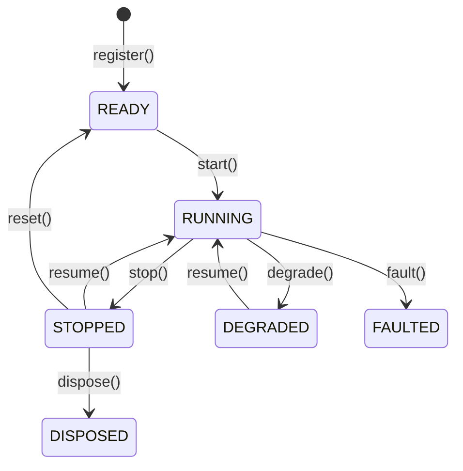

# Actors

**data actor** รับข้อมูลที่ request และ subscribe ไว้ จัดการ system event และดูแลสถานะของ component
ใน Rust ให้ implement trait `DataActor` ส่วน strategy จะเพิ่มความสามารถในการจัดการ order เข้ามา

**ความสามารถ**:

- การ subscribe และ request market data และ custom data
- การ publish custom data และ signal
- การจัดการ event, timer และ alert
- การเข้าถึง cache
- structured logging

## Config และ ID ของ actor {#actor-configuration-and-ids}

data actor สามารถรับ config ได้ โดย config พื้นฐานรับ `actor_id` แบบ optional หากระบุ ID
actor จะลงทะเบียนด้วย ID นั้น

ให้กำหนด `actor_id` อย่างชัดเจนให้แต่ละ instance เมื่อรัน actor ตัวเดียวกันมากกว่าหนึ่ง instance เพราะ
ID ที่ซ้ำกันจะถูกปฏิเสธตอนลงทะเบียน

ให้มอง config เป็นข้อมูลสำหรับการสร้าง actor อ่านค่าที่ผู้ใช้กำหนดจาก config และเก็บสถานะ runtime ไว้ที่
ตัว actor เอง

actor ใน Rust เก็บ identity และสถานะ runtime ไว้ใน `DataActorCore` ให้อ่าน runtime ID ผ่าน
`actor_id()` แทนที่จะคาดหวังให้ ID ที่ generate ขึ้นถูกเขียนกลับไปใน `DataActorConfig`
actor ใน Rust ที่ไม่ได้กำหนด `actor_id` จะลงทะเบียนเป็น `DataActor` ไม่ว่าจะเป็น type ใดก็ตาม ดังนั้นให้กำหนด
`actor_id` อย่างชัดเจนให้ actor ใน Rust ทุกตัว

ผู้เขียนฝั่ง Rust ให้ implement `DataActor` และใช้ facade method บน `self`
ส่วน `DataActorNative` เป็นการเข้าถึงแบบ native เท่านั้นสำหรับการเชื่อมต่อ runtime และสถานะ core แบบยืม (borrowed)
ให้ import เฉพาะเมื่อต้องการเส้นทางที่เน้นประสิทธิภาพภายใน binary เดียวกัน หรือสำหรับการเชื่อมต่อ runtime ภายในเท่านั้น

ดูตัวอย่างเต็มได้ที่ [Write a Rust actor](../how_to/write_rust_actor.md)

## Lifecycle {#lifecycle}

actor เปลี่ยนผ่านสถานะหลักที่เสถียรดังที่แสดงด้านล่าง:



แสดงเฉพาะ flow หลัก: ละสถานะระหว่างทาง (transitional state) และเส้นทางที่ถูกต้องแต่พบไม่บ่อยไว้ สำหรับการกระทำที่มี
lifecycle handler actor จะไปถึงสถานะปลายทางก็ต่อเมื่อ handler นั้นทำงานสำเร็จแล้วเท่านั้น

override method เหล่านี้เพื่อ hook เข้ากับ lifecycle event:

| Method         | ถูกเรียกเมื่อ                                                                                                     |
| -------------- | -------------------------------------------------------------------------------------------------------------- |
| `on_start()`   | actor กำลังเปลี่ยนสถานะเพื่อ start ให้ subscribe ข้อมูลที่นี่                                                          |
| `on_stop()`    | actor กำลังเปลี่ยนสถานะเพื่อ stop ให้เก็บกวาด resource ที่ actor เป็นเจ้าของที่นี่                                          |
| `on_resume()`  | actor กำลัง resume หลังจากหยุดหรือ degrade                                                                       |
| `on_reset()`   | actor ถูก reset รวมถึงระหว่างการรัน backtest แต่ละรอบ actor จะปล่อย data subscription ที่ถือไว้หลังจาก hook ทำงานสำเร็จ |
| `on_degrade()` | actor กำลังเข้าสู่สถานะ degraded และอาจให้บริการได้เพียงบางส่วน                                                     |
| `on_fault()`   | actor กำลังเข้าสู่สถานะ faulted หลังพบข้อผิดพลาด (fault)                                                          |
| `on_dispose()` | actor กำลังถูก dispose และต้องคืน resource ที่เหลืออยู่ทั้งหมด                                                        |

## Timer และ alert {#timers-and-alerts}

actor เข้าถึง clock สำหรับการตั้งเวลาได้ โดยใช้ `set_timer` สำหรับ timer ที่ทำงานซ้ำ และ `set_time_alert`
สำหรับ alert ครั้งเดียว ควรตั้งเวลาใน `on_start()` / `on_resume()` และยกเลิกใน `on_stop()` / `on_degrade()`

ส่ง `callback` เพื่อส่ง object `TimeEvent` ไปยัง method ของคุณเอง หากไม่ส่ง runtime ของ actor
จะเชื่อม default handler ที่ลงทะเบียนไว้ของ clock เข้ากับ `on_time_event()`

ใช้ `set_timer_zoned()` เพื่อตั้งเวลาซ้ำตามเวลาท้องถิ่น เช่น 09:30 ในนิวยอร์ก แม้มีการเปลี่ยน DST
ดูการตั้งค่าและพฤติกรรมการส่ง event ได้ที่[ตัวอย่าง calendar timer](strategies.md#calendar-timers)

เมื่อหลาย component ใช้ clock ร่วมกัน:

- ใช้ **callback แบบระบุชัดเจน** เพื่อส่ง event ไปยัง component ที่ต้องการ
- ใช้ **ชื่อ timer ที่ไม่ซ้ำกัน** ภายใน namespace ของ clock การลงทะเบียนชื่อเดิมซ้ำจะแทนที่
  timer ที่มีอยู่

## การเข้าถึงระบบ {#system-access}

actor เข้าถึง component หลักของระบบได้:

| API                                         | คำอธิบาย                                              |
| ------------------------------------------- | ---------------------------------------------------- |
| `self.cache`                                | สถานะร่วมของ instrument, order และ position           |
| `self.clock`                                | เวลาปัจจุบันและการตั้งเวลา timer หรือ alert                |
| `self.log`                                  | structured logging                                   |
| `publish_data()` / `subscribe_data()`       | การส่งข้อความ custom data แบบมีโครงสร้าง                  |
| `publish_signal()` / `subscribe_signal()`   | alert และการแจ้งเตือนแบบเบา                             |
| `subscribe_queue_state()`                   | การเปลี่ยนสถานะแรงกดดันของ queue ของ live runner          |
| `subscribe_socket_state()`                  | การเปลี่ยนสถานะ transport ของ socket แบบ live            |
| `reconnect_socket()`                        | ขอให้กู้คืน endpoint ของ socket แบบ live หนึ่งตัว            |
| `unsubscribe_queue_state()`                 | หยุดรับการเปลี่ยนสถานะแรงกดดันของ queue ของ runner         |
| `unsubscribe_socket_state()`                | หยุดรับการเปลี่ยนสถานะ transport ของ socket              |
| `on_queue_state()`                          | จัดการการเปลี่ยนสถานะแรงกดดันของ queue ของ runner          |
| `on_socket_state()`                         | จัดการการเปลี่ยนสถานะ transport ของ socket               |

### สถานะแรงกดดันของ queue {#queue-pressure-state}

actor สามารถ subscribe การเปลี่ยนสถานะแรงกดดันของ queue (queue pressure) ของ runner ได้:

```rust tab="Rust"
use nautilus_common::{
    actor::DataActor,
    messages::system::QueueStateChanged,
};

impl DataActor for MyActor {
    fn on_start(&mut self) -> anyhow::Result<()> {
        self.subscribe_queue_state(None, Some(50));
        Ok(())
    }

    fn on_stop(&mut self) -> anyhow::Result<()> {
        self.unsubscribe_queue_state(None);
        Ok(())
    }

    fn on_queue_state(&mut self, event: &QueueStateChanged) -> anyhow::Result<()> {
        log::warn!(
            "Queue {:?} changed {:?} to {:?} at depth {}",
            event.channel,
            event.condition,
            event.state,
            event.queue_depth,
        );
        Ok(())
    }
}
```

#### ตัวกรองและการส่ง {#filters-and-delivery}

priority ซึ่งเป็น optional ใช้ควบคุมลำดับการส่งระหว่าง subscriber ที่ตรงเงื่อนไข **ค่าที่สูงกว่าจะทำงานก่อน**
การ subscribe ครั้งที่สองจะไม่เปลี่ยน priority ที่มีอยู่ หากต้องการเปลี่ยน priority ให้ unsubscribe ก่อน แล้ว
subscribe ใหม่ด้วย priority ใหม่

ส่ง `channel` เพื่อเลือก channel ของ runner เพียงหนึ่ง channel (เช่น `SystemChannel.DATA_EVENTS`)

- การละ `channel` จะ subscribe ทุก channel ที่ถูกเฝ้าดู
- หากต้องการลบ subscription ให้ส่ง **channel เดียวกัน** ไปยัง `unsubscribe_queue_state` การละไว้
  จะลบเฉพาะ subscription ที่ไม่มีตัวกรองเท่านั้น
- subscription ที่ทับซ้อนกันจะเรียก callback แยกกันสำหรับแต่ละ event ที่ตรงเงื่อนไข

queue ของ runner ใช้ร่วมกันระหว่าง client จึงไม่มีตัวกรองตาม client

#### เนื้อหาของ queue event {#queue-event-contents}

`QueueStateChanged` ประกอบด้วย trader ID, channel ของ runner, เงื่อนไขของ queue, สถานะของเงื่อนไข, ความลึก
ของ queue, เวลา dispatch เฉลี่ย, event ID และ timestamp การส่งใช้ message bus ภายใน process แบบมี type
และไม่มีรูปแบบสำหรับส่งออกภายนอก (wire representation) ดูความหมายของการ trigger และการ clear ได้ที่
[การเฝ้าดูแรงกดดันของ queue](live.md#queue-pressure-monitoring)

### สถานะ transport ของ socket {#socket-transport-state}

actor สามารถ subscribe การเปลี่ยนสถานะของ socket จาก live adapter ที่รายงานสถานะนี้ได้:

```rust tab="Rust"
use nautilus_common::{
    actor::DataActor,
    messages::system::SocketStateChanged,
};

impl DataActor for MyActor {
    fn on_start(&mut self) -> anyhow::Result<()> {
        self.subscribe_socket_state(None, None, Some(50));
        Ok(())
    }

    fn on_stop(&mut self) -> anyhow::Result<()> {
        self.unsubscribe_socket_state(None, None);
        Ok(())
    }

    fn on_socket_state(&mut self, event: &SocketStateChanged) -> anyhow::Result<()> {
        log::info!(
            "Socket {} for {} changed to {:?}",
            event.endpoint,
            event.client_id,
            event.state,
        );
        Ok(())
    }
}
```

#### ตัวกรองและการส่ง {#filters-and-delivery-1}

priority ซึ่งเป็น optional ใช้ควบคุมลำดับการส่งระหว่าง subscriber ที่ตรงเงื่อนไข **ค่าที่สูงกว่าจะทำงานก่อน**
การ subscribe ครั้งที่สองจะไม่เปลี่ยน priority ที่มีอยู่ หากต้องการเปลี่ยน priority ให้ unsubscribe ก่อน แล้ว
subscribe ใหม่ด้วย priority ใหม่

ส่ง `client_id`, `endpoint` หรือทั้งสองอย่างเพื่อกรอง socket event เช่น client `BINANCE` ร่วมกับ endpoint
`binance-futures-market-streams` จะเลือก transport เพียงตัวเดียว

- ตัวกรองแต่ละตัวที่ละไว้จะตรงกับทุกค่าของฟิลด์นั้น
- ค่าที่ระบุจะเทียบแบบตรงตัวอักษร รวมถึงจุดและอักขระ wildcard
- ส่ง **ตัวกรองชุดเดียวกัน** ไปยัง `unsubscribe_socket_state` เพื่อลบ subscription นั้น การละทั้งสองตัว
  จะลบเฉพาะ subscription ที่ไม่มีตัวกรองเท่านั้น
- subscription ที่ทับซ้อนกันจะเรียก callback แยกกันสำหรับแต่ละ event ที่ตรงเงื่อนไข

#### เนื้อหาของ socket event {#socket-event-contents}

`SocketStateChanged` ประกอบด้วย trader ID, client ID, venue (optional), label ของ endpoint ที่คงที่,
สถานะของ transport, event ID และ timestamp endpoint เป็น label เชิงตรรกะที่ไม่ใช่ความลับ ไม่ใช่ URL
การเชื่อมต่อจริง `SocketState.DISCONNECTED` รายงานการสูญเสีย transport ที่กำลังใช้งานอยู่

:::note
`SocketState.CONNECTED` รายงาน **ความพร้อมของ transport** ไม่ใช่การยืนยันตัวตน (authentication), การ replay subscription
หรือความพร้อมของ adapter
:::

การส่งใช้ message bus ภายใน process แบบมี type และไม่มีรูปแบบสำหรับส่งออกภายนอก ดู adapter ที่รองรับและ
ความหมายที่แน่นอนของขอบการเชื่อมต่อ (connection edge) ได้ที่
[สถานะ transport ของ socket](live.md#socket-transport-state)

### Reconnect endpoint ของ socket {#reconnect-a-socket-endpoint}

actor และ strategy แบบ live สามารถขอให้กู้คืน endpoint หนึ่งตัวได้โดยไม่ต้อง restart data client หรือ
execution client ของมัน ให้ส่ง `client_id` และ label ของ endpoint ที่ `SocketStateChanged` รายงาน:

```rust tab="Rust"
use nautilus_common::actor::DataActor;
use nautilus_model::identifiers::ClientId;

impl MyActor {
    fn recover_market_socket(&self) -> anyhow::Result<()> {
        self.reconnect_socket(
            ClientId::from("POLYMARKET"),
            "polymarket-market-streams",
        )?;
        Ok(())
    }
}
```

#### การเฝ้าดูการกู้คืน {#observe-recovery}

:::note
API นี้เป็นแบบ **fire-and-observe** การคืนค่าสำเร็จหมายความว่าคำสั่งผ่านการตรวจสอบในเครื่องและ
ถูกนำเข้า queue แล้ว ไม่ได้ยืนยันว่า kernel ยอมรับคำขอหรือการกู้คืนเสร็จสมบูรณ์
:::

subscribe ด้วย `subscribe_socket_state` โดยใช้ตัวกรอง `client_id` และ `endpoint` ชุดเดียวกัน แล้ว
ตรวจดู event `SocketStateChanged` คำขอที่ได้รับการยอมรับจะรายงาน:

1. `SocketState.DISCONNECTED` เมื่อ transport เข้าสู่โหมด reconnect
1. `SocketState.CONNECTED` หลังจาก transport กู้คืนแล้ว

#### คำขอที่ล้มเหลว {#request-failures}

- **ความล้มเหลวแบบ synchronous**: label ของ endpoint ที่ไม่ถูกต้อง และ channel ของ runner ที่ไม่พร้อมใช้งานหรือปิดแล้ว จะล้มเหลว
  แบบ synchronous label ของ endpoint รับเฉพาะตัวอักษร ASCII, ตัวเลข, `.`, `-` และ `_` ให้ส่ง label เชิงตรรกะ
  แทน URL จริง
- **การปฏิเสธจาก kernel**: kernel จะ log กรณี client ที่ไม่รู้จัก, client ที่ไม่รองรับ, endpoint ที่ไม่รู้จักหรือกำกวม,
  คำขอซ้ำ, transport ที่กำลังตัดการเชื่อมต่อ และ transport ที่ปิดแล้ว การปฏิเสธเหล่านี้
  จะไม่ส่งการเปลี่ยนสถานะของ socket และไม่กระทบ endpoint อื่น

## การจัดการข้อมูลและ callback {#data-handling-and-callbacks}

ระบบ dispatch การตอบกลับของ request แยกจากการอัปเดตที่ subscribe ไว้ การดำเนินการเป็นตัวกำหนด
ว่า callback ใดจะจัดการข้อมูล

### การตอบกลับของ request และ subscription {#request-responses-and-subscriptions}

ระบบแยก data flow ออกเป็นสองแบบ:

1. **การตอบกลับของ request**:
   - ได้รับผ่าน method อย่าง `request_bars()`, `request_quotes()` เป็นต้น
   - ประมวลผลผ่าน batch handler เฉพาะ type เช่น `on_historical_bars()` และ
     `on_historical_quotes()`
   - custom data ใช้ `on_historical_data()` หนึ่งครั้งต่อการตอบกลับ `CustomData` แบบ scalar จะมาถึงเป็น
     object นั้น ส่วน batch จะมาถึงเป็น list เดียว รวมถึง list ว่าง
   - ใช้สำหรับการโหลดข้อมูลเริ่มต้นและการวิเคราะห์ย้อนหลัง

2. **ข้อมูลที่ subscribe**:
   - ได้รับผ่าน method อย่าง `subscribe_bars()`, `subscribe_quotes()` เป็นต้น
   - ประมวลผลผ่าน handler เฉพาะ เช่น `on_bar()`, `on_quote()` เป็นต้น
   - ใช้สำหรับการประมวลผล event อย่างต่อเนื่อง

### List ใน historical request {#historical-request-lists}

historical request แต่ละครั้งเลือก data type หนึ่งชนิด method เหล่านี้รับค่าแบบ scalar หรือ list ที่ไม่ว่าง:

| ข้อมูล                  | Request method                                                       |
| ---------------------- | -------------------------------------------------------------------- |
| นิยามของ instrument     | `request_instrument`                                                 |
| Quote และ trade         | `request_quotes`, `request_trades`                                   |
| Order book             | `request_book_snapshot`, `request_book_deltas`, `request_book_depth` |
| Funding rate           | `request_funding_rates`                                              |
| Bar                    | `request_bars`                                                       |

Rust รับ vector, array และ slice รวมถึงค่าแบบ scalar สมาชิกที่ซ้ำกันจะถูกลบออกโดยคงลำดับที่พบครั้งแรก

- ID ต้องอยู่ใน venue เดียวกัน เว้นแต่จะระบุ `client_id` อย่างชัดเจน
- request ของ quote และ trade ที่มีหลาย ID จะปฏิเสธการกำหนด record limit ก่อน dispatch
- การรองรับหลายสมาชิกขึ้นอยู่กับ adapter request ของ book, funding rate และ bar ต้องมีสมาชิกเดียว

Databento รองรับ list สำหรับนิยามของ instrument, quote และ trade เส้นทางของ adapter อื่นจะปฏิเสธ
list ที่ไม่รองรับพร้อม error ที่ชัดเจน ส่วน custom data, request instrument ทั้ง venue, request
option chain และ request ของ DeFi ยังคงใช้ input แบบเดิม

การ routing ที่ไม่ถูกต้องและ record limit แบบหลาย ID จะล้มเหลวในการเรียก request เลย (ได้ `Err` ใน Rust)
ส่วน list ที่ไม่รองรับจะไปถึง `on_data_response` เป็น envelope ที่เสร็จสมบูรณ์โดยตั้งค่า
`failure_reason` ไว้ ข้อมูลที่พบใน catalog ยังอาจให้ข้อมูลบางส่วนได้

### การเสร็จสิ้นของ historical request {#historical-completion}

`on_data_response(response)` ทำงานหลังจาก hook ของ payload แบบมี type สำหรับแต่ละ envelope envelope จะคง
correlation ID ระดับ root ไว้ และ `completed` ระบุว่าเป็น envelope สุดท้ายของ request นั้น
เมื่อมี `sub_correlation_id` จะระบุถึง request ลูก

request ที่มี `params["time_range_generator"]` จะส่ง payload ของแต่ละช่วงเวลาผ่าน hook แบบมี type
และ `on_data_response` โดยมี `completed=False` เมื่อสำเร็จ envelope สุดท้ายจะมี payload ว่าง
และ `params["data_count"]` ของมันจะรายงานจำนวนรวมเมื่อไม่เป็นศูนย์

ตรวจสอบ `failure_reason` ตอนเสร็จสิ้น ความล้มเหลวเชิงปฏิบัติการจะยังคงข้อมูลจากงานที่สำเร็จไว้
envelope ปลายทางอาจมีข้อมูลเป็นค่าว่าง ซึ่งในกรณีนั้นจะไม่มี metadata ของ payload และไม่เรียก hook ของ payload แบบมี type

สามารถส่ง request สำหรับ data type อื่นจาก hook ตอนเสร็จสิ้นได้ การเรียกแต่ละครั้งมี correlation ID ของตัวเอง

#### Completion group {#completion-groups}

ใน Rust ให้ใช้ `request_group(request_ids, request_id)` เพื่อรับ completion event หนึ่งครั้งหลังจาก request หลายรายการเสร็จสิ้น
ส่ง list ที่ไม่ว่างของ request ID ที่ไม่ซ้ำกันซึ่งออกโดย actor เดียวกัน request ที่เสร็จแล้วและ group อื่น
เป็นสมาชิกลูกที่ใช้ได้ child ID ที่ว่าง ซ้ำ หรือไม่รู้จัก จะคืน error โดยไม่สร้าง
group ID ของ group ที่ระบุต้องไม่ตรงกับ request ID หรือ group ID ที่มีอยู่แล้วใน actor

ลูกแต่ละตัวยังคงการส่ง payload แบบมี type ของตัวเอง group จะส่ง envelope `on_data_response` ปลายทาง
ที่มี correlation ID ของตัวเองและไม่มี payload โดยจะรอลูกทุกตัว แม้หลังจากมีความล้มเหลว
`failure_reason` ของมันจะระบุลูกตัวแรกที่ล้มเหลวตามลำดับที่ส่งมา หรือไม่มีค่าเมื่อสำเร็จ

group จะแจ้งหลังจาก response hook ที่กำลังทำงานอยู่คืนค่า group ที่พร้อมจากลูกตัวเดียวกันจะแจ้งตาม
ลำดับการลงทะเบียน group ที่ลูกทุกตัวเสร็จสิ้นไปแล้วอาจแจ้งก่อนที่ `request_group`
จะคืนค่า ให้เก็บและส่ง UUID ของ group ก่อนการเรียก หาก hook ต้องการจดจำ event นั้น:

```rust
use nautilus_core::UUID4;

let group_id = UUID4::new();
self.history_group = Some(group_id);
self.request_group(vec![quotes_id, trades_id], Some(group_id))?;
```

runner จะนำ request ที่ส่งตามมาจาก completion hook เข้า queue error ของ hook จะถูก
log และไม่ขัดขวางการเสร็จสิ้นของ group request ID และ metadata ของความล้มเหลวจะยังคงใช้ได้สำหรับ
การจัดกลุ่มจนกว่าจะมีการเก็บกวาด request ของ actor ส่วน batch ของ payload จะไม่ถูกเก็บไว้สำหรับการจัดกลุ่ม การ reset
หรือ dispose ที่สำเร็จ, fault และ `release_subscriptions` จะล้างสถานะนี้และทิ้ง group ที่ยังไม่เสร็จโดยไม่มี
completion event

### List ใน subscription {#subscription-lists}

subscription ของ actor และ strategy รับ identifier ตัวเดียวหรือ collection ที่ไม่ว่าง method
unsubscribe ที่คู่กันรับ input แบบเดียวกัน

| ข้อมูล                  | Subscribe method                                                              |
| ---------------------- | ----------------------------------------------------------------------------- |
| นิยามของ instrument     | `subscribe_instrument`                                                        |
| Order book             | `subscribe_book_deltas`, `subscribe_book_depth`, `subscribe_book_at_interval` |
| Quote และ trade         | `subscribe_quotes`, `subscribe_trades`                                        |
| Mark price และ index price | `subscribe_mark_prices`, `subscribe_index_prices`                         |
| Funding rate           | `subscribe_funding_rates`                                                     |
| Event ของ instrument    | `subscribe_instrument_status`, `subscribe_instrument_close`                   |
| Option Greeks          | `subscribe_option_greeks`                                                     |
| Bar                    | `subscribe_bars`                                                              |

Rust รับค่าแบบ scalar, vector, array และ slice ID ที่ซ้ำกันหรือ bar type แบบเต็มที่ซ้ำกันจะถูกลบออกโดยคงลำดับที่พบครั้งแรก
bar specification ที่ต่างกันของ instrument เดียวกันจะยังแยกจากกัน

```rust tab="Rust"
self.subscribe_quotes(instrument_id, None, None);
self.subscribe_quotes([first_id, second_id], None, None);
self.unsubscribe_quotes([first_id, second_id], None, None);
self.subscribe_trades([first_id, second_id], None, None);
```

กฎของ list ใน subscription เหล่านี้ไม่เปลี่ยนแปลง input ของ custom data, `subscribe_instruments(Venue)` ทั้ง venue,
option chain หรือ DeFi

#### Routing และการตรวจสอบ {#routing-and-validation}

- **Venue**: ID ต้องอยู่ใน venue เดียวกัน เว้นแต่จะระบุ `client_id` อย่างชัดเจน ใช้กับทั้ง subscribe และ unsubscribe
- **การตั้งค่า book**: การตั้งค่ามีผลกับทุก ID ให้ unsubscribe ด้วยพารามิเตอร์ `is_parent` และ snapshot interval เดิม
- **Trade**: actor จะจัดกลุ่ม synthetic ID แยกจาก ID อื่น แม้จะระบุ client อย่างชัดเจน

สำหรับ data client ที่ไม่ใช่แบบ external actor จะตรวจสอบเส้นทาง subscription เหล่านี้ด้วย:

- list ของ quote ต้องใช้เส้นทางเดียวกัน: client, synthetic หรือ aggregated spread การ routing แบบ spread ต้องมี
  `aggregate_spread_quotes=true` และ spread instrument ใน cache
- นิยามของ instrument, book, status, close และ option Greeks จะปฏิเสธ list ที่มีหลาย ID
  และมีสมาชิกที่เป็น synthetic

data client แบบ external จะจัดการการผสมเส้นทางของ quote และ synthetic เหล่านั้นเอง

list ที่ว่าง หรือ list ข้าม venue ที่ไม่ระบุ client จะล้มเหลวก่อนที่ subscription ใดจะเปลี่ยนแปลง รวมถึงการ release
เส้นทาง subscription ที่ไม่รองรับจะล้มเหลวก่อนที่จะถือ ownership หรือลงทะเบียน handler:

| API             | ความล้มเหลวในการตรวจสอบ |
| --------------- | --------------------- |
| Rust actor      | Panic                 |
| `DataActorCore` | `Err`                 |

#### Ownership ของ bar {#bar-ownership}

actor จะถือ subscription หนึ่งรายการต่อ output bar type มาตรฐาน type แบบเต็มที่ร้องขอเป็นตัวแรก
จะเป็นผู้กำหนด source ส่วน source variant ที่ตามมาภายหลังสำหรับ output เดียวกันจะไม่ได้ owner เพิ่ม

unsubscribe ด้วย type แบบเต็มเดิมหรือ alias `standard()` ของมัน ทั้งสองแบบจะ release type แบบเต็มเดิม

```rust tab="Rust"
self.subscribe_bars([first_bar_type, second_bar_type], None, None);
self.unsubscribe_bars([first_bar_type, second_bar_type], None, None);
```

#### Ownership และการ release {#ownership-and-releases}

- actor ถือ ownership ต่อ instrument และ dispatch เฉพาะ ID ที่เพิ่งได้มาใหม่ feed ที่ใช้ร่วมกัน
  จะยังทำงานอยู่จนกว่า owner ตัวสุดท้ายจะ release
- การ release ใช้เส้นทางและพารามิเตอร์เดิม สมาชิกที่ได้มาจากการเรียกแยกกันจะอยู่ในคำสั่ง release
  แยกกัน ดังนั้นการได้มาแบบ scalar จะมีการ release แบบ scalar
- client adapter จะเก็บคำสั่ง release สุดท้ายที่ล้มเหลวซึ่งไม่ใช่ของ book ไว้สำหรับการ retry อย่างชัดเจน actor จะไม่
  retry การ release ที่ล้มเหลวโดยอัตโนมัติ

:::warning
การ release ที่ไม่ใช่ของ book จะลบ ownership claim แบบไม่ระบุตัวตนหนึ่งรายการต่อสมาชิก ให้เรียก subscribe และ unsubscribe
ให้สมดุลกัน การ release ทั้ง list ซ้ำหลังจากสำเร็จเพียงบางส่วนไม่รับประกันว่าจะไม่มีผลกระทบเพิ่มเติม
:::

#### การส่งไปยัง adapter และความล้มเหลว {#adapter-delivery-and-failures}

สมาชิกโดยตรงที่เข้ากันได้จะไปถึง native hook เป็น list เดียวที่เรียงลำดับแล้ว พร้อมกับ command ID ของคำสั่งแม่
และ metadata ใช้กับทั้ง subscribe และ unsubscribe ส่วน client ของ MessageBus แบบ external ก็ได้รับเป็น list เช่นกัน

hook จะปฏิเสธ list ที่ไม่รองรับก่อนเกิดผลใดๆ ส่วน list ที่รองรับจะประมวลผลสมาชิกที่เป็นอิสระต่อกันแบบ best effort
โดยไม่ rollback งานที่ได้รับการยอมรับแล้ว engine จะ log ความล้มเหลวในขั้นเตรียมการและส่งต่อสมาชิกที่
เตรียมสำเร็จ adapter สามารถรวม request ไปยัง venue เป็น batch หรือวนทีละตัวในเครื่องก็ได้

bar แบบ internal และ composite, book snapshot, spread และ continuous futures จะได้ source
subscription แยกกัน คำสั่งที่ derive มาเหล่านี้มี ownership ของตัวเองและอาจมีสมาชิกเพียงตัวเดียวแม้
คำสั่งแม่จะมีหลายตัว

native hook รายงานการยอมรับแบบ synchronous:

| ผลลัพธ์ของ hook       | สมาชิกที่ได้รับการยอมรับ                                       |
| ------------------- | --------------------------------------------------------- |
| `Ok(())`            | สมาชิกทุกตัวที่ dispatch                                     |
| `SubscriptionError` | ตาม `instrument_ids_accepted` หรือ `bar_types_accepted` พอดี |
| error อื่น            | ไม่มี                                                       |

ผลลัพธ์ของ bar ใช้ bar type แบบเต็ม การยอมรับ unsubscribe หมายถึงการ release สำเร็จ log ของความล้มเหลวจะระบุ
สมาชิกที่ไม่ได้รับการยอมรับหรือไม่ได้ release

#### เวลาเริ่มต้นของ catalog {#catalog-start-times}

เมื่อใช้ `streaming` engine จะอนุมาน `start_ns` ของ catalog เฉพาะเมื่อ `params` ไม่ได้ระบุไว้:

| Subscription         | การอนุมานเวลาเริ่มต้นของ catalog |
| -------------------- | ---------------------------- |
| quote/trade ตัวเดียว   | ต่อ instrument                |
| list ของ quote/trade  | ไม่มี                          |
| External bar         | ต่อ bar type แบบเต็ม            |

ส่ง `start_ns` อย่างชัดเจนเพื่อใช้เวลาเริ่มต้นร่วมกันของทั้ง batch bar type แบบ external ที่มีพารามิเตอร์ที่มีผลจริงเท่ากัน
จะอยู่ใน list เดียวกัน ส่วนเวลาเริ่มต้นที่ต่างกันจะได้ subset ที่เรียงลำดับโดยมี command ID เดียวกัน

การ release อาจจัดกลุ่ม subset เหล่านั้นใหม่โดยใช้พารามิเตอร์ เส้นทาง และขอบเขตการได้มาเดิม
source แบบ scalar ที่ derive มาจะยังคงการอนุมาน catalog ของตัวเอง

#### Integration ที่เขียนเองใน Rust {#custom-rust-integrations}

- override method ของ instrument ด้วย `impl IntoInstrumentIds` และ method ของ bar ด้วย `impl IntoBarTypes`
  ส่งค่า `InstrumentId` หรือ `BarType` อย่างชัดเจนในจุดที่ `.into()` เคยอาศัยการอนุมานแบบ scalar
- method list ของ `DataActorCore` ที่ migrate แล้วจะคืนค่า `Result<()>` ให้ลบ `topic` หรือ `pattern` ออกจาก
  การเรียก subscribe ที่ migrate แล้ว เพราะ core จะ derive topic จากสมาชิกแต่ละตัวเอง
- อ่าน `instrument_ids` หรือ `bar_types` ในคำสั่ง ฟิลด์ที่ serialize ก็เก็บเป็น list เช่นกัน ดังนั้นให้อัปเกรด
  ฝั่ง producer และ consumer ไปพร้อมกัน
- hook ที่จำกัดเพียงสมาชิกเดียวสามารถปฏิเสธ list ก่อนเกิดผลด้วย `single_instrument_id()` หรือ
  `single_bar_type()` และสร้าง error แบบบางส่วนด้วย `SubscriptionError::instruments` หรือ `SubscriptionError::bars`

### Callback handler {#callback-handlers}

การดำเนินการกับข้อมูลที่ใช้บ่อยจะ map ไปยัง handler เหล่านี้:

| การดำเนินการ                     | หมวดหมู่      | Handler                         | วัตถุประสงค์                                   |
| ------------------------------- | ------------ | ------------------------------- | -------------------------------------------- |
| `subscribe_data()`              | Subscription | `on_data()`                     | การอัปเดต custom data                         |
| `subscribe_signal()`            | Subscription | `on_signal()`                   | การอัปเดต signal                              |
| `subscribe_instrument()`        | Subscription | `on_instrument()`               | การอัปเดตนิยามของ instrument                   |
| `subscribe_instruments()`       | Subscription | `on_instrument()`               | การอัปเดตนิยามของ instrument ทั้ง venue          |
| `subscribe_book_deltas()`       | Subscription | `on_book_deltas()`              | order book delta                             |
| `subscribe_book_depth()`        | Subscription | `on_book_depth()`               | snapshot ความลึกของ order book                 |
| `subscribe_book_at_interval()`  | Subscription | `on_book()`                     | snapshot ของ order book ตามช่วงเวลา             |
| `subscribe_quotes()`            | Subscription | `on_quote()`                    | การอัปเดต quote                               |
| `subscribe_trades()`            | Subscription | `on_trade()`                    | การอัปเดต trade                               |
| `subscribe_mark_prices()`       | Subscription | `on_mark_price()`               | การอัปเดต mark price                          |
| `subscribe_index_prices()`      | Subscription | `on_index_price()`              | การอัปเดต index price                         |
| `subscribe_bars()`              | Subscription | `on_bar()`                      | การอัปเดต bar                                 |
| `subscribe_funding_rates()`     | Subscription | `on_funding_rate()`             | การอัปเดต funding rate                        |
| `subscribe_instrument_status()` | Subscription | `on_instrument_status()`        | การอัปเดตสถานะของ instrument                   |
| `subscribe_instrument_close()`  | Subscription | `on_instrument_close()`         | การอัปเดตการปิดของ instrument                  |
| `subscribe_option_greeks()`     | Subscription | `on_option_greeks()`            | การอัปเดต option Greeks                       |
| `subscribe_option_chain()`      | Subscription | `on_option_chain()`             | snapshot ของ option chain slice              |
| `request_data()`                | Request      | `on_historical_data()`          | custom data ย้อนหลัง                          |
| `request_book_deltas()`         | Request      | `on_historical_book_deltas()`   | order book delta ย้อนหลัง                     |
| `request_book_depth()`          | Request      | `on_historical_book_depth()`    | ความลึกของ order book ย้อนหลัง                  |
| `request_book_snapshot()`       | Request      | `on_book()`                     | snapshot ของ order book                       |
| `request_instrument()`          | Request      | `on_instrument()`               | นิยามของ instrument                           |
| `request_instruments()`         | Request      | `on_instrument()`               | นิยามของ instrument หลายตัว                    |
| `request_quotes()`              | Request      | `on_historical_quotes()`        | quote ย้อนหลัง                                |
| `request_trades()`              | Request      | `on_historical_trades()`        | trade ย้อนหลัง                                |
| `request_bars()`                | Request      | `on_historical_bars()`          | bar ย้อนหลัง                                  |
| `request_funding_rates()`       | Request      | `on_historical_funding_rates()` | funding rate ย้อนหลัง                         |

### ตัวอย่าง request และ subscription {#request-and-subscription-example}

> หมายเหตุ: ต้นฉบับมีเฉพาะตัวอย่าง Python จึงตัดออก

handler ที่แยกกันระหว่าง request และ subscription ช่วยให้ actor แยกข้อมูลตั้งต้น (bootstrap) ออกจากการอัปเดตที่ต่อเนื่อง
ใช้ bar ย้อนหลังเพื่อ initialize indicator หรือสถานะพื้นฐาน และใช้การตรวจสอบหรือการ log ที่ต่างกันกับ batch ของ
การตอบกลับและการอัปเดตที่ subscribe ทีละรายการ

:::tip
เมื่อ debug data flow ให้ตรวจสอบ handler ของแหล่งข้อมูลนั้น หาก bar ปรากฏใน log แต่ไม่เข้า
`on_bar()` ให้ตรวจสอบ `on_historical_bars()` เพราะ bar เหล่านั้นอาจมาจาก request แทนที่จะเป็น subscription
:::

## การจัดการ order event {#order-event-handling}

data actor ไม่ได้จัดการ order หรือกำหนด callback ของ order event ให้จัดการ order event ใน `Strategy`
ผ่าน callback เฉพาะของ order หรือ `on_order_event()` ใช้ custom data หรือ signal เพื่อส่ง
ค่าที่ derive มาไปยัง data actor เมื่อ component อื่นต้องการ ดูรายการ callback ได้ที่
[Strategies: การจัดการ order](strategies.md#order-management)

## คู่มือที่เกี่ยวข้อง {#related-guides}

- [Strategies](strategies.md): strategy ขยาย actor ด้วยความสามารถในการจัดการ order
- [Data](data/): data type และ subscription ที่ actor ใช้ได้
- [Message Bus](message_bus.md): ระบบส่งข้อความที่ actor ใช้ในการสื่อสาร
