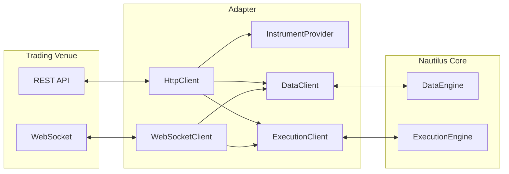

Adapter ทำหน้าที่เชื่อมต่อผู้ให้บริการข้อมูล (data provider) และ trading venue เข้ากับ NautilusTrader โดยแปลง
protocol เฉพาะของแต่ละ venue ให้เป็น domain object และ event ที่ data engine และ execution engine ใช้งาน
ความสามารถที่แต่ละ adapter รองรับมีอธิบายไว้ใน[คู่มือ integration](../integrations/index.md)

โดยทั่วไป adapter หนึ่งตัวประกอบด้วยส่วนต่าง ๆ ดังนี้:

| Component            | หน้าที่                                                      |
| -------------------- | ----------------------------------------------------------- |
| `HttpClient`         | สื่อสารผ่าน REST API                                          |
| `WebSocketClient`    | การเชื่อมต่อแบบ streaming แบบ real-time                        |
| `InstrumentProvider` | โหลดและ parse นิยาม instrument จาก venue                      |
| `DataClient`         | จัดการการ subscribe และ request ข้อมูลตลาด                     |
| `ExecutionClient`    | จัดการการส่ง แก้ไข และยกเลิก order                             |

## การตั้งค่าและการ routing [#configuration-and-routing]

แต่ละ adapter มี config type และ factory สำหรับ client ที่รองรับ config ใช้เลือกค่าเฉพาะของ venue เช่น
product, environment, credential และนโยบายการโหลด instrument ส่วน factory จะสร้าง client ขึ้นมาเมื่อ build
`LiveNode` จากนั้น actor และ strategy จะใช้ API กลางของ Nautilus แทนการเรียก transport ของ adapter โดยตรง

node หนึ่งตัวลงทะเบียน data client และ execution client ได้หลายตัว ให้ส่ง `client_id` จาก actor หรือ strategy
เมื่อต้องการให้ client ตัวใดตัวหนึ่งรับผิดชอบ request, subscription หรือ order นั้นโดยเฉพาะ หากไม่ระบุ client
data engine และ execution engine จะใช้ route ตาม venue และ route เริ่มต้นที่ node ตั้งค่าไว้

## Custom adapter [#custom-adapters]

คุณพัฒนา adapter ของตัวเองได้ custom adapter รับผิดชอบงานด้าน data และ execution แบบเดียวกับ adapter
ที่มีมาในตัว และทำงานร่วมกับ adapter เหล่านั้นใน `LiveNode` เดียวกันได้ strategy ยังคงใช้ API มาตรฐานสำหรับ
request, subscription และ order ตามเดิม แล้ว node จะ route การทำงานเหล่านั้นไปยัง client ที่ลงทะเบียนไว้

Adapter ทำงานอยู่นอกขอบเขตของ core ที่ทำงานแบบ synchronous โดยจะส่ง data, response และ execution event
ที่มี type ชัดเจนเข้าไปให้ core ประมวลผล ดังนั้นการที่ adapter ส่ง output ออกไปแล้ว ไม่ได้แปลว่า cache
ถูกอัปเดตตามแล้ว วิธีนี้ทำให้การแก้ไข cache และการเปลี่ยนสถานะของ engine อยู่ภายใต้การควบคุมของ core

> หมายเหตุ: ต้นฉบับส่วนนี้ที่เหลืออธิบายการเขียน custom adapter เป็น Python package (PyO3/GIL, asyncio)
> จึงตัดออก ดูแนวทางฝั่ง Rust ได้ที่[คู่มือนักพัฒนา adapter](../developer_guide/adapters.md)

## Instrument provider [#instrument-providers]

Instrument provider โหลดนิยามของ venue แล้ว parse ให้เป็น object `Instrument` ของ Nautilus
แต่ละ adapter เป็นผู้กำหนดพฤติกรรมนี้เอง API ของ adapter อาจมี loader แยกต่างหาก มี provider config
เฉพาะ กำหนดการโหลดผ่าน client config หรือใช้หลายแบบร่วมกัน

`InstrumentProvider` ใช้งานได้สองกรณี:

- ค้นหา instrument ที่มีอยู่แบบ standalone เพื่อใช้ในงานวิจัยหรือ backtest
- โหลดขณะ runtime ใน [environment context](architecture.md#environment-contexts) แบบ `sandbox` หรือ `live`
  ให้ actor และ strategy ใช้งาน

### งานวิจัยและ backtest [#research-and-backtesting]

> หมายเหตุ: ต้นฉบับมีเฉพาะตัวอย่าง Python (การโหลด instrument Binance USD-M หนึ่งตัว) จึงตัดออก

### Live trading [#live-trading]

แต่ละ integration จัดการการโหลดตอน startup ต่างกัน ตัวอย่างเช่น provider config ของ Binance สามารถตั้ง
`load_all` เพื่อโหลด catalog ทั้งหมด หรือตั้ง `load_all` เป็น false แล้วระบุ `load_ids` เพื่อโหลดเฉพาะ
instrument ที่ต้องการ

`load_ids` คือรายการ instrument ID ของ Nautilus ซึ่งรวม suffix ของ venue ด้วย (เช่น `BTCUSDT-PERP.BINANCE`)
ไม่ใช่ symbol ดิบของ venue

ค่าตั้ง ค่าเริ่มต้น และ filter สำหรับการโหลด instrument แตกต่างกันไปในแต่ละ integration ควรตรวจสอบคู่มือ
integration ที่เกี่ยวข้องก่อนคัดลอก config จาก adapter หนึ่งไปใช้กับอีกตัว

Subscription, การส่ง order และ execution reconciliation ไม่ได้โหลด instrument ให้เอง ต้องตั้งค่า adapter
ให้โหลด instrument ที่จำเป็นทุกตัวตอน startup หรือ request เองแล้วรอจนเข้า cache ก่อนใช้งาน ส่วนการที่
reconciliation จัดการ report ของ instrument ที่ยังไม่ได้โหลดอย่างไร ดูได้ที่
[instrument availability](execution/reconciliation.md#instrument-availability)

## Data client [#data-clients]

Data client จัดการ subscription และ request ข้อมูลตลาดของ venue โดยเชื่อมต่อกับ API ของ venue แล้ว
normalize ข้อมูลที่เข้ามาให้เป็น type ของ Nautilus

### การ request ข้อมูล [#requesting-data]

Actor และ strategy request ข้อมูลได้ด้วย method ที่มีมาให้ (เช่น request instrument definition หรือ bar
ย้อนหลัง) และข้อมูลจะถูกส่งกลับผ่าน callback

### การ subscribe ข้อมูล [#subscribing-to-data]

สำหรับข้อมูลแบบ real-time ให้ใช้ method สำหรับ subscription (เช่น subscribe trade หรือ bar) โดยต้องโหลด
instrument เข้า cache ไว้ก่อนแล้ว

> หมายเหตุ: ต้นฉบับมีเฉพาะตัวอย่าง Python จึงตัดออก ดูตัวอย่างฝั่ง Rust ได้ที่
> [การเขียน strategy ด้วย Rust](../how_to/write_rust_strategy.md) และ[การเขียน actor ด้วย Rust](../how_to/write_rust_actor.md)

:::tip
ดูเอกสาร [Actors](actors.md) สำหรับรายการ method สำหรับ request และ subscription ทั้งหมดพร้อม callback
ที่คู่กัน
:::

## Execution client [#execution-clients]

Execution client จัดการ order ของ venue โดยแปลงคำสั่ง order ของ Nautilus ให้เป็นการเรียก API เฉพาะของ venue
และประมวลผล execution report ที่ได้กลับมาให้เป็น event ของ Nautilus

หน้าที่:

- ส่ง แก้ไข และยกเลิก order
- ประมวลผล fill และ execution report
- reconcile สถานะ order กับ venue
- จัดการการอัปเดต account และ position

Execution client สามารถประกาศขีดจำกัดเวลาต่ำสุดที่ใช้กับ historical reconciliation และบอกได้ว่าแหล่งข้อมูล
order, fill และ position ที่จำเป็นดึงมาครบหรือไม่ เมื่อ adapter ให้ข้อตกลงนี้ engine จะกู้สถานะ order ที่เชื่อถือได้
กลับมาได้ แต่จะไม่นำผลทางเศรษฐศาสตร์ของ position หรือ portfolio ย้อนหลังที่หลักฐานที่มีไม่รองรับมาใช้ ดู
[Bounded history safety](execution/reconciliation.md#bounded-history-safety)

### ข้อตกลงการ execute แบบ reduce-only [#reduce-only-execution-contract]

Execution client **ต้องไม่ทิ้ง** `reduce_only=true` แบบเงียบ ๆ เด็ดขาด ต้องเลือกอย่างใดอย่างหนึ่ง คือส่ง
instruction ของ venue ที่มีเอกสารรองรับและบังคับเจตนาเดียวกัน หรือ reject order ก่อนส่งออกไป ทั้งนี้ venue
ยังอาจ reject instruction ที่ encode แล้วได้ด้วยเหตุผลต่อไปนี้:

- product นั้นไม่รองรับ instruction ดังกล่าว
- order นั้นจะไม่ได้ลด position ที่เปิดอยู่
- กฎอื่นของ venue ทำให้การผสมกันนั้นไม่ถูกต้อง

Instruction ที่บังคับผลเทียบเท่ากันสามารถใช้แทน flag ของ venue ตรงตัวได้ ตัวอย่างเช่น conditional order
แบบ close-all ของ Binance Futures ยังคงมี `reduce_only=true` ใน order ของ Nautilus แต่ adapter จะส่ง
`closePosition=true` โดยไม่ใส่ field `reduceOnly` ของ Binance ที่ใช้ร่วมกันไม่ได้ ดู
[close-position order ของ Binance Futures](../integrations/binance.md#close-position)

Matching engine ของ backtest และ sandbox บังคับ reduce-only เมื่อเปิด `use_reduce_only` และจะ reject
order แบบ reduce-only เมื่อปิดไว้ Custom execution client และ external route ก็ทำตามข้อตกลง ส่งหรือ reject
แบบเดียวกัน

คำสั่ง order และผลลัพธ์จาก venue เป็นแบบ asynchronous `OrderSubmitted` หมายถึง adapter เริ่มขั้นตอนการส่งแล้ว
ไม่ได้หมายความว่า venue รับ order แล้ว ความล้มเหลวของ transport อาจทำให้ไม่รู้ผลลัพธ์ ดังนั้น adapter จะใช้
stream update, การ query หรือ reconciliation แทนการเหมาเอาว่าถูก reject

สำหรับ order ใหม่ `ExecutionEngine` จะใช้ client ที่ระบุไว้ชัดเจน การ routing ตาม venue หรือค่าเริ่มต้นที่ตั้งไว้
ส่วนคำสั่งถัดไปของ order ที่มีอยู่แล้วจะกลับไปที่ client ต้นทางของ order นั้นหากทราบ ดูคู่มือ
[Execution](execution/) สำหรับการจัดการ order จากมุมมองของ strategy

:::tip
หากต้องการสร้าง custom adapter ดู[คู่มือนักพัฒนา adapter](../developer_guide/adapters.md)
:::

## คู่มือที่เกี่ยวข้อง [#related-guides]

- [Live trading](live.md): ตั้งค่าและรัน live trading ด้วย adapter
- [Execution](execution/): การ execute order ผ่าน adapter
- [Data](data/): ข้อมูลตลาดที่ได้จาก adapter
