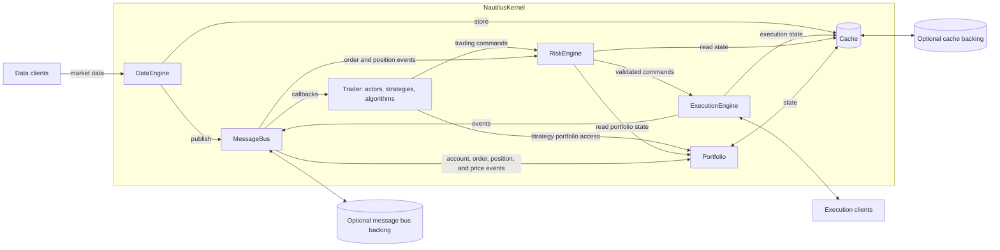
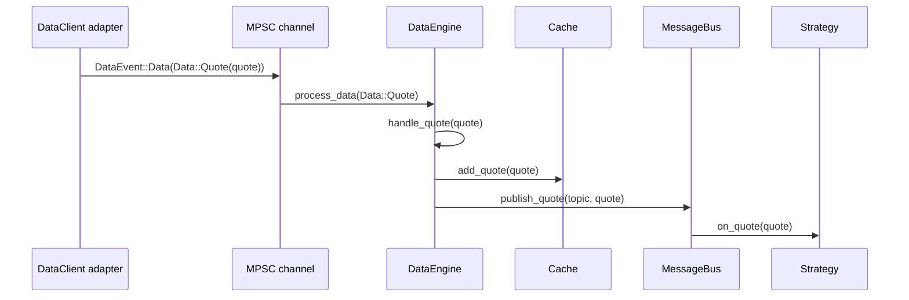
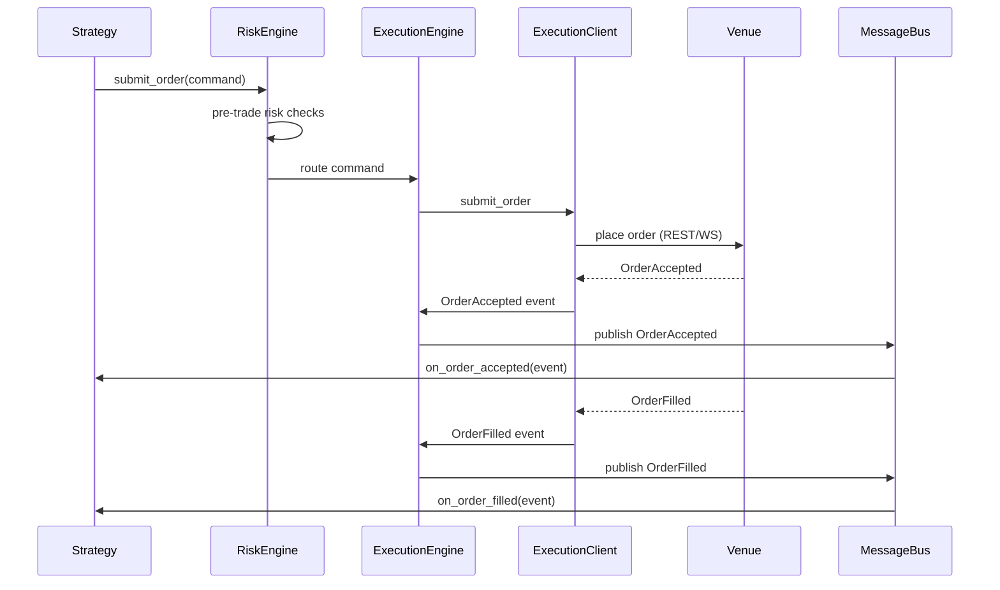
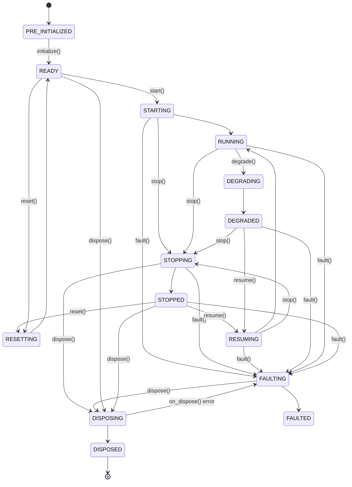
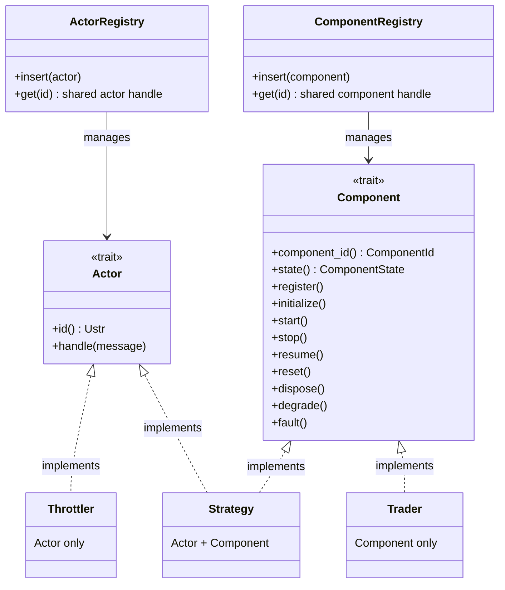
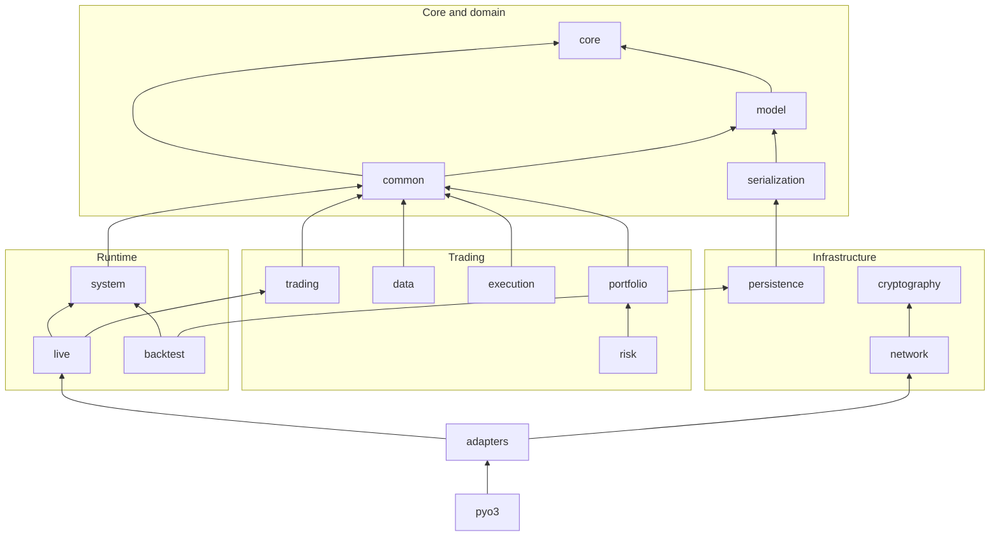

หน้านี้อธิบาย component, ขอบเขตของ runtime และการไหลของข้อมูลใน NautilusTrader
โครงสร้างนี้ยึดตาม [หลักการออกแบบและนโยบาย](../developer_guide/design_principles.md)

:::note
ในคู่มือนี้ **ขอบเขตของระบบ Nautilus** หมายถึง runtime ของ Nautilus node หนึ่ง instance
:::

## รูปแบบสถาปัตยกรรม [#architectural-style]

NautilusTrader ใช้เทคนิคทางสถาปัตยกรรมและ design pattern ต่อไปนี้:

- [Domain-driven design (DDD)](https://en.wikipedia.org/wiki/Domain-driven_design)
- [Event-driven architecture](https://en.wikipedia.org/wiki/Event-driven_programming)
- [Messaging patterns](https://en.wikipedia.org/wiki/Messaging_pattern) (publish/subscribe,
  request/response และ point-to-point)
- [Ports and adapters](https://en.wikipedia.org/wiki/Hexagonal_architecture_(software))
- [Crash-only design](#crash-only-design)

[หลักการออกแบบและนโยบาย](../developer_guide/design_principles.md) ระบุลำดับความสำคัญและข้อตกลง (contract)
ที่เทคนิคเหล่านี้รองรับ

## สถาปัตยกรรมของระบบ [#system-architecture]

NautilusTrader มีทั้ง framework สำหรับประกอบระบบเทรด และ implementation เริ่มต้นสำหรับ
[environment context](#environment-contexts) หลายแบบ

kernel เป็นเจ้าของแกนกลางการเทรดที่ใช้ร่วมกัน adapter แลกเปลี่ยน market data และ message ด้าน execution
ผ่านขอบเขตของ engine

### Component หลัก [#core-components]

#### `NautilusKernel` [#nautiluskernel]

component ศูนย์กลางที่ประสานการทำงานทั้งหมด:

- initialize และจัดการ component หลักที่ใช้ร่วมกัน
- ตั้งค่าโครงสร้างพื้นฐานด้าน messaging
- เลือก clock และพฤติกรรมตาม environment
- ประสานทรัพยากรที่ใช้ร่วมกันและการจัดการ lifecycle
- เป็นขอบเขต lifecycle เดียวสำหรับการทำงานของระบบ

#### `MessageBus` [#messagebus]

`MessageBus` เป็นศูนย์กลางในการ route การสื่อสารระหว่าง component:

- **Publish/subscribe**: กระจาย event และข้อมูลไปยังผู้รับหลายราย
- **Request/response**: จับคู่ request กับ response ของมัน
- **Command/event messaging**: route action และการเปลี่ยนสถานะผ่าน endpoint ที่มี type ชัดเจน
- **Backing ภายนอก (optional)**: ส่ง publication ที่เลือกไว้ และสำหรับ live node ยังรับ stream ภายนอกที่ตั้งค่าไว้
  ผ่าน backing อย่าง Redis ได้ด้วย stream เหล่านี้ทำหน้าที่เป็น transport แบบ live ส่วนการกู้คืนสถานะแบบถาวร
  เป็นหน้าที่ของ cache หรือ event store

#### `Cache` [#cache]

`Cache` เก็บสถานะการเทรดไว้ในหน่วยความจำ:

- เก็บ instrument, account, order, position และอื่น ๆ
- ให้การอ่านแบบมี index สำหรับ component ด้านการเทรด
- persist สถานะที่ตั้งค่าไว้ผ่าน database backing ของ cache ได้ (optional)

#### `DataEngine` [#dataengine]

ประมวลผลและ route market data ไปทั่วทั้งระบบ:

- จัดการ quote, trade, bar, order book, custom data และ type อื่นที่รองรับ
- จัดการ subscription และ flow แบบ request/response ที่สัมพันธ์กันผ่าน data client
- คง subscription ของแต่ละ client ไว้จนกว่าเจ้าของรายสุดท้ายจะปล่อย โดยเก็บ route ของ client และ parameter
  เดิมไว้ใช้ตอน unsubscribe ครั้งสุดท้าย
- route ข้อมูลที่ได้ไปยังผู้รับตาม subscription และ request ของแต่ละราย
- จัดการการไหลของข้อมูลจากแหล่งภายนอกไปยัง component ภายใน

#### `ExecutionEngine` [#executionengine]

จัดการ lifecycle ของ order และการ execute:

- route คำสั่งเทรดไปยัง execution client ที่เหมาะสม
- ติดตามสถานะของ order และ position
- ประสานงานกับระบบบริหารความเสี่ยง
- จัดการ execution report และ fill จาก venue
- ใช้ reconciliation event และ reconcile report จาก venue ทีละรายการ

สำหรับ live execution `ExecutionManager` ติดตามสถานะ reconciliation และประสานการทำ reconciliation แต่ละครั้ง
ส่วน `LiveNode` เป็นเจ้าของการตรวจสอบเป็นรอบ, deadline และการยกเลิก ดู
[แผนภาพ component ของ reconciliation](execution/reconciliation.md#component-responsibilities)
สำหรับความเป็นเจ้าของและ dependency ของแต่ละส่วน

#### `RiskEngine` [#riskengine]

ทำหน้าที่บริหารความเสี่ยง:

- ตรวจสอบ field ของ order, balance, quantity, notional, พฤติกรรม reduce-only และสถานะการเทรด
- ใช้ rate limit ที่ตั้งค่าได้สำหรับการส่งและแก้ไข order
- ติดตาม event ของ order และ position ที่ตัวควบคุมของมันใช้

#### `Portfolio` [#portfolio]

ดูแลสถานะของ account และ position ที่คำนวณต่อยอดมา:

- ติดตาม balance, net position, margin, กำไรขาดทุนที่ realize และยังไม่ realize (PnL) และ exposure
- อัปเดตสถานะและการประเมินมูลค่าจาก event ของ account, order, position, quote, bar และ mark price

#### `Trader` [#trader]

ประสาน component ด้านการเทรดของผู้ใช้:

- ลงทะเบียน actor, strategy และ execution algorithm
- จัดการ lifecycle, clock และ event subscription ของสิ่งเหล่านี้

### Environment contexts [#environment-contexts]

environment context กำหนดแหล่งข้อมูลและรูปแบบการ execute ของ node:

- `Backtest`: ข้อมูลในอดีตกับการ execute แบบจำลอง
- `Sandbox`: ข้อมูล real-time กับการ execute แบบจำลอง
- `Live`: ข้อมูล real-time กับการเชื่อมต่อ venue จริง ทั้ง account แบบ paper และ account จริง

### แกนกลางร่วม [#common-core]

ระบบ backtest, sandbox และ live ใช้ struct `NautilusKernel` จาก crate `nautilus-system` ร่วมกัน
kernel เป็นเจ้าของ cache, portfolio, engine, trader, clock และโครงสร้างพื้นฐานด้าน messaging ที่ใช้ร่วมกัน

รูปแบบสถาปัตยกรรมแบบ *ports and adapters* ทำให้ component แบบ modular เชื่อมเข้ากับแกนกลางได้ผ่าน interface
ที่ชัดเจนของ client, backing store และ component รวมถึง implementation ที่เขียนเอง

### รูปแบบการไหลของข้อมูลและ execution [#data-and-execution-flow-patterns]

#### Data flow: เส้นทางของ quote tick [#data-flow-life-of-a-quote-tick]

ลำดับต่อไปนี้แสดงเส้นทางที่ `QuoteTick` เดินทางจาก network ไปถึง strategy trade และ bar ใช้เส้นทาง
cache-แล้ว-publish แบบเดียวกันแต่ชื่อ handler ต่างกัน ส่วน order book delta และ depth snapshot ใช้เส้นทางอื่น
(ดู note ใต้ขั้นตอน)

1. **Adapter รับข้อมูลดิบ** `DataClient` เฉพาะของ venue เช่น Binance หรือ Bybit รับ message จาก WebSocket
   parse แล้วสร้าง `QuoteTick`
1. **Adapter ส่ง data event** adapter ส่ง `DataEvent::Data(Data::Quote(quote))` ผ่าน MPSC channel
   ในโหมด live จะเป็น async unbounded channel ส่วนใน backtest engine จะป้อนข้อมูลโดยตรง
1. **`DataEngine` ประมวลผล event** ตัวรับของ channel route event ไปยัง `DataEngine::process_data`
   ซึ่ง dispatch ต่อไปยัง `handle_quote`
1. **`Cache` เก็บ quote** `handle_quote` เรียก `cache.add_quote(quote)` เมื่อการ insert สำเร็จ
   component ต่าง ๆ จะอ่านได้ผ่าน `cache.quote(instrument_id)`
1. **`MessageBus` publish** engine publish quote ไปยัง topic ที่สร้างจาก instrument ID เช่น
   `data.quotes.BINANCE.BTCUSDT-PERP` แล้ว `MessageBus` จะหา handler ทั้งหมดที่ subscribe topic นั้น
1. **Handler ของ strategy ทำงาน** `on_quote(quote)` ของแต่ละ strategy ที่ subscribe จะรันบนแกนกลางแบบ
   single-threaded `cache.quote(instrument_id)` จะคืน quote ตัวเดียวกันก็ต่อเมื่อการ insert สำเร็จ
   และยังไม่มี quote ใหม่กว่ามาแทนที่ก่อนการอ่าน

:::note
สำหรับ quote, trade และ bar engine จะพยายาม insert ลง cache ก่อน publish:

- error จากการ persist หรือการเข้าคิวแบบ synchronous จะทำให้การ insert ในหน่วยความจำไม่เกิดขึ้น แต่ engine
  จะ log error แล้วยัง publish ค่านั้นต่อไป ดังนั้น quote ที่ publish ไปแล้วอาจไม่มีอยู่ใน cache หากการ insert
  แบบ synchronous ล้มเหลว
- database backing ในตัวเขียนข้อมูลจริงแบบ asynchronous ดังนั้น error ของ database ที่เกิดภายหลังจะไม่ rollback
  การ insert ลง cache

callback อาจเห็นสถานะ cache ที่ใหม่กว่า event ที่กำลังจัดการอยู่ได้ รวมถึงระหว่าง synchronous reentry
ลำดับการส่งไม่ได้ให้ snapshot ตาม event time และ
[ข้อกำหนดของ queued dispatch](../developer_guide/callback_dispatch.md#maintenance-and-observable-state)
ก็ไม่ได้เพิ่มสิ่งนี้ให้

order book delta และ depth snapshot ถูก publish โดยตรง ขณะที่ subscription ของ `BookUpdater` ดูแลสถานะ
ของ book แยกต่างหาก
:::

#### Execution flow: เส้นทางของ order [#execution-flow-life-of-an-order]

ลำดับแบบย่อนี้แสดงการส่ง order โดยตรงที่ venue accept สำเร็จแล้วตามด้วย fill โดยไม่รวม execution algorithm,
emulation และผลลัพธ์ของ transport ที่ไม่ชัดเจน ดู [Execution](execution/index.md) และ
[ผลลัพธ์ของคำสั่ง](execution/policies.md#command-outcomes) สำหรับเส้นทางเหล่านั้น adapter แปล message
ของ venue เป็น execution event ตามที่แสดงด้านล่าง:

1. **Strategy สร้างคำสั่ง** strategy เรียก `submit_order(order)`
1. **`RiskEngine` ตรวจสอบ** การตรวจสอบ order, balance, quantity, notional, สถานะการเทรด และ rate
   ที่ตั้งค่าไว้จะทำงาน หากการตรวจสอบใดไม่ผ่าน strategy จะได้รับ `OrderDenied` และ order จะไม่ไปถึง venue เลย
1. **`ExecutionEngine` route** คำสั่งถูก route ไปยัง `ExecutionClient` ของ venue เป้าหมาย
1. **`ExecutionClient` ส่ง** adapter ส่ง order ไปยัง venue ผ่าน REST หรือ WebSocket
1. **Event ไหลกลับมา** venue ตอบกลับด้วยการยืนยันและ fill แต่ละ event (`Accepted`, `Filled`, `Canceled`,
   `Rejected` หรือ `Expired`) ไหลผ่าน `ExecutionEngine` ซึ่งอัปเดตสถานะ order ใน `Cache` และส่ง event
   ไปยัง handler ของ strategy event ของ fill ยังทำให้เกิดการอัปเดต position และ portfolio ด้วย

#### การจัดการสถานะของ component [#component-state-management]

type ที่ implement trait `Component` ใช้ finite state machine `ComponentState` นิยามสถานะแบบคงที่และ
สถานะระหว่างเปลี่ยน ส่วน `ComponentTrigger` จำกัดการเปลี่ยนสถานะที่ถูกต้อง:

**สถานะคงที่**:

- **PRE_INITIALIZED**: component มีอยู่แล้วแต่ยังไม่พร้อมทำงานตาม specification
- **READY**: component ตั้งค่าเรียบร้อยและเริ่มทำงานได้
- **RUNNING**: component ทำงานตามปกติและทำงานตาม specification ได้
- **STOPPED**: component หยุดทำงานสำเร็จแล้ว
- **DEGRADED**: component อาจทำงานได้ไม่ครบตาม specification
- **FAULTED**: component ปิดตัวลงเพราะตรวจพบ fault
- **DISPOSED**: component ปิดตัวลงและปล่อยทรัพยากรแล้ว

**สถานะระหว่างเปลี่ยน**:

- **STARTING**: component กำลังทำ action ของ `start`
- **STOPPING**: component กำลังทำ action ของ `stop`
- **RESUMING**: component กำลังทำ action ของ `resume` หลังจากหยุดหรือ degrade
- **RESETTING**: component กำลังทำ action ของ `reset`
- **DISPOSING**: component กำลังทำ action ของ `dispose`
- **DEGRADING**: component กำลังทำ action ของ `degrade`
- **FAULTING**: component กำลังทำ action ของ `fault`

สถานะระหว่างเปลี่ยนครอบคลุม lifecycle callback ที่สอดคล้องกัน และควรใช้เวลาสั้น หาก callback คืน error
การเปลี่ยนสถานะจะหยุดค้างอยู่ในสถานะระหว่างเปลี่ยนนั้น

`dispose()` เป็นข้อยกเว้น: `on_dispose` ที่ล้มเหลวจะย้าย component ไปที่ FAULTED เพื่อให้ยัง retire ได้
`on_stop` หรือ `on_fault` ที่ล้มเหลวจะทำให้ component ค้างในสถานะระหว่างเปลี่ยน ซึ่งจากจุดนั้นการ retire
ของ trader ยังเรียก `dispose()` และ cleanup ให้เสร็จได้

หลังจาก reset สำเร็จ component จะปล่อย data subscription ที่ถือไว้ก่อนกลับไปที่ READY การ start ครั้งถัดไป
จะได้ subscription ใหม่กับ data engine ที่ reset แล้ว หาก `on_reset` ล้มเหลว component จะค้างอยู่ที่
RESETTING โดย subscription ยังคงอยู่ครบ

ในการ retire ตามปกติ trader จะรัน `on_dispose`, ปล่อย data subscription ที่ component ถือไว้ แล้วลบ entry
ใน registry และข้อมูลบันทึกต่าง ๆ หาก `on_dispose` ล้มเหลว component จะยังลงทะเบียนอยู่และ subscription
ยังคงอยู่ครบ การ retire component ที่อยู่ในสถานะ FAULTED หลังจากนั้นจะปล่อย subscription เหล่านั้น
โดยไม่เรียก hook การ dispose ที่ล้มเหลวซ้ำอีก

การปล่อยของ component แต่ละครั้งจะลบ handler บน message bus ของมัน และลดจำนวนความเป็นเจ้าของบน data client
ที่ถูก route ไป data client จะส่ง unsubscribe ไปยังต้นทางก็ต่อเมื่อเจ้าของรายสุดท้ายปล่อย subscription
ทางกายภาพตัวเดียวกันแล้วเท่านั้น ทรัพยากรที่ engine จัดการ เช่น book snapshot, synthetic feed, spread quote,
internal bar และ option chain ก็ใช้กฎเจ้าของรายสุดท้ายเดียวกันนี้

#### Trait `Actor` เทียบกับ `Component` [#actor-vs-component-traits]

implementation ใน Rust แยกการ dispatch message แบบเจาะจงเป้าหมายออกจากการจัดการ lifecycle:

**Trait `Actor`: การ dispatch message**

- มีเมธอด `handle` สำหรับรับ message ที่ dispatch ผ่าน actor registry
- รองรับการค้นหาด้วย actor ID accessor แบบ typed unchecked จะตรวจสอบ type จริงของ actor ตอน runtime
  และคืน guard แบบ `ActorRef`
- ใช้โดย type ที่รับ message แบบเจาะจงเป้าหมาย เช่น strategy และ throttler

**Trait `Component`: การจัดการ lifecycle**

- จัดการการเปลี่ยนสถานะ เช่น `start`, `stop`, `resume`, `reset` และ `dispose`
- ลงทะเบียน component กับ trader ID, clock และ cache
- ติดตามสถานะของ component ผ่าน finite state machine ที่อธิบายไว้ข้างต้น
- ใช้โดย actor, strategy, execution algorithm และ `Trader` เมื่อต้องการพฤติกรรม lifecycle ที่มีการจัดการ
  ส่วน data, risk และ execution engine มีเมธอด lifecycle ของตัวเอง แต่ไม่ได้ implement trait นี้

:::note
การเข้าถึง message bus ไม่ได้ขึ้นกับ trait `Actor` โค้ดที่รันบน thread ของ node ใช้ API ของ `MessageBus`
แบบ thread-local ได้ ส่วน `Actor` มีไว้เฉพาะเพื่อให้ dispatch ไปยัง actor ID ผ่าน registry ได้
:::

การแยกแบบนี้ทำให้มีได้ทั้ง:

- **Actor อย่างเดียว**: message handler น้ำหนักเบาที่ไม่มี lifecycle เช่น `Throttler`
- **Component อย่างเดียว**: type ที่มีการจัดการ lifecycle แต่ไม่มีการ dispatch แบบเจาะจง actor เช่น `Trader`
- **ทั้งสอง trait**: data actor รวมถึง strategy และ execution algorithm ที่ต้องการทั้งการจัดการ lifecycle
  และการ dispatch แบบเจาะจงเป้าหมาย

:::warning
registry แบบ thread-local ที่แยกกันรองรับรูปแบบการเข้าถึงเหล่านี้ เมธอด `get` ของ registry ทั้งสองคืน handle
แบบ `Rc<UnsafeCell<dyn ...>>` ที่ใช้ร่วมกัน

- **การเข้าถึง component**: ฟังก์ชัน wrapper ของ lifecycle ใช้ borrow guard ภายในเพื่อปฏิเสธการเข้าถึง lifecycle
  ที่ซ้อนทับกัน แต่การป้องกันนี้ไม่ครอบคลุมการเข้าถึงใด ๆ ผ่าน handle ดิบจาก registry
- **การเข้าถึง actor**: accessor แบบ typed คืน guard แบบ `ActorRef` ซึ่งไม่ได้ป้องกันการมี guard สองตัว
  ของ actor ตัวเดียวกันพร้อมกัน

การสร้าง mutable reference ที่ซ้อนทับกันเป็น undefined behavior ให้ get, ใช้งาน และ drop `ActorRef` ภายใน
scope แบบ synchronous เดียว **ห้ามเก็บไว้หรือถือข้ามจุด `.await` เด็ดขาด** การค้นหา actor ตัวเดิมแบบ re-entrant
เป็นข้อจำกัดของโมเดล dispatch ปัจจุบัน ไม่ใช่การรับประกันว่า aliasing ปลอดภัย
:::

สำหรับ queued dispatch การปล่อย actor guard เพียงอย่างเดียวยังไม่ถือเป็นขอบเขตการส่งที่ปลอดภัย:
mutable borrow ของ runtime ที่ครอบอยู่ก็ต้องสิ้นสุดด้วย ลำดับการรับ subscriber เพียงอย่างเดียวไม่ได้รักษา
ลำดับการ publish ระหว่าง fan-out แบบซ้อน การส่งที่ค้างอยู่ต้องมี identity ของการลงทะเบียนและ lifecycle
เพื่อบังคับใช้ [ข้อกำหนดของ dispatch](../developer_guide/callback_dispatch.md)

### Messaging [#messaging]

`MessageBus` ส่งผ่านข้อมูล, คำสั่ง และ event ระหว่าง component โดยไม่ต้องมี reference ถึง component กันโดยตรง

#### โมเดล threading [#threading-model]

ภายใน node แกนกลางจะรับและ dispatch message บน **thread เดียว** ซึ่งรวมถึง:

- `MessageBus` และการ dispatch callback ของ actor
- logic ของ strategy และการจัดการ order
- การตรวจสอบของ risk engine และการประสานงานด้าน execution
- การอ่านและเขียน cache

การประมวลผลแบบเรียงลำดับช่วยประสานการเปลี่ยนสถานะภายใน node แต่ synchronous reentry ยังคงมีข้อจำกัด
ตามที่อธิบายไว้ข้างต้น [ข้อกำหนดของ queued dispatch](../developer_guide/callback_dispatch.md) นิยามลำดับ
การ publish ข้าม callback ที่ซ้อนกัน input แบบ live และ latency อาจทำให้พฤติกรรมต่างจาก backtest ได้
component รับ message แบบ synchronous ในรูปแบบที่ *คล้าย* กับ
[actor model](https://en.wikipedia.org/wiki/Actor_model)

:::note
[สถาปัตยกรรม LMAX](https://martinfowler.com/articles/lmax.html) เป็นตัวอย่างที่เกี่ยวข้องของการประมวลผล
transaction แบบ single-threaded
:::

service เบื้องหลังใช้ thread แยก หรือ Tokio runtime แบบ multi-threaded ที่ใช้ร่วมกันทั้ง process
จำนวน worker ของ runtime ตั้งค่าได้:

- **Network และ adapter**: การเชื่อมต่อ WebSocket, REST client และ data feed รันเป็น async task
- **Logging**: worker ตัวหนึ่งรับ log event นอกแกนกลางแบบ synchronous
- **Persistence**: cache backing ของ Redis และ PostgreSQL จัดคิวการเขียนไปยัง async task ส่วน DataFusion
  รัน future ของการ query catalog บน Tokio runtime

producer แบบ async ส่ง data และ execution event ผ่าน channel ตัวรันของ node รับ event เหล่านั้นแล้วใช้
`MessageBus` แบบ thread-local dispatch ไปยัง endpoint ของ engine บน core thread แต่ละ thread มี instance
ของ bus เป็นของตัวเอง channel ทำหน้าที่เชื่อมงานจาก thread หรือ task อื่น

## Crash-only design [#crash-only-design]

NautilusTrader นำแนวคิด [crash-only design](https://en.wikipedia.org/wiki/Crash-only_software) มาใช้
เมื่อจัดการ fault ที่กู้คืนไม่ได้ release build ของ repository จะ abort เมื่อเกิด panic เพื่อให้ supervisor
ภายนอก restart process แทนที่จะปล่อยให้ทำงานต่อด้วยสถานะที่อาจไม่ถูกต้อง

พฤติกรรมการกู้คืน:

- **การกู้คืนตอน startup**: การกู้คืน cache และ event store ที่ตั้งค่าไว้ทำงานผ่าน startup ตามปกติ
  ไม่ได้ผ่าน entry point แบบ crash-only แยกต่างหาก startup ปกติและ test ด้านการกู้คืนโดยเฉพาะ
  จึงทดสอบ flow การ initialize เดียวกัน
- **สถานะภายนอก**: backing store ที่ตั้งค่าไว้จะเก็บสถานะที่เลือกไว้ข้ามการ restart process ช่วยลดงานกู้คืน
  และความเสี่ยงที่สถานะจะสูญหาย ความคงทนขึ้นอยู่กับ backing store และการตั้งค่าของมัน
- **การ restart ที่ supervisor จัดการ**: process supervisor ภายนอกเป็นเจ้าของนโยบายการ restart หลังเกิด
  ความล้มเหลวที่กู้คืนไม่ได้ การ abort จะข้าม cleanup แบบ graceful ภายใน process ที่ล้มเหลว downtime จริง
  ขึ้นอยู่กับ supervisor, สถานะที่ตั้งค่าไว้ และ backing store
- **การกู้คืนอย่างรวดเร็ว**: การออกแบบมุ่งลด downtime โดยใช้การกู้คืนตอน startup ตามปกติหลังจาก supervisor
  restart process เวลาในการกู้คืนขึ้นอยู่กับสถานะที่ต้องกู้คืนและ backing store ของมัน
- **การกู้คืนด้าน execution**: โดยทั่วไปการ retry คำสั่งไปยัง venue แบบไม่ตรวจสอบนั้นไม่ปลอดภัย
  execution reconciliation เป็นตัวจัดการขอบเขตนี้

:::note
การทำงานปกติยังใช้ flow การปิดแบบ graceful เช่น `stop` และ `dispose` ซึ่งจะปิด client และเมื่อตั้งค่าไว้
จะบันทึกสถานะและ flush writer พฤติกรรมแบบ crash-only ใช้กับ fault ที่กู้คืนไม่ได้ ซึ่งการ cleanup ตามปกติต่อไป
อาจไม่ปลอดภัย
:::

การออกแบบนี้เสริมกับ
[นโยบายด้าน data integrity](../developer_guide/design_principles.md#data-integrity-and-failure): panic
ที่เกิดจากการละเมิด invariant ที่กู้คืนไม่ได้จะทำให้ process ที่ build ด้วย release profile ของ repository
สิ้นสุดลงทันที

**อ้างอิง**:

- [Crash-Only Software](https://www.usenix.org/conference/hotos-ix/crash-only-software): Candea และ
  Fox, HotOS 2003
- [Microreboot: A technique for cheap recovery](https://www.usenix.org/events/osdi04/tech/candea.html):
  Candea et al., OSDI 2004
- [The properties of crash-only software](https://brooker.co.za/blog/2012/01/22/crash-only.html):
  Marc Brooker
- [Crash-only software: More than meets the eye](https://lwn.net/Articles/191059/): LWN.net
- [Recovery-Oriented Computing (ROC) Project](http://roc.cs.berkeley.edu/): UC Berkeley และ
  Stanford

## การจัดระเบียบ framework [#framework-organization]

Rust workspace จัดกลุ่มพฤติกรรมที่เกี่ยวข้องกันเป็น crate ภายใต้ `crates/`

### Core และ domain [#core-and-domain]

- `core`: primitive ระดับล่างด้านเวลา, string, serialization และ runtime
- `model`: type ของ domain การเทรด รวมถึง instrument, account, order, position และ market data
- `common`: service ของ runtime ที่ใช้ร่วมกัน รวมถึง cache, message bus, clock, actor, component และ logging
- `serialization`: การรองรับ schema และ encoding สำหรับ type ของ model และ event

### การเทรดและการวิเคราะห์ [#trading-and-analysis]

- `analysis`: สถิติผลงานการเทรดและการวิเคราะห์
- `indicators`: technical indicator
- `data`: engine ด้าน market data, การ aggregate และเครื่องมือด้านข้อมูล
- `execution`: primitive ด้าน order execution, emulation และ reconciliation
- `portfolio`: การทำบัญชีและสถานะของ portfolio
- `risk`: การควบคุมก่อนเทรด, การกำหนดขนาด position และสถานะการเทรด
- `trading`: strategy และ execution algorithm

### โครงสร้างพื้นฐานและ runtime [#infrastructure-and-runtimes]

- `network` และ `cryptography`: network client, การรองรับ transport, การ sign และผู้ให้บริการด้าน cryptography
- `infrastructure`, `persistence` และ `event_store`: database backing, data catalog, object storage
  และการเชื่อมต่อ event store
- `system`: kernel ที่ใช้ร่วมกันโดย [environment context](#environment-contexts) แบบ backtest, sandbox และ live
- `backtest` และ `live`: engine และ node เฉพาะของแต่ละ environment
- `adapters/*`: integration กับ venue, broker, ข้อมูล, blockchain และ sandbox
- `plugin`, `cli` และ `testkit`: interface ของ plugin, เครื่องมือ command-line และการรองรับการทดสอบ

## โครงสร้างโค้ด [#code-structure]

directory `crates/` เก็บ implementation ที่เป็น Rust

crate `nautilus-core` และ `nautilus-model` มี C FFI แบบ optional ไว้สำหรับผู้ใช้แบบ native ส่วน crate อื่นใน
workspace ใช้ Rust API

### Rust crates [#rust-crates]

manifest ของ Rust crate ประกาศ workspace dependency และ feature flag แบบ optional feature จะเปิดความสามารถ
เสริมโดยไม่เพิ่มเข้าไปใน build ขั้นต่ำ

ด้านล่างแสดง direct workspace dependency ที่เลือกมาบางส่วน ลูกศรชี้ไปยัง dependency แผนภาพนี้ละ edge
ที่ไม่ช่วยให้เห็นทิศทางโดยรวมได้ชัดขึ้น

**Feature flags**:

| Feature     | Crate หลัก                                 | ผล                                                             |
| ----------- | ----------------------------------------- | ---------------------------------------------------------------- |
| `streaming` | `data`, `system`, `live`, `backtest`      | เพิ่มการรองรับ persistence สำหรับ catalog streaming                  |
| `cloud`     | `persistence`                             | เพิ่ม backend ของ object store สำหรับ AWS, Azure, GCP และ HTTP     |
| `defi`      | crate ด้าน domain, data, runtime และ binding | เพิ่ม type และเส้นทางของ runtime สำหรับ DeFi และ blockchain           |

### Type safety [#type-safety]

codebase ของ Rust อาศัยการรับประกันของ compiler สำหรับโค้ดที่ปลอดภัย แต่ละ block ที่เป็น `unsafe` คือการเลือก
ไม่ใช้การรับประกันเหล่านั้นอย่างชัดเจน ดังนั้นความปลอดภัยของหน่วยความจำและ type จึงขึ้นอยู่กับ invariant
ที่ระบุไว้ในเอกสาร ดูส่วน Rust ใน [Developer Guide](../developer_guide/rust.md)

### Errors และ exceptions [#errors-and-exceptions]

เอกสาร API อธิบาย error ที่คาดว่าจะเกิดจาก NautilusTrader และเงื่อนไขที่ทำให้เกิด error เหล่านั้น

### Processes และ threads [#processes-and-threads]

:::warning[หนึ่ง node ต่อหนึ่ง process]
การรัน `LiveNode` หรือ `BacktestNode` หลาย instance **พร้อมกัน** ใน process เดียวกันไม่ได้รับการรองรับ
เพราะสถานะของ runtime ไม่ได้แยกออกจากกัน:

- **โหมดของ logger และ timestamp**: ระบบ logging ใช้สถานะแบบ global ส่วน backtest จะสลับ clock ของ logging
  ระหว่างโหมด static และ real-time
- **สถานะ runtime แบบ thread-local**: node จะติดตั้ง message bus, registry ของ actor และ component
  และ channel sender สำหรับ thread ที่ขับเคลื่อนมัน
- **สถานะ runtime ระดับ process**: Tokio runtime และ worker ของ logging ใช้ร่วมกันทั้ง process

การรันหลาย node แบบเรียงลำดับทำได้ เมื่อ dispose แต่ละ node ก่อนที่ node ถัดไปจะเริ่ม ก่อนสร้าง `LiveNode`
ตัวใหม่บน thread เดียวกัน ให้ drop node ตัวก่อนหน้าด้วย การ dispose อย่างเดียวไม่ได้ปล่อย guard
ที่ใช้ตอนสร้าง node มีการทดสอบเฉพาะสำหรับการสร้าง node แบบเรียงลำดับและการกู้คืนสถานะที่มี cache backing

สำหรับ production ให้เพิ่มหลาย strategy เข้าไปใน `LiveNode` ตัวเดียวภายใน process หนึ่ง
หากต้องการรันแบบขนานหรือแยก workload ให้รันแต่ละ node ใน process แยกของตัวเอง
:::

### การจัดสรรหน่วยความจำ [#memory-allocation]

แกนกลางแบบ event-driven จะจัดสรรและคืนหน่วยความจำของ object ระหว่างการ dispatch message, การจัดการ order event
และการดูแล order book การเลือก allocator จึงมีผลต่อ throughput และหน่วยความจำที่ใช้จริง (resident memory)
ผลที่ได้ขึ้นอยู่กับ workload, platform และการตั้งค่า build

CLI `nautilus` ใช้ [mimalloc](https://crates.io/crates/mimalloc) สำหรับการจัดสรรหน่วยความจำของ Rust
ให้เปรียบเทียบ allocator กับ workload ที่เป็นตัวแทนจริงก่อนเลือกใช้กับ binary ของตัวเอง บันทึก source revision,
การตั้งค่า build, environment, วิธีการวัด, throughput และ resident memory ตาม
[คู่มือ benchmarking](../developer_guide/benchmarking.md)

Rust binary หนึ่งตัว link global allocator ได้เพียงตัวเดียว และ library ไม่ได้บังคับเลือกให้ ดังนั้น crate ของ
NautilusTrader จึงเป็นกลางต่อ allocator เมื่อ build โดยใช้ crate โดยตรง ให้เลือกเปิดใช้จาก binary ของตัวเอง
(ดู [คู่มือ Rust](rust.md#memory-allocator))

## คู่มือที่เกี่ยวข้อง [#related-guides]

- [Design principles](../developer_guide/design_principles.md): หลักการ นโยบาย และ trade-off
- [Identifier storage](../developer_guide/rust.md#identifier-storage): lifetime ของ identifier และต้นทุนด้านหน่วยความจำ
- [Behavioral models](behavioral_models.md): การแทนและการ dispatch ของ model
- [Overview](overview.md): ภาพรวมระดับสูงของ NautilusTrader
- [Rust](rust.md): Rust API แบบ native และการใช้งาน runtime
- [Message Bus](message_bus.md): โครงสร้างพื้นฐานด้าน messaging หลัก
