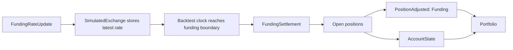

venue ใน backtest ใช้ account จำลองสำหรับยอดเงินคงเหลือ, margin และการชำระ funding ดูโมเดล
account ฉบับเต็มและสูตรคำนวณ margin ได้ที่ [Accounting](../accounting.md)

## Funding [#funding]

backtest จะชำระ funding ของ perpetual จากข้อมูล `FundingRateUpdate` ที่รอบเวลา funding (funding boundary):

- เมื่อมี `next_funding_ns` exchange จำลองจะเก็บ rate ล่าสุดไว้ และ clock ของ backtest
  จะส่ง `FundingSettlement` หนึ่งครั้งที่ timestamp นั้น
- เมื่อไม่มี `next_funding_ns` exchange จะชำระก็ต่อเมื่อ `ts_event` ตรงกับรอบของ `interval` เท่านั้น
- การอัปเดตที่ไม่มีรอบเวลาจะเป็นเพียงข้อมูลสำหรับ strategy และไม่สร้างการจ่าย funding

การชำระจะปรับ position ที่เปิดอยู่และยอดเงินของ account ที่สอดคล้องกันก่อนที่ portfolio
จะเห็นสถานะใหม่

`PositionAdjusted` ยังคงเป็น event ทางบัญชีของ position **funding rate ที่เป็นบวก** จะหักเงินจาก position
ฝั่ง long และเพิ่มเงินให้ position ฝั่ง short การปรับนี้เปลี่ยนแปลง realized PnL และการอัปเดตยอดเงินของ
account ที่สอดคล้องกันจะบันทึกการเคลื่อนไหวของเงินสด

## Account [#accounts]

venue ใน backtest แต่ละแห่งใช้ค่า `account_type` อย่างใดอย่างหนึ่งจากสามค่า: `CASH`, `MARGIN` หรือ `BETTING`

> หมายเหตุ: ต้นฉบับมีเฉพาะตัวอย่าง Python จึงตัดออก ดูการตั้งค่า venue ฝั่ง Rust ได้ที่
> [Run a Rust backtest](../../how_to/run_rust_backtest.md)

## Margin model [#margin-models]

account แบบ margin ใช้ `LeveragedMarginModel` เป็นค่าเริ่มต้น หากต้องการกันเงิน margin ตามเปอร์เซ็นต์
initial margin และ maintenance margin คงที่ของ instrument โดยไม่มีการลดหย่อนจาก leverage ของ account
ให้ใช้ `StandardMarginModel`
