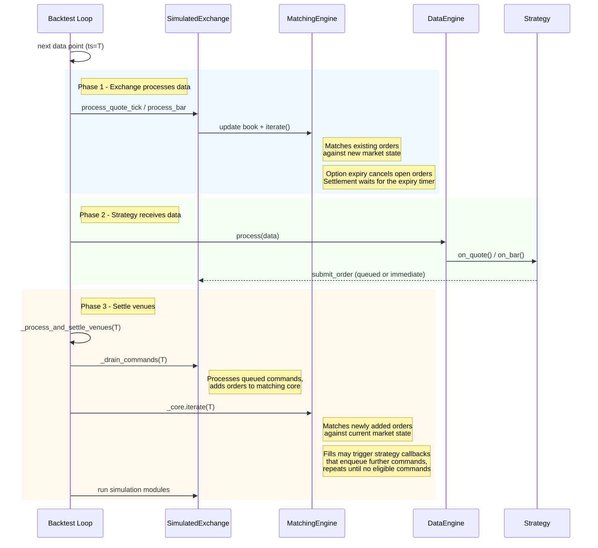

backtest loop จะประมวลผลสถานะตลาดก่อนเรียก callback ของ strategy จากนั้นจึง settle command ที่เกิดขึ้น
ใน timestamp เดียวกัน

## ลำดับของข้อมูลและ message [#data-and-message-sequencing]

backtest loop หลักจะนำ market data ใหม่ไปประมวลผลเพื่อ execute order ก่อนที่ data engine
จะ dispatch ข้อมูลนั้นไปยัง actor และ strategy

### ลำดับการทำงานของ main loop [#main-loop-flow]

สำหรับข้อมูลแต่ละจุด engine จะทำงานสามขั้นตอน:

1. **การประมวลผลของ exchange**: simulated exchange อัปเดต order book จาก market data ที่เข้ามา และ
   iterate matching engine ซึ่งจะ fill order ที่มีอยู่เดิมซึ่ง match กับสถานะตลาดใหม่
1. **Callback ของ strategy**: data engine dispatch ข้อมูลไปยัง actor และ strategy ผ่าน
   callback (เช่น `on_quote`, `on_bar`) strategy อาจ submit, cancel หรือ modify order ระหว่าง
   callback เหล่านี้ได้
1. **การ settle venue**: engine ดึง venue command ที่อยู่ในคิวออกมาทั้งหมด แล้ว iterate matching engine เพื่อ fill
   order ที่เพิ่ง submit ทำซ้ำจนกว่าจะไม่มี command ที่พร้อมทำงาน ดังนั้น order ที่เกิดต่อเนื่องกัน (เช่น hedge
   ที่ submit จาก `on_order_filled`) จะ settle ภายใน timestamp เดียวกัน ส่วน command ที่ถูกหน่วงด้วย latency
   ก่อนหน้านั้นจะเป็นไปตามกฎระดับ instrument ใน [การ settle command](#command-settling)

สามขั้นตอนนี้ทำให้ order ที่วางรออยู่ (resting order) เห็นข้อมูลตลาดที่เข้ามาก่อน order ที่เพิ่ง submit

timer event ใช้กลไก settle แบบเดียวกัน โดยจัดเป็นกลุ่มตาม timestamp callback ทั้งหมดที่ timestamp T จะทำงานก่อน
จากนั้น venue จะ settle สำหรับ T ก่อนที่ clock จะเดินไป T+1 timestamp ที่มีเพียง timer ของ portfolio snapshot
จะไม่ปล่อย command เก่าที่ถูกเลื่อนด้วย latency

สำหรับ timer ที่ใช้กับ bar ที่ aggregate ภายใน ดู
[จังหวะเวลาของการ aggregate bar ภายใน](bar-execution.md#internal-bar-aggregation-timing)

### การเลื่อน settlement ของ option [#deferred-option-settlement]

ที่ timestamp หมดอายุของ option การตรวจสอบการหมดอายุอัตโนมัติจะปิดตลาดของ option นั้น cancel order ที่เปิดอยู่
และ reject order ใหม่ การ settle position จะรอจนกว่า market data ทั้งหมดที่ timestamp นั้นถูกประมวลผลแล้ว
เพื่อให้ settlement เห็นราคา underlying ล่าสุดที่มีสำหรับ timestamp นั้น

`InstrumentClose` ที่ระบุชัดเจนด้วย `InstrumentCloseType::ContractExpired` จะพยายาม settle ทันที
batch แบบ streaming ต้องเก็บ **ข้อมูลทั้งหมดของ timestamp เดียวกันไว้ด้วยกัน** ซึ่ง `BacktestNode` ทำให้อัตโนมัติ

`SimulatedVenueConfig.defer_option_settlement` มีค่า default เป็น `true` backtest engine จะกำหนดเวลา
settlement หลังจาก market data ทั้งหมดที่ timestamp หมดอายุ โดยไม่ต้องรอ timestamp ถัดไป
เมื่อขับ `SimulatedExchange` โดยตรง ให้กำหนดเวลาการประมวลผลการหมดอายุไว้หลังข้อมูลของ timestamp นั้น
หรือตั้ง `defer_option_settlement` เป็น `false` อย่างชัดเจนเพื่อ settle ทันที การ settle ทันที
อาจใช้ **ราคา underlying ที่เก่ากว่า** หากยังมี update ที่ timestamp เดียวกันที่ยังไม่ได้ประมวลผล

### การ settle command [#command-settling]

#### Command ในรอบเดียวกัน [#same-cycle-commands]

fill ของ order อาจกระตุ้น callback ของ strategy ที่ submit order อื่น เช่น stop-loss จาก
`on_order_filled` engine จะดึงคิว venue command และประมวลผล command ที่เกิดจาก event เหล่านั้น
จนกว่าจะไม่มี command ที่พร้อมทำงานในรอบปัจจุบัน command ที่สร้างขึ้นใน timestamp นั้นและถึงกำหนดแล้วจะ settle
ภายในรอบเดียวกัน รวมถึง command แบบ zero-latency และ same-tick ของ instrument อื่นด้วย

simulation module จะทำงานครั้งเดียว หลังจาก command loop เสร็จสิ้น

#### Command ที่ถูกหน่วงด้วย latency [#latency-delayed-commands]

[`LatencyModel`](../behavioral_models.md) จะวาง command แต่ละตัวไว้ในคิว inflight ของ venue
พร้อม timestamp ที่จะมาถึง เมื่อ command ถึงกำหนด จุด settlement จะเป็นตัวกำหนดว่า
engine จะปล่อย command นั้นหรือไม่:

| จุด settlement                  | Command ที่ถึงกำหนดซึ่งถูกปล่อย                                              |
| ------------------------------ | -------------------------------------------------------------------------- |
| Market data                    | command ใน timestamp เดียวกัน และ command เก่าของ instrument ของข้อมูลนั้น     |
| เฉพาะ timer ของ portfolio snapshot | command ใน timestamp เดียวกัน                                              |
| timer อื่น ๆ                     | command ทั้งหมดที่ถึงกำหนด ณ timestamp ของ timer                            |
| การ settle funding rate         | command ทั้งหมดที่ถึงกำหนด ณ timestamp ของ funding settlement               |
| การ drain ตอน shutdown          | command ทั้งหมดที่ถึงกำหนดขณะที่ clock เดินผ่านเวลามาถึงของ inflight ตัวสุดท้าย |

market data ของ instrument อื่นจะไม่ทำให้ command เก่าทำงานกับสถานะตลาดที่ล้าสมัย command
ที่มี timestamp มาถึงในอนาคตจะยังอยู่ในคิว inflight

### Inbound latency ของ sandbox [#sandbox-inbound-latency]

`SandboxExecutionClientConfig.latency_model` รับ `StaticLatencyModel` โดยใช้รูปแบบเดียวกับการตั้งค่า
`fee_model` model นี้จะหน่วง submit, modify และ cancel ตามขา insert, update และ delete ของ
model ตามลำดับ ก่อนที่จะไปถึง matching engine

event ที่ venue สร้างขึ้น (accept, fill, cancel, expiration) จะไม่ถูกหน่วง ดังนั้น model จึงครอบคลุม
เฉพาะ **ขาขาเข้า (inbound leg)** หากไม่มี latency model พฤติกรรมของ client จะไม่เปลี่ยนแปลง

> หมายเหตุ: ต้นฉบับมีเฉพาะตัวอย่าง Python จึงตัดออก

#### จังหวะเวลาของ event และ command [#event-and-command-timing]

event ของ client แต่ละตัวใช้ execution channel ของ runner ตามลำดับที่ปล่อยออกมา ไม่ว่าจะมี latency model หรือไม่:

- `OrderSubmitted` ของ order จะมาก่อน venue event ของ order นั้น
- fill จาก market data จะมาก่อน response ของ command ใด ๆ ที่ถูกปล่อยหลังจากนั้น

**จังหวะเวลาของ command**:

- command จะมีผลก่อน market data ใด ๆ ที่ประมวลผลหลังเวลาที่ถึงกำหนด client จะ drain คิวก่อน
  แต่ละ tick และ clock alert ของ client จะปล่อย command ในคิวเมื่อไม่มีข้อมูลไหลเข้ามา
- command ที่มีขา latency เป็นศูนย์จะมีผลทันทีที่มาถึง เว้นแต่มี command อื่นที่ถึงกำหนดแล้วแต่ยังไม่ถูกปล่อย
  ในกรณีนั้น command จะต่อคิวหลัง command ดังกล่าว
- cancel-all จะ cancel เฉพาะ order ที่ venue ได้รับแล้วเท่านั้น order ที่ submit ยังอยู่ระหว่างทาง
  จะไม่ถูกแตะต้องจนกว่า venue จะประมวลผล submit นั้น

#### Contingent order [#contingent-orders]

ทั้งใน backtest และ sandbox การทำงานแบบ contingent จะเคารพการรับของ venue:

- fill, update, expiration และ cancellation ไม่สามารถ activate, แก้ไข หรือ cancel order ที่ผูกกันอยู่
  ซึ่ง venue ยังไม่ได้รับได้
- submit list แต่ละชุดจะมาถึงพร้อมกันเป็นหน่วยเดียว
- OTO child ที่ venue ได้รับแล้วยังคง activate ได้เมื่อ parent ถูก fill
- submit ที่มาช้าจะถูกตรวจสอบกับสถานะปัจจุบันของ order ที่ผูกกันอยู่ และอาจถูก reject หาก order ที่ผูกไว้
  ปิดไปแล้ว
- การเปลี่ยนจำนวนแบบ contingent ที่ถูกข้ามไปก่อน venue ได้รับ จะไม่ถูก replay เมื่อ submit มาถึง order จะคง
  จำนวนที่ submit ไว้ เว้นแต่มีกฎอื่นที่เกี่ยวข้องเปลี่ยนแปลงมัน

#### การหยุดขณะที่มี command อยู่ระหว่างทาง [#stopping-with-commands-in-flight]

การหยุด client จะทิ้งทุกอย่างที่ยังอยู่ระหว่างทาง:

- submit, modify หรือ cancel แบบระบุเป้าหมายที่ถูกทิ้งจะถูก reject (`OrderRejected`, `OrderModifyRejected`,
  `OrderCancelRejected`) เพื่อไม่ให้ order ค้างอยู่ในสถานะ `SUBMITTED` หรือ pending ตลอดไป เนื่องจาก sandbox
  ไม่สร้าง order status report จึงไม่มีอะไรอื่นมา resolve ให้
- `CancelAllOrders` ที่ถูกทิ้งจะถูกละไป strategy ไม่ได้ mark order ใดเป็น `PENDING_CANCEL` สำหรับมัน
  จึงไม่มีสถานะ pending ที่ต้องปล่อย

### ความหมายของการ shutdown [#shutdown-semantics]

`BacktestEngine::end()` แยกจากการตั้งค่า `shutdown_on_error` ใน
[backtest API และการรันซ้ำ](apis-and-runs.md#shutdown-on-error) มันจะเรียก handler `on_stop`
ของแต่ละ strategy แล้ว drain และ settle command ที่ปล่อยออกมา (เช่น `close_all_positions`, `cancel_all_orders`)
จากนั้นจึงหยุด engine

- command จาก `on_stop` ใช้การเข้าคิวและ latency ของ venue ตามปกติ ไม่ได้รับสิทธิ์ก่อน command
  inflight ที่มาก่อนหน้า
- หาก order ที่ส่งก่อนหยุดไปถึง venue ก่อน cancel จาก `on_stop` ก็ยังอาจถูก fill ได้ และ close แบบ
  reduce-only ที่ตามมาทีหลังอาจถูก reject หาก fill นั้นเปลี่ยน net exposure ไปแล้ว
- strategy ที่ต้องการปิด position อย่าง deterministic ควรเข้าสู่สถานะ exit-only ก่อนหยุด และ
  หลีกเลี่ยงการเปิด order ใหม่ขณะที่ command cancel และ close ยังอยู่ระหว่างทาง
- event handler ของ strategy จะไม่ทำงานสำหรับ event ที่เกิดตามมา เพราะ strategy อยู่ในสถานะ `Stopped` แล้ว
  `OrderFilled` และ event ที่คล้ายกันจะถูก log แต่ข้าม `on_order_filled` และ handler ที่เกี่ยวข้อง logic ที่ตอบสนองต่อ
  fill ต้องทำงานก่อนที่ `on_stop` จะ return
- simulation module จะไม่ทำงานซ้ำตอน shutdown `SimulationModule::process` ทำงานครั้งเดียวต่อ timestamp การเรียก
  ครั้งที่สองจะทำให้ผลข้างเคียงถูกนำไปใช้ซ้ำ เช่น ดอกเบี้ย FX rollover
- `LatencyModel` จะเพิ่ม delay ให้กับ command ท้าย ๆ (command ที่ปล่อยออกมาใน
  data tick สุดท้ายหรือใน `on_stop`) เส้นทาง shutdown จะเลื่อน clock ของ engine ไปยัง timestamp ที่ inflight
  ตัวล่าสุดมาถึง เพื่อให้ command เหล่านั้นยัง settle ได้ก่อน engine หยุด

## Backtest ที่มีเฉพาะ timer [#timer-only-backtests]

backtest engine รองรับการรันที่มี timer แต่ไม่มี market data ซึ่งมีประโยชน์สำหรับงานที่ตั้งเวลาไว้
หรือการทดสอบ logic ที่ขึ้นกับ timer timer จะทำงานตามลำดับเวลา

## Trade ID แบบ deterministic [#deterministic-trade-ids]

simulated exchange (ใช้ทั้งใน backtest และ sandbox execution) จะปล่อย `TradeId` แบบ deterministic สำหรับ
fill แต่ละตัวที่สร้างขึ้น ID มีรูปแบบ `T-{hash:016x}-{count:03d}` ส่วน hex 16 ตัวอักษรคือ hash แบบ FNV-1a ของ
`(venue, raw_id, ts_init)` ส่วนตัวนับท้ายใช้แยก fill หลายตัวที่ `ts_init` เดียวกัน (เช่น
หลาย leg ของ fill ที่ขับเคลื่อนด้วย bar)

Trade ID แบบ deterministic มีคุณสมบัติดังนี้:

- **Deterministic ข้ามการรัน**: ข้อมูลที่ replay ชุดเดียวกันจะได้ `TradeId` เดียวกันทุกครั้ง ทำให้
  การ dedup ในขั้นถัดไปและการเปรียบเทียบกับ golden output มีความเสถียร
- **ไม่ชนกันข้ามการ reset**: `ts_init` ถูกตรึงไว้ในข้อมูล backtest และเพิ่มขึ้นเสมอใน live/sandbox ดังนั้น
  `BacktestEngine.reset()` จึงไม่สามารถสร้าง `TradeId` ที่ชนกับตัวที่อยู่ใน cache แล้วได้ การรับประกันเดียวกัน
  ใช้กับการ reset `IdsGenerator` ในหน่วยความจำใน sandbox ที่มี order ถูก persist ไว้ด้วย
- **ความยาวจำกัด**: hash ทำให้ identifier ยาวไม่เกินขีดจำกัด 36 ตัวอักษรของ `TradeId` ไม่ว่า
  ชื่อ venue จะยาวเท่าใด

flag `use_random_ids` ของ venue ยังคงควบคุมการสร้าง `VenueOrderId` และ `PositionId` แต่
`TradeId` จะเป็นแบบ deterministic เสมอและไม่ได้รับผลจาก flag นี้
