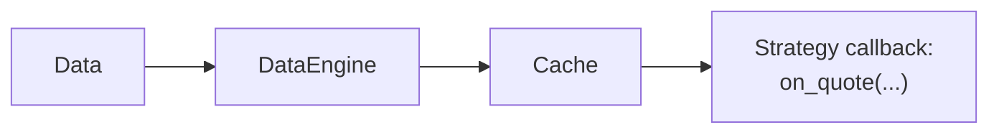

`Cache` คือที่เก็บข้อมูลใน memory ส่วนกลางสำหรับ trading state และ market data ล่าสุด actor และ strategy
ใช้ cache เพื่ออ่านข้อมูลที่ data engine และ execution engine ดูแลอยู่ หรือเพื่อแชร์ข้อมูลแบบ raw bytes ภายใต้
key ที่แอปพลิเคชันกำหนดเอง

cache ทำหน้าที่:

- เก็บ order book ปัจจุบัน และประวัติแบบจำกัดขนาดของ quote, trade, bar และ market data อื่น ๆ
- ติดตาม order, position, account, instrument และ currency จนกว่าจะถูก purge หรือ reset
- แชร์ข้อมูลที่ผู้เรียก serialize เองระหว่าง component และ persist ข้อมูลนั้นเมื่อมีการตั้งค่า backing database

## การทำงานของ cache [#how-caching-works]

engine จะเพิ่มข้อมูลแบบ built-in ลงใน `Cache` เมื่อ event ไหลผ่านระบบ live adapter ส่ง event ให้ engine
แบบ asynchronous ดังนั้น cache จะเปลี่ยน **เมื่อ engine ประมวลผล event** ไม่ใช่ตอนที่ adapter ได้รับ event
ครั้งแรก

สำหรับ quote, trade และ bar นั้น `DataEngine` จะพยายามเขียนลง `Cache` ก่อน publish ให้ subscriber
เมื่อเขียนสำเร็จ ค่าล่าสุดจะพร้อมใช้งานแล้วตอนที่ handler ของ strategy ทำงาน ส่วน order book delta และ
depth snapshot จะถูก publish โดยตรง และ subscription ของ `BookUpdater` จะดูแล state ของ book ปัจจุบันแยกต่างหาก:



ดูการไล่ลำดับทีละขั้นแบบเต็มได้ที่
[Data flow: วงจรชีวิตของ quote tick](architecture.md#data-flow-life-of-a-quote-tick)

### ตัวอย่างพื้นฐาน [#basic-example]

ภายใน strategy สามารถเข้าถึง `Cache` ที่ใช้ร่วมกันเพื่ออ่าน bar ล่าสุด, state ของ position ปัจจุบัน และ
open order ของ instrument ได้

> หมายเหตุ: ต้นฉบับมีเฉพาะตัวอย่าง Python จึงตัดออก

## การตั้งค่า [#configuration]

ใช้ `CacheConfig` เพื่อตั้งค่าพฤติกรรมและความจุของ `Cache` แล้วส่งให้ `BacktestEngine` หรือ `LiveNode`
ขึ้นอยู่กับ [environment context](architecture.md#environment-contexts)

การตั้งค่าความจุแบบเดียวกันใช้ได้ทั้งสอง environment

:::tip
โดย default `Cache` จะเก็บค่าได้สูงสุด 10,000 ค่าในแต่ละลำดับ tick ต่อ instrument และ 10,000 bar ต่อ bar type
ค่าเหล่านี้เป็นขีดจำกัดแยกกัน ไม่ใช่ผลรวม ตั้งค่าความจุแต่ละตัวได้ในช่วง `[1, 1_000_000]` ให้เพิ่มค่าเมื่อ
strategy ต้องการ lookback ใน memory ที่ยาวขึ้น และยอมรับการใช้ memory ที่เพิ่มขึ้นได้
:::

### ตัวเลือกการตั้งค่า [#configuration-options]

`CacheConfig` รองรับพารามิเตอร์ต่อไปนี้:

```rust
use nautilus_common::{cache::CacheConfig, enums::SerializationEncoding};

let config = CacheConfig {
    encoding: SerializationEncoding::MsgPack,
    timestamps_as_iso8601: false,
    buffer_interval_ms: None,
    bulk_read_batch_size: None,
    use_trader_prefix: true,
    use_instance_id: false,
    flush_on_start: false,
    drop_instruments_on_reset: true,
    tick_capacity: 10_000,
    bar_capacity: 10_000,
    persist_account_events: true,
    save_market_data: false,
};
```

:::note
แต่ละ bar type มีความจุของตัวเอง ตัวอย่างเช่น ถ้าใช้ทั้ง bar 1 นาทีและ 5 นาที แต่ละชนิดจะเก็บได้สูงสุด
`bar_capacity` bar
เมื่อถึง `bar_capacity` แล้ว `Cache` จะลบข้อมูลที่เก่าที่สุดออกโดยอัตโนมัติ
:::

### การตั้งค่า database [#database-configuration]

ตั้งค่า database backing เพื่อกู้คืน cache record ที่รองรับและ persist สำเร็จแล้วหลังจาก restart record ที่
กู้คืนได้ ได้แก่ general data, currency, instrument, instrument close, account, order และ position
ตอนเริ่มต้นระบบจะไม่กู้คืนประวัติ market data แบบจำกัดขนาด และไม่กู้คืน process ที่กำลังทำงานอยู่

instrument close จะถูก persist เสมอเมื่อมีการตั้งค่า backing database โดย `save_market_data` ไม่ได้ควบคุม
ส่วนนี้ เพราะเป็น snapshot สำหรับการกู้คืน ไม่ใช่ประวัติ market data แบบจำกัดขนาด

`CacheConfig` ควบคุมพฤติกรรมของ cache ส่วนการตั้งค่าการเชื่อมต่ออยู่ใน config ของ backing แต่ละตัว เช่น
`RedisCacheConfig` หรือ `PostgresCacheConfig`

backing เป็นกลไกสำหรับการกู้คืน ไม่ใช่คลังเก็บ event ที่สมบูรณ์ หรือ distributed cache ที่ซิงก์กัน แต่ละ node
เป็นเจ้าของ cache ใน memory ของตัวเอง การชี้หลาย node ไปยัง namespace เดียวกันของ database ไม่ได้ทำให้
cache เหล่านั้นสอดคล้องกัน

ฝั่ง Rust ให้สร้าง database config แบบ concrete แล้วใช้ trait `CacheDatabaseFactory` เพื่อสร้าง adapter
ที่จะส่งเข้าไปยัง system builder:

```rust
use nautilus_common::{
    cache::{CacheConfig, database::CacheDatabaseFactory},
    enums::SerializationEncoding,
};
use nautilus_infrastructure::redis::cache::RedisCacheConfig;

let config = CacheConfig {
    encoding: SerializationEncoding::MsgPack,
    timestamps_as_iso8601: true,
    buffer_interval_ms: Some(100),
    ..Default::default()
};

let database = RedisCacheConfig {
    host: Some("localhost".to_string()),
    port: Some(6379),
    connection_timeout: 2,
    response_timeout: 2,
    ..Default::default()
};

let cache_database = database
    .create(trader_id, instance_id, config.clone())
    .await?;
```

สำหรับ live node ใน Rust ให้ attach adapter ก่อนเริ่มต้นระบบ:

```rust
let node_config = LiveNodeConfig {
    trader_id,
    ..Default::default()
};
let mut node = LiveNode::build("LiveNode".to_string(), Some(node_config))?;
node.set_cache_database(cache_database)?;
node.run().await?;
```

:::warning
เมื่อใช้ค่า default `LiveExecutionEngineConfig.load_cache = true` node จะกู้คืน cache state ที่ persist ไว้
และสร้าง derived index ใหม่ ก่อนเชื่อมต่อ client หรือทำ reconciliation ของ execution state การตั้ง
`CacheConfig.flush_on_start = true` จะล้าง backing แทน สำหรับ backing แบบ Postgres จะล้างเฉพาะแถวของ
trader ของ node นั้น (ดูด้านล่าง)
:::

ส่ง `PostgresCacheConfig` แทน เพื่อใช้ Postgres เป็น backing ของ cache data Postgres ไม่รองรับการ persist
state ของ actor หรือ strategy จึงไม่ควรใช้ร่วมกับ `load_state` หรือ `save_state`

backing แบบ Postgres ผูกขอบเขตกับ trader ID ของ node ดังนั้นหลาย node จึงใช้ database เดียวกันได้:

- node จะโหลดและเขียนเฉพาะ order, position, snapshot และ account ของตัวเอง โดยใช้ trader เป็น key
  ดังนั้น trader สองรายจึงใช้ client order ID หรือ position ID ซ้ำกันได้
- `flush_on_start` ลบเฉพาะแถวของ trader นั้น
- currency, instrument, instrument close, market data และ general data ยังใช้ร่วมกันระหว่าง trader

:::warning
การอัปเกรด database ที่มีอยู่แล้วเป็นขั้นตอน migration ที่ต้องทำ account event ที่ persist ไว้ก่อนมีการผูก
ขอบเขตตาม trader จะไม่มี trader และไม่มีอะไรระบุได้ว่า trader คนใดเป็นเจ้าของ ดังนั้นการเชื่อมต่อจะล้มเหลว
ตราบที่ยังมี event เหล่านี้อยู่ ซึ่งจะ block ทุก node ที่ใช้ database นั้น error จะแสดงรายการ account ที่ได้รับ
ผลกระทบ ให้รัน `nautilus database init` แล้ว assign แต่ละ account ให้ trader ของมัน:

```bash
nautilus database assign-account --account-id <ACCOUNT_ID> --trader-id <TRADER_ID>
```

:::

:::warning
ต้อง dispose node ทุกครั้ง `dispose()` จะปิด backing ซึ่งจะ flush การเขียนที่ยังค้างอยู่ใน buffer เมื่อตั้งค่า
`CacheConfig.buffer_interval_ms` ไว้ การ return ออกจาก `run()` ทันทีอาจทำให้ข้อมูลเหล่านั้นหายไป
:::

## การใช้งาน cache [#using-the-cache]

### การเข้าถึง market data [#accessing-market-data]

`Cache` ให้เข้าถึง order book, quote, trade, bar และ market data อื่น ๆ ประวัติ market data ใน cache ใช้
**reverse indexing**: index 0 คือรายการล่าสุด และ index 1 คือรายการก่อนหน้า accessor ที่คืนค่าเป็นรายการ
ใช้ลำดับเดียวกับ accessor ที่คืนค่ารายการเดียว

| ชนิดข้อมูล          | ประวัติ                              | รายการล่าสุด                       |
| ------------------- | ------------------------------------ | ---------------------------------- |
| Quotes              | `quotes(instrument_id)`              | `quote(instrument_id)`             |
| Trades              | `trades(instrument_id)`              | `trade(instrument_id)`             |
| Bars                | `bars(bar_type)`                     | `bar(bar_type)`                    |
| Mark prices         | `mark_prices(instrument_id)`         | `mark_price(instrument_id)`        |
| Index prices        | `index_prices(instrument_id)`        | `index_price(instrument_id)`       |
| Funding rates       | `funding_rates(instrument_id)`       | `funding_rate(instrument_id)`      |
| Instrument statuses | `instrument_statuses(instrument_id)` | `instrument_status(instrument_id)` |

bar เรียงตาม `ts_event` จากใหม่ไปเก่า ส่วนประวัติอื่นเรียงตามลำดับการเพิ่มแบบย้อนกลับ: รายการที่เพิ่มล่าสุด
จะอยู่ก่อน แม้ว่าจะมี timestamp เก่ากว่าก็ตาม ประวัติเหล่านี้ไม่ได้เรียงตาม `ts_event` หรือ `ts_init`

accessor ของประวัติแต่ละตัวคืนค่าเป็นรายการ หรือไม่มีค่าเมื่อไม่มีรายการใน cache สำหรับ key นั้น สำหรับรายการ
ที่ไม่ว่าง ตัวแรกคือรายการล่าสุด ส่วนตัวสุดท้ายคือ bar ที่เก่าที่สุดที่ยังเก็บไว้ หรือรายการที่เพิ่มเข้ามานานที่สุด
ในประวัติอื่น ๆ มีเพียง `quote()`, `trade()` และ `bar()` เท่านั้นที่รับ argument `index` และจะไม่มีค่า
เมื่อไม่มีรายการที่ index ที่ไม่ติดลบและถูกต้อง

`CacheConfig.bar_capacity` จำกัดประวัติของแต่ละ bar type ส่วน `CacheConfig.tick_capacity` จำกัดประวัติ
อื่น ๆ แต่ละชนิดต่อ instrument เมื่อประวัติเต็มความจุแล้ว การเพิ่มรายการใหม่จะลบรายการสุดท้ายออก

#### Order book [#order-book]

cache เก็บ state ของ order book ปัจจุบันของแต่ละ instrument ไม่ได้เก็บประวัติการอัปเดตของ book
instrument close ก็เก็บค่าเดียวต่อ instrument เช่นกัน: `instrument_close(instrument_id)` คืนค่า close
ที่เพิ่มล่าสุด หรือไม่มีค่าถ้ายังไม่มี

> หมายเหตุ: ต้นฉบับมีเฉพาะตัวอย่าง Python ของ accessor ในส่วนนี้ (order book, quote, trade, bar, price,
> bar type) จึงตัดออก

#### Trade tick [#trade-ticks]

quote และ trade จะสะสม tick ทั้งหมด รวมถึง tick ที่มี timestamp เดียวกัน

#### การเข้าถึง bar [#bar-access]

ถ้าต้องการประมวลผล bar จากเก่าไปใหม่ ให้กลับลำดับรายการที่ได้คืนมา

bar ถูกเก็บแบบ **ใหม่สุดก่อนต่อ bar type** bar ที่ใหม่กว่าจะถูกเพิ่มเข้าไป bar ที่เก่ากว่าจะถูกข้าม แต่ยังคง
ส่งไปใน response

- **Time bar**: bar ที่มี `ts_event` เดียวกันจะแทนที่ตัวที่อยู่ใน cache (ข้อมูลที่มาทีหลังชนะ) ดังนั้นข้อมูลซ้ำจาก
  historical request ที่ช่วงเวลาทับซ้อนกันจะไม่สะสม
- **Non-time bar**: Renko brick หรือ volume bar ที่ออกมาจากการอัปเดตครั้งเดียวอาจมี `ts_event` เดียวกันได้
  ตามปกติ bar ทุกตัวที่ timestamp เดียวกันจะถูกเก็บไว้ รวมถึงตัวที่ถูกส่งซ้ำจาก request ที่ทับซ้อนกัน
- **Internal request aggregation**: cache จะแทรก bar ที่สร้างจาก request ลงในตำแหน่งตามลำดับแทนที่จะข้าม
  เพราะ cache เป็นช่องทางเดียวที่ส่ง bar เหล่านี้ออกไป

#### การเข้าถึงราคา [#price-access]

ดึงราคาปัจจุบันตามประเภทได้ โดยมีตัวเลือก `BID`, `ASK`, `MID`, `LAST` และ `MARK`

#### Bar type [#bar-types]

ดึง bar type ทั้งหมดที่มีของ instrument ได้ โดยกรองตาม price type (`BID`, `ASK`, `MID`, `LAST`, `MARK`)
และ aggregation source

#### ตัวอย่างอย่างง่าย [#simple-example]

> หมายเหตุ: ต้นฉบับมีเฉพาะตัวอย่าง Python จึงตัดออก

### Trading object [#trading-objects]

`Cache` ให้เข้าถึง trading object เช่น:

- Order
- Position
- Account
- Instrument

#### Order [#orders]

query order ได้ตาม venue, strategy, instrument, account หรือ order side

> หมายเหตุ: ต้นฉบับมีเฉพาะตัวอย่าง Python ของการเข้าถึง order, การ query สถานะ (open, closed, emulated,
> inflight, active local) และสถิติของ order จึงตัดออก

#### Position [#positions]

`Cache` เก็บ position ไว้จนกว่าจะถูก purge หรือ reset และมีหลายวิธีให้ query

> หมายเหตุ: ต้นฉบับมีเฉพาะตัวอย่าง Python ของการเข้าถึง position, การ query สถานะ และสถิติของ position
> จึงตัดออก

#### Account [#accounts]

การค้นหาด้วย venue จะได้ผลก็ต่อเมื่อมี account ที่ออกภายใต้ venue นั้นเพียงหนึ่ง account เท่านั้น (venue คือ
prefix ของ account ID เช่น `BINANCE` ใน `BINANCE-001`) เมื่อมีหลาย account ใช้ venue เดียวกัน
`account_for_venue` และ `account_id` จะไม่คืนค่า ให้ดึง account เหล่านั้นด้วย ID แทน

#### Instrument [#instruments]

> หมายเหตุ: ต้นฉบับมีเฉพาะตัวอย่าง Python (ดึง instrument ตาม ID, ทั้งหมด, ตาม venue และดึง instrument ID)
> จึงตัดออก

### การ purge ข้อมูลใน cache [#purging-cached-data]

session ที่ทำงานยาวนานจะสะสม closed order, closed position, account event และ instrument ที่ไม่ได้ใช้แล้ว
cache มี method สำหรับ purge ทั้งแบบเจาะจงและแบบเป็นชุด เพื่อให้ strategy และ live trading engine คุมการใช้
memory ได้โดยไม่ต้อง restart ระบบ

#### การ purge แบบเจาะจง [#targeted-purges]

ใช้เพื่อลบ entity ทีละตัว แต่ละ method จะไม่ purge ถ้า entity นั้นยัง active อยู่

- `cache.purge_order(client_order_id)`: ลบ order และ index entry ทุกตัวที่ใช้ order เป็น key ข้าม open order
- `cache.purge_position(position_id)`: ลบ position, snapshot ของ position และ index entry ที่ใช้ position
  เป็น key ข้าม open position
- `cache.purge_instrument(instrument_id)`: ลบ instrument และ map ชั่วคราวต่อ instrument (order book, quote,
  trade, ราคา mark/index/funding, instrument status และ close, greeks และ bar ที่อ้างอิง instrument นั้น)
  จะข้ามถ้ามี order ที่เกี่ยวข้องตัวใดยังไม่อยู่ในสถานะสิ้นสุด (ทุกสถานะที่ยังไม่ถึงสถานะปิด รวมถึง order ที่เป็น
  initialized, submitted, accepted, emulated, released และ inflight) หรือมี position ที่เกี่ยวข้องตัวใดยัง
  ไม่ปิด order และ position ใน cache จะยังคงอยู่ใน index จนกว่าจะถูก purge แยกต่างหาก เพื่อรักษา historical
  query และ realized PnL ไว้

:::warning
`purge_instrument` มีไว้สำหรับ actor และ strategy ที่มี lifecycle logic ของตัวเองในการตัดสินว่าเมื่อใดไม่ต้องการ
instrument แล้ว การ purge instrument ที่ component อื่นยังใช้อยู่จะทำให้ค้นหา instrument ไม่เจอ และสูญเสีย
ประวัติ market data subscription ที่ active อยู่เป็นของ data engine ดังนั้นให้ unsubscribe ก่อน purge
ถ้าไม่ต้องการรับอัปเดตอีก
:::

#### การ purge แบบเป็นชุด [#bulk-purges]

ใช้เพื่อกวาดรายการที่เก่าออกตามอายุ โดยรับ timestamp ปัจจุบันและช่วง buffer หรือ lookback หน่วยวินาที

- `cache.purge_closed_orders(ts_now, buffer_secs)`: closed order ที่ timestamp ตอนปิดเก่ากว่า `buffer_secs`
- `cache.purge_closed_positions(ts_now, buffer_secs)`: closed position ที่ timestamp ตอนปิดเก่ากว่า
  `buffer_secs`
- `cache.purge_account_events(ts_now, lookback_secs)`: account state event ที่เก่ากว่า `lookback_secs`
  ค่า `0` จะ purge event ทั้งหมด

:::warning
ให้เก็บ closed source position ของการ flip แบบ virtual `HEDGING` ไว้ ตราบใดที่ order ของมันยังอาจได้รับ fill
การ purge position นั้นจะลบประวัติที่จำเป็นสำหรับ route fill ที่ตามมา และอาจทำให้ engine reject fill เหล่านั้น
:::

#### การ purge อัตโนมัติใน live trading [#automatic-purging-in-live-trading]

`LiveExecutionEngineConfig` ตั้งเวลาให้ purge แบบเป็นชุดทำงานด้วย timer ช่วงเวลา purge ทุกตัวมีค่า default
เป็น `None` ซึ่งปิด loop ที่เกี่ยวข้องไว้ ตั้งค่า interval เพื่อเปิด loop และตั้ง buffer หรือ lookback เพื่อควบคุม
ว่ารายการที่ใหม่แค่ไหนจะได้รับการคุ้มครอง ค่าเริ่มต้นที่แนะนำจากคู่มือการตั้งค่า live trading คือ:

- `purge_closed_orders_interval_mins=15`, `purge_closed_orders_buffer_mins=60`
- `purge_closed_positions_interval_mins=15`, `purge_closed_positions_buffer_mins=60`
- `purge_account_events_interval_mins=15`, `purge_account_events_lookback_mins=60`

interval ที่สั้นลงทำให้ purge บ่อยขึ้น ส่วน buffer หรือ lookback ที่สั้นลงจะลบข้อมูลที่ใหม่กว่า เลือกแต่ละค่าแยกกัน
ตามขีดจำกัดของ memory และ execution context ล่าสุดที่ต้องใช้สำหรับ reconciliation หรือการวิเคราะห์ ดูรายการ
พารามิเตอร์ทั้งหมดได้ที่
[ตั้งค่า live trading: การจัดการ memory](../how_to/configure_live_trading.md)

:::note
การ purge instrument ไม่มี loop อัตโนมัติ เพราะเวลาที่เหมาะสมในการลบ instrument ขึ้นอยู่กับ state ของ strategy
ไม่ใช่อายุ ให้เรียก `cache.purge_instrument` จาก actor หรือ strategy ที่ดูแล lifecycle ของ instrument นั้น
:::

### Custom data [#custom-data]

`Cache` เก็บ raw bytes ภายใต้ string key ที่แอปพลิเคชันกำหนด ให้ serialize ค่าก่อนเพิ่ม และ deserialize หลัง
ดึงออกมา actor และ strategy ใช้รายการเหล่านี้เพื่อแชร์ข้อมูลแอปพลิเคชันจำนวนเล็กน้อยได้

#### การเก็บและดึงข้อมูลเบื้องต้น [#basic-storage-and-retrieval]

> หมายเหตุ: ต้นฉบับมีเฉพาะตัวอย่าง Python (`add` และ `get` ด้วย key) จึงตัดออก

:::warning
`Cache` ไม่ใช่ database ทั่วไป ให้ใช้ที่เก็บข้อมูลเฉพาะทางสำหรับชุดข้อมูลขนาดใหญ่หรือ query ที่ซับซ้อน
:::

## แนวปฏิบัติที่ดีและคำถามที่พบบ่อย [#best-practices-and-common-questions]

### Cache กับ portfolio [#cache-vs-portfolio-usage]

`Cache` และ `Portfolio` มีหน้าที่ต่างกัน:

**Cache**:

- เก็บ execution object, ประวัติของ object บางชนิด และ market data ล่าสุดแบบจำกัดขนาด จนกว่าจะ purge หรือ reset
- ใช้การเปลี่ยนแปลง state ภายในทันที เช่น การ initialize order ก่อน submit
- ใช้ event จากภายนอกเมื่อ engine ประมวลผล event นั้น เช่น ตอนที่ order ถูก fill

**Portfolio**:

- รวบรวมข้อมูล position, exposure และ account
- คำนวณมูลค่า portfolio ปัจจุบันจาก state ใน cache และราคาตลาด

### Cache กับตัวแปรของ strategy [#cache-vs-strategy-variables]

ใช้รายการใน cache สำหรับข้อมูลที่แชร์และ serialize แล้ว และใช้ตัวแปรของ strategy สำหรับ working state ภายใน

**การเก็บใน cache**:

- actor และ strategy ที่ใช้ system cache ร่วมกันเข้าถึงได้
- persist รายการ byte ทั่วไปได้เมื่อมีการตั้งค่า backing database และการเขียนเสร็จสมบูรณ์
- ยังคงอยู่เมื่อ strategy ตัวใดตัวหนึ่ง reset แต่การ reset cache หรือ execution engine จะล้างรายการใน memory

**ตัวแปรของ strategy**:

- เก็บการคำนวณและค่าระหว่างทางที่มี type และเฉพาะของ strategy ไว้ภายใน
- ไม่เปิดเผยค่าให้ component อื่น และไม่ persist ให้อัตโนมัติ

การ persist state ของ actor และ strategy ข้ามการ restart process ใช้ hook `on_save` และ `on_load` แยกต่างหาก
ร่วมกับ backing ที่รองรับ ดูหัวข้อ
[การตั้งค่า cache database](../how_to/configure_live_trading.md#cache-database-configuration)
ในคู่มือ live trading

ให้ serialize ข้อมูลที่แชร์ก่อนเพิ่มลงใน cache แล้ว strategy อื่นจึงดึงข้อมูลนั้นมา deserialize ได้

> หมายเหตุ: ต้นฉบับมีเฉพาะตัวอย่าง Python จึงตัดออก

## คู่มือที่เกี่ยวข้อง [#related-guides]

- [Data](data/): ชนิดข้อมูลที่เก็บใน cache
- [Strategies](strategies.md): strategy เข้าถึง cache เพื่ออ่าน market data และ state
- [Reports](reports.md): สร้าง report จากข้อมูลใน cache
