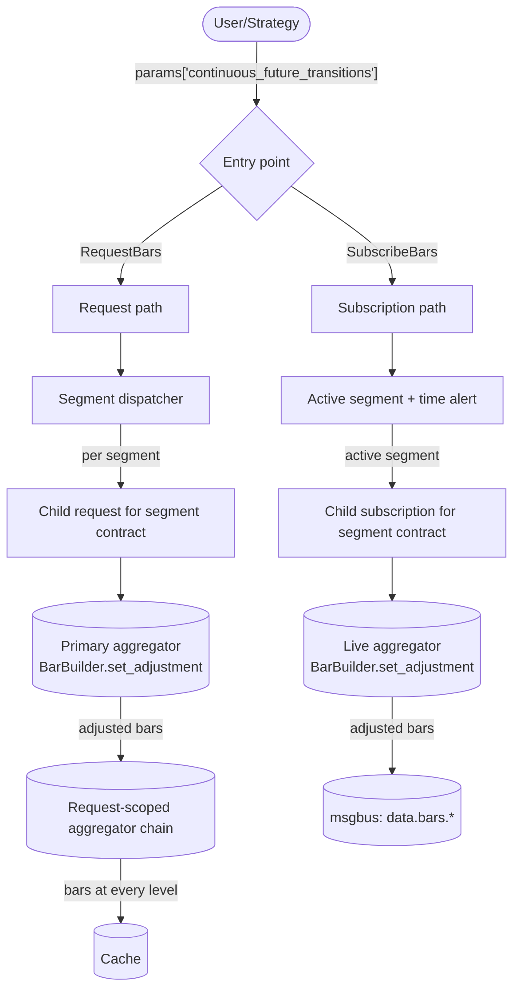
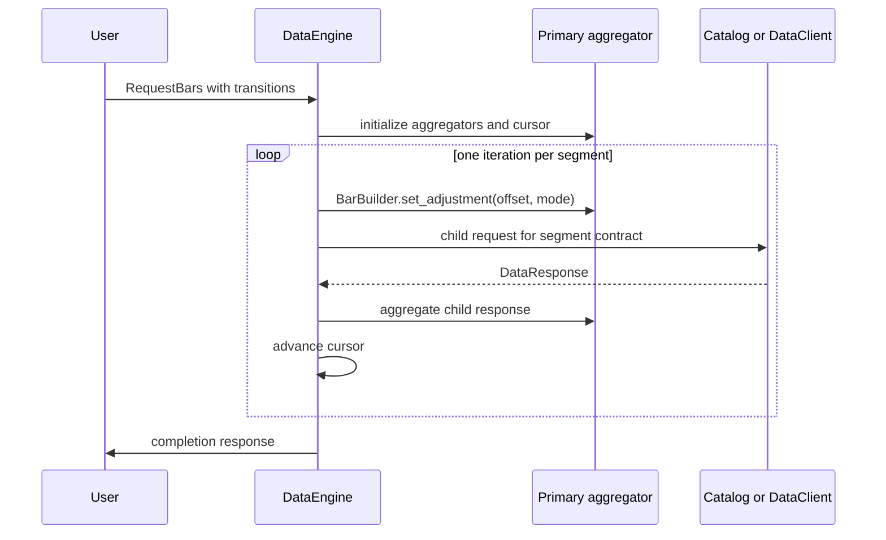
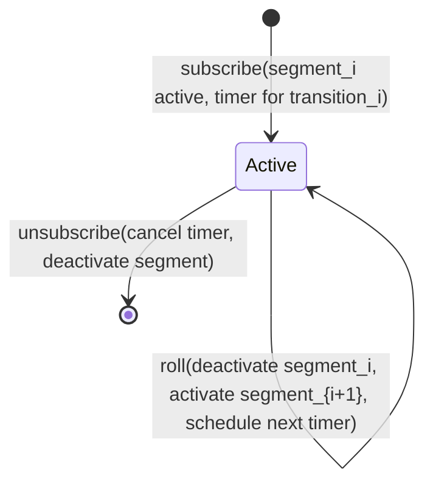
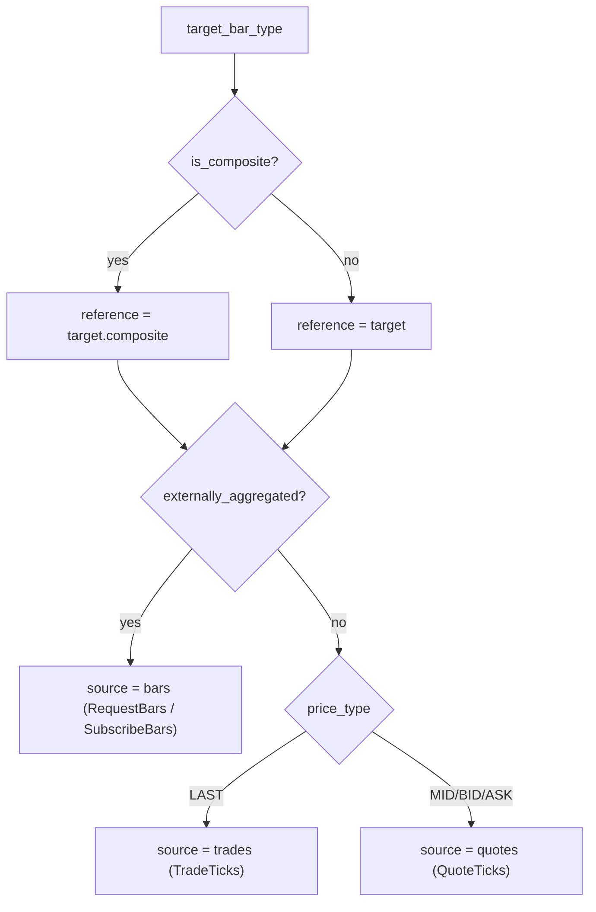
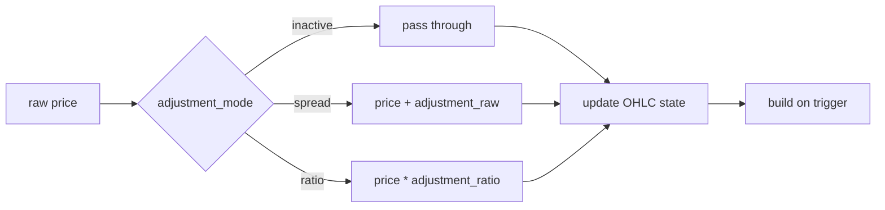

**continuous future** คือชุดข้อมูลอนุพันธ์ที่นำสัญญา futures ที่ต่อเนื่องกันมาต่อเป็น price stream เดียวที่ผ่าน
การปรับราคาแล้ว เนื่องจากสัญญาอ้างอิงแต่ละตัวมีวันหมดอายุ ชุดข้อมูลแบบ continuous จึงต้อง roll ไปยังสัญญาถัดไป
ณ จุดเปลี่ยน (transition point) แต่ละช่วงจะถูกปรับให้อยู่ในกรอบราคาเดียวกัน เพื่อไม่ให้การเปลี่ยนสัญญาสร้าง
การกระโดดของราคาแบบเทียม

Nautilus model continuous future ด้วย target `BarType` บวกกับรายการ roll transition ที่ระบุอย่างชัดเจนใน
params ของ request หรือ subscription สำหรับแต่ละช่วงเวลา data engine จะเลือกสัญญาจริงและคำนวณค่าปรับราคาสะสม
(cumulative price adjustment) จากนั้นป้อนข้อมูลต้นทางที่ปรับแล้วผ่านเส้นทาง bar aggregation ตามปกติ

## โหมดการปรับราคา [#adjustment-modes]

`ContinuousFutureAdjustmentType` รวมทิศทาง (backward หรือ forward) เข้ากับวิธีคำนวณ (spread หรือ ratio):

| โหมด              | วิธีคำนวณ      | ช่วงที่ใช้เป็น anchor                 |
| ----------------- | -------------- | ------------------------------------- |
| `BACKWARD_SPREAD` | บวก (Additive) | สัญญาสุดท้ายในช่วงที่ปรับราคา        |
| `FORWARD_SPREAD`  | บวก (Additive) | สัญญาแรกในช่วงที่ปรับราคา            |
| `BACKWARD_RATIO`  | คูณ (Multiplicative) | สัญญาสุดท้ายในช่วงที่ปรับราคา  |
| `FORWARD_RATIO`   | คูณ (Multiplicative) | สัญญาแรกในช่วงที่ปรับราคา      |

ค่าปรับสะสมที่ segment `k` จากทั้งหมด `N` transition คือ:

```text
BACKWARD_SPREAD: sum over i in [k, N) of (post_i - pre_i)
FORWARD_SPREAD:  sum over i in [0, k) of (pre_i - post_i)
BACKWARD_RATIO:  product over i in [k, N) of (post_i / pre_i)
FORWARD_RATIO:   product over i in [0, k) of (pre_i / post_i)
```

โหมด spread สะสม offset แบบบวก ส่วนโหมด ratio สะสมตัวคูณ และต้องการราคาที่เป็นบวกเท่านั้น

## Input [#inputs]

request หรือ subscription แบบ continuous future คือ `RequestBars` หรือ `SubscribeBars` ใด ๆ ที่มี
รายการ `continuous_future_transitions` อยู่ใน `params` โดยมีคีย์ดังนี้:

- `continuous_future_transitions`: รายการของ transition แต่ละแถวประกอบด้วย `transition_time_ns`
  (เวลาที่สัญญาเดิม roll ไปยังสัญญาใหม่), `pre_instrument_id`, `post_instrument_id`, `pre_price`
  (ราคาสุดท้ายของสัญญาเดิมก่อน roll) และ `post_price` (ราคาแรกของสัญญาใหม่หลัง roll)
- `continuous_future_adjustment_mode`: เช่น `"BACKWARD_SPREAD"`
- `last_post_instrument_id` (ไม่บังคับ): จำกัดขอบบนของการปรับสะสมไว้ที่ transition ที่ `post_instrument_id`
  ตรงกัน (anchor ของโหมด backward)
- `first_pre_instrument_id` (ไม่บังคับ): จำกัดขอบล่างของการปรับสะสมไว้ที่ transition ที่ `pre_instrument_id`
  ตรงกัน (anchor ของโหมด forward)

> หมายเหตุ: ต้นฉบับแสดงตัวอย่าง `params` เป็นโค้ด Python จึงตัดออก

ถ้าไม่ระบุ `continuous_future_adjustment_mode` จะใช้ค่า default เป็น `BACKWARD_SPREAD`

`bar_type` ของ request หรือสมาชิกแต่ละตัวใน `bar_types` ของ subscription ระบุ bar type แบบ continuous
ที่เป็น **target** เช่น `"ES.XCME-1-MINUTE-LAST-INTERNAL@1-MINUTE-EXTERNAL"`

target ของ subscription ใช้ `params` ของ command ร่วมกัน ถ้ามีหลาย chain หรือหลายการตั้งค่า ให้ใช้ command แยกกัน

`ES.XCME` ระบุ continuous root ไม่ใช่สัญญาจริง แต่ละ segment จะได้ข้อมูลดิบต้นทางจากสัญญาจริงที่อยู่ใน
รายการ transition

target bar type แบบ continuous ต้องเป็นแบบ **internally aggregated** bar ที่ aggregate จากภายนอก
(externally aggregated) ใช้เป็น continuous target ไม่ได้ แต่ใช้เป็นต้นทางของแต่ละ segment ได้

### Chain แบบมีขอบเขต [#bounded-chains]

ขอบเขตที่เป็นตัวเลือกทั้งสองตัวจำกัดว่า transition ใดบ้างที่นำมาคิดในค่าปรับสะสม แต่ไม่ได้ตัด segment ของสัญญา
ออกจาก request หรือ subscription:

- `last_post_instrument_id` จำกัดขอบบนไว้ที่ transition แรกที่ `post_instrument_id` ตรงกัน
  โหมด backward ใช้ post contract ที่ตรงกันเป็น anchor ที่มีค่าปรับเป็นศูนย์ ส่วนโหมด forward จะไม่นำ
  transition ที่อยู่หลังจากนั้นมาคิดในค่าปรับสะสม
- `first_pre_instrument_id` จำกัดขอบล่างไว้ที่ transition แรกที่ `pre_instrument_id` ตรงกัน
  โหมด forward ใช้ pre contract ที่ตรงกันเป็น anchor ที่มีค่าปรับเป็นศูนย์ ส่วนโหมด backward จะไม่นำ
  transition ที่อยู่ก่อนหน้านั้นมาคิดในค่าปรับสะสม

ขอบเขตเหล่านี้ทำให้ผู้เรียกส่งตาราง transition ที่กว้างกว่าได้ โดยยังเลือกช่วงที่จะปรับราคาเองได้

## การตรวจสอบความถูกต้อง [#validation]

ทั้งเส้นทาง request และ subscription ใช้กฎตรวจสอบ transition parameter ชุดเดียวกัน ก่อนจะสร้าง aggregator
หรือ state ของ child segment:

- ถ้าระบุ `continuous_future_adjustment_mode` ต้อง parse เป็น `ContinuousFutureAdjustmentType` ที่ถูกต้องได้
- `continuous_future_transitions` ต้องเป็น array ของแถว transition ที่ไม่ว่าง
- แต่ละแถวต้องมี `transition_time_ns` เป็นจำนวนเต็มที่ไม่ติดลบ และเวลาของ transition ต้องเพิ่มขึ้นอย่างเคร่งครัด
- `pre_instrument_id` และ `post_instrument_id` แต่ละตัวต้อง parse เป็น `InstrumentId` ที่ถูกต้องได้ และ
  venue ต้องตรงกับ venue ของ target
- chain ต้องต่อเนื่อง: `post_instrument_id` ของแถว `i` ต้องเท่ากับ `pre_instrument_id` ของแถว `i + 1`
- แต่ละแถวต้องมี `pre_price` และ `post_price` ที่เป็นค่าจำกัด (finite) โหมด ratio ยังต้องการให้ราคาทั้งสอง
  เป็นบวกด้วย
- ถ้าผู้เรียกระบุ `last_post_instrument_id` ค่านั้นต้อง parse เป็น `InstrumentId` ได้ venue ตรงกับ target
  และต้องปรากฏเป็น `post_instrument_id` ในรายการ transition กฎเดียวกันใช้กับ `first_pre_instrument_id`

ดังนั้น validation error จะคืนกลับมาก่อนที่เส้นทางใดจะเริ่ม workflow ของการ aggregate

หลังผ่านการตรวจสอบแล้ว ถ้าการ setup หรือการ dispatch segment แรกล้มเหลว เส้นทาง request จะปล่อย aggregator
ที่ผูกกับ request นั้น ส่วนความล้มเหลวระหว่าง dispatch segment ถัด ๆ ไป ยังคงจบ request ด้วย completion
response และการเก็บกวาด aggregator ตามปกติ

## การสร้าง target instrument อัตโนมัติ [#target-instrument-auto-synthesis]

continuous root (เช่น `ES.XCME`) เป็น id สังเคราะห์ที่ไม่มี market data ของตัวเอง แต่ส่วนที่ทำงานต่อจากนั้น
(aggregator, การค้นหาใน cache, serialization) ยังคาดหวังว่าจะมี `Instrument` อยู่ใน cache หลังผ่านการตรวจสอบ
ทั้งเส้นทาง request และ subscription จะตรวจให้แน่ใจว่ามี target instrument อยู่:

- ถ้า target id อยู่ใน cache แล้ว การ setup target จะไม่ทำอะไร ผู้เรียกสามารถลงทะเบียน continuous instrument
  แบบกำหนดเองไว้ก่อนได้ และ engine จะใช้ตัวนั้น
- มิฉะนั้น การ setup target จะดึง instrument ของ segment แรกจาก cache แล้ว clone มา โดย override เฉพาะ `id`
  และ `raw_symbol` และล้าง `activation_ns` กับ `expiration_ns` ให้เป็น `0` ฟิลด์อื่นทั้งหมด (currency,
  precision, increment, multiplier, lot size, underlying, fee, margin, exchange, tick scheme, info) ใช้ค่า
  จาก segment
- ถ้า segment แรกยังไม่อยู่ใน cache หรือไม่ใช่ `FuturesContract` การ setup จะ log warning แล้ว return
  ผู้เรียกต้องลงทะเบียน continuous instrument เอง

## ภาพรวมสถาปัตยกรรม [#architecture-overview]



bar จากเส้นทาง request จะถูกเก็บลง cache ส่วน bar จากเส้นทาง subscription จะ publish ไปยัง message bus

ทั้งสองเส้นทางใช้การแบ่ง segment, การหา source และการคำนวณค่าปรับแบบเดียวกัน เส้นทาง request ประมวลผล
segment ตามลำดับ ส่วนเส้นทาง subscription จะเปิดใช้งาน source ไว้หนึ่งตัว และสลับเมื่อ time alert ของ
transition ถัดไปทำงาน

## Segment [#segments]

**segment** คือช่วงเวลาต่อเนื่องที่เป็นของสัญญาจริงหนึ่งสัญญา โดยมี transition เป็นตัวแบ่ง segment เมื่อมี
`transitions[0..N)`:

- Segment 0: `(-inf, transitions[0].time)` บน `transitions[0].pre_instrument_id`
- Segment k โดย k อยู่ใน `[1, N)`: `[transitions[k-1].time, transitions[k].time)` บน
  `transitions[k].pre_instrument_id`
- Segment N: `[transitions[N-1].time, +inf)` บน `transitions[N-1].post_instrument_id`

เส้นทาง request จะตัดแต่ละ segment ให้อยู่ในช่วงเวลาที่ request และ dispatch segment ตามลำดับ ส่วนเส้นทาง
subscription ใช้ clock ของ engine เลือก segment ที่ active และตั้งเวลาสำหรับ transition ถัดไปที่เหลืออยู่

## ลำดับการทำงานของ request [#request-flow]

เส้นทาง request จะ dispatch child request ทีละตัวผ่านการจัดการ request ปกติของ engine ดังนั้น data catalog
ที่ลงทะเบียนไว้จะให้ข้อมูลของ segment ก่อน แล้ว client จึงเติมช่องว่างที่เหลือ เมื่อ child response มาถึง
engine จะ aggregate ข้อมูลแล้วไปยัง segment ถัดไป segment ที่แบ่งข้อมูลระหว่าง catalog และ client จะไปต่อ
ก็ต่อเมื่อได้รับทุกส่วนครบแล้ว



:::info
bar ที่ปรับแล้วจะถูกเขียนลง cache ทันทีที่ประมวลผล child response แต่ละตัว completion response เป็นสัญญาณว่า
request เสร็จสิ้นแล้วและรายงานจำนวน record ต้นทาง โดยไม่ได้มี vector รวมของ bar ที่ปรับแล้ว
:::

### Chain aggregator [#chain-aggregators]

ถ้า request ตั้ง `bar_types = (bar_type_1, bar_type_2)` สำหรับการ aggregate ภายในหลายระดับ engine จะสร้าง
aggregator แยกที่ผูกกับ request สำหรับแต่ละระดับ response ต้นทางของ segment จะเข้าสู่ continuous target
ตัวหลัก และ bar ที่ออกมาจะป้อนให้ aggregator ระดับถัดไปที่ตรงกัน มีเพียง builder ตัวหลักเท่านั้นที่ได้รับ
ค่าปรับ ระดับที่สูงกว่าจะ aggregate ซ้ำจากข้อมูลที่ปรับแล้ว

## ลำดับการทำงานของ subscription [#subscription-flow]

state machine ขนาดเล็กขับเคลื่อน subscription ที่ active แต่ละตัวผ่าน time alert ที่รออยู่เพียงตัวเดียว:



เมื่อ transition ทำงาน engine จะ:

1. ปิด segment ปัจจุบันโดย unsubscribe source
1. ใช้ค่าปรับของ segment ถัดไป
1. subscribe source ใหม่
1. ตั้ง timer สำหรับ transition ถัดไป

## การหา source [#source-resolution]

สำหรับ target `BarType` แบบ continuous future ใด ๆ ข้อมูลดิบที่ป้อนให้ aggregator ตัวหลักจะมาจาก
**สัญญาของ segment** ไม่ใช่ continuous id รูปแบบของ target เป็นตัวกำหนดประเภทของ source:



สำหรับ source ที่ aggregate ภายใน `LAST` ใช้ trade ส่วน `BID`, `ASK` และ `MID` ใช้ quote
price type อื่นไม่รองรับใน quote aggregation

## การปรับราคาใน BarBuilder [#barbuilder-adjustment]

builder ใช้ค่าปรับ **ตอนรับข้อมูลเข้า** ในทุกการเรียก `update(price, ...)` และ `update_bar(bar, ...)`
ดังนั้น state ของ OHLC ที่สะสมอยู่จะอยู่ในกรอบราคาร่วมที่ปรับแล้วเสมอ การเปลี่ยนค่าปรับระหว่าง bar จะมีผลเฉพาะ
กับ input ที่เข้ามาหลังจากนั้น



`BarBuilder` ใช้โหมดเพียงเพื่อเลือกว่าจะบวกหรือคูณ engine จะแปลงทิศทางการปรับเป็นค่าสะสมก่อนเรียก
`set_adjustment` method `reset()` จะล้าง state ของ OHLCV ต่อ bar เพื่อเตรียม bar ถัดไป แต่ยังเก็บค่าปรับ
ระดับ segment ไว้

## การ roll กลาง bar [#mid-bar-roll-boundary]

ถ้าการ roll เกิดขึ้นระหว่าง target bar ที่กำลังสร้างอยู่ builder จะคง state ของ OHLC ปัจจุบันไว้ และใช้ค่าปรับใหม่
เฉพาะกับการอัปเดตที่ตามมา ส่วนก่อนถึงจุดเปลี่ยนจะใช้ offset เดิม ส่วนหลังจุดเปลี่ยนใช้ offset ใหม่ การเขียน OHLC
ที่มีอยู่ใหม่ด้วยค่าปรับใหม่จะต้องใช้ input ดิบ ซึ่ง builder ไม่ได้เก็บไว้

## ข้อจำกัด [#limitations]

- ฟีเจอร์นี้ต้องได้รับ metadata ของ transition จากผู้เรียก engine ไม่ได้ค้นหาการ roll เลือกสัญญา หรืออนุมาน
  ราคา roll เอง ซึ่งเป็นความรับผิดชอบของผู้เรียก
- การปรับแบบ ratio แปลงตัวคูณและราคาแต่ละค่าผ่าน `f64` ก่อนสร้าง `Price` ที่ปรับแล้วขึ้นมาใหม่ สำหรับ instrument
  ที่มี precision สูง ผลลัพธ์อาจต่างจากการคูณด้วย `Decimal` ส่วนการปรับแบบ spread ยังแม่นยำในรูปแบบ fixed-point
  เพราะบวกเข้ากับ `PriceRaw` โดยตรง
