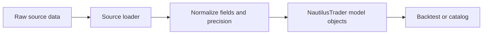

# Data

NautilusTrader รองรับข้อมูล order book แบบละเอียด, quote, trade, bar, ราคาอ้างอิง และ custom data
หน้าภาพรวมนี้รวมลิงก์ไปยังชนิดข้อมูล built-in และอธิบายแนวคิดที่ใช้ร่วมกันในสภาพแวดล้อม backtest, sandbox
และ live

## ชนิดข้อมูล built-in {#built-in-data-types}

market data แบบ built-in หลักแต่ละชนิดมีคู่มือเฉพาะที่อธิบายฟิลด์ พฤติกรรม และการสร้าง

| ชนิดข้อมูล                                    | หมวดหมู่             | คำอธิบาย                                             |
| --------------------------------------------- | -------------------- | ---------------------------------------------------- |
| [`OrderBookDelta`](order_book_delta.md)       | Order book           | การเปลี่ยนแปลงของ order book แบบ incremental หนึ่งรายการ |
| [`OrderBookDeltas`](order_book_deltas.md)     | Order book           | ชุดของ order book delta ที่เกี่ยวข้องกัน              |
| [`OrderBookDepth`](order_book_depth.md)       | Order book           | snapshot ฝั่ง bid และ ask แบบกำหนดความลึกได้          |
| [`QuoteTick`](quote_tick.md)                  | Top-of-book          | ราคาและขนาดของ bid และ ask ที่ดีที่สุด                |
| [`TradeTick`](trade_tick.md)                  | Trades               | trade หรือ match event หนึ่งรายการจาก venue           |
| [`Bar`](bar.md)                               | Aggregation          | bar แบบ OHLCV ของ `BarType` ที่ระบุ                  |
| [`MarkPriceUpdate`](mark_price_update.md)     | Derivative reference | mark price ของ instrument ประเภท derivatives          |
| [`IndexPriceUpdate`](index_price_update.md)   | Derivative reference | index price ที่ตลาด derivatives ใช้                   |
| [`FundingRateUpdate`](funding_rate_update.md) | Derivative reference | funding rate และ metadata ของรอบ funding ถัดไป        |
| [`OptionGreeks`](option_greeks.md)            | Options              | Greeks และ implied volatility ที่ venue ให้มา         |
| [`InstrumentStatus`](instrument_status.md)    | Instrument event     | การเปลี่ยนสถานะ trading, quoting และ halt             |
| [`InstrumentClose`](instrument_close.md)      | Instrument event     | event ราคาปิด, ราคา settlement หรือราคาปิดอื่นของ venue |

ข้อมูลที่ระบุตำแหน่งด้วย topic บน message bus จะอยู่ภายใต้ root `data`:

- live stream ใช้ `data.<kind>...`
- data pipeline ใช้ `data.pipeline.<kind>...`

ดูลำดับชั้นของ topic ได้ที่ [Message Bus](../message_bus.md#topic-hierarchy)

## Order book {#order-books}

`OrderBook` ของ Rust ดูแล state ของ instrument หนึ่งตัว ทั้งใน backtest และ live trading NautilusTrader
รองรับ book type ดังนี้:

- `L3_MBO`: ข้อมูล Level 3 แบบ market-by-order (MBO) ใช้ order ID เป็น key ในแต่ละระดับราคา
- `L2_MBP`: ข้อมูล Level 2 แบบ market-by-price (MBP) รวมตามระดับราคา
- `L1_MBP`: ข้อมูล Level 1 แบบ market-by-price (MBP) ระดับ top-of-book หรือที่เรียกว่า best bid and offer (BBO)

ข้อมูล quote, trade และ bar (`QuoteTick`, `TradeTick` และ `Bar`) ก็ขับเคลื่อน book แบบ `L1_MBP` ใน
backtest ได้เช่นกัน

### Delta flag และขอบเขตของ event {#delta-flags-and-event-boundaries}

`OrderBookDelta` แต่ละตัวมีฟิลด์ `flags` ที่ใช้ค่า bitmask ของ `RecordFlag` เพื่อบอกขอบเขตของ event ให้
`DataEngine`:

- `F_LAST`: ระบุ delta ตัวสุดท้ายในกลุ่ม event เชิงตรรกะ เมื่อเปิด `buffer_deltas` แล้ว `DataEngine` จะสะสม
  delta ไว้และ publish ให้ subscriber เมื่อเจอ `F_LAST` เท่านั้น กลุ่ม event ทุกกลุ่ม **ต้อง** จบด้วย delta ที่ตั้ง
  `F_LAST` ไว้ `BacktestNode` ก็ปิดแต่ละชุด `OrderBookDeltas` ที่ replay ที่ flag นี้เช่นกัน ดู
  [การ replay order book delta](../backtesting/apis-and-runs.md#order-book-delta-replay)
- `F_SNAPSHOT`: ระบุ delta ที่เป็นส่วนหนึ่งของ snapshot (ต่างจากการอัปเดตแบบ incremental) ลำดับของ snapshot
  เริ่มด้วย action `Clear` ตามด้วย delta แบบ `Add` ที่สร้าง state ของ book ทั้งหมดขึ้นมาใหม่ delta ตัวสุดท้าย
  ใน snapshot จะตั้งทั้ง `F_SNAPSHOT | F_LAST`

:::warning[ไม่มี F_LAST ทำให้ consumer แบบ buffer ค้าง]
ถ้า delta ตัวสุดท้ายในกลุ่ม event ไม่มี `F_LAST` consumer แบบ buffer จะสะสม delta ไปเรื่อย ๆ โดยไม่ publish
ซึ่งเกิดได้ทั้งกับการอัปเดตแบบ incremental และ snapshot รวมถึง snapshot ของ book ว่างที่ส่งออกมาเพียง delta
`Clear` ตัวเดียว
:::

## Instrument {#instruments}

market data ทั้งหมดเป็นของ instrument ตัวใดตัวหนึ่ง นิยามของ instrument ให้ข้อมูล identity, precision,
ขั้นของราคาและขนาด, ขีดจำกัด, สกุลเงิน และความหมายของสัญญา ซึ่งทำให้ข้อมูลมีความหมาย

ดูการจัดหมวดหมู่ instrument และคู่มือของแต่ละประเภทได้ที่ [Instruments](../instruments/)

## Bar และการ aggregate {#bars-and-aggregation}

### รู้จัก bar {#introduction-to-bars}

**bar** หรือที่เรียกว่า candle, candlestick หรือ kline สรุปราคาและ volume ในช่วงเวลาหนึ่ง:

- ราคาเปิด
- ราคาสูงสุด
- ราคาต่ำสุด
- ราคาปิด
- volume ที่ซื้อขาย (หรือจำนวน tick ที่ใช้แทน volume)

**aggregation method** กำหนดว่า NautilusTrader จะจัดกลุ่มข้อมูล input เป็น bar อย่างไร

### จุดประสงค์ของการ aggregate ข้อมูล {#purpose-of-data-aggregation}

การ aggregate แปลง market data แบบละเอียดเป็น bar ที่:

- ใช้เป็น input ของ technical indicator และ strategy
- ตรงกับความละเอียดของเวลาที่ strategy ต้องการ
- ลดพื้นที่เก็บข้อมูลและการประมวลผลเมื่อเทียบกับข้อมูล order book ความถี่สูง

### Aggregation method {#aggregation-methods}

NautilusTrader รองรับ aggregation method ต่อไปนี้:

| ชื่อ               | คำอธิบาย                                                  | หมวดหมู่    |
| :----------------- | :-------------------------------------------------------- | :---------- |
| `TICK`             | จำนวน tick                                                | Threshold   |
| `TICK_IMBALANCE`   | ความไม่สมดุลระหว่างฝั่งซื้อ/ขายของ tick                   | Threshold   |
| `TICK_RUNS`        | การซื้อ/ขายต่อเนื่องกัน (run) ของ tick                    | Information |
| `VOLUME`           | volume ที่ซื้อขาย                                         | Threshold   |
| `VOLUME_IMBALANCE` | ความไม่สมดุลระหว่างฝั่งซื้อ/ขายของ volume                 | Threshold   |
| `VOLUME_RUNS`      | การซื้อ/ขายต่อเนื่องกัน (run) ของ volume                  | Information |
| `VALUE`            | มูลค่า notional ของ trade หรือที่เรียกว่า dollar bar       | Threshold   |
| `VALUE_IMBALANCE`  | ความไม่สมดุลระหว่างฝั่งซื้อ/ขายของมูลค่า notional         | Threshold   |
| `VALUE_RUNS`       | การซื้อ/ขายต่อเนื่องกัน (run) ของมูลค่า notional          | Information |
| `RENKO`            | การเคลื่อนของราคาแบบคงที่ โดยวัดขนาด brick เป็นจำนวน tick | Price       |
| `MILLISECOND`      | ช่วงเวลาระดับมิลลิวินาที                                  | Time        |
| `SECOND`           | ช่วงเวลาระดับวินาที                                       | Time        |
| `MINUTE`           | ช่วงเวลาระดับนาที                                         | Time        |
| `HOUR`             | ช่วงเวลาระดับชั่วโมง                                      | Time        |
| `DAY`              | ช่วงเวลาระดับวัน                                          | Time        |
| `WEEK`             | ช่วงเวลาระดับสัปดาห์                                      | Time        |
| `MONTH`            | ช่วงเวลาระดับเดือน                                        | Time        |
| `YEAR`             | ช่วงเวลาระดับปี                                           | Time        |

หมวด threshold, information และ time เป็นไปตาม predicate ของ `BarSpecification` ส่วน `RENKO` ขับเคลื่อน
ด้วยราคาและไม่มี predicate ที่ตรงกัน แนวคิด information-driven ที่กว้างกว่าในหัวข้อถัดไปครอบคลุมทั้ง bar แบบ
imbalance และ runs

### Information-driven bar {#information-driven-bars}

information-driven bar ปรับความถี่ในการ sample ตามกิจกรรมของตลาด แทนที่จะใช้ช่วงเวลาคงที่ โดยอิงแนวคิดของ
**aggressor side** (ผู้เริ่ม trade เป็นฝั่งซื้อหรือฝั่งขาย) และแบ่งเป็นสองตระกูล คือ **imbalance** และ **runs**

**Imbalance bar** จะปิดเมื่อกิจกรรมซื้อ/ขาย *สุทธิ* แบบค่าสัมบูรณ์ถึง step ที่ตั้งไว้ แต่ละ trade ให้ค่าแบบมีเครื่องหมาย:
บวกสำหรับ trade ที่ฝั่งซื้อเป็นผู้เริ่ม และลบสำหรับ trade ที่ฝั่งขายเป็นผู้เริ่ม trade ที่ทิศทางตรงข้ามกันจะหักล้างกัน
bar ชนิดนี้จึงเกิดช้าลงในตลาดที่สมดุล และเกิดเร็วขึ้นเมื่อราคามีทิศทาง

**Runs bar** จะปิดเมื่อกิจกรรม *ต่อเนื่อง* จาก aggressor side เดียวกันถึง threshold ตัวนับจะ reset เมื่อ
aggressor side เปลี่ยน ทำให้ไวต่อแรงกดดันด้านเดียวที่ต่อเนื่อง มากกว่าความไม่สมดุลสุทธิ

ทั้งสองตระกูลมีสามรูปแบบตามสิ่งที่วัด:

| รูปแบบ  | Imbalance          | Runs          | สิ่งที่วัด                    |
| :------ | :----------------- | :------------ | :---------------------------- |
| Tick    | `TICK_IMBALANCE`   | `TICK_RUNS`   | จำนวน trade                   |
| Volume  | `VOLUME_IMBALANCE` | `VOLUME_RUNS` | ปริมาณที่ซื้อขาย              |
| Value   | `VALUE_IMBALANCE`  | `VALUE_RUNS`  | ราคาคูณด้วยปริมาณ             |

information-driven bar ต้องใช้ข้อมูล `TradeTick` เพราะต้องใช้ฟิลด์ `aggressor_side` ในการจำแนกแต่ละ trade
จึง aggregate จากข้อมูล `QuoteTick` เพียงอย่างเดียวไม่ได้

### ประเภทของการ aggregate {#types-of-aggregation}

NautilusTrader รองรับ input สำหรับการ aggregate สามแบบ:

| Input         | ผลลัพธ์                                   | Price type             | ข้อกำหนดของ syntax  |
| ------------- | ----------------------------------------- | ---------------------- | ------------------- |
| `TradeTick`   | aggregate จาก trade เป็น bar              | `LAST`                 | ไม่มี source หลัง `@` |
| `QuoteTick`   | aggregate จาก quote เป็น bar              | `BID`, `ASK` หรือ `MID` | ไม่มี source หลัง `@` |
| `Bar` ที่เล็กกว่า | aggregate จาก bar เป็น bar ที่ใหญ่กว่า | price type ของ target bar | source ตามหลัง `@` |

### Bar type {#bar-types}

`BarType` ระบุ bar ด้วย:

- **Instrument ID** (`InstrumentId`): instrument ของ bar
- **Bar specification** (`BarSpecification`):
  - `step`: ช่วงหรือความถี่
  - `aggregation`: aggregation method
  - `price_type`: ฐานของราคา เช่น bid, ask, mid หรือ last
- **Aggregation source** (`AggregationSource`): NautilusTrader เป็นผู้ aggregate bar หรือ venue/data provider
  ภายนอกเป็นผู้ aggregate

`BarSpecification` ฝั่ง Rust ตรวจสอบการ aggregate ตามเวลาแบบ fixed-subunit เพื่อให้ bar ตรงแนวกับหน่วยของ
clock หรือปฏิทินที่ใหญ่กว่าอย่างเรียบร้อย:

- step ของ `MILLISECOND` ต้องหาร 1000 ลงตัวและน้อยกว่า 1000
- step ของ `SECOND` และ `MINUTE` ต้องหาร 60 ลงตัวและน้อยกว่า 60
- step ของ `HOUR` ต้องหาร 24 ลงตัวและน้อยกว่า 24
- step ของ `MONTH` ต้องหาร 12 ลงตัว และเท่ากับ 12 ได้

ยกเว้น `12-MONTH` เมื่อ step เท่ากับหน่วยที่ใหญ่กว่า ให้ใช้ aggregation ระดับถัดไปแทน เช่น ใช้ `1-HOUR`
แทน `60-MINUTE`

ใน model นี้ bar แบบ `DAY`, `WEEK`, `YEAR`, threshold, information-driven และ `RENKO` ไม่ถูกจำกัดด้วยกฎ
fixed-subunit การ aggregate ตามเวลายังต้องแปลงเป็น duration และช่วงเวลาระดับ nanosecond ได้ด้วย ดังนั้น step
ของ `DAY`, `WEEK` หรือ `YEAR` ที่ใหญ่เกินไปจะถูกปฏิเสธ

bar type ยังแบ่งได้เป็นแบบ *standard* หรือ *composite*:

- **Standard**: สร้างจาก market data แบบละเอียด เช่น quote tick หรือ trade tick
- **Composite**: ได้มาจาก bar type ที่ละเอียดกว่า เช่น bar 5 นาทีที่ aggregate จาก bar 1 นาที

### Aggregation source {#aggregation-sources}

การ aggregate ข้อมูล bar เป็นได้ทั้งแบบ *internal* หรือ *external*:

- `INTERNAL`: NautilusTrader เป็นผู้ aggregate bar
- `EXTERNAL`: venue หรือ data provider เป็นผู้ aggregate bar

สำหรับการ aggregate จาก bar เป็น bar นั้น target จะเป็น `INTERNAL` เสมอ ส่วน source เป็นได้ทั้ง `INTERNAL`
หรือ `EXTERNAL`

### การนิยาม bar type ด้วย string syntax {#defining-bar-types-with-string-syntax}

#### Standard bar {#standard-bars}

นิยาม standard bar type ด้วย:

`{instrument_id}-{step}-{aggregation}-{price_type}-{INTERNAL | EXTERNAL}`

ตัวอย่างนี้นิยาม trade bar 5 นาทีของ AAPL ที่ NautilusTrader aggregate เองภายใน:
`AAPL.XNAS-5-MINUTE-LAST-INTERNAL`

#### Composite bar {#composite-bars}

นิยาม composite bar type ด้วย:

`{instrument_id}-{step}-{aggregation}-{price_type}-INTERNAL@{step}-{aggregation}-{INTERNAL | EXTERNAL}`

- bar type ที่ได้มาต้องใช้ aggregation source เป็น `INTERNAL` (เพราะเป็นวิธีที่ bar ถูก aggregate)
- bar type ที่ถูก sample ต้องละเอียดกว่า bar type ที่ได้มา
- instrument ID ของ bar ที่ถูก sample จะอนุมานให้ตรงกับของ bar type ที่ได้มา
- composite bar สามารถ aggregate *จาก* aggregation source แบบ `INTERNAL` หรือ `EXTERNAL` ก็ได้

ตัวอย่างนี้นิยาม trade bar 5 นาทีของ AAPL แบบ internal ที่ aggregate จาก bar 1 นาทีแบบ external:
`AAPL.XNAS-5-MINUTE-LAST-INTERNAL@1-MINUTE-EXTERNAL`

### ตัวอย่าง syntax ของการ aggregate {#aggregation-syntax-examples}

รูปแบบ string ของ `BarType` เข้ารหัสทั้ง target bar type และ (ถ้ามี) ชนิดของข้อมูลต้นทาง:

```text
{instrument_id}-{step}-{aggregation}-{price_type}-{source}@{step}-{aggregation}-{source}
```

ส่วนที่อยู่หลัง `@` ใช้เฉพาะกับการ aggregate จาก bar เป็น bar:

- **ไม่มี `@`**: aggregate จาก object `TradeTick` สำหรับ `LAST` หรือจาก object `QuoteTick` สำหรับ `BID`,
  `ASK` หรือ `MID`
- **มี `@`**: aggregate จาก object `Bar` ที่มีอยู่แล้วตามชนิด source ที่ระบุ

ตัวอย่าง bar type ตามแต่ละกรณี:

- **trade เป็น bar**: `6EH4.XCME-50-VOLUME-LAST-INTERNAL` (`LAST` เลือกข้อมูล `TradeTick` เป็น source)
- **quote เป็น bar**: `6EH4.XCME-1-MINUTE-ASK-INTERNAL`, `6EH4.XCME-1-MINUTE-BID-INTERNAL` และ
  `6EH4.XCME-1-MINUTE-MID-INTERNAL` (bar 1 นาทีจากราคา ask, bid และ mid ของ `QuoteTick`)
- **bar เป็น bar**: `6EH4.XCME-5-MINUTE-LAST-INTERNAL@1-MINUTE-EXTERNAL` (bar 5 นาทีจาก object `Bar`
  1 นาที รูปแบบคือ `target_bar_type@source_bar_type` และ price type อยู่เฉพาะฝั่ง target)
- **bar เป็น bar แบบหลายชั้น**: สร้าง chain การ aggregate ที่ยาวขึ้นจาก bar ที่ NautilusTrader aggregate ไว้แล้ว
  เช่น `6EH4.XCME-1-MINUTE-LAST-INTERNAL` (bar 1 นาทีจาก `TradeTick`) ->
  `6EH4.XCME-5-MINUTE-LAST-INTERNAL@1-MINUTE-INTERNAL` (bar 5 นาทีจาก bar 1 นาที) ->
  `6EH4.XCME-1-HOUR-LAST-INTERNAL@5-MINUTE-INTERNAL` (bar รายชั่วโมงจาก bar 5 นาที)

> หมายเหตุ: ต้นฉบับมีตัวอย่างการ request/subscribe bar เหล่านี้เฉพาะในภาษา Python จึงตัดออก

### การทำงานกับ bar: request กับ subscribe {#working-with-bars-request-vs-subscribe}

NautilusTrader มีสองการดำเนินการสำหรับทำงานกับ bar:

| Method             | จุดประสงค์              | Handler ที่รับข้อมูล   |
| ------------------ | ----------------------- | ---------------------- |
| `request_bars()`   | ดึง bar ย้อนหลัง        | `on_historical_bars()` |
| `subscribe_bars()` | subscribe bar แบบ live  | `on_bar()`             |

`subscribe_bars()` คาดหวังว่าจะมี instrument ของ `BarType` อยู่ใน cache เงื่อนไขเดียวกันนี้ใช้กับ subscription
ของ live market data อื่น ๆ ด้วย

ใน workflow ทั่วไป สอง method นี้ทำงานร่วมกัน:

1. `request_bars()` โหลดข้อมูลย้อนหลังเพื่อ initialize indicator หรือ state ของ strategy
1. `subscribe_bars()` รับ stream ต่อด้วย bar แบบ live

request จะคืนค่า correlation ID ข้อมูลย้อนหลังจะมาถึงผ่าน `on_historical_bars()` เป็นชุดของ bar ส่วนข้อมูล live
จะมาถึงผ่าน `on_bar()` ทีละ bar

### ลงทะเบียน indicator ก่อน request ข้อมูล {#register-indicators-before-requesting-data}

ให้ลงทะเบียน indicator ก่อน request ข้อมูลย้อนหลัง เพื่อให้ indicator ได้รับการอัปเดตจากข้อมูลเหล่านั้น ถ้า request
ก่อนแล้วค่อยลงทะเบียน indicator จะพลาดการอัปเดตจากข้อมูลย้อนหลัง

### ข้อพิจารณาด้านประสิทธิภาพ {#performance-considerations}

bar aggregator ติดตามราคา OHLC ด้วย `Price` แบบ fixed-point ส่วน aggregation method เป็นตัวกำหนดงานเพิ่มเติม
ในแต่ละการอัปเดต:

- **Time bar**: สะสม state ของ OHLCV ในแต่ละการอัปเดตและใช้ timer เพื่อส่ง bar ออกมา
- **Threshold bar**: bar แบบ tick, volume และ value เพิ่มการตรวจตัวนับหรือตัวสะสมในแต่ละการอัปเดต bar แบบ
  volume และ value อาจแบ่ง trade ขนาดใหญ่หนึ่งรายการไปอยู่หลาย bar เมื่อเกิน threshold ที่เหลืออยู่
- **Information-driven bar**: bar แบบ imbalance และ runs ติดตาม aggressor side และการสะสมแบบมีเครื่องหมาย
- **Renko bar**: bar ที่ขับเคลื่อนด้วยราคาอาจส่ง bar ออกมาหลายตัวจากการเคลื่อนของราคาครั้งใหญ่ครั้งเดียว
- **Composite bar**: ประมวลผล source bar ที่ aggregate แล้ว แทนที่จะประมวลผลทุก tick ที่อยู่ข้างใต้

### การตั้งค่า time bar {#time-bar-configuration}

`DataEngineConfig` ควบคุมพฤติกรรมของ time bar ตัวเลือกเหล่านี้ใช้กับการ aggregate ตามเวลาทั้งหมด ตั้งแต่
มิลลิวินาทีจนถึงปี:

| ตัวเลือก                            | Default     | คำอธิบาย |
| :---------------------------------- | :---------- | :------- |
| `time_bars_interval_type`           | `LEFT_OPEN` | `LEFT_OPEN`: ไม่รวมจุดเริ่ม แต่รวมจุดสิ้นสุด `RIGHT_OPEN`: รวมจุดเริ่ม แต่ไม่รวมจุดสิ้นสุด |
| `time_bars_timestamp_on_close`      | `True`      | เมื่อเป็น `True` ค่า `ts_event` คือเวลาปิดของ bar เมื่อเป็น `False` ค่า `ts_event` คือเวลาเปิดของ bar |
| `time_bars_skip_first_non_full_bar` | `False`     | ไม่ส่ง bar ออกมาเมื่อเริ่ม aggregate กลางช่วงเวลา เพื่อหลีกเลี่ยง bar ที่ไม่เต็มตอนเริ่มต้น |
| `time_bars_build_with_no_updates`   | `True`      | เมื่อเป็น `True` จะส่ง bar ออกมาแม้ไม่มี market update เข้ามาในช่วงเวลานั้น |
| `time_bars_origin_offset`           | `{}`        | map จาก aggregation type ไปยัง offset หน่วย nanosecond ที่ใช้เลื่อนแนวของ bar |
| `time_bars_build_delay`             | `0`         | หน่วงเวลาหน่วยไมโครวินาทีก่อนสร้าง bar มีประโยชน์ใน backtest เพื่อให้แน่ใจว่าข้อมูลที่ timestamp ตรงขอบ bar ถูกประมวลผลก่อน timer ทำงาน |
| `time_bars_time_zone`               | `None`      | IANA time zone สำหรับขอบเขตปฏิทินรายวันขึ้นไป โดยมี UTC เป็นค่า default |

ตัวอย่างเช่น offset `34_200_000_000_000` nanosecond สำหรับ `BarAggregation.DAY` จะจัดขอบของ bar รายวันให้
ตรงกับ 09:30 UTC

ตั้ง `time_bars_time_zone` เพื่อจัดแนว bar รายวัน รายสัปดาห์ รายเดือน และรายปีตามปฏิทินท้องถิ่น ตัวอย่างเช่น
ตั้ง `time_bars_time_zone` เป็น `"America/New_York"` และ `time_bars_origin_offset` ของ `BarAggregation.DAY`
เป็น `34_200_000_000_000` จะปิด bar รายวันที่ 09:30 ตามเวลา New York แม้มีการเปลี่ยน DST

> หมายเหตุ: ต้นฉบับมีตัวอย่าง `DataEngineConfig` เฉพาะในภาษา Python จึงตัดออก

#### การ override time zone {#time-zone-overrides}

สำหรับ bar ที่ aggregate ภายใน สามารถ override zone ที่ตั้งไว้ใน engine ผ่านพารามิเตอร์ของ request หรือ
subscription:

- ใน subscription ให้ส่ง `time_zone` เป็น `"UTC"` ใน `params`
- ใน historical aggregation request ให้ใส่ `"time_zone"` ไปพร้อมกับพารามิเตอร์ request `"bar_types"`

การระบุ `"UTC"` อย่างชัดเจนจะ override การตั้งค่าที่ไม่ใช่ UTC subscription ที่ใช้ live bar type เดียวกันต้องใช้
zone เดียวกัน historical request ที่ตั้ง `"update_subscriptions"` เป็น true ก็ใช้ instance นั้นร่วมกันด้วย ดังนั้น
zone ที่ต่างกันจะถูกปฏิเสธ ส่วน request aggregator ที่เป็นอิสระใช้ zone อื่นได้

#### ขอบเขตปฏิทิน {#calendar-boundaries}

origin offset ใช้กับขอบเขตท้องถิ่นตามชื่อ (nominal) ก่อนการ resolve DST:

- **ช่วงที่หายไปจาก DST**: ขอบเขตที่ตกอยู่ในช่วงที่หายไปจะเลื่อนไปข้างหน้าเท่ากับขนาดของช่วงนั้น
- **ขอบเขตที่ซ้ำกัน**: ขอบเขตที่เกิดซ้ำจะใช้ครั้งแรกที่เกิดขึ้น
- **การ clamp ปลายเดือน**: clamp เฉพาะขอบเขตที่ได้รับผลกระทบ เดือนต่อ ๆ ไปยังคงใช้ origin ตามชื่อ

build delay จะบวกเวลาที่ผ่านไปหน่วยไมโครวินาทีหลังแต่ละขอบเขตที่ resolve แล้ว timestamp ของ bar ยังคงเป็น
UTC UNIX nanoseconds และช่วงเวลาที่สั้นกว่าหนึ่งวันยังจัดแนวตาม UTC ขอบเขตปฏิทินเหล่านี้ไม่รวม session ของ
exchange วันหยุด หรือการปิดก่อนเวลา

## Timestamp {#timestamps}

market data, order และ event object จำนวนมากมี timestamp สองค่า:

- `ts_event`: UNIX timestamp หน่วย nanoseconds ตอนที่ event เกิดขึ้น
- `ts_init`: UNIX timestamp หน่วย nanoseconds ตอนที่ NautilusTrader initialize object

### ความหมายโดยทั่วไป {#typical-meanings}

| ชนิด event        | `ts_event`                             | `ts_init`                                        |
| ----------------- | -------------------------------------- | ------------------------------------------------ |
| `TradeTick`       | เวลาของ trade ที่ venue                | เวลาที่ initialize object ภายในเครื่อง           |
| `QuoteTick`       | เวลาของ quote ที่ venue                | เวลาที่ initialize object ภายในเครื่อง           |
| `OrderBookDelta`  | เวลาอัปเดต book ที่ venue              | เวลาที่ initialize object ภายในเครื่อง           |
| `Bar`             | ขอบเปิดหรือปิดของ bar ตามที่ตั้งค่า     | เวลาที่ aggregate หรือ initialize object ภายในเครื่อง |
| `DefiData`        | เวลาของ block หรือ pool event          | เวลาที่ initialize object จากข้อมูล chain         |
| `OrderFilled`     | เวลาที่ fill ที่ venue                 | เวลาที่ initialize fill event ภายในเครื่อง        |
| `OrderCanceled`   | เวลาที่ cancel ที่ venue               | เวลาที่ initialize cancellation event ภายในเครื่อง |
| Custom news event | เวลาที่เผยแพร่                         | เวลาที่ initialize object ภายในเครื่อง           |
| Custom event      | เวลาที่ custom event กำหนด             | เวลาที่ initialize object ภายในเครื่อง           |

:::note
`ts_init` หมายถึงเวลาที่ initialize ไม่ใช่เวลาที่ได้รับข้อมูลเสมอไป command และ event ที่สร้างขึ้นภายในก็ใช้ค่านี้
แม้ว่า NautilusTrader จะไม่ได้รับมาจากแหล่งภายนอก
:::

### การวิเคราะห์ latency {#latency-analysis}

ผลต่าง `ts_init - ts_event` วัด delay ที่สังเกตได้ก็ต่อเมื่อ clock ที่สร้าง timestamp ทั้งสองค่าซิงก์กันเท่านั้น
มิฉะนั้นผลลัพธ์จะรวม clock offset ไว้ด้วย และใช้แทน latency ของระบบเพียงอย่างเดียวไม่ได้

### พฤติกรรมเฉพาะของแต่ละ environment {#environment-specific-behavior}

#### Environment ของ backtest {#backtesting-environment}

- ข้อมูลเรียงตาม `ts_init` ด้วย stable sort
- ข้อมูล DeFi (`DefiData`) ตัดสินกรณี `ts_init` เท่ากันด้วยตำแหน่งบน chain (block number, transaction
  index, log index) เพื่อให้ event จาก block เดียวกัน replay ตามลำดับ canonical ของ chain
- การเรียงลำดับนี้ทำให้ backtest replay ได้แบบ deterministic

#### Environment ของ live trading {#live-trading-environment}

live trading ประมวลผลข้อมูลตามที่เข้ามา สำหรับข้อมูลจาก venue ค่า `ts_event` บันทึกเวลาของ event ภายนอก
ส่วน `ts_init` มักบันทึกเวลาที่ initialize object ภายในเครื่องหลังได้รับข้อมูล

### หมายเหตุและข้อพิจารณาอื่น ๆ {#other-notes-and-considerations}

- สำหรับข้อมูลจากแหล่งภายนอก `ts_init` มักเป็นเวลาที่ได้รับหรือ normalize ภายในเครื่อง เนื่องจาก clock skew
  จึงไม่รับประกันว่า `ts_init` จะมากกว่าหรือเท่ากับ `ts_event`
- สำหรับข้อมูลที่สร้างภายใน NautilusTrader ค่า `ts_init` และ `ts_event` อาจเท่ากันได้
- บางชนิดที่มี `ts_init` ไม่มี `ts_event` เพราะ:
  - การ initialize object เกิดขึ้นพร้อมกับตัว event เอง
  - แนวคิดเรื่องเวลาของ event ภายนอกใช้ไม่ได้

#### ข้อมูลที่ persist ไว้ {#persisted-data}

ฟิลด์ `ts_init` เก็บ timestamp ตอน initialize ดั้งเดิมไว้ สำหรับข้อมูลจาก venue มักเป็นเวลาที่ได้รับ สำหรับข้อมูล
ที่สร้างภายในคือเวลาที่สร้าง object นั้น

## Data flow {#data-flow}

ตั้งแต่ `DataEngine` เป็นต้นไป ข้อมูลจะไหลผ่านเส้นทางเดียวกันในทุก
[environment context](../architecture.md#environment-contexts): backtest, sandbox และ live ที่ต่างกันคือ
เส้นทางขาเข้า:

- ในโหมด live และ sandbox venue adapter จะสร้าง data object ที่ normalize แล้วและส่งผ่าน channel
- ใน backtest engine จะป้อนข้อมูลโดยตรง

ในทุก environment `DataEngine` จะเก็บชนิดข้อมูลที่ cache ได้ลงใน `Cache` และ publish ข้อมูลบน `MessageBus`
ให้ handler ที่ subscribe ไว้ ดูการไล่ลำดับทีละขั้นพร้อม sequence diagram ได้ที่
[Data flow: วงจรชีวิตของ quote tick](../architecture.md#data-flow-life-of-a-quote-tick)

ดู [Custom data](#custom-data) เพื่อนิยามและ publish ชนิดข้อมูลอื่น

## การโหลดข้อมูล {#loading-data}

แปลง record จากภายนอกให้เป็น model object ของ NautilusTrader ก่อนเพิ่มลงใน backtest หรือเขียนลง catalog
เส้นทางการแปลงขึ้นอยู่กับแหล่งข้อมูล:

- ใช้ adapter loader เมื่อ repository มี loader สำหรับรูปแบบข้อมูลนั้น
- สร้าง model type เป้าหมายโดยตรงเมื่อทำงานจากแถวข้อมูลที่ normalize แล้ว

### Data loader {#data-loaders}

data loader เฉพาะเจาะจงกับรูปแบบของแหล่งข้อมูล: ข้อมูล order book แบบ CSV ของ Binance ต่างจาก
[Databento Binary Encoding (DBN)](https://databento.com/docs/knowledge-base/new-users/dbn-encoding/getting-started-with-dbn)

### Fixed-point precision และ raw value {#fixed-point-precision-and-raw-values}

NautilusTrader ใช้ fixed-point arithmetic สำหรับ `Price` และ `Quantity` raw value ต้องตรงกับ scale ของ
precision ที่ประกาศไว้

#### ข้อกำหนดของ raw value {#raw-value-requirements}

เมื่อสร้าง `Price` หรือ `Quantity` ด้วย `from_raw()` ให้ใช้ raw value จาก:

- ฟิลด์ `.raw` ของค่าที่มีอยู่แล้ว เช่น `price.raw`
- ฟังก์ชันแปลง fixed-point ของ NautilusTrader

สำหรับค่าทศนิยมจาก Arrow column ปัจจุบัน ให้ใช้ `Price.from_decimal` หรือ `Quantity.from_decimal` แทน
`from_raw()`

:::warning[raw value ที่ไม่ผ่านการตรวจสอบ]
สำหรับ precision ที่ต่ำกว่า `FIXED_PRECISION` raw value ต้องหารด้วย `10^(FIXED_PRECISION - precision)`
ลงตัว การสร้าง object จะไม่ปฏิเสธค่าที่ไม่ใช่ผลคูณที่ถูกต้อง ซึ่งอาจทำให้ได้ค่าที่ผิด
:::

column ราคาและขนาดของ catalog ปัจจุบันสำหรับ market data แบบ fixed-point ใช้ `Decimal128(38, 16)` ค่าที่
decode แล้วเป็นทศนิยม ส่วน mantissa ทางกายภาพใช้ scale ของ storage ซึ่งอาจต่างจาก scale ของ raw integer
ใน model ให้ใช้ `from_raw()` เฉพาะกับจำนวนเต็มที่เข้ารหัสด้วย scale ของ model ที่ใช้งานอยู่แล้วเท่านั้น

#### การแก้ไข raw value แบบเก่า {#legacy-raw-value-correction}

ตัวเขียน catalog รุ่นเก่าอาจทำให้เกิดความคลาดเคลื่อนของ floating-point จากการคำนวณ raw value ด้วย
`int(value * FIXED_SCALAR)` การ migrate อย่างชัดเจนจะแก้ค่าราคาและปริมาณที่ได้รับผลกระทบให้เป็นผลคูณของ scale
ที่ถูกต้องที่ใกล้ที่สุดตาม precision โดยไม่แตะ sentinel value catalog เหล่านี้ต้อง migrate อย่างชัดเจนก่อน query
ตอน runtime การแก้ไขนี้เพิ่มงานเล็กน้อยระหว่าง decode Arrow

### Pipeline การแปลงข้อมูล {#transformation-pipeline}

1. loader เฉพาะของแหล่งข้อมูลอ่านข้อมูลดิบ
1. การแปลงจะ normalize ชื่อฟิลด์, timestamp, enum และ precision
1. constructor ของ model ตรวจสอบความถูกต้องและสร้าง data object ของ NautilusTrader
1. แอปพลิเคชันส่ง object เหล่านั้นให้ backtest หรือตัวเขียน catalog



การแปลงต้องรักษาค่าราคาและปริมาณให้ตรงทุกประการ ให้สร้าง `Price` และ `Quantity` จาก input แบบทศนิยมหรือ
string แทนที่จะส่งค่าที่ไม่ต่อเนื่องผ่าน binary floating point

## Data catalog {#data-catalog}

data catalog เก็บข้อมูลของ NautilusTrader ในไฟล์ [Parquet](https://parquet.apache.org) สำหรับ backtest,
live trading และงานวิจัย ดูการ initialize, ตัวเลือก storage, การเขียน, การ query และการจัดการไฟล์ได้ที่
[คู่มือ data catalog](catalog.md)

## การ migrate ข้อมูล {#data-migrations}

crate `nautilus_model` กำหนดรูปแบบข้อมูลภายใน NautilusTrader serialize model เหล่านี้เป็น Arrow record batch
และเก็บในไฟล์ Parquet

ใช้ `nautilus catalog migrate-parquet` เพื่อเขียน catalog ที่สร้างด้วย schema หรือ
[precision mode](../../getting_started/installation.md#precision-mode) รุ่นก่อนให้เป็นรูปแบบ Arrow ปัจจุบัน
ดู dry run, ตัวเลือก remote storage และรายงานการ migrate ได้ที่
[Migrate a Parquet catalog](../../how_to/migrate_parquet_catalog.md)

## Custom data {#custom-data}

payload แบบกำหนดเองใช้ `DataType` สำหรับ identity และการ route และใช้ `CustomData` เป็น wrapper กลาง:

- **การลงทะเบียน**: ลงทะเบียนชนิดข้อมูลก่อน reconstruct จาก JSON หรือก่อนใช้ persistence แบบ Arrow,
  Parquet หรือ Feather
- **Rust payload**: ชนิดข้อมูล Rust ที่อยู่ใน binary เดียวกันลงทะเบียน native handler ได้ ชนิดข้อมูล Rust ที่ใช้
  เฉพาะ live ไม่จำเป็นต้องรองรับ Arrow

ดู registry, wrapper และสถาปัตยกรรมของ persistence ได้ที่ [Custom data](../custom_data.md)

custom data ที่เขียนลง catalog ต้องเรียงตาม `ts_init` จากน้อยไปมาก ไฟล์ที่เขียนไว้ก่อนหน้าด้วย timestamp
แบบจำนวนเต็มให้แปลงด้วย `nautilus catalog migrate-parquet`

`BacktestDataConfig` รองรับชนิดข้อมูล built-in ของ catalog ไม่รองรับ custom type ใด ๆ ถ้าต้องการ replay
wrapper `CustomData` ที่ query มา ให้เพิ่มลงใน `BacktestEngine` ที่ตั้งค่าไว้โดยตรง

`BacktestEngine.add_data` เรียงตาม `ts_init` โดย default ให้ปิดการเรียง (`sort=False`) เฉพาะเมื่อ input
อยู่ในลำดับที่ต้องใช้ replay อยู่แล้ว

> หมายเหตุ: ต้นฉบับมีตัวอย่าง custom data class และการเขียน/query catalog เฉพาะในภาษา Python จึงตัดออก

### การ publish และ subscribe {#publishing-and-subscribing}

actor และ strategy publish และรับ wrapper `CustomData`

`publish_data` สร้าง topic ของ message bus จาก argument `data_type` รวมถึง metadata ของ argument นั้น
argument นี้สามารถ override `data_type` ของ wrapper `CustomData` เองได้ ให้ใช้ค่าเดียวกันทั้งสองที่ เว้นแต่
ตั้งใจจะ override

`on_data` รับ custom data ทั้งหมดที่ subscribe ไว้ จึงต้องตรวจ `data_type` ก่อนใช้ `.data`

สำหรับ `subscribe_data`:

- ถ้าไม่มี `client_id` จะติดตั้งเฉพาะ subscription ภายในบน message bus
- ถ้ามี `client_id` จะส่ง subscription request ไปยัง data client นั้นด้วย

### การเก็บใน cache {#cache-storage}

`Cache` ทั่วไปเก็บ bytes ที่ serialize แล้วภายใต้ key ที่แอปพลิเคชันกำหนด หลังลงทะเบียนชนิดของ payload แล้ว
actor หรือ strategy จะเก็บและกู้คืน wrapper `CustomData` ทั้งตัวไป-กลับได้

### การ publish และรับข้อมูล signal {#publishing-and-receiving-signal-data}

**signal** คือข้อความ custom data ที่มีชื่อ และค่าของมันจะถูกแปลงเป็น string actor หรือ strategy publish และ
subscribe signal ได้ (`publish_signal`, `subscribe_signal`)

ถ้า `ts_event` เป็นศูนย์ `publish_signal` จะใช้เวลาปัจจุบันของ clock ข้อความ signal ใช้ custom data
pipeline ภายใน ส่วน `subscribe_signal` จะ dispatch ไปยัง `on_signal`

## คู่มือที่เกี่ยวข้อง {#related-guides}

- [Custom data](../custom_data.md): การลงทะเบียนตอน runtime, wrapper, การ route และ persistence
- [Instruments](../instruments/): financial instrument ที่ข้อมูลอ้างอิงถึง
- [Options](../options.md): option instrument, การ subscribe chain และการกรอง strike
- [Greeks](../greeks.md): option Greeks ที่ venue ให้มาและที่คำนวณภายในเครื่อง
- [Cache](../cache.md): การเก็บและดึงข้อมูล
- [Adapters](../adapters.md): แหล่งข้อมูลและการเชื่อมต่อ
