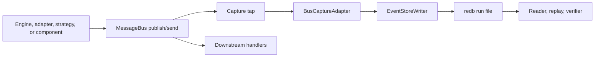
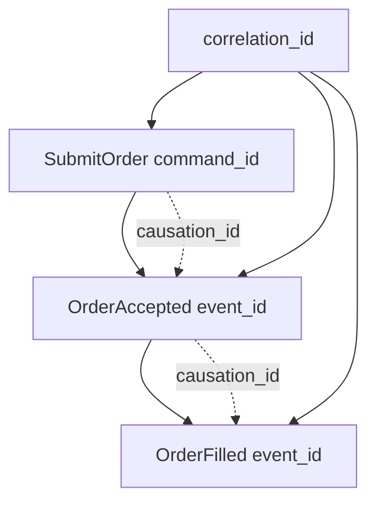
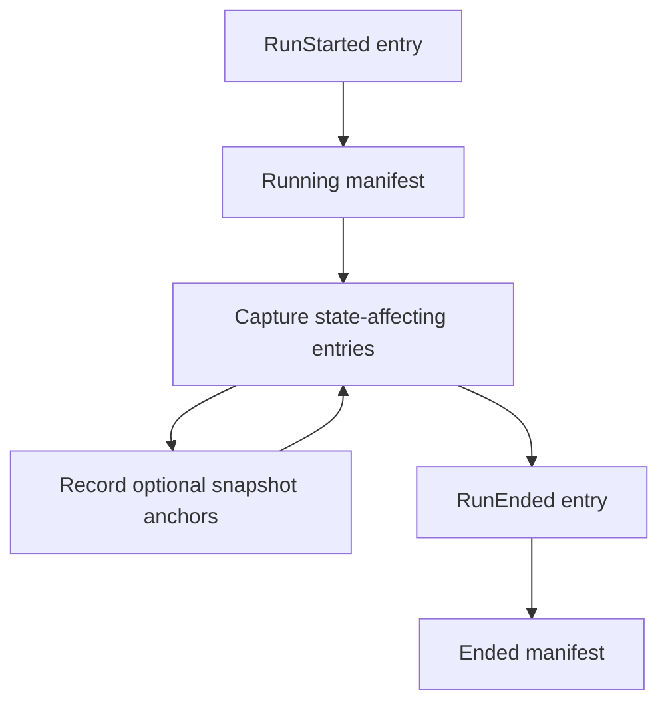
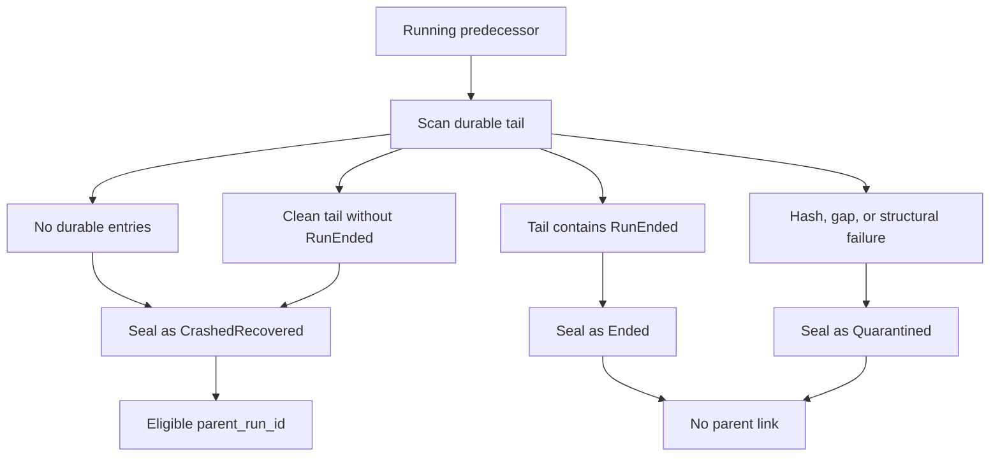
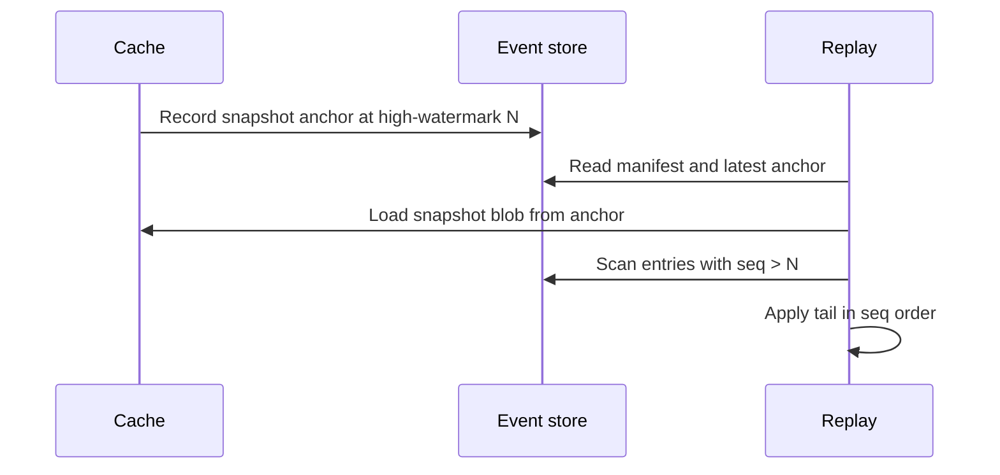

# Event Sourcing

Event sourcing ทำให้ NautilusTrader มีบันทึกของ message ที่เปลี่ยนสถานะของ engine อย่างคงทนและเรียงลำดับ
event store บันทึก message เหล่านั้นที่ขอบเขตของระบบ จากนั้น reader, เครื่องมือ replay และ verifier จะใช้
log เดียวกันนี้เพื่อสร้างสิ่งที่เกิดขึ้นขึ้นใหม่และ rebuild สถานะ

**หลักการสำคัญ**:

- event store คือแหล่งอ้างอิงที่คงทนสำหรับประวัติที่มีผลต่อสถานะ
- cache เป็น projection แบบ write-through ไม่ใช่ source of truth
- cache replay สร้างสถานะใหม่โดยนำประวัติที่ capture ไว้ไปใช้กับสถานะที่ cache เป็นเจ้าของ
- market data อยู่ใน data catalog ส่วน event store บันทึก message ที่มีผลต่อสถานะ
- I/O ภายนอกจะ replay ได้ก็ต่อเมื่อ Nautilus capture มันไว้เป็น command, raw report หรือ
  input อื่นที่มีผลต่อสถานะ

:::note
การ capture, replay, verification, recovery และการวางแผน retention ของ event store มี test coverage
ที่เจาะจงแล้ว แต่ API ยังอยู่ระหว่างการพัฒนา ให้ถือหน้านี้เป็น design contract และใช้
[`nautilus-event-store` README](https://github.com/nautechsystems/nautilus_trader/blob/develop/crates/event_store/README.md)
กับ [docs.rs](https://docs.rs/nautilus-event-store) เป็นเอกสารอ้างอิง API
:::

## ทำไมต้อง event sourcing {#why-event-sourcing}

cache ตอบคำถามว่า "ตอนนี้อะไรเป็นจริง" ส่วน event store ตอบว่า "Nautilus มาถึงจุดนี้ได้อย่างไร" มันให้
ประวัติในขอบเขตของ run แก่ reader, เครื่องมือ replay และ verifier ประวัตินี้อธิบายสถานะในอดีตได้โดยไม่ต้องใช้
logic ของ strategy, การ query venue หรือ live cache

event store เป็นพื้นฐานที่คงทนสำหรับ:

- พิสูจน์ว่า run ที่ seal แล้วสะอาดหรือไม่ก่อน replay หรือ archive
- ตรวจสอบลำดับที่แน่นอนของ command, report และ event เบื้องหลัง order หรือ intent ของ component
- สร้างสถานะ cache ขึ้นใหม่จากประวัติที่ capture ไว้ รวมถึง snapshot anchor และส่วนท้ายของ run
- ติดตาม intent ผ่าน message ฝั่ง engine ที่ตามมาจากมัน
- seal ไฟล์ run ที่ค้างอยู่ก่อนเริ่ม run ถัดไป หลังจาก process ออกหรือ writer halt

## คำศัพท์ {#terms}

- **Run**: kernel session หนึ่งครั้งสำหรับ instance, binary และ config หนึ่งชุด
- **Entry**: message ที่ capture ไว้หนึ่งตัวพร้อม metadata สำหรับ replay
- `seq`: sequence ต่อ run ที่ writer กำหนดและใช้เป็นลำดับของ replay
- **High-watermark**: `seq` ที่มากที่สุดซึ่ง backend ยืนยันความคงทนแล้ว
- **Snapshot anchor**: high-watermark ที่บันทึกไว้พร้อม cache snapshot
- **Headers**: metadata ด้าน correlation และ causation ที่ส่งต่อไปพร้อมกับ message ที่ capture ไว้

## สิ่งที่ store บันทึก {#what-the-store-records}

event store บันทึก traffic บน message bus ที่มีผลต่อสถานะสำหรับ trading instance หนึ่งตัวและ run หนึ่งครั้ง
run เริ่มเมื่อ kernel เริ่ม และจบเมื่อ process หยุดอย่างปกติหรือ crash

**Entry ที่ capture ได้แก่**:

- execution command เช่น submit, modify และ cancel
- data subscription command ที่กำหนดช่วงการสังเกตของ actor หรือ strategy
- time event ที่ทำงานแล้ว และ order, position, account event ที่ถูกสร้างขึ้น
- raw venue execution report ก่อนที่ reconciliation จะสังเคราะห์เป็น event ที่ derive มา
- ผลลัพธ์ของ reconciliation ที่ได้จาก raw report เหล่านั้น
- request และ response message หรือ metadata ที่เกี่ยวข้องกับการ audit ซึ่งผ่าน bus และมีผลต่อ
  สถานะ
- entry ของ lifecycle ของ run เช่น `RunStarted` และ `RunEnded`

การสังเกต market data แบบ streaming จะอยู่ใน data catalog ส่วน event store บันทึก command
stream, raw report, event ที่ถูกสร้าง และ metadata ที่จำเป็นในการ replay ว่า engine ตอบสนองต่อ
โลกภายนอกนั้นอย่างไร

กฎการ capture สองข้อแยก data response และ instrument close ออกจากการสังเกตแบบ streaming:

- **Data response**: response ทุกตัวต่อ request ของ engine จะถูก capture รวมถึง response ของ book, ราคาอ้างอิงของ
  option chain และ custom data เฉพาะรายการที่ระบุไว้ใน [Cache replay](#cache-replay) เท่านั้นที่มีกฎ
  นำกลับไปใช้กับสถานะ cache ส่วนที่เหลือเป็น record สำหรับการตรวจสอบ
- **Instrument close**: `InstrumentClose` ทุกตัวที่ publish จะถูก capture เพราะการหมดอายุของสัญญาจะ settle
  position

## ขอบเขต {#boundaries}

event store ถูกออกแบบให้แคบโดยเจตนา:

- ไม่ได้มาแทน data catalog
- ไม่มี analytics หรือ OLAP query
- ไม่ได้รวม trader instance หลายตัวเข้าเป็น consensus log
- ยังไม่ได้กำหนดเรื่อง redaction, encryption-at-rest หรือ tamper evidence

## Flow การ capture {#capture-flow}

การ capture เกิดขึ้นที่ขอบเขตการ dispatch ของ message bus ดังนั้น tap จะเห็น message ที่มีผลต่อสถานะแต่ละตัว
ก่อนที่ handler ปลายทางจะเห็น



การ capture แยกออกมาจาก dispatch เดียวกับที่ป้อน handler ปลายทาง และ reader จะเข้าถึงได้
เฉพาะ backend ที่คงทนเท่านั้น

การ capture เป็นแบบ **asynchronous** ไม่ได้เป็นด่านตรวจรับของ dispatch การ capture ที่สำเร็จจะใส่
entry เข้าคิวของ writer จากนั้น writer thread จะกำหนด `seq` ถัดไป commit เป็น batch และเลื่อน
high-watermark เมื่อ backend ยืนยันความคงทนแล้ว

reader สแกน backend ที่ seal แล้วหรือกำลังทำงานผ่าน interface ที่ไม่มี operation สำหรับ append

writer รับ entry ผ่าน bounded channel โดยมีเส้นทางความล้มเหลวสองแบบที่แตกต่างกัน:

- **Backpressure**: submit ที่ค้างเกิน `halt_threshold` ที่ตั้งไว้จะส่ง halt
  signal backpressure จะไม่ทิ้ง entry ที่รับไปแล้วอย่างเงียบ ๆ
- **Backend commit ล้มเหลว**: writer ส่ง halt signal ทิ้ง batch ที่ pending และ
  จบ loop ของตน entry เหล่านั้นจะไม่มีวันคงทน

:::warning
**Fail-stop ไม่ได้ขัดจังหวะ run** tap จะ log ความล้มเหลว และ message ยังคงไปถึง
handler ของมัน เมื่อ halt แล้ว tap จะหยุดบันทึก ดังนั้นส่วนที่เหลือของ session นั้นจะทำงานโดยไม่ถูก capture

ไม่มี component ใดใน runtime ที่ poll halt signal เพื่อหยุด trader การ sweep เพื่อ recovery ในการ boot ครั้งถัดไป
จะ seal run นั้น โดยใช้ `CrashedRecovered` เมื่อส่วนท้ายสะอาด
:::

บาง message คาดว่าจะผ่านขอบเขตที่ tap มองเห็นมากกว่าหนึ่งครั้ง:

- execution engine ส่ง order event ไปยัง endpoint ของ portfolio และ publish event เดียวกัน
  บน topic ของ strategy
- trading command เดินทางจาก strategy ไปยัง risk แล้วไปยัง execution

การ dispatch ซ้ำของ message เดียวกันจะเกิดขึ้นภายใน engine cycle เดียว capture adapter จึง deduplicate
โดยเทียบกับหน้าต่างแบบจำกัดขนาดของ identity ของ message ที่ capture ไปเมื่อเร็ว ๆ นี้ (event id, command id) message
เชิงตรรกะแต่ละตัวจะกลายเป็น entry เดียว และ replay จะไม่นำ event เดียวกันไปใช้สองครั้ง

## Lifecycle option {#lifecycle-options}

`EventStoreConfig` คือ run policy ที่ serialize ได้ ส่วน policy การสร้างระดับ process อยู่ใน
`EventStoreLifecycleOptions` ซึ่งผู้เรียกขั้นสูงส่งผ่าน
`EventStoreLifecycle::boot_with_options(...)`

โดย default lifecycle จะเปิด `RedbBackend` และติดตั้ง registry ของ encoder และ data-marker
extractor แบบ default lifecycle option สามารถแทนที่อย่างใดอย่างหนึ่งในสามอย่างนี้ได้:

- encoder registry หรือ factory ที่สร้าง registry ต่อ run ซึ่งนำไปใช้ก่อนที่ bus tap จะเริ่ม
  capture
- backend opener ที่ return implementation ใดก็ได้ของ `EventStore` สำหรับ run ใหม่
- factory ของ data-marker extractor registry สำหรับ marker class ที่ตั้งค่าไว้

backend opener คือเส้นทางที่ปลอดภัยสำหรับ simulation ในการ capture ลงหน่วยความจำ DST harness หรือ test เฉพาะทางสามารถเปิด
`MemoryBackend` ผ่าน lifecycle ปกติด้วย bus tap และความหมายของ writer แบบเดียวกัน แล้วอ่าน
entry ที่ capture ไว้ภายใน process หลัง seal ได้ เมื่อใช้ opener แบบ `MemoryBackend` การ capture ไม่ต้องใช้ไฟล์ run ของ `redb`

ภายใต้ `cfg(madsim)` writer จะ commit แต่ละ submit แบบ synchronous ดังนั้นลำดับ `seq` ที่ capture ได้จึง
deterministic

## โมเดลของ entry {#entry-model}

entry แต่ละตัวใน event store คือ message ที่ capture ไว้หนึ่งตัวพร้อม metadata:

- `seq`: ตัวกำหนดลำดับ replay ต่อ run
- `ts_init`: domain timestamp บน message ที่ capture ไว้
- `ts_publish`: timestamp ที่ bus รับหรือที่ writer ได้รับ
- `topic`: bus topic หรือ endpoint เชิงตรรกะ
- `payload_type`: ชนิดของ message ที่ encode แล้ว
- `payload`: byte ของ message ที่ encode แล้ว
- `headers`: metadata ด้าน correlation และ causation
- `entry_hash`: canonical hash ของเนื้อหา entry

`seq` เป็นตัวกำหนดลำดับ replay timestamp ช่วยอธิบาย run แต่ไม่ได้มีผลเหนือกว่า `seq`

secondary index รองรับการค้นหาด้วย `client_order_id` และ `venue_order_id` สามารถเพิ่ม index ของ `correlation_id`
ได้เมื่อมีผู้เรียกเพื่อการตรวจสอบที่ต้องการรูปแบบการค้นหานั้นจริง ๆ ระหว่างนี้การสแกน correlation สามารถไล่ดู
stream ที่ capture ไว้ได้

## โมเดลของ correlation {#correlation-model}

โมเดลเป้าหมายใช้ identity สามระดับเพื่อแยกขอบเขต สายเชื้อสาย (lineage) และ identity ของ message:

- `correlation_id`: workflow หรือ chain เชิงตรรกะ
- `causation_id`: message แม่โดยตรงที่ทำให้เกิด message นี้
- `command_id`, `event_id` หรือ `report_id`: identity ของ message นี้โดยเฉพาะ



`correlation_id` หนึ่งตัวครอบคลุมทั้ง workflow ส่วน `causation_id` เชื่อม message แต่ละตัวกับ message แม่
โดยตรง

:::warning
**การส่งต่อ header ยังไม่สมบูรณ์** entry ที่ capture ไว้ส่วนใหญ่จึงมี header ว่าง ให้ถือ
แผนภาพข้างต้นเป็น design contract ไม่ใช่คำอธิบายของสิ่งที่ run ที่ capture ไว้มีอยู่จริง

encoder registry แบบ default ลงทะเบียน extractor สำหรับ trading command, data command และ data
response extractor เหล่านั้นส่งต่อสิ่งที่ message มีอยู่ ในทางปฏิบัติ:

- **Data message**: มีเพียง data request และ data response ที่ให้ header ที่มีค่า request จะให้
  `request_id` ส่วน response จะมี `correlation_id` ที่จำเป็นต้องมี
- **Trading command**: producer ภายใน repository ไม่ได้ตั้งค่า `correlation_id` และ `causation_id`
- **Event และ report**: order, position และ account event, execution report และ time event
  ไม่มี extractor

:::

ในกรณีที่ header มีค่า operator จะถามคำถามที่พบบ่อยได้สองข้อ:

- "แสดงทุกอย่างใน workflow นี้": กรองหรือสแกนด้วย `correlation_id`
- "แสดงว่าทำไม event นี้จึงเกิดขึ้น": ไล่ `causation_id` ย้อนกลับไปยัง message แม่โดยตรง

## ไฟล์ run และ manifest {#run-files-and-manifests}

backend แบบ default คือ `redb` ซึ่งเก็บไฟล์หนึ่งไฟล์ต่อ run ไว้ที่:

```text
<base>/<instance_id>/<run_id>.redb
```

ไฟล์ run แต่ละไฟล์ประกอบด้วย:

- entry ที่ใช้ `seq` เป็น key
- secondary index สำหรับ identifier ของ order
- manifest ที่เขียนตอนเริ่ม run และ seal ตอนจบ run
- snapshot anchor (optional) สำหรับการกู้คืน cache

manifest บันทึก identity ของ run และ input สำหรับการทำซ้ำ (reproducibility):

- Identity ของ run:
  - `run_id`
  - `parent_run_id`
  - `instance_id`

- Identity ของ build:
  - `binary_hash`
  - `schema_version`
  - `crate_versions`
  - `feature_flags`
  - `adapter_versions`

- Identity ของ config:
  - `config_hash`
  - `registered_components`
  - `seed`

- สถานะของ lifecycle:
  - `start_ts_init`
  - `end_ts_init`
  - `high_watermark`
  - `status`

สถานะของ run เป็นหนึ่งใน `Running`, `Ended`, `CrashedRecovered` หรือ `Quarantined`

## Lifecycle ของ run {#run-lifecycle}



run เปิดด้วย `RunStarted` และปิดด้วย `RunEnded` snapshot anchor เป็นจุด optional ที่บันทึกไว้ระหว่างที่
manifest ยังเป็น `Running`

- `RunStarted` คือ entry แรกของ run ใหม่ การเรียก `open()` ซ้ำใน process เดียวกันจะ seal
  session ปัจจุบันก่อนเริ่ม run ใหม่
- ขณะที่ manifest เป็น `Running` bus tap จะบันทึก entry ที่มีผลต่อสถานะ และ cache snapshot
  สามารถบันทึก anchor เทียบกับ high-watermark ที่คงทนได้
- การ shutdown ปกติ, การ drop kernel หรือการ seal จาก reset/rerun จะ append `RunEnded` และ seal manifest เป็น
  `Ended`
- session ที่ fail-stop (halt) จะข้ามการ seal ภายใน process การ sweep เพื่อ recovery ในการ boot ครั้งถัดไปจะรับผิดชอบแทน
  halt signal มีขอบเขตอยู่ที่ run ที่ส่งมันออกมา การเรียก `open()` ครั้งต่อไปจะตั้ง signal ใหม่ ดังนั้นการ halt หนึ่งครั้ง
  จะไม่ส่งผลเสียต่อ run ถัด ๆ ไปใน process เดียวกัน

## การ seal เพื่อ recovery {#recovery-sealing}

predecessor คือไฟล์ run ที่เก่ากว่าของ instance เดียวกันซึ่ง manifest ยังระบุว่า `Running` อยู่ ซึ่ง
หมายความว่า process ก่อนหน้าไม่ได้ทำ lifecycle ปกติจนจบ หรือ writer halt ก่อนที่การ seal
manifest จะเสร็จ



recovery ตอน boot จะสแกน predecessor ที่เป็น `Running` แต่ละตัว และเลือกสถานะสุดท้ายของ manifest จากส่วนท้าย
ที่คงทน:

| ส่วนท้ายที่คงทน                              | สถานะที่ seal      | เป็น parent ได้ |
| ----------------------------------------- | ------------------ | --------------- |
| ไม่มี entry                                | `CrashedRecovered` | Yes             |
| สะอาด ไม่มี `RunEnded`                     | `CrashedRecovered` | Yes             |
| สะอาด จบด้วย `RunEnded`                    | `Ended`            | No              |
| hash ไม่ตรง, มีช่องว่าง หรือโครงสร้างผิดพลาด | `Quarantined`      | No              |

การ sweep จะไม่ทำให้ trader boot ไม่ได้เพราะไฟล์ run ไฟล์เดียวเสียหาย:

- **ซ่อมแซม**: หลังจาก hard kill (SIGKILL, OOM kill หรือไฟดับ) redb จะปฏิเสธการเปิดไฟล์ run
  แบบ read-only การ list จะ fallback ไปเปิดแบบเขียนได้ ซึ่งจะทำ repair pass ของ redb
  ก่อนดำเนินการ recovery ต่อ
- **ข้ามและลองใหม่**: หากไฟล์ยังเปิดไม่ได้หรือไม่มี manifest recovery จะข้ามไฟล์นั้นและ log
  error แล้วลองไฟล์นั้นใหม่ในการ boot ครั้งถัดไป recovery และ retention ยังคงทำงานต่อกับ run ที่ปกติ

เฉพาะ predecessor ที่เป็น `CrashedRecovered` เท่านั้นที่จะกลายเป็น `parent_run_id` ได้ `replay_from_run_id` ที่ตั้งค่าไว้
จะมีผลเหนือกว่า parent ที่กู้คืนมาหลังผ่านการตรวจสอบแล้ว

verifier แบบ read-only จะตรวจสอบ run ที่ seal แล้วแยกต่างหากโดยไม่แก้ไขมัน และรายงาน
`quarantine=not-performed`

## Input ของ replay {#replay-inputs}

replay ใช้กฎการเรียงลำดับข้อเดียว คือนำ entry ใน event store ไปใช้ตามลำดับ `seq` ส่วน `ts_init` และ
`ts_publish` อธิบายว่า message เกิดขึ้นเมื่อใด แต่ `seq` คือลำดับ replay ที่คงทน

API สำหรับ replay input ของ Rust แยกการวางแผนออกจากการ execute:

- replay input ที่ใช้เฉพาะ event store จะ return เฉพาะ entry
- replay input ที่ join กับ catalog จะเพิ่มส่วนของ catalog ที่ผู้เรียกเลือกไว้เพื่อวิเคราะห์บริบท

catalog planner รับค่า `CatalogSliceSelector` ที่ระบุชัดเจนและ `ReplayCatalog` แบบ read-only:

- **การวางแผน**: resolve ขอบเขตเวลาของ catalog จากการสแกน event store เว้นแต่ selector จะระบุ
  ขอบเขตไว้ชัดเจน รายงานส่วนของ catalog ที่ขาดหายไป และคง `seq` ไว้เป็นตัวกำหนดลำดับของ entry
- **การโหลด**: return `ReplayInputs` ที่มี entry ของ event store ตามลำดับ `seq` และ record ของ catalog
  ที่จัดกลุ่มไว้ใต้ส่วนที่เลือก

ผู้เรียกฝั่ง Rust สามารถเปิด feature `persistence` (ปิดอยู่โดย default) และห่อ `ParquetDataCatalog`
ด้วย `nautilus_event_store::ParquetReplayCatalog` เพื่อวางแผนไฟล์ catalog ที่เลือกและ
ช่วงเวลาที่ derive จากชื่อไฟล์ bridge นี้โหลด `quotes`, `trades` และ `bars` เป็นค่า
`CatalogReplayRecord` ที่มี type

:::note
persistence bridge เป็นแบบ read-only: ใช้ API สำหรับค้นหาและ query catalog แต่ **ไม่เขียน
ลง catalog** catalog class ที่ไม่รองรับจะโหลดไม่สำเร็จจนกว่า replay จะเพิ่ม typed payload
contract สำหรับ class นั้น
:::

API เหล่านี้ **ไม่**:

- เปิด live venue client
- รัน strategy หรือ actor
- รัน reconciliation ซ้ำ
- ลบไฟล์
- replay lifecycle การลงทะเบียน/ยกเลิกของ clock

## Cache replay {#cache-replay}

replay ที่ kernel จัดการใช้ `EventStoreConfig::replay_from_run_id` เมื่อตั้งค่านี้ kernel จะกู้คืนสถานะ cache
จาก run ที่ seal แล้ว และบันทึก run นั้นเป็น parent ของ child run ใหม่ โดยข้าม live engine, client,
startup และ venue reconciliation

**ข้อกำหนดของ replay**:

- run ที่ถูก quarantine จะถูกปฏิเสธ
- replay ต้องใช้ `load_state=true` หากปิดไว้ kernel จะ log error และ return โดยไม่
  กู้คืน cache หรือเปิด child run

cache replay loader เป็นแบบ **state-only** มันกู้คืน snapshot ที่ cache เป็นเจ้าของ สแกนส่วนท้ายของ event store
ตามลำดับ `seq` decode payload ที่มีผลต่อ cache ที่รองรับ แล้วนำไปใช้กับ `Cache` โดยตรง
payload ที่รองรับได้แก่:

- account, order และ position event ที่สังเคราะห์ขึ้น
- order list ที่ capture ไว้
- data response ที่สมบูรณ์สำหรับ instrument, quote, trade, funding rate และ bar
- instrument close ซึ่ง settle position ของ binary option แบบเดียวกับ live execution โดย fill
  หรือ fill void ที่ replay หลัง settlement นั้นจะอัปเดต order แต่ไม่อัปเดต position ที่ settle แล้ว

loader **ไม่**:

- publish entry ที่ replay ไปยัง live message bus
- รันโค้ดของ strategy หรือ actor
- query venue
- รัน reconciliation
- derive identifier ใหม่
- ตั้ง clock ใหม่

`TimeEvent` ที่ทำงานแล้วและ raw venue report เป็นเพียง record สำหรับการตรวจสอบในเส้นทางนี้ replay จะนำ
order, position และ account event ที่สังเคราะห์และ capture ไว้ภายหลังใน run ไปใช้

## Data marker sidecar {#data-marker-sidecar}

:::note
marker sidecar เป็นแบบ opt-in ผ่าน `EventStoreConfig.data_markers` และปิดอยู่โดย default
:::

ลำดับการส่งข้อมูลที่แน่นอนไม่ได้อนุมานจาก timestamp ใน catalog marker sidecar บันทึกข้อมูลที่สังเกตได้ที่
ขอบเขตการ dispatch ของ message bus ไว้ใน `<base>/<instance_id>/<run_id>.markers.redb` ข้างไฟล์ run ของ event store
โดยไม่เขียน payload market data ทั้งหมดลงในแถวของ `EventStoreEntry`

sidecar รองรับข้อกล่าวอ้างเพื่อการ audit ข้อเดียว คือเมื่อเปิด marker capture แล้ว Nautilus สังเกตการส่งข้อมูลตามลำดับ
`marker_seq` ที่ขอบเขตของ bus สำหรับ run นั้น marker แต่ละตัวมี identity เพียงพอที่จะ join กลับไปยัง
แถวที่เป็นไปได้ใน catalog แต่ไม่สามารถ:

- พิสูจน์ว่า timestamp ใน catalog เพียงอย่างเดียวกำหนดลำดับบน bus
- สร้างข้อมูลขึ้นใหม่เมื่อแถวใน catalog หายไปหรือถูกเปลี่ยน
- พิสูจน์ลำดับการส่งของ venue ก่อนที่ Nautilus จะสังเกตเห็น message
- บอกอะไรเกี่ยวกับ run ที่ปิด marker capture ไว้
- รับประกันว่า data message ที่สังเกตได้ทุกตัวสร้าง marker

sidecar แลกความครบถ้วนกับการแยกตัวออกจากเส้นทางการเทรด จึงไม่ได้รับ backpressure contract แบบเดียวกับ
entry writer เมื่อ submit marker แล้วพบว่า bounded channel เต็ม จะทิ้ง
marker แทนที่จะทำให้ผู้เรียกค้างหรือ halt run sequence ของมันจะกลายเป็นส่วนหนึ่งของ gap record:

- `Overflow`: submit ครั้งถัดไปจะ flush ช่วงที่ถูกทิ้ง
- `WriterClosed`: writer ปิดขณะที่ช่วงที่ถูกทิ้งยัง pending อยู่

### ลำดับและ identity {#ordering-and-identity}

marker ไม่ได้ใช้ค่า `seq` ของ event store และไม่สร้างช่องว่างในตาราง entry marker แต่ละตัวมี
`marker_seq` ของตัวเองที่เพิ่มขึ้นเสมอ และ `event_seq_before` ซึ่งคือ `seq` ที่มากที่สุดของ event store ที่ถูกกำหนด
ก่อนสังเกตเห็น marker `seq` ของ event store ยังคงเป็นตัวกำหนดลำดับ replay สำหรับ entry
ที่มีผลต่อสถานะ

สำหรับการวิเคราะห์ run ที่ seal แล้ว:

- หา entry ถัดไปของ event store หลัง marker จาก `event_seq_before + 1`
- เรียง marker ที่มี `event_seq_before` เดียวกันด้วย `marker_seq`

sidecar มี marker สองชนิด:

- **Cursor snapshot**: `DataCursorSnapshot` คือโหมด capture แบบ default snapshot แต่ละตัวบันทึก
  `marker_seq`, `event_seq_before`, `ts_init` และ entry ของ `StreamCursor` ที่เลื่อนไปตั้งแต่
  snapshot ก่อนหน้า `StreamCursor` มี `slot` ของ stream, `ts_init` สูงสุดที่เห็น
  ใน slot นั้น (`ts_init_hi`) และ `count` ของ record ส่วน `StreamDictEntry` จับคู่ `slot` แต่ละตัวกับ
  `data_cls` (`BookDeltas`, `BookDepth`, `Quote`, `Trade`, `Bar`) และ `identifier` ของ instrument
- **High-fidelity marker**: `HiFiMarker` เป็นแบบ opt-in ต่อ instrument ผ่าน `DataMarkerConfig.high_fidelity`
  แต่ละตัวบันทึก `marker_seq`, `event_seq_before`, `slot`, `ts_event`, `ts_init`, `same_ts_ordinal` และ
  `record_fingerprint` ขนาด 32 byte ที่คำนวณจากฟิลด์ของแถวแบบ typed ในรูปแบบมาตรฐาน

`same_ts_ordinal` และ `record_fingerprint` ช่วยแยกข้อมูลที่ซ้ำกันใน timestamp เดียวกันโดยไม่ต้องเก็บราคา
จำนวน ขนาด หรือ payload แบบ MessagePack แถวใน catalog สองแถวอาจเหมือนกันทุก byte สำหรับ key และ
timestamp เดียวกัน ในกรณีนี้ sidecar พิสูจน์ได้ว่า Nautilus สังเกตเห็นการส่งสองครั้งตามลำดับ
marker ที่เจาะจง แต่ไม่สามารถระบุแถวทางกายภาพที่ไม่ซ้ำใน catalog ได้หลังจากการ compaction ของ catalog เขียนลำดับแถวใหม่

### ขอบเขตของ verification และ replay {#verification-and-replay-boundaries}

marker verification พิสูจน์ว่าลำดับ `marker_seq` ถูกนับครบทั้งหมด โดยนับ gap ที่บันทึกไว้
เป็นส่วนที่ครอบคลุมด้วย **ให้อ่าน gap record** เพื่อดูว่าอะไรถูกทิ้งไป

contract ที่เสถียรคือ marker schema, primitive สำหรับ capture แบบ opt-in และ reader, verification ของ
marker sequence และกฎการ join กับ catalog เครื่องมือวิเคราะห์สามารถสร้างต่อจาก contract นี้เพื่อเลือกช่วงเวลา
ตีความข้อมูลเฉพาะ venue จัดอันดับหรือจัดกลุ่ม marker นำเสนอรายงาน และรวม run เป็น bundle

เมื่อปิด marker capture จะไม่มีการติดตั้ง data marker writer cache replay และ live restart จะไม่อ่าน
sidecar นี้ snapshot-tail replay ยังคงนำ entry ของ event store ไปใช้ตามลำดับ `seq` live restart ยังคง boot
จากสถานะที่ cache เป็นเจ้าของบวกกับ parent link ของ event store

## การกู้คืนที่อิงกับ snapshot anchor {#snapshot-anchored-recovery}

cache snapshot เป็นของ cache ส่วน event store เก็บเพียง snapshot anchor ซึ่งประกอบด้วย
high-watermark ณ เวลาที่ทำ snapshot, `blob_ref` แบบ opaque ที่ cache เป็นเจ้าของซึ่งระบุชื่อ snapshot และ
`content_hash` ของ blob นั้นที่ cache เป็นเจ้าของ



recovery จะโหลด snapshot ที่ anchor ระบุ แล้วนำไปใช้เฉพาะ entry หลัง high-watermark
ของ anchor

กรณีของ recovery เรียงตามว่า message ไปได้ไกลแค่ไหน:

| จุดที่ล้มเหลว                          | พฤติกรรมของ recovery                                              |
| ------------------------------------ | ---------------------------------------------------------------- |
| ก่อน enqueue                          | message ไม่เคยไปถึง writer จึงใช้ retry policy ของ producer         |
| หลัง enqueue ก่อน commit              | batch ที่อยู่ระหว่างทางยังไม่คงทน high-watermark จึงไม่เลื่อน         |
| หลัง commit ก่อน snapshot anchor      | โหลด snapshot ก่อนหน้าแล้ว replay ส่วนท้าย                         |
| หลัง snapshot anchor                  | โหลด snapshot ล่าสุดแล้ว replay entry หลัง anchor                  |

:::info
live restart ยังคงใช้ snapshot-plus-reconcile การกู้คืนด้วย event store จะกลายเป็นเส้นทาง live restart ก็ต่อเมื่อ
capture coverage และกฎของ replay ครอบคลุมทุกเส้นทางที่มีผลต่อสถานะแล้วเท่านั้น
:::

ความถูกต้องของ replay ขึ้นกับการตรวจสอบสี่ข้อ:

- entry ถูกอ้างถึงด้วยค่า `seq` ที่ไม่เปลี่ยนแปลง
- การเขียนจะปฏิเสธ commit ที่ไม่เรียงลำดับ
- reader ตรวจพบช่องว่างภายใน high-watermark
- แผนของ snapshot replay จะปฏิเสธ anchor ที่ชี้เลย high-watermark ที่คงทน

## การวางแผน retention {#retention-planning}

retention ใช้ไฟล์ run ทั้งไฟล์เป็นหน่วยของการเรียกคืนพื้นที่ event store มี planner แบบไม่ทำลายข้อมูล ซึ่ง
list manifest ของ run ที่ seal แล้ว ตรวจสอบสถานะ snapshot anchor ล่าสุด และ return ไฟล์ run ที่เป็นตัวเลือก
process ของ supervisor หรือ operator สามารถเรียกคืนไฟล์เหล่านั้นภายหลังได้

planner รองรับสามโหมด:

- `Full`: เก็บ run ที่ seal แล้วทุกตัวและไม่ return ตัวเลือกให้เรียกคืน
- `Bounded { keep_last }`: เก็บ run ที่ seal แล้วล่าสุด และเก็บ restore point ที่ทราบว่าดี
  อย่างน้อยหนึ่งจุด
- `SnapshotAnchored`: เรียกคืนเฉพาะ run ที่ seal แล้วซึ่งเก่ากว่า restore point ที่ทราบว่าดีล่าสุด

restore point ที่ทราบว่าดีคือ run ที่ seal แล้วและไม่ใช่ `Quarantined` ซึ่งมี snapshot anchor ที่ valid และ
high-watermark ของ anchor ไม่เกิน high-watermark ที่คงทนของ run planner เปรียบเทียบกับ
entry สุดท้ายบนดิสก์แทนค่าที่บันทึกใน manifest ดังนั้น run ที่ส่วนท้ายถูกตัดจึงไม่สามารถผ่านเกณฑ์
เป็น restore point ได้

**มาตรการป้องกันของ retention**:

- run ที่เป็น `Running` จะไม่ถูก list เป็น run ที่ seal แล้วหรือถูกเลือกเป็นตัวเลือกให้เรียกคืน
- snapshot anchor ที่หายไป เสียหาย หรือ invalid จะไม่นับเป็น restore point planner จะไม่ return
  ตัวเลือกใดเลยเมื่อพิสูจน์ไม่ได้ว่ายังมี restore point ที่ถูกต้องตามโครงสร้างเหลืออยู่อย่างน้อยหนึ่งจุด

**ข้อจำกัดของการตรวจสอบ**: planner ไม่เคยโหลด snapshot blob การตรวจสอบหยุดที่ anchor จึง
ไม่สามารถตัดความเป็นไปได้ของการกู้คืนล้มเหลวที่เกิดจาก blob ที่หายไปหรือถูกแก้ไข

## Integrity และ verification {#integrity-and-verification}

entry แต่ละตัวมี canonical hash ของเนื้อหาทั้งหมด reader และ verifier จะคำนวณ hash ใหม่และรายงาน
ความไม่ตรงกัน verifier ยังตรวจสอบสถานะของ manifest/high-watermark และตรวจ secondary index เทียบกับ
ตาราง entry และรายงาน snapshot anchor ที่ decode ไม่ได้หรือชี้เลย high-watermark ที่คงทน

:::warning
ผลการตรวจ `clean` พิสูจน์ความถูกต้องของโครงสร้างเท่านั้น ไม่ได้พิสูจน์ว่ากู้คืนได้หรือ capture ครบถ้วน:

- verifier ตรวจสอบ snapshot anchor แต่ไม่เคยโหลดหรือ hash blob ที่มันระบุ ดังนั้น run ที่ blob
  หายไปหรือถูกแก้ไขจะผ่านการตรวจเป็น clean แต่ล้มเหลวตอนกู้คืน retention planner เลือก restore point ด้วย
  หลักฐานจาก anchor เพียงอย่างเดียวเช่นกัน
- marker verification นับ gap ที่บันทึกไว้เป็นส่วนที่ครอบคลุม ดังนั้น run ที่ทิ้ง marker ภายใต้
  backpressure ก็ผ่านการตรวจเป็น clean
- run ที่ fail-stop กลาง session จะผ่านการตรวจเป็น clean สำหรับสิ่งที่ capture ได้ และไม่บอกอะไร
  เกี่ยวกับ message ที่ตามมาหลัง halt

:::

verification ของ run ทำงานแยก process เรื่องนี้สำคัญเพราะไฟล์ `redb` ที่เสียหายบางไฟล์อาจ panic
ตอนเปิดหรือตอนอ่านครั้งแรก และ release build ใช้ `panic = "abort"` verifier จึงรันการสแกนใน
worker subprocess เพื่อให้ไฟล์ที่เสียทำให้ worker abort ไม่ใช่ผู้เรียก

ตรวจสอบไฟล์ run ที่ seal แล้ว:

```bash
cargo run -p nautilus-event-store --bin verify -- ./event_store/trader-001/1700000000-cafe0001.redb
```

ผลลัพธ์ที่ clean มีลักษณะดังนี้:

```text
clean run_id=1700000000-cafe0001 status=Ended high_watermark=3 entries_scanned=3 markers=absent
```

ผลลัพธ์ที่ corrupt จะมี `quarantine=not-performed`:

```text
corrupt run_id=1700000000-cafe0001 status=Ended high_watermark=3 entries_scanned=3 findings=1 marker_findings=0 markers=absent quarantine=not-performed
- hash mismatch at seq 2
```

ฟิลด์ `markers=` รายงานผลการสแกน sidecar:

| ค่า                  | ความหมาย                                                                                             |
| -------------------- | --------------------------------------------------------------------------------------------------- |
| `absent`             | ไม่มี `<run_id>.markers.redb` อยู่ข้างไฟล์ run                                                        |
| `clean` or `corrupt` | อ่าน sidecar แล้ว พร้อมจำนวน snapshot, high-fidelity marker, gap และ dictionary entry ที่สแกน            |
| `error`              | มี sidecar แต่ไม่สามารถเปิดหรือสแกนได้                                                                 |

Exit code:

- `0`: run สะอาด
- `1`: run มีสิ่งที่ตรวจพบว่าเสียหาย หรือ worker abort หรือ timeout
- `2`: verifier ไม่สามารถเปิดหรือทำงานกับไฟล์ที่ระบุได้

เพิ่ม timeout ของ worker สำหรับ run ที่ seal แล้วขนาดใหญ่:

```bash
env NAUTILUS_EVENT_STORE_VERIFY_TIMEOUT_SECS=120 \
    cargo run -p nautilus-event-store --bin verify -- ./event_store/trader-001/1700000000-cafe0001.redb
```

อ่าน run ที่ seal แล้วจาก Rust:

```rust
use nautilus_event_store::{EventStoreReader, RedbBackend, ScanDirection};

fn inspect_run() -> Result<(), Box<dyn std::error::Error>> {
    let backend =
        RedbBackend::open_sealed_file("./event_store/trader-001/1700000000-cafe0001.redb")?;
    let reader = EventStoreReader::new(backend);
    let high_watermark = reader.high_watermark()?;

    for entry in reader.scan_range(1, high_watermark, ScanDirection::Forward) {
        let entry = entry?;
        println!("{} {}", entry.seq, entry.topic);
    }

    Ok(())
}
```

:::note
verifier รายงานความเสียหายแต่ไม่แก้ไขไฟล์ run การ quarantine เป็น policy ของ operator หรือ
supervisor
:::

## Verification coverage {#verification-coverage}

test suite ของ event store ยึดการรับประกันความถูกต้องหลักเหล่านี้สำหรับส่วนที่เป็น alpha:

- encoder registry แบบ default ครอบคลุมส่วนการ capture ที่มีผลต่อสถานะซึ่งผ่านการ audit แล้ว
- `TimeEvent` ที่ทำงานแล้วจะผ่าน event-store tap ที่ติดตั้งไว้ผ่าน `TimeEventHandler::run`
- writer จะ halt ภายใต้ bounded backpressure แทนที่จะทิ้ง entry ที่รับแล้ว
- การตรวจสอบ entry hash ตรวจพบความเสียหายของ payload ในระดับ byte
- verification แบบแยก process รายงานไฟล์ run ที่ถูกตัดท้ายหรือมีส่วนท้ายเป็นศูนย์ว่า corrupt
- cache replay สร้างสถานะ account, order และ position ที่สังเกตได้ตรงกับ live cache
  สำหรับ event stream ที่ capture ไว้ซึ่งสร้างขึ้น
- order event เดียวกันที่ dispatch ข้ามขอบเขต bus หลายจุดจะถูก capture เพียงครั้งเดียว
- snapshot anchor ที่ decode ไม่ได้หรือชี้เลย high-watermark ที่คงทนจะปรากฏเป็น
  สิ่งที่ verifier ตรวจพบ แทนที่จะผ่านเป็น clean
- การวางแผน replay input ที่ join กับ catalog ครอบคลุมส่วนที่เลือก ส่วนที่ขาดหาย ขอบเขตเวลา และ
  ลำดับ `seq` ของ event store
- crash recovery จะ seal predecessor ที่เป็น `Running` เป็น `Ended`, `CrashedRecovered` หรือ `Quarantined`
  ตามส่วนท้ายที่คงทน และเฉพาะ run ที่เป็น `CrashedRecovered` เท่านั้นที่จะกลายเป็น parent
- recovery ตอน boot ซ่อมแซมไฟล์ run ที่ crash แบบ hard และข้ามไฟล์ที่อ่านไม่ได้แทนที่จะทำให้
  การ sweep ล้มเหลว

## ความสัมพันธ์กับ DST {#relationship-to-dst}

event store และ [deterministic simulation testing](dst.md) (DST) แก้ปัญหาคนละส่วนของ
replay

- event store ให้ประวัติ input ที่ capture ไว้
- DST ควบคุม scheduling, เวลา, ค่าสุ่มที่มี seed และความไม่ deterministic อื่น ๆ ในขอบเขต

เมื่อใช้ร่วมกันจะทำให้ run สามารถทำซ้ำพฤติกรรมของ engine ได้ภายในขอบเขตของ deterministic simulation
manifest บันทึก input ที่ระบุตัวตนของ run ดังกล่าวไว้คู่กับ log ที่ capture เอง ได้แก่ `seed`,
`binary_hash`, `config_hash` และ `schema_version`

ภายใต้ `cfg(madsim)` writer จะ commit แบบ synchronous แทนการ spawn writer thread เมื่อ simulation
harness ส่ง opener แบบ `MemoryBackend` ผ่าน lifecycle option การ capture จะอยู่ภายใน process และไม่
ต้องใช้ไฟล์ `redb` นอกเส้นทาง option ขั้นสูงนั้น redb ยังคงเป็น backend ที่คงทนแบบ default

network I/O ของ adapter อยู่นอกขอบเขตของ replay แบบ bit-identical เว้นแต่ Nautilus จะ capture raw input ที่เกี่ยวข้องและ
route ผ่าน interface ที่ deterministic
