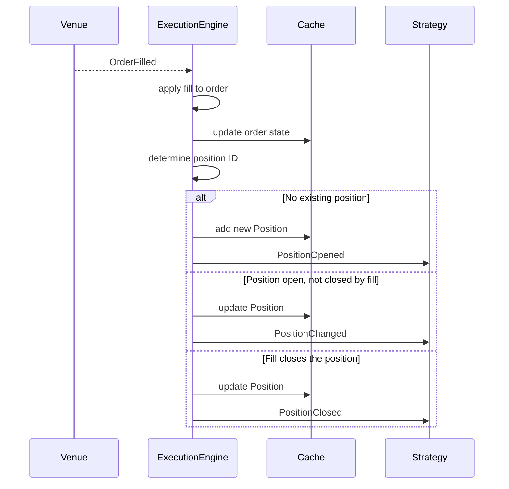

NautilusTrader จำลองการเปลี่ยนแปลงของ execution, position, account และเวลาในรูปของ event
โดย `MessageBus` จะส่ง event เหล่านี้ไปยัง component ที่สนใจ และส่งต่อไปยัง handler ของ strategy
ในกรณีที่รองรับ คู่มือนี้อธิบายชนิดของ event, การ dispatch และวิธีที่ order fill และการแก้ไข fill
ก่อให้เกิด position event

## หมวดหมู่ของ event [#event-categories]

| หมวด     | ตัวอย่าง                                         | ที่มา                             |
| -------- | ----------------------------------------------- | ------------------------------- |
| Order    | `OrderAccepted`, `OrderFilled`, `OrderCanceled` | Execution pipeline              |
| Position | `PositionOpened`, `PositionAdjusted`            | fill และการเปลี่ยนแปลงทางบัญชี      |
| Account  | `AccountState`                                  | `ExecutionClient` / `Portfolio` |
| Time     | `TimeEvent`                                     | `Clock` (timer และ alert)        |

## การ dispatch ไปยัง handler [#handler-dispatch]

เมื่อ event มาถึง strategy ระบบจะเรียก handler ตามลำดับที่ตายตัว โดย **handler เฉพาะ** จะทำงานก่อน
**handler รวม** ดังนั้นจะจัดการ event ที่ระดับความละเอียดใดก็ได้ หรือใช้ทั้งสองแบบร่วมกัน

strategy จะส่ง event ไปยัง handler ของตน **เฉพาะตอนที่กำลังทำงานอยู่เท่านั้น** event ที่มาถึงก่อน
start หรือหลัง stop จะไม่ถูก dispatch

### Order event [#order-events]

1. handler เฉพาะ (เช่น `on_order_filled`)
1. `on_order_event` (รับ order event ทุกชนิด)

### Position event [#position-events]

สำหรับ position lifecycle event ที่ dispatch ไปยัง strategy:

1. handler เฉพาะ (เช่น `on_position_opened`)
1. `on_position_event` (รับ position lifecycle event ทุกตัวที่ถูก dispatch)

### Time event [#time-events]

timer และ alert จะสร้าง object `TimeEvent` ส่ง `callback` ตอนเรียก `set_timer` หรือ
`set_time_alert` เพื่อส่ง event ไปยัง method ของคุณเอง

หากไม่ได้ระบุ callback:

- จะใช้ callback ที่เคยลงทะเบียนไว้ภายใต้ชื่อเดียวกัน หากมี
- หากไม่มี event จะถูกส่งไปที่ `on_time_event`

## Order event [#order-events-1]

order event ใช้สร้าง order, เปลี่ยนสถานะ หรือแก้ไขประวัติ fill ของ order โดย execution pipeline
จะนำ event ไปใช้กับ order และ cache แล้ว publish บน `MessageBus` ตารางด้านล่างแสดง transition หลัก
order ที่ partially filled, order จากภายนอก และ order ที่ถูก trigger ยังรองรับ transition เพิ่มเติม
ซึ่งอธิบายไว้ใน[ลำดับสถานะของ order](../orders/index.md#order-state-flow) ฉบับเต็ม

| Event                                             | Transition หลัก                                         | Handler                    |
| ------------------------------------------------- | ------------------------------------------------------ | -------------------------- |
| [`OrderInitialized`](order_initialized.md)        | สร้างหรือ materialize order                              | `on_order_initialized`     |
| [`OrderDenied`](order_denied.md)                  | Initialized -> Denied                                  | `on_order_denied`          |
| [`OrderEmulated`](order_emulated.md)              | Initialized -> Emulated                                | `on_order_emulated`        |
| [`OrderReleased`](order_released.md)              | Emulated -> Released                                   | `on_order_released`        |
| [`OrderSubmitted`](order_submitted.md)            | Initialized/Released -> Submitted                      | `on_order_submitted`       |
| [`OrderAccepted`](order_accepted.md)              | Submitted -> Accepted                                  | `on_order_accepted`        |
| [`OrderRejected`](order_rejected.md)              | Submitted -> Rejected                                  | `on_order_rejected`        |
| [`OrderTriggered`](order_triggered.md)            | Accepted -> Triggered                                  | `on_order_triggered`       |
| [`OrderPendingUpdate`](order_pending_update.md)   | Accepted -> PendingUpdate                              | `on_order_pending_update`  |
| [`OrderPendingCancel`](order_pending_cancel.md)   | Accepted -> PendingCancel                              | `on_order_pending_cancel`  |
| [`OrderUpdated`](order_updated.md)                | PendingUpdate -> สถานะก่อนหน้า                            | `on_order_updated`         |
| [`OrderModifyRejected`](order_modify_rejected.md) | PendingUpdate -> สถานะก่อนหน้า                            | `on_order_modify_rejected` |
| [`OrderCancelRejected`](order_cancel_rejected.md) | PendingCancel -> สถานะก่อนหน้า                            | `on_order_cancel_rejected` |
| [`OrderCanceled`](order_canceled.md)              | PendingCancel/Accepted -> Canceled                     | `on_order_canceled`        |
| [`OrderExpired`](order_expired.md)                | Accepted -> Expired                                    | `on_order_expired`         |
| [`OrderFilled`](order_filled.md)                  | Accepted -> Filled/PartiallyFilled                     | `on_order_filled`          |
| [`OrderFillVoided`](order_fill_voided.md)         | แก้ไข fill ที่รู้จัก หรือยืนยันสถานะ terminal สำหรับ fill ที่ไม่รู้จัก | `on_order_fill_voided`     |

### ฟิลด์ร่วมของ order event [#common-python-order-event-fields]

order event แต่ละชนิดมีฟิลด์เหล่านี้:

| ฟิลด์              | คำอธิบาย                                                       |
| ----------------- | ------------------------------------------------------------ |
| `trader_id`       | ตัวระบุของ trader instance                                     |
| `strategy_id`     | strategy ที่เกี่ยวข้องกับ order                                  |
| `instrument_id`   | instrument ของ order                                         |
| `client_order_id` | ตัวระบุ order ที่ฝั่ง client กำหนด                                 |
| `event_id`        | ตัวระบุ event ที่ไม่ซ้ำกัน                                          |
| `ts_event`        | UNIX timestamp (นาโนวินาที) ที่ event เกิดขึ้น                       |
| `ts_init`         | UNIX timestamp (นาโนวินาที) ที่ event ถูกสร้าง                      |
| `causation_id`    | event หรือ report ต้นทางที่ทำให้เกิด event นี้ หากทราบ               |

หน้าของ order event แต่ละตัวจะระบุฟิลด์เฉพาะของชนิดนั้น ซึ่งรวมถึง `venue_order_id`, `account_id`
และ `reconciliation` เฉพาะใน event ที่มีฟิลด์เหล่านี้ ตัวอย่างเช่น [`OrderFilled`](order_filled.md)
เพิ่ม `last_qty`, `last_px`, `trade_id` และ `commission` ส่วน [`OrderFillVoided`](order_fill_voided.md)
ระบุ trade ที่ถูกแก้ไขและเก็บปริมาณที่ถูก void สะสมไว้

## Position event [#position-events-1]

position lifecycle event อธิบายการเปลี่ยนแปลงของ position ใน cache ที่เกิดจาก fill และการแก้ไข fill
`ExecutionEngine` จะประมวลผล `OrderFilled` แต่ละตัว อัปเดตหรือสร้าง position แล้ว emit lifecycle event
ที่สอดคล้องกัน

เมื่อ `OrderFillVoided` แก้ไข fill ที่ถูกนำไปใช้ในเครื่องแล้ว จะสร้าง position ใน cache ที่ได้รับผลกระทบ
ขึ้นใหม่จากประวัติ fill ที่มีผลจริง โดยไม่ emit fill ฝั่งตรงข้าม หลัง publish การแก้ไขแล้ว engine จะ
emit `PositionChanged` สำหรับ position ที่ถูกแก้ไขและยังเปิดอยู่ หรือ `PositionClosed` สำหรับ position
ที่ปิดแล้ว การแก้ไขที่กระทบเฉพาะ order จะไม่ทำให้เกิด position event

| Event                                    | เกิดขึ้นเมื่อ                                      | Handler               |
| ---------------------------------------- | ---------------------------------------------- | --------------------- |
| [`PositionOpened`](position_opened.md)   | fill สร้าง position ใหม่                         | `on_position_opened`  |
| [`PositionChanged`](position_changed.md) | fill หรือการแก้ไขเปลี่ยน position ที่เปิดอยู่           | `on_position_changed` |
| [`PositionClosed`](position_closed.md)   | fill หรือการแก้ไขทำให้ปริมาณเหลือศูนย์                | `on_position_closed`  |

:::warning[PositionAdjusted ไม่เคยไปถึง position handler]
[`PositionAdjusted`](../positions.md#position-adjustments) บันทึกการเปลี่ยนแปลงปริมาณหรือ realized PnL
ที่เกิดนอก fill ปกติ เช่น commission ที่เป็น base currency และ funding โดย `ExecutionEngine` จะ
publish event นี้ แต่ทั้ง `on_position_event` และ handler เฉพาะใดๆ จะไม่ได้รับ ให้ตรวจดูประวัติที่บันทึกไว้
จาก `position.adjustments()`
:::

### จาก fill สู่ position: ห่วงโซ่เหตุและผล [#from-fill-to-position-the-causal-chain]

แผนภาพต่อไปนี้แสดงว่า `OrderFilled` เพียงตัวเดียวก่อให้เกิด position event อย่างไร ซึ่งเป็นจุดเชื่อม
ระหว่างการจัดการ order กับการติดตาม position

ทีละขั้นตอน:

1. **fill มาถึง**: `ExecutionEngine` ได้รับ event `OrderFilled` ผ่าน execution pipeline
1. **สถานะ order**: engine นำ fill ไปใช้กับ object ของ order และเขียน order ที่อัปเดตแล้วลง `Cache`
1. **Position ID**: engine ระบุว่า fill นี้เป็นของ position ใด โดยอิงจาก OMS type และการตั้งค่าของ
   strategy
1. **วงจรชีวิตของ position**: engine สร้างหรืออัปเดต position ด้วยวิธีใดวิธีหนึ่งในสามแบบ:
   - **ยังไม่มี position** สำหรับ ID นี้: engine สร้าง `Position` จาก fill เพิ่มลงใน `Cache` และ emit
     `PositionOpened`
   - **มี position อยู่และยังเปิดอยู่** หลัง fill: engine นำ fill ไปใช้กับ position อัปเดต `Cache` และ
     emit `PositionChanged`
   - **มี position อยู่และถูกปิด** (ปริมาณเหลือศูนย์): engine นำ fill ไปใช้ อัปเดต `Cache` และ emit
     `PositionClosed`
1. **การกลับทิศ position**: เมื่อ fill ทำให้ position กลับทิศ (เช่น ขาย 15 ขณะถือ long 10) engine จะแบ่ง
   fill ออกเป็นสองส่วน ส่วนหนึ่งปิด position เดิม (`PositionClosed`) อีกส่วนเปิด position ใหม่
   (`PositionOpened`)

### ฟิลด์ของ position event [#position-event-fields]

position lifecycle event ทั้งสามชนิดมีชุดฟิลด์หลักร่วมกัน และมีฟิลด์เพิ่มเติมเมื่อ position พัฒนาไป
เครื่องหมายถูกหมายถึง event ชนิดนั้นมีฟิลด์นี้ ขีดหมายถึงไม่มีฟิลด์นี้

| ฟิลด์               | Opened | Changed | Closed | คำอธิบาย                                       |
| ------------------ | ------ | ------- | ------ | -------------------------------------------- |
| `trader_id`        | ✓      | ✓       | ✓      | ตัวระบุของ trader instance                     |
| `strategy_id`      | ✓      | ✓       | ✓      | strategy ที่เป็นเจ้าของ position                 |
| `instrument_id`    | ✓      | ✓       | ✓      | instrument ของ position                      |
| `position_id`      | ✓      | ✓       | ✓      | ตัวระบุ position ที่ไม่ซ้ำกัน                       |
| `account_id`       | ✓      | ✓       | ✓      | account ที่ position สังกัด                      |
| `opening_order_id` | ✓      | ✓       | ✓      | order ที่เปิด position                          |
| `closing_order_id` | -      | -       | ✓      | order ที่ปิด position                           |
| `entry`            | ✓      | ✓       | ✓      | ฝั่งของ fill ที่เปิด position                      |
| `side`             | ✓      | ✓       | ✓      | ฝั่งปัจจุบันของ position                          |
| `signed_qty`       | ✓      | ✓       | ✓      | ปริมาณแบบมีเครื่องหมาย (ค่าลบ=short)              |
| `quantity`         | ✓      | ✓       | ✓      | ปริมาณของ position แบบไม่มีเครื่องหมาย              |
| `peak_quantity`    | -      | ✓       | ✓      | ปริมาณสูงสุดที่เคยถือ                              |
| `peak_qty`         | -      | ✓       | ✓      | alias เพื่อความเข้ากันได้ของ `peak_quantity`        |
| `last_qty`         | ✓      | ✓       | ✓      | ปริมาณของ fill หรือการแก้ไข                       |
| `last_px`          | ✓      | ✓       | ✓      | ราคาของ fill หรือการแก้ไข                         |
| `currency`         | ✓      | ✓       | ✓      | quote currency ของ position                   |
| `avg_px_open`      | ✓      | ✓       | ✓      | ราคาเข้าเฉลี่ย                                   |
| `avg_px_close`     | -      | ✓       | ✓      | ราคาออกเฉลี่ย หากมี                              |
| `realized_return`  | -      | ✓       | ✓      | ผลตอบแทนที่รับรู้แล้วในรูปอัตราส่วน                     |
| `realized_pnl`     | ✓      | ✓       | ✓      | realized PnL ของรอบปัจจุบันในสกุลเงินต้นทุน          |
| `unrealized_pnl`   | -      | ✓       | ✓      | engine ตั้งค่าเป็นศูนย์                            |
| `duration`         | -      | -       | ✓      | ระยะเวลาที่ถือ หน่วยนาโนวินาที                       |
| `ts_opened`        | -      | ✓       | ✓      | timestamp ที่ position เปิด                     |
| `ts_closed`        | -      | -       | ✓      | timestamp ที่ position ปิด                      |
| `event_id`         | ✓      | ✓       | ✓      | ตัวระบุ event ที่ไม่ซ้ำกัน                          |
| `ts_event`         | ✓      | ✓       | ✓      | timestamp ของ event ที่เป็นตัวกระตุ้น               |
| `ts_init`          | ✓      | ✓       | ✓      | timestamp ที่ event ถูกสร้าง                     |

### การไล่ตามจาก order ไปยัง position [#tracing-orders-to-positions]

`Cache` มี method สำหรับไล่ไปมาระหว่าง order และ position ได้ทั้งจาก position ไปหา order ทุกตัวที่มี
fill ร่วม และจาก order ไปหา position ที่ order นั้นสังกัด ส่วน order ที่เปิด position จะถูกเก็บไว้บน
position โดยตรง

> หมายเหตุ: ต้นฉบับมีเฉพาะตัวอย่าง Python จึงตัดออก

## Account event [#account-events]

event `AccountState` แทน snapshot ของ balance และ margin โดยจะเกิดขึ้นเมื่อ:

- venue รายงานการอัปเดต account (ผ่าน execution client)
- `Portfolio` คำนวณสถานะ account ใหม่หลังการอัปเดต position (สำหรับ margin account ที่เปิด
  `calculate_account_state`)

account state ประกอบด้วย balance, margin, account type และ base currency โดย `Portfolio` จะ subscribe
event เหล่านี้ภายในเพื่อติดตาม exposure และ balance ดูรายการฟิลด์ทั้งหมดได้ที่
[`AccountState`](account_state.md)

## คู่มือที่เกี่ยวข้อง [#related-guides]

- [Orders](../orders/) - ชนิดของ order และ state machine
- [Positions](../positions.md) - วงจรชีวิตของ position และ PnL
- [Execution](../execution/) - ลำดับการ execute และการตรวจสอบความเสี่ยง
- [Strategies](../strategies.md) - การ implement handler ใน strategy
- [Architecture](../architecture.md) - รูปแบบการไหลของข้อมูลและ execution
