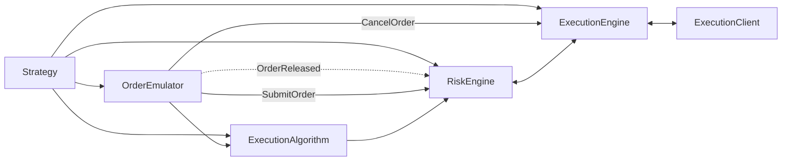
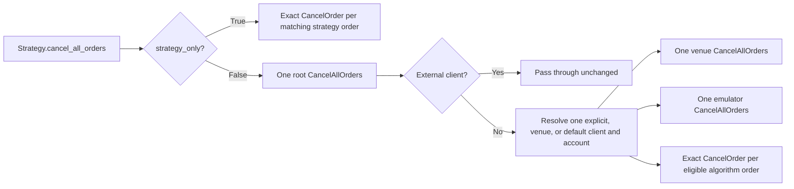

# Execution

NautilusTrader ประสานงานการส่ง order, การตรวจสอบความเสี่ยง, การ execution ที่ venue, reconciliation
และการอัปเดต position ข้ามหลาย strategy และหลาย venue หน้านี้อธิบาย component และ message flow
ที่รองรับการ execution

เลือกใช้คู่มือด้าน execution ตามคำถามที่ต้องการคำตอบ:

| คำถาม                                                  | คู่มือ                                                               |
| ---------------------------------------------------- | ------------------------------------------------------------------ |
| component ใดบ้างที่จัดการคำสั่ง (command) ของ order?          | หน้านี้: [Execution flow](#execution-flow)                           |
| order มีสถานะและการเปลี่ยนสถานะอะไรได้บ้าง?                   | [Orders: order state flow](../orders/index.md#order-state-flow)    |
| นโยบายใดกำกับการ execution ที่ขอบเขตของ venue?              | [Execution policies](policies.md)                                  |
| execution algorithm แบ่งและจัดการ order อย่างไร?             | [Execution algorithms](algorithms.md)                              |
| state ฝั่ง live กู้คืนและรักษาความสอดคล้องอย่างไร?               | [Execution reconciliation](reconciliation.md)                      |
| จะตั้งค่า live node อย่างไร?                                 | [การตั้งค่า live node](../../how_to/configure_live_trading.md)       |
| live node จัดตารางและเฝ้าติดตามการ execution อย่างไร?          | [Live trading](../live.md)                                         |

component หลักของการ execution ได้แก่:

- `Strategy`
- `ExecutionAlgorithm`
- `OrderEmulator`
- `RiskEngine`
- `ExecutionEngine`
- `ExecutionClient`

## Execution flow {#execution-flow}

`Strategy` ต่อยอดจากความสามารถของ data actor และเพิ่ม method สำหรับจัดการ order และการ execution:

- `submit_order(...)`
- `submit_order_list(...)`
- `modify_order(...)`
- `cancel_order(...)`
- `cancel_orders(...)`
- `cancel_all_orders(...)`
- `close_position(...)`
- `close_all_positions(...)`
- `query_account(...)`
- `query_order(...)`

method เหล่านี้ส่ง execution command แบบ point-to-point ผ่าน message bus นอกจากนี้การสร้าง order
ยัง publish event อย่าง `OrderInitialized` ด้วย

command แต่ละแบบมีเส้นทางต่างกัน:

- `submit_order(...)` ถูกส่งไปที่ `OrderEmulator` สำหรับ order ที่ emulate, ไปที่ `ExecutionAlgorithm` เมื่อตั้ง
  `exec_algorithm_id` ไว้ และไปที่ `RiskEngine` ในกรณีอื่น
- `submit_order_list(...)` แตกแขนงแบบเดียวกันตามการ emulate และ `exec_algorithm_id`
- สำหรับ order ที่ emulate `modify_order(...)` จะถูกส่งไปที่ `OrderEmulator` ส่วน order ที่ไม่ได้ emulate จะถูกส่งไปที่
  `ExecutionAlgorithm` หาก order มี `exec_algorithm_id` และยัง active อยู่ภายในระบบ local มิฉะนั้นจะถูกส่งไปที่
  `RiskEngine`
- command สำหรับ cancel และ query อาจถูกส่งตรงไปที่ `OrderEmulator`, `ExecutionAlgorithm` หรือ
  `ExecutionEngine` ขึ้นอยู่กับ command และสถานะของ order

order ใหม่มักเข้าสู่เส้นทางใดเส้นทางหนึ่งต่อไปนี้:

`Strategy` -> `OrderEmulator` หรือ `ExecutionAlgorithm` หรือ `RiskEngine`

flow ถัดไปปลายน้ำคือ:

`OrderEmulator` -> `ExecutionAlgorithm` หรือ `RiskEngine`

`ExecutionAlgorithm` -> `RiskEngine` -> `ExecutionEngine` -> `ExecutionClient`

เส้นทางการ execution แตกแขนงตามการ emulate และการ route ไปยัง algorithm ก่อนจะไปถึง execution engine
และ client

## Order management system (OMS) {#order-management-system-oms}

ประเภทของ **order management system (OMS)** เป็นตัวกำหนดว่า order จะจับคู่กับ position ของ instrument อย่างไร
ทั้ง strategy และ venue ไม่ว่าจะจำลองหรือ live ต่างใช้ OMS type ที่นิยามโดย enum `OmsType`

enum `OmsType` มีสาม variant:

- `UNSPECIFIED`: strategy ใช้ OMS type ของ execution client ที่เป็นเจ้าของ
- `NETTING`: position ถูกรวมเป็น position เดียวต่อ instrument และ strategy
- `HEDGING`: เปิด position ได้หลายตัวต่อ instrument และ strategy

เมื่อ OMS type ของ strategy กับ venue ต่างกัน `ExecutionEngine` จะกำหนดหรือเขียนทับค่า `position_id`
บน event `OrderFilled` **virtual position** คือ position ที่มีอยู่ใน NautilusTrader แต่ไม่ได้เป็น position
แยกต่างหากที่ venue

| Strategy OMS | Venue OMS | ผลลัพธ์                                                                |
| ------------ | --------- | ------------------------------------------------------------------- |
| `NETTING`    | `NETTING` | position เดียวต่อ instrument และ strategy                              |
| `HEDGING`    | `HEDGING` | หลาย position ต่อ instrument และ strategy                              |
| `NETTING`    | `HEDGING` | virtual position เดียวครอบคลุม position หลายตัวที่ venue                 |
| `HEDGING`    | `NETTING` | virtual position หลายตัวเทียบกับ net position เดียวของ venue            |

หาก fill ชี้ไปยัง position ใน cache ที่เป็นของ instrument อื่น `ExecutionEngine` จะ log error และทิ้ง fill นั้น
order จะยังไม่อยู่ในสถานะสิ้นสุด (non-terminal) เพื่อให้ fill ที่ถูกต้องในภายหลังยังนำมาใช้ได้

สำหรับการลด inventory ที่สืบทอดมา ดู [การลด position ภายนอก](reconciliation.md#reducing-external-positions)

### การตั้งค่า OMS {#oms-configuration}

เมื่อ strategy ไม่ระบุ `oms_type` หรือใช้ `UNSPECIFIED` `ExecutionEngine` จะใช้ OMS type ของ execution
client ที่เป็นเจ้าของ การ override ของ strategy แบบระบุชัดเป็น `NETTING` หรือ `HEDGING` จะมีลำดับความสำคัญสูงกว่า

engine ระบุความเป็นเจ้าของตามประเภทของการทำงาน:

- **การตรวจสอบตอน submit**: ใช้ client ที่ถูกเลือกจากการ route command
- **การประมวลผล fill**: ใช้ client ต้นทางของ order ใน cache หากไม่มีข้อมูลต้นทางนั้น จะใช้ client ที่ลงทะเบียนไว้
  เพียงตัวเดียวที่ตรงกับ account ของ fill และดูแล venue ของ instrument นั้น การค้นหาตาม account นี้ครอบคลุม
  fill ของ spread leg ที่ไม่มี order ใน cache ด้วย

สำหรับ fill ที่ผูกกับ order position ที่มีอยู่แล้วใน cache จะคง OMS type ที่บันทึกไว้

หากไม่มีข้อมูลความเป็นเจ้าของหรือกำกวม fill จะใช้ `NETTING` เว้นแต่ strategy จะ override ไว้ชัดเจน
เส้นทาง route ตาม venue และเส้นทางค่าเริ่มต้นของ command ไม่ได้เป็นตัวเลือก OMS type ของ fill ควรตั้งค่า
venue ใน backtest ด้วย OMS type เดียวกับ venue จริงที่กำลังจำลอง

โหมด position ของ venue อาจต้องการ configuration เฉพาะของ adapter ตัวอย่างเช่น ดู
[Binance Futures hedge mode](../../integrations/binance.md#futures-hedge-mode)

### Position ID แบบกำหนดเองกับ NETTING {#custom-position-ids-and-netting}

position ID แบบกำหนดเองใช้ได้เฉพาะภายใต้ OMS แบบ `HEDGING` เท่านั้น `NETTING` มี position เดียวต่อ instrument
และ strategy โดยมี ID ที่กำหนดแน่นอน (deterministic) ในรูปแบบ `{instrument_id}-{strategy_id}`

`ExecutionEngine` บังคับกฎนี้ตอน submit หาก OMS ที่มีผลจริงคือ `NETTING` ค่า `position_id` ที่ส่งมาใน
`submit_order` (หรือ `submit_order_list`) ต้องตรงกับ `{instrument_id}-{strategy_id}` หากไม่ตรง order จะถูก
deny ด้วย event `OrderDenied` ที่อธิบายความไม่ตรงกันนั้น

กฎนี้ยังคงรองรับรูปแบบการปิด position ที่ใช้กันทั่วไป: `Strategy.close_position(position)` ส่งต่อ `position.id`
ซึ่งภายใต้ `NETTING` ก็คือ ID แบบ deterministic พอดี จึงผ่าน หากต้องการติดป้ายหรือแบ่ง position ด้วย ID
ตามใจชอบ ให้ตั้งค่า strategy เป็น `oms_type=HEDGING`

สำหรับ `submit_order_list` engine ยัง deny list ที่มีหลาย instrument ปนกันเมื่อมีการระบุ `position_id` ไม่ว่า
OMS จะเป็นแบบใด เพราะ position หนึ่งเป็นของ instrument เดียว การผสมเช่นนี้จึงถูกปฏิเสธพร้อมเหตุผล
`OrderDenied` ที่ชัดเจน ดู [Order lists](../orders/advanced.md#order-lists) สำหรับข้อควรระวังอื่น ๆ
เกี่ยวกับ list ที่มีหลาย instrument

### การ replay position ข้ามรอบของ NETTING {#position-replay-across-netting-cycles}

ภายใต้ `NETTING` engine ใช้ position ID เดิมซ้ำข้ามรอบการปิดและเปิดใหม่ ดังนั้น replay log ของ position
อาจสะสม fill ทุกตัวที่เคยใช้กับ ID นั้น ตัวเลือก `ExecutionEngineConfig.carry_replay_events_on_reopen`
ควบคุมว่า log นี้จะยังอยู่หลังการเปิดใหม่หรือไม่:

| `carry_replay_events_on_reopen` | พฤติกรรม                                                         |
| ------------------------------- | -------------------------------------------------------------- |
| `False` (ค่าเริ่มต้น)               | เก็บเฉพาะ state ของรอบปัจจุบัน จำกัดต้นทุนต่อ fill ไว้                  |
| `True`                          | fill ในรอบก่อน ๆ ยังแก้ไขได้ แต่ state ของ position อาจโตขึ้นเรื่อย ๆ      |

- **Live trading**: `LiveExecutionEngineConfig` นำ replay log ติดไปด้วยเสมอ (`True`) ดังนั้น
  [`OrderFillVoided`](../events/order_fill_voided.md) จาก venue ที่อ้างถึงรอบก่อนหน้ายังแก้ไขได้
- **Backtesting**: venue จำลองไม่เคยส่ง fill void ออกมา backtest จึงใช้ค่าเริ่มต้นแบบจำกัด
- **Execution client แบบกำหนดเองหรือภายนอก**: เปิดตัวเลือกนี้อย่างชัดเจนหาก client อาจแก้ไข fill จากรอบก่อนหน้า
  หากไม่มี log ที่นำติดมา engine จะหา fragment ของ position ที่ตรงกันไม่พบและปฏิเสธการแก้ไขนั้น

snapshot ของ realized PnL จะเปลี่ยนตามการแก้ไข fill void ที่ย้อนไปถึงรอบก่อนหน้าจะสร้าง position ใหม่ข้ามเส้นแบ่ง
ของรอบ ซึ่งทำให้เส้นแบ่งที่ snapshot ที่เก็บไว้อธิบายเลื่อนไป engine จึงจัด snapshot เหล่านั้นเข้ากับรอบที่ปิดแล้ว
ของประวัติที่แก้ไขแล้ว และ realized PnL นับแต่ละรอบเพียงครั้งเดียว void ที่จำกัดอยู่ในรอบปัจจุบันจะไม่กระทบ
archive ดู [Position snapshotting](../positions.md#position-snapshotting)

## Risk engine {#risk-engine}

`RiskEngine` เป็น component ของทุกระบบ Nautilus ทั้งสภาพแวดล้อม backtest, sandbox และ live มันอยู่บนเส้นทาง
submit และ modify และยังรับ order event เช่น `OrderReleased` จาก `OrderEmulator` ด้วย ส่วน command สำหรับ
cancel และ query จะถูกส่งตรงไปยัง component อื่นของการ execution โดยไม่ผ่าน `RiskEngine`

เว้นแต่จะ bypass ไว้ใน `RiskEngineConfig` engine จะตรวจสอบ:

- ความละเอียด (precision) ของราคาและราคา trigger สำหรับ instrument
- ราคาต้องเป็นบวก เว้นแต่ instrument อนุญาตราคาติดลบ (futures, options, futures spread, option spread
  และ spot commodity) ทั้งนี้ inverse futures และ futures spread ต้องใช้ราคาบวก
- precision ของจำนวน และขอบเขตต่ำสุดและสูงสุดของ base quantity
- order แบบ GTD ต้องยังไม่หมดอายุ
- order แบบ `reduce_only` ต้องไม่เพิ่มขนาด position ที่อ้างถึง
- ขีดจำกัด `max_notional_per_order` ระดับ engine และฟิลด์ `min_notional` กับ `max_notional` ของ instrument
  โดยเปรียบเทียบตามขนาดของ notional
- ผลกระทบต่อยอดเงินของ cash account สำหรับ account ที่ไม่ใช่ margin
- rate limit ของการ submit และ modify
- ข้อจำกัดตาม trading state (`ACTIVE`, `HALTED`, `REDUCING`)

หากการตรวจสอบความเสี่ยงตอน submit ล้มเหลว ระบบจะสร้าง event `OrderDenied` พร้อม
[reason code](#order-denied-reasons) มาตรฐาน หากการตรวจสอบตอน modify ล้มเหลว จะสร้าง event
`OrderModifyRejected`

### การเลือก account {#account-selection}

การตรวจสอบยอดเงิน, margin และ position ใช้ account ของ execution client ที่จะรัน command นั้น ก่อนที่
`OrderSubmitted` จะกำหนด account ให้ order risk engine เลือก account ตามลำดับนี้:

1. order ที่มี account อยู่แล้ว เช่น order ที่กำลังถูก modify จะใช้ account นั้น
1. command สำหรับ client ภายนอก (`external_clients`) จะใช้ account ของ venue ก็ต่อเมื่อมี account ภายใต้ venue
   นั้นเพียงตัวเดียวเท่านั้น
1. command ที่ `client_id` ระบุ execution client ที่ลงทะเบียนไว้ จะใช้ account ของ client นั้น
1. command อื่น ๆ ใช้ account ของ client ที่ถูก route สำหรับ venue ของ instrument แล้วจึงเป็น account ของ client
   ค่าเริ่มต้น รวมถึง command ที่ `client_id` ไม่ได้ระบุทั้ง client ที่ลงทะเบียนไว้และ client ภายนอก ซึ่ง
   execution engine ก็ route ในแบบเดียวกัน
1. command ที่ไม่มีเส้นทาง route ตาม venue และไม่มี client ค่าเริ่มต้น จะใช้ account ของ venue ก็ต่อเมื่อมี account
   ภายใต้ venue นั้นเพียงตัวเดียวเท่านั้น

order list จะเลือก account เดียวจาก `client_id` และ instrument ของ command หากหา account ไม่ได้ หรือ account
ของ client ที่เลือกยังไม่อยู่ใน cache risk engine จะ deny order หรือปฏิเสธการ modify ด้วย `VALIDATION_FAILED`
และจะไม่ fallback ไปใช้ account อื่น position และ open order จะถูกนับในการตรวจสอบการลด position ก็ต่อเมื่อเป็น
ของ account ที่เลือกเท่านั้น

### Conditional exit แบบปิดทั้ง position {#whole-position-conditional-exits}

execution client บางตัวรองรับ conditional exit ที่ venue กำหนดจำนวนที่จะปิดจาก position ที่เปิดอยู่ ณ ตอนที่
trigger ทำงาน แต่ order ของ Nautilus ยังต้องมีจำนวนตัวยึดตำแหน่ง (placeholder quantity) เพื่อใช้ตรวจสอบภายใน
การตั้งค่า `full_position_exit_venues` บน `RiskEngineConfig` และ `LiveRiskEngineConfig` ใช้ระบุ venue ที่
execution client บังคับใช้ความหมายนี้ ค่าเริ่มต้นคือว่าง

order จะได้รับการยกเว้นสำหรับ placeholder ก็ต่อเมื่อเป็นไปตามเงื่อนไขทั้งหมดนี้:

- order ถูก submit เดี่ยว ๆ ไม่ได้อยู่ใน order list
- venue ของ order อยู่ใน `full_position_exit_venues`
- ใช้ instrument ประเภท futures หรือ perpetual ที่รองรับ
- เป็น order แบบ `StopMarket` หรือ `MarketIfTouched` ที่มีราคา trigger และ `close_position=true`
- มี placeholder quantity เป็นบวก และตั้ง `reduce_only=true`
- command, order และ position ที่ผูกไว้ใน cache ใช้ instrument และ position ID เดียวกัน
- position ที่ผูกไว้เป็นของ [account ที่เลือก](#account-selection)
- position ที่ผูกไว้ยังเปิดอยู่ ฝั่งของ order เป็นฝั่งที่ปิด position และ placeholder quantity ไม่เกินจำนวนของ
  position

สำหรับ exit ที่ผ่านเงื่อนไข risk engine จะจัดการการตรวจสอบดังนี้:

| การตรวจสอบความเสี่ยง                                                     | การจัดการ                                     |
| --------------------------------------------------------------------- | ------------------------------------------- |
| precision และความเป็นบวกของจำนวน                                        | บังคับใช้                                      |
| precision และความเป็นบวกของราคาและราคา trigger                           | บังคับใช้                                      |
| การหมดอายุ GTD, ข้อจำกัดของ trading state และ rate limit ของการ submit   | บังคับใช้                                      |
| exposure ของ position, margin และยอดเงิน                                | ถือว่าเป็นการลด position                       |
| จำนวนต่ำสุดและสูงสุดของ instrument                                       | ข้ามสำหรับ placeholder quantity                |
| notional ต่ำสุดและสูงสุดของ instrument                                   | ข้ามสำหรับ placeholder notional                |
| `max_notional_per_order` ที่ตั้งค่าไว้                                    | ข้ามสำหรับ placeholder notional                |
| order ที่ไม่ผ่านเงื่อนไข                                                  | การตรวจสอบความเสี่ยงปกติทั้งหมดยังมีผล               |

ให้ใส่ venue ใน allowlist เฉพาะเมื่อ execution client ปลายน้ำบังคับการปิดทั้ง position จริงเท่านั้น ดู
[Binance Futures close-position orders](../../integrations/binance.md#close-position) สำหรับ configuration
ที่รองรับ

:::warning
exchange จำลองไม่ได้ตีความ `close_position` และไม่ได้แทนที่ placeholder ด้วยจำนวนของ position ที่เปิดอยู่
อย่าใส่ venue จำลองของ backtest ไว้ใน `full_position_exit_venues` ให้จำลอง exit ใน backtest ด้วยจำนวนที่ระบุชัด
และ `reduce_only` แทน
:::

### Trading state {#trading-state}

แต่ละ state จะเข้มงวดขึ้นตามลำดับ:

| State      | ค่าตัวเลข | command ที่อนุญาต                                                               |
| ---------- | ------: | ---------------------------------------------------------------------------- |
| `ACTIVE`   |       1 | command สำหรับ submit, modify, cancel และ query ทำงานตามปกติ                    |
| `REDUCING` |       2 | การ submit แบบ reduce-only เดี่ยว ๆ ที่เข้าเงื่อนไข, การ cancel และการ query          |
| `HALTED`   |       3 | cancel และ query เท่านั้น ไม่อนุญาตการ submit และ modify ใหม่                       |

ใน `REDUCING` `SubmitOrder` เดี่ยว ๆ จะเข้าเงื่อนไขก็ต่อเมื่อเป็นไปตามเงื่อนไขทั้งหมดนี้:

- order ตั้ง `reduce_only=true`
- command และ order ระบุ instrument เดียวกัน
- position ID ที่ส่งมาตรงกับ open position ของ order ใน cache บน [account ที่เลือก](#account-selection)
- ฝั่งของ order อยู่ตรงข้ามกับ position
- จำนวนที่ submit ไม่เกินจำนวนของ position ใน cache

order list และการ modify จะถูก deny

risk engine ใช้กฎเหล่านี้ก่อนส่งต่อ command ไปยังการ execution order ที่ emulate แล้วถูกปล่อยออกมาก็อยู่ภายใต้กฎ
เดียวกัน: stop ป้องกันความเสี่ยงต้องตั้ง `reduce_only=true` และผ่านเงื่อนไขข้างต้นจึงจะผ่านใน `REDUCING`
ส่วน `HALTED` จะ deny order ที่ถูกปล่อยออกมาทั้งหมด รวมถึง stop ป้องกันความเสี่ยงด้วย การ modify order ที่ emulate
และยังถูกถือไว้จะอยู่ภายใน emulator และไม่ผ่านข้อจำกัดของ risk engine เหล่านี้

:::warning[การ bypass การตรวจสอบ trading state]
เมื่อเปิด `RiskEngineConfig.bypass` trading state จะไม่ถูกบังคับใช้ แต่ execution client ยังคงปฏิบัติตาม
[ข้อตกลงแบบส่งหรือปฏิเสธของ reduce-only](../adapters.md#reduce-only-execution-contract)
:::

ดูรายละเอียดของ configuration ได้ใน [Rust API reference](https://nautilustrader.io/docs/core-latest/)
(`RiskEngineConfig`)

## Execution algorithm {#execution-algorithms}

`ExecutionAlgorithm` รับ primary order ที่ถูกเลือกด้วย `exec_algorithm_id` และสามารถแบ่งออกเป็น spawned order
ที่เล็กลงได้ NautilusTrader รองรับ algorithm แบบกำหนดเอง และมี TWAP ที่ implement แบบ native ใน Rust มาให้

ดู [Execution algorithms](algorithms.md) สำหรับการตั้งค่า TWAP, algorithm แบบกำหนดเอง, พฤติกรรมของ
spawned order และการ query จาก cache

## การ route ของ cancel-all {#cancel-all-routing}

`Strategy.cancel_all_orders(...)` รองรับทั้งการยกเลิกเฉพาะใน strategy และการยกเลิกแบบกว้าง:

| `strategy_only` | ผลลัพธ์จาก strategy                                        | ขอบเขต                                                          | การ route ปลายน้ำ                                     |
| --------------- | ------------------------------------------------------- | -------------------------------------------------------------- | --------------------------------------------------- |
| `True`          | `CancelOrder` หนึ่งตัวต่อ order ที่ตรงเงื่อนไข                  | order ที่ตรงเงื่อนไขและผูกกับ strategy ที่เรียก                      | แต่ละ order ไปตามเส้นทาง cancel ปกติของตัวเอง           |
| `False`         | `CancelAllOrders` ระดับ root หนึ่งตัว แม้ไม่มี order ใน local ที่ตรง | order ที่ตรงเงื่อนไขของ execution client และ account ที่ resolve ได้หนึ่งชุด | execution engine สร้าง command ลูกที่จำเป็น             |

โหมดกว้างจะมอบหมายงานต่อก่อนที่ strategy จะตรวจ cache ของตัวเอง command จึงไปถึง execution client ที่ resolve
ได้แม้ NautilusTrader จะไม่มี order ใน local ที่ตรงเงื่อนไขเลย ซึ่งช่วยให้ endpoint สำหรับ bulk-cancel ของ venue
ลบ order ที่มีอยู่ที่ venue แต่ไม่อยู่ใน cache ของ local ได้ เมื่อ adapter มี endpoint แบบนี้ command เดียวยังช่วยลด
ปริมาณคำขอ cancel ได้ด้วย

สำหรับ execution client แบบ local `ExecutionEngine` จะ resolve command ระดับ root ให้เหลือ client เพียงตัวเดียว
ตามลำดับนี้:

1. `client_id` ที่ระบุชัด หากระบุ client แบบ local ที่ลงทะเบียนไว้
1. client ที่ถูก route สำหรับ venue ของ instrument
1. execution client ค่าเริ่มต้น

จากนั้น engine จะสร้าง command ลูกชุดใหม่สำหรับ client ที่เลือกและ account ของมัน:

- `CancelAllOrders` หนึ่งตัวสำหรับ execution client ครอบคลุม order ที่ venue ที่ตรงเงื่อนไข
- `CancelAllOrders` หนึ่งตัวสำหรับ `OrderEmulator` ครอบคลุม order ที่ emulate ที่ตรงเงื่อนไข
- `CancelOrder` หนึ่งตัวต่อ order ของ execution algorithm ที่ active อยู่ใน local และเข้าเงื่อนไข

โหมดกว้างเลือก client เพียงตัวเดียวก่อนกระจาย command และไม่เคย broadcast ไปยัง execution client ทุกตัว
หากต้องการยกเลิกข้ามหลาย client ให้เรียก `cancel_all_orders(...)` หนึ่งครั้งต่อ client

command ลูกแต่ละตัวมี command ID ใหม่ คัดลอกพารามิเตอร์จาก root, เชื่อมโยง (correlate) กับการทำงานระดับ root
และบันทึก command ระดับ root เป็นสาเหตุ ตัวกรอง instrument และฝั่ง (side) ที่ไม่บังคับจะมีผลกับแต่ละเส้นทาง local
account ของการ execution ที่เลือกยังเป็นขอบเขตของการยกเลิกใน matching engine ด้วย รวมถึง order ในสถานะ
`SUBMITTED` และสถานะระหว่างทางอื่นที่ยกเลิกได้

ความเป็นเจ้าของของ client มีผลกับ order ที่ emulate และ order ของ execution algorithm ใน local:

- order ที่ถูกกำหนดให้ client อื่นแล้วจะไม่ถูกแตะต้อง
- เมื่อ root ไม่ระบุ `client_id` order ที่ยังไม่ถูกกำหนดและตรงเงื่อนไขจะถูก client ที่ engine เลือกไว้รับเป็นเจ้าของ
  ก่อนการยกเลิกใน local
- เมื่อ root ระบุ `client_id` order ที่ยังไม่ถูกกำหนดจะไม่ถูกแตะต้อง เพราะ engine อนุมานไม่ได้ว่าเป็นของ client
  ที่ระบุไว้
- order ที่ emulate จะจับคู่กับ instrument ที่ซื้อขายจริงของมัน แม้ trigger จะมาจาก instrument อื่นก็ตาม

execution client ภายนอกที่ตั้งค่าไว้อย่างชัดเจนจะได้รับ command ระดับ root ตัวเดิมโดยไม่เปลี่ยนแปลง
client ภายนอกเป็นผู้รับผิดชอบการกระจาย command ที่จำเป็นหลังขอบเขตนั้นเอง

## ผลลัพธ์ของ command {#command-outcomes}

execution command แยกแยะระหว่างความล้มเหลวใน local ที่แน่นอน, ผลลัพธ์จาก venue ที่แน่นอน และผลลัพธ์ของ live
ที่ยังไม่ทราบ ผลลัพธ์ที่ยังไม่ทราบจะคงสถานะระหว่างทางไว้รอการอัปเดตจาก stream, polling, query หรือ
reconciliation เมื่อ retry จนหมดแล้วอาจมีการใช้ event reconciliation สิ้นสุดแบบสังเคราะห์ (synthetic) ในภายหลัง

ดู [Execution policies](policies.md#command-outcomes) สำหรับประเภทของหลักฐาน, ขีดจำกัดของการส่งและการ retry,
ขอบเขตของ persistence และที่มาของ reconciliation สิ้นสุด ดู [Runtime checks](reconciliation.md#runtime-checks)
สำหรับขั้นตอน reconciliation ต่อเนื่อง

## เหตุผลที่ order ถูก deny {#order-denied-reasons}

การ deny ใน local (`OrderDenied`) มี reason code มาตรฐานรูปแบบ `CATEGORY_CONDITION` และอาจมีส่วนต่อท้าย
สำหรับวินิจฉัย เฉพาะ code ที่อยู่ข้างหน้าเท่านั้นที่เป็นค่ามาตรฐาน ข้อความมีรูปแบบดังนี้:

- `CODE` เมื่อการ deny ไม่ต้องมีส่วนต่อท้ายสำหรับวินิจฉัย
- `CODE: value` สำหรับค่าที่มี type หนึ่งค่า หรือข้อความวินิจฉัยแบบอิสระ
- `CODE: key=value, key=value` เมื่อมีค่าที่มี type หลายค่าและต้องแยกให้ชัด
- `CODE: value; free text` เมื่อมีค่าที่มี type หนึ่งค่านำหน้าข้อความวินิจฉัยแบบอิสระ

ตารางนี้ครอบคลุมการ deny ใน local ที่มาจาก execution algorithm และ client รวมถึง risk engine และ execution
engine code เหล่านี้เป็นแหล่งข้อมูลอ้างอิงหลักสำหรับ order ที่ถูก deny ใน local

เหตุผลของ `OrderRejected` ขึ้นอยู่กับแหล่งที่มา:

- **การปฏิเสธที่ venue ยืนยัน**: มีความหมายตามที่ venue ให้มา adapter จะลบ wrapper ของ protocol ออกและจำกัด
  ขนาดข้อความจาก venue ที่ไม่น่าเชื่อถือก่อนส่งออก โดยไม่แทนที่ด้วย denial code มาตรฐานของ local
- **การปฏิเสธจาก reconciliation แบบสังเคราะห์**: ใช้เหตุผลที่อธิบายไว้ใน
  [Terminal reconciliation provenance](policies.md#terminal-reconciliation-provenance)

การตรวจสอบราคาและจำนวนยังอาจส่งเหตุผลที่ขึ้นต้นด้วย code เหล่านี้ใน `OrderModifyRejected`:

- `PRICE_PRECISION_EXCEEDS_MAXIMUM`
- `PRICE_NOT_POSITIVE`
- `QUANTITY_PRECISION_EXCEEDS_MAXIMUM`
- `QUANTITY_EXCEEDS_MAXIMUM`
- `QUANTITY_BELOW_MINIMUM`

สำหรับเหตุผลด้านราคา `field` จะเป็น `PRICE` หรือ `TRIGGER_PRICE` และระบุฟิลด์ของ command ที่ถูกปฏิเสธ เหตุผล
การปฏิเสธการ modify แบบอื่นยังเป็นข้อความอิสระ และ `OrderDeniedCode` ไม่ได้จัดประเภทไว้

`OrderRejected.due_post_only` จะเป็น `true` ก็ต่อเมื่อหลักฐานจาก venue พิสูจน์ได้ว่า order แบบ post-only จะ cross
หรือจับคู่ทันที การปฏิเสธอื่นจาก venue จะคงค่าเป็น `false`

<!-- Generated from the `OrderDeniedReason` enum (crates/model). Regenerate with: cargo test -p nautilus-model regenerate_order_denied_reasons_doc -- --ignored -->
<!-- BEGIN GENERATED: order-denied-reasons -->

| Code                                             | คำอธิบาย                                                                                |
| ------------------------------------------------ | ------------------------------------------------------------------------------------- |
| `PRICE_PRECISION_EXCEEDS_MAXIMUM`                | precision ของราคาเกินค่าสูงสุดของ instrument                                              |
| `PRICE_NOT_POSITIVE`                             | ราคาไม่เป็นบวก                                                                         |
| `QUANTITY_PRECISION_EXCEEDS_MAXIMUM`             | precision ของจำนวนเกินค่าสูงสุดของ instrument                                             |
| `QUANTITY_CONVERSION_FAILED`                     | ไม่สามารถแปลงจำนวนของ order สำหรับการตรวจสอบความเสี่ยงได้                                     |
| `QUANTITY_EXCEEDS_MAXIMUM`                       | จำนวนที่มีผลจริงของ order เกินค่าสูงสุดของ instrument                                         |
| `QUANTITY_BELOW_MINIMUM`                         | จำนวนที่มีผลจริงของ order ต่ำกว่าค่าต่ำสุดของ instrument                                       |
| `INVALID_MAX_NOTIONAL_PER_ORDER`                 | ค่า notional สูงสุดต่อ order ที่ตั้งไว้ไม่ถูกต้อง                                               |
| `MISSING_EXPIRE_TIME`                            | order แบบ GTD ไม่มีเวลาหมดอายุ                                                          |
| `EXPIRE_TIME_IN_PAST`                            | เวลาหมดอายุของ order อยู่ในอดีต                                                         |
| `MISSING_TRAILING_OFFSET_TYPE`                   | order ไม่มี trailing offset type ที่จำเป็น                                                |
| `UNSUPPORTED_TRAILING_OFFSET_TYPE`               | ไม่รองรับ trailing offset type ของ order                                                 |
| `MISSING_TRIGGER_TYPE`                           | order ไม่มี trigger type ที่จำเป็น                                                       |
| `MISSING_TRAILING_OFFSET`                        | order ไม่มี trailing offset ที่จำเป็น                                                     |
| `INSTRUMENT_NOT_FOUND`                           | ไม่พบ instrument ใน cache                                                             |
| `POSITION_NOT_FOUND`                             | ไม่พบ position สำหรับ order แบบ reduce-only                                             |
| `MARKET_PRICE_UNAVAILABLE`                       | ไม่มีราคาตลาดสำหรับการตรวจสอบความเสี่ยงของ order                                           |
| `TRAILING_STOP_CALCULATION_FAILED`               | ไม่สามารถคำนวณราคา trigger ของ trailing stop ได้                                         |
| `NOTIONAL_CALCULATION_FAILED`                    | ไม่สามารถคำนวณมูลค่า notional ของ order ได้                                              |
| `NOTIONAL_BELOW_MINIMUM`                         | notional ของ order ต่ำกว่าค่าต่ำสุดของ instrument                                         |
| `NOTIONAL_EXCEEDS_MAXIMUM`                       | notional ของ order เกินค่าสูงสุดของ instrument                                           |
| `NOTIONAL_EXCEEDS_MAX_PER_ORDER`                 | notional ของ order เกินค่าสูงสุดต่อ order ที่ตั้งไว้                                         |
| `NOTIONAL_EXCEEDS_FREE_BALANCE`                  | notional ของ order เกินยอดเงินที่ใช้ได้ (free balance) ของ account                          |
| `INITIAL_MARGIN_CALCULATION_FAILED`              | ไม่สามารถคำนวณ initial margin ของ order ได้                                              |
| `INITIAL_MARGIN_EXCEEDS_FREE_BALANCE`            | initial margin ของ order เกินยอดเงินที่ใช้ได้ของ account                                    |
| `BETTING_BALANCE_LOCKED_CALCULATION_FAILED`      | ไม่สามารถคำนวณยอดเงินที่ต้องล็อกสำหรับ order แบบ betting ได้                                  |
| `CUMULATIVE_NOTIONAL_EXCEEDS_FREE_BALANCE`       | notional สะสมของ order เกินยอดเงินที่ใช้ได้ของ account                                      |
| `CUMULATIVE_INITIAL_MARGIN_CALCULATION_FAILED`   | ไม่สามารถคำนวณ initial margin สะสมได้                                                    |
| `CUMULATIVE_INITIAL_MARGIN_EXCEEDS_FREE_BALANCE` | initial margin สะสมเกินยอดเงินที่ใช้ได้ของ account                                          |
| `REDUCE_ONLY_WOULD_INCREASE_POSITION`            | order แบบ reduce-only จะทำให้ position เพิ่มขึ้น                                          |
| `ORDER_LIST_INCOMPLETE`                          | order list ขาด order บางตัวใน cache                                                    |
| `ORDER_LIST_DENIED`                              | order ถูก deny เพราะ order list ของมันไม่ผ่านการตรวจสอบความเสี่ยง                            |
| `TRADING_HALTED`                                 | การเทรดถูกหยุด การ submit และ modify ใหม่จะถูก deny                                      |
| `TRADING_STATE_REDUCING`                         | การเทรดอยู่ในสถานะ reducing อนุญาตเฉพาะการ submit แบบ reduce-only ที่เข้าเงื่อนไข              |
| `RATE_LIMIT_EXCEEDED`                            | เกิน rate limit ของการ submit order                                                    |
| `STREAM_RECONCILING`                             | execution stream ใช้งานไม่ได้หรือกำลังกู้คืน ให้ retry หลังกู้คืนเสร็จ                          |
| `NO_EXECUTION_CLIENT`                            | ไม่พบ execution client สำหรับ command ที่ถูก route                                       |
| `CLIENT_VENUE_MISMATCH`                          | execution client ไม่ได้ดูแล venue ของ order                                              |
| `SUBMIT_FAILED`                                  | การ submit order ไปยัง execution client ล้มเหลว                                         |
| `INVALID_CLIENT_ORDER_ID`                        | client order ID ไม่ถูกต้องสำหรับ venue                                                   |
| `INVALID_POSITION_ID`                            | position ID ที่ส่งมาไม่ถูกต้องสำหรับการ submit order                                      |
| `UNSUPPORTED_ORDER_LIST`                         | venue ไม่รองรับ order list ที่ร้องขอ                                                     |
| `UNSUPPORTED_ORDER_TYPE`                         | ไม่รองรับประเภทของ order                                                               |
| `UNSUPPORTED_QUOTE_QUANTITY`                     | execution client หรือ venue ไม่รองรับ quote quantity สำหรับ order นี้                     |
| `UNSUPPORTED_POST_ONLY`                          | execution client หรือ venue ไม่รองรับคำสั่ง post-only ที่ร้องขอ                            |
| `UNSUPPORTED_REDUCE_ONLY`                        | execution client หรือ venue ไม่รองรับคำสั่ง reduce-only ที่ร้องขอ                          |
| `UNSUPPORTED_TIME_IN_FORCE`                      | ไม่รองรับ time in force ของ order                                                       |
| `UNSUPPORTED_TP_SL`                              | venue ไม่รองรับพารามิเตอร์ take-profit/stop-loss ที่ร้องขอ                                 |
| `VALIDATION_FAILED`                              | order ไม่ผ่านการตรวจสอบก่อน submit                                                      |

<!-- END GENERATED: order-denied-reasons -->

## Own order book {#own-order-books}

เมื่อเปิด `manage_own_order_books` `ExecutionEngine` จะดูแลมุมมองแบบ market-by-order (MBO/L3) ของ order ที่
กำลังทำงานอยู่ของคุณสำหรับแต่ละ instrument strategy สามารถหัก order เหล่านี้ออกจาก public book เพื่อประมาณ
liquidity สุทธิที่ใช้ได้ ดู [Own order book](../order_book.md#own-order-book) สำหรับวงจรชีวิต, การ query,
การกรอง และการตรวจสอบ (auditing)

### การ query สำหรับการยกเลิกอย่างปลอดภัย {#safe-cancellation-queries}

เมื่อ query own order book เพื่อหา order ที่จะยกเลิก ให้ตัด `PENDING_CANCEL` ออกจากตัวกรอง `status`

:::warning
การรวม `PENDING_CANCEL` อาจทำให้ส่งคำขอ cancel ซ้ำ และเลือก order ที่กำลังรอการยืนยันอยู่แล้วซ้ำแล้วซ้ำอีก
:::

## Overfill {#overfills}

**overfill** เกิดขึ้นเมื่อจำนวนที่ fill สะสมของ order เกินจำนวนเดิมของมัน ตัวอย่างเช่น fill รวม 110 หน่วยของ order
ขนาด 100 หน่วยถือว่า overfill ไป 10 หน่วย

### Overfill เกิดขึ้นได้อย่างไร {#how-overfills-occur}

engine จะพบ overfill เมื่อจำนวนที่รายงานมาเกินจำนวนของ order ซึ่งอาจเป็นผลลัพธ์จริงจาก venue, การส่งซ้ำภายใต้
trade ID ที่ต่างกัน หรือการรายงานที่ไม่สอดคล้องกันของ venue ก็ได้ จำนวนเพียงอย่างเดียวบอกสาเหตุไม่ได้

fill ใน live อาจมาถึงผ่านสองช่องทาง:

- fill event แบบ real-time ที่มาทาง WebSocket
- reconciliation แบบเป็นระยะที่ poll venue เพื่อดูประวัติ fill และสถานะ position

ค่า `trade_id` ที่คงที่ช่วยให้ engine กำจัด fill ซ้ำตัวเดียวกันข้ามทั้งสองช่องทางได้ หาก fill เชิงตรรกะเดียวกันมาถึง
ด้วย ID ที่ต่างกัน engine จะถือว่าเป็นรายงานคนละตัว ดู
[Continuous reconciliation](../../how_to/configure_live_trading.md#continuous-reconciliation) สำหรับรายละเอียด
ของ configuration

### พฤติกรรมของระบบ {#system-behavior}

`ExecutionEngine` ตรวจสอบ overfill ที่อาจเกิดขึ้นก่อนใช้ fill event แต่ละตัว โดยเปรียบเทียบ `filled_qty` ปัจจุบัน
ของ order บวกกับ `last_qty` ที่เข้ามา กับ `quantity` เดิม

ตัวเลือก configuration `allow_overfills` (ค่าเริ่มต้น: `False`) ควบคุมวิธีจัดการ overfill:

| `allow_overfills` | พฤติกรรม                                                                                |
| ----------------- | ------------------------------------------------------------------------------------- |
| `False`           | log และปฏิเสธ fill ทั้งนี้ fill จาก reconciliation แบบเดี่ยวอาจเพิ่มจำนวนของ order ก่อนได้       |
| `True`            | log คำเตือน ใช้ fill นั้น และติดตามส่วนเกินไว้ใน `overfill_qty`                                |

เมื่อ `allow_overfills` เป็น false และ execution client อนุญาต overfill นั้น engine จะเพิ่มจำนวนของ order ให้เท่ากับ
จำนวนที่ fill แล้วบวก fill นั้น แล้วจึงใช้ fill order ที่ fill ครบแล้วจะไม่ถูกเพิ่มจำนวน fill event จาก adapter, fill ที่มา
พร้อม order report และ fill ที่ live manager คาดการณ์ (projected) ไม่ได้ใช้การเพิ่มจำนวนนี้

เมื่ออนุญาต overfill ฟิลด์ `overfill_qty` ของ order จะติดตามจำนวนส่วนเกิน order จะเปลี่ยนเป็นสถานะ `FILLED`
และ `leaves_qty` จะถูกจำกัดไว้ที่ศูนย์

### การตรวจจับ fill ซ้ำ {#duplicate-fill-detection}

model ของ `Order` บังคับให้มี fill ที่มีจำนวนได้เพียงหนึ่งตัวต่อ `trade_id` fill ที่ซ้ำที่ราคาล่าสุดที่บันทึกไว้ของ trade
นั้นจะถูกปฏิเสธในฐานะ fill ซ้ำ ส่วน fill ที่ซ้ำแต่ราคาใหม่จะปรับราคาที่ trade นั้นมีส่วนต่อ `avg_px` โดยไม่เปลี่ยนจำนวน,
สถานะ หรือ fill เดิมที่เก็บไว้

#### เส้นทางของ core engine {#core-engine-path}

ก่อนใช้ fill `ExecutionEngine` จะเรียก `Order.is_duplicate_fill()` ซึ่งเปรียบเทียบ fill ล่าสุดของ `trade_id` นั้นตาม:

- `trade_id`
- `order_side`
- `last_px`
- `last_qty`

หากตรงกันทั้งหมดจะถูกข้ามพร้อมคำเตือน หาก `trade_id` ตรงแต่ราคาต่างกัน fill นั้นคือการปรับราคา (price
restatement) order จะปรับราคาเฉลี่ยของตัวเอง และ engine จะปรับราคาเฉลี่ยของ open position โดยไม่ใช้จำนวน
หากฟิลด์อื่นต่างกัน `Order.apply()` จะปฏิเสธ ID ที่ถูกใช้ซ้ำ และ engine จะ log และทิ้ง fill นั้น

#### เส้นทางของ reconciliation {#reconciliation-path}

เส้นทางของ reconciliation ตรวจ `trade_id` ก่อนสร้าง event `OrderFilled` และจะทิ้งรายงานเมื่อ ID นั้นมีอยู่แล้วบน
order ไม่ว่าราคาหรือจำนวนจะเป็นเท่าใด

fill จาก reconciliation แบบสังเคราะห์และแบบอนุมานใช้ ID แบบ deterministic ดังนั้นการ replay input ชุดเดิมหลัง
restart จะได้ `trade_id` เดิมและถูกกำจัดความซ้ำ

### การแจ้งเตือน fill ที่ถูกปฏิเสธ {#declined-fill-notification}

เมื่อ `ExecutionEngine` ปฏิเสธ `OrderFilled` หรือ `OrderFillVoided` แทนที่จะนำไปใช้ มันจะ publish event เดิมโดย
ไม่เปลี่ยนแปลงบน `events.order_fill_declined.{instrument_id}` ตัวอย่างเช่น การปฏิเสธ fill ซ้ำ, overfill หรือ event
ของ order ที่หาไม่พบ adapter ที่ติดตามว่า fill และการแก้ไขของตนถูกนำไปใช้หรือไม่สามารถ subscribe topic นี้ได้

จุดที่ปฏิเสธแต่ละจุดจะ log เหตุผลไว้ แต่ event ที่ publish ไม่ได้แนบเหตุผลไปด้วย engine จะไม่ publish บน topic นี้
สำหรับ projection จาก reconciliation ซึ่งอัปเดตเฉพาะ order

### Configuration {#configuration}

สำหรับ live trading ให้เปิดการยอมรับ overfill ใน `LiveExecutionEngineConfig` ด้วยการตั้ง `allow_overfills` เป็น true

:::warning
ให้เลือกค่านี้ตามข้อตกลงด้านการ execution ของ venue ค่าเริ่มต้น `False` ปกป้อง state ใน local แต่อาจทิ้งความ
คลาดเคลื่อนไว้หลังจากเกิด overfill ที่ชอบธรรมจาก venue ส่วน `True` จะใช้จำนวนส่วนเกินและไม่ได้ทดแทนการตรวจจับ
fill ซ้ำ ใช้ [execution reconciliation](reconciliation.md) เพื่อตรวจหาความคลาดเคลื่อน
:::

## การแก้ไข fill {#fill-corrections}

venue บางแห่งอาจลดหรือยกเลิกผลของ fill ในภายหลัง Nautilus บันทึกกรณีนี้เป็น event
[`OrderFillVoided`](../events/order_fill_voided.md) และไม่เคยบันทึกเป็น fill ฝั่งตรงข้าม event นี้ระบุ trade เดิม และ
มีจำนวนที่ถูก void สะสมกับการแก้ไขค่าธรรมเนียม

execution engine จะสร้าง order และ position ที่ได้รับผลกระทบขึ้นใหม่ และรีเฟรช cache ของ position และ PnL
ใน portfolio ก่อน publish การแก้ไขให้ strategy และ execution algorithm adapter ที่รองรับการแก้ไข fill จะขอรีเฟรช
account จากแหล่งที่เชื่อถือได้หลังจากเกิด void

adapter ต้อง publish fill ที่ถูกอ้างถึงก่อนการแก้ไขที่ทำให้ order กลับมาเปิด (reopened) หรือการแก้ไขบางส่วนที่ทำให้
order ยัง execute ได้ หากไม่มี fill ใน local การแก้ไขที่ไม่ได้ reopen จะทำให้ order ทั้งตัวเข้าสู่สถานะสิ้นสุด แม้
`voided_qty` จะน้อยกว่าจำนวนของ order ก็ตาม status report แบบ working ที่มาภายหลังจะไม่ทำให้ `VOIDED` กลับมาเปิด
ดู[ข้อตกลงของ `OrderFillVoided`](../events/order_fill_voided.md#contract)ฉบับเต็ม

### Fill ถูก void ได้อย่างไร {#how-voided-fills-occur}

void คือการกระทำของ venue ต่อ trade ที่ได้รายงานไปแล้ว สาเหตุที่พบซ้ำได้ในทุก asset class ได้แก่:

- **การทบทวนการ execution ที่ผิดพลาด**: venue ยกเลิกรายการซื้อขาย (print) ที่ไม่สอดคล้องกับตลาดอย่างมีนัยสำคัญ ณ
  เวลาที่ execute รวมถึง print ที่เกิดจากความผิดพลาดของระบบ exchange
- **การ settle ล้มเหลว**: trade ที่จับคู่แล้วไม่สามารถ settle ได้ fill จึงไม่มีผลทางเศรษฐกิจเลย
- **การยกเลิกผลของเหตุการณ์**: เหตุการณ์อ้างอิงถูกยกเลิก หรือผู้แข่งขันถอนตัว position ที่จับคู่แล้วจึงไม่มี exposure
- **การปรับรายการหลังการซื้อขาย**: venue ปรับจำนวนหรือค่าธรรมเนียมของ trade ระหว่างกระบวนการ clearing

การปรับราคาโดย venue ใช้ `OrderFilled` ตัวใหม่ที่มี `trade_id` เดิมในราคาใหม่ ซึ่งปรับการบันทึกบัญชีของ trade
โดยไม่เปลี่ยนจำนวนที่จับคู่ ส่วน event `OrderFillVoided` เองแก้ไขจำนวน ไม่ใช่ราคา

การยกเลิก trade (break) ไปถึง client ต่างกันในแต่ละ venue venue แบบ FIX ส่งสัญญาณผ่านค่า
[`ExecType <150>`](https://www.onixs.biz/fix-dictionary/5.0.sp2/tagnum_150.html) คือ `H` (trade cancel) และ `G`
(trade correct) ส่วน venue ที่แจ้งผ่านช่องทางอื่น (out of band) จะปล่อยให้ break ปรากฏผ่าน
[execution reconciliation](reconciliation.md)

### แหล่งอ้างอิงของ venue {#venue-references}

venue แต่ละแห่งเผยแพร่เงื่อนไขที่ตนจะดำเนินการ:

| Venue            | กลไก                                                      | แหล่งอ้างอิง                                                                                                                                       |
| ---------------- | -------------------------------------------------------- | ------------------------------------------------------------------------------------------------------------------------------------------------ |
| Nasdaq           | Clearly erroneous transactions (Rule 11890)              | [Clearly erroneous transactions policy](https://www.nasdaqtrader.com/Trader.aspx?id=ClearlyErroneous)                                            |
| NYSE             | Clearly erroneous executions (Rule 7.10)                 | [Clearly erroneous execution review](https://www.nyse.com/trade/cee)                                                                             |
| Cboe US equities | Clearly erroneous executions (BZX Rule 11.17)            | [Clearly erroneous execution form](https://www.cboe.com/us/equities/trading/cee_form/)                                                           |
| CME Group        | การยกเลิก trade และการปรับราคา (Rule 588)                    | [CME rulebook chapter 5](https://www.cmegroup.com/rulebook/CME/I/5/5.pdf)                                                                        |
| Betfair          | bet ที่ถูก void รายงานเป็นขนาดที่ void สะสม (`sv`)             | [Void bets on the Stream API](https://support.developer.betfair.com/hc/en-us/articles/360000391492-How-are-void-bets-treated-by-the-Stream-API)  |
| Polymarket       | สถานะ trade เป็น `FAILED` หลัง on-chain revert หรือ reorg     | [User channel](https://docs.polymarket.com/developers/CLOB/websocket/user-channel)                                                               |

adapter ของ Nautilus จะส่ง `OrderFillVoided` ในกรณีที่ venue เผยแพร่ void ผ่าน stream ที่ adapter รับข้อมูลอยู่
adapter และแหล่งข้อมูลที่รองรับได้แก่:

- [Betfair](../../integrations/betfair.md#voided-fills): ฟิลด์ `sv` ใน order change message
- [Polymarket](../../integrations/polymarket.md#trades): สถานะ trade ใน user channel

## คู่มือที่เกี่ยวข้อง {#related-guides}

- [Events](../events/): ประเภทของ order event และ position event และการ dispatch
- [Execution algorithms](algorithms.md): TWAP, algorithm แบบกำหนดเอง และ spawned order
- [Execution policies](policies.md): ขอบเขตของการส่ง, state, persistence และการกู้คืน
- [Execution reconciliation](reconciliation.md): การกู้คืน state ฝั่ง live และการตรวจสอบความสอดคล้องขณะรัน
- [Order book](../order_book.md): พฤติกรรมของ public order book และ own order book
- [Orders](../orders/): ประเภทของ order และการจัดการ
- [Positions](../positions.md): การติดตาม position จากการ execution
- [Strategies](../strategies.md): การส่ง order จาก strategy
