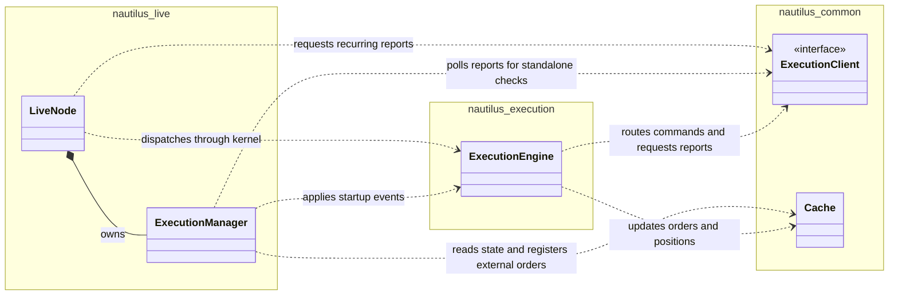
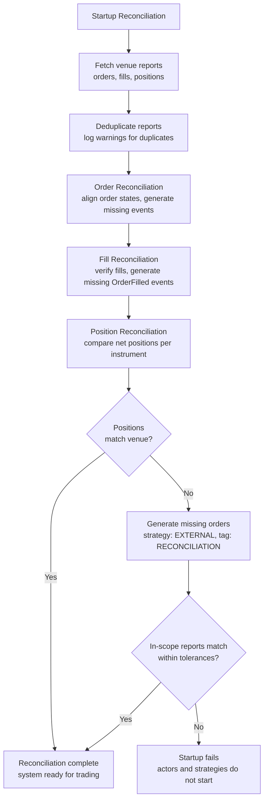

execution reconciliation ทำให้ state จริงของ order และ position ที่ venue ตรงกับ state ภายในของระบบที่สร้างแบบ
event sourcing คู่มือนี้อธิบายการกู้คืน state ตอนเริ่มทำงาน และการตรวจสอบต่อเนื่องที่ใช้ตรวจจับความคลาดเคลื่อนระหว่าง runtime

ผลลัพธ์ของ command แบบ live ที่ยังไม่ชัดเจนเป็นต้นเหตุหนึ่งที่ทำให้ state แตกต่างกัน สำหรับวิธีที่ Nautilus จำแนก
ความล้มเหลวภายใน, ผลลัพธ์ที่แน่นอน และผลลัพธ์ที่ไม่ทราบ ดู[ผลลัพธ์ของ command](policies.md#command-outcomes)

สำหรับ lifecycle ของ node ทั้งหมด ดู[Live trading](../live.md) สำหรับการตั้งค่าที่มีและค่าที่แนะนำ ดู
[การตั้งค่า live trading node](../../how_to/configure_live_trading.md#executionengine-configuration)

## โมเดลของ reconciliation [#reconciliation-model]

live execution จะ reconcile state ภายในกับ report จาก venue ส่วน backtest ควบคุมทั้งการ execute order และ state ที่เกิดขึ้น
จึงไม่ต้องทำ reconciliation กับ venue

มีสองสถานการณ์:

- **มี state ใน cache**: ข้อมูลจาก report จะสร้าง event ที่ขาดหายไปเพื่อให้ state ตรงกัน
- **ไม่มี state ใน cache**: order และ position ทั้งหมดที่ venue จะถูกสร้างขึ้นใหม่ทั้งหมด

:::info[Position report คือ market exposure]
**position report ที่ระบุชัดเจนถือเป็นข้อมูลที่เชื่อถือได้ ระหว่าง startup reconciliation engine จะปรับให้ตรงกับ report นั้น
ภายใน tolerance ของ reconciliation หรือ fail closed**

position report ที่เชื่อถือได้:

- report แบบ open ที่ระบุชัดเจน รวมถึงปริมาณและทิศทาง
- report แบบ flat ที่ระบุชัดเจน

สิ่งที่ไม่ใช่หลักฐานว่า position เป็น flat:

- report ที่หายไป
- ปริมาณที่เป็น null
- venue ที่ไม่ publish position

fill window ไม่ได้เป็นตัวตัดสินว่า report เชื่อถือได้หรือไม่ report ที่หายไปไม่ได้แปลว่า flat

โดยค่าเริ่มต้น `generate_missing_orders` เปิดอยู่ engine จะสร้าง order และ fill ที่จำเป็นเพื่อปรับ state ภายในให้ตรงกับ
report การปิดการสร้างนี้ไม่ได้ทำให้ report ที่ยังไม่ resolve ผ่าน startup ไปได้

การรับประกันนี้ครอบคลุม report ที่ผ่านตัวกรอง position report และ instrument เมื่อเปิด reconciliation ไว้ report ที่ยัง
ไม่ resolve จะทำให้ actor และ strategy เริ่มทำงานไม่ได้
:::

:::tip
persist execution event ทั้งหมดลง cache database วิธีนี้ลดการพึ่งพาประวัติจาก venue และทำให้ reconciliation มี state ของ
order และ position ที่เก็บไว้ ซึ่งจำเป็นสำหรับการตีความช่วงประวัติที่สั้น
:::

### หน้าที่ของ component [#component-responsibilities]

`LiveNode` เป็นเจ้าของ `ExecutionManager` และจัดตารางการทำ reconciliation ซ้ำ ๆ manager ติดตามกิจกรรม, การ retry และ
ตัวตนของ fill, ตีความ state ใน cache และเตรียม event ของ reconciliation ส่วน `ExecutionEngine` นำ event ไปใช้กับ order
และ position และจัดการ execution report แต่ละตัว

แผนภาพ UML แสดงความเป็นเจ้าของและการพึ่งพา รูปข้าวหลามตัดทึบแสดงความเป็นเจ้าของ ลูกศรเส้นประชี้จากผู้เรียกไปยัง
component ที่ใช้ kernel เป็นเจ้าของ engine และ cache ที่ใช้ร่วมกัน แต่ละไว้ที่นี่เพื่อเน้นเรื่อง reconciliation

facade ของ live client ใช้ adapter instance เดียวร่วมกันระหว่าง node และ engine report request ที่ค้างอยู่อาจถือ borrow
ของ client ไว้ขณะที่ event loop จัดการงานอื่น การอัปเดต instrument จะถูกเลื่อนออกไปจนกว่า borrow เหล่านั้นจะถูกปล่อย
แล้วจึง flush เมื่อ request เสร็จหรือถูกยกเลิก

ภายใน `nautilus-live` นั้น module ของ source แบ่งหน้าที่เหล่านี้ดังนี้:

| Module                        | หน้าที่                                                                    |
| ----------------------------- | ------------------------------------------------------------------------ |
| `node/mod.rs`                 | lifecycle ของ node, event loop และการ dispatch event                      |
| `node/reconciliation.rs`      | task ของ report ที่ทำซ้ำ, deadline, การยกเลิก และการจัดการผลลัพธ์             |
| `execution/manager.rs`        | state ของ reconciliation, การตัดสินใจ และการตรวจสอบ reconciliation แต่ละแบบ |
| `execution/reconciliation.rs` | type ที่ใช้ร่วมกัน, การตัดสินใจที่ไม่ขึ้นกับ state และ report request แบบเจาะจง    |

module `nautilus_execution::reconciliation` ที่แยกออกมาให้ operation การแปลง report เป็น event และการคำนวณที่ใช้ร่วมกับ
execution engine

reconciliation มีเส้นทางต่างกันตอน startup และระหว่างการตรวจสอบต่อเนื่อง:

- **Startup**: manager จะ publish report ดิบ, นำ event ของ order และ fill ไปใช้, ตรวจสอบการนำ fill ย้อนหลังไปใช้
  แล้วจึงประเมิน position เทียบกับ cache ที่อัปเดตแล้ว
- **การตรวจสอบ position ต่อเนื่อง**: node ประสานงาน query และการ dispatch fill ที่เชื่อถือได้ก่อนขอให้ manager สร้าง
  event สังเคราะห์ revision ของกิจกรรมใช้ตรวจจับการเปลี่ยนแปลงภายในระหว่าง request หรือ callback การนำ fill ที่เชื่อถือได้
  ไปใช้จะเลื่อน reconciliation แบบสังเคราะห์ออกไปจนกว่าจะมี position report ใหม่

fill ที่เตรียมไม่สำเร็จหรือที่ engine ไม่ได้นำไปใช้ ก็จะเลื่อน reconciliation แบบสังเคราะห์ออกไปเช่นกัน การเลื่อนนี้มีผลจนกว่า
จะครบ `position_check_threshold_ms` นับจากความล้มเหลวครั้งแรกเท่านั้น การตรวจสอบหลังจากนั้นจะข้าม fill นั้นและ reconcile
position แบบสังเคราะห์ การตรวจสอบแต่ละครั้งจะหยุดที่ fill แรกแบบนี้ของ instrument และ account หนึ่ง ดังนั้น fill ที่ถูกปฏิเสธ
แต่ละตัวจะทำให้ fallback ล่าช้าไปอย่างน้อยหนึ่งรอบการตรวจสอบ หาก fill ที่ถูกข้ามไปถูกนำไปใช้ภายหลังผ่านเส้นทางอื่น (เช่น
execution stream) อาจเพิ่มเข้าไปในการแก้ไขแบบสังเคราะห์ได้ การตรวจสอบ position ครั้งถัดไปจะ reconcile ส่วนต่างนั้น

manager ยังใช้งานได้โดยไม่ต้องเปิด feature `node` ผู้เรียกแบบ standalone ใช้เมธอด polling แต่ละตัวของ manager และนำ event
ที่คืนมาไปใช้เองได้ การ polling position แบบ standalone จะคืน event สังเคราะห์ของความคลาดเคลื่อนโดยตรง ส่วน node จะเพิ่ม
ลำดับการกู้คืนด้วย fill ที่เชื่อถือได้เข้าไป

### Origin ของ execution client [#execution-client-origins]

**execution-client origin** คือการผูกแบบเขียนครั้งเดียวระหว่าง order กับ client ที่รับผิดชอบการ execute order นั้น

origin จะถูกบันทึก:

- จาก client ที่ระบุอย่างชัดเจนตอน submit หรือจาก client สุดท้ายที่ถูกเลือกหลังการ routing และการตรวจสอบ venue
  และก่อนการส่งผ่าน transport
- เมื่อ external order ที่ไม่ใช่แบบสังเคราะห์ถูกสร้างขึ้นระหว่าง startup reconciliation โดยใช้ client ที่รายงาน mass status
- เมื่อ external order ถูกสร้างจาก report ของ venue ระหว่าง runtime และ account ของ report ตรงกับ client ที่ลงทะเบียนไว้
  เพียงตัวเดียวที่จัดการ venue ของ instrument นั้น

origin อาจไม่มีในกรณี:

- ข้อมูลใน cache ที่เขียนไว้ก่อนที่ origin ที่ resolve แล้วจะถูก persist
- external order ที่ report ระหว่าง runtime ไม่สามารถระบุ client ที่ลงทะเบียนไว้ได้เพียงตัวเดียวจาก account และ venue ของ
  instrument
- order สังเคราะห์จาก reconciliation

cache backend ในตัวจะเข้าคิว origin ที่ resolve แล้วเพื่อ persist ก่อนการส่งผ่าน transport การเขียนยังเป็นแบบ asynchronous
ลำดับการเข้าคิวจึงไม่รับประกันว่า origin จะถูกบันทึกอย่างคงทนก่อนที่ order จะไปถึง client

ตอน startup จะตรวจสอบ mass status ของแต่ละ client เทียบกับ origin ใน cache order ที่ client รายงานควรผูกกับ client
ตัวเดียวกันนั้น

- **ไม่มี origin**: log warning แบบรวม และยังเข้ากันได้กับข้อมูลใน cache ที่มีอยู่
- **origin ขัดแย้งกัน**: log warning แบบรวมเรื่อง deprecation และ reconcile เพื่อความเข้ากันได้ release ในอนาคต
  จะปฏิเสธความขัดแย้งนี้เป็น error ตอน startup

ดูแถวที่เกี่ยวกับ origin ใน[สถานการณ์ตอน startup](#startup-scenarios)

เรื่องนี้แยกจาก[การ claim external order](#external-order-creation) ซึ่งระบุว่า order ที่มาจาก venue เป็นของ *strategy*
ใด ส่วน execution-client origin บันทึกว่า order เป็นของ *client* ใด

### Reconciliation report [#reconciliation-reports]

execution engine ใช้ reconciliation report สี่ variant จาก live adapter แต่ละ variant มีบทบาทปกติต่างกันเมื่อ order ที่ตรงกัน
ไม่มีอยู่ใน cache ประวัติที่มีขอบเขตชัดเจนสามารถใช้[การ project fill เฉพาะ order](#order-only-fill-projection) แทนได้

| Variant                | วัตถุประสงค์                | การดำเนินการเมื่อไม่มี order                              |
| ---------------------- | ------------------------ | ---------------------------------------------------- |
| `OrderStatusReport`    | อัปเดต state ของ order    | สร้าง order และอนุมาน fill ที่รายงานไว้                  |
| `FillReport`           | fill เดี่ยว               | สร้าง market order แล้วนำ metadata ของ fill ไปใช้        |
| `OrderWithFills`       | state ของ order พร้อม fill | สร้าง order, นำ fill ไปใช้ และอนุมานส่วนที่เหลือ           |
| `PositionStatusReport` | snapshot ของ position ที่ venue | log report position ยังคงคำนวณจาก fill              |

#### ควรใช้ variant ใดเมื่อไร [#when-to-use-each-variant]

adapter เลือก variant ที่ตรงกับ event ของ venue:

- ใช้ `OrderStatusReport` สำหรับการอัปเดต lifecycle ของ order เมื่อรายละเอียดของ fill มาทาง stream แยก
- ใช้ `FillReport` สำหรับการปิดที่ venue เป็นผู้เริ่มซึ่งมี fill แต่ไม่มี order ระดับผู้ใช้ liquidation ของ Hyperliquid
  เป็นไปตามรูปแบบนี้
- ใช้ `OrderWithFills` เมื่อ event เดียวของ venue มีทั้งสถานะ order และ fill ของมัน Binance Futures ใช้แบบนี้สำหรับ order
  ที่ exchange สร้างขึ้นจาก ADL, liquidation และ settlement

### ความสดใหม่ของ snapshot และการแก้ไข fill [#snapshot-freshness-and-fill-corrections]

snapshot ต้องไม่ย้อนกลับ fill ที่เกิดขึ้นหลัง state ที่ snapshot อธิบาย การได้รับ snapshot หลัง event ของ stream ไม่ได้ทำให้
snapshot ใหม่กว่า: REST request และการส่งของ stream อาจซ้อนกันระหว่างการกู้คืน เช่น request หนึ่งอาจเห็นปริมาณที่ fill
เป็นศูนย์ จากนั้น stream ส่ง fill ห้าหน่วย และ response ที่เก่ากว่ามาถึงทีหลังสุด การตีความ response นั้นเป็นการแก้ไขจะทำให้
void ห้าหน่วยนั้นอย่างผิดพลาด

การแก้ไขด้วย snapshot ต้องแยกแยะระหว่าง:

- **snapshot ที่เก่ากว่า fill**: ปริมาณที่ fill ซึ่งต่ำกว่าไม่ได้พิสูจน์ว่า fill ถูก void
- **snapshot ที่ครอบคลุม fill และรายงานการลดลง**: การลดลงอาจเป็นการแก้ไขจริง ซึ่งคำนวณจากประวัติ fill ที่เก็บไว้
- **event fill-void ที่ venue ระบุชัดเจน**: ประมวลผลตาม[สัญญาของ OrderFillVoided](../events/order_fill_voided.md) รวมถึง
  การตรวจสอบตัวตน ปริมาณ และลำดับ โดยไม่ต้องอาศัยการอนุมานการแก้ไขจากยอดรวมใน snapshot

ความหมายของ timestamp สำคัญเมื่อพิจารณาว่า snapshot ครอบคลุมถึงไหน:

- adapter ของ Derive รายงาน timestamp ของการอัปเดต order
- `matchedDate` ของ Betfair อธิบายการ match ครั้งล่าสุด ไม่ใช่เวลาของ snapshot หรือการแก้ไข

เวลาที่ response มาถึง, timestamp ที่เท่ากัน หรือ timestamp จาก clock ต่างกัน ไม่ได้พิสูจน์ด้วยตัวเองว่า snapshot รวม fill ไว้แล้ว

การปฏิเสธการแก้ไขจริงว่าเป็นข้อมูลเก่าอาจทำให้ปริมาณที่ fill และ exposure ภายในสูงเกินจริง จนกว่า reconciliation ครั้งถัดไป
จะแก้ความคลาดเคลื่อน ในทางกลับกัน snapshot เก่าที่มี timestamp ดูใหม่กว่าอย่างหลอกลวง ก็ยังอาจทำให้เกิดการ void ผิด ๆ
ได้หากการตรวจสอบความสดใหม่เชื่อ timestamp นั้น

execution engine นำการลดลงของปริมาณที่ fill จาก mass status ไปใช้กับ fill ที่เก็บไว้ แม้ snapshot จะไม่มี trade ประกอบก็ตาม

**กิจกรรม fill ที่ซ้อนกัน**: การรวบรวมเริ่มที่ `ExecutionMassStatus.ts_init` engine จะข้าม snapshot ของ order โดยอัตโนมัติ
เมื่อ fill หรือ fill void ใน cache มี timestamp การ initialize ภายในตรงหรือหลังขอบเขตนั้น การข้ามนี้ข้ามการเปลี่ยนแปลงทั้งหมด
จาก order report นั้น รวมถึงการอัปเดตสถานะ ปริมาณ และราคา

engine ยังคง publish report ดิบและประมวลผล trade ประกอบผ่านการตัดตัวซ้ำตามปกติ ไม่ได้เข้าคิว snapshot ที่ถูกข้าม
snapshot ที่มาทีหลังสามารถนำการแก้ไขจริงไปใช้ได้เมื่อการรวบรวมเริ่มหลังกิจกรรม fill ใน cache การข้ามนี้ไม่ต้องตั้งค่าใด ๆ
และไม่ได้ระงับ event fill-void ที่ระบุชัดเจน

การป้องกันนี้ใช้กับการจัดการ mass status ระหว่าง runtime ใน `ExecutionEngine` ส่วน startup reconciliation ใช้
`ExecutionManager` ซึ่งไม่ใช้ขอบเขต timestamp นี้

สำหรับการป้องกันระหว่าง runtime นั้น adapter ต้องบันทึก timestamp ของ mass status ก่อนรวบรวม report โดยใช้ clock ภายใน
ตัวเดียวกับ fill event ขอบเขตนี้ป้องกันกิจกรรมภายในที่ซ้อนกัน แต่ตรวจจับ state ของ venue ที่เก่าอยู่แล้วตอนเริ่มรวบรวมไม่ได้

### การ project fill เฉพาะ order [#order-only-fill-projection]

ระหว่าง startup reconciliation นั้น fill ย้อนหลังที่มีขอบเขตจะไม่เปลี่ยน position หรือ portfolio เมื่อ instrument นั้นไม่มี
position report ที่ระบุชัดเจนอยู่ในขอบเขต การไม่มี report ไม่ใช่ report แบบ flat แต่ order ยังคงไปถึงสถานะและปริมาณที่ fill
ตามที่รายงาน

position report ที่ระบุชัดเจน ไม่ว่าจะ open หรือ flat คือเป้าหมายของปริมาณ engine จะนำ fill ที่มีไปใช้, สร้างส่วนต่างเมื่อ
ตั้งค่าไว้ หรือปล่อยให้ position ยังไม่ resolve

การ project นี้ใช้กับการกู้คืนด้วย reconciliation เท่านั้น report ดิบยังคงมีให้ใช้ การตั้ง `filter_position_reports` จะทำให้
fill ย้อนหลังที่มีขอบเขตเป็นแบบเฉพาะ order แม้ mass status จะมี position report ก็ตาม ดู[ความปลอดภัยของประวัติแบบมีขอบเขต](#bounded-history-safety)
สำหรับข้อยกเว้นของ window ที่ไม่ได้ประกาศ และกฎของ fill ที่เก็บไว้

### การสร้าง external order [#external-order-creation]

เมื่อ report อ้างถึง order ที่ไม่มีอยู่ใน cache engine จะสร้าง **external order** ซึ่งครอบคลุม ADL, liquidation หรือ settlement
ที่ venue เป็นผู้เริ่ม, order ที่ process อื่นส่ง และ order ที่ยังไม่ถูกสังเกตเห็นภายใน

การตั้งชื่อแยกเจตนาของ config ออกจาก state ความเป็นเจ้าของแบบ live:

- `external_order_instrument_ids` คือเจตนาใน config ของ strategy ที่ serialize ได้ ระบุ instrument ที่ควรมอบ external order
  ให้ strategy เมื่อ strategy ลงทะเบียน
- **external order claim** คือ entry ที่ active ใน cache ซึ่ง map `InstrumentId` หนึ่งตัวไปยัง `StrategyId` หนึ่งตัว
  โค้ดใช้ `external_order_claims` เรียกชุดของ entry แบบ live เหล่านี้

การลงทะเบียน strategy แบบ live จะสร้าง claim จาก instrument ID ที่ตั้งค่าไว้ด้วย `register_external_order_claims`
operation นี้เป็นแบบเพิ่มและเข้มงวด จะปฏิเสธ instrument ที่ซ้ำ หรือ instrument ใดก็ตามที่มี claim อยู่แล้ว รวมถึง claim ของ
strategy เดียวกัน

เมธอดของ strategy `set_external_order_instrument_ids(...)` ส่งต่อไปยัง operation ของ cache `set_external_order_claims`
operation นี้ถือว่า input คือชุด claim ที่ active ทั้งหมดที่ strategy ต้องการ อาจคงหรือปล่อย claim เดิมของ strategy นั้น และรับ
instrument ที่ยังไม่มีใคร claim ได้ แต่ไม่สามารถแย่ง claim จาก strategy อื่นได้

การตรวจสอบครอบคลุม input ทั้งหมดก่อนเปลี่ยน cache ดังนั้นความขัดแย้งจะทำให้ claim ที่มีอยู่ทุกตัวคงเดิม

`ExecutionManager` และ `ExecutionEngine` อ่าน claim map มาตรฐานชุดเดียวกันจาก cache เมื่อประมวลผล report ภายนอก และ
มอบ external order ให้กับ:

- strategy ที่ระบุโดย claim ที่ active ของ instrument ใน report
- strategy `EXTERNAL` เป็น fallback เริ่มต้น

การอัปเดต claim ที่ active จึงมองเห็นได้ทั้งสอง component โดยไม่ต้องมี message ประสานงาน claim ที่มีอยู่ตอนสร้าง external
order เป็นตัวกำหนดการมอบหมาย order ที่อยู่ใน cache อยู่แล้วจะคง `StrategyId` ที่ได้รับมอบหมายไว้ การเปลี่ยน claim ไม่ได้
มอบหมาย order เหล่านั้นใหม่

หากต้องการโอน instrument ระหว่าง strategy เจ้าของปัจจุบันต้องปล่อยก่อนที่เจ้าของใหม่จะ claim การส่งต่อข้าม strategy ไม่ใช่
แบบ atomic report ที่ประมวลผลระหว่างการปล่อยและการรับจะไม่มี claim ที่ active และจะถูกมอบให้ `EXTERNAL`

การ reset cache จะคง claim ที่ active ไว้เพื่อให้การ routing ที่ลงทะเบียนยังตั้งค่าอยู่ ส่วนการเลิกใช้ strategy จะล้าง claim
ของ strategy นั้น

external order ใช้ `client_order_id` ของ report หากมี มิฉะนั้นจะสร้างจาก `venue_order_id` engine จะเพิ่ม order ลงใน cache,
ลงทะเบียน venue order ID และ emit event `OrderAccepted`, `OrderFilled`, `OrderCanceled` หรือ `OrderExpired` ที่เกี่ยวข้อง
จากนั้น position จะอัปเดตผ่าน event pipeline ตามปกติ

ดู[การ claim external order](../strategies.md#claiming-external-orders) สำหรับการตั้งค่า strategy และการอัปเดตระหว่าง runtime

### การลด external position [#reducing-external-positions]

strategy สามารถใช้ fill แบบ reduce-only เพื่อลด inventory `EXTERNAL` ที่รับช่วงมาภายใต้ NETTING ได้

#### การเลือก position [#position-selection]

ลิงก์ position ที่มีอยู่ใน cache ยังคงเป็นข้อมูลที่เชื่อถือได้ หากไม่มีลิงก์ใน cache fill แบบ reduce-only จะใช้ position ที่เปิด
อยู่ของ strategy เองหากมี หาก position นั้นไม่มีหรือปิดแล้ว engine จะหา position ที่ตรงตามเงื่อนไขทั้งหมดนี้:

- เป็นของ `EXTERNAL` และใช้ NETTING
- เปิดอยู่ฝั่งตรงข้ามกับ fill
- ตรงกับ instrument และ account ของ fill

engine จะเลือก fallback เฉพาะเมื่อมี position ที่ตรง **เพียงหนึ่งเดียว** ปริมาณของ fill ต้องไม่เกินปริมาณของ position นั้น
แม้ปริมาณคงเหลือของ order จะมากกว่าได้ หากไม่มี fallback ที่ปลอดภัย fill ที่ถูกต้องในด้านอื่นจะอัปเดต order แต่จะไม่เปิด
หรืออัปเดต position

#### ความเป็นเจ้าของและ event [#ownership-and-events]

หลังลดสำเร็จ engine จะลิงก์ order กับ external position เพื่อให้ fill ถัดไปใช้เป้าหมายเดียวกัน position ยังคงเป็นของ `EXTERNAL`:

- `OrderFilled` คง ID ของ strategy ที่ลด position และระบุ external position
- `PositionChanged` และ `PositionClosed` ใช้ event topic ของ strategy `EXTERNAL`

#### การตรวจสอบการลดที่ลิงก์ไว้ [#linked-reduction-checks]

เมื่อนำผลทางเศรษฐศาสตร์ของ position ไปใช้ การลดที่ลิงก์ไว้แต่ละครั้งต้องตรงกับ account ของ external position และลดปริมาณ
ที่เปิดอยู่โดยไม่กลับทิศหรือเปิดใหม่ หาก fill ละเมิดการตรวจสอบเหล่านี้ engine จะปฏิเสธ fill **ก่อนเปลี่ยน order หรือ position**

[การ project fill เฉพาะ order](#order-only-fill-projection) ข้ามการตรวจสอบการลดเหล่านี้ เพราะเป็นการซ่อมประวัติของ order
โดยไม่เปลี่ยน position

## การตั้งค่า reconciliation [#reconciliation-configuration]

เว้นแต่จะตั้ง `reconciliation` เป็น false live node จะทำ startup reconciliation สำหรับ execution client แต่ละตัว พารามิเตอร์
`reconciliation_lookback_mins` ควบคุมว่าจะขอประวัติย้อนหลังไปไกลแค่ไหนผ่าน execution engine การเปิดใช้ตอน startup และ
interval ของการ polling อยู่ใน `LiveExecutionEngineConfig` ของ node ส่วน manager จะได้รับ threshold, ขีดจำกัดการ retry,
ตัวกรอง และ lookback ที่ใช้ในการตัดสินใจเรื่อง reconciliation

:::tip
ปล่อย `reconciliation_lookback_mins` ไว้โดยไม่ตั้งค่า เพื่อใช้ค่าเริ่มต้นที่ adapter ระบุไว้ adapter จำนวนมากจะขอประวัติ
execution สูงสุดที่ venue มีให้ ขณะที่บางตัวใช้ค่าเริ่มต้นแบบมีขอบเขตให้ตรงกับระยะเวลาเก็บข้อมูลและขีดจำกัด request ของ
venue ดูคู่มือ integration ของ venue ที่เลือก
:::

:::warning
history window ที่มีขอบเขตอาจเริ่มหลัง fill ที่เปิด position บาง venue ยังกรองหรือทิ้งข้อมูล execution ที่เก่ากว่าด้วย แต่สิ่งนี้
ไม่ได้เปลี่ยนกฎของ position report ข้างต้น: report ที่ระบุชัดเจนยังคงเป็นเป้าหมายของปริมาณ
:::

สำหรับ option ทั้งหมดของ live trading ดู `LiveExecutionEngineConfig` ใน
[Rust API docs](https://nautilustrader.io/docs/core-latest/)

### ความเป็นเจ้าของ order และ tag [#order-ownership-and-tags]

แต่ละ strategy สามารถตั้ง `external_order_instrument_ids` เป็นเจตนาในการ claim external order ที่มาจาก venue และกิจกรรม
reconciliation ที่ถูกสร้างขึ้นสำหรับ instrument ที่ระบุ การลงทะเบียน strategy แบบ live จะสร้างเจตนานั้นเป็น claim ที่ active
ซึ่ง strategy สามารถแทนที่ได้ระหว่าง runtime ทำให้ strategy กลับมาจัดการ order และ position ที่เปิดอยู่ได้แม้ไม่มี state ใน cache

strategy ID และ tag ระบุที่มาของ external order ขึ้นกับแหล่งที่มาและขึ้นกับว่ามี strategy claim instrument ของมันหรือไม่
order และ fill ที่ถูก claim จะใช้ strategy ID ของ strategy ที่ claim เพื่อให้ strategy จัดการ state ที่กู้คืนได้ต่อไป

| แหล่งที่มาของ order                | ไม่ถูก claim                       | ถูก claim                                 |
| ----------------------------- | -------------------------------- | --------------------------------------- |
| order จาก venue               | `EXTERNAL`, tag `VENUE`          | strategy ที่ claim, ไม่มี tag             |
| order จาก position reconciliation | `EXTERNAL`, tag `RECONCILIATION` | strategy ที่ claim, tag `RECONCILIATION` |

:::tip
หากต้องการตรวจจับ external order ที่ไม่ถูก claim ใน strategy ให้ตรวจสอบ `order.strategy_id.value == "EXTERNAL"`
ความเป็นเจ้าของไม่ได้ตัด order เหล่านี้ออกจากการติดตาม position หรือการคำนวณ portfolio fill ย้อนหลังยังคงเป็นไปตามกฎ
[ความปลอดภัยของประวัติแบบมีขอบเขต](#bounded-history-safety) เมื่อเกี่ยวข้อง
:::

### การกู้คืนการ submit [#submission-recovery]

`submission_recovery_policy` มีค่าเริ่มต้นเป็น `ResolveLocally` การเลือก `RetainUnresolved` จะเปิดใช้:

- การติดตามตัวตนของการ submit
- การวินิจฉัยเมื่อหมดความพยายาม (exhaustion diagnostic)
- การคงงบการกู้คืนของการ submit ไว้จนกว่าจะได้รับการตอบรับ

การ submit ที่ยังไม่ได้รับการตอบรับและหมดความพยายามแล้วจะยังคงไม่ resolve และหยุด query กู้คืนอัตโนมัติราย order
client ยังสามารถบังคับใช้การป้องกันนี้ได้เองโดยไม่ขึ้นกับ policy ที่ตั้งค่าไว้ Polymarket เปิดการป้องกันนี้ให้อัตโนมัติ

การ submit ที่ถูกคงไว้ยังส่งผลต่อ[ผลลัพธ์ตอน shutdown ของ node](../live.md#submission-recovery-at-shutdown) ด้วย
`LiveNode::stop` และ `run` ของ Rust รวมถึงการรันแบบ hosted จะรายงาน client order ID ที่ยังไม่ resolve หลัง teardown เมื่อการ
กู้คืนการ submit ยังไม่เสร็จที่ขอบเขต `delay_post_stop` ซึ่งรวมถึง Polymarket แม้ไม่ได้ opt-in อย่างชัดเจน exhaustion
diagnostic และ teardown ที่สำเร็จไม่ได้พิสูจน์ผลลัพธ์ที่ venue หรือว่า position เป็น flat

#### Exhaustion diagnostic [#exhaustion-diagnostic]

เมื่อเปิดการติดตาม `LiveNode` แบบ native จะ publish `SubmissionRecoveryExhausted` บน
`reconciliation.SubmissionRecoveryExhausted` เมื่อการ submit ที่ยังไม่ได้รับการตอบรับถึงขีดจำกัดการกู้คืนที่มีอยู่ โดย publish
diagnostic หลังประมวลผล event ของ reconciliation หนึ่งครั้งต่อการ submit ที่ติดตามอยู่

diagnostic นี้บรรจุตัวตนของการ submit ดั้งเดิม, แหล่งที่มาของการกู้คืน, จำนวนครั้งที่ตรวจสอบ และ timestamp ของ event
diagnostic นี้ไม่ใช่ order event และไม่ได้พิสูจน์ผลลัพธ์ที่ venue

#### งบการกู้คืน [#recovery-budget]

cancel หรือ modify ที่ dispatch ก่อนได้รับการตอบรับจะใช้งบการกู้คืนที่เหลือของการ submit ร่วมกัน การลงทะเบียนซ้ำและการ
บันทึก order ที่หายไปไม่สามารถเริ่มงบนั้นใหม่ได้ การตอบรับจะปิดงบโดยไม่โอนการกู้คืนไปยัง command ที่ซ้อนกัน

command ที่ dispatch หลังได้รับการตอบรับจะเริ่ม in-flight check ของตัวเองตอน dispatch แม้ event ที่รออยู่จะยังไม่มาถึง โดยใช้
กฎการล้างข้อมูลของ command ที่มีอยู่ เช่น order status report แบบ `PARTIALLY_FILLED` จะหยุด timeout ของ cancel ที่รออยู่
ภายใต้ทั้งสอง policy กฎการล้างนี้ไม่ใช้กับ fill report แบบเดี่ยว

หากไม่มีการติดตามการ submit (`ResolveLocally` และไม่มีการคงไว้ที่ client บังคับ) การ dispatch command จะเริ่มงบการกู้คืนใหม่
และ event fill หรือ `Triggered` แบบ native จะไม่ปิด timeout ของ command ที่รออยู่

#### การตอบรับ [#acknowledgement]

report `Submitted` ที่ตรงกันและมี venue order ID จะปิดการกู้คืนของการ submit ดั้งเดิม report ที่เข้ามา และ response ของ query
แบบรวมหรือแบบเจาะจง ใช้การตรวจสอบการยืนยันเดียวกัน `OrderUpdated` ที่ถูกนำไปใช้และมีตัวตนจาก venue ก็ยืนยันการ submit
ด้วย ส่วนการอัปเดตภายในที่ไม่มีตัวตนจาก venue ไม่นับ

registry จะคงตัวตนของการ submit ไว้ตลอดกิจกรรมที่ตามมา:

- **การ submit ที่ยืนยันแล้ว**: การยืนยันจาก report อย่างเดียวจะถูกจดจำไว้ รวมถึงสำหรับ order ใน cache ที่ยังไม่ได้ลงทะเบียน
  เพื่อการกู้คืน ดังนั้นการลงทะเบียนการ submit ซ้ำจะไม่เริ่ม timeout ใหม่ การบันทึก order ที่หายไปจะไม่ลงทะเบียนการ submit
  ที่ได้รับการตอบรับแล้วซ้ำ
- **การ submit ที่หมดความพยายามแล้ว**: ตัวตนของมันจะคงอยู่ใน registry จนกว่าหลักฐานจาก venue จะ resolve ได้ การลงทะเบียนซ้ำ
  และการ dispatch cancel หรือ modify ไม่สามารถเริ่มการกู้คืนอัตโนมัติใหม่ได้

command ที่ตามมาจะไม่สร้าง diagnostic เรื่องการ submit หมดความพยายาม

#### การลงทะเบียน [#registration]

- **Live node**: `LiveNode` ลงทะเบียนตัวตนของการ submit ก่อน dispatch และการคงไว้ที่ client บังคับให้อัตโนมัติ
- **ผู้เรียก `ExecutionManager` โดยตรง**: ใช้ `register_submission` สำหรับการ submit ส่วน `register_inflight` เพียงเริ่ม
  การกู้คืน command และไม่อนุมานตัวตนของการ submit จาก cache host ที่ใช้ manager โดยตรงต้องเลือก `RetainUnresolved`
  หรือรัน `check_open_orders` กับ client ของตนก่อนพึ่งพาการคงไว้ที่ client บังคับใน in-flight check

#### ขีดจำกัดการกู้คืน [#recovery-limits]

ขีดจำกัดและการตรวจสอบความครอบคลุมที่มีอยู่ยังคงใช้:

- **In-flight check**: `inflight_check_retries` นับจำนวนการตรวจสอบ ขีดจำกัด `N` อนุญาตให้ query order ระหว่างทางได้
  `N - 1` ครั้งก่อนหมดความพยายาม
- **การตรวจสอบ order ที่หายไป**: ใช้ `open_check_missing_retries` และต้องมีความครอบคลุมของ client ที่เสร็จสมบูรณ์และตรงกัน
  พร้อม query แบบเจาะจงที่สำเร็จและไม่พบ order ก่อนรายงานการหมดความพยายาม query แบบเจาะจงที่ล้มเหลวหรือถูกเลื่อนจะไม่
  สร้าง diagnostic นั้น

### ความพร้อมของ instrument [#instrument-availability]

adapter parse reconciliation report โดยใช้ instrument ดังนั้นทุก instrument ที่ report อ้างถึงต้องถูกโหลดไว้แล้ว adapter
จะไม่ดึง instrument ที่หายไปจาก venue ระหว่าง reconciliation

ขอบเขตของ instrument มาจาก config ของ provider ใน adapter ไม่ใช่จาก engine `InstrumentProviderConfig.load_ids` กำหนดว่า
adapter ถือ instrument ใดบ้าง ขณะที่ `reconciliation_instrument_ids` กรอง report หลังจาก adapter สร้าง report แล้วเท่านั้น

report ของ instrument ที่อยู่นอกขอบเขต `load_ids` ที่ระบุชัดเจนเป็นเรื่องที่คาดไว้แล้ว และจะถูกทิ้งที่ระดับ debug ดังนั้น node
ที่จำกัดขอบเขตไว้ที่ instrument เดียวจะไม่ส่งเสียงเกี่ยวกับส่วนที่เหลือของ venue ส่วน instrument ในขอบเขตที่ resolve ไม่ได้
แปลว่ามีบางอย่างผิดปกติ ไม่ว่าจะระบุใน `load_ids` หรือครอบคลุมด้วย `load_all` เป็น true ผลลัพธ์ขึ้นกับสิ่งที่ report อธิบาย:

- report ของ order หรือ position ที่เปิดอยู่จะทำให้ reconciliation ล้มเหลว ระบบจึงไม่เริ่มทำงาน position แบบ live ที่ประเมิน
  ราคาไม่ได้จะไม่ถูกทิ้งอย่างเงียบ ๆ เด็ดขาด
- record ที่ปิดแล้วหรือเป็นประวัติจะ log warning แทนการยกเลิก startup เมื่อ adapter ประกาศประวัติแบบมีขอบเขต record นั้นจะ
  ทำเครื่องหมายว่าชุด report ไม่สมบูรณ์ด้วย โดยใช้กฎ[ความปลอดภัยของประวัติแบบมีขอบเขต](#bounded-history-safety) การหมดอายุ
  มักทำให้ instrument ที่ fill เก่ายังอ้างถึงถูกเลิกใช้ไปตามปกติ

## Startup reconciliation [#startup-reconciliation]

execution client ของ adapter ทุกตัวใช้ขั้นตอน reconciliation เดียวกัน โดยเรียกสามเมธอดเพื่อสร้าง execution mass status:

- `generate_order_status_reports`
- `generate_fill_reports`
- `generate_position_status_reports`

report เหล่านี้แทนความเป็นจริงภายนอก ขั้นตอนนี้ประมวลผลตามลำดับที่แสดง เพื่อให้การตรวจสอบ position แต่ละครั้งต่อยอดจาก
state ของ order และ fill ที่ reconcile แล้ว

### สัญญาเรื่องประวัติของ mass status [#mass-status-history-contract]

`ExecutionMassStatus` สามารถประกาศที่มาของ report ย้อนหลังได้:

- `lookback_start=None` หมายความว่า adapter ไม่ได้ประกาศขอบเขตเวลาล่างอย่างชัดเจน
- `lookback_start=Some(timestamp)` หมายความว่า report ของ order และ fill ย้อนหลังไม่รวมกิจกรรมที่ venue ก่อน timestamp นั้น
- `reports_complete=true` หมายความว่าแหล่ง order, fill และ position ทุกแหล่งที่จำเป็นต่อการตีความประวัติแบบมีขอบเขต
  ทำงานเสร็จ และ record ที่จำเป็นทั้งหมด map ได้สำเร็จ

adapter ยังสามารถคืน active order และ position report ที่เชื่อถือได้เมื่อแหล่งประวัติล้มเหลว โดยจะทำเครื่องหมายว่า mass status
ไม่สมบูรณ์เพื่อบันทึกว่าประวัติขาดหาย ความไม่สมบูรณ์นี้ไม่ได้ขัดขวางการกู้คืนจาก position report ที่ระบุชัดเจน

### การตัด report ซ้ำ [#report-deduplication]

- ตัด order report ที่ซ้ำภายใน batch และ log warning
- log trade ID ที่ซ้ำเป็น warning เพื่อการตรวจสอบ
- นับ position report เพียงครั้งเดียวใน startup validation และการตรวจสอบ position ต่อเนื่อง เมื่อตรงกับ report ก่อนหน้า
  ยกเว้น `report_id` และ `ts_init` และ log warning สำหรับตัวซ้ำแต่ละตัว report ที่ต่างกันในฟิลด์อื่นใด รวมถึง `ts_last`
  จะนับแยกกัน

### Order reconciliation [#order-reconciliation]

- สร้างและนำ event ไปใช้เพื่อย้าย order จาก state ใน cache ไปเป็น state ปัจจุบัน
- สร้าง event ของ external order สำหรับ client order ID ที่ไม่รู้จัก หรือ report ที่ไม่มี client order ID

### Fill reconciliation [#fill-reconciliation]

- อนุมาน event `OrderFilled` สำหรับ trade report ที่หายไป
- ตรวจสอบความสอดคล้องของข้อมูล fill report ด้วยการเปรียบเทียบราคาและค่าคอมมิชชันแบบมี tolerance
- ทิ้งกลุ่ม fill ที่ไม่มีทั้ง order report และ order ใน cache และ log warning แบบรวมหนึ่งครั้งต่อ mass status สำหรับกลุ่มที่ถูกทิ้ง
  กลุ่มที่ fill มี `venue_position_id` จะถูกจัดการแยก engine จะสร้าง order ที่ fill แล้วจากกลุ่มนั้นเมื่อเปิด
  `generate_missing_orders` และข้ามไปในกรณีอื่น

### ลำดับของ event [#event-ordering]

startup reconciliation นำ event ของ order และ fill ที่สร้างขึ้นไปใช้ตามลำดับเวลา:

- fill จะถูกนำไปใช้ตามลำดับเวลาของ event: เวลา execute ที่ venue จาก `FillReport.ts_event` หรือ `ts_last` ของ report
  สำหรับ fill ที่อนุมาน
- event อื่นของ venue order แต่ละตัว เช่น การ accept จะถูกนำไปใช้ไม่ช้ากว่า fill แรกสุดที่ตามมาของ venue order นั้น การ accept
  ที่รายงานอาจมาหลัง fill ของ order เองได้ หาก venue รายงานเวลาอัปเดตล่าสุดหรือ adapter ใช้เวลาภายใน order ยังคงถูก accept
  ก่อนที่ fill จะถูกนำไปใช้
- event ของ venue order ต่างตัวกันจะคงเวลาของตัวเอง รวมถึง order ที่ถูกแทนที่ซึ่งใช้ client order ID เดียวกับ order ที่มาแทน

ลำดับเปลี่ยนเฉพาะตอนที่ event ถูกนำไปใช้ event แต่ละตัวยังคง timestamp ที่รายงานไว้

### Position reconciliation [#position-reconciliation]

- จับคู่ net position ต่อ account และ instrument กับ position report ของ venue โดยใช้ quantity tolerance ของ account
- สร้าง event ของ external order เมื่อ order reconciliation ทิ้ง position ที่ต่างจาก venue ไว้
- เมื่อเปิด `generate_missing_orders` (ค่าเริ่มต้น: true) จะสร้าง order ที่มี strategy ID `EXTERNAL` และ tag
  `RECONCILIATION` เพื่อปรับความคลาดเคลื่อน
- log warning เมื่อความเป็นเจ้าของแบบ NETTING ถูกแบ่งระหว่างหลาย strategy สำหรับ account และ instrument เดียวกัน เพราะ
  position report ของ venue เป็น net position ระดับ account

#### Order สังเคราะห์ [#synthetic-orders]

reconciliation สร้าง report ของ MARKET order และ fill แบบสังเคราะห์ด้วยราคาที่ทราบ:

- การเปิดจาก flat ใช้ `avg_px_open` ที่รายงาน
- การเพิ่ม position ที่มีอยู่ใช้ราคาที่คำนวณให้ได้ราคาเข้าเฉลี่ยตามที่รายงาน
- การลด position ที่มีอยู่ใช้ราคาเข้าเฉลี่ยที่รายงาน และ fallback ไปใช้ค่าเฉลี่ยใน cache เมื่อ report ไม่มีค่านี้ การลดไม่เปลี่ยน
  ราคาเข้าเฉลี่ยของ position ที่เหลือ
- การปิดเป็น flat ใช้ราคาเข้าเฉลี่ยใน cache
- การกลับทิศจะปิด position ใน cache แล้วเปิด position ที่รายงานที่ราคาเข้าเฉลี่ยของมัน

report ที่ทำเครื่องหมายค่าเฉลี่ยไว้จะเปลี่ยนราคาบางส่วนเหล่านี้ ดู[ราคาเข้าเฉลี่ยที่รายงาน](#reported-entry-averages)

engine จะข้ามส่วนต่างของปริมาณที่ปัดแล้วเป็นศูนย์ตาม size precision ของ instrument startup validation ยังคงตรวจสอบส่วนต่าง
ที่เหลือเทียบกับ quantity tolerance ของ account

#### Fill ที่ถูก replay [#replayed-fills]

reconciliation อาจเปิด position จาก position report ของ venue ตราบใดที่ position นั้นยังเปิดอยู่ fill report ของ instrument และ
account เดียวกันที่มี `ts_event` เก่ากว่าจะอัปเดต order ของมันแต่ไม่อัปเดต position เพราะ report รวม execution เหล่านั้นไว้แล้ว
ดังนั้น venue ที่ส่ง execution เหล่านั้นซ้ำหลัง restart (เช่น Interactive Brokers TWS) จะไม่ทำให้ position เพิ่มเป็นสองเท่า fill
ที่เก่ากว่ายังคงถูกนำไปใช้เมื่อไม่มี position แบบนั้นเปิดอยู่สำหรับ instrument และ account นั้น

การป้องกันนี้มีช่องโหว่ที่ทราบดังนี้:

- **ช่วงเวลาของ reconciliation**: fill เปิด position แบบสังเคราะห์ใช้เวลาของ reconciliation แทนเวลาของ report ดังนั้น fill จริงที่
  เกิดระหว่างการ query position report กับ reconciliation ก็จะไม่ถูกนับใน position ด้วย การตรวจสอบ position ต่อเนื่องจะปรับให้
  ตรงเฉพาะเมื่อรันโดยเปิด `generate_missing_orders`
- **การ purge order ที่เปิด position**: การป้องกันต้องมี order เปิด position แบบสังเคราะห์อยู่ใน cache เมื่อเปิดการ purge order
  ที่ปิดแล้ว `purge_closed_orders_buffer_mins` ที่สั้นกว่าความล่าช้าในการ replay ของ venue อาจลบ order นั้นออกไปก่อน
- **Fill ที่มาเป็นชุด**: fill ที่มาพร้อมกับ order status report จะข้ามการป้องกันนี้

fill ที่ไม่ถูกนับใน position จะอยู่บน order เท่านั้น เช่นเดียวกับ[การ project fill เฉพาะ order](#order-only-fill-projection)
โดยมีผลดังนี้:

- **การ restore จาก event store**: การ restore cache จาก event store จะนำ fill ไปใช้กับ position ดังนั้น position ที่ restore
  แล้วอาจมีปริมาณเกินกว่าที่ venue รายงาน
- **Fill void**: fill void จาก venue สำหรับ fill นั้นจะถูกปฏิเสธ order จึงยังคงเป็น filled
- **Locked balance**: order ที่เปิดอยู่ซึ่ง fill นั้นปิดไป จะยังคง locked balance ไว้จนกว่าจะมี order event ถัดไปของ instrument
  และ account นั้น
- **การตรวจสอบ position**: หาก position ที่ reconcile แล้วปิดก่อนที่การตรวจสอบ position ต่อเนื่องจะปรับให้ตรง การตรวจสอบ
  ครั้งถัดไปจะหยุดที่ fill นั้น และรอจนครบ `position_check_threshold_ms` นับจากครั้งแรกที่นำไปใช้ไม่สำเร็จ แล้วจึงปรับ position
  แบบสังเคราะห์

#### การตรวจสอบ position ตอน startup [#startup-position-validation]

หลังนำ report ตอน startup ไปใช้ live node จะตรวจสอบ **position report ที่ระบุชัดเจนและอยู่ในขอบเขตทุกตัว รวมถึง report
แบบ flat** เทียบกับ cache position ที่ยังไม่ resolve จะหยุด startup **ก่อน `on_start` ของ actor หรือ strategy** error จะระบุ
account, instrument, ปริมาณที่ venue และความล้มเหลวในการกู้คืน

| กรณีของ position                             | ตัวตนใน cache            | ข้อกำหนดเรื่องปริมาณ        |
| ------------------------------------------ | ----------------------- | ------------------------ |
| HEDGING ที่มี venue position ID             | venue position ID ตรงกันทุกประการ | ปริมาณตรงกันทุกประการ    |
| NETTING ที่มีหรือไม่มี venue position ID      | account และ instrument   | ภายใน tolerance ของ account |
| net report ที่ไม่มี position ID              | account และ instrument   | ภายใน tolerance ของ account |

เมื่อ venue รายงานทั้ง position ฝั่ง long และ short ยอดรวมของแต่ละฝั่งต้องตรงกันด้วย net quantity ที่เท่ากันอย่างเดียวไม่เพียงพอ
ส่วนต่างที่เหลือซึ่งอยู่นอก tolerance ของ account จะยังไม่ resolve แม้จะปัดเป็นศูนย์ได้ตาม size precision ของ instrument
ส่วนต่างที่อยู่ภายใน tolerance ยังยอมรับได้ รวมถึงเศษเล็ก ๆ รอบศูนย์

สำหรับ position ที่เปิดอยู่และมี `avg_px_open` ที่รายงาน startup ยังตรวจสอบราคาเข้าเฉลี่ยด้วย relative tolerance ของ fill
adjustment ที่ 0.01% ราคาเข้าเฉลี่ยอาจตกอยู่ระหว่าง tick ราคาของ instrument การเปรียบเทียบจะไม่ปัดค่าให้เป็นตาม price precision
ของ instrument

report แบบ NETTING ใช้ราคาเข้าเฉลี่ยถ่วงน้ำหนักตามปริมาณของแต่ละฝั่งที่รายงาน หากฝั่งหนึ่งกระจายอยู่ในหลาย report ทุก report
ที่มีส่วนต้องให้ค่าเฉลี่ย จึงจะกำหนดเป้าหมายราคาของฝั่งนั้นได้ report สามารถข้ามการตรวจสอบนี้หรือขยาย tolerance ได้ ตามที่อธิบายใน
[ราคาเข้าเฉลี่ยที่รายงาน](#reported-entry-averages)

ปริมาณที่ตรงกันอย่างเดียวไม่ได้แก้ปัญหาราคาเข้าที่รายงานไม่ตรงกัน เมื่อปริมาณตรงกันอยู่แล้ว position reconciliation จะไม่สร้างการ
แก้ไขเพียงเพื่อเปลี่ยนราคาเข้าเฉลี่ย ราคาที่ยังไม่ตรงกันจะทำให้ startup ล้มเหลว เมื่อแก้ไขปริมาณแล้ว startup ยังคงล้มเหลวหาก
ค่าเฉลี่ยที่ได้ยังอยู่นอก tolerance การกู้คืนแบบสังเคราะห์ไม่ได้สร้าง realized PnL ย้อนหลังขึ้นมา

#### ราคาเข้าเฉลี่ยที่รายงาน [#reported-entry-averages]

ฟิลด์สองตัวของ `PositionStatusReport` บอก reconciliation ว่าควรอ่าน `avg_px_open` อย่างไร ค่าเริ่มต้นของทั้งสองคงพฤติกรรม
ตามที่อธิบายข้างต้น

- `avg_px_open_reconciliation`: `MATCH` (ค่าเริ่มต้น) เปรียบเทียบค่าเฉลี่ยกับราคาเข้าเฉลี่ยใน cache และใช้กำหนดราคาของ fill
  สังเคราะห์ `OPENING_ONLY` ทำเครื่องหมายว่าค่าเฉลี่ยคำนวณด้วยวิธีอื่น เช่น lot แบบ FIFO ที่เหลือ ค่าเฉลี่ยนี้ต่างจากค่าเฉลี่ย
  ถ่วงน้ำหนักตามปริมาณใน cache ได้อย่างถูกต้อง เมื่อ position ถูกลดลงแล้ว
- `avg_px_open_precision`: จำนวนตำแหน่งทศนิยมที่ venue เก็บไว้เมื่อปัดหรือตัดค่าเฉลี่ย หากไม่ตั้งค่า การเปรียบเทียบจะไม่เผื่อ
  ส่วนต่างใด ๆ

| การใช้ค่าเฉลี่ย                       | `OPENING_ONLY`                                         | ตั้ง `avg_px_open_precision` ไว้                                            |
| --------------------------------- | ------------------------------------------------------ | ------------------------------------------------------------------------ |
| การตรวจสอบราคาเข้าตอน startup        | ข้ามสำหรับฝั่งนั้น การตรวจสอบปริมาณยังคงใช้                  | ผ่านเมื่ออยู่ภายใน 0.01% บวกหนึ่งหน่วยที่ precision หยาบที่สุดของฝั่งนั้น         |
| การจับคู่ของ fill adjustment         | ปริมาณเท่านั้น ดังนั้นส่วนต่างของราคาจะคง fill จริงไว้          | ใช้ส่วนเผื่อราคาเดียวกัน ปริมาณยังต้องตรงกันทุกประการ                       |
| การเปิดจาก flat หรือการกลับทิศ        | ใช้ค่าเฉลี่ยที่รายงาน                                      | ใช้ค่าเฉลี่ยที่รายงาน                                                       |
| การเพิ่มหรือลด position             | ใช้ค่าเฉลี่ยใน cache                                      | ใช้ค่าเฉลี่ยใน cache เมื่อตรงกับ report อยู่แล้ว                              |

สำหรับ `OPENING_ONLY` การเปิดจาก flat รวมถึง fill เปิด position แบบสังเคราะห์ที่[fill adjustment](#fill-adjustment) เพิ่มไว้ก่อน
window ที่ไม่ครบ report ที่ทำเครื่องหมาย precision ไว้จะกำหนดราคาของ fill นั้นที่ค่าเฉลี่ยของ fill ใน window หากเข้าเงื่อนไขสองข้อ
คือ position ใน window ต้องอยู่ฝั่งเดียวกับ report และค่าเฉลี่ยของมันต้องตรงกับ report อยู่แล้ว หากไม่เข้าเงื่อนไขข้อใดข้อหนึ่ง
fill จะใช้ราคาเริ่มต้น

report แบบ `OPENING_ONLY` เพียงตัวเดียวทำให้ทั้งฝั่งนั้นเปรียบเทียบไม่ได้ เพราะค่าเฉลี่ยถ่วงน้ำหนักของฝั่งนั้นจะปนวิธีคำนวณ
การกำหนดราคาของการเปลี่ยนแปลง position ที่มีอยู่ด้วยค่าเฉลี่ยใน cache จะคงราคาเข้าเฉลี่ยไว้ และไม่บันทึก trading PnL แบบสังเคราะห์
เมื่อลด position หากไม่มีค่าเฉลี่ยใน cache fill สังเคราะห์จะ fallback ไปใช้ค่าเฉลี่ยที่รายงาน

#### เงื่อนไขเบื้องต้นและตัวกรองของการกู้คืน [#recovery-prerequisites-and-filters]

การสร้าง position ใน cache ว่างจาก report ที่ไม่มีประวัติ order หรือ fill ต้องมี `avg_px_open` engine จะไม่สร้างราคาเข้าขึ้นมาเอง

- **การสร้าง order ที่หายไป**: การปิด `generate_missing_orders` ไม่ได้ข้าม startup validation
- **ขอบเขตของ report**: ตัวกรอง position report และ instrument ยังคงใช้ report ที่ถูกตัดออกจะไม่ถูกตรวจสอบ
- **ปิด reconciliation**: การปิด reconciliation จะข้ามการตรวจสอบนี้ทั้งหมด

### Fill adjustment [#fill-adjustment]

engine สามารถวิเคราะห์จุดที่ position ตัดผ่านศูนย์ (zero-crossing), ตัด lifecycle ที่ปิดแล้วออก และสร้าง fill สังเคราะห์
เมื่อ fill ที่รายงานไม่สามารถอธิบาย position ปัจจุบันที่ venue ได้

เงื่อนไขต่อไปนี้ควบคุม fill adjustment:

- การประกาศ `lookback_start` ไม่ได้ทำให้ข้าม adjustment
- หากไม่มี `avg_px_open` ที่รายงาน engine จะคง order และ fill ดั้งเดิมไว้ แทนที่จะสร้างราคาขึ้นมาเองสำหรับ fill adjustment
  แบบสังเคราะห์
- การตั้ง `filter_position_reports` จะข้าม fill adjustment ทั้งสำหรับ window ที่ประกาศและไม่ได้ประกาศ

fill adjustment ใช้คำศัพท์เหล่านี้:

- **Zero-crossing**: ปริมาณ position ตัดผ่านศูนย์ (FLAT) ซึ่งเป็นขอบเขตของ lifecycle
- **Lifecycle**: ลำดับของ fill ระหว่าง zero-crossing ที่แทนหนึ่งรอบของการเปิด-ปิด
- **Fill สังเคราะห์**: fill report ที่คำนวณขึ้นเพื่อแทนกิจกรรมที่หายไป โดยกำหนดราคาให้ได้ค่าเฉลี่ย position ที่ถูกต้อง
- **Tolerance**: fill adjustment ใช้ relative tolerance ของราคาเข้าที่ 0.0001 (0.01%) เพื่อรองรับความต่างเล็กน้อยจากการคำนวณ
  startup validation ใช้ tolerance ของราคาเดียวกันและ quantity tolerance แยกของ account report ที่ตั้ง
  `avg_px_open_precision` จะเพิ่มหนึ่งหน่วยที่ precision นั้นเข้าไปใน tolerance ของราคา

เมื่อปิด `generate_missing_orders` engine ยังคงประมวลผล order report ดิบจาก venue และกรอง lifecycle ที่เสร็จแล้วออกเมื่อ
lifecycle ปัจจุบันอธิบาย position ที่ venue ได้ แต่จะไม่เพิ่มหรือแทนที่ report สังเคราะห์เพื่อปรับ fill window ให้ตรงกับ position
ที่ venue และจะไม่สร้าง order สำหรับกลุ่ม fill ที่ไม่มี order report

adapter ที่ใช้จุดตัดประวัติควรประกาศผ่าน[สัญญาเรื่องประวัติของ mass status](#mass-status-history-contract) ด้วย การประกาศนี้
บันทึกที่มาของข้อมูล แต่ไม่ได้อนุญาตให้ปล่อย position report ที่ระบุชัดเจนไว้โดยไม่จับคู่

### ความปลอดภัยของประวัติแบบมีขอบเขต [#bounded-history-safety]

**position report ที่ระบุชัดเจน** เป็นข้อมูลที่เชื่อถือได้สำหรับ position ไม่ว่าจะ open หรือ flat engine จะปรับให้ตรงกับ report
นั้นภายใน tolerance ของ reconciliation หรือ fail closed โดยไม่ replay window ที่มีขอบเขตเพื่อตัดสินว่า report เชื่อถือได้หรือไม่

engine นำ order และ fill ที่มีไปใช้ และโดยค่าเริ่มต้นจะสร้าง order และ fill ที่จำเป็นเพื่อให้ถึง report การปิด
`generate_missing_orders` ไม่ได้อนุญาตให้ความไม่ตรงกันคงอยู่

หากไม่มี position report ที่ระบุชัดเจนและอยู่ในขอบเขตสำหรับ instrument นั้น fill แบบมีขอบเขตจะไม่เปิด ปิด หรือเปลี่ยน position
และไม่อัปเดตผลทางเศรษฐศาสตร์ของ portfolio order ยังคงไปถึงสถานะและปริมาณที่ fill ตามที่รายงาน report ดิบของ reconciliation
ยังคงมีให้ใช้

เพื่อความเข้ากันได้ mass status ที่ไม่ได้ประกาศ `lookback_start` ยังสามารถนำ fill ย้อนหลังไปใช้ได้เมื่อไม่มี position report
ข้อยกเว้นนี้ไม่ได้ถือว่า report ที่หายไปเป็น flat การตัดตัวซ้ำของ fill ที่เก็บไว้และการ project lifecycle ที่เก่ากว่ายังคงใช้ในทั้งสองเส้นทาง

report ที่มี `venue_position_id` ระบุชัดเจนจะใช้เส้นทาง reconciliation เฉพาะ position และไม่ต้องอนุมาน lifecycle แบบ NETTING

### การจัดการความล้มเหลว [#failure-handling]

ระหว่าง startup request mass status ของ execution client มีผลลัพธ์สามแบบ:

- **มีข้อมูล (`Ok(Some(...))`)**: reconcile report ที่ได้รับ position report ในขอบเขตที่ยังไม่ resolve จะทำให้ actor และ strategy
  เริ่มทำงานไม่ได้
- **ไม่มีข้อมูล (`Ok(None)`)**: log warning และดำเนิน startup ต่อ policy เพื่อความเข้ากันได้นี้ไม่ได้พิสูจน์ว่า venue เป็น flat
  และไม่สามารถอนุมานเป้าหมายของ position จาก report ที่หายไปได้
- **ล้มเหลว (`Err(...)`) หรือหมดเวลา**: ยกเลิก startup และทำตามเส้นทางการล้างข้อมูลตอน startup

การประมวลผล report ยังเป็นไปตามกฎเหล่านี้:

- adapter สามารถคงส่วนของ report ที่สำเร็จไว้ได้หลังแหล่งข้อมูลแหล่งใดแหล่งหนึ่งล้มเหลว mass status ที่มีขอบเขตชัดเจนต้อง
  ทำเครื่องหมายว่าผลลัพธ์ไม่สมบูรณ์ ความไม่สมบูรณ์ไม่ได้ veto position report ที่ระบุชัดเจน fill แบบมีขอบเขตที่ไม่มี position
  report ที่ระบุชัดเจนจะไม่เปลี่ยน position
- fill report ที่มาก่อน order status report จะถูกเลื่อนไว้จนกว่า state ของ order จะพร้อม

#### ความล้มเหลวของค่าคอมมิชชัน [#commission-failures]

ค่าคอมมิชชันของ fill จาก adapter ที่คำนวณหรือแสดงค่าไม่ได้จะทำให้ report request ล้มเหลวตาม
[สัญญาของ adapter](../../developer_guide/adapters.md#commission-failure-handling) adapter จะไม่ทิ้ง fill นั้น หรือแทนค่าคอมมิชชัน
ด้วยศูนย์หรือสูตรทั่วไป startup จะหยุดก่อนนำ mass status ของ client นั้นไปใช้

engine จะขอให้ execution client ที่รับผิดชอบคำนวณค่าคอมมิชชันของ fill ที่อนุมาน หากล้มเหลวจะเลื่อนปริมาณที่อนุมานและการ
เปลี่ยนไปสถานะสุดท้ายที่ขึ้นกับมันออกไป จนกว่ารอบ reconciliation ถัดไปจะสำเร็จ fill ที่ระบุชัดเจนและถูกต้องจากชุด report เดียวกัน
ยังนำไปใช้ได้ สำหรับ external order นั้น engine จะ resolve ค่าคอมมิชชันก่อนเพิ่ม order ลงใน cache หรือ publish event แรกของมัน
ดังนั้นความล้มเหลวจะเลื่อน external order ทั้งหมดออกไป การที่ execution client ที่รับผิดชอบไม่พร้อมใช้งานก็ให้ผลแบบ fail closed
เช่นเดียวกัน

ความล้มเหลวของค่าคอมมิชชันของ fill ที่อนุมานระหว่างการนำ mass status ที่สำเร็จในส่วนอื่นไปใช้ ไม่ได้หยุด startup ด้วยตัวเอง
startup ยังคงล้มเหลวหาก position report ที่ระบุชัดเจนและอยู่ในขอบเขตยังไม่ resolve มิฉะนั้นงานที่ยังไม่ resolve จะรออยู่สำหรับ
รอบ reconciliation ถัดไป

หาก startup reconciliation ล้มเหลวด้วยเหตุผลอื่นใด ระบบจะ log error และไม่เริ่มทำงาน

## การตรวจสอบระหว่าง runtime [#runtime-checks]

reconciliation แบบต่อเนื่องเริ่มหลัง startup reconciliation เสร็จ โดยจะ:

- เฝ้าดู order ที่อยู่ระหว่างทาง (in-flight) ว่าล่าช้าเกิน threshold ที่ตั้งไว้หรือไม่
- reconcile order ที่เปิดอยู่กับ venue ตาม interval ที่ตั้งไว้
- ตรวจสอบสถานะ position กับ venue ตาม interval ที่ตั้งไว้
- ตรวจสอบ *own* order book ภายในเทียบกับ public book ของ venue

พารามิเตอร์ `reconciliation_startup_delay_secs` เพิ่มความล่าช้า *หลัง* startup reconciliation เสร็จ เพื่อให้ระบบมีเวลา
เข้าสู่สภาวะคงที่ [สถานการณ์ระหว่าง runtime](#runtime-scenarios) แสดงผลลัพธ์ของการตรวจสอบแต่ละแบบ

### In-flight check [#in-flight-checks]

หลังใช้จำนวน retry ที่ตั้งไว้หมดแล้ว in-flight checker จะ resolve order ที่หมดเวลาดังนี้ เว้นแต่ order นั้นไม่เคยถูก accept และ
มีการคงการ submit ไว้:

- `SUBMITTED`: reject order ด้วยเหตุผล `INFLIGHT_TIMEOUT`
- `PENDING_CANCEL` หรือ `PENDING_UPDATE`: resolve order เป็น `CANCELED`

สำหรับ order ที่ไม่เคยถูก accept นั้น `SubmissionRecoveryPolicy::RetainUnresolved` บังคับให้คงไว้ เช่นเดียวกับ Polymarket ไม่ว่า
policy ที่ตั้งไว้จะเป็นอะไร การคงไว้จะหยุด query กู้คืนอัตโนมัติราย order แต่ยังให้หลักฐานจาก venue ที่มาภายหลัง resolve order ได้
ดู[การกู้คืนการ submit](#submission-recovery) สำหรับกฎของการคงไว้

[ที่มาของ terminal reconciliation](policies.md#terminal-reconciliation-provenance) แยกการ resolve ตาม policy ภายในออกจาก
ผลลัพธ์ที่ venue รายงาน

### การตรวจสอบความสอดคล้องของ order [#order-consistency-checks]

การตรวจสอบ order ที่เปิดอยู่จะ query execution client ทุกตัวก่อนรันการประมวลผล report ที่เลื่อนไว้ client แต่ละตัวจะอยู่ในสถานะ
ไม่ว่างจนกว่างานนั้นจะเสร็จหรือ report ถูกทิ้ง report request อื่นที่ส่งไปยัง client นั้นจะล้มเหลวเพราะกำลังทำงานอยู่

timeout เริ่มนับเมื่อการตรวจสอบเริ่ม และใช้ `timeout_reconciliation` node จะยอมรับ batch เฉพาะก่อนถึง deadline batch ที่พร้อม
ตรงเวลา deadline พอดีจะถูกทิ้ง

เมื่อยอมรับ batch แล้ว การประมวลผลของ adapter ที่เลื่อนไว้และการนำ report ไปใช้จะทำงานแบบ synchronous โดยไม่มีการตรวจสอบ
deadline หรือจุดยกเลิกเพิ่มเติม การประมวลผลที่ช้าจะไม่ทิ้ง report ที่ยอมรับแล้ว การทิ้ง batch หรือ response แบบเจาะจงจะข้ามงาน
ของ adapter ที่เลื่อนไว้ แต่ไม่สามารถย้อนการเปลี่ยนแปลง state ที่ adapter ทำระหว่างการรวบรวมได้

query ติดตามผลแบบเจาะจงใช้งบ timeout เดียวที่เริ่มเมื่อ task เริ่ม สำหรับแต่ละ order node จะลอง client ที่รับผิดชอบซึ่งพร้อมใช้งาน
ตามลำดับ และหยุดที่สถานะแรกที่ตรงกัน จะ query fill ประกอบที่จำเป็นก่อนเริ่ม query สถานะของ order ถัดไป query สถานะแต่ละครั้ง
จะทำให้ client ไม่ว่างจนกว่าจะประมวลผลที่เลื่อนไว้หรือทิ้ง query fill ประกอบจะปล่อย client นั้นก่อน query ของ order ถัดไป

node จะยอมรับ response ของสถานะหรือ fill แต่ละตัวเฉพาะก่อน deadline เดิม แล้วจึงรันการประมวลผลที่เลื่อนไว้
response ที่พร้อมตรงเวลา deadline พอดีจะถูกทิ้ง ผลลัพธ์ที่ยอมรับแล้วจะอยู่ในความดูแลของ node จนถึง reconciliation รวมถึงหลัง
fill timeout, fill error, การยกเลิก หรือการ shutdown ตามปกติ การประมวลผลที่ช้าไม่สามารถทิ้งผลลัพธ์ที่ยอมรับแล้ว สถานะ canceled
หรือ expired ที่มี fill ที่ยังไม่ถูกนับจะถูกเลื่อนไว้จนกว่า fill เหล่านั้นจะมาถึง task ที่หมดเวลาหรือถูกยกเลิกจะไม่ resolve order ว่า
หายไป ความล้มเหลวร้ายแรงของ callback จะหยุดการ dispatch ต่อไปและทิ้งผลลัพธ์ที่เก็บไว้

ตารางด้านล่างใช้เมื่อ state ใน cache ต่างจาก state ที่ venue การไม่มี open-order report ไม่ได้พิสูจน์ผลลัพธ์ของ modify หรือ cancel
ที่รออยู่ด้วยตัวเอง ดังนั้นการตรวจสอบเหล่านี้จึงปล่อย state เหล่านั้นไว้โดยไม่ resolve จนกว่าการตรวจสอบอื่นจะระบุ state ที่ venue ได้

:::info[การตรวจสอบแบบประวัติเต็ม]
แถว *Not found* ใช้เฉพาะในโหมดประวัติเต็ม (`open_check_open_only` เป็น false) โหมด open-only เป็นค่าเริ่มต้น การคงการ submit
ไว้ก็ใช้ที่นี่ด้วย: order `SUBMITTED` ที่ยังไม่ได้รับการตอบรับจะยังไม่ resolve เมื่อ policy หรือ client ของมันบังคับให้คงไว้
:::

| สถานะใน cache       | สถานะที่ venue | การ resolve   | เหตุผล                                                                     |
| ------------------ | ------------ | ------------ | ------------------------------------------------------------------------ |
| `SUBMITTED`        | *Not found*  | `REJECTED`   | venue ไม่เคยยืนยัน order (เช่น หายไประหว่าง network error)                    |
| `ACCEPTED`         | *Not found*  | `REJECTED`   | order ไม่มีอยู่ที่ venue น่าจะไม่เคยถูกส่งสำเร็จ                                |
| `ACCEPTED`         | `CANCELED`   | `CANCELED`   | venue ยกเลิก order (ผู้ใช้สั่งหรือ venue เป็นผู้เริ่ม)                           |
| `ACCEPTED`         | `EXPIRED`    | `EXPIRED`    | order ถึงเวลาหมดอายุแบบ GTD ที่ venue                                       |
| `ACCEPTED`         | `REJECTED`   | `REJECTED`   | venue reject หลังจาก accept ในตอนแรก (เกิดน้อยแต่เป็นไปได้)                    |
| `PENDING_UPDATE`   | *Not found*  | *Unresolved* | ยังไม่ทราบผลลัพธ์ของการแก้ไข                                                 |
| `PENDING_CANCEL`   | *Not found*  | *Unresolved* | ยังไม่ทราบผลลัพธ์ของการยกเลิก                                                |
| `PARTIALLY_FILLED` | `CANCELED`   | `CANCELED`   | order ถูกยกเลิกที่ venue โดยคง fill ไว้                                       |
| `PARTIALLY_FILLED` | *Not found*  | `CANCELED`   | order ไม่มีอยู่แต่เคยมี fill (reconcile ประวัติ fill)                           |

#### โหมด open-only [#open-only-mode]

endpoint "open orders" ของ venue ตัด order ที่ปิดแล้วออกโดยการออกแบบ ทำให้แยกไม่ได้ว่า order หายไปหรือเพิ่งปิด order ที่รอ
cancel/update จะยังไม่ resolve เมื่อการตรวจสอบ order ที่หายไปพิสูจน์ state สุดท้ายที่ venue ไม่ได้

#### การป้องกัน order ล่าสุด [#recent-order-protection]

engine จะข้าม reconciliation สำหรับ order ที่ event ล่าสุดอยู่ภายในช่วง `open_check_threshold_ms` เพื่อป้องกัน false positive
จาก race condition ที่ venue ยังประมวลผลอยู่

#### มาตรการป้องกันด้วย query แบบเจาะจง [#targeted-query-safeguard]

ก่อนนำการ resolve แบบสุดท้ายว่า "not found" ไปใช้ engine จะส่ง query ราย order ไปยัง venue หนึ่งครั้ง เพื่อจับ false negative
ที่เกิดจากข้อจำกัดของ query แบบรวมหรือความล่าช้าด้านเวลา

#### Order ที่เสร็จสมบูรณ์ [#completed-orders]

order ที่ `FILLED` ซึ่ง "not found" ที่ venue จะถูกเพิกเฉยอย่างเงียบ ๆ venue มักตัด order ที่เสร็จแล้วออกจากผลลัพธ์ของ query

### การตรวจสอบ position [#position-checks]

#### การยอมรับ report [#report-acceptance]

snapshot ของ position และ query fill ที่เชื่อถือได้ของมันใช้ deadline `timeout_reconciliation` แยกกัน แต่ละขั้นจะรวบรวมผลลัพธ์
ทั้งหมดก่อนยอมรับ และยอมรับเฉพาะเมื่อ `now < deadline` client แต่ละตัวจะไม่ว่างจนกว่าการประมวลผล report ที่เก็บไว้ทั้งหมด
จะเสร็จหรือผลลัพธ์ถูกทิ้ง

ขั้นที่ยอมรับแล้วจะรันการประมวลผลที่เลื่อนไว้และส่ง report ให้ reconciliation แบบ synchronous แม้การประมวลผลจะเลย deadline
ไปแล้ว การหมดอายุหรือการยกเลิกจะข้ามการประมวลผลที่เลื่อนไว้ แต่ไม่สามารถย้อนการเปลี่ยนแปลง state ที่ adapter ทำระหว่าง
การรวบรวมได้

ระหว่าง shutdown node จะทิ้ง snapshot ของ position ที่ไม่ได้ใช้โดยไม่รันการประมวลผลที่เลื่อนไว้, นำขั้น fill ที่ยอมรับแล้วไปใช้
และคงความเป็นเจ้าของ worker ที่รวบรวมข้อมูลไว้จนกว่าจะทำงานเสร็จหมด

#### การ retry และ query ที่ล้มเหลว [#retries-and-query-failures]

การตรวจสอบ position ใช้ตัวนับ retry แยกต่อ instrument และ account การจับคู่ position ที่สำเร็จจะล้างตัวนับ ส่วนความคลาดเคลื่อน
ที่ยังไม่ resolve ซ้ำ ๆ จะหยุด reconciliation แบบ active สำหรับคู่นั้นจนกว่าความคลาดเคลื่อนจะหายไป

หาก query position ของ venue ล้มเหลว engine จะข้าม position ใน cache ของ venue นั้นในรอบนั้น แทนที่จะถือว่า report ที่หายไป
เป็น flat

### การประสานงานการ retry [#retry-coordination]

loop ของ in-flight จะเพิ่มตัวนับ retry ราย order ของตัวเองเทียบกับ `inflight_check_retries` และสะท้อนค่านั้นไปยังการติดตาม
order ที่หายไป loop ของ open-order จะเพิ่มตัวนับ order ที่หายไปเทียบกับ `open_check_missing_retries` แต่ละ loop ใช้ขีดจำกัด
ของตัวเอง ไม่มีค่าใด override อีกค่าโดยอัตโนมัติ

เมื่อ loop ของ open-order ใช้ retry หมด engine จะส่ง probe `GenerateOrderStatusReport` แบบเจาะจงหนึ่งครั้ง ก่อนนำ state สุดท้าย
ไปใช้ หรือปล่อยให้ cancel/update ที่รออยู่และกำกวมยังไม่ resolve หาก venue คืน order มา reconciliation จะดำเนินต่อและล้างการ
ติดตาม order ที่หายไป หาก state ที่รออยู่ยังไม่ resolve engine จะ reset ตัวนับ in-flight ด้วย ก่อนตรวจสอบอีกครั้งหลัง threshold
ที่ตั้งไว้

เมื่อใช้ `RetainUnresolved` หรือ client ที่ลงทะเบียนบังคับให้คงไว้ การ submit ที่ติดตามอยู่ซึ่งยังไม่ได้รับการตอบรับจะคงงบ in-flight
เดิมไว้แทนการ reset การตรวจสอบ order ที่หายไปซ้ำ ๆ ไม่สามารถเลื่อนการหมดงบนั้นออกไปได้ การหมดความพยายามจะคงการ submit
ที่ยังไม่ resolve ไว้โดยไม่มี terminal event แบบสังเคราะห์

### การจำกัดอัตรา query ราย order [#single-order-query-throttling]

engine จำกัดจำนวน query ราย order ต่อรอบด้วย `max_single_order_queries_per_cycle` order ที่เหลือจะถูกเลื่อนไปรอบถัดไป
`single_order_query_delay_ms` เว้นระยะระหว่าง query ที่ต่อเนื่องกันเพื่อหลีกเลี่ยง rate limit วิธีนี้รับมือกับ query แบบรวมที่ล้มเหลว
กับ order หลายร้อยตัวได้โดยไม่ทำให้ API ของ venue รับภาระเกิน

task แบบเจาะจงจะใช้ delay ระหว่างการลอง query สถานะกับ client ที่พร้อมใช้งานข้ามทุก order ใน task client ที่ไม่พร้อมใช้งานไม่ใช้
delay request fill ประกอบจะตามหลังสถานะที่ตรงกันโดยไม่มี delay เพิ่ม การลอง query สถานะครั้งถัดไปจะใช้ delay ที่ตั้งไว้และงบ
timeout ที่เหลือ

## สถานการณ์ reconciliation ที่พบบ่อย [#common-reconciliation-scenarios]

ตารางด้านล่างครอบคลุม startup reconciliation (mass status), การตรวจสอบระหว่าง runtime (in-flight order check, การ poll
open order, การตรวจสอบ own book), fill adjustment และประวัติแบบมีขอบเขต

### สถานการณ์ตอน startup [#startup-scenarios]

| สถานการณ์                               | คำอธิบาย                                                                                | พฤติกรรมของระบบ                                                                                            |
| -------------------------------------- | -------------------------------------------------------------------------------------- | -------------------------------------------------------------------------------------------------------- |
| **state ของ order ไม่ตรงกัน**            | state ภายในต่างจาก venue (เช่น ภายในเป็น `SUBMITTED`, venue เป็น `REJECTED`)             | อัปเดต order ภายในให้ตรงกับ state ที่ venue และ emit event ที่หายไป                                         |
| **fill ที่พลาดไป**                        | ประวัติที่ venue แบบสมบูรณ์มี fill ที่ engine พลาดไป                                        | สร้าง event `OrderFilled` ที่หายไปและนำผลทางเศรษฐศาสตร์ไปใช้                                               |
| **หลาย fill**                           | ชุด report ที่สมบูรณ์และสอดคล้องกันมีหลาย fill ของ order หนึ่ง                               | สร้างประวัติ fill ที่รายงานขึ้นใหม่ตามลำดับ event                                                           |
| **ประวัติแบบมีขอบเขตที่ไม่สมบูรณ์**          | แหล่ง order, fill หรือ position ที่จำเป็นล้มเหลวหรือ map ไม่ได้                              | ปรับให้ตรงกับ position report ที่ระบุชัดเจน หรือปล่อยไว้โดยไม่ resolve fill ที่ไม่มี report จะเป็นแบบเฉพาะ order |
| **lifecycle แบบมีขอบเขตที่กำกวม**          | report แบบมีขอบเขตไม่ได้พิสูจน์การเปลี่ยนแปลง position แบบ NETTING ที่สอดคล้องกันหนึ่งครั้ง        | position report ที่ระบุชัดเจนยังเป็นเป้าหมายของปริมาณ fill ที่ไม่มี report จะเป็นแบบเฉพาะ order                |
| **External order**                     | order มีอยู่ที่ venue แต่ไม่มีใน cache ภายใน                                                | สร้าง order ที่ไม่ถูก claim ด้วย strategy ID `EXTERNAL` และ tag `VENUE`                                    |
| **ไม่มี client origin**                  | order ใน cache ที่อยู่ใน mass status ไม่มี execution-client origin ที่บันทึกไว้                 | log warning แบบรวมหนึ่งครั้งพร้อมจำนวนและตัวอย่าง ID แล้ว reconcile กับ client ที่รายงาน                      |
| **client origin ขัดแย้งกัน**              | origin ของ order ใน cache ต่างจาก client ที่ส่ง report                                     | log warning เรื่อง deprecation แบบรวมหนึ่งครั้ง reconciliation ดำเนินต่อในช่วงเวลาเพื่อความเข้ากันได้            |
| **fill บางส่วนแล้วถูกยกเลิก**               | order ถูก fill บางส่วนแล้ว venue ยกเลิก                                                   | อัปเดต state เป็น `CANCELED` และคงประวัติ fill ไว้                                                       |
| **ข้อมูล fill ต่างกัน**                    | venue รายงานราคา/ค่าคอมมิชชันของ fill ต่างจากใน cache                                      | คงข้อมูลใน cache ไว้ และ log ความคลาดเคลื่อน                                                              |
| **order ที่ถูกกรอง**                      | order ที่ถูกทำเครื่องหมายให้กรองผ่าน config                                                 | ข้ามตาม `filtered_client_order_ids` หรือตัวกรอง instrument                                               |
| **instrument ที่ resolve ไม่ได้**          | report อ้างถึง instrument ในขอบเขตที่ adapter ยังไม่ได้โหลด                                  | startup ล้มเหลวสำหรับ report ของ order และ position ที่เปิดอยู่ กรณีอื่นจะ warning และทำเครื่องหมายว่าประวัติแบบมีขอบเขตไม่สมบูรณ์ |
| **ค่าคอมมิชชันของ fill ล้มเหลว**            | adapter แสดงค่าคอมมิชชันของ fill ที่จำเป็นไม่ได้ระหว่างสร้าง report                             | การสร้าง mass status ล้มเหลว และหยุด startup ก่อนนำ report ของ client นั้นไปใช้                            |
| **ค่าคอมมิชชันของ fill ที่อนุมานล้มเหลว**     | execution client ที่รับผิดชอบคำนวณค่าคอมมิชชันที่จำเป็นไม่ได้                                  | เลื่อนงานที่อนุมานออกไป external order จะยังไม่มี ขณะที่ fill ที่ระบุชัดเจนและถูกต้องยังนำไปใช้ได้              |
| **order report ซ้ำ**                    | order หลายตัวใช้ตัวระบุเดียวกัน                                                             | ตัดตัวซ้ำพร้อม log warning                                                                               |
| **ปริมาณ position ไม่ตรงกัน (long)**      | position ฝั่ง long ภายในต่างจาก venue (เช่น 100 กับ 150)                                   | สร้าง BUY MARKET ด้วยราคาที่คำนวณ เมื่อ `generate_missing_orders` เป็น true                               |
| **ปริมาณ position ไม่ตรงกัน (short)**     | position ฝั่ง short ภายในต่างจาก venue (เช่น -100 กับ -150)                                | สร้าง SELL MARKET ด้วยราคาที่คำนวณ เมื่อ `generate_missing_orders` เป็น true                              |
| **position ลดลง**                       | position ที่ venue เล็กกว่าภายใน (เช่น ภายใน long 150, venue long 100)                       | สร้าง MARKET order ฝั่งตรงข้ามด้วยราคาที่คำนวณ                                                            |
| **position กลับฝั่ง**                     | position ภายในอยู่ฝั่งตรงข้ามกับ venue (เช่น ภายใน long 100, venue short 50)                   | สร้าง MARKET order เพื่อปิด position ภายในและเปิด position ตามภายนอก                                       |
| **order ภายในจาก reconciliation**        | order ที่สร้างขึ้นเพื่อปรับความคลาดเคลื่อนของ position                                          | ใส่ tag `RECONCILIATION` ใช้ claim เมื่อตั้งค่าไว้ มิฉะนั้นใช้ `EXTERNAL`                                   |

### สถานการณ์ระหว่าง runtime [#runtime-scenarios]

| สถานการณ์                            | คำอธิบาย                                                  | พฤติกรรมของระบบ                                    |
| ----------------------------------- | --------------------------------------------------------- | ----------------------------------------------- |
| **submit แบบ in-flight หมดเวลา**      | `SUBMITTED` ยังไม่ได้รับการยืนยันหลังใช้ retry หมด            | resolve เป็น `REJECTED` ด้วย `INFLIGHT_TIMEOUT`  |
| **cancel/update แบบ in-flight หมดเวลา** | `PENDING_CANCEL` หรือ `PENDING_UPDATE` เกินจำนวน retry      | resolve เป็น `CANCELED` ผ่าน reconciliation      |
| **การตรวจสอบ open order พบความคลาดเคลื่อน** | การ poll ตามรอบตรวจพบการเปลี่ยน state ที่ venue               | ยืนยันสถานะและนำการเปลี่ยนสถานะไปใช้               |
| **การตรวจสอบ position พบความคลาดเคลื่อน** | การ poll ตามรอบตรวจพบ position ไม่ตรงกัน                     | สร้าง event ของ reconciliation เมื่อเข้าเงื่อนไข     |
| **การสร้างค่าคอมมิชชันล้มเหลว**          | แสดงค่าคอมมิชชันของ fill ที่จำเป็นไม่ได้                         | เลื่อนงานที่ได้รับผลกระทบไปรอบถัดไป                    |
| **การตรวจสอบ own book ไม่ตรงกัน**       | own order book แตกต่างจาก public book ของ venue              | ตรวจสอบและ log ความไม่สอดคล้อง                     |

แถว in-flight timeout ไม่ใช้กับ order ที่ยังไม่ได้รับการตอบรับ เมื่อ policy หรือ client ของมันบังคับให้คงการ submit ไว้ order นั้น
จะยังไม่ resolve ดู[In-flight check](#in-flight-checks)

### สถานการณ์ของ fill adjustment [#fill-adjustment-scenarios]

สถานการณ์เหล่านี้ใช้ไม่ว่า mass status จะประกาศ `lookback_start` หรือไม่:

| สถานการณ์                                  | คำอธิบาย                                                 | พฤติกรรมของระบบ                                                                                                                                                                                  |
| ----------------------------------------- | ------------------------------------------------------- | ---------------------------------------------------------------------------------------------------------------------------------------------------------------------------------------------- |
| **Lifecycle สมบูรณ์**                      | จับ fill ได้ครบตั้งแต่เปิดจนถึง state ปัจจุบัน                  | ไม่มีการปรับ                                                                                                                                                                                     |
| **Lifecycle เดียวที่ไม่สมบูรณ์**              | report ขาด fill ที่เปิด position และไม่มี zero-crossing      | เพิ่ม fill เปิด position แบบสังเคราะห์ด้วยราคาที่คำนวณ                                                                                                                                              |
| **หลาย lifecycle, lifecycle ปัจจุบันตรงกัน**  | zero-crossing แบ่ง lifecycle ก่อนหน้าและปัจจุบัน              | กรอง lifecycle เก่าออกและเก็บ lifecycle ปัจจุบันไว้ order ที่ fill คร่อมจุดตัดจะคง fill ก่อนหน้าไว้ โดย project ไปยัง state ของ order เท่านั้น จึงไม่อนุมานปริมาณที่ fill                                |
| **หลาย lifecycle, lifecycle ปัจจุบันไม่ตรงกัน** | lifecycle ปัจจุบันต่างจาก position ที่ venue                 | สร้าง fill ของ position แบบสังเคราะห์ และคง order ที่รายงานไว้เพื่อการตัดตัวซ้ำตอน replay โดย project fill ก่อนหน้าไปยัง state ของ order เท่านั้น                                                        |
| **Position แบบ flat**                      | venue รายงานว่า flat ไม่ว่าประวัติ fill จะเป็นอย่างไร            | ไม่มีการปรับ                                                                                                                                                                                     |
| **ไม่มี fill**                              | ชุด report ไม่มี fill เลย                                  | คืนชุด fill ว่าง                                                                                                                                                                                 |

### สถานการณ์ของประวัติแบบมีขอบเขต [#bounded-history-scenarios]

| Position report   | report ย้อนหลัง                                            | พฤติกรรมของระบบ                                                                                                                     |
| ----------------- | --------------------------------------------------------- | --------------------------------------------------------------------------------------------------------------------------------- |
| **Open ที่ระบุชัดเจน** | ประวัติแบบมีขอบเขตที่สมบูรณ์ ไม่สมบูรณ์ หรือกำกวม                  | นำ report ที่มีไปใช้และพยายามกู้คืนให้ได้ปริมาณและราคาเข้าเฉลี่ยตามที่รายงาน ส่วนต่างที่ยังไม่ resolve จะ block startup                    |
| **Flat ที่ระบุชัดเจน** | ประวัติแบบมีขอบเขตที่สมบูรณ์ ไม่สมบูรณ์ หรือกำกวม                  | นำ report ที่มีไปใช้และปิด exposure ที่เหลือเมื่อเปิดการสร้าง ส่วนต่างของปริมาณที่ยังไม่ resolve จะ block startup                          |
| **ไม่มี**          | ประวัติแบบมีขอบเขต มีหรือไม่มี state ก่อนหน้าใน cache              | กู้คืนเฉพาะ state ของ order fill ไม่เปลี่ยน position หรือผลทางเศรษฐศาสตร์ของ portfolio                                                 |
| **ถูกกรอง**        | ตัวกรอง position report หรือ instrument ตัด report ออก           | การกรอง position report ทำให้ fill แบบมีขอบเขตเป็นแบบเฉพาะ order การกรอง instrument จะตัดทั้ง order และ position ออก                       |

## ปัญหา reconciliation ที่พบบ่อย [#common-reconciliation-issues]

:::tip
สำหรับปัญหาที่เกิดซ้ำ ให้ตรวจสอบ report จาก venue และความเป็นเจ้าของใน cache ก่อนทิ้ง state หรือ flatten account
:::

### Trade report หายไป [#missing-trade-reports]

บาง venue กรอง trade ที่เก่ากว่าออก ให้เพิ่ม `reconciliation_lookback_mins` หรือ persist event ทั้งหมดไว้ภายใน adapter ที่มี
ขอบเขตชัดเจนจะทำเครื่องหมายประวัติที่ไม่สมบูรณ์ เพื่อให้ fill ที่ไม่มีหลักฐานรองรับไม่เปลี่ยน position หรือผลทางเศรษฐศาสตร์ของ portfolio

### Position ไม่ตรงกัน [#position-mismatches]

external order ที่เกิดก่อน lookback window ทำให้ position คลาดเคลื่อน ให้ขยาย window, restore state ที่เก็บไว้ หรือให้
position report ที่เชื่อถือได้ reconcile ปริมาณปัจจุบัน flatten account เฉพาะเมื่อเป็นขั้นตอนกู้คืนเชิงปฏิบัติการที่ตั้งใจเท่านั้น

### ความเป็นเจ้าของแบบ NETTING ที่ถูกแบ่ง [#split-netting-ownership]

หลาย strategy อาจถือ position ใน cache สำหรับ account และ instrument เดียวกัน แต่ venue รายงาน net position ระดับ account
เพียงตัวเดียว ควรมี strategy ที่ claim เพียงตัวเดียวต่อคู่ account/instrument แบบ NETTING เมื่อกลับมาจัดการ state ภายนอก

### Order ID ซ้ำ [#duplicate-order-ids]

reconciliation จะตัดตัวซ้ำและ log warning การซ้ำบ่อย ๆ อาจบ่งชี้ปัญหาความถูกต้องของข้อมูลจาก venue

### Instrument ที่ resolve ไม่ได้ [#unresolved-instruments]

report อ้างถึง instrument ที่ adapter ไม่เคยโหลด ให้เพิ่มลงใน `load_ids` หรือตั้ง `load_all` เป็น true report ที่อยู่นอกขอบเขต
`load_ids` ที่ระบุชัดเจนจะถูกทิ้งโดยการออกแบบและไม่ต้องดำเนินการใด ๆ

### ความต่างของ precision [#precision-differences]

tolerance ของ reconciliation รองรับความต่างเล็กน้อยของปริมาณและราคาเข้า ความคลาดเคลื่อนขนาดใหญ่อาจบ่งชี้ว่ามี order หายไป

### Report ที่มาไม่ตามลำดับ [#out-of-order-reports]

fill report ที่มาก่อน order status report จะถูกเลื่อนไว้จนกว่า state ของ order จะพร้อม

## Invariant ของ reconciliation [#reconciliation-invariants]

เส้นทาง reconciliation คง invariant เหล่านี้ไว้สำหรับ report และ position ที่ประมวลผล:

1. **State ของ order**: report ที่เชื่อถือได้จะกู้คืนสถานะและปริมาณที่ fill ของ order ได้ตรงทุกประการ แม้ fill ย้อนหลังจะใช้กับ
   state ของ order เท่านั้น
1. **Position report ที่ระบุชัดเจน**: report แบบ open หรือ flat ที่ระบุชัดเจนคือเป้าหมายของปริมาณ engine จะปรับให้ตรง โดยสร้าง
   order และ fill เมื่อตั้งค่าไว้ หรือปล่อยไว้โดยไม่ resolve report ที่หายไปไม่ใช่ flat
1. **Position report ที่หายไป**: fill ย้อนหลังที่มีขอบเขตชัดเจนและไม่มี position report ในขอบเขต จะอัปเดตเฉพาะ state ของ order
   โดยไม่เปลี่ยน position หรือผลทางเศรษฐศาสตร์ของ portfolio
1. **ปริมาณของ position**: position ที่ reconcile แล้วตรงกับ report ที่เชื่อถือได้จาก venue ภายใน quantity tolerance ที่ใช้
1. **ราคาเข้า**: ราคาเข้าเฉลี่ยที่รายงานต้องตรงกันภายใน tolerance ก่อน startup จะดำเนินต่อ ยกเว้นค่าเฉลี่ยที่ report ทำเครื่องหมาย
   `OPENING_ONLY` fill สังเคราะห์ใช้ราคาที่รายงานหรือที่คำนวณ และไม่ได้สร้าง PnL ย้อนหลังที่หายไปขึ้นใหม่
1. **ความ deterministic ของ ID**: ค่า `trade_id` และ `venue_order_id` แบบสังเคราะห์เป็นฟังก์ชันแบบ deterministic ของ event
   เชิงตรรกะ การ replay จึงตัดตัวซ้ำได้ข้ามการ restart

## คู่มือที่เกี่ยวข้อง [#related-guides]

- [Live trading](../live.md) - lifecycle ของ node, การตั้งค่า, metric และการ shutdown
- [การตั้งค่า live trading node](../../how_to/configure_live_trading.md) - การตั้งค่า node และ engine
- [Adapters](../adapters.md) - การเชื่อมต่อกับ venue
- [Execution](index.md) - ผลลัพธ์ของ command และ execution flow
- [Execution policies](policies.md) - หลักฐานของ command, การ persist และขอบเขตของการกู้คืน
