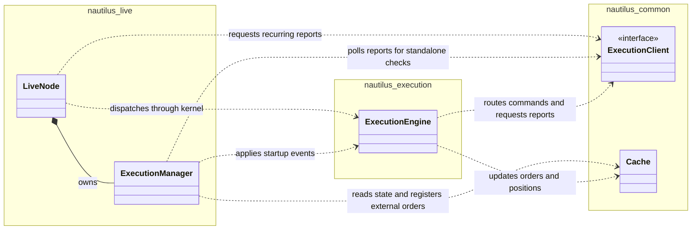

# Execution Reconciliation

execution reconciliation ทำให้ state จริงของ order และ position ที่ venue ตรงกับ state ภายในของระบบที่สร้างแบบ
event sourcing คู่มือนี้อธิบายการกู้คืน state ตอนเริ่มทำงาน และการตรวจสอบต่อเนื่องที่ใช้ตรวจจับความคลาดเคลื่อนระหว่าง runtime

ผลลัพธ์ของ command แบบ live ที่ยังไม่ชัดเจนเป็นต้นเหตุหนึ่งที่ทำให้ state แตกต่างกัน สำหรับวิธีที่ Nautilus จำแนก
ความล้มเหลวภายใน, ผลลัพธ์ที่แน่นอน และผลลัพธ์ที่ไม่ทราบ ดู[ผลลัพธ์ของ command](policies.md#command-outcomes)

สำหรับ lifecycle ของ node ทั้งหมด ดู[Live trading](../live.md) สำหรับการตั้งค่าที่มีและค่าที่แนะนำ ดู
[การตั้งค่า live trading node](../../how_to/configure_live_trading.md#executionengine-configuration)

## โมเดลของ reconciliation {#reconciliation-model}

live execution จะ reconcile state ภายในกับ report จาก venue ส่วน backtest ควบคุมทั้งการ execute order และ state ที่เกิดขึ้น
จึงไม่ต้องทำ reconciliation กับ venue

มีสองสถานการณ์:

- **มี state ใน cache**: ข้อมูลจาก report จะสร้าง event ที่ขาดหายไปเพื่อให้ state ตรงกัน
- **ไม่มี state ใน cache**: order และ position ทั้งหมดที่ venue จะถูกสร้างขึ้นใหม่ทั้งหมด

:::info[Position report คือ market exposure]
**position report ที่ระบุชัดเจนถือเป็นข้อมูลที่เชื่อถือได้ ระหว่าง startup reconciliation engine จะปรับให้ตรงกับ report นั้น
ภายใน tolerance ของ reconciliation หรือ fail closed**

position report ที่เชื่อถือได้:

- report แบบ open ที่ระบุชัดเจน รวมถึงปริมาณและทิศทาง
- report แบบ flat ที่ระบุชัดเจน

สิ่งที่ไม่ใช่หลักฐานว่า position เป็น flat:

- report ที่หายไป
- ปริมาณที่เป็น null
- venue ที่ไม่ publish position

fill window ไม่ได้เป็นตัวตัดสินว่า report เชื่อถือได้หรือไม่ report ที่หายไปไม่ได้แปลว่า flat

โดยค่าเริ่มต้น `generate_missing_orders` เปิดอยู่ engine จะสร้าง order และ fill ที่จำเป็นเพื่อปรับ state ภายในให้ตรงกับ
report การปิดการสร้างนี้ไม่ได้ทำให้ report ที่ยังไม่ resolve ผ่าน startup ไปได้

การรับประกันนี้ครอบคลุม report ที่ผ่านตัวกรอง position report และ instrument เมื่อเปิด reconciliation ไว้ report ที่ยัง
ไม่ resolve จะทำให้ actor และ strategy เริ่มทำงานไม่ได้
:::

:::tip
persist execution event ทั้งหมดลง cache database วิธีนี้ลดการพึ่งพาประวัติจาก venue และทำให้ reconciliation มี state ของ
order และ position ที่เก็บไว้ ซึ่งจำเป็นสำหรับการตีความช่วงประวัติที่สั้น
:::

### หน้าที่ของ component {#component-responsibilities}

`LiveNode` เป็นเจ้าของ `ExecutionManager` และจัดตารางการทำ reconciliation ซ้ำ ๆ manager ติดตามกิจกรรม, การ retry และ
ตัวตนของ fill, ตีความ state ใน cache และเตรียม event ของ reconciliation ส่วน `ExecutionEngine` นำ event ไปใช้กับ order
และ position และจัดการ execution report แต่ละตัว

แผนภาพ UML แสดงความเป็นเจ้าของและการพึ่งพา รูปข้าวหลามตัดทึบแสดงความเป็นเจ้าของ ลูกศรเส้นประชี้จากผู้เรียกไปยัง
component ที่ใช้ kernel เป็นเจ้าของ engine และ cache ที่ใช้ร่วมกัน แต่ละไว้ที่นี่เพื่อเน้นเรื่อง reconciliation

facade ของ live client ใช้ adapter instance เดียวร่วมกันระหว่าง node และ engine report request ที่ค้างอยู่อาจถือ borrow
ของ client ไว้ขณะที่ event loop จัดการงานอื่น การอัปเดต instrument จะถูกเลื่อนออกไปจนกว่า borrow เหล่านั้นจะถูกปล่อย
แล้วจึง flush เมื่อ request เสร็จหรือถูกยกเลิก

ภายใน `nautilus-live` นั้น module ของ source แบ่งหน้าที่เหล่านี้ดังนี้:

| Module                        | หน้าที่                                                                    |
| ----------------------------- | ------------------------------------------------------------------------ |
| `node/mod.rs`                 | lifecycle ของ node, event loop และการ dispatch event                      |
| `node/reconciliation.rs`      | task ของ report ที่ทำซ้ำ, deadline, การยกเลิก และการจัดการผลลัพธ์             |
| `execution/manager.rs`        | state ของ reconciliation, การตัดสินใจ และการตรวจสอบ reconciliation แต่ละแบบ |
| `execution/reconciliation.rs` | type ที่ใช้ร่วมกัน, การตัดสินใจที่ไม่ขึ้นกับ state และ report request แบบเจาะจง    |

module `nautilus_execution::reconciliation` ที่แยกออกมาให้ operation การแปลง report เป็น event และการคำนวณที่ใช้ร่วมกับ
execution engine

reconciliation มีเส้นทางต่างกันตอน startup และระหว่างการตรวจสอบต่อเนื่อง:

- **Startup**: manager จะ publish report ดิบ, นำ event ของ order และ fill ไปใช้, ตรวจสอบการนำ fill ย้อนหลังไปใช้
  แล้วจึงประเมิน position เทียบกับ cache ที่อัปเดตแล้ว
- **การตรวจสอบ position ต่อเนื่อง**: node ประสานงาน query และการ dispatch fill ที่เชื่อถือได้ก่อนขอให้ manager สร้าง
  event สังเคราะห์ revision ของกิจกรรมใช้ตรวจจับการเปลี่ยนแปลงภายในระหว่าง request หรือ callback การนำ fill ที่เชื่อถือได้
  ไปใช้จะเลื่อน reconciliation แบบสังเคราะห์ออกไปจนกว่าจะมี position report ใหม่

fill ที่เตรียมไม่สำเร็จหรือที่ engine ไม่ได้นำไปใช้ ก็จะเลื่อน reconciliation แบบสังเคราะห์ออกไปเช่นกัน การเลื่อนนี้มีผลจนกว่า
จะครบ `position_check_threshold_ms` นับจากความล้มเหลวครั้งแรกเท่านั้น การตรวจสอบหลังจากนั้นจะข้าม fill นั้นและ reconcile
position แบบสังเคราะห์ การตรวจสอบแต่ละครั้งจะหยุดที่ fill แรกแบบนี้ของ instrument และ account หนึ่ง ดังนั้น fill ที่ถูกปฏิเสธ
แต่ละตัวจะทำให้ fallback ล่าช้าไปอย่างน้อยหนึ่งรอบการตรวจสอบ หาก fill ที่ถูกข้ามไปถูกนำไปใช้ภายหลังผ่านเส้นทางอื่น (เช่น
execution stream) อาจเพิ่มเข้าไปในการแก้ไขแบบสังเคราะห์ได้ การตรวจสอบ position ครั้งถัดไปจะ reconcile ส่วนต่างนั้น

manager ยังใช้งานได้โดยไม่ต้องเปิด feature `node` ผู้เรียกแบบ standalone ใช้เมธอด polling แต่ละตัวของ manager และนำ event
ที่คืนมาไปใช้เองได้ การ polling position แบบ standalone จะคืน event สังเคราะห์ของความคลาดเคลื่อนโดยตรง ส่วน node จะเพิ่ม
ลำดับการกู้คืนด้วย fill ที่เชื่อถือได้เข้าไป

### Origin ของ execution client {#execution-client-origins}

**execution-client origin** คือการผูกแบบเขียนครั้งเดียวระหว่าง order กับ client ที่รับผิดชอบการ execute order นั้น

origin จะถูกบันทึก:

- จาก client ที่ระบุอย่างชัดเจนตอน submit หรือจาก client สุดท้ายที่ถูกเลือกหลังการ routing และการตรวจสอบ venue
  และก่อนการส่งผ่าน transport
- เมื่อ external order ที่ไม่ใช่แบบสังเคราะห์ถูกสร้างขึ้นระหว่าง startup reconciliation โดยใช้ client ที่รายงาน mass status
- เมื่อ external order ถูกสร้างจาก report ของ venue ระหว่าง runtime และ account ของ report ตรงกับ client ที่ลงทะเบียนไว้
  เพียงตัวเดียวที่จัดการ venue ของ instrument นั้น

origin อาจไม่มีในกรณี:

- ข้อมูลใน cache ที่เขียนไว้ก่อนที่ origin ที่ resolve แล้วจะถูก persist
- external order ที่ report ระหว่าง runtime ไม่สามารถระบุ client ที่ลงทะเบียนไว้ได้เพียงตัวเดียวจาก account และ venue ของ
  instrument
- order สังเคราะห์จาก reconciliation

cache backend ในตัวจะเข้าคิว origin ที่ resolve แล้วเพื่อ persist ก่อนการส่งผ่าน transport การเขียนยังเป็นแบบ asynchronous
ลำดับการเข้าคิวจึงไม่รับประกันว่า origin จะถูกบันทึกอย่างคงทนก่อนที่ order จะไปถึง client

ตอน startup จะตรวจสอบ mass status ของแต่ละ client เทียบกับ origin ใน cache order ที่ client รายงานควรผูกกับ client
ตัวเดียวกันนั้น

- **ไม่มี origin**: log warning แบบรวม และยังเข้ากันได้กับข้อมูลใน cache ที่มีอยู่
- **origin ขัดแย้งกัน**: log warning แบบรวมเรื่อง deprecation และ reconcile เพื่อความเข้ากันได้ release ในอนาคต
  จะปฏิเสธความขัดแย้งนี้เป็น error ตอน startup

ดูแถวที่เกี่ยวกับ origin ใน[สถานการณ์ตอน startup](#startup-scenarios)

เรื่องนี้แยกจาก[การ claim external order](#external-order-creation) ซึ่งระบุว่า order ที่มาจาก venue เป็นของ *strategy*
ใด ส่วน execution-client origin บันทึกว่า order เป็นของ *client* ใด

### Reconciliation report {#reconciliation-reports}

execution engine ใช้ reconciliation report สี่ variant จาก live adapter แต่ละ variant มีบทบาทปกติต่างกันเมื่อ order ที่ตรงกัน
ไม่มีอยู่ใน cache ประวัติที่มีขอบเขตชัดเจนสามารถใช้[การ project fill เฉพาะ order](#order-only-fill-projection) แทนได้

| Variant                | วัตถุประสงค์                | การดำเนินการเมื่อไม่มี order                              |
| ---------------------- | ------------------------ | ---------------------------------------------------- |
| `OrderStatusReport`    | อัปเดต state ของ order    | สร้าง order และอนุมาน fill ที่รายงานไว้                  |
| `FillReport`           | fill เดี่ยว               | สร้าง market order แล้วนำ metadata ของ fill ไปใช้        |
| `OrderWithFills`       | state ของ order พร้อม fill | สร้าง order, นำ fill ไปใช้ และอนุมานส่วนที่เหลือ           |
| `PositionStatusReport` | snapshot ของ position ที่ venue | log report position ยังคงคำนวณจาก fill              |

#### ควรใช้ variant ใดเมื่อไร {#when-to-use-each-variant}

adapter เลือก variant ที่ตรงกับ event ของ venue:

- ใช้ `OrderStatusReport` สำหรับการอัปเดต lifecycle ของ order เมื่อรายละเอียดของ fill มาทาง stream แยก
- ใช้ `FillReport` สำหรับการปิดที่ venue เป็นผู้เริ่มซึ่งมี fill แต่ไม่มี order ระดับผู้ใช้ liquidation ของ Hyperliquid
  เป็นไปตามรูปแบบนี้
- ใช้ `OrderWithFills` เมื่อ event เดียวของ venue มีทั้งสถานะ order และ fill ของมัน Binance Futures ใช้แบบนี้สำหรับ order
  ที่ exchange สร้างขึ้นจาก ADL, liquidation และ settlement

### ความสดใหม่ของ snapshot และการแก้ไข fill {#snapshot-freshness-and-fill-corrections}

snapshot ต้องไม่ย้อนกลับ fill ที่เกิดขึ้นหลัง state ที่ snapshot อธิบาย การได้รับ snapshot หลัง event ของ stream ไม่ได้ทำให้
snapshot ใหม่กว่า: REST request และการส่งของ stream อาจซ้อนกันระหว่างการกู้คืน เช่น request หนึ่งอาจเห็นปริมาณที่ fill
เป็นศูนย์ จากนั้น stream ส่ง fill ห้าหน่วย และ response ที่เก่ากว่ามาถึงทีหลังสุด การตีความ response นั้นเป็นการแก้ไขจะทำให้
void ห้าหน่วยนั้นอย่างผิดพลาด

การแก้ไขด้วย snapshot ต้องแยกแยะระหว่าง:

- **snapshot ที่เก่ากว่า fill**: ปริมาณที่ fill ซึ่งต่ำกว่าไม่ได้พิสูจน์ว่า fill ถูก void
- **snapshot ที่ครอบคลุม fill และรายงานการลดลง**: การลดลงอาจเป็นการแก้ไขจริง ซึ่งคำนวณจากประวัติ fill ที่เก็บไว้
- **event fill-void ที่ venue ระบุชัดเจน**: ประมวลผลตาม[สัญญาของ OrderFillVoided](../events/order_fill_voided.md) รวมถึง
  การตรวจสอบตัวตน ปริมาณ และลำดับ โดยไม่ต้องอาศัยการอนุมานการแก้ไขจากยอดรวมใน snapshot

ความหมายของ timestamp สำคัญเมื่อพิจารณาว่า snapshot ครอบคลุมถึงไหน:

- adapter ของ Derive รายงาน timestamp ของการอัปเดต order
- `matchedDate` ของ Betfair อธิบายการ match ครั้งล่าสุด ไม่ใช่เวลาของ snapshot หรือการแก้ไข

เวลาที่ response มาถึง, timestamp ที่เท่ากัน หรือ timestamp จาก clock ต่างกัน ไม่ได้พิสูจน์ด้วยตัวเองว่า snapshot รวม fill ไว้แล้ว

การปฏิเสธการแก้ไขจริงว่าเป็นข้อมูลเก่าอาจทำให้ปริมาณที่ fill และ exposure ภายในสูงเกินจริง จนกว่า reconciliation ครั้งถัดไป
จะแก้ความคลาดเคลื่อน ในทางกลับกัน snapshot เก่าที่มี timestamp ดูใหม่กว่าอย่างหลอกลวง ก็ยังอาจทำให้เกิดการ void ผิด ๆ
ได้หากการตรวจสอบความสดใหม่เชื่อ timestamp นั้น

execution engine นำการลดลงของปริมาณที่ fill จาก mass status ไปใช้กับ fill ที่เก็บไว้ แม้ snapshot จะไม่มี trade ประกอบก็ตาม

**กิจกรรม fill ที่ซ้อนกัน**: การรวบรวมเริ่มที่ `ExecutionMassStatus.ts_init` engine จะข้าม snapshot ของ order โดยอัตโนมัติ
เมื่อ fill หรือ fill void ใน cache มี timestamp การ initialize ภายในตรงหรือหลังขอบเขตนั้น การข้ามนี้ข้ามการเปลี่ยนแปลงทั้งหมด
จาก order report นั้น รวมถึงการอัปเดตสถานะ ปริมาณ และราคา

engine ยังคง publish report ดิบและประมวลผล trade ประกอบผ่านการตัดตัวซ้ำตามปกติ ไม่ได้เข้าคิว snapshot ที่ถูกข้าม
snapshot ที่มาทีหลังสามารถนำการแก้ไขจริงไปใช้ได้เมื่อการรวบรวมเริ่มหลังกิจกรรม fill ใน cache การข้ามนี้ไม่ต้องตั้งค่าใด ๆ
และไม่ได้ระงับ event fill-void ที่ระบุชัดเจน

การป้องกันนี้ใช้กับการจัดการ mass status ระหว่าง runtime ใน `ExecutionEngine` ส่วน startup reconciliation ใช้
`ExecutionManager` ซึ่งไม่ใช้ขอบเขต timestamp นี้

สำหรับการป้องกันระหว่าง runtime นั้น adapter ต้องบันทึก timestamp ของ mass status ก่อนรวบรวม report โดยใช้ clock ภายใน
ตัวเดียวกับ fill event ขอบเขตนี้ป้องกันกิจกรรมภายในที่ซ้อนกัน แต่ตรวจจับ state ของ venue ที่เก่าอยู่แล้วตอนเริ่มรวบรวมไม่ได้

### การ project fill เฉพาะ order {#order-only-fill-projection}

ระหว่าง startup reconciliation นั้น fill ย้อนหลังที่มีขอบเขตจะไม่เปลี่ยน position หรือ portfolio เมื่อ instrument นั้นไม่มี
position report ที่ระบุชัดเจนอยู่ในขอบเขต การไม่มี report ไม่ใช่ report แบบ flat แต่ order ยังคงไปถึงสถานะและปริมาณที่ fill
ตามที่รายงาน

position report ที่ระบุชัดเจน ไม่ว่าจะ open หรือ flat คือเป้าหมายของปริมาณ engine จะนำ fill ที่มีไปใช้, สร้างส่วนต่างเมื่อ
ตั้งค่าไว้ หรือปล่อยให้ position ยังไม่ resolve

การ project นี้ใช้กับการกู้คืนด้วย reconciliation เท่านั้น report ดิบยังคงมีให้ใช้ การตั้ง `filter_position_reports` จะทำให้
fill ย้อนหลังที่มีขอบเขตเป็นแบบเฉพาะ order แม้ mass status จะมี position report ก็ตาม ดู[ความปลอดภัยของประวัติแบบมีขอบเขต](#bounded-history-safety)
สำหรับข้อยกเว้นของ window ที่ไม่ได้ประกาศ และกฎของ fill ที่เก็บไว้

### การสร้าง external order {#external-order-creation}

เมื่อ report อ้างถึง order ที่ไม่มีอยู่ใน cache engine จะสร้าง **external order** ซึ่งครอบคลุม ADL, liquidation หรือ settlement
ที่ venue เป็นผู้เริ่ม, order ที่ process อื่นส่ง และ order ที่ยังไม่ถูกสังเกตเห็นภายใน

การตั้งชื่อแยกเจตนาของ config ออกจาก state ความเป็นเจ้าของแบบ live:

- `external_order_instrument_ids` คือเจตนาใน config ของ strategy ที่ serialize ได้ ระบุ instrument ที่ควรมอบ external order
  ให้ strategy เมื่อ strategy ลงทะเบียน
- **external order claim** คือ entry ที่ active ใน cache ซึ่ง map `InstrumentId` หนึ่งตัวไปยัง `StrategyId` หนึ่งตัว
  โค้ดใช้ `external_order_claims` เรียกชุดของ entry แบบ live เหล่านี้

การลงทะเบียน strategy แบบ live จะสร้าง claim จาก instrument ID ที่ตั้งค่าไว้ด้วย `register_external_order_claims`
operation นี้เป็นแบบเพิ่มและเข้มงวด จะปฏิเสธ instrument ที่ซ้ำ หรือ instrument ใดก็ตามที่มี claim อยู่แล้ว รวมถึง claim ของ
strategy เดียวกัน

เมธอดของ strategy `set_external_order_instrument_ids(...)` ส่งต่อไปยัง operation ของ cache `set_external_order_claims`
operation นี้ถือว่า input คือชุด claim ที่ active ทั้งหมดที่ strategy ต้องการ อาจคงหรือปล่อย claim เดิมของ strategy นั้น และรับ
instrument ที่ยังไม่มีใคร claim ได้ แต่ไม่สามารถแย่ง claim จาก strategy อื่นได้

การตรวจสอบครอบคลุม input ทั้งหมดก่อนเปลี่ยน cache ดังนั้นความขัดแย้งจะทำให้ claim ที่มีอยู่ทุกตัวคงเดิม

`ExecutionManager` และ `ExecutionEngine` อ่าน claim map มาตรฐานชุดเดียวกันจาก cache เมื่อประมวลผล report ภายนอก และ
มอบ external order ให้กับ:

- strategy ที่ระบุโดย claim ที่ active ของ instrument ใน report
- strategy `EXTERNAL` เป็น fallback เริ่มต้น

การอัปเดต claim ที่ active จึงมองเห็นได้ทั้งสอง component โดยไม่ต้องมี message ประสานงาน claim ที่มีอยู่ตอนสร้าง external
order เป็นตัวกำหนดการมอบหมาย order ที่อยู่ใน cache อยู่แล้วจะคง `StrategyId` ที่ได้รับมอบหมายไว้ การเปลี่ยน claim ไม่ได้
มอบหมาย order เหล่านั้นใหม่

หากต้องการโอน instrument ระหว่าง strategy เจ้าของปัจจุบันต้องปล่อยก่อนที่เจ้าของใหม่จะ claim การส่งต่อข้าม strategy ไม่ใช่
แบบ atomic report ที่ประมวลผลระหว่างการปล่อยและการรับจะไม่มี claim ที่ active และจะถูกมอบให้ `EXTERNAL`

การ reset cache จะคง claim ที่ active ไว้เพื่อให้การ routing ที่ลงทะเบียนยังตั้งค่าอยู่ ส่วนการเลิกใช้ strategy จะล้าง claim
ของ strategy นั้น

external order ใช้ `client_order_id` ของ report หากมี มิฉะนั้นจะสร้างจาก `venue_order_id` engine จะเพิ่ม order ลงใน cache,
ลงทะเบียน venue order ID และ emit event `OrderAccepted`, `OrderFilled`, `OrderCanceled` หรือ `OrderExpired` ที่เกี่ยวข้อง
จากนั้น position จะอัปเดตผ่าน event pipeline ตามปกติ

ดู[การ claim external order](../strategies.md#claiming-external-orders) สำหรับการตั้งค่า strategy และการอัปเดตระหว่าง runtime

### การลด external position {#reducing-external-positions}

strategy สามารถใช้ fill แบบ reduce-only เพื่อลด inventory `EXTERNAL` ที่รับช่วงมาภายใต้ NETTING ได้

#### การเลือก position {#position-selection}

ลิงก์ position ที่มีอยู่ใน cache ยังคงเป็นข้อมูลที่เชื่อถือได้ หากไม่มีลิงก์ใน cache fill แบบ reduce-only จะใช้ position ที่เปิด
อยู่ของ strategy เองหากมี หาก position นั้นไม่มีหรือปิดแล้ว engine จะหา position ที่ตรงตามเงื่อนไขทั้งหมดนี้:

- เป็นของ `EXTERNAL` และใช้ NETTING
- เปิดอยู่ฝั่งตรงข้ามกับ fill
- ตรงกับ instrument และ account ของ fill

engine จะเลือก fallback เฉพาะเมื่อมี position ที่ตรง **เพียงหนึ่งเดียว** ปริมาณของ fill ต้องไม่เกินปริมาณของ position นั้น
แม้ปริมาณคงเหลือของ order จะมากกว่าได้ หากไม่มี fallback ที่ปลอดภัย fill ที่ถูกต้องในด้านอื่นจะอัปเดต order แต่จะไม่เปิด
หรืออัปเดต position

#### ความเป็นเจ้าของและ event {#ownership-and-events}

หลังลดสำเร็จ engine จะลิงก์ order กับ external position เพื่อให้ fill ถัดไปใช้เป้าหมายเดียวกัน position ยังคงเป็นของ `EXTERNAL`:

- `OrderFilled` คง ID ของ strategy ที่ลด position และระบุ external position
- `PositionChanged` และ `PositionClosed` ใช้ event topic ของ strategy `EXTERNAL`

#### การตรวจสอบการลดที่ลิงก์ไว้ {#linked-reduction-checks}

เมื่อนำผลทางเศรษฐศาสตร์ของ position ไปใช้ การลดที่ลิงก์ไว้แต่ละครั้งต้องตรงกับ account ของ external position และลดปริมาณ
ที่เปิดอยู่โดยไม่กลับทิศหรือเปิดใหม่ หาก fill ละเมิดการตรวจสอบเหล่านี้ engine จะปฏิเสธ fill **ก่อนเปลี่ยน order หรือ position**

[การ project fill เฉพาะ order](#order-only-fill-projection) ข้ามการตรวจสอบการลดเหล่านี้ เพราะเป็นการซ่อมประวัติของ order
โดยไม่เปลี่ยน position

