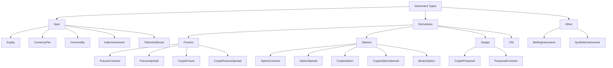

# Instruments

instrument คือข้อกำหนด (specification) ของสินทรัพย์ สัญญา หรือตลาดสังเคราะห์ภายใน (local synthetic market)
ที่ซื้อขายได้ ทั้ง market data, order, position, การบัญชี, การคำนวณของ portfolio และ symbology ของ adapter
ล้วนอ้างกลับไปที่ `InstrumentId` และนิยามของ instrument นั้น

ตัวอย่าง Rust ในหน้านี้ใช้ crate `nautilus_model`

## ประเภทของ instrument {#instrument-types}

| ประเภท instrument                                 | `InstrumentClass` | คำอธิบาย                                                  | Adapter ที่พบบ่อย                 |
| ------------------------------------------------- | ----------------- | --------------------------------------------------------- | ------------------------------- |
| [`Equity`](equity.md)                             | `SPOT`            | หุ้นหรือ ETF จดทะเบียนที่ซื้อขายในตลาดเงินสด                    | Databento, Interactive Brokers. |
| [`CurrencyPair`](currency_pair.md)                | `SPOT`            | คู่เงิน FX หรือ crypto spot ในรูปแบบ base/quote              | Binance, Kraken, OKX, Tardis.   |
| [`Commodity`](commodity.md)                       | `SPOT`            | สินค้าโภคภัณฑ์แบบ spot เช่น ทองคำหรือน้ำมัน                     | Interactive Brokers.            |
| [`Cfd`](cfd.md)                                   | `CFD`             | contract for difference ที่อ้างอิงสินทรัพย์อ้างอิง                 | Interactive Brokers.            |
| [`IndexInstrument`](index_instrument.md)          | `SPOT`            | ดัชนีอ้างอิง ซื้อขายโดยตรงไม่ได้                               | Interactive Brokers.            |
| [`TokenizedAsset`](tokenized_asset.md)            | `SPOT`            | สินทรัพย์แบบ tokenized บน crypto venue                       | Kraken.                         |
| [`FuturesContract`](futures_contract.md)          | `FUTURE`          | สัญญา futures ที่มีวันหมดอายุ                                 | Databento, Interactive Brokers. |
| [`FuturesSpread`](futures_spread.md)              | `FUTURES_SPREAD`  | strategy ของ futures หลาย leg ที่ exchange กำหนด               | Databento, Interactive Brokers. |
| [`CryptoFuture`](crypto_future.md)                | `FUTURE`          | สัญญา crypto futures ที่มีวันหมดอายุ                           | Bybit, Deribit, OKX.            |
| [`CryptoFuturesSpread`](crypto_futures_spread.md) | `FUTURES_SPREAD`  | crypto futures spread ที่ exchange กำหนด                     | Deribit, OKX.                   |
| [`CryptoPerpetual`](crypto_perpetual.md)          | `SWAP`            | สัญญา crypto perpetual futures                              | Binance, Bybit, dYdX.           |
| [`PerpetualContract`](perpetual_contract.md)      | `SWAP`            | สัญญา perpetual futures ข้ามประเภทสินทรัพย์                    | Architect AX, Binance.          |
| [`OptionContract`](option_contract.md)            | `OPTION`          | option แบบ put หรือ call ที่ซื้อขายใน exchange                  | Databento, Interactive Brokers. |
| [`OptionSpread`](option_spread.md)                | `OPTION_SPREAD`   | strategy ของ options หลาย leg ที่ exchange กำหนด               | Databento, Interactive Brokers. |
| [`CryptoOption`](crypto_option.md)                | `OPTION`          | option ที่มีสินทรัพย์อ้างอิงเป็น crypto                          | Bybit, Deribit, OKX, Tardis.    |
| [`CryptoOptionSpread`](crypto_option_spread.md)   | `OPTION_SPREAD`   | crypto option spread ที่ exchange กำหนด                      | Deribit, OKX.                   |
| [`BinaryOption`](binary_option.md)                | `BINARY_OPTION`   | instrument แบบ binary ที่ settle เป็น 0 หรือ 1                | Hyperliquid, OKX, Polymarket.   |
| [`BettingInstrument`](betting_instrument.md)      | `SPORTS_BETTING`  | ตัวเลือก (selection) ในตลาดกีฬาหรือเกม                         | Betfair.                        |
| [`SyntheticInstrument`](synthetic_instrument.md)  | n/a               | instrument ภายในที่คำนวณจากสูตร                               | Local only.                     |

## การจัดหมวดหมู่ {#taxonomy}

**โครงสร้างตลาด**: NautilusTrader จัดกลุ่ม instrument ตามโครงสร้างตลาดที่ instrument นั้นแทน



## ฟิลด์ร่วม {#common-fields}

instrument ส่วนใหญ่มีโครงสร้างหลักเหมือนกัน หน้าของแต่ละประเภทจะแสดง constructor และฟิลด์ของ struct
ของประเภทนั้นอย่างครบถ้วน

| Field             | ความหมาย                                                              |
| ----------------- | -------------------------------------------------------------------- |
| `id`              | `InstrumentId` ของ Nautilus ประกอบจาก symbol และ venue                |
| `raw_symbol`      | symbol ดั้งเดิมของ venue ก่อน Nautilus ทำ normalization                 |
| `price_precision` | จำนวนตำแหน่งทศนิยมที่กำหนดไว้สำหรับค่าราคา                               |
| `size_precision`  | จำนวนตำแหน่งทศนิยมที่กำหนดไว้สำหรับค่า quantity                           |
| `price_increment` | ขั้นราคาที่เล็กที่สุดที่ใช้ได้                                               |
| `size_increment`  | ขั้น quantity ที่เล็กที่สุดที่ใช้ได้                                         |
| `multiplier`      | ตัวคูณสัญญาที่ใช้คำนวณ notional และ PnL                                  |
| `lot_size`        | ขนาด lot หรือ board ที่ปัดแล้ว เมื่อ venue เผยแพร่ค่านี้                    |
| `margin_init`     | อัตรา initial margin เป็นเศษส่วนทศนิยมของมูลค่า notional                  |
| `margin_maint`    | อัตรา maintenance margin เป็นเศษส่วนทศนิยมของมูลค่า notional              |
| `max_quantity`    | quantity สูงสุดของ order เมื่อทราบ                                      |
| `min_quantity`    | quantity ต่ำสุดของ order เมื่อทราบ                                      |
| `max_notional`    | มูลค่า notional สูงสุดของ order เมื่อทราบ                                |
| `min_notional`    | มูลค่า notional ต่ำสุดของ order เมื่อทราบ                                |
| `max_price`       | ราคา quote หรือ order สูงสุดที่ใช้ได้ เมื่อทราบ                             |
| `min_price`       | ราคา quote หรือ order ต่ำสุดที่ใช้ได้ เมื่อทราบ                             |
| `tick_scheme`     | ชื่อ tick scheme ที่ลงทะเบียนไว้ ใช้สำหรับเลื่อนระดับราคา                     |
| `info`            | metadata ของ adapter ที่เก็บไว้จาก venue หรือแหล่งข้อมูล                   |
| `ts_event`        | timestamp แบบ UNIX nanosecond ของเวลาที่ event นิยาม instrument เกิดขึ้น   |
| `ts_init`         | timestamp แบบ UNIX nanosecond ของเวลาที่ Nautilus สร้าง object            |

## Tick scheme {#tick-schemes}

tick scheme ที่มีชื่อจะกำหนดตารางราคา (price grid) ที่ method `next_bid_price` และ `next_ask_price`
ของ instrument ใช้ ใช้ `FixedTickScheme` เมื่อ increment คงที่ หรือ `TieredTickScheme` เมื่อ increment
เปลี่ยนไปตามช่วงราคา

ต้องลงทะเบียน scheme ก่อนส่งชื่อของมันเป็น argument `tick_scheme` ให้ constructor ของ instrument

ลงทะเบียน scheme ที่กำหนดเอง**ก่อนโหลดนิยาม instrument ที่บันทึกไว้**จาก catalog เพราะนิยามที่บันทึกไว้
มีชื่อ scheme อยู่ และขั้นตอนการโหลดจะตรวจสอบชื่อนั้นกับ registry ของ process ปัจจุบัน

**การย้ายจาก v1**:

- `FixedTickScheme` ไม่รับ `min_tick` หรือ `max_tick` อีกต่อไป และไม่มี attribute `min_price` หรือ `max_price`
  scheme แบบ fixed ใช้ช่วงของ `Price` ที่แทนค่าได้ รวมถึงราคาติดลบ scheme Forex ที่มีมาในตัวก็ไม่จำกัด
  ขอบเขตราคาแบบ v1 อีกต่อไป
- argument `increment` ต้องเป็น `Price`

increment แบบ fixed ใช้ `Price` เพื่อรักษาค่าที่แน่นอน การเลื่อนระดับราคาจะคืน `None` ถ้า price precision
ของ instrument แทนค่า increment นั้นได้ไม่ตรงพอดี

```rust tab="Rust"
use nautilus_model::{
    instruments::{FixedTickScheme, TickScheme, TickSchemeRule, get_tick_scheme, register_tick_scheme},
    types::Price,
};

let fixed = FixedTickScheme::new(Price::from("0.05")).unwrap();
register_tick_scheme("FIVE_CENT", TickScheme::Fixed(fixed)).unwrap();
let scheme = get_tick_scheme("five_cent").unwrap();
assert_eq!(scheme.next_bid_price(1.13, 0, 2), Some(Price::from("1.10")));
assert_eq!(scheme.next_ask_price(1.13, 0, 2), Some(Price::from("1.15")));
```

นิยามของ tier ใช้รูปแบบ `(start, stop, step)` โดยรวม start แต่ไม่รวม stop แต่ละ tier จะขยายเป็นราคาได้
ไม่เกิน `max_ticks_per_tier` ราคา รวมถึง tier ที่มี stop เป็นอนันต์ tier ที่มีขอบเขตจำกัดแต่เกินเพดานนี้
จะถูกตัดทอนโดยไม่แจ้ง error ควรเลือกเพดานให้ใหญ่พอที่จะครอบคลุมทุกราคาที่ต้องการ

```rust tab="Rust"
use nautilus_model::instruments::{TickScheme, TieredTickScheme, register_tick_scheme};

let tiers = [(0.05, 10.00, 0.05), (10.00, f64::INFINITY, 0.25)];
let scheme = TieredTickScheme::new(&tiers, 2, 1000).unwrap();
register_tick_scheme("OPTION_GRID", TickScheme::Tiered(scheme)).unwrap();
```

### การลงทะเบียนและการค้นหา {#registration-and-lookup}

- **ชื่อ**: เป็น ASCII, ตัดช่องว่างหัวท้าย และไม่สนตัวพิมพ์เล็กใหญ่
- **อายุการใช้งาน**: การลงทะเบียนคงอยู่ตลอดอายุของ process ชื่อที่ลงทะเบียนแล้วจะแทนที่หรือลบไม่ได้
- **ชื่อที่สงวนไว้**: ชื่อที่มีมาในตัว เช่น `BETFAIR` และ `TOPIX100` รวมถึง alias เช่น
  `FIXED_PRECISION_01` ของ `FIXED_PRECISION_1` จะแทนที่หรือลบไม่ได้
- **การแสดงรายการ**: `list_tick_schemes()` คืนชื่อมาตรฐานของ scheme ที่มีมาในตัวและที่ลงทะเบียนไว้ โดยเรียงลำดับแล้ว

**ผลลัพธ์เมื่อล้มเหลว**:

| ความล้มเหลว                                   | Rust              |
| -------------------------------------------- | ----------------- |
| input สำหรับการสร้างหรือการลงทะเบียนไม่ถูกต้อง      | `TickSchemeError` |
| ชื่อซ้ำตอนลงทะเบียน                             | `TickSchemeError` |
| ไม่พบชื่อตอนค้นหา                               | `None`            |

## Symbology {#symbology}

instrument แต่ละตัวมี `InstrumentId` ที่ไม่ซ้ำกัน ประกอบจาก symbol ของ Nautilus และ venue คั่นด้วยจุด
ส่วนฟิลด์ `raw_symbol` แยกต่างหากเก็บ symbol ดั้งเดิมของ venue ไว้

**ตัวอย่าง Binance Futures**: สัญญา perpetual ของ Ethereum ใช้ตัวระบุนี้

```text
ETHUSDT-PERP.BINANCE
```

symbol ดั้งเดิมควรไม่ซ้ำกันภายใน venue หนึ่ง แต่ไม่ใช่ทุก exchange ที่รับประกันข้อนี้ ส่วนคู่ `{symbol}.{venue}`
ของ Nautilus ต้องไม่ซ้ำกันภายในระบบ

:::warning
นิยามของ instrument ต้องสอดคล้องกับ market data และความหมายของ order ฝั่ง venue instrument ที่ไม่ถูกต้อง
อาจตัดทอนราคาหรือ quantity หรือคำนวณมูลค่า notional ด้วยสกุลเงินผิด และยังอาจทำให้ backtest ยอมรับราคา
ที่ venue จริงจะปฏิเสธ
:::

## Rust surface {#rust-and-python-surfaces}

**Rust**: ใช้ struct ของ instrument ใน `nautilus_model` และ `InstrumentAny`

```rust
use nautilus_model::instruments::{CurrencyPair, InstrumentAny};
```

struct เหล่านี้แทนข้อกำหนดของ instrument ทั้งหมด ได้แก่ ตัวตน, precision, increment, สกุลเงิน, limit,
margin, ค่าธรรมเนียม, metadata และ timestamp

## การโหลด instrument {#loading-instruments}

adapter สำหรับ live integration มี object `InstrumentProvider` ที่ cache นิยามของ instrument ไว้ ใช้
`load_all=True` ใน `InstrumentProviderConfig` ในกรณีที่ integration นั้นรองรับ หรือใช้ `load_ids` เพื่อโหลด
ชุด instrument ที่รู้จักอยู่แล้ว การส่ง order ต้องมีนิยาม instrument ที่ตรงกันอยู่ใน cache กลางก่อน

## การค้นหา instrument {#finding-instruments}

**ค้นจาก cache**: strategy และ actor ดึง instrument จาก cache กลาง

```rust tab="Rust"
use nautilus_model::identifiers::InstrumentId;

let instrument_id = InstrumentId::from("ETHUSDT-PERP.BINANCE");
let instrument = cache.instrument(&instrument_id);
```

**Subscription**: subscribe instrument ตัวเดียว หรือ instrument ทั้งหมดของ venue หนึ่งก็ได้

เมื่อ `DataEngine` ได้รับการอัปเดต instrument จะส่ง object นั้นไปยัง handler `on_instrument()`

## Precision {#precision}

สำหรับการตรวจสอบ order นั้น `price_precision` และ `size_precision` กำหนดจำนวนตำแหน่งทศนิยมสูงสุดที่
`RiskEngine` ยอมรับ ส่วน `price_increment` และ `size_increment` บันทึกขั้นต่ำสุดที่สอดคล้องกัน

| Field             | ควบคุม                                    | ตัวอย่าง           |
| ----------------- | ----------------------------------------- | ----------------- |
| `price_precision` | ราคาของ order, trigger price และ fill        | `2` -> `50000.01` |
| `size_precision`  | quantity ของ order และขนาดของ fill           | `5` -> `1.00001`  |

precision ของ price increment ต้องตรงกับ `price_precision` และ precision ของ size increment ต้องตรงกับ
`size_precision` เช่น `price_precision=2` ต้องคู่กับ `price_increment` ที่มีค่า `0.01` และ precision 2

**การปัดค่า**: ใช้ factory method ของ instrument (`make_price` และ `make_qty`) เพื่อปัดค่าให้ตรงกับ
precision ที่กำหนดไว้

method เหล่านี้ปัดค่าตาม precision ของ increment ที่สอดคล้องกัน ซึ่งการสร้าง instrument บังคับให้ตรงกับ
precision ที่ประกาศไว้ แต่ไม่รับประกันว่าผลลัพธ์จะเป็นผลคูณของ increment เช่น `0.25`

:::warning
`RiskEngine` ไม่ปัดค่าให้อัตโนมัติ ถ้าสร้าง `Price` ที่มีทศนิยม 5 ตำแหน่งสำหรับ instrument ที่รองรับเพียง 2
ตำแหน่ง order จะถูกปฏิเสธ (denied) ให้ใช้ `instrument.make_price()` และ `instrument.make_qty()` เพื่อปัดค่า
อย่างชัดเจน นอกจากนี้ `RiskEngine` ไม่ได้ตรวจสอบว่าค่าเป็นผลคูณของ increment จึงต้องตรวจให้แน่ใจว่าราคา
และ quantity ตรงกับขั้นของ venue ก่อนส่ง order
:::

## Limit, margin และค่าธรรมเนียม {#limits-margins-and-fees}

**Limit ที่เป็นทางเลือก**: นิยามจาก venue และ adapter อาจมี limit ต่อไปนี้

- `max_quantity` และ `min_quantity`
- `max_notional` และ `min_notional`
- `max_price` และ `min_price`

margin model ใช้ `margin_init` และ `margin_maint` เพื่อคำนวณ initial margin และ maintenance margin

instrument ไม่ได้เก็บอัตราค่าธรรมเนียม maker หรือ taker ไว้ commission ใน backtest และ sandbox ใช้
[fee model](../behavioral_models.md) ส่วน commission ใน live มาจาก fill ของ venue

**ข้อตกลงเรื่องอัตราของ fee model**:

- อัตราค่าธรรมเนียมที่เป็นบวกหมายถึง commission
- อัตราค่าธรรมเนียมที่เป็นลบหมายถึง rebate

ดูพฤติกรรมด้านการบัญชีเชิงลึกได้ที่ [Accounting](../accounting.md)

## Metadata {#metadata}

ฟิลด์ `info` เก็บ metadata ดิบหรือ metadata เฉพาะของ adapter ไว้ในรูป dictionary ที่ serialize เป็น JSON ได้
ใช้ฟิลด์นี้เมื่อ venue เผยแพร่รายละเอียดที่มีประโยชน์แต่ไม่อยู่ใน API ของ instrument ที่เป็นมาตรฐานกลางของ Nautilus

## คู่มือที่เกี่ยวข้อง {#related-guides}

- [Data](../data/) อธิบายประเภทของ market data ที่อ้างถึง instrument
- [Orders](../orders/) อธิบายฟิลด์ของ order ที่อ้างถึง instrument
- [Synthetics](../synthetics.md) อธิบาย instrument ภายในที่คำนวณจากสูตร
- [Rust API Reference](https://nautilustrader.io/docs/core-latest/) แสดง constructor และ member ของ crate ฝั่ง Rust
