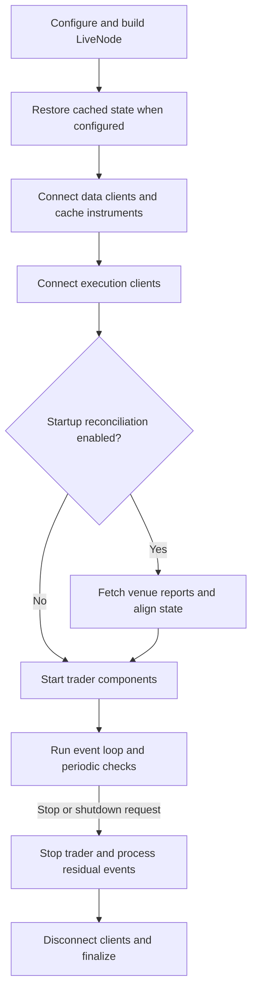

โค้ด strategy และ execution algorithm ชุดเดียวกันสามารถรันได้ทั้งใน backtest และ live แต่การ execute
แบบ live ยังมีพฤติกรรมด้าน venue, transport, จังหวะเวลา, persistence, กิจกรรมจากภายนอก และ
reconciliation ที่การจำลองอาจไม่ได้จำลองไว้

:::warning
**Live trading มีความเสี่ยงทางการเงินจริง** ก่อน deploy สู่ production ควรเข้าใจการตั้งค่าระบบ,
การดำเนินงานของ node, execution reconciliation และความแตกต่างระหว่าง backtest กับ live trading
:::

## ความแตกต่างระหว่าง backtest และ live [#backtest-and-live-differences]

backtest จะเดิน clock ที่ควบคุมได้จากข้อมูลย้อนหลัง และ execute order บน venue จำลอง ส่วน live node
ใช้โค้ด strategy และ execution algorithm ร่วมกับ backtest แต่ต้องประสานงานกับระบบที่อยู่นอกขอบเขตของ process

- **Venue**: กฎของ venue และความสามารถของ adapter เป็นตัวกำหนดว่ามีชนิด order, คำสั่งพิเศษ และ event ใด
  ให้ใช้บ้าง ดู [Adapters](adapters.md)
- **Transport**: ความล้มเหลวของเครือข่ายอาจทำให้ไม่รู้ผลของคำสั่ง order ดู
  [Command outcomes](execution/policies.md#command-outcomes)
- **จังหวะเวลา**: input ที่เป็นอิสระต่อกันอาจสลับลำดับกันได้ และ runner ไม่ได้กำหนดลำดับ FIFO แบบ global
  เพียงลำดับเดียว ดู [Dispatch priority](#dispatch-priority-and-overload-behavior)
- **Persistence**: cache backend ในตัวประมวลผลการเขียนแยกจาก transport ของ venue และการบันทึกลง
  event store ไม่ได้รอ commit ที่ถาวรก่อน dispatch ดู
  [Persistence before transport](execution/policies.md#persistence-before-transport)
- **กิจกรรมจากภายนอก**: report จาก venue อาจมี order ที่ถูกสร้างนอก node ดู
  [External order creation](execution/reconciliation.md#external-order-creation)
- **Reconciliation**: การตรวจสอบตอนเริ่มต้นและระหว่างรันจะปรับสถานะในเครื่องที่เก็บไว้ให้ตรงกับ report
  ของ venue ดู [Execution reconciliation](execution/reconciliation.md)

## การ routing ไปยัง execution client [#execution-client-routing]

live node สามารถลงทะเบียน execution client หลายตัวที่ตั้งชื่อแยกกันสำหรับ venue เดียวกันได้ `client_id`
ของคำสั่งจะเลือก client ที่ลงทะเบียนไว้โดยตรง ส่วนเส้นทางตาม venue และเส้นทางค่าเริ่มต้นจะใช้เลือก client
เมื่อทั้ง `client_id` ของคำสั่งและการ routing ตาม account ไม่สามารถระบุ client ได้

:::warning[การแยก account]
การลงทะเบียนหลาย client สำหรับ venue หนึ่งไม่ได้ทำให้ position และการจัดการ order แยกขาดจากกันแบบ
end-to-end ระหว่าง account บน venue เดียวกัน การตรวจความเสี่ยงก่อนเทรด (pre-trade risk check) ใช้ account
ของ client ที่จะรันคำสั่งนั้นๆ ดู [Account selection](execution/index.md#account-selection)
:::

### การ routing order [#order-routing]

ตั้งค่าเส้นทางตาม venue และเส้นทางค่าเริ่มต้นผ่าน `RoutingConfig` ของแต่ละ client:

- `venues` กำหนด venue ที่ระบุให้กับ client นั้น เส้นทางที่กำหนดชัดเจนเหล่านี้มีลำดับความสำคัญเหนือ
  เส้นทาง venue อัตโนมัติและ client ค่าเริ่มต้น
- `default=True` เลือก client สำรองเมื่อไม่มีเส้นทาง venue ใดใช้ได้

client ตัวเดียวที่ลงทะเบียนไว้สำหรับ venue หนึ่งจะ route venue นั้นโดยอัตโนมัติ เว้นแต่จะมี client อื่น
route venue นั้นอย่างชัดเจน หากมีหลาย client สำหรับ venue เดียวกัน ต้องมีเส้นทาง venue ที่กำหนดชัดเจน
หรือ client ค่าเริ่มต้น แม้ strategy จะระบุ `client_id` ให้ทุกคำสั่งก็ตาม client ID ซ้ำกัน, เส้นทาง venue
ที่ขัดกัน และการมีค่าเริ่มต้นหลายตัว จะทำให้การสร้าง node ล้มเหลว

### การอัปเดต instrument [#instrument-updates]

การอัปเดต instrument จะไปถึงทุก client ที่ venue ของตัวเองตรงกัน รวมถึง client ที่ถูก route ไปยัง venue นั้น
(ถ้ามี) client ที่ตรงเงื่อนไขแต่ละตัวจะได้รับการอัปเดตเพียงครั้งเดียว การได้รับการอัปเดต instrument ไม่ได้
ทำให้ client นั้นถูกเลือกเป็นผู้รับคำสั่ง order

### การเรียกจาก Rust โดยตรง [#direct-rust-callers]

`ExecutionEngine::register_client` ลงทะเบียน client โดยไม่กำหนด routing ให้เรียก
`register_venue_routing` หรือ `set_default_client` ตามหลังเพื่อตั้งค่าเส้นทาง venue หรือเส้นทางสำรอง
อีกทางหนึ่งคือ `register_default_client` ซึ่งลงทะเบียน client และตั้งให้เป็นค่าเริ่มต้นไปพร้อมกัน

## วงจรชีวิตของ live node [#live-node-lifecycle]

`LiveNode::run()` ของ Rust จะเตรียมสถานะใน cache และสถานะของ venue ก่อนเริ่ม component ของ trader
จากนั้นจะเป็นเจ้าของ event loop และการ shutdown แบบประสานงาน



วงจรชีวิตของ live node: instrument และสถานะ execution ถูกเตรียมไว้ก่อนที่ strategy จะเริ่มเทรด

การกู้คืน cache จะทำงานเมื่อมีฐานข้อมูลรองรับอยู่และเปิดการโหลด cache ไว้ หากการเชื่อมต่อ, reconciliation
หรือการเริ่ม trader ล้มเหลว การเริ่มต้นจะถูกยกเลิกและเข้าสู่เส้นทาง cleanup แบบประสานงาน

:::warning[หนึ่ง LiveNode ต่อหนึ่ง process]
ให้รัน `LiveNode` พร้อมกันได้เพียงตัวเดียวต่อ process เพราะ runner ผูก channel sender และ message bus
ไว้กับ thread-local storage และสถานะ runtime อื่นๆ ก็เป็นระดับ process ให้รัน node เพิ่มเติมใน process แยก

การสร้าง `LiveNode` อีกตัวบน thread เดียวกันจะเกิด error ขณะที่ node ตัวแรกยังมีอยู่หรือกำลังถูกสร้าง
:::

### การกู้คืน submission ตอน shutdown [#submission-recovery-at-shutdown]

`LiveNode::stop`, `run` และ `run_with_mode` ของ Rust ใช้ขอบเขตการกู้คืน submission เดียวกัน:

1. ระหว่าง `delay_post_stop` node จะยังประมวลผลหลักฐานจาก venue และ timer ของ managed exit แบบ native
   ต่อไป โดยไม่เริ่ม query สำหรับ reconciliation ใหม่
1. เมื่อจบช่วงเวลานั้น หากยังมี submission ที่เก็บไว้ซึ่งไม่มีผลลัพธ์แบบ native หรือการยืนยันจาก venue
   การ shutdown จะคืนค่า error โดย error จะระบุ client order ID ที่ยังไม่ได้ข้อสรุป
1. client จะ disconnect และ kernel จะหยุดแม้การกู้คืนยังไม่สมบูรณ์

หลักฐานที่ระบายเข้ามาหลังขอบเขตนี้ไม่สามารถเปลี่ยนผลการ shutdown ที่บันทึกไว้แล้วได้

กฎนี้ใช้กับ `RetainUnresolved` และกับ client ที่บังคับให้เก็บ submission ไว้ รวมถึง submission ที่งบการกู้คืน
ยังไม่หมด Polymarket บังคับการเก็บไว้โดยอัตโนมัติ ผู้เรียกจึงอาจได้รับ error นี้โดยไม่ต้องเลือก policy
แบบ opt-in ส่วน policy ค่าเริ่มต้น `ResolveLocally` ยังคงเดิมสำหรับ client ที่ไม่ได้บังคับการเก็บไว้

การ acknowledge submission ทำให้การกู้คืน submission สิ้นสุดลง แต่ไม่ได้พิสูจน์ว่าการ cancel หรือ update
ของ order ที่ถูก accept แล้วเสร็จสมบูรณ์ หรือว่า position เป็นศูนย์ managed exit ยังคงใช้งบความพยายาม
ที่มีอยู่เดิม และผลลัพธ์นี้ไม่ได้ขยาย cleanup ให้เลยช่วง `delay_post_stop` หรือทำการกู้คืนข้ามการ restart
ดูกฎเรื่อง identity และงบการ query ได้ที่ [submission recovery](execution/reconciliation.md#submission-recovery)

## การตั้งค่า [#configuration]

สำหรับวิธีที่ config struct จัดการค่าเริ่มต้น, ความหมายของ `T` เทียบกับ `Option<T>` และรูปแบบ builder
ดูคู่มือแนวคิด [Configuration](configuration.md)

สำหรับการตั้งค่า node และ execution engine, การตั้งค่า strategy, cache backing และการเชื่อมหลาย venue
ดูคู่มือ how-to [Configure a live trading node](../how_to/configure_live_trading.md)

## Execution reconciliation [#execution-reconciliation]

สำหรับวิธีที่คำสั่ง submit, modify และ cancel ได้ข้อสรุป ดู
[Command outcomes](execution/policies.md#command-outcomes)

ตอนเริ่มต้น reconciliation จะปรับสถานะ order และ position ใน cache ให้ตรงกับ report ของ venue ก่อนที่
component ของ trader จะเริ่ม จากนั้นการตรวจสอบต่อเนื่องจะเฝ้าดู order ที่กำลังส่ง, order ที่เปิดอยู่,
position และ own order book ระหว่างที่ node ทำงาน

adapter สามารถประกาศ report ย้อนหลังแบบมีขอบเขตได้ reconciliation ตอนเริ่มต้นจะนำผลทางเศรษฐศาสตร์ของ
fill ใน report เหล่านั้นไปใช้ก็ต่อเมื่อชุด report และสถานะที่เก็บไว้พิสูจน์ได้ว่าเป็นการเปลี่ยนผ่านของ position
ที่สอดคล้องกัน ประวัติที่ไม่ครบหรือกำกวมยังกู้คืนสถานะ order ที่แน่นอนได้ โดยไม่เปลี่ยน position หรือผลทาง
เศรษฐศาสตร์ของ portfolio

ดู [Execution reconciliation](execution/reconciliation.md) สำหรับการตั้งค่า, ขั้นตอนการกู้คืน,
การตรวจสอบระหว่างรัน, สถานการณ์ตัวอย่าง และ invariant
สำหรับการป้องกัน snapshot ที่ล้าสมัยระหว่างรัน และความแตกต่างจากการแก้ไขจริงและ event fill-void ที่ระบุ
ชัดเจน ดู [Snapshot freshness and fill corrections](execution/reconciliation.md#snapshot-freshness-and-fill-corrections)

## Metrics ของ live runner ใน Rust [#rust-live-runner-metrics]

`LiveNode` ของ Rust เปิดให้ดู metrics พื้นฐานของ runner ผ่าน `LiveNodeHandle::metrics_snapshot()`
ให้ดึง handle จาก node ก่อนเรียก `run()` แล้ว poll snapshot จาก task อื่น และคำนวณอัตราหรือ utilization
จากส่วนต่าง (delta)

```rust
use std::time::Duration;

use nautilus_common::enums::Environment;
use nautilus_live::node::{LiveNode, RunnerMetricsDelta};

let mut node = LiveNode::builder(trader_id, Environment::Live)?
    // Add clients, actors, and strategies here.
    .build()?;

let metrics_handle = node.handle();

tokio::spawn(async move {
    let mut prev = metrics_handle.metrics_snapshot();
    let mut interval = tokio::time::interval(Duration::from_secs(1));

    loop {
        interval.tick().await;

        let next = metrics_handle.metrics_snapshot();
        let delta = RunnerMetricsDelta::from_snapshots(prev, next);
        if delta.elapsed_ns == 0 {
            prev = next;
            continue;
        }

        let elapsed_s = delta.elapsed_ns as f64 / 1_000_000_000.0;
        let data_event_rate = delta.data_events as f64 / elapsed_s;
        let data_event_staleness_ns = if next.data_events.last_dispatch_at_ns == 0 {
            0
        } else {
            next.elapsed_ns
                .saturating_sub(next.data_events.last_dispatch_at_ns)
        };

        log::info!(
            "Runner metrics: data_event_rate={data_event_rate:.0} \
             data_event_staleness_ns={data_event_staleness_ns} \
             dispatch_utilization={:.6} loop_utilization={:.6} \
             mean_dispatch_ns={} data_queue_depth={}",
            delta.dispatch_utilization(),
            delta.loop_utilization(),
            delta.mean_dispatch_ns(),
            next.data_events.queue_depth,
        );

        prev = next;
    }
});

node.run().await?;
```

### ขอบเขตและการตีความ snapshot [#snapshot-scope-and-interpretation]

snapshot ครอบคลุมการ dispatch ผ่าน channel ของ `LiveNode::run` หลังการเริ่มต้น รวมถึงการ dispatch ที่
ค้างอยู่ในช่วง grace period ของการ shutdown แต่ **ไม่** รวม buffer ตอนเริ่มต้น, การ flush ตอนเริ่มต้น หรือ
การระบายครั้งสุดท้ายหลังจบ loop

- `dispatch_busy_ns` ครอบคลุม dispatch branch ทั้งห้า ส่วน `maintenance_busy_ns` และ
  `external_msgbus_busy_ns` ครอบคลุมงานใน loop ที่ไม่ใช่การ dispatch
- ความลึกของคิวเป็นค่าที่สุ่มวัด ณ จุดเวลาจาก maintenance tick ระหว่างที่ node ทำงาน และอาจล้าสมัยในช่วง
  grace ของการ shutdown
- snapshot เป็นแบบ lock-free และอาจไม่ใช่มุมมองที่สอดคล้องกันข้ามฟิลด์ ให้คำนวณอัตราจาก snapshot ที่ต่อเนื่องกัน
  ด้วย **saturating delta**
- ตัวนับจะรีเซ็ตเมื่อ `LiveNode::run` เข้าสู่ steady state

## ลำดับความสำคัญของการ dispatch และพฤติกรรมเมื่อโหลดเกิน [#dispatch-priority-and-overload-behavior]

message channel ภายในทั้งเจ็ดของ live runner แยกจากกันและไม่จำกัดขนาด เมื่อมีหลาย channel พร้อมในเวลา
เดียวกัน runner จะ poll branch ที่มีสิทธิ์ตามลำดับนี้:

1. งานด้านเวลาและระบบ
1. Execution event
1. Execution command
1. ข้อมูลขาเข้าจาก external message bus
1. Data event และ command

เมื่อมีงานด้าน data ค้างอยู่ การ poll timer จะหลีกทางจนกว่า message channel อื่นจะได้รับการบริการ
execution event มาก่อน execution command ส่วน data event และ command จะสลับกันเมื่อค้างอยู่ทั้งคู่

ลำดับการ poll นี้ป้องกันไม่ให้ข้อมูลตลาดที่ค้างสะสมได้ลำดับความสำคัญเหนือ execution traffic ที่พร้อมอยู่
แต่ไม่ได้กำหนด **ลำดับ FIFO แบบ global เพียงลำดับเดียว** ข้าม channel, adapter หรือ venue

branch ที่ถูกเลือกแต่ละตัวจะทำงานจนเสร็จก่อนที่ runner จะ poll อีกครั้ง handler ที่ช้าจึงทำให้ทุก channel
ล่าช้า runner จะหลีกทางให้ event loop ของ host เป็นระยะ แต่การหลีกทางนี้ไม่ได้เปลี่ยนลำดับความสำคัญของ
channel หรือทำให้ handler ที่ช้าเร็วขึ้น

:::warning[คิวไม่จำกัดขนาด]
channel ของ runner ไม่มี backpressure ไปยังผู้ผลิตข้อมูล, ไม่รวมข้อความ, ไม่ทิ้งข้อมูลตลาด และไม่กำหนด
ความลึกคิวสูงสุด input ที่สูงกว่าความสามารถในการ dispatch อย่างต่อเนื่องจึงเพิ่มความลึกคิว, latency และ
การใช้หน่วยความจำ runner จะไม่ throttle feed, หยุดเทรด หรือ shutdown โดยอัตโนมัติเมื่อเกินเกณฑ์
:::

ใช้ runner metrics และ queue-state event เพื่อตรวจจับแรงกดดันนี้ เกณฑ์เหล่านี้เป็นสัญญาณเชิงปฏิบัติการ
ไม่ใช่การรับประกันเวลาให้บริการ แอปพลิเคชันต้องตัดสินใจเองว่าจะแจ้งเตือน, ลด input, หยุดเปิด exposure ใหม่
หรือหยุด node อย่างไรเมื่อแรงกดดันยังคงอยู่

## การเฝ้าดูแรงกดดันของคิว [#queue-pressure-monitoring]

`LiveNode` จะแปลงค่าตัวอย่างคิวของ runner เป็นการเปลี่ยนสถานะแบบมี type เมื่อตั้งค่า
`LiveNodeConfig.queue_monitor` ไว้ ตัวเฝ้าดูนี้ **ปิดโดยค่าเริ่มต้น** และจะไม่ publish queue-state event ใดๆ
ขณะที่ฟิลด์นี้ยังไม่ได้ตั้งค่า

### ตั้งค่าเกณฑ์ [#configure-thresholds]

ตัวอย่างต่อไปนี้ตั้งเกณฑ์ที่ใช้กับแต่ละ runner channel ที่ถูกเฝ้าดู:

```rust tab="Rust"
use nautilus_live::config::{LiveNodeConfig, QueueMonitorConfig};

let config = LiveNodeConfig {
    queue_monitor: Some(
        QueueMonitorConfig::builder()
            .queue_depth_trigger(1_000)
            .queue_depth_clear(500)
            .mean_dispatch_ns_trigger(250_000)
            .mean_dispatch_ns_clear(150_000)
            .build(),
    ),
    ..Default::default()
};
```

ค่าทั้งสี่ใช้กับแต่ละ runner channel ที่ถูกเฝ้าดู:

- `time_events`
- `exec_events`
- `exec_commands`
- `data_events`
- `data_commands`

เกณฑ์ clear แต่ละตัวต้อง **ต่ำกว่าเกณฑ์ trigger ของมัน** การตรวจสอบ config จะปฏิเสธเกณฑ์ที่เท่ากันหรือกลับด้าน

### การเปลี่ยนสถานะ [#state-transitions]

live runner จะประเมินตัวเฝ้าดูทุก maintenance tick ที่ 100 ms หลังสุ่มวัดความลึกคิวปัจจุบัน ความลึกคิวเป็น
ค่า ณ จุดเวลา ส่วนเวลา dispatch เฉลี่ยใช้จำนวนข้อความและเวลาที่ dispatch ไม่ว่างที่สะสมมาตั้งแต่ metrics
snapshot ครั้งก่อน

| เงื่อนไข       | ค่าที่วัด                                                | `Triggered`                                    | `Cleared`                                    |
| ------------ | ----------------------------------------------------- | ---------------------------------------------- | -------------------------------------------- |
| `Backlogged` | ความลึกคิว ณ จุดเวลา                                     | `queue_depth >= queue_depth_trigger`           | `queue_depth <= queue_depth_clear`           |
| `Slow`       | เวลา dispatch เฉลี่ยราย channel ในช่วงหน้าต่างของตัวอย่าง        | `mean_dispatch_ns >= mean_dispatch_ns_trigger` | `mean_dispatch_ns <= mean_dispatch_ns_clear` |

แต่ละ channel ติดตาม `Backlogged` และ `Slow` แยกจากกัน:

- ค่าที่อยู่ระหว่างเกณฑ์ clear และ trigger จะคงสถานะเดิมไว้ จึงไม่ publish event เพิ่ม
- หากทั้งสองเงื่อนไขข้ามเกณฑ์ใน tick เดียวกัน node จะ publish สอง event และแต่ละเงื่อนไขจะ clear แยกกัน
- หน้าต่างตัวอย่างที่ไม่มีการ dispatch จะไม่ประเมิน `Slow` เงื่อนไขนี้จะคงสถานะเดิมจนกว่าจะมีหน้าต่างที่มี
  การ dispatch

### การส่งแบบมี type [#typed-delivery]

การเปลี่ยนสถานะแต่ละครั้งจะ publish ค่า `QueueStateChanged` ใหม่บน
`events.system.QueueStateChanged.<channel>` โดย `<channel>` คือชื่อ variant ใน Rust เช่น `DataEvents`
event นี้ระบุ trader ที่ตั้งค่าไว้, runner channel, เงื่อนไข และสถานะการเปลี่ยน รวมถึงบันทึกความลึกคิวและ
เวลา dispatch เฉลี่ย ณ จุดที่ข้ามเกณฑ์, event ID ใหม่ และ timestamp ของ event

actor subscribe ด้วย `subscribe_queue_state(...)` และรับ event ผ่าน `on_queue_state(...)` การ publish
อยู่บน message bus แบบมี type ภายใน process และ event นี้ไม่มีรูปแบบ wire สำหรับการสตรีมผ่าน external
message bus ดูตัวอย่างสำหรับ actor ได้ที่ [Queue pressure state](actors.md#queue-pressure-state)

## สถานะ transport ของ socket [#socket-transport-state]

### การ publish และการ routing [#publication-and-routing]

actor สามารถสังเกตความพร้อมใช้งานของ transport สำหรับ adapter ที่เลือกเปิดการรายงานสถานะ socket ได้
`LiveNode` จะ publish `SocketStateChanged` บน `events.system.SocketStateChanged.<client_id>.<endpoint>`
พร้อม trader ID, client ID, venue (ถ้ามี), label ของ endpoint ที่คงที่, สถานะ, event ID ใหม่ และ timestamp
ของ event โดย label ของ endpoint ระบุ transport เชิงตรรกะหนึ่งตัวของ adapter โดยไม่เปิดเผย URL

`LiveNode` ตั้ง timestamp ทั้งสองจาก clock ของ kernel เมื่อจัดการการแจ้งสถานะแบบกลางของ transport
adapter ส่งการแจ้งนี้ผ่าน system-event channel ของ runner แยกจากข้อมูลตลาด channel ภายในนี้ไม่ได้เป็นส่วน
หนึ่งของการเฝ้าดูแรงกดดันของคิว

ส่วนประกอบ client ID และ endpoint จะ percent-encode ไบต์ที่ไม่ใช่ตัวอักษร ASCII, ตัวเลข, `-` และ `_`
ดังนั้นจุดและอักขระ wildcard ใน label จึงเปลี่ยนการจับคู่ topic ไม่ได้ ใช้ตัวกรองของ
`subscribe_socket_state` เพื่อเลือก client, endpoint หรือทั้งสองอย่าง โดยไม่ต้องสร้างชื่อ topic เอง

### ความหมายของสถานะ [#state-semantics]

| event หรือเงื่อนไขของ transport          | การ publish                                             |
| ----------------------------------- | ------------------------------------------------------ |
| TCP หรือ WebSocket พร้อมใช้งาน          | `Connected`                                            |
| transport ที่ใช้งานอยู่ขาดหาย             | `Disconnected`                                         |
| การเชื่อมต่อหรือการลองใหม่ล้มเหลว            | ไม่มี event                                              |
| การ shutdown โดยเจตนา                 | ไม่มี disconnect event                                   |
| ลอง reconnect จนหมดจำนวนครั้ง            | ไม่มี event เพิ่มหลังจากรายงานการขาดหายของ transport แล้ว      |

`Connected` รายงาน **ความพร้อมใช้งานของ transport** ไม่ได้หมายความว่าการยืนยันตัวตน, การ replay
subscription หรือการกู้คืนของ adapter เสร็จสมบูรณ์แล้ว

:::warning
สถานะ socket เป็นหลักฐานเชิงปฏิบัติการ ไม่ใช่ผลลัพธ์ของคำสั่ง execution การ disconnect เพียงอย่างเดียว
ไม่ได้ reject, cancel หรือสรุปผลคำสั่งที่กำลังดำเนินอยู่ การอัปเดตจากสตรีม, query หรือ reconciliation
เป็นผู้ให้หลักฐานนั้นภายใต้ [command outcome policy](execution/policies.md#command-outcomes)
:::

### การตรวจจับ peer ที่ตายแล้ว [#dead-peer-detection]

การเชื่อมต่ออาจหยุดส่งข้อมูลโดยไม่ปิด เช่น NAT หรือ load balancer ทิ้งการเชื่อมต่อไปโดยไม่มี `FIN` และ
ไม่มี `RST` การเขียนจึงยังสำเร็จลง send buffer ต่อไปและไม่มีอะไรบ่งชี้ว่าการเชื่อมต่อหายไป

#### Heartbeat timeout [#heartbeat-timeout]

WebSocket และ raw TCP client แบบ handler-mode จะ reconnect เมื่อ heartbeat timeout เมื่อตั้งค่า heartbeat
ไว้ timeout ค่าเริ่มต้นคือ **สามช่วง heartbeat** หากระบุ `heartbeat_timeout_secs` ชัดเจนจะใช้ค่านั้นแทน
WebSocket client จะรีเซ็ตเมื่อได้รับ frame ขาเข้าใดๆ ส่วน raw TCP client จะรีเซ็ตเมื่อมีไบต์มาถึง

client คาดหวังว่า peer จะตอบ heartbeat ดังนั้น transport ที่ไม่มี heartbeat จะไม่มีหน้าต่างค่าเริ่มต้น แต่
timeout ที่ระบุชัดเจนยังเปิดการตรวจจับได้แม้ไม่มี heartbeat

สำหรับ WebSocket client หน้าต่างนี้นับทุก frame การตอบ keepalive จึงรีเฟรชหน้าต่าง และตลาดที่เงียบจะไม่
ทำให้ timeout

#### Feed idle timeout [#feed-idle-timeout]

adapter สามารถตั้ง idle timeout แยกต่างหากเพื่อตรวจจับ feed ที่หยุดไหลขณะที่ transport ยังปกติดี มีเพียง
frame แบบ Text และ Binary เท่านั้นที่รีเฟรช timeout นี้ หน้าต่างที่สองนี้เหมาะกับ venue ที่ push ข้อมูลตาม
จังหวะที่รู้แน่นอน ในกรณีที่ venue ตอบ keepalive ด้วย payload แบบ text การตอบนั้นจะรีเฟรช idle timeout
เหมือนข้อมูลจริง หน้าต่างนี้จึงมีความหมายก็ต่อเมื่อตั้งไว้ต่ำกว่าช่วง heartbeat

### การเชื่อมกับ adapter และ actor [#adapter-and-actor-integration]

การเชื่อม adapter จะสร้าง `SocketStateSink` และตั้งผ่าน builder option `state_sink` ของ network client
การ publish ต้องใช้ runner ของ `LiveNode` ส่วน `AsyncRunner` แบบ standalone จะไม่ publish event เหล่านี้

actor subscribe ด้วย `subscribe_socket_state(...)` และรับ event ผ่าน `on_socket_state(...)` การส่งอยู่บน
bus แบบมี type ภายใน process การสตรีมผ่าน external message bus และรูปแบบ wire จะไม่เปิดเผย event เหล่านี้

### คำสั่ง reconnect ราย endpoint [#endpoint-reconnect-commands]

actor หรือ strategy สามารถเรียก `reconnect_socket(client_id, endpoint)` ด้วย label ของ endpoint จาก
state event ได้ runner จะ route คำสั่งแบบมี type ผ่าน kernel และ engine ที่เป็นเจ้าของ endpoint ที่ลงทะเบียนไว้
engine จะเรียกเฉพาะ reconnect handle ของ transport นั้น โดยไม่เรียกวงจร disconnect และ connect ของ
`DataClient` หรือ `ExecutionClient` ที่ครอบอยู่

:::note
API นี้เป็นแบบ **fire-and-observe** การคืนค่าสำเร็จหมายความว่าคำสั่งผ่านการตรวจสอบในเครื่องและเข้าคิวแล้ว
ไม่ได้ยืนยันว่า kernel รับคำสั่งหรือการกู้คืนเสร็จสมบูรณ์
:::

คำขอที่ได้รับการยอมรับจะ emit `SocketStateChanged` สำหรับ endpoint ที่เลือก:

1. `SocketState.DISCONNECTED` เมื่อ transport เข้าสู่โหมด reconnect
1. `SocketState.CONNECTED` หลัง transport กู้คืนแล้ว

ตัวควบคุมการ reconnect ปกติของ transport จะคงพฤติกรรมการยืนยันตัวตน, การ replay subscription และการ
กู้คืนของ adapter ไว้

kernel จะ log client ที่ไม่รู้จัก, client ที่ไม่รองรับ, endpoint ที่ไม่รู้จักหรือกำกวม, คำขอซ้ำ, transport ที่กำลัง
disconnect และ transport ที่ปิดแล้ว การปฏิเสธเหล่านี้จะไม่ emit การเปลี่ยนสถานะ socket และไม่กระทบ
endpoint อื่น label ของ endpoint ใช้เฉพาะอักขระของ identifier และไม่มี URL ดิบ

## Shutdown เมื่อเกิด error [#shutdown-on-error]

ตั้ง `LiveNodeConfig.shutdown_on_error=True` เพื่อให้ error log ใน Rust ร้องขอการ shutdown ของ live node
logger ของ Rust จะบันทึก `log::error!` ตัวแรกที่ถูก emit หลัง kernel เริ่ม รวมถึง error log จาก thread อื่น
kernel จะ publish คำสั่ง `ShutdownSystem` เมื่อ live event loop ตรวจการ shutdown ครั้งถัดไป

คำขอ shutdown จะเป็นไปตามเส้นทางการหยุด live node ปกติ node จะหยุด trader, รอ post-stop delay,
disconnect client และหยุด engine โดยไม่ abort process

trigger นี้มีกฎดังนี้:

- error log ที่ถูกระงับโดยตัวกรองของ component หรือโหมด logging bypass ยังร้องขอ shutdown ได้
- การรัน kernel ครั้งใหม่จะล้างและตั้ง trigger ใหม่ process จึง restart node ได้โดยไม่ต้อง initialize ระบบ
  logging ใหม่
- shutdown-on-error สังเกต **record ของ `log` ใน Rust**

:::note
option `graceful_shutdown_on_error` ราย engine ถูกนำออกแล้ว ให้ตั้งค่า shutdown-on-error ที่ระดับ
node/kernel แทน
:::

## คู่มือที่เกี่ยวข้อง [#related-guides]

- [Execution reconciliation](execution/reconciliation.md) - การกู้คืนสถานะและการตรวจความสอดคล้องระหว่างรัน
- [Execution policies](execution/policies.md) - ขอบเขตของการส่งคำสั่ง, persistence และการกู้คืน
- [Configure a live trading node](../how_to/configure_live_trading.md) - การตั้งค่า node และ engine
- [Run live trading with Rust](../how_to/run_rust_live_trading.md) - การตั้งค่า node ใน Rust และการเชื่อมต่อ venue
- [Adapters](adapters.md) - การเชื่อมต่อกับ venue
- [Execution](execution/) - ผลลัพธ์ของคำสั่งและการ execute order
- [Message bus](message_bus.md) - พฤติกรรม publish และ subscribe แบบมี type ภายใน process
- [Backtesting](backtesting/) - การทดสอบ strategy ก่อน deploy
