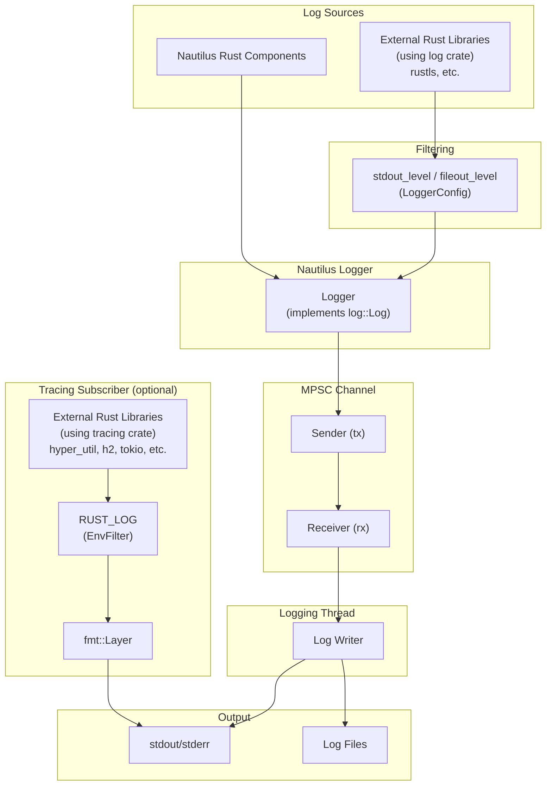

แพลตฟอร์มมีระบบ logging ฝั่ง Rust สำหรับ backtest และ live trading ผ่าน facade มาตรฐานของ crate `log`

core logger ทำงานใน thread แยก และใช้ channel แบบ multi-producer single-consumer (MPSC) ในการรับ log message
วิธีนี้ย้าย I/O ของการเขียน log ออกจาก thread ที่เรียกใช้ อย่างไรก็ตาม argument ของ message ยังคงถูก format
บน thread ที่เรียกใช้ก่อนที่ event จะเข้าคิว

output ของ logging ปรับแต่งได้ และรองรับ:

- **stdout/stderr writer** สำหรับแสดงผลบน console
- **file writer** สำหรับเก็บ log ไว้ถาวร

:::tip
สามารถเชื่อมต่อ infrastructure อย่าง [Vector](https://github.com/vectordotdev/vector) เพื่อเก็บรวบรวมและ aggregate event ภายในระบบของคุณได้
:::

## สถาปัตยกรรม [#architecture]

subsystem ของ logging รับ event จากหลายแหล่ง แล้วส่งต่อผ่าน MPSC channel ไปยัง thread สำหรับ logging โดยเฉพาะ:



- **Component ของ Nautilus**: log ผ่าน Nautilus Logger โดยตรง
- **ผู้ใช้ crate `log` ภายนอก**: ถูกกรองด้วย `stdout_level`/`fileout_level` ใน `LoggerConfig`
- **ผู้ใช้ crate `tracing` ภายนอก**: เมื่อเปิดใช้ output จะออกไปที่ stdout โดยตรง (แยกจาก logging ของ Nautilus) และถูกกรองด้วย environment variable `RUST_LOG`
- **Logging thread**: NautilusTrader ส่ง log event ทั้งหมดผ่าน MPSC channel ไปยัง thread เฉพาะ ดังนั้น
  การทำ I/O ของ log จึงไม่ block main thread

## การตั้งค่า [#configuration]

ตั้งค่า logging ได้ผ่าน object `LoggerConfig`
โดยค่าเริ่มต้น log event ที่มี `LogLevel` ตั้งแต่ `INFO` ขึ้นไปจะถูกเขียนออก stdout/stderr

log level ที่รองรับมีดังนี้:

- `OFF` - ปิด logging
- `TRACE` - ระดับที่ละเอียดที่สุด
- `DEBUG` - ข้อมูลวินิจฉัยโดยละเอียด
- `INFO` - message ทั่วไปเกี่ยวกับการทำงาน
- `WARNING` - ปัญหาที่อาจเกิดขึ้นแต่ไม่ขัดขวางการทำงาน
- `ERROR` - error ที่อาจกระทบการทำงาน

สิ่งที่ตั้งค่าได้มีดังนี้:

- `LogLevel` ขั้นต่ำสำหรับ stdout/stderr
- `LogLevel` ขั้นต่ำสำหรับ log file
- ขนาดสูงสุดก่อน rotate log file
- จำนวน backup log file สูงสุดที่เก็บไว้เมื่อ rotate
- การตั้งชื่อ log file อัตโนมัติด้วยส่วนประกอบวันที่หรือ timestamp หรือกำหนดชื่อ log file เอง
- directory สำหรับเขียน log file
- รูปแบบ log file เป็น plain text หรือ JSON
- การกรองแต่ละ component ตาม log level
- สี ANSI ในบรรทัด log
- ข้าม logging ทั้งหมด (bypass)
- พิมพ์ config ของ Rust ออก stdout ตอน initialize
- ล้าง log file เดิมตอนเริ่มทำงาน (`clear_log_file`)

### Logging ออก standard output [#standard-output-logging]

stdout/stderr writer จะเขียน log message ออก console ตั้งระดับขั้นต่ำได้ด้วย `stdout_level`

### Logging ลงไฟล์ [#file-logging]

โดยค่าเริ่มต้น log file จะถูกเขียนลง current working directory โดยมี setting สำหรับควบคุมการตั้งชื่อไฟล์และการ rotate

กำหนด directory ของ log และชื่อไฟล์ฐาน (basename) เองได้ด้วย `FileWriterConfig.directory` และ
`FileWriterConfig.file_name`

:::warning
เมื่อเปิด file logging การ initialize logging จะล้มเหลวหากสร้าง log directory ไม่ได้หรือเปิด log
file ไม่ได้ ดังนั้น node ที่มี log path ใช้งานไม่ได้จะไม่ start ส่วน Rust binary ที่ initialize
logging แบบ lazy จาก `NAUTILUS_LOG` จะรายงาน error แล้วทำงานต่อโดยใช้เพียง console logging
:::

logging thread จะ flush buffer ของไฟล์ไปยังระบบปฏิบัติการทุก ๆ ประมาณ 100 ms โดยไม่
sync ลง disk ดังนั้น log file ที่ tail ดูอยู่จะเป็นปัจจุบันเสมอ แต่ console output ที่ block อาจทำให้ flush ล่าช้า และการที่ process
จบลงกะทันหันยังอาจทำให้บรรทัดที่อยู่ใน buffer หรือในคิวของ logging thread สูญหายได้

**รูปแบบ log file**:

- `None` (ค่าเริ่มต้น) - รูปแบบ plain text นามสกุล `.log`
- `"json"` - รูปแบบ JSON นามสกุล `.jsonl` เหมาะกับเครื่องมือ aggregate log

สำหรับรายละเอียดเรื่องข้อกำหนดการตั้งชื่อ log file และพฤติกรรมการ rotate ดูหัวข้อ [การ rotate log file](#log-file-rotation) และ [ข้อกำหนดการตั้งชื่อ log file](#log-file-naming-convention) ด้านล่าง

#### การ rotate log file [#log-file-rotation]

พฤติกรรมการ rotate ขึ้นอยู่กับทั้งการมี size limit และการกำหนดชื่อไฟล์เอง:

- **Rotate ตามขนาด**:
  - ตั้ง `FileWriterConfig.file_rotate` เป็น tuple `(max_file_size, max_backup_count)` เช่น
    `(100_000_000, 5)` สำหรับ 100 MB และ backup ห้าไฟล์
  - เมื่อการเขียน log entry จะทำให้ไฟล์ปัจจุบันเกินขนาดนี้ ไฟล์จะถูกปิดและสร้างไฟล์ใหม่ขึ้นมา
  - ชื่อไฟล์ที่ rotate มีความละเอียดระดับมิลลิวินาที หากการ rotate ได้ path ซ้ำกับไฟล์ที่ใช้งานอยู่
    logging จะเขียนต่อในไฟล์นั้น ซึ่งอาจเกินขนาดสูงสุดที่ตั้งไว้ชั่วขณะ
- **Rotate ตามวันที่ (เฉพาะการตั้งชื่อแบบค่าเริ่มต้น)**:
  - ใช้เมื่อไม่ได้ตั้งทั้ง `file_rotate` และ `file_name`
  - ในการเขียนครั้งแรกหลังวันที่ UTC เปลี่ยน (เที่ยงคืน) logger จะปิด log file ปัจจุบันและ
    เริ่มไฟล์ใหม่ ทำให้ได้หนึ่งไฟล์ต่อหนึ่งวัน UTC
- **ไม่ rotate**:
  - เมื่อตั้ง `file_name` โดยไม่ตั้ง `file_rotate` log จะถูกต่อท้ายในไฟล์เดิมเรื่อย ๆ
  - หมายเหตุ: การ rotate ตามขนาดมีลำดับความสำคัญสูงกว่า หากกำหนดทั้งชื่อเองและ size limit ก็ยังคงมีการ rotate
- **การจัดการ backup file**:
  - ค่าที่สองใน `file_rotate` จำกัดจำนวนไฟล์ที่ rotate แล้วซึ่งจะเก็บไว้ทั้งหมด
  - เมื่อเกินจำนวนนี้ backup file ที่เก่าที่สุดจะถูกลบโดยอัตโนมัติ
  - ขีดจำกัดนี้ใช้กับไฟล์ที่ rotate โดย process ปัจจุบันเท่านั้น ไฟล์ที่ rotate จากการรันครั้งก่อนจะไม่
    ถูกลบ ให้ใช้เครื่องมือภายนอกอย่าง `logrotate` สำหรับการเก็บรักษาข้ามการ restart
- **การ rotate ล้มเหลว**:
  - หากการ rotate ล้มเหลว (เช่น เปิดไฟล์ใหม่ไม่ได้) logging จะเขียนต่อใน
    ไฟล์ปัจจุบัน และจะลอง rotate ใหม่เมื่อถึงขอบเขตขนาดหรือวันที่ครั้งถัดไป

#### ข้อกำหนดการตั้งชื่อ log file [#log-file-naming-convention]

ข้อกำหนดการตั้งชื่อแบบค่าเริ่มต้นทำให้ log file ระบุตัวตนได้ไม่ซ้ำและมี timestamp กำกับ
รูปแบบขึ้นอยู่กับว่าเปิดการ rotate ไฟล์หรือไม่:

**เมื่อเปิดการ rotate ไฟล์**:

- **รูปแบบ**: `{trader_id}_{%Y-%m-%d_%H%M%S-%3f}_{instance_id}.{log|jsonl}`
- **ตัวอย่าง**: `TESTER-001_2025-04-09_210721-521_d7dc12c8-7008-4042-8ac4-017c3db0fc38.log`
- **ส่วนประกอบ**:
  - `{trader_id}`: trader identifier (เช่น `TESTER-001`)
  - `{%Y-%m-%d_%H%M%S-%3f}`: วันเวลา UTC ความละเอียดระดับมิลลิวินาที
  - `{instance_id}`: instance identifier ที่ไม่ซ้ำกัน
  - `{log|jsonl}`: นามสกุลไฟล์ตาม setting รูปแบบ

**เมื่อไม่มีการ rotate ตามขนาด (การตั้งชื่อแบบค่าเริ่มต้น)**:

- **รูปแบบ**: `{trader_id}_{%Y-%m-%d}_{instance_id}.{log|jsonl}`
- **ตัวอย่าง**: `TESTER-001_2025-04-09_d7dc12c8-7008-4042-8ac4-017c3db0fc38.log`
- **ส่วนประกอบ**:
  - `{trader_id}`: trader identifier
  - `{%Y-%m-%d}`: วันที่เท่านั้น (YYYY-MM-DD)
  - `{instance_id}`: instance identifier ที่ไม่ซ้ำกัน
  - `{log|jsonl}`: นามสกุลไฟล์ตาม setting รูปแบบ
- **หมายเหตุ**: เมื่อใช้การตั้งชื่อแบบค่าเริ่มต้นและไม่มี size limit log จะ rotate ทุกวันตอนเที่ยงคืน UTC

**การตั้งชื่อเอง**:

หากตั้ง `file_name` (เช่น `my_custom_log`):

- เมื่อปิดการ rotate: ไฟล์จะมีชื่อตรงตามที่กำหนด (เช่น `my_custom_log.log`)
- เมื่อเปิดการ rotate: ไฟล์จะมีทั้งชื่อที่กำหนดและ timestamp (เช่น
  `my_custom_log_2025-04-09_210721-521.log`)
- นามสกุลที่ใส่ใน `file_name` จะถูกแทนที่ด้วยนามสกุลตามรูปแบบ ดังนั้น `my_custom_log.log` จะให้
  ชื่อไฟล์เหมือนกับ `my_custom_log`

### การกรอง log ราย component [#component-log-filtering]

parameter `component_levels` ใช้กำหนด log level ให้แต่ละ component
ค่าที่ใส่เป็น mapping จาก string ของ component ID ไปยัง string ของ log level

> หมายเหตุ: ต้นฉบับมีเฉพาะตัวอย่าง Python ของการตั้งค่า logging ใน trading node จึงตัดออก

สำหรับ backtest สามารถใช้ `BacktestEngineConfig` แทน `LiveNodeConfig` ได้ เพราะมี option เดียวกัน

### การตั้งค่าผ่าน environment variable [#environment-variable-configuration]

environment variable `NAUTILUS_LOG` เป็นอีกทางหนึ่งในการตั้งค่า logging โดยใช้ spec string ที่คั่นด้วยเครื่องหมาย semicolon เหมาะสำหรับ Rust-only binary หรือเมื่อต้องการ override setting ของ logging โดยไม่ต้องแก้ code

```bash
export NAUTILUS_LOG="stdout=Info;fileout=Debug;RiskEngine=Error;is_colored"
```

**Key ที่รองรับ**:

| Key                   | Type      | Description                                           |
| --------------------- | --------- | ----------------------------------------------------- |
| `stdout`              | Log level | ระดับสูงสุดสำหรับ output ออก stdout                    |
| `fileout`             | Log level | ระดับสูงสุดสำหรับ output ลงไฟล์                        |
| `is_colored`          | Flag      | เปิดสี ANSI (ค่าเริ่มต้น: true)                        |
| `print_config`        | Flag      | พิมพ์ config ออก stdout ตอนเริ่มทำงาน                  |
| `log_components_only` | Flag      | log เฉพาะ component ที่มี filter กำหนดไว้ชัดเจน         |
| `<Component>`         | Log level | ระดับเฉพาะของ component (match แบบตรงตัว)              |
| `<module::path>`      | Log level | ระดับเฉพาะของ module (match แบบ prefix, Rust เท่านั้น)  |

flag จะเปิดใช้งานเมื่อปรากฏอยู่ใน spec string (ไม่ต้องใส่ค่า) ส่วน log level ไม่สนตัวพิมพ์เล็กใหญ่: `Off`, `Trace`, `Debug`, `Info`, `Warn`, `Error`

:::note
สำหรับ Rust-only binary subsystem ของ logging จะ initialize แบบ lazy เมื่อใช้งานครั้งแรก การตั้ง
`NAUTILUS_LOG` จะตั้งค่า logging ได้โดยไม่ต้องเรียก `init_logging()` เอง
:::

### Logging เฉพาะ component [#components-only-logging]

เมื่อต้องการโฟกัสเฉพาะบางส่วนของระบบที่มี log เยอะ ให้เปิด `log_components_only` เพื่อ log เฉพาะ message จาก
component ที่ระบุไว้ใน `component_levels` เท่านั้น component อื่นทั้งหมดจะถูกปิดเสียงโดยไม่ขึ้นกับ
ระดับ stdout หรือระดับไฟล์ส่วนกลาง

หากใช้ Rust spec string ผ่าน environment ให้ใส่ `log_components_only` ไว้คู่กับ component
filter เช่น:

```bash
export NAUTILUS_LOG="stdout=Info;log_components_only;RiskEngine=Debug;Portfolio=Info"
```

### การกรองตาม module path (Rust เท่านั้น) [#module-path-filtering-rust-only]

เมื่อใช้ environment variable `NAUTILUS_LOG` สามารถกรองตาม module path ของ Rust ได้นอกเหนือจากชื่อ component โดย key ที่มี `::` จะถือเป็น module path filter แบบ match ด้วย prefix ส่วน key ที่ไม่มี `::` จะเป็น component filter แบบ match ตรงตัว

```bash
# Filter all OKX adapter modules to Warn, but allow Debug for the websocket modules
export NAUTILUS_LOG="stdout=Info;nautilus_okx::=Warn;nautilus_okx::websocket=Debug"
```

prefix ที่ match ยาวที่สุดจะมีลำดับความสำคัญสูงสุด จากตัวอย่างข้างต้น `nautilus_okx::websocket::handler` จะใช้ระดับ `Debug` (prefix ยาวกว่า) ส่วน `nautilus_okx::data` จะใช้ `Warn`

:::tip
log macro ของ Rust จะเก็บ module path ให้อัตโนมัติเมื่อไม่ได้ระบุ component ไว้ชัดเจน ทำให้การกรองระดับ module ใช้ได้กับการเรียก logging แบบมาตรฐาน
:::

:::note
การกรองตาม module path ใช้ได้ผ่าน environment variable `NAUTILUS_LOG` เท่านั้น ส่วนการตั้งค่า
`component_levels` ใช้การ match ด้วยชื่อ component เท่านั้น
:::

:::warning
หาก `log_components_only=True` (หรือมี `log_components_only` อยู่ใน spec string) และ
`component_levels` ว่างเปล่า จะไม่มี log message ใดถูกส่งออก stdout/stderr หรือไฟล์เลย ให้เพิ่ม
component filter อย่างน้อยหนึ่งตัว หรือปิด logging เฉพาะ component
:::

### สีของ log [#log-colors]

รหัสสี ANSI ช่วยให้อ่าน log บน terminal ได้ง่ายขึ้น
แต่ในสภาพแวดล้อมที่ไม่รองรับการแสดงสี ANSI (เช่น cloud environment บางแห่งหรือ text editor)
รหัสสีเหล่านี้อาจไม่เหมาะ เพราะอาจปรากฏเป็นข้อความดิบ

ตั้ง `LoggerConfig.is_colored=False` สำหรับสภาพแวดล้อมเหล่านี้

## การใช้ logger โดยตรง [#using-a-logger-directly]

หากไม่มี object ที่ initialize `NautilusKernel` และ logging ให้ (เช่น `BacktestEngine` หรือ `LiveNode`)
จะต้องเปิดใช้ logging เองด้วย `init_logging`

> หมายเหตุ: ต้นฉบับมีเฉพาะตัวอย่าง Python จึงตัดออก

**เก็บ `LogGuard` ที่ได้คืนมาไว้ตลอด** ตราบเท่าที่ยังต้องการ logging โดยตรง subsystem ของ logging
รองรับ guard พร้อมกันได้สูงสุด 255 ตัว

## LogGuard: การจัดการวงจรชีวิตของ log [#logguard-managing-log-lifecycle]

`init_logging` คืนค่า `LogGuard` ที่ติดตามผู้ใช้หนึ่งรายของ subsystem logging ระดับ process-global
`BacktestEngine` และ `LiveNode` ถือ guard ของตัวเองไว้ภายใน ดังนั้น application code จึงไม่จำเป็นต้อง
ขอ guard จาก engine หรือ node

### การ implement reference counting [#reference-counting-implementation]

ระบบ logging ใช้ reference counting เพื่อติดตาม instance ของ `LogGuard` ที่ยังใช้งานอยู่:

- **เพิ่มค่า counter**: เมื่อสร้าง `LogGuard` ใหม่ atomic counter จะเพิ่มขึ้น
- **ลดค่า counter**: เมื่อ `LogGuard` ถูก drop counter จะลดลง
- **Guard ตัวสุดท้าย**: เมื่อ counter เป็นศูนย์ log ที่ค้างอยู่ในไฟล์จะถูก flush และ sync โดย
  logging thread ระดับ process-global ยังคงพร้อมใช้งานสำหรับ guard ที่สร้างภายหลัง
- **จำนวน guard สูงสุด**: ระบบรองรับ instance ของ `LogGuard` พร้อมกันได้สูงสุด 255 ตัว การพยายามสร้างเกินจำนวนนี้จะทำให้ `init_logging` หรือการสร้าง engine/node ล้มเหลวด้วย error

การจบ process กะทันหันยังอาจทำให้ log ใน buffer สูญหายได้ ควร dispose engine และ node ตามปกติ และเก็บ guard
ที่ได้จากการเรียก `init_logging` โดยตรงไว้จนกว่า application จะไม่ต้องการ logging อีก

## Tracing subscriber สำหรับ Rust library ภายนอก [#tracing-subscriber-for-external-rust-libraries]

Rust crate ภายนอกที่ใช้ crate `tracing` สามารถแสดง log output ได้โดยเปิดใช้
tracing subscriber ซึ่งมีประโยชน์ในการ debug dependency ภายนอก หรือเมื่อ integrate
Rust component ที่เขียนเอง (เช่น feature extractor หรือ adapter)

### การเปิดใช้ subscriber [#enabling-the-subscriber]

initialize tracing subscriber โดยตรง

> หมายเหตุ: ต้นฉบับมีเฉพาะตัวอย่าง Python จึงตัดออก

### การกรองด้วย RUST_LOG [#filtering-with-rust_log]

environment variable `RUST_LOG` ควบคุมว่าจะแสดง tracing event ใดบ้าง เช่น
`RUST_LOG=my_feature_extractor=debug,hyper=warn` จะแสดง debug log จาก crate ของคุณ และแสดงตั้งแต่ระดับ warn ขึ้นไปจาก hyper

หากไม่ได้ตั้ง `RUST_LOG` ระดับ filter ค่าเริ่มต้นคือ `warn`

### หลักการทำงาน [#how-it-works]

tracing subscriber ใช้ fmt layer ของ `tracing-subscriber` ร่วมกับ formatter ที่เขียนเองเพื่อส่ง output
ออก stdout โดยตรง ซึ่งแยกจาก infrastructure ของ logging ใน Nautilus โดย tracing output
ใช้รูปแบบที่สอดคล้องกับ Nautilus พร้อม timestamp ระดับนาโนวินาที

ตัวอย่าง tracing output:

```
2026-01-24T05:51:42.809619000Z [DEBUG] hyper_util::client::legacy::connect::http: connecting to 104.18.5.240:443
2026-01-24T05:51:42.810543000Z [DEBUG] hyper_util::client::legacy::pool: pooling idle connection for ("https", api.example.com)
```

**ความแตกต่างจาก logging ของ Nautilus**:

- tracing output ออกไปที่ stdout โดยตรง ไม่ผ่าน logging thread ของ Nautilus
- tracing event ไม่ถูกเขียนลง log file ของ Nautilus
- การกรองควบคุมด้วย `RUST_LOG` เพียงอย่างเดียว ไม่ขึ้นกับ `LoggerConfig`

สำหรับ library ภายนอกที่ใช้ crate `log` (เช่น `rustls`) event จะผ่าน
Nautilus logger และถูกกรองด้วย `stdout_level`/`fileout_level` ใน `LoggerConfig`

:::tip
`RUST_LOG` มีผลเฉพาะกับ crate ที่ใช้ `tracing` สำหรับ crate ที่ใช้ `log` ให้ตั้งระดับความละเอียดผ่าน
`LoggerConfig` หรือ environment variable `NAUTILUS_LOG` (เช่น `NAUTILUS_LOG=stdout=Debug`)
:::

:::note
tracing subscriber initialize ได้เพียงครั้งเดียวต่อ process การเรียก `init_tracing()` ครั้งที่สอง
จะเกิด error
:::

## คู่มือที่เกี่ยวข้อง [#related-guides]

- [Architecture](architecture.md) - สถาปัตยกรรมของระบบ รวมถึง infrastructure ของ logging
