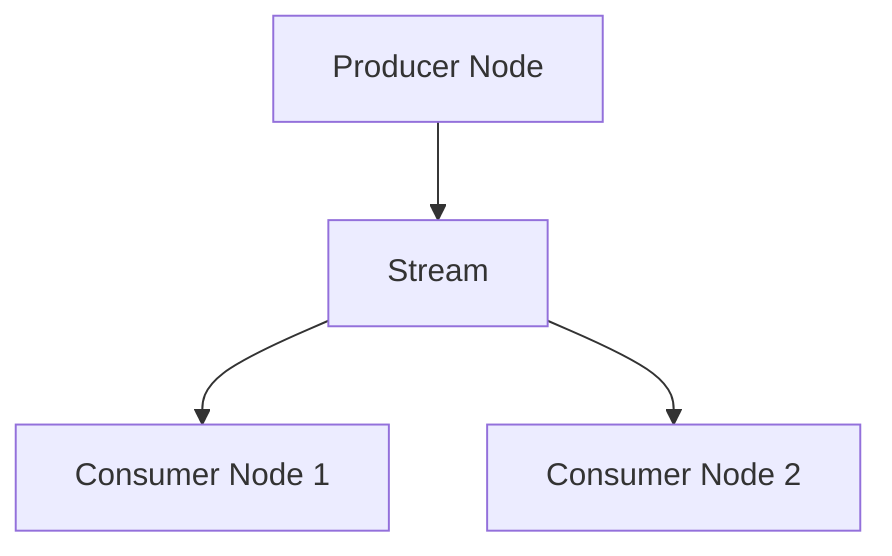

# Message Bus

`MessageBus` ทำให้ component ต่าง ๆ ในระบบสื่อสารกันได้ผ่านการส่ง message การออกแบบนี้สร้างสถาปัตยกรรมแบบ
loosely coupled ที่ component โต้ตอบกันได้โดยไม่ต้องพึ่งพากันโดยตรง

*รูปแบบการส่ง message* ประกอบด้วย:

- Point-to-Point
- Publish/Subscribe
- Request/Response

message ที่แลกเปลี่ยนผ่าน `MessageBus` แบ่งออกเป็นสามประเภท:

- Data
- Events
- Commands

## ลำดับชั้นของ topic {#topic-hierarchy}

Nautilus เก็บ topic ของ market data ไว้ใต้ root `data` การ publish ข้อมูลแบบ live ใช้ topic `data.<kind>...` โดยตรง
เช่น `data.book.deltas.XCME.ESZ24`

เมื่อข้อมูลที่มาจากการ request, การ replay หรือที่ workflow สร้างขึ้นไหลผ่าน message bus ในรูปข้อมูลที่ระบุด้วย topic
`DataEngine` จะ publish ไว้ใต้ `data.pipeline.<kind>...` เช่น book delta บนเส้นทาง pipeline ใช้
`data.pipeline.book.deltas.XCME.ESZ24`

request ที่ยาว, request แบบจัดกลุ่ม และ chain ของการ aggregate อาจแยก แปลง และรวมข้อมูลกลับเข้าด้วยกันก่อนที่
request แม่จะเสร็จ message เหล่านี้ยังคงเป็น data message แต่ไม่ได้รับประกันลำดับและจังหวะเวลาแบบ live
เหมือนการ publish แบบ real-time ทั่วไป

response ของ request ที่มี correlation จะถูกส่งผ่าน response handler ที่ใช้ correlation ID เป็น key ส่วน topic
`data.response` เป็นช่องทางสำหรับดักเก็บการ publish response ไม่ใช่เส้นทางข้อมูลของ pipeline

## ความถูกต้องสมบูรณ์ของ message {#message-integrity}

เมื่อสร้าง message แล้ว **ห้ามแก้ไขฟิลด์ใด ๆ ของมัน** รวมถึงฟิลด์ที่เป็น container เช่น map `params` ด้วย
component อ่าน message และสร้าง state ภายในจาก message ได้ แต่ห้ามเขียนทับต้นฉบับ

message ที่ immutable ทำให้ผู้รับทุกตัวเห็น input เดียวกัน คงสภาพสิ่งที่เป็นจริง ณ เวลาที่ emit และขจัด race
ที่เกิดจาก shared state ไปได้ทั้งกลุ่ม การ replay, การ debug และการ audit ล้วนอาศัยการที่ message คงที่หลังการ dispatch

จากหลักการนี้จึงได้กฎความเป็นเจ้าของสามข้อ:

- option ของ request ที่ผู้เรียกส่งมาจะอยู่บน message
- metadata ของ response ที่คืนให้ผู้เรียกจะอยู่บน response
- state ของ workflow ใน component (ช่วงวันที่ที่มีขอบเขต, state ของการจัดกลุ่ม, cursor ของการ replay, ตัวนับ,
  flag ของการประมวลผล) จะอยู่ใน context ที่ component เป็นเจ้าของ โดยใช้ ID ของ message หรือ request เป็น key

เมื่อ component ต้องการ message ที่ดัดแปลงแล้ว ให้สร้าง message ใหม่ด้วยค่าที่ต้องการแทนการเขียนทับต้นฉบับ

## การ publish data และ signal {#data-and-signal-publishing}

แม้ `MessageBus` จะเป็น component ระดับล่างที่ผู้ใช้มักโต้ตอบด้วยทางอ้อม แต่ `DataActor`, `Strategy` และ
`ExecutionAlgorithm` มีเมธอดแบบมี type ที่สร้างอยู่บน message bus ได้แก่ `publish_data` และ `publish_signal`
ซึ่งใช้ publish custom data และ signal ได้โดยไม่ต้องเข้าถึง message bus โดยตรง

## รูปแบบการส่ง message {#messaging-styles}

NautilusTrader เป็น framework แบบ **event-driven** ที่ component สื่อสารกันด้วยการส่งและรับ message
การเข้าใจรูปแบบการส่ง message แต่ละแบบช่วยในการสร้างระบบเทรด

ส่วนนี้อธิบายรูปแบบการส่ง message หลักใน NautilusTrader:

| **รูปแบบการส่ง message**                | **วัตถุประสงค์**                         | **เหมาะกับ**                                           |
| :------------------------------------ | :----------------------------------- | :---------------------------------------------------- |
| **Custom data publish/subscribe**     | แลกเปลี่ยนข้อมูลการเทรดแบบมีโครงสร้าง      | metric การเทรด, indicator, ข้อมูลที่ต้อง persist          |
| **Signal publish/subscribe**          | การแจ้งเตือนแบบเบา                     | alert, flag และการอัปเดตสถานะแบบง่าย                   |
| **Rust MessageBus publish/subscribe** | การสื่อสารผ่าน topic ระดับล่างแบบมี type   | component ของ runtime แบบ native                        |

แต่ละแนวทางมีจุดประสงค์ต่างกัน ใช้ส่วนนี้ประกอบการตัดสินใจว่าจะใช้รูปแบบใด

### Rust MessageBus publish/subscribe ไปยัง topic {#rust-messagebus-publishsubscribe-to-topics}

#### แนวคิด {#concept}

`MessageBus` เป็นศูนย์กลางของ message ทั้งหมดใน NautilusTrader component ของ Rust สามารถ publish message
แบบมี type ไปยัง topic ที่ตั้งชื่อไว้ และ subscribe handler กับ topic เหล่านั้นได้

#### ประโยชน์และกรณีการใช้งาน {#benefits-and-use-cases}

การเข้าถึง message bus โดยตรงเหมาะกับ component แบบ native ที่ต้องการ:

- **การสื่อสารข้าม component** ภายในระบบ
- **ความยืดหยุ่น** ในการกำหนด topic และ payload แบบมี type
- **การแยกขาด (decoupling)** ระหว่างผู้ publish และผู้ subscribe ที่ไม่จำเป็นต้องรู้จักกัน
- **การกระจายแบบทั่วถึง** ที่ผู้ subscribe หลายรายรับ message ได้
- การทำงานกับ event ที่ไม่เข้ากับโมเดลของ data actor
- สถานการณ์ขั้นสูงที่ต้องควบคุมการส่ง message ได้ทั้งหมด

#### ข้อควรพิจารณา {#considerations}

- ต้องติดตามชื่อ topic เอง (พิมพ์ผิดอาจทำให้พลาด message)
- ต้องกำหนด handler เอง

### Custom data publish/subscribe {#custom-data-publishsubscribe}

#### แนวคิด {#concept-1}

custom data ใช้แลกเปลี่ยนค่าแบบมีโครงสร้างระหว่าง data actor และ strategy ค่า `CustomData` บรรจุ `DataType`,
payload, timestamp ของ event และ timestamp ตอน initialize ไว้สำหรับการ routing และการเรียงลำดับ event

#### ประโยชน์และกรณีการใช้งาน {#benefits-and-use-cases-1}

แนวทาง Data publish/subscribe เหมาะเมื่อต้องการ:

- **แลกเปลี่ยนข้อมูลการเทรดแบบมีโครงสร้าง** เช่น market data, indicator, metric แบบกำหนดเอง หรือ option greeks
- **timestamp ของ event** (`ts_event`, `ts_init`) สำหรับเรียงลำดับ input ระหว่าง backtest การ publish เองไม่ได้
  เรียงลำดับ message
- **การ persist และ serialize ข้อมูล** ผ่าน custom data class ที่ลงทะเบียนไว้ ซึ่งทำงานร่วมกับระบบ data catalog ของ NautilusTrader
- **การแลกเปลี่ยนข้อมูลการเทรดแบบมาตรฐาน** ระหว่าง component ของระบบ

#### ข้อควรพิจารณา {#considerations-1}

- payload ต้องมี `ts_event` และ `ts_init`
- การ persist ต้องลงทะเบียน custom data class ที่ serialize ได้

ดู[Custom data](custom_data.md) สำหรับการลงทะเบียนและการ persist

### Signal publish/subscribe {#signal-publishsubscribe}

#### แนวคิด {#concept-2}

**Signal** เป็นวิธีแบบเบาในการ publish และ subscribe การแจ้งเตือนแบบง่ายภายใน actor framework
นี่เป็นวิธีส่ง message ที่ง่ายที่สุด ไม่ต้องนิยาม class แบบกำหนดเอง

#### ประโยชน์และกรณีการใช้งาน {#benefits-and-use-cases-2}

แนวทาง Signal เหมาะเมื่อต้องการ:

- **การแจ้งเตือน/alert แบบง่ายและเบา** เช่น "RiskThresholdExceeded" หรือ "TrendUp"
- **การส่ง message แบบรวดเร็วทันที** โดยไม่ต้องนิยาม class แบบกำหนดเอง
- **การกระจาย alert หรือ flag** เป็นค่า primitive แบบง่าย
- **การเชื่อมต่อผ่าน API** ด้วยเมธอด (`publish_signal`, `subscribe_signal`)
- **การสื่อสารกับผู้ subscribe หลายราย** ที่ทุกรายได้รับ signal เมื่อมีการ publish
- **overhead ในการ setup น้อย** ไม่ต้องนิยาม class

#### ข้อควรพิจารณา {#considerations-2}

- signal แต่ละตัวบรรจุค่าเดียว ค่าจะถูกแปลงเป็น string ตอน publish ดังนั้น handler จะได้รับ `signal.value`
  เป็น string เสมอ โครงสร้างข้อมูลที่ซับซ้อนจะไม่ถูกเก็บรักษาไว้
- แยกแยะ signal แต่ละตัวใน handler `on_signal` ด้วย `signal.name`

:::warning การ reentry ของ signal callback
การ publish signal อาจ reenter actor ที่กำลังทำงานอยู่แบบ synchronous ไม่ว่าจะโดยตรงหรือผ่านผู้ subscribe รายอื่น
ซึ่งทำให้เกิด undefined behavior ใน actor **การปล่อย borrow ของ cache ไม่ได้ทำให้การ reentry ของ actor
ปลอดภัย** หลีกเลี่ยงวงจรการ publish ที่เรียก actor ก่อนที่ callback ปัจจุบันของมันจะ return
:::

> หมายเหตุ: ต้นฉบับมีเฉพาะตัวอย่าง Python สำหรับ custom data และ signal จึงตัดออก

### สรุปและแนวทางการตัดสินใจ {#summary-and-decision-guide}

#### แนวทางการตัดสินใจ: ควรเลือกรูปแบบใด? {#decision-guide-which-style-to-choose}

| **กรณีการใช้งาน**                         | **แนวทางที่แนะนำ**                     | **สิ่งที่ต้อง setup**                         |
| :------------------------------------- | :---------------------------------- | :---------------------------------------- |
| การสื่อสารระดับระบบแบบ native            | Rust `MessageBus` publish/subscribe | topic และ handler แบบมี type               |
| ข้อมูลแบบมีโครงสร้างระหว่าง component      | เมธอด custom data ของ `DataActor`   | `DataType`, `CustomData` และ `on_data()`  |
| alert และการแจ้งเตือนแบบง่าย               | เมธอด signal ของ `DataActor`        | ชื่อ signal และ `on_signal()`              |

## External egress และ ingress {#external-egress-and-ingress}

`MessageBus` สามารถเขียน message ที่ serialize แล้วไปยัง stream ภายนอกได้ ส่วนนี้อธิบายฝั่ง egress (ขาออก)
และ ingress (ขาเข้า) ของ bus ภายนอก live node แบบ Rust-native ใช้ `MessageBusExternalEgress` และ
`MessageBusExternalIngress` ที่ inject เข้ามา ทำให้ core node ไม่ต้องพึ่งพา Redis, broker, implementation ของ
shared memory หรือ protocol ของ socket

:::info
Redis เป็น backing ภายนอกในตัวสำหรับ message ที่ serialize ได้ Redis เวอร์ชันต่ำสุดที่รองรับคือ 6.2
ซึ่งจำเป็นสำหรับการ trim stream ด้วย `MINID` ที่ autotrim ใช้
:::

เมื่อตั้งค่า external egress แล้ว message ขาออกที่ publish จะถูก dispatch ไปยังผู้ subscribe ภายใน process ก่อน
จากนั้นจึง serialize เป็น wire record `BusMessage` ที่มีอยู่:

- `topic`: topic ของ message bus ตรงตามที่การเรียก publish ภายในใช้ เช่น
  `data.quotes.BINANCE.BTCUSDT` หรือ `events.order.S-001`
- `type`: ชื่อ type มาตรฐานของ payload เช่น `QuoteTick` หรือ `OrderEventAny`
- `payload_kind`: มีค่า `typed` สำหรับ payload แบบ native ของ data request, reply, control, execution และ
  reconciliation ซึ่งชื่อ type ตายตัวของมันอาจซ้ำกับ custom payload ได้
- `encoding`: encoding ของ payload ที่เลือกตามนโยบาย encoding ของ message bus
- `payload`: byte ที่ serialize แล้วด้วย encoding ที่เลือก

producer ภายนอกที่เขียนลง Redis stream โดยตรงต้องปฏิบัติตามกฎเหล่านี้:

- ใส่ `topic`, `type` และ `payload` โดย `topic` ต้องเป็น publish topic ที่ถูกต้อง และห้ามมี `*` หรือ `?`
- ฟิลด์ `encoding` ไม่บังคับ และเป็น JSON โดยค่าเริ่มต้นเมื่อไม่ระบุ
- node ที่รับจะข้าม entry ที่ไม่มี `type` เพราะเลือก decoder ของ payload ไม่ได้
- ตั้ง `payload_kind` เป็น `typed` สำหรับ payload แบบ typed ที่ตายตัว หากไม่มีตัวแยกแยะนี้ node ที่รับจะถือว่า
  ชื่อ type เดียวกันเป็น custom data

external egress รับ record นั้นผ่าน `publish(BusMessage)` การเรียกขาออกนี้ต้องไม่ block thread ของ bus ใน node
implementation ของ egress ที่มีขอบเขตจะ drop message เมื่อ queue เต็ม แทนที่จะสร้าง back-pressure ให้ trading loop
การปิด message bus จะปิด egress ที่ตั้งค่าไว้ด้วย

stream ขาเข้าจากภายนอกเปิดเผยผ่าน trait `MessageBusExternalIngress` ของ Rust ที่แยกต่างหาก ingress ให้
`BusMessage { topic, payload_type, encoding, payload, source }` ในรูปแบบเดียวกัน
`republish_external_message` จะ decode message ขาเข้าที่รองรับ และ republish ภายในโดยไม่ส่ง message กลับออกไปอีก
การ republish ภายในตามปกติต้องให้ type ของ payload ขาเข้าลงทะเบียนสำหรับ streaming ไว้ และจะข้าม type ที่ไม่ได้
ลงทะเบียนโดยไม่ decode message `AccountState` ขาเข้าจะผ่าน endpoint ของ account ใน Portfolio แทนที่จะไปยัง topic
ขาเข้าโดยตรง Portfolio ต้องลงทะเบียนไว้ โดยจะอัปเดต cache ก่อน publish state ที่ยอมรับแล้วบน
`events.account.{account_id}` การอัปเดต account ที่ถูกปฏิเสธจะไม่ถูก publish

implementation ของ ingress ใน Rust สามารถแนบข้อมูลที่มา `BusMessageSource` (ไม่บังคับ) ได้ ได้แก่ publisher ID,
process instance ID, stream และ sequence `msgbus::current_external_source()` ของ Rust จะเปิดเผยข้อมูลนี้ในขณะที่
handler และ processor ทำงานแบบ synchronous รวมถึงสำหรับ message ที่พวกมัน publish ภายในด้วย การ dispatch จาก
ภายนอกแบบซ้อนจะคืนค่า source ก่อนหน้าเมื่อ return backing Redis ในตัวไม่ได้แนบข้อมูลนี้

`LiveNode::add_stream_processor` ใช้ลงทะเบียน callback สำหรับ payload แบบ typed ที่เป็น JSON หรือ MessagePack
processor ทำงานตามลำดับการลงทะเบียนก่อนการตรวจสอบการลงทะเบียน streaming ภายใน จึงได้รับ message แบบ typed
ที่รองรับแม้การ republish ภายในจะถูกปิดไว้ error ใน processor จะหยุด processor ตัวถัดไปและข้ามการ republish ภายใน
สำหรับ message นั้น

ระหว่างการเชื่อมต่อ data client node จะ republish data reply แบบ native ที่ลงทะเบียนสำหรับ streaming และมี
correlation handler รออยู่ก่อนการ dispatch ปกติ reply เหล่านี้ข้าม processor และอาจแซง message ที่ buffer ไว้ได้
message ภายนอกอื่น ๆ จะรอใน FIFO buffer ที่จำกัดขนาดเท่ากับความจุของ channel ขาเข้า หาก buffer เต็ม การ startup
จะหยุดดึง ingress ดังนั้น reply ที่ต้องการซึ่งอยู่หลัง traffic นั้นอาจทำให้การเชื่อมต่อค้างจนกว่า `timeout_connection`
จะหมดเวลา

สำหรับ custom data แบบ JSON และ MessagePack นั้น egress จะเขียน และ ingress จะคาดหวัง envelope ในฟิลด์ `payload`
ของ Redis ไม่ใช่ custom object เปล่า ๆ envelope แบบ JSON มาตรฐานคือ:

```json
{
  "type": "MyData",
  "data_type": {
    "type_name": "MyData",
    "metadata": {
      "source": "external"
    },
    "identifier": "optional-storage-key"
  },
  "payload": {
    "value": 42,
    "ts_event": 0,
    "ts_init": 0
  }
}
```

envelope ต้องมี `type` และ `payload` ส่วน `data_type` ไม่บังคับสำหรับ ingress และมีค่าเริ่มต้นเป็น type ของ message
โดยไม่มี metadata หรือ identifier

- **ผลลัพธ์มาตรฐาน**: `data_type.type_name` ใช้ชื่อ custom type เดียวกัน `metadata` เป็น object ที่อาจว่างได้ และ
  `identifier` จะมีเฉพาะเมื่อมีการกำหนดค่า
- **การจับคู่ type**: `type` ของ envelope ต้องตรงกับ `type` ของ Redis stream
- **Payload**: `payload` ของ envelope คือ object เปล่าที่ส่งต่อให้เมธอด `from_json(...)` ของ class ที่ลงทะเบียนไว้

MessagePack ใช้ฟิลด์ของ map ชุดเดียวกันที่ encode เป็น byte แบบ MessagePack

ดูข้อกำหนดของ class ได้ที่ [Custom data](custom_data.md#registration-architecture)

สำหรับ Redis นั้น message bus จะส่ง message ผ่าน channel แบบ Multiple-Producer Single-Consumer (MPSC) ไปยัง
Rust task ที่แยกต่างหาก task นั้นจะเขียน message ลง Redis stream

การย้าย I/O ไปไว้ใน task แยกช่วยให้ thread ที่ publish ไม่ถูก block

เมื่อใช้ MessagePack หรือ JSON external egress แบบ Rust-native จะส่งต่อการ publish แบบ typed ที่ serialize ได้:

- instrument, quote, trade, bar, book delta และ snapshot แบบความลึกแปรผัน
- การอัปเดต mark/index/funding และ option greeks (`OptionGreeks`)
- account state, portfolio snapshot, order event, position event และ custom data
- เมื่อเปิด feature `defi`: DeFi block, pool, การอัปเดต liquidity, fee collect และ flash event

snapshot ของ order book แบบเต็มที่แยกเดี่ยว, record `GreeksData`, slice ของ option chain และ DeFi pool swap จะไม่ถูก
ส่งต่อ เพราะ type เหล่านั้นไม่ได้ implement การ serialize ของ Serde

เมื่อ `external_streams` ไม่ว่าง egress แบบ JSON หรือ MessagePack จะส่งต่อ subscription command, trading command,
data request และ reply และ execution mass-status request ด้วย รวมถึง order status report, fill report,
position status report และ execution mass-status report payload เหล่านี้จะอยู่ภายในเมื่อไม่ได้ตั้งค่า external stream

โค้ดของ application publish request และ reply แบบ native ด้วย `msgbus::publish_any` ของ Rust
`DataEngine` ไม่ส่งต่อ request สำหรับ external client และ `send_response` จะอยู่ภายใน
หากต้องการ route reply ขาเข้าไปยัง callback ของ request ที่รออยู่ ให้ลงทะเบียน `BusPayloadType::DataResponse`
สำหรับ streaming และ subscribe topic handler ที่เรียก `msgbus::send_response` ซึ่งจะทำให้ request เสร็จสมบูรณ์
สำหรับ reply ระหว่างทางหรือ reply สุดท้ายที่ไม่มี payload ให้ลงทะเบียน `BusPayloadType::DataResponseEnvelope`
และเรียก `msgbus::send_response_envelope` จาก topic handler

reply แบบ native ใช้รูปแบบ response แบบ JSON/MessagePack ร่วมกันที่ใช้ชนิดของ response เป็น key
reply ของ book จะเก็บ order, metadata และ state ของ L1 batch ที่ยังไม่เสร็จของแต่ละฝั่งไว้ทั้งหมด encoding ของมัน
ไม่ขึ้นกับ feature `sbe` encoding ที่ไม่รองรับสำหรับ request และ reply แบบ native จะคืน error

เมื่อใช้ SBE external egress แบบ Rust-native จะส่งต่อเฉพาะ payload ของ market data ในตัวที่มี schema codec ต่อไปนี้:

- Quotes
- Trades
- Bars
- Book deltas
- Variable-depth snapshots
- Mark price updates
- Index price updates
- Funding rate updates
- Option greeks

payload type อื่น ๆ จะถูก drop พร้อม log ระดับ debug เมื่อเลือก SBE

## การตั้งค่า {#configuration}

เทคโนโลยี backing ภายนอกของ message bus ใช้ config ด้านพฤติกรรม ร่วมกับ backing config ที่เทคโนโลยีนั้นเป็นเจ้าของ
`MessageBusConfig` ควบคุมพฤติกรรมของ message bus ส่วน `RedisMessageBusConfig` เป็นเจ้าของการตั้งค่าการเชื่อมต่อ
Redis และ implement `MessageBusBackingFactory`

```rust
use nautilus_common::{
    enums::SerializationEncoding,
    msgbus::{MessageBusBackingFactory, MessageBusConfig},
};
use nautilus_infrastructure::redis::msgbus::RedisMessageBusConfig;

let config = MessageBusConfig {
    encoding: SerializationEncoding::MsgPack,
    encoding_market_data: Some(SerializationEncoding::Sbe),
    timestamps_as_iso8601: true,
    buffer_interval_ms: Some(100),
    autotrim_mins: Some(30),
    use_trader_prefix: true,
    use_trader_id: true,
    use_instance_id: false,
    streams_prefix: "streams".to_string(),
    types_filter: Some(vec!["QuoteTick".to_string(), "TradeTick".to_string()]),
    ..Default::default()
};

let redis_config = RedisMessageBusConfig::default();
let backing = redis_config.create(trader_id, instance_id, config.clone())?;
```

โค้ด Rust เดิมยังใช้ `RedisMessageBusFactory::new(redis_config)` ต่อได้ ซึ่งจะส่งต่อไปยัง implementation ของ config

### Backing config {#backing-config}

ต้องมี `RedisMessageBusConfig` เมื่อใช้ backing Redis ในตัว สำหรับการตั้งค่า Redis แบบค่าเริ่มต้นบน local loopback
สามารถส่ง `RedisMessageBusConfig::default()` ได้

การเลือก Redis ระบุอย่างชัดเจนผ่าน type ของ Rust config ไม่ได้ใช้ตัวเลือกที่ผู้ใช้กำหนดเอง เช่น `type = "redis"`
หรือ `backing_type = "redis"`

ผู้เรียกแบบ Rust-native ที่ inject `MessageBusExternalEgress` ด้วย `LiveNodeBuilder::with_external_msgbus_egress`
จะส่งรายละเอียดการเชื่อมต่อจริงตอนสร้าง egress นั้นเอง core message bus ไม่ต้องใช้ `RedisMessageBusConfig`
สำหรับ egress ที่ inject เข้ามา

live runtime ของ Rust รับ `external_streams` ใน `MessageBusConfig` และรับ `BusMessage` ขาเข้าเมื่อผู้เรียก inject
`MessageBusExternalIngress` ด้วย `LiveNodeBuilder::with_external_ingress` config ระบุชื่อ key ของ stream ภายนอก
ส่วน ingress ที่ inject เข้ามาคือแหล่งข้อมูลจริงขณะ runtime

ผู้เรียกฝั่ง Rust ติดตั้ง `RedisMessageBusConfig` ได้ด้วย `LiveNodeBuilder::with_external_msgbus_factory`
การ build จะล้มเหลวเมื่อใช้ factory ร่วมกับ egress หรือ ingress ที่ inject แยกต่างหาก factory จะติดตั้ง egress เสมอ
และสร้าง ingress เฉพาะเมื่อ `external_streams` ไม่ว่าง

:::warning
ingress Redis ในตัวจะเริ่มอ่าน stream ที่ตั้งค่าไว้แต่ละตัวจาก timestamp ปัจจุบัน ดังนั้น entry ที่มีอยู่แล้วตอน node
เริ่มทำงานจะไม่ถูก replay หลัง startup จะเลื่อน ID ล่าสุดที่เห็นของแต่ละ stream และเก็บ ID เหล่านั้นไว้ข้ามการลอง
เชื่อมต่อใหม่ ใช้ cache recovery หรือ event store เมื่อต้องการ replay ข้อมูลก่อนเริ่มทำงานแบบคงทน
`external_streams` ให้การส่งต่อแบบ live ไม่ใช่ backlog ของ consumer group
:::

### Encoding {#encoding}

external message bus egress แบบ Rust-native รองรับชื่อ encoding เหล่านี้:

- JSON (`json`)
- MessagePack (`msgpack`)
- SBE (`sbe` เมื่อเปิด feature `sbe` ของ Rust)

หากต้องการใช้ SBE สำหรับ market data และ MessagePack สำหรับ payload อื่นทั้งหมด ให้ตั้ง `encoding = "msgpack"` และ
`encoding_market_data = "sbe"` ตามตัวอย่างด้านบน
ใช้ `encoding_market_data` เพื่อ override encoding ของ payload market data ที่มี binary codec ของ bus ภายนอกรองรับ
ใช้ `encoding_builtin` เพื่อ override payload ของ account state, portfolio snapshot, order event และ position event
payload แบบ custom และ type ที่ไม่ได้ map ไว้จะใช้ `encoding` เสมอ

`MessageBusConfig::validate` กำหนดให้ `encoding` เริ่มต้นต้องรองรับ custom payload คือ JSON หรือ MessagePack
encoding ที่ override รายหมวดต้องรองรับโดยทุก payload type ที่ publish ในหมวดนั้น SBE ต้องใช้ feature `sbe` และรองรับ
เฉพาะ `encoding_market_data` เท่านั้น `encoding_builtin = "sbe"` จะไม่ผ่านการ validate

เส้นทาง payload ของ Redis cache รองรับเฉพาะ MessagePack และ JSON SBE เป็น encoding สำหรับ market data ของ
external message bus egress แบบ Rust-native การเลือก SBE สำหรับ payload ของ Redis cache จะคืน error

:::tip
encoding `json` ถูกใช้เป็นค่าเริ่มต้นเพื่อให้คนอ่านได้และทำงานร่วมกับระบบอื่นได้ง่าย
ใช้ `msgpack` เมื่อขนาด payload และประสิทธิภาพการ serialize เป็นเรื่องสำคัญอันดับแรก
:::

### รูปแบบของ timestamp {#timestamp-formatting}

โดยค่าเริ่มต้น timestamp จะอยู่ในรูปจำนวนเต็มนาโนวินาทีนับจาก UNIX epoch หรือตั้งค่าให้เป็น string แบบ ISO 8601
ได้โดยตั้ง `timestamps_as_iso8601` เป็น `true`

### Key ของ message stream {#message-stream-keys}

key ของ message stream ใช้ระบุ trader node แต่ละตัวและจัดระเบียบ message ภายใน stream ส่วน prefix `trader-`,
trader ID และ instance ID เป็นแบบไม่บังคับและควบคุมด้วย option ด้านล่าง ส่วน streams prefix จะมีเสมอ เมื่อเปิดทุกส่วน
key ของ trader จะมีโครงสร้างดังนี้:

```
trader-{trader_id}:{instance_id}:{streams_prefix}
```

เมื่อใช้ option ค่าเริ่มต้น (เปิด `use_trader_prefix` และ `use_trader_id`, ปิด `use_instance_id`) key ของ stream
หลักคือ `trader-{trader_id}:{streams_prefix}`

option เหล่านี้ควบคุม key ของ Redis stream ไม่ได้เขียนทับ `topic` ที่ส่งให้ `MessageBusExternalEgress` ที่ inject
เข้ามา topic นั้นยังคงเป็น publish topic ภายในของ message bus เมื่อ `stream_per_topic` เป็น `true` egress ของ Redis
จะต่อ topic ท้าย key ของ stream เมื่อเป็น `false` Redis จะเก็บ message ทั้งหมดไว้บน key ของ stream หลัก และเก็บ topic
ไว้เป็นฟิลด์ของ message

option สำหรับตั้งค่า key ของ message stream มีดังนี้:

#### Trader prefix {#trader-prefix}

กำหนดว่า key ควรขึ้นต้นด้วย prefix `trader-` หรือไม่

#### Trader ID {#trader-id}

กำหนดว่า key ควรมี trader ID ของ node หรือไม่

#### Instance ID {#instance-id}

trader node แต่ละตัวได้รับ instance ID แบบ UUIDv4 ที่ไม่ซ้ำกัน ซึ่งใช้แยกแยะ trader แต่ละตัวเมื่อ message กระจายอยู่
ในหลาย stream ตั้ง `use_instance_id` เป็น `true` เพื่อใส่ไว้ใน key ของ trader และระบุ trader ข้าม stream ในระบบเทรด
แบบหลาย node

#### Streams prefix {#streams-prefix}

string `streams_prefix` ใช้จัดกลุ่ม stream ทั้งหมดของ trader instance เดียว หรือจัดระเบียบ message ของหลาย instance
ให้ตั้ง prefix อื่นเป็น false แล้วส่ง string ให้ option `streams_prefix`

#### Stream per topic {#stream-per-topic}

ตั้ง `stream_per_topic` เป็น `true` เพื่อเขียน stream แยกสำหรับแต่ละ topic เหมาะกับ backing แบบ Redis ซึ่งไม่รองรับ
wildcard topic เมื่อ listen stream ตั้งเป็น `false` เพื่อเขียน message ทั้งหมดลง stream เดียวกัน

:::info
Redis ไม่รองรับ wildcard ใน topic ของ stream เพื่อให้เข้ากับ Redis ได้ดีขึ้น แนะนำให้ตั้ง option นี้เป็น false
:::

### การกรอง type {#types-filtering}

หากตั้งค่าและเปิดใช้ backing ของ message bus ไว้ message ที่ publish จะถูก serialize และเขียนลง stream
คุณสามารถยกเว้น message type ที่เลือกไว้จากการ publish ภายนอก เพื่อป้องกันไม่ให้ stream ล้น (เช่นจาก quote
ความถี่สูง)

สำหรับการกรองการ publish ภายนอก ให้ส่ง list ของชื่อ payload type ให้พารามิเตอร์ `types_filter` ของ config
message bus type ที่อยู่ใน list จะไม่ถูก publish ภายนอก ชื่อที่ custom payload และ payload แบบ typed ที่ตายตัวใช้ร่วมกัน
จะถูกยกเว้นทั้งคู่ ดูตัวอย่าง `types_filter` ได้ใน config ของ Rust ในส่วน[การตั้งค่า](#configuration)ด้านบน

### การ trim stream อัตโนมัติ {#stream-auto-trimming}

ใช้ `autotrim_mins` เพื่อกำหนดช่วงเวลาย้อนหลังเป็นนาที ใช้ `autotrim_maxlen` เพื่อกำหนดจำนวน entry สูงสุดโดยประมาณ
ของแต่ละ Redis stream ตั้งค่านโยบายใดนโยบายหนึ่งหรือทั้งสองก็ได้ เมื่อตั้งทั้งสอง message bus จะลบ entry ที่เกิน
ช่วงเวลาหรือเกินเกณฑ์จำนวน entry อย่างใดอย่างหนึ่ง

Redis ใช้ `autotrim_maxlen` ด้วยการ trim แบบประมาณเพื่อประสิทธิภาพการเขียนที่ดีขึ้น ดังนั้น stream อาจมี entry
มากกว่าเกณฑ์ที่ตั้งไว้เล็กน้อย

:::info
implementation ของ Redis จะ trim แต่ละ stream ไม่เกินนาทีละครั้ง ดังนั้น entry อาจอยู่นานกว่าช่วง `autotrim_mins`
ได้ราวหนึ่งนาที
:::

## External stream {#external-streams}

message bus ภายใน `LiveNode` (node) เรียกว่า "internal message bus"
producer node คือ node ที่ publish message ลงบน stream ภายนอก (ดู[external egress และ ingress](#external-egress-and-ingress))
consumer node จะ listen stream ภายนอกเพื่อรับ payload ของ message ที่ deserialize แล้วและ publish ลงบน internal message bus ของตัวเอง



:::info
ตั้ง `LiveDataEngineConfig.external_clients` เป็น list ของ `client_id` ที่แทน client ของ streaming ภายนอก
`DataEngine` จะกรอง subscription command สำหรับ client เหล่านี้ออก เพราะ streaming ภายนอกเป็นผู้ส่งข้อมูลที่ subscribe ให้

เมื่อ `DataEngine` ของ Rust ข้าม subscription ของ external client จะลงทะเบียน payload type ของ streaming ที่ตรงกัน
สำหรับการ republish ขาเข้าบน message bus
:::

### ตัวอย่างการตั้งค่า {#example-configuration}

ในตัวอย่าง streaming นี้ producer node จะ publish ข้อมูล Binance ออกภายนอก และ consumer node ปลายทางจะ publish
data message เหล่านี้ลงบน internal message bus ของตัวเอง

#### Producer node {#producer-node}

`MessageBus` ของ producer node จะ publish ไปยัง stream `"binance"` โดยตั้ง `use_trader_id`, `use_trader_prefix`
และ `use_instance_id` เป็น `false` ทั้งหมด ทำให้ stream มี key ที่เรียบง่ายและคาดเดาได้ ซึ่ง consumer node
ลงทะเบียนรับได้

```rust
let message_bus = MessageBusConfig {
    use_trader_id: false,
    use_trader_prefix: false,
    use_instance_id: false,
    streams_prefix: "binance".to_string(), // <---
    stream_per_topic: false,
    autotrim_mins: Some(30),
    ..Default::default()
};

let redis_config = RedisMessageBusConfig {
    connection_timeout: 2,
    response_timeout: 2,
    ..Default::default()
};

let mut node = LiveNode::builder(trader_id, Environment::Live)?
    .with_msgbus_config(message_bus)
    .with_external_msgbus_factory(Box::new(redis_config))
    .build()?;
node.run().await?;
```

#### Consumer node {#consumer-node}

ตั้งค่า `MessageBus` ของ consumer node ให้รับ message จาก stream `"binance"` เดียวกัน `RedisMessageBusConfig`
จะสร้าง ingress จาก `external_streams` และ `LiveNode::run` จะ publish message ที่ได้รับลงบน internal message bus
ของ node เราประกาศ client ID `"BINANCE_EXT"` เป็น external client เพื่อไม่ให้ `DataEngine` พยายามส่ง data command
ไปยัง client ID นี้

```rust
let data_engine = LiveDataEngineConfig {
    external_clients: Some(vec![ClientId::from("BINANCE_EXT")]),
    ..Default::default()
};

let message_bus = MessageBusConfig {
    external_streams: Some(vec!["binance".to_string()]), // <---
    ..Default::default()
};

let redis_config = RedisMessageBusConfig {
    connection_timeout: 2,
    response_timeout: 2,
    ..Default::default()
};

let mut node = LiveNode::builder(trader_id, Environment::Live)?
    .with_data_engine_config(data_engine)
    .with_msgbus_config(message_bus)
    .with_external_msgbus_factory(Box::new(redis_config))
    .build()?;
node.run().await?;
```

## คู่มือที่เกี่ยวข้อง {#related-guides}

- [Actors](actors.md) - actor ใช้ message bus ในการจัดการ event
- [Architecture](architecture.md) - บทบาทของ message bus ในสถาปัตยกรรมของระบบ
