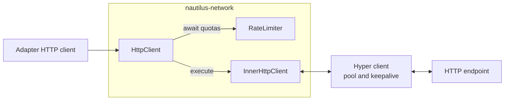
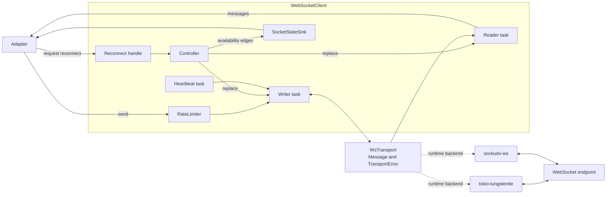
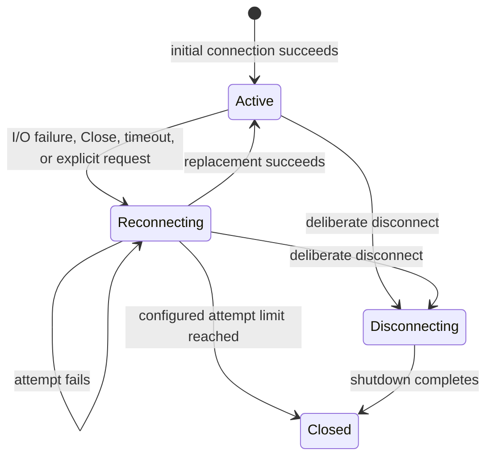
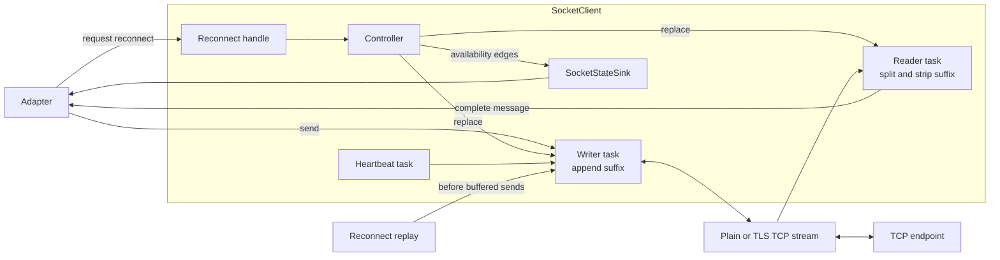
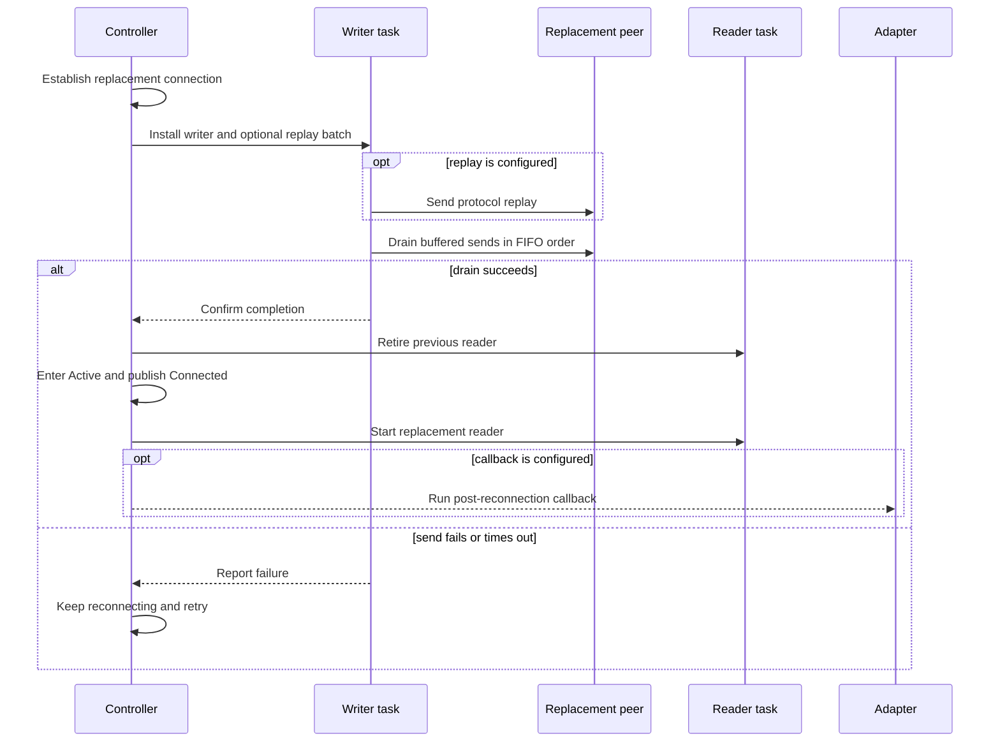

# Networking

adapter ของ NautilusTrader ใช้ client กลางใน `nautilus-network` สำหรับ API แบบ request/response ผ่าน HTTP,
สตรีม WebSocket และโปรโตคอล TCP ที่แบ่ง frame ด้วย suffix โดย client เหล่านี้เพิ่ม policy ระดับระบบเทรด
ครอบ transport ของ Rust ที่อยู่ข้างใต้ ได้แก่ rate limit, การนำการเชื่อมต่อกลับมาใช้ซ้ำ, การตรวจ liveness,
การควบคุม reconnect, การประสานการ replay และการอ่านแบบมีขอบเขต

| Client         | Transport ข้างใต้                      | ใช้เมื่อ                               | Policy ที่เพิ่มเข้ามา                                                                                   |
| -------------- | ----------------------------------- | ---------------------------------- | ----------------------------------------------------------------------------------------------- |
| HTTP           | Hyper                               | งาน request/response ที่จบในตัว       | quota แบบหลายชั้น, connection pool, keepalive, timeout, การ route ผ่าน proxy และ body แบบมีขอบเขต       |
| WebSocket      | `tokio-tungstenite` หรือ `sockudo-ws` | สตรีมแบบ frame ที่อยู่ยาว                | การเลือก backend ตอน runtime, quota, heartbeat, การตรวจ liveness, reconnect และ session fencing      |
| Raw TCP socket | Tokio และ `rustls`                   | สตรีมไบต์ที่แบ่ง frame ด้วย suffix         | framing, การลองใหม่ตอนเริ่มต้น, heartbeat, การตรวจ liveness, reconnect และ replay ตามลำดับ             |

คู่มือ [Adapters](adapters.md) อธิบายว่า client ของ venue แปลง transport เหล่านี้เป็นข้อความโดเมนของ
Nautilus อย่างไร หน้านี้ครอบคลุมพฤติกรรมของ transport กลางที่อยู่ใต้ขอบเขตนั้น

## HTTP client {#http-client}

[`HttpClient`](../../crates/network/src/http/client.rs) ห่อ Hyper client ที่ใช้ซ้ำได้หนึ่งตัวและ rate limiter
ที่ใช้ร่วมกันหนึ่งตัวขึ้นไป request จะรอ quota ทุกตัวที่เกี่ยวข้องก่อนที่ client ภายในจะสร้างและ execute request นั้น



client ชั้นนอกใช้ policy เรื่อง quota ส่วน client ภายในที่ใช้ซ้ำได้เป็นเจ้าของ policy ด้านการเชื่อมต่อและ response

Rust API เปิดให้ใช้ `http::Method`, `http::StatusCode` และ `url::Url` request จะคืนค่า `HttpResponse` หรือ
`HttpResponseStream` และเมื่อล้มเหลวจะคืน `HttpClientError`

### Rate limiting และ request {#rate-limiting-and-requests}

rate limiter ใช้ generic cell rate algorithm (GCRA) พร้อม quota ค่าเริ่มต้นและการ override ราย key ที่ไม่บังคับ
request หนึ่งตัวสามารถมีหลาย key เช่น endpoint และขอบเขตของ order และจะรอทุก key พร้อมกัน การมีหลาย
limiter ทำให้ request หนึ่งใช้งบที่เป็นอิสระต่อกันได้ เช่น limit ราย IP และราย account การแชร์ค่า `Arc` ของ
limiter ข้าม HTTP client จะทำให้งบเหล่านั้นเป็นระดับ process แทนที่จะได้โควตาแยกต่อการเชื่อมต่อ

client รองรับ header ค่าเริ่มต้นและราย request, query parameter ที่มีค่าซ้ำ, request body แบบดิบ และ method
`GET`, `POST`, `PUT`, `PATCH` และ `DELETE` timeout ระดับ client ใช้กับทุก request เว้นแต่ request นั้นจะระบุ
timeout ของตัวเอง

### การ route ผ่าน proxy {#proxy-routing}

โดยค่าเริ่มต้น client จะใช้การตั้งค่า proxy จากสภาพแวดล้อม เมื่อ `use_system_proxy` อยู่ที่ค่าเริ่มต้น `true`
และไม่ได้ระบุ `proxy_url` ไว้ request จะใช้ proxy ที่ระบุใน `HTTP_PROXY`, `HTTPS_PROXY` หรือ `ALL_PROXY`
(รวมถึงแบบตัวพิมพ์เล็ก) ปลายทางที่ตรงกับ `NO_PROXY` จะไม่ผ่าน proxy

ค่าเริ่มต้นนี้ตั้งใจเชื่อถือ environment ของ process ผู้ที่ควบคุม environment นั้นได้จึงเลือก proxy ที่มองเห็น
HTTP traffic แบบ plaintext ทั้งหมดและ CONNECT tunnel ที่ใช้ส่ง HTTPS ได้

`proxy_url` ที่ระบุชัดเจน (ไม่บังคับ) ใช้กับทั้ง HTTP และ HTTPS traffic และมีลำดับความสำคัญเหนือการค้นหาจาก
สภาพแวดล้อมเสมอ การส่ง `use_system_proxy(false)` จะปิดการค้นหาจากสภาพแวดล้อม request จึงจะไปตรง
เฉพาะเมื่อไม่ได้ตั้ง `proxy_url`

**error ที่เป็น HTTP status ยังคงเป็นค่า `HttpResponse` ปกติ** เพื่อให้แต่ละ adapter ตีความ body และกฎการลองใหม่
ของ venue ได้เอง การลองใหม่ระดับ transport ครอบคลุม:

- request ที่ถูกยกเลิกก่อนส่งบนการเชื่อมต่อที่นำกลับมาใช้ซ้ำ
- error `GOAWAY(NO_ERROR)` หรือ `REFUSED_STREAM` ของ HTTP/2 จากฝั่ง remote โดยลองใหม่ได้สองครั้ง

ความล้มเหลวของ transport แบบอื่นและ HTTP status code จะไม่ทำให้เกิดการลองใหม่ adapter สามารถครอบงานที่
ลองใหม่ได้ด้วย [`RetryManager`](../../crates/network/src/retry.rs) แต่ adapter ต้องตัดสินใจเองว่า error ของ
venue และงานใดบ้างที่ลองใหม่ได้อย่างปลอดภัย

### การใช้การเชื่อมต่อซ้ำและขอบเขตของ response {#connection-reuse-and-response-bounds}

`HttpClient` สำหรับ production แต่ละตัวเปิด `TCP_NODELAY`, เก็บการเชื่อมต่อที่ว่างได้สูงสุด 32 ตัวต่อ host
และเก็บการเชื่อมต่อที่ว่างไว้ได้นานสุด 60 วินาที การเชื่อมต่อ HTTP/2 จะส่ง keepalive probe ทุก 30 วินาทีแม้ขณะ
ว่างอยู่ การใช้ client ซ้ำจะคง pool ไว้และเลี่ยง handshake ของ TCP และ TLS ใหม่ในทุก request

การเชื่อมต่อ HTTP/2 ใช้ flow-control window แบบคงที่ขนาด 16 MiB ต่อ stream และ 32 MiB ต่อการเชื่อมต่อ ดังนั้น
server สามารถส่ง response ได้ถึง 16 MiB ก่อนที่ client จะ acknowledge ส่วนใดเลย การตั้ง
`NAUTILUS_HTTP2_ADAPTIVE_WINDOW=true` ก่อนสร้าง client จะเลือกใช้ adaptive window ของ Hyper แทน ค่า `false`
หรือไม่ตั้งตัวแปรจะคง window แบบคงที่ไว้ และค่าอื่นใดจะทำให้การสร้าง client ล้มเหลว
[Flow-control windows](#flow-control-windows) อธิบายว่าเลือกขนาดเหล่านี้มาอย่างไร

client เพิ่มเฉพาะ origin ของ request (scheme, host และ port) ลงใน error ของ transport และข้อมูลวินิจฉัยของ
response stream โดยไม่รวม userinfo, path, query และ fragment ใน URL context นี้ ตั้ง
`HttpClient::builder().redact_url(true)` เพื่อละ origin ที่เพิ่มเข้ามา request และข้อความวินิจฉัยจากชั้นล่างจะไม่
เปลี่ยน error ของใบรับรอง TLS และ log ของ dependency ยังอาจมีชื่อ host อยู่

#### Response แบบ buffer {#buffered-responses}

request แบบ buffer จะประกาศรองรับ gzip เว้นแต่ header ค่าเริ่มต้นหรือราย request จะตั้ง `Accept-Encoding` ไว้
client จะถอดรหัส gzip และลบ `Content-Encoding` และ `Content-Length` ออกจาก header ที่เลือก encoding ที่ไม่
รองรับหรือเสียหายจะล้มเหลวไม่ว่า status จะเป็นอะไร ส่วน response ที่ method หรือ status ห้ามมี content จะไม่ถูก
ถอดรหัส

body ที่ได้รับและ body ที่ถอดรหัสแล้วมี limit ค่าเริ่มต้นแยกกันที่ 100 MiB ความยาวที่ประกาศไว้เกินขนาดจะล้มเหลว
ก่อนอ่าน ส่วน body แบบ chunked หรือไม่มีขอบเขตจะหยุดเมื่อไบต์ที่ได้รับถึง limit deadline ของ request รวมเวลา
คลายการบีบอัดด้วย ตั้ง limit ของข้อมูลที่ถอดรหัสแล้วด้วย `HttpClient::builder().max_decompressed_bytes(...)`
โดย Tardis ตั้งไว้ที่ 1 GiB

#### Response แบบสตรีม {#streaming-responses}

`HttpClient::get_stream` คืน status และ chunk ดิบโดยไม่ buffer หรือถอดรหัส body header ค่าเริ่มต้นยังใช้อยู่
แต่จะไม่เพิ่ม `Accept-Encoding` หรือ limit ขนาด body รวม deadline สัมบูรณ์หนึ่งค่าครอบคลุมทั้ง header และ body
รวมถึงการประมวลผล chunk และไม่มีการส่ง key ของ rate limit จึงไม่ใช้ quota

การทิ้ง response ที่ยังไม่จบจะปล่อย exchange นั้น รวมถึง
[simulated connection task](dst.md#simulated-http-and-websocket-transport) ของมัน การดาวน์โหลด dataset จะ
สตรีมลงไฟล์ชั่วคราวก่อนเปลี่ยนชื่อ timeout ของ header และ timeout ต่อการอ่านแต่ละครั้งที่แยกกันทำให้การดาวน์โหลด
ที่ยังคืบหน้าอยู่ใช้เวลารวมเกิน timeout ที่ตั้งไว้ได้

### Benchmark ของ HTTP transport {#http-transport-benchmarks}

[HTTP comparison](../../crates/network/benches/BENCHMARKS.md#http-transport-comparison) ซึ่งวัดเมื่อ
2026-09-09 บน AMD Ryzen Threadripper 9980X เปรียบเทียบ client Reqwest 0.13.4 ตัวเดิมกับ implementation ที่
ใช้ Hyper โดยตรง ทั้งสองรันใน binary `bench-lto` เดียวกันที่เปิด fat LTO และ codegen unit เดียว CPU governor
ตั้งเป็น `performance`, ปิด ASLR ราย process และ pin thread ของ client และ server ไว้คนละ physical core
session ที่ยอมรับไม่มีกิจกรรมของ Cargo หรือ compiler ระหว่างการสุ่มวัด

session อิสระห้าชุดให้ตัวอย่างแบบจับคู่ 60 ตัวต่อ workload กรณี 64 KiB ต่อไปนี้สรุป GET และ POST ที่
concurrency 1 และ 16 รายงานฉบับเต็มมี response ขนาด 1 KiB และ 1 MiB, ค่า p99, ช่วงความไม่แน่นอน และ
การวัดทรัพยากร

| Workload 64 KiB      | Reqwest req/s | Hyper req/s | การเปลี่ยนแปลง throughput แบบจับคู่ | การเปลี่ยนแปลง p99 แบบจับคู่ |
| -------------------- | ------------- | ----------- | ------------------------ | ----------------- |
| GET, concurrency 1   | 29,516        | 30,645      | +3.6%                    | -3.1%             |
| POST, concurrency 1  | 27,054        | 28,223      | +4.1%                    | -3.4%             |
| GET, concurrency 16  | 55,870        | 55,460      | -0.5%                    | +0.4%             |
| POST, concurrency 16 | 47,779        | 47,631      | -0.3%                    | +0.2%             |

คอลัมน์ throughput เป็นค่ามัธยฐานของสรุปตัวอย่าง ส่วนการเปลี่ยนแปลงเป็นค่ามัธยฐานของอัตราส่วนแบบจับคู่ภายใน
รอบเดียวกัน การเปลี่ยนแปลง throughput ที่เป็นบวกและการเปลี่ยนแปลง p99 ที่เป็นลบหมายถึง Hyper ดีกว่า

throughput แบบ serial สำหรับ response 1 KiB และ 64 KiB ดีขึ้น 3.6% ถึง 5.0% กรณี concurrent อยู่ในช่วง -2.6%
ถึง +0.2% และกรณี POST แบบ concurrent ขนาด 1 KiB มี p99 แบบจับคู่เพิ่มขึ้น 1.8% ผลเหล่านี้สนับสนุนว่า
แบบ serial ดีขึ้นเล็กน้อย โดยมีการถดถอยในบาง workload แบบ concurrent

benchmark นี้ทดสอบ request ที่สมบูรณ์และตรวจสอบ response body, status, header และการใช้การเชื่อมต่อซ้ำผ่าน
HTTP/1.1 บน loopback โดยไม่รวม TLS, HTTP/2, proxy, latency ของ WAN และการ parse ของ adapter ผลลัพธ์จึง
ไม่ได้ยืนยันว่าเร็วขึ้นในระดับ production ทั้งหมด

### Flow-control window {#flow-control-windows}

flow control ของ HTTP/2 จำกัดปริมาณข้อมูล response ที่ server ส่งได้ก่อนที่ client จะ acknowledge แต่ละ
round trip ส่งได้มากสุดหนึ่ง window ดังนั้นบนเส้นทางที่ยาว window จะเป็นตัวกำหนดความเร็วดาวน์โหลดแทนลิงก์
Hyper มีสองโหมด:

- adaptive window เริ่มที่ 65,535 ไบต์และโตขึ้นไปจนถึง 16 MiB ขณะที่ PING probe วัด bandwidth-delay
  product โดยใช้ SETTINGS frame เพิ่มขนาด window
- fixed window คงที่ ค่าเริ่มต้นของ Hyper คือ 2 MiB ต่อ stream และ 5 MiB ต่อการเชื่อมต่อ

`HttpClient` ใช้ fixed window ขนาด 16 MiB ต่อ stream และ 32 MiB ต่อการเชื่อมต่อ เพราะ adaptive window
ทำให้เกิดปัญหาสองอย่าง:

- Cloudflare reset: Cloudflare อยู่หน้า `api.tardis.dev` ซึ่งให้บริการรายการ instrument ของ Deribit ขนาด
  284 MB แบบไม่บีบอัด การดาวน์โหลดถูก reset กลาง body ใน 13 จาก 21 ครั้งเมื่อใช้ adaptive window ขณะที่
  การดาวน์โหลดทั้ง 49 ครั้งด้วย fixed window ขนาด 2, 8 หรือ 16 MiB เสร็จสมบูรณ์ หลักฐานชี้ว่าตัวกระตุ้นคือ
  traffic ของ probe และ SETTINGS ในการโตของ adaptive window ไม่ใช่ขนาดของ window
- การเชื่อมต่อใหม่ช้า: body ที่ใหญ่กว่า 65,535 ไบต์แต่ละตัวต้องใช้ round trip เพิ่มขณะที่ window กำลังโต ที่
  RTT 100 ms, response ขนาด 1 MiB บนการเชื่อมต่อใหม่ใช้เวลา 616 ms กับ adaptive window และ 207 ms กับ
  fixed window

fixed window ค่าเริ่มต้นของ Hyper เลี่ยงปัญหาทั้งสองได้ แต่ส่งได้มากสุด 2 MiB ต่อ round trip ทำให้ body ขนาดใหญ่
ช้าลง benchmark ในเครื่องเปรียบเทียบการตั้งค่าต่างๆ ผ่าน TLS บน loopback โดยมี relay เพิ่ม delay ของ
round trip กรณีต่อไปนี้ที่ RTT 100 ms แสดงรูปแบบ เป็นค่ามัธยฐานหน่วยมิลลิวินาที:

| Body   | การเชื่อมต่อ | Adaptive | Fixed 2 MiB | Fixed 8 MiB | Fixed 16 MiB |
| ------ | ---------- | -------- | ----------- | ----------- | ------------ |
| 64 KiB | ใหม่        | 308      | 206         | 206         | 206          |
| 1 MiB  | ใหม่        | 616      | 207         | 207         | 207          |
| 4 MiB  | ใหม่        | 875      | 413         | 209         | 208          |
| 16 MiB | ใหม่        | 1,185    | 1,037       | 416         | 211          |
| 1 MiB  | Warm       | 154      | 103         | 104         | 103          |
| 4 MiB  | Warm       | 105      | 310         | 105         | 105          |
| 16 MiB | Warm       | 212      | 935         | 315         | 108          |

การเชื่อมต่อแบบ warm ได้ให้บริการ request ขนาดเดียวกันไปแล้วสามครั้ง ซึ่งให้เวลา adaptive window ได้โต
stream window ขนาด 16 MiB เท่ากับเพดานของ adaptive window ดังนั้น response จะได้ความจุนั้นตั้งแต่ round
trip แรกโดยไม่มี traffic ของ probe

การทดสอบครอบคลุม RTT 20, 100 และ 250 ms, body ตั้งแต่ 32 KiB ถึง 16 MiB และการเชื่อมต่อทั้งแบบใหม่และ
แบบ warm โดย Fixed 16 MiB ทำได้เท่ากับตัวที่เร็วกว่าระหว่าง adaptive และค่าเริ่มต้นของ Hyper ภายใน 1 ms หรือ
ดีกว่า ส่วน Fixed 8 MiB ใช้เวลานานกว่าสองถึงสามเท่าสำหรับ body ขนาด 16 MiB connection window ขนาด
32 MiB ทำให้ response ขนาดใหญ่สองตัวบนการเชื่อมต่อเดียวใช้ stream window ได้เต็มทั้งคู่

ก่อนที่ flow control จะสร้าง backpressure ผู้อ่านที่ช้าอาจได้รับข้อมูลถึง 16 MiB ต่อ stream และ 32 MiB ต่อ
การเชื่อมต่อ ขณะที่ adaptive window อนุญาตสูงสุด 16 MiB สำหรับแต่ละอย่าง

bandwidth ของ loopback แทบไม่มีขีดจำกัด benchmark จึงแสดงประโยชน์ของ body ขนาดใหญ่เกินจริง บนลิงก์จริง
window จะจำกัด throughput เฉพาะเมื่อเล็กกว่า bandwidth คูณ RTT ที่ RTT 100 ms ขนาด 2 MiB ให้ได้ประมาณ
20 MiB/s และ 16 MiB ได้ประมาณ 160 MiB/s
[HTTP/2 flow-control benchmark](../../crates/network/benches/BENCHMARKS.md#http2-flow-control-windows)
มีตารางฉบับเต็ม, วิธีการ และผลการรันกับ Cloudflare

## WebSocket client {#websocket-client}

[`WebSocketClient`](../../crates/network/src/websocket/client.rs) แยกวงจรชีวิตของการเชื่อมต่อออกจากการส่ง
frame โดย controller เป็นเจ้าของการเปลี่ยนสถานะ reconnect และ shutdown, writer หนึ่งตัวจัดลำดับการเข้าถึง
sink ทั้งหมด และ handler mode กำหนดให้การเชื่อมต่อแต่ละตัวมี reader task หนึ่งตัว heartbeat task ที่ไม่บังคับ
จะส่ง traffic เพื่อยืนยัน liveness ผ่าน writer ตัวเดียวกัน



task ของวงจรชีวิตใช้ interface ของ transport แบบกลางเพียงตัวเดียว adapter จึงไม่ต้องพึ่งไลบรารี WebSocket
ตัวใดตัวหนึ่งโดยเฉพาะ

### โหมดการเชื่อมต่อ {#connection-modes}

| โหมด    | ผู้เป็นเจ้าของ reader     | Reconnect อัตโนมัติ                | พฤติกรรมด้าน liveness                               |
| ------- | ---------------------- | ------------------------------ | ---------------------------------------------- |
| Handler | callback task ภายใน     | exponential backoff และ jitter  | heartbeat timeout และ idle timeout ของข้อมูลแอปพลิเคชัน |
| Stream  | reader ที่ผู้เรียกเป็นเจ้าของ | ปิดอยู่                           | ผู้เรียกรายงานความล้มเหลวและแทนที่ client เอง           |

handler mode เป็นตัวเลือกปกติสำหรับการเชื่อมต่อของ adapter ที่อยู่ยาว ส่วน stream mode เหมาะกับ adapter ที่ต้องการ
backpressure ของ stream โดยตรง หรือมีลำดับการ reconnect เฉพาะโปรโตคอลของตัวเอง

### Transport backend {#transport-backends}

abstraction `WsTransport` ทำให้ frame แบบ text, binary, Ping, Pong และ Close รวมถึง error ของ transport อยู่ใน
รูปแบบเดียวกัน `WebSocketConfig.backend` ใช้เลือก backend ตอน runtime:

| Backend                                                           | การมีให้ใช้                                      | Upgrade header                              | พฤติกรรมกับ proxy                   |
| ----------------------------------------------------------------- | -------------------------------------------- | ----------------------------------------- | -------------------------------- |
| [`tokio-tungstenite`](https://crates.io/crates/tokio-tungstenite) | compile เสมอ                                  | ส่งผ่าน WebSocket handshake                 | `CONNECT` tunnel แบบ HTTP และ HTTPS |
| [`sockudo-ws`](https://crates.io/crates/sockudo-ws)               | ค่าเริ่มต้นเมื่อเปิด feature `transport-sockudo`     | ส่งผ่าน HTTP/1.1 handshake ในเครื่อง           | `CONNECT` tunnel แบบ HTTP และ HTTPS |

การปิด Cargo feature ค่าเริ่มต้นจะเอา `sockudo-ws` ออกและทำให้ Tungstenite เป็นค่าเริ่มต้น ทั้งสอง backend ใช้
`rustls` สำหรับการเชื่อมต่อ `wss://` และตั้ง `TCP_NODELAY` บนเส้นทางที่ Nautilus สร้าง TCP stream เอง

:::warning
URL ของ SOCKS proxy ที่รู้จักจะ log คำเตือนแล้ว **เชื่อมต่อตรง** เพราะยังไม่ได้ implement SOCKS tunneling สำหรับ
WebSocket ส่วน URL ของ proxy ที่ผิดรูปแบบและ scheme อื่นที่ไม่รองรับจะคืนค่า error
:::

### ขีดจำกัดขนาดขาเข้า {#inbound-size-limits}

`WebSocketConfig.max_message_size_bytes` และ `WebSocketConfig.max_frame_size_bytes` จำกัดขนาด payload ของ
message และ frame ขาเข้าสำหรับการเชื่อมต่อหนึ่งตัว หากไม่ตั้งไว้จะใช้ config ค่าเริ่มต้นปัจจุบันของแต่ละ backend:
**64 MiB ต่อ message และ 16 MiB ต่อ frame**

เพดานของ frame จำกัดหน่วยความจำสำหรับ frame ขาเข้าหนึ่งตัว ทั้งสอง backend ใช้เพดานของ message หลังอ่าน
payload ของ frame นั้นแล้ว การลดเพดาน message จึงไม่ทำให้ buffer เล็กลง ค่าศูนย์จะถูกปฏิเสธทั้งที่ builder และ
บนเส้นทาง connect ของทั้ง handler และ stream

ทั้งสอง backend ใช้เพดาน message กับ message แบบ frame เดียวและแบบแบ่ง fragment message ที่เกินเพดานแต่อยู่
ในเพดานของ frame จะทำให้การอ่านล้มเหลวด้วย `MessageTooLarge` ส่วน error จากขีดจำกัดของ frame จะต่างกันตาม
backend:

- **Sockudo**: frame ที่เกินเพดาน frame จะล้มเหลวก่อนด้วย `FrameTooLarge` รวมถึง frame เล็กที่ถูก buffer ไว้ครบ
- **Tungstenite**: การเกินขีดจำกัดของ frame ทุกครั้งจะถูกรายงานเป็น `MessageTooLarge`

### Liveness และการกู้คืน {#liveness-and-recovery}

heartbeat ที่ตั้งค่าไว้จะส่ง Ping ตาม RFC 6455 หรือข้อความ text เฉพาะของ venue ตามช่วงเวลาคงที่ การตั้ง
heartbeat ยังเปิด deadline ของการตอบกลับด้วย: client คาดหวังว่า peer จะตอบ ดังนั้นหากไม่ได้ตั้ง
`heartbeat_timeout_secs` จะใช้ค่าเริ่มต้นสามช่วง heartbeat ตั้งฟิลด์นี้เพื่อเลือกหน้าต่างอื่น transport ที่ไม่มี
heartbeat จะไม่มีค่าเริ่มต้น เพราะไม่มีอะไรรับประกัน frame ขาเข้าที่จำเป็นต่อการเปิดหน้าต่างไว้

**heartbeat timeout** จะรีเซ็ตทุกครั้งที่มี frame ขาเข้า รวมถึง Ping และ Pong จึงตรวจจับ peer ที่หยุดส่งทุกอย่าง
ได้ ส่วน **idle timeout** ที่แยกต่างหากจะรีเซ็ตเฉพาะเมื่อมีข้อมูลแอปพลิเคชันแบบ text หรือ binary ดังนั้น control
traffic จึงซ่อนสตรีมข้อมูลตลาดที่เงียบไปไม่ได้ venue ที่ตอบ keepalive ด้วย payload แบบ text จะรีเฟรช idle timeout
เหมือนข้อมูลจริง หน้าต่างนี้จึงมีความหมายก็ต่อเมื่อตั้งไว้ต่ำกว่าช่วง heartbeat

timeout ที่ไม่ได้ตั้งจะปิดการตรวจจับนั้น ยกเว้น `heartbeat_timeout_secs` ที่ไม่ได้ตั้งจะยังคำนวณเป็นสามช่วงเมื่อมีการ
ตั้ง heartbeat ไว้ timeout ที่เป็นศูนย์จะถูกปฏิเสธ adapter ที่เปิดให้ตั้งเป็นจำนวนเต็มแบบไม่ optional จะ map ค่าศูนย์
เป็น "ไม่ได้ตั้ง" แทนที่จะส่งต่อไปตรงๆ

ความล้มเหลวในการอ่าน, ความล้มเหลวในการเขียน, Close frame, heartbeat timeout, idle timeout หรือคำขอ
reconnect ที่ระบุชัดเจน จะทำให้ client ใน handler mode เข้าสู่สถานะ reconnecting การ reconnect ใช้ exponential
backoff พร้อม jitter แบบมีขอบเขต และโดยค่าเริ่มต้นลองได้ไม่จำกัดจำนวนครั้ง การเชื่อมต่อตัวแทนที่ใช้งานได้ต่อเนื่อง
อย่างน้อย 10 วินาทีจะรีเซ็ตจำนวนครั้งที่ลองและ backoff หากตั้งค่าสูงสุดไว้ client จะปิดหลังลองล้มเหลวหรือได้
การเชื่อมต่อที่อยู่ได้ไม่นานติดต่อกันครบจำนวนนั้น



handler mode จะ publish `Disconnected` เมื่อเข้าสู่ `Reconnecting` และ `Connected` เมื่อกู้คืนได้ การลองแต่ละครั้ง
และการ disconnect โดยเจตนาจะไม่เพิ่ม edge ใน state sink

writer จะติดตั้ง sink ตัวแทนก่อนที่ controller จะเริ่ม reader และ publish การแจ้ง reconnect **connection epoch**
จะเพิ่มขึ้นทุกครั้งที่แทนที่ sink ตัวกั้นของ reader จะทิ้ง frame จาก session ที่เลิกใช้แล้ว ขณะที่ handler และการส่ง
ที่รู้จัก epoch ทำให้ adapter ผูกงานเข้ากับ transport ที่สร้างงานนั้นได้ header ของการ reconnect ที่แก้ไขได้จะมีผล
กับ handshake ครั้งถัดไปโดยไม่ขัดจังหวะการเชื่อมต่อที่ใช้อยู่

adapter สามารถลงทะเบียน `AuthTracker` เพื่อให้การ disconnect ทำให้การยืนยันตัวตนเป็นโมฆะ และยังสามารถกั้น
reconnect buffer ด้วย tracker นั้นได้ ข้อความจะรอจนกว่า session ใหม่จะยืนยันตัวตนสำเร็จ หากยืนยันตัวตนล้มเหลว
client จะทิ้ง buffer ที่เหลือ ส่วน `SubscriptionState` จะบันทึกแยกต่างหากถึงความตั้งใจที่ยืนยันแล้ว, กำลังรอ
subscribe และกำลังรอ unsubscribe สำหรับการ resubscribe ที่ adapter เป็นผู้ขับเคลื่อน โดยไม่ส่งข้อความโปรโตคอล
เองเลย

### การ throttle การ reconnect {#reconnect-throttling}

เมื่อมีการลอง reconnect ครบสามครั้งภายในหน้าต่างเลื่อนสองนาที การลองครั้งถัดๆ ไปแต่ละครั้งจะรออย่างน้อยหนึ่งวินาที
ไม่ว่าจะตั้ง backoff ไว้อย่างไร หน้าต่างนี้อิงเวลาล้วนๆ การเชื่อมต่อตัวแทนที่อยู่ได้ผ่านเกณฑ์ความเสถียรยังคงรีเซ็ต
backoff และจำนวนครั้งที่ลอง แต่ไม่มีผลต่อค่าขั้นต่ำนี้ การ throttle จะหายไปเองเมื่อจำนวนครั้งที่ลองในหน้าต่างเหลือ
น้อยกว่าสาม

venue จำกัดอัตราการเชื่อมต่อใหม่ราย IP (Binance อนุญาต 300 การเชื่อมต่อต่อห้านาที, OKX สามครั้งต่อวินาที)
ดังนั้น loop การ reconnect ที่ไม่ถูก throttle อาจเปลี่ยนการหลุดชั่วคราวให้กลายเป็นการ throttle หรือแบนระดับ IP ที่
กระทบทุก client หลัง address นั้น การลองสามครั้งแรกในหน้าต่างใดๆ จะไม่มี delay จากการ throttle เพิ่ม แต่ backoff
ที่ตั้งไว้ยังมีผล การหลุดครั้งเดียวยังทำให้ reconnect ครั้งแรกทันทีได้

### การรายงานสถานะและการ reconnect แบบระบุชัดเจน {#state-reporting-and-explicit-reconnect}

client ที่ตั้งค่า `SocketStateSink` ไว้จะ publish edge ของความพร้อมใช้งาน `Connected` และ `Disconnected`
ตามลำดับ:

1. การเชื่อมต่อครั้งแรกที่สำเร็จจะ publish `Connected`
1. การสูญเสีย transport หรือการ reconnect แบบระบุชัดเจนที่ได้รับการยอมรับจะ publish `Disconnected`
1. การแทนที่ที่สำเร็จจะ publish `Connected`

ความล้มเหลวของการเชื่อมต่อครั้งแรก, การลองใหม่แต่ละครั้ง, การลองใหม่จนหมด, การ disconnect โดยเจตนา และการ
drop client จะไม่เพิ่ม event sink นี้อธิบายความพร้อมใช้งานของ transport และไม่ได้รายงานการเปลี่ยน
`ConnectionMode` ภายในทั้งหมด

callback ของ sink ทำงานแบบ synchronous และจัดลำดับ edge ดังนั้นต้องคืนค่าโดยเร็ว และต้องไม่ร้องขอการเปลี่ยน
สถานะอื่นผ่าน sink เดียวกัน

`request_reconnect()` ร้องขอแบบ atomic ให้ controller ใน handler mode แทนที่ transport ที่ใช้อยู่
`WebSocketReconnectHandle` ที่ clone ได้ให้ความสามารถเดียวกันแก่ task ของ adapter โดยไม่ต้องเป็นเจ้าของ client
และแยกแยะคำขอที่ได้รับการยอมรับ, กำลัง reconnect อยู่แล้ว, กำลัง disconnect, ปิดแล้ว และไม่รองรับ
คำขอที่ได้รับการยอมรับจะทำให้สถานะการยืนยันตัวตนที่ลงทะเบียนไว้เป็นโมฆะ และ publish `Disconnected` ก่อนที่ตัว
แทนที่จะเริ่มใช้งานได้ stream mode จะรายงาน `Unsupported` เพราะ reader เป็นของผู้เรียก

### ความหมายของการส่ง {#send-semantics}

การส่ง text และ binary ของแอปพลิเคชันจะรอ key ของ rate limit และรอให้มีการเชื่อมต่อที่ใช้งานอยู่ method การส่ง
ปกติจะคืนค่าหลังนำ frame เข้าคิว ดังนั้น **การสำเร็จไม่ได้พิสูจน์ว่าส่งถึงแล้ว**

writer จะคงลำดับ FIFO ของข้อความแอปพลิเคชันที่ถูก buffer ไว้ระหว่าง reconnect หรือหลังการเขียนล้มเหลว และ
replay บนการเชื่อมต่อตัวแทน control frame เป็นของการเชื่อมต่อที่ส่งมันออกไป ดังนั้น Ping, Pong หรือ Close ที่
ล้มเหลวจะถูกทิ้งแทนที่จะ replay

buffer ในหน่วยความจำนี้ให้ความต่อเนื่องระหว่าง reconnect ไม่ใช่การส่งแบบถาวรหรือ exactly-once

การส่ง text แบบผูกกับ ownership จะรับ connection epoch ที่คาดไว้และรอผลจาก writer โดยจะล้มเหลวหาก
ownership เปลี่ยนไป และจะไม่ replay บนการเชื่อมต่ออื่น การส่ง Pong แบบผูกกับการเชื่อมต่อใช้การตรวจ epoch
เดียวกัน เพื่อไม่ให้ response รั่วไปยังการเชื่อมต่อที่ตามหลังการเชื่อมต่อที่ได้รับ Ping นั้น

:::warning
หากการเขียนแบบผูกไว้ timeout หลังจากเริ่มไปแล้ว **จะไม่สามารถระบุได้ว่าส่งถึงหรือไม่** และผู้เรียกต้องไม่ลองใหม่
แบบไม่ไตร่ตรอง
:::

### ความจุของ writer {#writer-capacity}

`WebSocketConfig::writer_capacity` จำกัดจำนวนข้อความปกติรวมกันทั้งในคิวของ writer, การเขียนที่กำลังดำเนินอยู่
และ reconnect buffer โดยมีค่าเริ่มต้น 1,024 ข้อความ

การส่งแบบผูกกับ ownership, keepalive และ control frame ใช้โควตาแยกต่างหากขนาดเดียวกัน เพื่อให้การยืนยันตัวตน
ดำเนินต่อได้เมื่อการ replay ใช้โควตาปกติจนเต็ม โควตาที่เต็มจะปฏิเสธการส่งใหม่ด้วย `SendError::BufferFull` ก่อน
เข้าคิว ขีดจำกัดเหล่านี้จำกัด **จำนวนข้อความ ไม่ใช่จำนวนไบต์ของ payload**

### Benchmark ของ backend {#backend-benchmarks}

[WebSocket benchmark](../../crates/network/benches/BENCHMARKS.md) วัดเมื่อ 2026-07-29 ผลลัพธ์ขนาด 512 B
ต่อไปนี้เป็นค่ามัธยฐานของการรันติดกันสามครั้งบน host AMD Ryzen Threadripper 9980X เครื่องเดียวกัน:

| Metric                            | `tokio-tungstenite 0.30.0` | `sockudo-ws 2.0.1`       |
| --------------------------------- | -------------------------: | -----------------------: |
| Round-trip text latency, p99      | 3.305 us                   | 0.651 us                 |
| One-way binary burst latency, p99 | 17.647 us                  | 15.053 us                |
| Text receive throughput           | 7.187 million messages/s   | 8.504 million messages/s |
| Text send throughput              | 6.400 million messages/s   | 7.207 million messages/s |
| Text round-trip throughput        | 0.530 million messages/s   | 1.852 million messages/s |

ใน payload ขนาด 64 B, 512 B และ 4,096 B ที่วัด `sockudo-ws 2.0.1` ลด latency p99 ของ round trip ได้ 73% ถึง
82% ที่ 512 B ประมวลผลการรับได้มากขึ้น 18%, การส่งมากขึ้น 13% และ round trip มากขึ้น 250%

ผลเหล่านี้เป็น microbenchmark ของการส่ง frame ในระดับ backend บน Tokio duplex stream ในหน่วยความจำขนาด
1 MiB ที่เชื่อมต่อแล้วและไม่บีบอัด ไม่รวม DNS, TCP connect, TLS, HTTP upgrade, network I/O ของ kernel,
latency ภายนอก, traffic ของ keepalive และวงจรชีวิตของ client ที่ reconnect การวัด WebSocket เหล่านี้ไม่ครอบคลุม
HTTP หรือ raw TCP client และค่าสัมบูรณ์ควรเปรียบเทียบบนเครื่องเดียวกันเท่านั้น

## Raw TCP socket client {#raw-tcp-socket-client}

[`SocketClient`](../../crates/network/src/socket/client.rs) รองรับสตรีมไบต์ทั้งแบบ plain และ TLS สำหรับโปรโตคอล
ที่แบ่งขอบเขตข้อความด้วย suffix คงที่ controller ประสานการเชื่อมต่อ, reader หนึ่งตัวแยก frame ขาเข้า และ writer
หนึ่งตัวต่อ suffix ท้ายข้อความพร้อมจัดลำดับการส่งที่เกิดพร้อมกัน



writer เป็นเจ้าของ framing และลำดับการ replay ส่วน adapter จะได้รับข้อความที่สมบูรณ์โดยไม่มี suffix ที่ตั้งค่าไว้

### Framing และ liveness {#framing-and-liveness}

suffix ต้องมีอย่างน้อยหนึ่งไบต์และใช้ทั้งสองทิศทาง reader จะเก็บ frame ที่ยังไม่ครบไว้ข้ามการอ่านแต่ละครั้ง และตัด
suffix ออกก่อนเรียก callback ระหว่างที่ session ยังใช้งานอยู่ reader จะ emit ข้อความที่สมบูรณ์ตามลำดับที่มาถึง
หาก frame ที่ยังไม่จบโตเกิน 10 MiB reader จะหยุดและ controller จะ reconnect แทนที่จะปล่อยให้หน่วยความจำโต
โดยไม่มีการตรวจสอบ

heartbeat task ที่ไม่บังคับจะส่ง payload ไบต์ที่ตั้งค่าไว้ตามช่วงเวลาคงที่ writer จะต่อ suffix เดียวกับที่ใช้กับข้อความ
แอปพลิเคชัน raw socket ไม่มี Ping frame จึงต้องระบุ payload

`heartbeat_timeout_secs` จะหยุด reader เมื่อไม่มีไบต์มาถึงภายในหน้าต่าง หากไม่ได้ตั้งจะใช้ค่าเริ่มต้นสามช่วง
heartbeat เมื่อตั้ง heartbeat ไว้ มิฉะนั้นจะปิดการตรวจจับ timeout ที่เป็นศูนย์จะถูกปฏิเสธ

socket จะเปิด `TCP_NODELAY` เพื่อเลี่ยง delay จาก Nagle สำหรับข้อความโปรโตคอลขนาดเล็ก

### Policy ด้านการเชื่อมต่อและ TLS {#connection-and-tls-policy}

client รับ input แบบ `host:port` หรือ URL และรองรับโหมด plain หรือ TLS โดย TLS ใช้ web PKI root มาตรฐาน
directory ของใบรับรองสามารถเพิ่ม root ที่เชื่อถือ และเมื่อมีใบรับรองกับ private key ที่ตรงกัน จะใช้เป็น identity
ของ client สำหรับ mutual TLS ได้

การสร้างการเชื่อมต่อครั้งแรกจะลองได้สูงสุดห้าครั้งโดยค่าเริ่มต้น โดยแต่ละครั้งมีขอบเขต 10 วินาที และใช้
exponential backoff

เมื่อเชื่อมต่อแล้ว การสูญเสีย transport จะใช้ reconnect timeout ที่ตั้งค่าได้, exponential backoff, jitter แบบมี
ขอบเขต และลองได้ไม่จำกัดโดยค่าเริ่มต้น เช่นเดียวกับ WebSocket client การเชื่อมต่อที่เสถียรต่อเนื่อง 10 วินาทีจะ
รีเซ็ตรอบการ reconnect และการ throttle การ reconnect แบบเดียวกันจะจำกัดอัตราการลองเมื่อ reconnect สลับไปมา
state sink ที่ไม่บังคับจะรายงานการสูญเสียและการกู้คืนการเชื่อมต่อในเชิงความหมาย

### การรายงานสถานะและการ reconnect แบบระบุชัดเจน {#state-reporting-and-explicit-reconnect-1}

`SocketStateSink` ที่ไม่บังคับมีสัญญาเรื่องความพร้อมใช้งานเหมือนกับ WebSocket client โดยจะ publish `Connected`
หลังการเชื่อมต่อครั้งแรกสำเร็จ, `Disconnected` เมื่อ transport ที่ใช้งานอยู่เข้าสู่การ reconnect และ `Connected`
หลังการกู้คืน โดยละเว้นความล้มเหลวครั้งแรก, การลองแต่ละครั้ง, การลองใหม่จนหมด, การ disconnect โดยเจตนา และ
การ drop callback แบบ synchronous ของ sink ต้องคืนค่าโดยเร็ว และต้องไม่ร้องขอการเปลี่ยนสถานะอื่นผ่าน sink เดียวกัน

`request_reconnect()` ร้องขอแบบ atomic ให้ controller แทนที่ transport แบบ plain หรือ TLS ที่ใช้งานอยู่
`SocketReconnectHandle` ที่ clone ได้ช่วยให้ task ของ adapter ส่งคำขอนี้ได้โดยไม่ต้องเป็นเจ้าของ client และจะรายงาน
ว่าคำขอได้รับการยอมรับหรือไม่ คำขอจะถูกปฏิเสธหาก client กำลัง reconnect อยู่แล้ว, กำลัง disconnect หรือปิดแล้ว
คำขอที่ได้รับการยอมรับจะ publish `Disconnected` ก่อนปลุก controller จากนั้นการ replay และลำดับของ buffer ตาม
ปกติของการ reconnect จะมีผลกับตัวแทนที่

### ขอบเขตของการ replay และการส่ง {#replay-and-delivery-boundaries}

ระหว่าง reconnect writer จะ buffer ข้อความแอปพลิเคชันตามลำดับ FIFO การกู้คืนเป็นไปดังนี้:

1. หลังติดตั้ง writer ตัวแทนแล้ว สามารถส่งข้อความ replay ของโปรโตคอลที่ adapter ให้มา เช่น ลำดับการ logon
   หรือการตั้งค่า session
1. writer จะระบายข้อความแอปพลิเคชันที่ buffer ไว้
1. reader ตัวแทนจะเริ่มทำงานหลังการระบายนั้นสำเร็จเท่านั้น

callback หลังการ reconnect จะทำงานหลังจาก writer, buffer และ reader พร้อมแล้ว



การเชื่อมต่อ raw TCP ตัวแทนจะเริ่มใช้งานได้ก็ต่อเมื่อ replay ของโปรโตคอล (ถ้ามี) และข้อความแอปพลิเคชันที่ buffer
ไว้ถูกระบายสำเร็จแล้ว reader และ callback หลังการ reconnect จะเริ่มหลังจากนั้น

:::warning
`send_bytes` คืนค่าเมื่อข้อความเข้าสู่ channel ของ writer ไม่ใช่เมื่อ peer ได้รับ การ disconnect ที่เกิดพร้อมกันยังอาจ
ทำให้ส่งไม่ถึงได้ การ replay และ buffer ระหว่าง reconnect อยู่ในหน่วยความจำของ process ดังนั้นโปรโตคอลที่ต้องการ
การส่งแบบถาวรหรือ exactly-once ต้องบังคับการรับประกันเหล่านั้นในชั้นที่อยู่เหนือ socket client
:::

### ความจุของ writer {#writer-capacity-1}

`SocketConfig::writer_capacity` จำกัดจำนวนรวมของข้อความที่อยู่ในคิว, กำลังส่ง และรอ replay โดยมีค่าเริ่มต้น
1,024 เมื่อเต็มแล้ว writer จะปฏิเสธการส่งใหม่ด้วย `SendError::BufferFull` รวมถึงการส่งผ่าน
`SocketClient::writer_tx` ข้อความที่ได้รับแล้วจะคง policy การ replay ของตัวเองไว้ ขีดจำกัดนี้จำกัดจำนวนข้อความ
ไม่ใช่จำนวนไบต์ของ payload

## TCP socket option {#tcp-socket-options}

WebSocket และ raw TCP socket client ใช้ option ชุดเดียวกันกับการเชื่อมต่อขาออกทุกตัว รวมถึง hop ไปยัง HTTP
`CONNECT` proxy ส่วน HTTP client ใช้ Hyper connector แยกต่างหากที่เปิด `TCP_NODELAY`
keepalive ของ HTTP client เริ่มหลังว่าง 15 วินาที โดยห่างกัน 15 วินาทีระหว่าง probe และลองใหม่สามครั้ง
HTTP client ยังใช้ `TCP_USER_TIMEOUT` 30 วินาทีบน Linux, Android และ Fuchsia
ตารางด้านล่างใช้กับ WebSocket และ raw TCP client

| Option             | ค่า                              | ตรวจจับหรือป้องกัน                                             |
| ------------------ | ------------------------------- | --------------------------------------------------------- |
| `TCP_NODELAY`      | เปิด                             | Nagle หน่วง frame เล็กไว้หลัง frame ที่ยังไม่ได้รับ acknowledge     |
| Keepalive          | ว่าง 20 s, ห่างกัน 10 s, 3 probe    | peer ที่ว่างอยู่และหายไปโดยไม่ปิดการเชื่อมต่อ                         |
| `TCP_USER_TIMEOUT` | 1 นาที เฉพาะ Linux                | ข้อมูลขาออกที่ไม่เคยได้รับ acknowledge                             |

option เหล่านี้จับการเชื่อมต่อที่หยุดส่งข้อมูลโดยไม่ปิด NAT หรือ load balancer ทำให้เกิดสภาพนี้เมื่อทิ้ง state ไป
โดยไม่มี `FIN` และไม่มี `RST` การเขียนยังสำเร็จลง send buffer และคืนค่า `Ok` สำหรับข้อความที่ peer จะไม่มีวัน
ได้รับ ค่าเริ่มต้นของ kernel ใช้เวลาประมาณ 15 นาทีในการตรวจจับความล้มเหลวนี้ การตั้งค่าเหล่านี้จำกัดการตรวจจับให้
อยู่ที่ประมาณหนึ่งนาที

`TCP_USER_TIMEOUT` ถูกกำหนดขนาดให้เกินงบของ keepalive probe บน Linux ยัง override `TCP_KEEPCNT` ด้วย
การตรวจจับบน Linux จึงเป็นไปตาม timeout แทนจำนวน probe ซึ่งใช้บน macOS และ Windows

ให้มอง option เหล่านี้เป็นตัวสำรอง heartbeat timeout มักทำงานก่อน แต่ต่างจาก heartbeat ตรงที่ option เหล่านี้
ไม่ต้องตั้งค่า และยังจำกัดการเชื่อมต่อที่ reader task หยุดคืบหน้าได้ socket ที่ปฏิเสธ option ใดยังใช้งานได้ ความ
ล้มเหลวจึงถูก log ไว้และการเชื่อมต่อดำเนินต่อไป

## การทดสอบ {#testing}

crate network แยกการตรวจอัลกอริทึมออกจาก I/O ของระบบปฏิบัติการและโทโพโลยีความล้มเหลวแบบจำลอง เพื่อให้
ความล้มเหลวอยู่ในขอบเขตเฉพาะจุด invariant ของ state machine ควรล้มเหลวได้โดยไม่ต้องมี socket พฤติกรรมบน wire
ควรล้มเหลวเมื่อทดสอบกับ peer ขนาดเล็กบน loopback และ race ของการ reconnect ควรล้มเหลวภายใต้ตารางเวลาเครือข่าย
ที่ทำซ้ำได้

### Unit test และ component test {#unit-and-component-tests}

test ที่อยู่ข้าง implementation ครอบคลุมการตรวจสอบ config, การเปลี่ยนสถานะ, rate limit, backoff, งบการลองใหม่,
framing, การแปลง transport, การยืนยันตัวตน, สถานะ subscription และ policy ของ reconnect buffer logic ล้วนใช้
clock ปลอมและ state model โดยตรง ส่วน test ของ async task ใช้เวลา Tokio แบบหยุดไว้, duplex stream ในหน่วยความจำ,
transport ที่ inject เข้าไป หรือ server บน loopback ชั่วคราว จึงทดสอบ reader, writer, heartbeat และ controller
task ตัวจริงได้โดยไม่ต้องพึ่ง service ภายนอก

จากนั้นชุด test ของแต่ละ client จะทดสอบขอบเขตโปรโตคอลของตัวเอง test ของ HTTP ครอบคลุมการ serialize request,
header และ limit ของ body ใน response, timeout, พฤติกรรมของ proxy และการ redact URL test ของ WebSocket และ
raw TCP ครอบคลุมการส่งพร้อมกัน, liveness timeout, framing, connection epoch, state sink, การ reconnect แบบระบุ
ชัดเจน, ลำดับการ replay และ race ระหว่าง shutdown test ของ TLS ที่ใช้ร่วมกันครอบคลุมการโหลดใบรับรองและ handshake
แบบ mutual TLS ที่สมบูรณ์ ชุด integration test บน loopback แยกต่างหากทดสอบเส้นทาง HTTP `CONNECT` proxy ของ
WebSocket สำหรับ upstream แบบ `ws://` ธรรมดา

### Property test {#property-tests}

[`proptest`](https://github.com/proptest-rs/proptest) สร้างค่าและ trace ของการดำเนินการสำหรับ invariant ที่กรณี
ตัวอย่างไล่ครอบคลุมไม่ได้ ชุด test เปรียบเทียบการตัดสินใจของ GCRA กับ reference model และตรวจขอบเขตของ backoff
และการลองใหม่ ทำ round-trip ข้อความ transport ผ่านทั้งสอง backend ของ WebSocket และทดสอบ state machine ของ
การยืนยันตัวตน, subscription และ reconnect buffer ชุด test ที่เลือกไว้จะเก็บความล้มเหลวที่ย่อแล้วไว้ใน
`crates/network/proptest-regressions` เพื่อให้กรณีที่ค้นพบกลายเป็น regression test ถาวร

### การจำลองเครือข่ายแบบกำหนดผลได้ {#deterministic-network-simulation}

test ด้วย [`turmoil`](https://crates.io/crates/turmoil) จะ compile raw TCP และ WebSocket client ตัวที่ใช้ใน
production เข้ากับ TCP type แบบจำลองผ่านรอยต่อ `net` ของ crate seed คงที่ทำให้ความล้มเหลวทำซ้ำได้ การรันแบบ
stress จะเปลี่ยนลำดับ task และ latency ของข้อความ สถานการณ์จำลองจะ inject การหลุดของการเชื่อมต่อ, การแบ่ง
เครือข่ายและการซ่อมแซม, peer ที่ค้าง, handshake ที่ล้มเหลว และการ disconnect ระหว่าง backoff หรือการกู้คืน
การ assert ครอบคลุมสถานะสุดท้าย, ขีดจำกัดจำนวนครั้งที่ลอง, พฤติกรรมของ heartbeat, ลำดับข้อความ, การกั้นด้วยการ
ยืนยันตัวตน และการ shutdown ที่เรียบร้อย ชุด test แยกต่างหากทดสอบ backend Tungstenite และ Sockudo บน
โปรโตคอลจำลองเดียวกัน

test ค่าเริ่มต้นใช้เครือข่าย loopback ของ Tokio จริงและไม่รวมชุด test ที่ใช้เฉพาะการจำลอง การเปิด feature
`turmoil` จะสลับชั้น TCP และรวมชุด test เหล่านั้นเข้ามา:

```bash
cargo nextest run -p nautilus-network
cargo nextest run -p nautilus-network --features turmoil
```
