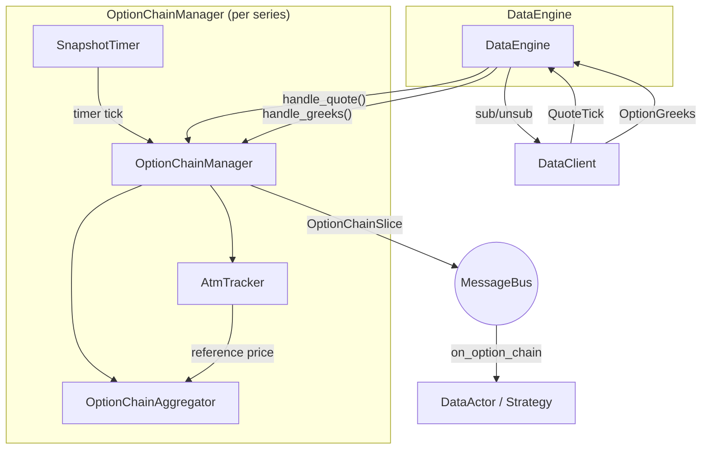

# Options

Nautilus รองรับการเทรด options ทั้งในตลาดดั้งเดิมและตลาด crypto โดยมี instrument type เฉพาะสำหรับ option,
การ stream Greeks ที่ venue ให้มา, การ aggregate option chain และตัวคำนวณ Greeks แบบ Black-Scholes ในเครื่อง
สำหรับการบริหารความเสี่ยง

## ประเภท instrument ของ option {#option-instrument-types}

แพลตฟอร์มนิยาม instrument type สำหรับ option ไว้หลายแบบ:

| Instrument           | คำอธิบาย                                                                      |
| -------------------- | ---------------------------------------------------------------------------- |
| `OptionContract`     | option ที่ซื้อขายในตลาด อ้างอิง underlying และมี strike กับวันหมดอายุ                    |
| `OptionSpread`       | option strategy แบบหลาย leg ที่ exchange นิยามไว้ ซื้อขายเป็นรายการเดียว               |
| `CryptoOption`       | crypto option ที่ quote/settle เป็น crypto แบบ inverse หรือ quanto                  |
| `CryptoOptionSpread` | crypto option spread ที่มี inverse, settlement currency และขนาดแบบเศษส่วน           |
| `BinaryOption`       | option แบบจ่ายผลตอบแทนคงที่ ซึ่ง settle เป็น 0 หรือ 1                               |

metadata ที่เกี่ยวกับ Greeks แตกต่างกันไปตามประเภท instrument:

- `OptionContract`, `CryptoOption`: มีข้อมูลสำหรับคำนวณ Greeks ครบ ได้แก่ `strike_price`,
  `option_kind` (CALL/PUT), `expiration_ns`, `underlying`, `multiplier`
- `OptionSpread`, `CryptoOptionSpread`: strategy แบบหลาย leg ที่ exchange นิยามและเผยแพร่เป็น instrument
  ที่ซื้อขายได้ตัวเดียว มี `underlying`, `expiration_ns` และ `strategy_type` (รหัสที่ venue กำหนด) ตัว spread เอง
  ไม่มี `strike_price` หรือ `option_kind` รายละเอียดของแต่ละ leg ที่ venue ให้มาจะเก็บไว้ใน `info` เมื่อ adapter
  ส่งมาให้ order จะ execute กับ spread เป็นรายการเดียว นอกจากนี้ `CryptoOptionSpread` ยังมี `is_inverse`
  และ `settlement_currency` สำหรับ venue อย่าง Deribit
- `BinaryOption`: มี `expiration_ns` และ `outcome`/`description` แต่ไม่มี `strike_price`, `option_kind`
  หรือ `underlying`

## ตัวระบุของ option {#option-identifiers}

### การอ้างอิงของ series {#series-references}

`OptionSeriesId` รวม `InstrumentId` ของราคาอ้างอิงไว้ในการเปรียบเทียบความเท่ากัน, การ hash และการเรียงลำดับ

รูปแบบเมื่อ serialize:

- **Derived reference**: `VENUE:UNDERLYING:SETTLEMENT:EXPIRY`
- **Other reference**: `VENUE:UNDERLYING:UNDERLYING_INSTRUMENT_ID:SETTLEMENT:EXPIRY`

ทั้งสองรูปแบบแปลงไปกลับผ่าน `from_str` ได้ครบถ้วน รวมถึงกรณีที่ symbol อ้างอิงมีเครื่องหมาย colon และวันหมดอายุ
ระดับนาโนวินาที ให้อัปเดตส่วนที่อ่านรูปแบบสี่ field ก่อนใช้ other reference การแสดงผลจะคงเศษวินาทีของวันหมดอายุไว้
ใน topic ของ message bus และ handler ID

| Rust API                        | Reference                                         |
| ------------------------------- | ------------------------------------------------- |
| `new`, `from_crypto_option`     | ต้องระบุ `InstrumentId`                              |
| `new_derived`                   | แบบ derived ใช้ argument สี่ตัว                       |
| `from_expiry`, `from_expiry_ns` | argument สุดท้ายเป็น `Option<InstrumentId>` (`None` คือ derive) |

struct literal ใน Rust ต้องระบุ `underlying_instrument_id` การ derive จะ reject underlying ที่ว่างหรือมีแต่ whitespace

การค้นหา chain ในเครื่องและการ bootstrap ATM ต้องใช้ derived reference engine ในเครื่องจะ reject reference แบบอื่น
และไม่ subscribe instrument อ้างอิงนั้น ส่วนคำสั่งที่ไปยัง external client จะถูก forward ต่อไป

### Contract ID ที่คำนวณได้ {#computed-contract-ids}

`compute_option_instrument_id` ใน Rust รวม `OptionContractSpec` เข้ากับ `OptionSymbologyScheme`
underlying จริงของสัญญาไม่ขึ้นกับราคาอ้างอิงของ series

**CME Globex** รับรหัส futures เช่น `ESH6` แทน `ES`:

- **Roots**: ES, NQ, RTY, MES, MNQ, SR3 SOFR และ CL WTI แบบรายสัปดาห์ตามตารางวันทำการปกติ
- **Expiry**: รุ่นรายไตรมาสของ equity มีลำดับความสำคัญกว่าเมื่อเดือนของ futures ตรงกับเดือนหมดอายุรายไตรมาส
  สัญญาแบบ end-of-month (EOM) ใช้วันทำการสุดท้ายของเดือน
- **Digits**: suffix ของปีเป็นไปตาม convention หนึ่งหรือสองหลักของ underlying strike ใช้หน่วย index point เต็ม
  สำหรับ equity และหน่วยหนึ่งในร้อยสำหรับ SOFR และ WTI

**Options Symbology Initiative (OSI)** ใช้ symbol ของ underlying เป็นค่าเริ่มต้น สามารถ override root ได้
และใช้ strike แปดหลักในหน่วยหนึ่งในพันแบบตรงพอดี

root, วันหมดอายุ และ precision ของ strike ที่ไม่รองรับจะคืน typed error ซึ่งรวมถึงวันที่รายเดือนตามปกติของ WTI
และวันหมดอายุของ Micro E-mini (MES, MNQ) ตั้งแต่วันที่ 29 มิถุนายน 2026 เป็นต้นไป

:::info
ตรวจสอบ ID ที่ได้กับนิยามของ instrument เพื่อยืนยันรายการที่มีจริงและวันหมดอายุที่ปรับตามวันหยุดแล้ว
:::

## ประเภทสำหรับเลือก option {#option-selection-types}

`OptionSideFilter` เลือก call, put, ทั้งสองฝั่ง หรือฝั่ง out-of-the-money รวมทั้งสองฝั่งที่ ATM
`StrikeSearchProfile` ใน Rust ตรวจสอบความถูกต้องทั้งตอนสร้างและตอน deserialize:

- increment ต้องไม่ว่าง เป็นค่าบวก ไม่ซ้ำกัน และเรียงตามลำดับที่ผู้เรียกต้องการ
- origin ของ grid ต้องไม่ติดลบ
- จำนวน candidate สูงสุดต้องเป็นค่าบวก

API สำหรับ subscribe chain ไม่รับทั้งสองประเภทนี้

## การ subscribe Greeks {#subscribing-to-greeks}

venue อย่าง Deribit, Bybit และ OKX เผยแพร่ Greeks แบบ real-time ควบคู่กับตลาด options
Nautilus มีการ subscribe สองระดับ:

- **Greeks ราย instrument**: subscribe option contract ทีละตัว
- **Option chain slice**: subscribe มุมมองแบบ aggregate ของ option series ทั้งชุด

### Greeks ราย instrument {#per-instrument-greeks}

subscribe Greeks ที่ venue ให้มาสำหรับ option contract ตัวเดียวจาก actor หรือ strategy ด้วย
`subscribe_option_greeks` โดยระบุ instrument ID และ client ID (เช่น `DERIBIT`)

รับ update ที่เข้ามาโดย implement handler `on_option_greeks` ซึ่งได้ค่าอย่าง `delta`, `gamma`, `vega`,
`theta`, `mark_iv` และ `underlying_price`

หากต้องการหยุดรับ update ให้เรียก `unsubscribe_option_greeks`

> หมายเหตุ: ต้นฉบับมีเฉพาะตัวอย่าง Python จึงตัดออก

### การ subscribe option chain {#option-chain-subscriptions}

การ subscribe option chain จะ aggregate quote และ Greeks ของทุก strike ใน option series ให้เป็น snapshot แบบ
`OptionChainSlice` `DataEngine` สร้าง `OptionChainManager` ของ Rust หนึ่งตัวต่อหนึ่ง series และเป็นเจ้าของ
lifecycle ของมัน โดยสร้าง manager, route ข้อมูลที่เข้ามา, รัน snapshot timer และ drain การเปลี่ยนแปลง
subscription ระดับ wire

ใช้ `subscribe_option_chain` โดยระบุ `OptionSeriesId` (venue, underlying, settlement currency, วันหมดอายุ),
`strike_range` และ `snapshot_interval_ms` เช่น 5 strike เหนือและใต้ ATM พร้อม snapshot ทุก 1000ms

รับ snapshot โดย implement handler `on_option_chain` แล้ววนอ่านแต่ละ strike ด้วย `strikes()`,
`get_call(strike)` และ `get_put(strike)`

### การกรองช่วง strike {#strike-range-filtering}

`StrikeRange` ควบคุมว่า strike ใดจะ active อยู่ใน chain subscription:

| Variant       | คำอธิบาย                                                  |
| ------------- | -------------------------------------------------------- |
| `Fixed`       | subscribe ชุด strike ที่ระบุไว้ชัดเจน                            |
| `AtmRelative` | N strike เหนือและ N strike ใต้ ATM strike ปัจจุบัน               |
| `AtmPercent`  | ทุก strike ที่อยู่ภายในช่วงเปอร์เซ็นต์รอบ ATM                       |
| `Delta`       | strike ที่ delta ของ call หรือ put ใกล้กับค่าเป้าหมาย              |

สำหรับช่วง strike แบบ dynamic การ subscribe จะถูก **เลื่อนออกไปจนกว่าจะรู้ราคา ATM** ATM ได้มาจากราคาอ้างอิงของ venue
ใน `OptionGreeks.underlying_price` และยัง seed ได้จากราคาอ้างอิงที่ดึงมาสำหรับ option series ผ่าน HTTP
ซึ่งทำให้ bootstrap ได้ทันทีก่อนที่ tick จาก WebSocket แบบ live จะมาถึง เมื่อ ATM เลื่อน ชุด strike ที่ active
จะ rebalance โดยอัตโนมัติ

`Delta` คำนวณจาก Greeks ที่ venue ให้มา: strike จะ active เมื่อขนาดของ delta ของ call หรือ put (call เป็นบวก
put เป็นลบ เปรียบเทียบด้วยค่าสัมบูรณ์) อยู่ภายใน `tolerance` ของ `target` เป้าหมายแบบ out-of-the-money
ทั่วไปอย่าง `0.25` จะเลือก strike ฝั่งละหนึ่งตัวรอบ ATM

การ bootstrap และ fallback ขึ้นอยู่กับข้อมูลที่มี:

- **ก่อนรู้ ATM**: `Delta` ถูกเลื่อนออกไปเหมือนช่วงแบบ dynamic อื่น ๆ
- **หลังรู้ ATM**: `Delta` จะ fallback ไปใช้หน้าต่างแบบ ATM-relative เมื่อไม่มี Greeks ของ strike ที่ active
  ตัวใดตรงกับช่วง รวมถึงก่อนที่ Greeks ใด ๆ จะมาถึง หน้าต่างนี้มีห้า strike ในแต่ละฝั่งของ ATM
- **ก่อนสลับไปใช้ strike ที่เลือกตาม delta**: aggregator จะรอจนกว่า leg ที่ใช้ fallback ทุกตัวมี Greeks
  เพื่อไม่ให้ update บางส่วนช่วงแรกทำให้ strike ข้างเคียงหลุดไป

### Snapshot mode เทียบกับ raw mode {#snapshot-vs-raw-mode}

parameter `snapshot_interval_ms` ควบคุมพฤติกรรมการ publish:

- **Snapshot mode** (`snapshot_interval_ms=1000`): quote และ Greeks สะสมอยู่ใน buffer และ publish เป็น
  `OptionChainSlice` ตาม timer เหมาะกับการ rebalance portfolio เป็นระยะหรือการแสดงผลบน UI
- **Raw mode** (`snapshot_interval_ms=None`): update ของ quote หรือ Greeks แต่ละครั้งของ instrument ที่ active
  จะ publish slice ทันที เหมาะกับ strategy ที่ไวต่อ latency และต้องตอบสนองต่อ update แต่ละรายการ

engine จะ reject `snapshot_interval_ms=0` ให้ใช้ `None` สำหรับ raw mode

## การ backtest option chain {#backtesting-option-chains}

backtest ของ option chain ใช้เส้นทาง `OptionChainManager` และ `OptionChainAggregator` เดียวกับ subscription แบบ live
สิ่งที่ต้องมีก่อนคือ Parquet catalog ของ Nautilus ที่มี option instrument และข้อมูลราย instrument ที่ chain ต้องใช้อยู่แล้ว:

- record แบบ `QuoteTick` ของแต่ละ option contract ซึ่งมี best bid และ offer ที่ replay
- record แบบ `OptionGreeks` ของแต่ละ option contract ซึ่งมี delta, implied volatility, convention และ
  `underlying_price` ที่ใช้ seed ATM
- instrument แบบ `CryptoOption` หรือ `OptionContract` ที่มี instrument ID เดียวกัน

ข้อมูล replay จาก Tardis ตรงตามเงื่อนไขนี้ เมื่อ snapshot ของ option book หรือ quote ถูกเขียนเป็น `QuoteTick`
และ message `option_summary` ถูกเขียนเป็น `OptionGreeks` backtest จะไม่ดาวน์โหลดหรือร้องขอข้อมูล catalog
ที่ขาดหายระหว่างการรัน

ตั้งค่าการรัน `BacktestNode` ให้มี data stream ทั้งสองแบบ (`QuoteTick` และ `OptionGreeks`) จาก catalog
สำหรับ option instrument ใน series จากนั้นจึง subscribe option chain จาก strategy (เช่นใช้ `StrikeRange` แบบ `Delta`
ที่ target 0.25 และ tolerance 0.05 พร้อม `snapshot_interval_ms=1000`)

ใช้ `snapshot_interval_ms=None` สำหรับ raw mode ซึ่งจะ publish slice หลัง update ของ quote หรือ Greeks
แต่ละครั้งของ instrument ที่ active ใช้ช่วงเวลาเป็นจำนวนเต็มสำหรับ snapshot แบบลดความถี่ (thinned)
ซึ่งจะสะสม BBO และ Greeks ล่าสุดของแต่ละ instrument แล้ว publish chain ตามจังหวะของ timer ช่วยลดปริมาณ event
สำหรับ chain ขนาดใหญ่

`OptionChainSlice` แต่ละตัวจะรวม BBO และ Greeks ล่าสุดตาม instrument แล้วจัดกลุ่มผลลัพธ์ตาม strike และ option kind
quote อาจมาถึงก่อน Greeks และ Greeks ก็อาจมาก่อน quote ได้ aggregator จะเก็บสถานะล่าสุดไว้และแนบทั้งสองอย่าง
เมื่อมีครบ `underlying_price` ใน `OptionGreeks` เป็นตัวขับเคลื่อนการหา ATM

การเลือก strike ทำได้ทั้งในช่วงของ subscription หรือภายใน strategy:

- Moneyness: ใช้ `StrikeRange` แบบ `AtmRelative` หรือ `AtmPercent`
- Delta: ใช้ `StrikeRange` แบบ `Delta` (target, tolerance) หรือตรวจ `greeks.delta` ของแต่ละ entry
  ใน `on_option_chain`
- Strike: ใช้ `StrikeRange` แบบ `Fixed` หรืออ่าน `get_call(strike)` และ `get_put(strike)` จาก chain

การ matching ของ options ขับเคลื่อนด้วย quote market order และ limit ที่ execute ได้ทันทีจะ fill แบบ taker
กับ BBO ฝั่งตรงข้ามที่ replay passive limit order จะพักอยู่บน book จำลองและ fill แบบ maker ได้เมื่อ BBO update
ภายหลังข้ามผ่านราคา limit model นี้ไม่จำลองตำแหน่งในคิวระดับ L2 สำหรับ options

fee model เชิงโครงสร้างของ option กำหนดไว้ที่ venue จำลอง ไม่ได้อนุมานจากชื่อ venue ให้กำหนดเป็น `fee_model`
ใน config ของ backtest venue ฝั่ง Rust ใช้
`FeeModelAny::CappedOption(CappedOptionFeeModel::new(...))` (เช่น รูปแบบคล้าย Deribit) และ
`FeeModelAny::TieredNotionalOption(TieredNotionalOptionFeeModel::new(...))` (เช่น รูปแบบคล้าย OKX)

ดูตัวอย่าง Rust ชื่อ `tardis-option-chain` ใน `crates/backtest/examples/`

## สถาปัตยกรรมของ option chain {#option-chain-architecture}

ระบบ option chain เป็นแบบ event-driven และออกแบบโดยแยกแต่ละ series ออกจากกัน `DataEngine` สร้าง
`OptionChainManager` ของ Rust หนึ่งตัวต่อ option series ที่ subscribe manager ห่อ `OptionChainAggregator`
และ `AtmTracker` ไว้ ลงทะเบียน handler บน message bus, publish snapshot และจัดคิวการเปลี่ยนแปลง subscription
ระดับ wire ให้ engine มา drain

### หน้าที่ของแต่ละ component {#component-responsibilities}

#### DataEngine {#dataengine}

ถือ `OptionChainManager` หนึ่งตัวต่อ `OptionSeriesId` ที่ active:

- **Subscription**: เมื่อได้รับ `SubscribeOptionChain` จะ resolve instrument จาก cache และร้องขอราคาอ้างอิงของ series
  สำหรับช่วง strike แบบ dynamic จากนั้นสร้าง manager, subscribe instrument ที่ active กับ data client
  และตั้ง snapshot timer
- **Timer tick**: manager ตรวจสอบการ rebalance, publish snapshot และจัดคิวการเปลี่ยนแปลง subscription ระดับ wire
  ให้ engine มา drain
- **Teardown**: เมื่อได้รับ `UnsubscribeOptionChain` หรือเมื่อ instrument ทั้งหมดหมดอายุ จะรื้อ manager,
  ยกเลิก timer และ unsubscribe feed ระดับ wire

#### OptionChainManager {#optionchainmanager}

manager ของ Rust ราย series ที่ห่อ `OptionChainAggregator` และ `AtmTracker` `DataEngine` ป้อน market data
ให้ผ่าน `handle_quote()` และ `handle_greeks()` manager จะ bootstrap ชุด instrument ที่ active ภายในตัวเอง
เมื่อได้ราคา ATM ครั้งแรก

- **Snapshot mode**: callback ของ timer เรียก `publish_slice()`
- **Raw mode**: update ของ quote หรือ Greeks ที่ active แต่ละครั้งจะเรียก `publish_slice()` ทันที

#### OptionChainAggregator {#optionchainaggregator}

สะสม quote และ Greeks ลงใน buffer ของ call/put ด้วย **semantics แบบเก็บค่าล่าสุด** (keep-latest)
instrument ที่ไม่มี update ตั้งแต่ snapshot ครั้งก่อนก็ยังถูกรวมอยู่

Greeks ที่มาถึงก่อน quote ใด ๆ ของ instrument จะถูกพักไว้ใน buffer `pending_greeks` และแนบเข้าไปเมื่อ quote แรก
มาถึง ทุกครั้งที่เรียก `snapshot()` aggregator จะสร้าง `OptionChainSlice` แบบ immutable

#### AtmTracker {#atmtracker}

หาราคา ATM แบบ reactive จาก field `underlying_price` ใน event `OptionGreeks` ที่เข้ามา และสามารถ seed ล่วงหน้า
จากราคาอ้างอิงผ่าน HTTP ของ option series ได้ ทำให้ bootstrap ได้ทันทีโดยไม่ต้องรอ tick จาก WebSocket

### Bootstrap และ rebalancing {#bootstrap-and-rebalancing}

สำหรับช่วง strike แบบ dynamic (`AtmRelative`, `AtmPercent` และ `Delta`) จะยังไม่สามารถกำหนดชุด instrument
ที่ active ได้จนกว่าจะรู้ราคา ATM มีเส้นทาง bootstrap สองแบบ:

**Instant bootstrap (มีราคาอ้างอิง)**:

1. `DataEngine` ได้รับ `SubscribeOptionChain` จึง resolve instrument ทั้งหมดของ series จาก cache
   และร้องขอราคาอ้างอิงจาก data client
2. เมื่อได้รับ response ของราคาอ้างอิง engine จะสร้าง manager โดย seed ราคา ATM ไว้ล่วงหน้า manager
   คำนวณชุด strike ที่ active ระหว่างการสร้าง
3. engine subscribe instrument ที่ active ทันที

**Deferred bootstrap (ไม่มีราคาอ้างอิง)**:

1. engine ไม่มี client ที่ตรงกันหรือไม่มี option instrument ใน cache หรือ client รายงานว่าไม่มีราคาอ้างอิง
   นอกจากนี้ request อาจล้มเหลวหรือ timeout หลัง 30 วินาที
2. engine สร้าง manager โดยไม่มีราคา ATM เริ่มต้น ชุด active จึงว่าง เมื่อ request ไปถึง client ที่มี
   option ตัวอย่างอยู่ใน cache engine จะ subscribe Greeks ของตัวอย่างนั้นเป็นแหล่ง bootstrap หากไม่มี client
   หรือตัวอย่าง การ bootstrap จะขึ้นอยู่กับข้อมูล Greeks ที่เกี่ยวข้องซึ่งไหลมาจาก subscription อื่นอยู่แล้ว
1. เมื่อ engine ป้อน event `OptionGreeks` ที่มี `underlying_price` ผ่าน `handle_greeks()` manager จะ
   bootstrap ชุด instrument ที่ active ลงทะเบียน handler บน message bus และจัดคิว subscription ระดับ wire
   ใหม่ให้ engine มา drain subscription ของตัวอย่างจะกลายเป็นส่วนหนึ่งของชุด active หรือถูกปล่อยไป

เมื่อ bootstrap แล้ว aggregator จะติดตามการเลื่อนของ ATM ทุก tick ของ snapshot timer manager จะเรียก
`check_rebalance()` ของ aggregator ซึ่งคืน instrument ที่ต้องเพิ่มหรือลบ threshold แบบ hysteresis และ
ช่วง cooldown ช่วยป้องกันการสลับไปมาบ่อยเกินไปใกล้ขอบของ strike

## Data type OptionGreeks {#optiongreeks-data-type}

`OptionGreeks` เก็บค่า sensitivity และ implied volatility ที่ venue ให้มาสำหรับ option contract หนึ่งตัว:

| Field              | คำอธิบาย                                                |
| ------------------ | ------------------------------------------------------ |
| `instrument_id`    | option contract ที่ Greeks ชุดนี้ใช้                       |
| `convention`       | numeraire convention ของ Greeks (`GreeksConvention`)   |
| `delta`            | อัตราการเปลี่ยนแปลงของราคา option ต่อหนึ่งหน่วยของ underlying  |
| `gamma`            | อัตราการเปลี่ยนแปลงของ delta ต่อหนึ่งหน่วยของ underlying     |
| `vega`             | vega ที่ venue รายงาน                                   |
| `theta`            | theta ที่ venue รายงาน                                  |
| `rho`              | rho ที่ venue รายงาน ค่าเริ่มต้นเป็นศูนย์                     |
| `mark_iv`          | mark implied volatility (อาจไม่มี)                      |
| `bid_iv`           | bid implied volatility (อาจไม่มี)                       |
| `ask_iv`           | ask implied volatility (อาจไม่มี)                       |
| `underlying_price` | ราคา underlying ณ เวลาที่คำนวณ (อาจไม่มี)                 |
| `open_interest`    | open interest ของสัญญา (อาจไม่มี)                        |
| `ts_event`         | UNIX timestamp (นาโนวินาที) ของ event                   |
| `ts_init`          | UNIX timestamp (นาโนวินาที) ตอน initialize              |

## Data type OptionChainSlice {#optionchainslice-data-type}

`OptionChainSlice` คือ snapshot ณ จุดเวลาหนึ่งของ option series ทั้งชุด

Properties:

| Property     | คำอธิบาย                                       |
| ------------ | --------------------------------------------- |
| `series_id`  | ตัวระบุ option series (`OptionSeriesId`)        |
| `atm_strike` | ATM strike ปัจจุบันเป็น `Price` (ถ้าหาได้แล้ว)         |
| `ts_event`   | UNIX timestamp (นาโนวินาที)                     |
| `ts_init`    | UNIX timestamp (นาโนวินาที)                     |

ข้อมูล call และ put เข้าถึงผ่านเมธอด ไม่ได้เป็น property โดยตรง `OptionStrikeData` แต่ละตัวที่เมธอดเหล่านี้คืนมา
มี `quote` (`QuoteTick`) และ `greeks` (`OptionGreeks`) แบบ optional ของ strike นั้น

เมธอด:

- `strikes()`: ราคา strike ที่ไม่ซ้ำกันทั้งหมดใน chain
- `strike_count()`, `call_count()`, `put_count()`: จำนวน
- `get_call(strike)`, `get_put(strike)`: `OptionStrikeData` แบบครบ
- `get_call_greeks(strike)`, `get_put_greeks(strike)`: เฉพาะ Greeks
- `get_call_quote(strike)`, `get_put_quote(strike)`: เฉพาะ quote
- `is_empty()`: เป็น true เมื่อ chain ไม่มีข้อมูล

## การรองรับของ adapter {#adapter-support}

adapter ต่อไปนี้รองรับการ subscribe option Greeks:

| Adapter             | Greeks ราย instrument | Option chains |
| ------------------- | --------------------- | ------------- |
| Deribit             | Yes                   | Yes           |
| Bybit               | Yes                   | Yes           |
| Derive              | Yes                   | Yes           |
| Interactive Brokers | Yes                   | Yes           |
| OKX                 | Yes                   | Yes           |

## ดูเพิ่มเติม {#see-also}

- [Greeks](greeks.md) - การคำนวณ Greeks ในเครื่องและการบริหารความเสี่ยงของ portfolio
- [Data](data/) - data type ในตัวและโมเดลการ subscribe
- [Actors](actors.md) - ตารางอ้างอิง subscription และ handler
