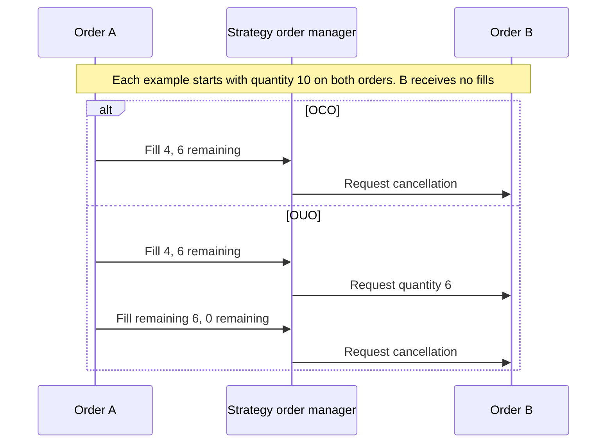
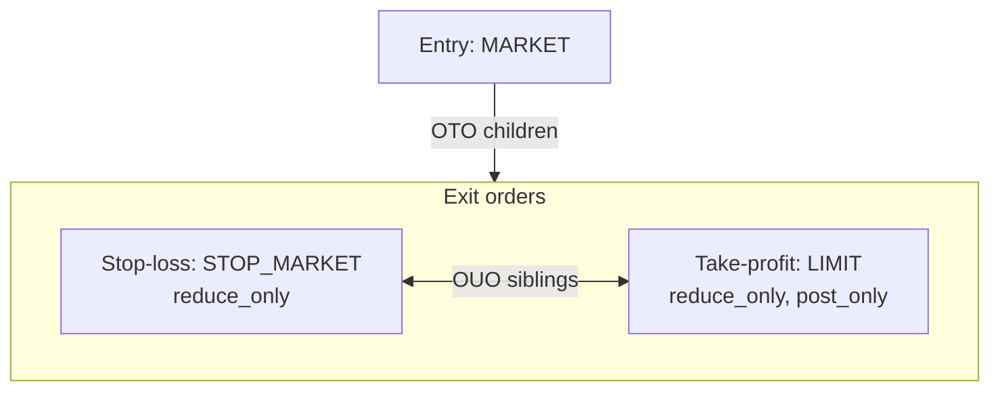

Order list ใช้จัดกลุ่ม order ที่เกี่ยวข้องกัน ส่วน contingency metadata อธิบายว่า fill, การยกเลิก หรือการอัปเดต
ควรส่งผลต่อ order ที่ผูกกันอยู่อย่างไร component ที่จัดการ list นั้นเป็นตัวกำหนดพฤติกรรม ไม่ว่าจะเป็น matching
engine ของ backtest, order emulator ภายในเครื่อง, live adapter และ venue หรือโค้ดของ strategy

:::warning
`OrderList` หรือ `ContingencyType` ไม่ได้รับประกันว่า live adapter หรือ venue ทุกตัวจะ implement ความสัมพันธ์นั้น
ตรวจสอบ integration เป้าหมายก่อนพึ่งพาพฤติกรรม contingency แบบ native
:::

## Order list [#order-lists]

Order list จัดกลุ่ม contingent order หรือ batch ที่ใหญ่กว่านั้นไว้ภายใต้ `order_list_id` เดียว order ใน list
ไม่จำเป็นต้องมีความสัมพันธ์แบบ contingency ต่อกัน ความสัมพันธ์ใด ๆ กำหนดด้วย metadata ของแต่ละ order เอง

Constructor สำหรับ production กำหนดให้ order ทุกตัวใน list ต้องใช้ venue เดียวกัน แต่ order อาจมุ่งไปยัง
instrument ต่างกันใน venue นั้นได้ เช่น pair, calendar spread หรือ strategy แบบหลายขา

List จะใช้ `instrument_id` ตัวแทนจาก order ตัวแรก ผู้ใช้ที่ต้องการ instrument จริงต้อง resolve จากแต่ละ order เอง

**การตรวจสอบไม่ผ่าน**: หากสมาชิกตัวใดไม่ผ่าน risk validation ราย order risk engine จะหยุดการส่ง list นั้น และส่ง
event `OrderDenied` ให้กับ[สมาชิกที่เข้าเงื่อนไข](../execution/policies.md#command-outcomes) ตัวที่ไม่ผ่านจะได้รับ
เหตุผลเฉพาะของการตรวจสอบนั้น ส่วนสมาชิกที่เข้าเงื่อนไขตัวอื่นจะได้รับ `ORDER_LIST_DENIED` order ที่ถูก dispatch
ไปแล้วจากการส่งครั้งก่อนยังคงดำเนินตามวงจรชีวิตของตัวเอง

`DENIED` เป็นสถานะสิ้นสุด หากต้องการลองส่ง order ที่ถูกปฏิเสธใหม่ ให้สร้าง order ใหม่ด้วย client order ID ใหม่

**ข้อควรระวังสำหรับ list ที่มีหลาย instrument**:

- **Pre-trade check**: price precision, quantity precision และการหมดอายุแบบ GTD ใช้ instrument ของแต่ละ order เอง
- **Cumulative risk check**: free balance, ขอบเขต notional, exposure ที่ลด position และ market data ใช้
  instrument ตัวแทนของ list สำหรับ list ที่มีหลาย instrument ผลที่ได้จึงเป็นขอบเขตแบบ instrument เดียว
  ไม่ได้แม่นยำราย instrument
- **การค้นหาใน cache**: `cache.order_lists(instrument_id=...)` กรองตาม `instrument_id` ตัวแทน list ที่มี
  instrument อื่นจะไม่ตรงกับ query ของ instrument อื่นเหล่านั้น
- **Position ID**: execution engine จะปฏิเสธ list ที่มีหลาย instrument เมื่อมีการระบุ `position_id`
  (position หนึ่งเป็นของ instrument เดียวเสมอไม่ว่าจะใช้ OMS แบบใด)
- **การทำ batch ของ adapter**: implementation ของ `submit_order_list` แตกต่างกันไป บางตัววนส่งทีละขาและ resolve
  `instrument_id` ของแต่ละ order กับ API ของ venue บางตัวยังสร้าง batch request โดยอิง `instrument_id`
  ตัวแทนของ list ซึ่งจะ route order ที่ไม่ใช่ตัวแรกผิดที่ ให้ถือว่า list ที่มีหลาย instrument ขึ้นกับ adapter
  และตรวจสอบพฤติกรรมของ adapter เป้าหมายก่อนพึ่งพา ส่วน backtest และการ routing ที่ strategy จัดการเอง
  ไม่ต้องพึ่งพฤติกรรม batch แบบหลาย instrument ของ adapter

## ประเภท contingency [#contingency-types]

- **OTO (One-Triggers-Other)**: parent order ปล่อย child order ตั้งแต่หนึ่งตัวขึ้นไปหลังเข้าเงื่อนไข fill ที่ตั้งไว้
- **OCO (One-Cancels-Other)**: เมื่อ order ตัวหนึ่งที่ผูกกันเกิด fill จะขอยกเลิกตัวอื่น
- **OUO (One-Updates-Other)**: เมื่อ order ตัวหนึ่งที่ผูกกันเกิด fill จะขออัปเดตปริมาณของตัวอื่น

:::info
Type เหล่านี้ตรงกับ FIX
[`ContingencyType <1385>`](https://www.onixs.biz/fix-dictionary/5.0.sp2/tagnum_1385.html)
:::

### Contingency ที่ strategy จัดการ [#strategy-managed-contingencies]

เปิด `StrategyConfig.manage_contingent_orders` เพื่อให้ strategy จัดการความสัมพันธ์ OTO, OCO และ OUO ที่เปิดอยู่
ของ order ที่ไม่ได้เป็น active local strategy จะส่งคำสั่งยกเลิกและอัปเดตปริมาณที่เกิดขึ้นผ่านเส้นทาง execution ปกติ
ก่อนเรียก handler ของ order event ทั้งแบบเฉพาะและแบบรวมของผู้ใช้

`OrderEmulator` เป็นเจ้าของ order ที่เป็น active local เสมอ ดังนั้นการเปิดให้ strategy จัดการจึงไม่ทำให้ strategy
และ emulator จัดการ order ตัวเดียวกัน

ตัวเลือกนี้จัดการ order ที่ไม่ได้เป็น active local และเปิดอยู่แล้วเท่านั้น ไม่ได้เพิ่มการรองรับแบบ native ของ venue
และไม่ได้ส่ง OTO child ที่ไม่ได้เป็น active local



สำหรับ order ที่เปิดอยู่และ strategy จัดการ OCO จะขอยกเลิกตั้งแต่เกิด partial fill ส่วน OUO จะขออัปเดตปริมาณก่อน
แล้วขอยกเลิกเมื่อไม่เหลือปริมาณ

### One-Triggers-Other (OTO) [#one-triggers-other-oto]

**ลำดับของ OTO**: ความสัมพันธ์แบบ OTO มีสองส่วน

1. Parent order เข้าสู่เส้นทาง execution
1. Child order ตั้งแต่หนึ่งตัวขึ้นไปอ้างอิงถึง parent และรอเงื่อนไขการปล่อยที่ตั้งไว้

Handler เป็นผู้กำหนดว่า child จะรออยู่ที่ไหน backtest engine สามารถถือ child ไว้ภายในเครื่องได้ ส่วน live adapter
อาจส่ง instruction แบบ native ของ venue ส่งทุกขา reject list หรือกำหนดให้ strategy จัดการความสัมพันธ์เอง

#### การกำหนดขนาด child [#child-sizing]

ก่อน parent จะ fill ครั้งแรก การจัดการโดย strategy จะส่งต่อการอัปเดตปริมาณของ parent ไปยัง OTO child ที่เปิดอยู่
และไม่ได้เป็น active local

เมื่อเริ่ม fill แล้ว event ของ parent แต่ละครั้งจะตั้งเป้าหมายของ child เริ่มต้นที่ปริมาณที่ fill สะสมของ parent
สำหรับ execution spawn ปริมาณนี้รวม fill จากทุก order ใน spawn

**การกำหนดขนาดที่ผูกกับ position**: สำหรับ parent ที่ผูกกับ position ตัวจัดการจะปรับเป้าหมายต่อตามลำดับดังนี้

1. สำหรับ parent ที่ไม่ใช่ spread และมี child แบบ reduce-only ให้จำกัดเป้าหมายรวมไม่เกินปริมาณที่ child fill แล้ว
   บวกปริมาณ position ปัจจุบันที่[ปรับด้วย commission แล้ว](../positions.md#base-currency-commissions)
   เพื่อให้ปริมาณคงเหลือของ child อยู่ภายใน position ที่เปิดอยู่
1. ปัดเป้าหมายรวมลงให้เป็นผลคูณของ size increment ของ instrument ของ child
1. หากตั้งค่าไว้ ให้ถือว่าเป้าหมายที่ปัดแล้วซึ่งต่ำกว่า minimum quantity ของ instrument ของ child มีค่าเป็นศูนย์

**ส่วนที่เหลือที่ไม่ได้ครอบคลุม**: การคำนวณนี้ไม่ได้ปัดสถานะของ position หรือ account position ที่เหลือซึ่งเล็กเกินกว่า
size increment และ minimum quantity (ถ้ามี) ของ instrument ของ child จะยังเปิดอยู่โดยไม่มี child แบบ reduce-only คุ้มครอง

Parent แบบ spread จะข้ามการจำกัดตาม position เพราะ execution engine ไม่สร้าง position ให้ child ที่ไม่ได้เป็น
reduce-only ก็ข้ามการจำกัดนี้เช่นกัน แต่ทั้งสองกรณียังใช้กฎขนาดของ instrument ของ child

#### สถานะที่จำเป็นสำหรับการกำหนดขนาด [#required-sizing-state]

**เงื่อนไขก่อนกำหนดขนาด**: เมื่อ fill event, parent ใน cache หรือ sibling ใน execution spawn ที่ fill แล้วระบุ
position ได้ การกำหนดขนาดต้องมีสิ่งต่อไปนี้

- Instrument ของ parent และ child อยู่ใน cache
- Size increment ของ instrument ของ child เป็นค่าบวก
- Position ที่ผูกอยู่ใน cache สำหรับ parent ที่ไม่ใช่ spread และมี child แบบ reduce-only
- Position ID ใน fill event และใน cache ตรงกันเมื่อมีทั้งสองค่า

หาก position ID ใน fill event ขัดแย้งกับความเป็นเจ้าของใน cache การประมวลผลของ parent event นั้นจะหยุด ส่วน
สถานะการกำหนดขนาดอื่นที่ขาดหายจะทำให้ child ที่ได้รับผลกระทบคงเดิม และการประมวลผลจะดำเนินต่อกับ child
ที่ผูกอยู่ตัวที่เหลือ

#### วงจรชีวิตของ child [#child-lifecycle]

**การนำเป้าหมายไปใช้**: event ของ parent จะนำเป้าหมายที่ตรวจสอบแล้วไปใช้ตามสถานะของ child และ parent

| เงื่อนไข                                                         | การดำเนินการ                                                |
| -------------------------------------------------------------- | --------------------------------------------------------- |
| Child ที่ถูกจัดการมีเป้าหมายเป็นบวกที่ต่างออกไป                          | อัปเดตปริมาณรวมของ child                                     |
| เป้าหมายเป็นศูนย์ และ parent หรือ execution spawn ยัง active           | คง child ไว้ตามเดิมและรอจนมีปริมาณที่ execute ได้                   |
| เป้าหมายเป็นศูนย์ และ parent หรือ execution spawn ปิดแล้ว             | ยกเลิก child                                                |
| Fill ของ child ถึงหรือเกินเป้าหมายที่เป็นบวก                             | ยกเลิกปริมาณที่เหลือ                                           |
| Child ที่เป็น active local ถึงเป้าหมายที่เป็นบวกและ execute ได้          | Emulator ของ active local ส่ง child นั้นหนึ่งครั้ง                  |

Fill หรือการอัปเดตของ child ไม่ทำให้คำนวณเป้าหมายใหม่ทันที event ถัดไปของ parent จะเป็นตัว refresh

#### Trigger model [#trigger-models]

| Trigger model | เงื่อนไขการปล่อยใน backtest                                                  |
| ------------- | ------------------------------------------------------------------------ |
| **Partial**   | ปล่อย child หลัง parent เกิด partial fill ครั้งแรก                           |
| **Full**      | ปล่อย child หลังปริมาณ fill สะสมของ parent ถึงปริมาณของ order                 |

:::info
โหมดเริ่มต้นของ `BacktestVenueConfig` คือ `OtoTriggerMode.PARTIAL` ตั้ง `oto_trigger_mode` เป็น
`OtoTriggerMode.FULL` เพื่อรอให้ fill ครบ ค่านี้ควบคุมจังหวะการปล่อยเท่านั้น ไม่ได้รับประกันการกำหนดขนาด child
ตามสัดส่วน ควรตรวจสอบปริมาณของ child เมื่อ parent fill ไม่ครบ
:::

เมื่อเปิด `support_contingent_orders` backtest venue จะกำหนดขนาด child แต่ละตัวเสมือนว่าครอบคลุมปริมาณทั้งหมด
ของ parent เมื่อ parent ถูกแก้ไขหรือปิด ปริมาณคงเหลือของ child แต่ละตัวจะครอบคลุมเท่าที่ parent ยังถือได้
โดยไม่รวมส่วนที่ child ทั้งหลาย fill ไปแล้ว

**ความจุของ parent**:

- ปริมาณของ parent ขณะที่ยัง working อยู่
- ปริมาณที่ fill แล้ว เมื่อ parent ถูกยกเลิก หมดอายุ หรือถูกลดลงเหลือเท่าปริมาณที่ fill แล้ว

**วงจรชีวิตของ child**: ภายใต้การตั้งค่าที่เปิดไว้เดียวกัน การ modify จะขยาย child เฉพาะเมื่อเพิ่มปริมาณของ parent
และการปิด parent จะทำได้เพียงลดขนาด child

- Child ที่ถูกปล่อยแล้วยังคง working สำหรับปริมาณที่ parent fill แล้ว child ที่ไม่เหลืออะไรให้ครอบคลุมจะถูกยกเลิก
- การลด parent ลงเหลือเท่าปริมาณที่ fill แล้วถือว่า parent เสร็จสมบูรณ์ ดังนั้น `OtoTriggerMode.FULL` จะปล่อย
  child ที่ถือไว้ที่ปริมาณนั้น child ที่ fill ตอนถูกปล่อยจะเหลือให้ตัวอื่นเฉพาะส่วนที่ตัวเองไม่ได้ fill
- การยกเลิกหรือการหมดอายุของ parent จะยกเลิก child ที่ถือไว้ ดังนั้น parent ที่ fill บางส่วนแล้วปิดลงด้วยวิธีนี้
  ภายใต้ `OtoTriggerMode.FULL` จะเหลือ fill ไว้โดยไม่มี child

**หน่วยของปริมาณ**: venue เปรียบเทียบปริมาณในหน่วยของ parent

- ภายใต้ parent ที่ปริมาณเป็นหน่วย base child ที่ยังถือปริมาณเป็นหน่วย quote จะถูกเปรียบเทียบเป็นปริมาณ base
  การแปลงใช้ราคาของ child หากไม่มีจึงใช้ trigger price หากไม่มีทั้งสองอย่าง จะใช้ best bid สำหรับฝั่ง sell หรือ
  best ask สำหรับฝั่ง buy ใน book ของ parent child จะถือปริมาณ base นั้นไว้เมื่อ venue ปรับขนาดแล้ว และทุกครั้ง
  ที่ parent ปิดตามที่อธิบายข้างต้น ดังนั้นการแปลงครั้งหลังจะไม่ทำให้เกิน fill ของ parent หากไม่มีราคาดังกล่าว
  child จะไม่ถูกปรับขนาด
- Parent ที่ยังถือปริมาณเป็นหน่วย quote เช่น stop ที่จะแปลงตอน fill จะปรับขนาดเฉพาะ child ที่ถือปริมาณ quote เช่นกัน
- Inverse instrument ไม่มีการแปลง quote จึงเปรียบเทียบปริมาณตามที่เป็น
- Child บน instrument อื่นครอบคลุมปริมาณของ parent แบบหนึ่งต่อหนึ่ง เมื่อ engine ของ instrument ของ child
  จับคู่ child แล้ว ปริมาณที่ยังต้องครอบคลุมจะถูกปัดลงตาม size precision ของ instrument นั้น ณ จุดนั้นปริมาณ quote
  จะแปลงด้วย instrument ของ child เอง โดยใช้ราคาหรือ trigger price ของตัวเองเท่านั้น

Child แบบ reduce-only ยังติดตาม position ระหว่าง event เหล่านี้ด้วย ตามที่อธิบายใน
[การปรับขนาด reduce-only ใน backtest](#backtest-reduce-only-resizing)

OTO child แบบ reduce-only จะปรับขนาดเมื่อ fill ของ parent ปล่อยออกมา และปรับอีกครั้งเมื่อ parent fill ครั้งถัดไป
fill ที่รอส่งเข้า cache จะนับรวมในปริมาณ position ที่ใช้ได้ด้วย exit ที่ถูกปล่อยสามารถ fill ใน bar เดียวกันได้
เมื่อขั้นถัดไปของ[การจำลองราคา OHLC](../backtesting/bar-execution.md#ohlc-price-simulation)ไปถึงราคาที่จับคู่ได้

#### การบังคับ trigger แบบ fill ครบในโค้ด strategy [#enforcing-a-full-fill-trigger-in-strategy-code]

**ทางเลือกสำรองแบบ fill ครบ**: หาก execution context ไม่มีพฤติกรรม fill ครบตามที่ต้องการ ให้ทำตามขั้นตอนนี้

1. ส่ง parent order โดยไม่มี contingent child
1. จัดการ event `OrderFilled` ของ parent
1. ยืนยันว่า parent อยู่ในสถานะ `FILLED`
1. ส่ง stop-loss, take-profit หรือ child order อื่น ๆ

:::warning
การปล่อยแบบ fill ครบจะทำให้ position ที่ fill บางส่วนไม่มี contingent exit จนกว่า parent จะเสร็จ การปล่อยแบบ
partial ช่วยลดความล่าช้านี้ ใน backtest child แบบ reduce-only ที่เปิดการบังคับไว้จะติดตามปริมาณ position ที่ใช้ได้
ภายใต้ขีดจำกัดของ parent แต่ child อื่นจะไม่ติดตาม partial fill แต่ละครั้งโดยอัตโนมัติ ตรวจสอบปริมาณและพฤติกรรม
ของ adapter ก่อนจะถือว่า child คุ้มครองได้ครบถ้วน
:::

### One-Cancels-Other (OCO) [#one-cancels-other-oco]

**ผู้รับผิดชอบการยกเลิก**: การยกเลิกแบบ OCO ขึ้นอยู่กับ component ที่จัดการความสัมพันธ์

- **Local matching ใน backtest**: fill เต็มหรือบางส่วนใน OCO order ตัวหนึ่ง จะทำให้เกิดคำขอยกเลิก sibling ที่เปิดอยู่
  แบบ best-effort
- **Local order manager**: ใช้พฤติกรรมนี้เฉพาะขณะที่ sibling ยังเป็น active local
- **เปิดการจัดการโดย strategy**: strategy จะขอยกเลิก sibling ที่เปิดอยู่และไม่ได้เป็น active local หากไม่ได้เปิด
  adapter หรือ venue จะเป็นผู้กำหนดพฤติกรรมการยกเลิก

Sibling ตัวอื่นอาจ fill ก่อนการยกเลิกจะเสร็จสิ้นได้

### One-Updates-Other (OUO) [#one-updates-other-ouo]

#### การอัปเดตหลัง sibling fill [#updates-after-a-sibling-fill]

**เป้าหมายของ sibling**: ใน local matching ของ backtest fill ใน OUO order ตัวหนึ่งจะใช้ปริมาณคงเหลือของ order
ตัวนั้นเป็นเป้าหมายสำหรับ sibling ที่เปิดอยู่แต่ละตัว

- หากเป้าหมายเป็นศูนย์ หรือปริมาณที่ sibling fill แล้วถึงเป้าหมายแล้ว ให้ยกเลิก sibling
- มิฉะนั้น ให้อัปเดตปริมาณของ sibling ตามความจำเป็น

พฤติกรรมนี้เหมาะกับ order คู่ที่ขนาดเท่ากัน และไม่ได้รักษาอัตราส่วนระหว่างปริมาณเริ่มต้นที่ไม่เท่ากัน เมื่อเปิดการจัดการ
โดย strategy strategy จะใช้พฤติกรรมอัปเดตหรือยกเลิกแบบเดียวกันกับ sibling ที่เปิดอยู่และไม่ได้เป็น active local
มิฉะนั้นพฤติกรรมแบบ live จะขึ้นกับการรองรับของ adapter และ venue

#### การปรับขนาด reduce-only ใน backtest [#backtest-reduce-only-resizing]

เมื่อเปิดการบังคับ reduce-only fill หนึ่งครั้งสามารถปรับขนาด reduce-only order ที่ resting อยู่ให้เท่ากับปริมาณ
position ที่ใช้ได้ ภายใต้ขีดจำกัดของ parent

**Sibling ที่เข้าเงื่อนไข**: เมื่อเปิดการรองรับ contingent order ด้วย OUO order ที่ถูกปรับขนาดจะส่งต่อปริมาณคงเหลือ
ไปยัง sibling ที่ตรงทั้งสองเงื่อนไขนี้

- เปิดอยู่และไม่ได้เป็น active local
- เป็น passive order ที่ resting อยู่บน book ของ instrument เดียวกัน

**ปริมาณของ sibling**: sibling ไม่จำเป็นต้องเป็น `reduce_only` การอัปเดตปริมาณของ sibling แต่ละตัวทำตามกฎนี้

- นำ fill ก่อนหน้าของ sibling บวกกับปริมาณคงเหลือที่ส่งต่อมา เพื่อได้ปริมาณรวม
- ใช้ขีดจำกัดปริมาณที่ fill แล้วของ parent ใน cache ของ sibling เอง หากมี
- ห้ามลดปริมาณรวมให้ต่ำกว่า fill ก่อนหน้าของ sibling

Order ที่กำลังถูก fill อยู่ยังคงใช้กฎปริมาณของ fill loop ที่กำลังทำงาน การส่งต่อนี้ไม่ได้ trigger การ matching เอง

ปริมาณที่ปรับขนาดแล้วเป็นหน่วย base order ที่ยังถือปริมาณเป็นหน่วย quote (เช่น stop ที่ยังไม่ trigger) จะได้รับ
ปริมาณที่ปรับขนาดเป็นหน่วย base ดังนั้นเมื่อ trigger จะไม่ถูกแปลงซ้ำอีก inverse instrument ไม่มีการแปลง quote
order จึงคงหน่วยของปริมาณไว้ตามเดิม

#### การยกเลิกใน backtest เมื่อความจุเป็นศูนย์ [#backtest-cancellation-at-zero-capacity]

**ความจุเป็นศูนย์**: เมื่อเปิดการบังคับ reduce-only และการรองรับ contingent order ให้ใช้กฎนี้

- เมื่อ reduce-only order ไม่เหลือความจุ ให้ยกเลิก order นั้นและ sibling ที่เข้าเงื่อนไขโดยไม่ปรับขนาด sibling
  รวมถึง sibling ที่ event การ accept ยังรอส่งอยู่ด้วย
- เมื่อ sibling ใช้โควตาของ parent ตัวเองหมดเพียงอย่างเดียว ให้ปรับขนาดเหลือเท่าปริมาณที่ fill แล้ว แล้วยกเลิก

## การสร้าง contingent order [#constructing-contingent-orders]

ใช้ `OrderFactory.bracket` เพื่อสร้าง contingency metadata ของ bracket

**การจัดกลุ่ม order ที่มีอยู่แล้ว**: `self.order().create_list(...)` จะกำหนด `order_list_id` ใหม่ให้กับกลุ่ม

**ข้อจำกัดของการตรวจสอบ**: เส้นทางการจัดกลุ่มเหล่านี้ไม่ได้สร้างความสัมพันธ์แบบ parent หรือ linked order ส่วน model
บังคับความสอดคล้องที่เหลือได้เพียงบางส่วน

- Contingent order ต้องมี `linked_order_id` อย่างน้อยหนึ่งตัว
- Child ระบุ parent ผ่าน `parent_order_id`
- `create_list` ของ Rust ต้องการ list ที่ไม่ว่างและ order ทั้งหมดใช้ venue เดียว
- `OrderList.validate` ตรวจว่า client order ID ไม่ว่างและไม่ซ้ำกันเมื่อ strategy ส่ง list
- `OrderList.validate` ไม่ได้ตรวจค่า `order_list_id` ที่ใช้ร่วมกัน การอ้างอิง parent หรือความสัมพันธ์ข้าม field อื่น ๆ

พฤติกรรมการแก้ไข การยกเลิก และการ reject ขึ้นกับ component ที่จัดการ contingency อย่าเหมาเอาว่าการอัปเดตหรือ
ยกเลิก parent จะส่งผลต่อเนื่องไปยัง child ในทุก live integration

:::warning
จัดการ event `OrderDenied` และ `OrderRejected` ของทุกขา ความล้มเหลวของ adapter หรือ venue อาจกระทบแต่ละขา
แยกกัน และทำให้ position ไม่มีการคุ้มครองตามที่ตั้งใจไว้
:::

## Bracket order [#bracket-orders]

Bracket order รวม entry เข้ากับ child แบบ take-profit และ stop-loss โดยค่าเริ่มต้น `OrderFactory.bracket` จะสร้าง
entry แบบ `MARKET`, take-profit แบบ `LIMIT` และ stop-loss แบบ `STOP_MARKET` โดยทำเครื่องหมาย entry ด้วย
contingency แบบ `OTO` ทำเครื่องหมาย exit ทั้งสองเป็น `reduce_only` และผูก exit ทั้งสองด้วย contingency แบบ `OUO`
ส่วน take-profit แบบ `LIMIT` ที่เป็นค่าเริ่มต้นยังเป็น `post_only` ด้วย

Factory สร้าง order และ metadata ของความสัมพันธ์ ส่วน execution context เป็นผู้กำหนดว่า child จะรออยู่ในเครื่อง
ใช้ instruction แบบ native ของ venue เข้าสู่ venue พร้อม parent หรือต้องให้ strategy จัดการเอง



Metadata ของ bracket โดยค่าเริ่มต้นเชื่อม entry กับ exit ทั้งสองด้วย OTO และผูก exit ทั้งสองเข้าด้วยกันด้วย OUO

สร้าง bracket ด้วย `OrderFactory` ซึ่งรองรับประเภท entry และ exit ที่ต่างกัน การตั้งค่า trigger และ execution instruction ด้วย

**ตัวอย่าง**: bracket entry แบบ *Market* เพื่อ BUY สัญญา ETHUSDT-PERP จำนวน 10 สัญญา โดยใช้ take-profit แบบ
*Limit* ที่ 3,300 USDT และ stop-loss แบบ *Stop-Market* ที่ trigger ที่ 2,800 USDT

```rust tab="Rust"
use nautilus_model::{
    enums::OrderSide,
    identifiers::InstrumentId,
    types::{Price, Quantity},
};

// `bracket()` returns a `bon` builder; finalize with `.call()`.
// The result is a `Vec<OrderAny>` ordered as [entry, stop-loss, take-profit].
let orders = self
    .order()
    .bracket()
    .instrument_id(InstrumentId::from("ETHUSDT-PERP.BINANCE"))
    .order_side(OrderSide::Buy)
    .quantity(Quantity::from(10))
    .tp_price(Price::from("3300.00"))         // take-profit LIMIT (default)
    .sl_trigger_price(Price::from("2800.00")) // stop-loss STOP_MARKET (default)
    .call();
```

:::warning
บาง venue กันวงเงิน margin ไว้สำหรับขาของ bracket ตรวจสอบกฎ margin ของ venue และจัดการกรณี child ถูก reject
หลัง entry fill แล้ว
:::

## คู่มือที่เกี่ยวข้อง [#related-guides]

- [Orders](index.md) - แนวคิดเรื่อง order, execution instruction และ order factory
- [Emulated orders](emulated.md) - การ emulate ประเภท order บน venue ที่ไม่รองรับแบบ native
- [Execution](../execution/) - การ execute order และการจัดการ fill
