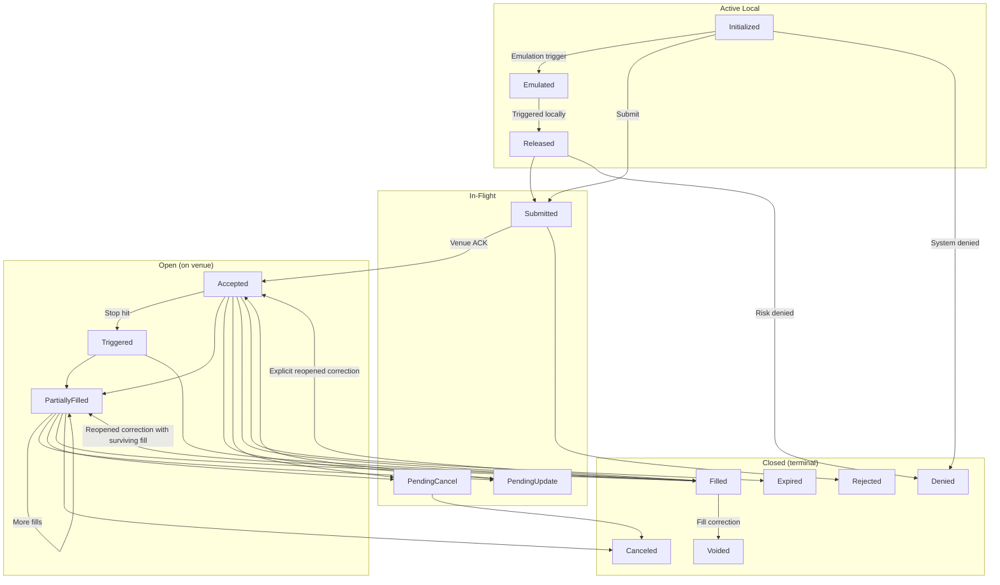

# Orders

NautilusTrader มี model กลางสำหรับประเภท order, execution instruction และความสัมพันธ์แบบ contingency
ที่ใช้ร่วมกันได้กับทุก trading venue

## ภาพรวม {#overview}

order ทุกประเภทต่อยอดมาจากพื้นฐานสองแบบ คือ order แบบ *Market* และ *Limit* โดย order แบบ *Market* ต้องการ
execute ทันทีที่ราคาดีที่สุดที่มีอยู่ ส่วน order แบบ *Limit* ที่ไม่ marketable จะค้างอยู่ใน order
book ที่ราคาที่กำหนดจนกว่าจะถูก match ขณะที่ order แบบ *Limit* ที่ marketable สามารถดึง liquidity ได้

NautilusTrader รองรับ order เก้าประเภท (ค่าของ enum `OrderType`) ซึ่งสรุปไว้ในหัวข้อ
[ประเภท order](#order-types) พร้อมคู่มือเฉพาะของแต่ละประเภท

:::info
NautilusTrader มี API ที่เป็นหนึ่งเดียว แต่การรองรับ order และ instruction แตกต่างกันไปตาม venue และ adapter
adapter อาจปฏิเสธคำขอที่ไม่รองรับตั้งแต่ก่อน submit หรือ venue อาจ reject คำขอนั้นก็ได้ ควรตรวจสอบ
ความสามารถของ integration เป้าหมายก่อนจะพึ่งพา option ใด ๆ
:::

### คำศัพท์ {#terminology}

- **Aggressive**: order ที่มี type เป็น `MARKET` หรือ order ที่ execute แบบ marketable และ
  ดึง liquidity
- **Passive**: order ที่ค้างอยู่ใน book โดยไม่ดึง liquidity
- **Active local**: order ที่ยังอยู่ภายในขอบเขตของระบบ local ที่สถานะ non-terminal ต่อไปนี้:
  - `INITIALIZED`
  - `EMULATED`
  - `RELEASED`
- **In-flight**: order ที่อยู่ในสถานะต่อไปนี้:
  - `SUBMITTED`
  - `PENDING_UPDATE`
  - `PENDING_CANCEL`
- **Open**: order ที่อยู่ในสถานะ non-terminal ต่อไปนี้:
  - `ACCEPTED`
  - `TRIGGERED`
  - `PENDING_UPDATE`
  - `PENDING_CANCEL`
  - `PARTIALLY_FILLED`
- **Closed**: order ที่อยู่ในสถานะ terminal ต่อไปนี้:
  - `DENIED`
  - `REJECTED`
  - `CANCELED`
  - `EXPIRED`
  - `FILLED`
  - `VOIDED`

**กลุ่มที่ซ้อนทับกัน**: open และ closed ไม่ได้เป็นขั้วตรงข้ามกัน

- `PENDING_UPDATE` และ `PENDING_CANCEL` เป็นทั้ง open และ in-flight กล่าวคือ order ยังทำงานอยู่ที่
  venue ขณะที่คำขอ modify หรือ cancel ยังค้างอยู่
- มีสี่สถานะที่ไม่เป็นทั้ง open และ closed ได้แก่ `INITIALIZED`, `EMULATED` และ `RELEASED` ซึ่งเป็น active
  local และ `SUBMITTED` ซึ่งเป็น in-flight จนกว่า venue จะตอบรับ order

:::warning[Open กับ closed ไม่ได้เป็นส่วนเติมเต็มของกันและกัน]
ให้ตรวจว่า order เสร็จสิ้นแล้วด้วย `is_closed` อย่าใช้การกลับค่าของ `is_open` เด็ดขาด order ที่อยู่ในหนึ่งในสี่สถานะ
ข้างต้นไม่ได้ open แต่ก็ยังไม่เสร็จสิ้น ทุก order จะเป็น `SUBMITTED` ทันทีหลัง submit ดังนั้น
code ที่ถือว่า "ไม่ open" คือเสร็จแล้ว จะทิ้ง order ที่ venue ยังประมวลผลอยู่ ให้ใช้ `is_inflight` สำหรับ
กรณีที่รอ venue ตอบกลับ
:::

### ลำดับสถานะของ order {#order-state-flow}

**Transition หลัก**: แผนภาพแสดงวงจรชีวิตของ order และ state transition หลัก
แต่ละสถานะปรากฏเพียงครั้งเดียว ดังนั้น `PENDING_UPDATE` และ `PENDING_CANCEL` จึงวาดไว้ใต้ In-Flight
แม้จะเป็น open ด้วยก็ตาม

แผนภาพแสดงเฉพาะ transition หลัก ขณะที่ order model จะ validate ชุด transition ทั้งหมด
สำหรับการกู้คืนและกรณีขอบ (edge case) ของ venue สถานะของ order อธิบายสถานะฝั่ง local ไม่ใช่หลักฐาน
ที่ทำให้เกิดสถานะนั้น ดู [Execution policies](../execution/policies.md) สำหรับประเภทผลลัพธ์ของคำสั่ง,
ที่มาของ event, ข้อจำกัดในการส่ง และ reconciliation policy

**Fill หลังหมดอายุ**: fill ยังคงอัปเดต order และ position

- partial fill จะทำให้ order ยังคงเป็น `EXPIRED`
- fill ที่ทำให้ครบปริมาณจะเปลี่ยน order เป็น `FILLED`

หาก fill มาถึงหลังการหมดอายุครั้งล่าสุด และ order ยังเป็น `EXPIRED` หรือ `FILLED` อยู่ Nautilus จะบันทึก
`OrderExpired` ครั้งถัดไป event นี้ไม่เปลี่ยนสถานะและ timestamp ของ order โดย event จะยังคงอยู่ใน
ประวัติของ order และ execution engine จะ publish ไปยัง handler ของ strategy ส่วน expiry event ครั้งต่อ ๆ ไป
จะถูกปฏิเสธจนกว่าจะมี fill ใหม่เข้ามา

### นิยามสถานะของ order {#order-status-definitions}

| Status             | Description                                                                                         |
| ------------------ | --------------------------------------------------------------------------------------------------- |
| `INITIALIZED`      | order ถูกสร้างขึ้นภายในระบบ Nautilus                                                                  |
| `DENIED`           | Nautilus ปฏิเสธ order เพราะไม่ถูกต้อง, ประมวลผลไม่ได้ หรือเกิน risk limit                               |
| `EMULATED`         | order กำลังถูก emulate โดย component `OrderEmulator`                                                  |
| `RELEASED`         | order ถูกปล่อยออกจาก component `OrderEmulator` แล้ว                                                   |
| `SUBMITTED`        | order ถูก submit ไปยัง venue แล้ว (รอการตอบรับ)                                                        |
| `ACCEPTED`         | venue ตอบรับว่าได้รับ order และ order ถูกต้อง (อาจกำลังทำงานอยู่)                                        |
| `REJECTED`         | order สิ้นสุดด้วยการถูก reject โดย `reconciliation` และ `reason` บอกที่มาเท่าที่มีข้อมูล                   |
| `CANCELED`         | order สิ้นสุดด้วยการถูก cancel สถานะเพียงอย่างเดียวไม่ได้บอกว่าสาเหตุมาจาก venue, local หรือ policy       |
| `EXPIRED`          | order ถึงเวลาหมดอายุแบบ GTD แล้ว (terminal)                                                            |
| `TRIGGERED`        | order แบบ stop-limit, trailing-stop-limit หรือ limit-if-touched ถูก trigger บน venue                    |
| `PENDING_UPDATE`   | order กำลังรอผลคำขอ modify บน venue                                                                   |
| `PENDING_CANCEL`   | order กำลังรอผลคำขอ cancel บน venue                                                                   |
| `PARTIALLY_FILLED` | order ถูก fill บางส่วนบน venue แล้ว                                                                   |
| `FILLED`           | order ถูก fill ครบทั้งหมดแล้ว (terminal)                                                               |
| `VOIDED`           | order สิ้นสุดหลังจากมีการแก้ไข fill ที่เชื่อถือได้ (authoritative fill correction)                       |

## Execution instructions {#execution-instructions}

execution instruction ระบุเงื่อนไขและข้อจำกัดว่า venue จะประมวลผล order อย่างไร
การรองรับแตกต่างกันไปตาม venue และ adapter

### Time in force {#time-in-force}

time in force ระบุว่า order จะ active อยู่นานเท่าใดก่อนที่ปริมาณที่ยังไม่ fill จะถูก cancel

- **`GTC` (Good Till Cancel)**: order active จนกว่า trader หรือ venue จะ cancel
- **`IOC` (Immediate or Cancel / Fill and Kill)**: order execute ทันที ส่วนที่ไม่ได้ fill
  จะถูก cancel
- **`FOK` (Fill or Kill)**: order ต้อง execute ทันทีครบทั้งจำนวน มิฉะนั้นจะไม่ execute เลย
- **`GTD` (Good Till Date)**: order active จนถึงวันและเวลาหมดอายุที่ระบุ
- **`DAY` (Good for session/day)**: order active จนจบ trading session ปัจจุบัน
- **`AT_THE_OPEN` (OPG)**: order active เฉพาะช่วงเปิดของ trading session
- **`AT_THE_CLOSE`**: order active เฉพาะช่วงปิดของ trading session

### เวลาหมดอายุ {#expire-time}

ใช้ `expire_time` คู่กับ `GTD` เพื่อระบุว่า order จะหมดอายุและออกจาก order book หรือ
ระบบจัดการ order ของ venue เมื่อใด

### Post-only {#post-only}

order ที่ระบุ `post_only` สามารถให้ liquidity ได้แต่ต้องไม่ดึง liquidity โดยปกติ venue จะ reject หรือ
cancel order หากมันจะถูก execute ทันที market maker สามารถใช้ instruction นี้เพื่อให้ได้
ค่าธรรมเนียมแบบ maker

### Reduce-only {#reduce-only}

order ที่ระบุ `reduce_only` สามารถลด position ที่มีอยู่ได้ แต่ต้องไม่เพิ่ม exposure หรือเปิด
position ใหม่เมื่อไม่มี position (flat) พฤติกรรมที่แน่นอนแตกต่างกันไปตาม venue

**พฤติกรรม reduce-only ในการจำลอง**: `SimulatedExchange` ของ Nautilus ใช้กฎต่อไปนี้

- cancel order เมื่อ position ที่เกี่ยวข้องกลายเป็น flat
- ลดปริมาณของ order ลงเมื่อ position ที่เกี่ยวข้องเล็กลง

### Display quantity {#display-quantity}

`display_qty` ระบุว่าจะให้ order มองเห็นได้บน limit order book มากน้อยเพียงใด order ที่มี
ปริมาณที่แสดงน้อยกว่าปริมาณทั้งหมดมักเรียกว่า iceberg order ส่วน display
quantity เป็นศูนย์จะทำให้ order ถูกซ่อน หาก venue รองรับพฤติกรรมนั้น

### Trigger type {#trigger-type}

trigger type หรือที่เรียกว่า
[trigger method](https://www.interactivebrokers.com/en/software/tws/usersguidebook/configuretws/Modify%20the%20Stop%20Trigger%20Method.htm)
ระบุราคาตลาดที่ใช้ trigger order แบบมีเงื่อนไข

การไม่มี trigger type แทนด้วย `None` ซึ่งใช้ไม่ได้กับ order ที่ต้องการ trigger type

- **`DEFAULT`**: ใช้ trigger type ค่าเริ่มต้นของ venue
- **`LAST_PRICE`**: ใช้ราคา last traded
- **`BID_ASK`**: ใช้ ask สำหรับ order ฝั่ง BUY และ bid สำหรับ order ฝั่ง SELL
- **`DOUBLE_LAST`**: ต้องมีราคา last ตรงตามเงื่อนไขติดกันสองครั้ง
- **`DOUBLE_BID_ASK`**: ต้องมีราคา bid หรือ ask ตรงตามเงื่อนไขติดกันสองครั้ง โดยขึ้นกับฝั่งของ order
- **`LAST_OR_BID_ASK`**: ใช้ราคา last หรือ bid/ask ที่เหมาะกับฝั่งของ order อย่างใดอย่างหนึ่ง
- **`MID_POINT`**: ใช้ราคากึ่งกลางระหว่าง bid และ ask
- **`MARK_PRICE`**: ใช้ mark price ของ venue สำหรับ instrument นั้น
- **`INDEX_PRICE`**: ใช้ index price ของ venue สำหรับ instrument นั้น

### Trailing offset type {#trailing-offset-type}

trailing offset type ระบุว่า trailing order คำนวณ offset ของ trigger จาก
ราคาตลาดที่เกี่ยวข้องอย่างไร

การไม่มี trailing offset type แทนด้วย `None` ซึ่งใช้ไม่ได้กับ trailing order

- **`PRICE`**: ใช้ส่วนต่างของราคา
- **`BASIS_POINTS`**: ใช้ส่วนต่างเป็นเปอร์เซ็นต์ในหน่วย basis point โดย 100 basis point เท่ากับ 1%
- **`TICKS`**: ใช้จำนวน tick
- **`PRICE_TIER`**: ใช้ price tier เฉพาะของ venue

### Contingent orders {#contingent-orders}

ความสัมพันธ์แบบ contingency สามารถพัก child order ไว้จนกว่า parent จะ activate หรือ fill, cancel
order ที่เชื่อมกัน หรือลดปริมาณของ order เหล่านั้นได้ ดู [Advanced orders](advanced.md) สำหรับ model ที่มีให้และ
ข้อจำกัดของแต่ละแบบ

## Order factory {#order-factory}

ใช้ `OrderFactory` ที่มีมาในตัวเพื่อสร้าง order โดย strategy API ฝั่ง Rust เปิดให้ใช้ผ่าน `self.order()`

factory จะกำหนด trader ID และ strategy ID ให้ และสร้าง client order ID และ initialization ID เมื่อ
จำเป็น นอกจากนี้ยังบันทึก timestamp เริ่มต้นและใส่ค่าเริ่มต้นตามประเภท order ที่เลือก

ตัวอย่างในคู่มือเหล่านี้สร้าง order จาก context ของ `Strategy`

ดูรายละเอียดเพิ่มเติมได้ที่ [Rust API reference](https://nautilustrader.io/docs/core-latest/)

## ประเภท order {#order-types}

NautilusTrader รองรับ order ประเภทต่อไปนี้ แต่ละประเภทมีลิงก์ไปยังคู่มือเฉพาะพร้อมตัวอย่าง code
parameter ที่เป็น optional จะมี comment ระบุค่าเริ่มต้นไว้

| Order type                                        | Category             | Description                                                                 |
| ------------------------------------------------- | -------------------- | --------------------------------------------------------------------------- |
| [`MARKET`](market.md)                             | Aggressive           | ซื้อขายปริมาณทั้งหมดทันทีที่ราคาดีที่สุดที่มีอยู่                                |
| [`LIMIT`](limit.md)                               | Passive              | ค้างอยู่ใน book และซื้อขายเฉพาะที่ราคา limit หรือดีกว่า                         |
| [`STOP_MARKET`](stop_market.md)                   | Conditional          | เมื่อราคาถึง trigger price จะวาง order แบบ *Market*                           |
| [`STOP_LIMIT`](stop_limit.md)                     | Conditional          | เมื่อราคาถึง trigger price จะวาง order แบบ *Limit* ที่ราคาที่กำหนด              |
| [`MARKET_TO_LIMIT`](market_to_limit.md)           | Hybrid               | submit เป็น *Market* ส่วนที่เหลือจะค้างเป็น *Limit* ที่ราคาที่ fill              |
| [`MARKET_IF_TOUCHED`](market_if_touched.md)       | Conditional          | เมื่อราคาแตะ trigger price จะวาง order แบบ *Market*                            |
| [`LIMIT_IF_TOUCHED`](limit_if_touched.md)         | Conditional          | เมื่อราคาแตะ trigger price จะวาง order แบบ *Limit* ที่ราคาที่กำหนด               |
| [`TRAILING_STOP_MARKET`](trailing_stop_market.md) | Conditional trailing | ให้ trigger ตามราคาด้วย offset แล้ววาง order แบบ *Market*                      |
| [`TRAILING_STOP_LIMIT`](trailing_stop_limit.md)   | Conditional trailing | ให้ trigger ตามราคาด้วย offset แล้ววาง order แบบ *Limit*                       |

### การ map กับ FIX OrdType {#fix-ordtype-mapping}

**การ map กับ FIX**: แต่ละประเภท map กับค่า FIX 5.0 SP2
[`OrdType <40>`](https://www.onixs.biz/fix-dictionary/5.0.sp2/tagnum_40.html) ที่ใกล้เคียงที่สุด ในกรณีที่โปรโตคอล
มีค่านั้นกำหนดไว้

| Order type           | FIX `OrdType <40>`                   |
| -------------------- | ------------------------------------ |
| Market               | `1` (Market)                         |
| Limit                | `2` (Limit)                          |
| Stop-Market          | `3` (Stop)                           |
| Stop-Limit           | `4` (Stop Limit)                     |
| Market-To-Limit      | `K` (Market With Left Over as Limit) |
| Market-If-Touched    | `J` (Market If Touched)              |
| Limit-If-Touched     | ไม่มีค่าเฉพาะ †                       |
| Trailing-Stop-Market | `3` (Stop) + trailing peg            |
| Trailing-Stop-Limit  | `4` (Stop Limit) + trailing peg      |

† FIX ไม่มี `OrdType` เฉพาะสำหรับ *Limit-If-Touched* โดยทั่วไปจะส่งเป็น `4` (Stop Limit) พร้อม
trigger ฝั่งที่เป็นประโยชน์ trailing stop ก็เช่นกัน ไม่มีค่าเฉพาะ และ model เป็น `3`/`4` บวกกับฟิลด์
trailing peg

## Advanced orders {#advanced-orders}

order สามารถจัดกลุ่มเป็น list และเชื่อมกันด้วยความสัมพันธ์แบบ contingency (OTO, OCO, OUO) ได้ และ
bracket order จะผูก child แบบ take-profit และ stop-loss เข้ากับ order เข้า (entry) ดูคู่มือ
[Advanced orders](advanced.md) สำหรับ order list, ประเภท contingency, กฎการ validate และ
bracket

## Emulated orders {#emulated-orders}

NautilusTrader สามารถ emulate ประเภท order ที่ venue ไม่รองรับในตัวได้ที่ฝั่ง local โดยใช้เพียง order แบบ
`MARKET` และ `LIMIT` ในการ execute จริง ดูคู่มือ [Emulated orders](emulated.md) สำหรับ
วงจรการ emulate, ประเภทที่รองรับ, การ query และแนวปฏิบัติที่ดี

## คู่มือที่เกี่ยวข้อง {#related-guides}

- [Events](../events/) - order event, position event และการ dispatch ไปยัง handler
- [Execution](../execution/) - การ execute order และการจัดการ fill
- [Positions](../positions.md) - position ที่เกิดจาก fill ของ order
- [Strategies](../strategies.md) - การจัดการ order จาก strategy
