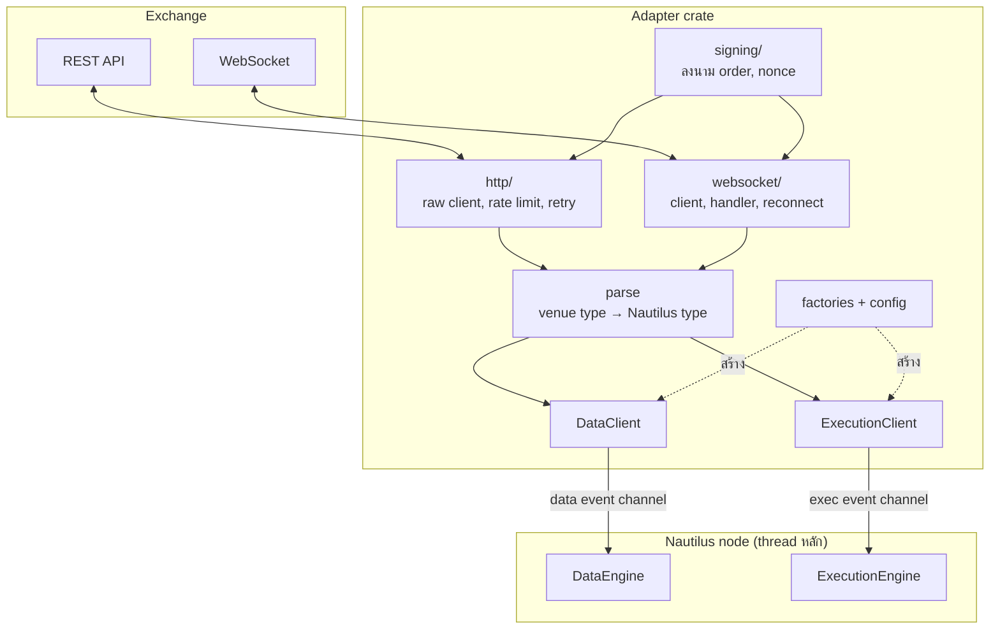

ใน [สถาปัตยกรรม](architecture.md) adapter คือสิ่งที่อยู่ "ขอบนอก" ของ node ทำหน้าที่แปลภาษาของ exchange ให้เป็นภาษาของ
Nautilus และแปลกลับ หน้านี้เปิดดูข้างในของ adapter สองตัวที่ออกแบบต่างกันชัดเจน เพื่อให้เห็นว่าส่วนไหนเป็นโครงสร้างร่วม
ที่ทุก adapter มี และส่วนไหนเป็นความเฉพาะของแต่ละ venue

- **Hyperliquid**: DEX แบบ order book บนเชนของตัวเอง ลงนามด้วย EIP-712
- **Lighter**: DEX แบบ zk-rollup ลงนามด้วยระบบ cryptography เฉพาะของตัวเอง

:::note
หน้านี้เป็นคำอธิบายโครงสร้าง ไม่ใช่คู่มือเขียน adapter ใหม่ ทุก path อ้างถึง repository ของ NautilusTrader ที่ commit `04f766b4`
คู่มือการเขียน adapter ฉบับเต็มอยู่ที่ [Developer guide: Adapters](../developer_guide/adapters.md)
:::

## ภาพรวม: adapter คือชั้นแปลภาษา [#layers]

ทุกชั้นในกรอบ adapter ทำงานบน tokio (ขอบนอก) ข้อมูลเข้าสู่แกนกลางผ่านสองทางเท่านั้น คือ data event channel
และ exec event channel ซึ่งตรงกับกฎข้อแรกของ [สถาปัตยกรรม](architecture.md#rules): งานที่ต้องรอ network อยู่นอก thread หลัก

## โครงสร้าง crate เทียบกัน [#crate-layout]

| ชั้น | Hyperliquid (`crates/adapters/hyperliquid/src`) | Lighter (`crates/adapters/lighter/src`) |
| --- | --- | --- |
| ค่าคงที่, enum, credential, parse ทั่วไป | `common/` | `common/` (รวม `symbol.rs` สำหรับแปลงชื่อเป็นเลข market) |
| HTTP | `http/` (client, models, parse, query, rate limits) | `http/` (client, models, parse, query) |
| WebSocket | `websocket/` (client, handler, messages, parse, dispatch, post API) | `websocket/` (client, handler, messages, parse, dispatch, account state) |
| order book | `book/` (sync, recovery) | `book/` (sync, recovery) |
| การลงนาม | `signing/` (EIP-712 signer, nonce) | `signing/` (curve, field, hash, Schnorr, tx encoding, nonce) |
| data client | `data.rs` | `data/` (รวม limits และ market stats) |
| execution client | `execution.rs` | `execution.rs` |
| config และ factory | `config.rs`, `factories.rs` | `config.rs`, `factories.rs` |
| Python binding | `python/` (feature `python`) | `python/` (feature `python`) |

โครงสร้างแทบเหมือนกันทุกบรรทัด ความต่างอยู่ในเนื้อของแต่ละโมดูล โดยเฉพาะ `signing/` ซึ่งสะท้อนว่าแต่ละเชนพิสูจน์ตัวตนต่างกัน
นี่คือรูปแบบที่ developer guide กำหนดไว้ ([Structure of an adapter](../developer_guide/adapters.md#structure-of-an-adapter))
ใครเปิด adapter ตัวไหนก็หาของเจอที่เดิม

## สัญญากับ node: trait สองตัวและ factory [#traits]

adapter เสียบเข้ากับ node ผ่าน trait ใน `nautilus-common`:

| Trait | ไฟล์ | หน้าที่หลัก |
| --- | --- | --- |
| `DataClient` | `crates/common/src/clients/data.rs` | `connect`/`disconnect`, `subscribe_*`/`unsubscribe_*` (quote, trade, bar, book, mark price, funding rate ฯลฯ), `request_*` (ข้อมูลย้อนหลัง, instrument) |
| `ExecutionClient` | `crates/common/src/clients/execution.rs` | `submit_order`, `submit_order_list`, `modify_order`, `cancel_order`, `cancel_all_orders`, `batch_cancel_orders`, `query_order` และ `generate_*_report(s)` สำหรับ reconciliation |
| `DataClientFactory`, `ExecutionClientFactory` | `crates/common/src/factories/client.rs` | สร้าง client จาก config ตอน node ประกอบตัว |

| | Hyperliquid | Lighter |
| --- | --- | --- |
| `DataClient` | `HyperliquidDataClient` | `LighterDataClient` |
| `ExecutionClient` | `HyperliquidExecutionClient` | `LighterExecutionClient` |
| Factory | `HyperliquidDataClientFactory`, `HyperliquidExecutionClientFactory` | `LighterDataClientFactory`, `LighterExecutionClientFactory` |
| Config | `HyperliquidDataClientConfig`, `HyperliquidExecutionClientConfig` | `LighterDataClientConfig`, `LighterExecutionClientConfig` |
| OMS type ของ execution client | `Netting` | `Netting` |

method สำหรับ subscribe รับ command object (เช่น `SubscribeBars`) ไม่ใช่ argument แยก นี่คือ command เดียวกับที่ strategy
ของเราสร้างตอนเรียก `subscribe_bars` แล้ว data engine ส่งต่อมา

ในตัวอย่างของบทนี้ `live.rs` ใช้ factory ของ Bybit เพียงสองบรรทัด:
`add_data_client(None, Box::new(BybitDataClientFactory::new()), ..)` และ `add_exec_client(..)` ถ้าเปลี่ยนเป็น
Hyperliquid ก็เปลี่ยนแค่ factory, config, instrument ID และ bar type ส่วน `components.rs` และ `exporter.rs` ไม่ต้องแตะเลย
เพราะทั้งสองคุยกับ node ผ่าน message bus และ cache เท่านั้น ไม่เคยคุยกับ adapter ตรง ๆ

## Config และ credential [#config]

| | Hyperliquid | Lighter |
| --- | --- | --- |
| เลือกเครือข่าย | `environment: HyperliquidEnvironment` (mainnet/testnet) | `environment: LighterEnvironment` และ `deployment: LighterDeployment` (Lighter หรือ Robinhood Chain) |
| credential | private key แบบ EVM และ vault address (ไม่บังคับ) | API key index, API secret, account index |
| env var | `HYPERLIQUID_PK`, `HYPERLIQUID_VAULT` และแบบ `HYPERLIQUID_TESTNET_*` | `LIGHTER_API_KEY_INDEX`, `LIGHTER_API_SECRET`, `LIGHTER_ACCOUNT_INDEX` และแบบ `LIGHTER_TESTNET_*`, `LIGHTER_ROBINHOOD_*` |
| ปรับแต่งอื่น | timeout, retry, slippage ของ market order, ตรวจ stream ที่เงียบผิดปกติ | quota ของ REST และของการส่ง transaction, slippage, `use_gtd` |

รูปแบบเดียวกับ Bybit ใน [ไปสู่ live](live.md#credentials): ชื่อ env var แยกตามเครือข่าย และ credential เป็นชนิดข้อมูลที่
ไม่พิมพ์ค่าลง log (`SecretString`) ดูหลักการได้ที่
[Credentials and secret handling](../developer_guide/adapters.md#credentials-and-secret-handling)

## ชั้น HTTP: rate limit, retry และการ parse [#http]

ทั้งสองตัวแยก HTTP client เป็นสองชั้น ชั้นล่าง (`*RawHttpClient`) ส่ง request ตรงตาม API ของ venue
ชั้นบน (`*HttpClient`) ให้ method ระดับ domain ที่คืนชนิดข้อมูลของ Nautilus แล้ว

**Rate limit ต่างกันตามกติกาของ venue:**

- Hyperliquid คิด rate limit เป็น "น้ำหนัก" ต่อ request ไม่ใช่จำนวน request adapter จึงมี `WeightedLimiter`
  (`http/rate_limits.rs`) ที่หักน้ำหนักตามประเภทของ request ภายใต้โควตาต่อนาที
- Lighter ใช้ quota แยกตาม key: REST 60 ครั้งต่อนาทีโดย default (ปรับได้ใน config) และ limiter แยกสำหรับการส่ง transaction

**Retry:** Lighter ใช้ `RetryManager` จาก `nautilus-network` Hyperliquid ใช้ backoff ของตัวเอง และ retry เฉพาะ request
ที่อ่านข้อมูล ไม่ retry request ที่ส่งคำสั่งเทรด เพราะการส่งซ้ำอาจทำให้ order ซ้ำ หลักข้อนี้ใช้ได้กับทุก adapter
ดู [Error handling and retry logic](../developer_guide/adapters.md#error-handling-and-retry-logic)

**Parse:** ไฟล์ `http/parse.rs` ของทั้งคู่คือหัวใจของการแปลภาษา ฟังก์ชันอย่าง `parse_perp_instruments`,
`parse_fill_report`, `parse_position_status_report` (Hyperliquid) หรือ `parse_candle_bar`, `parse_trade_tick`,
`parse_order_book_snapshot` (Lighter) รับ struct ที่ map ตรงกับ JSON ของ venue แล้วคืนชนิดข้อมูลของ Nautilus
การแยกชั้นนี้ทำให้ test การแปลงได้ด้วยไฟล์ JSON ตัวอย่างโดยไม่ต้องต่อ network

## ชั้น WebSocket: subscription และการเชื่อมต่อใหม่ [#websocket]

ทั้งสองมีโครงสร้างเดียวกัน:

1. **client** (`*WebSocketClient`) จัดการ connection และรับคำสั่ง subscribe จาก data/execution client
2. **handler** (`FeedHandler`) วนรับ frame จาก socket แปลง message ของ venue (`HyperliquidWsMessage`, `LighterWsFrame`)
   เป็น message กลาง (`NautilusWsMessage`) ที่มีแต่ชนิดข้อมูลของ Nautilus เช่น trade, quote, book delta, bar
   หรือ execution report
3. **การติดตาม subscription** ใช้ `SubscriptionState` จาก `nautilus-network` จำไว้ว่า subscribe อะไรอยู่
   เมื่อ connection หลุดแล้วต่อใหม่ adapter จะ subscribe ทุก topic ซ้ำเอง strategy ไม่ต้องรู้เรื่องนี้เลย
4. **heartbeat** ส่งทุก 30 วินาที (Hyperliquid ใช้ ping ระดับ application, Lighter ใช้ ping ของ WebSocket)
   และถือว่าหลุดถ้าเงียบเกินสามเท่าของรอบ

ข้อ 3 คือเหตุผลที่ strategy ในบทนี้ไม่มีโค้ดจัดการ network สักบรรทัด และเป็นเหตุผลที่การตรวจซ้ำเป็นระยะของ
execution engine ([reconciliation](live.md#reconciliation)) ยังจำเป็น: ระหว่างที่หลุด event อาจหายไปจริง
การ subscribe ซ้ำทำให้ได้ข้อมูลใหม่ แต่ไม่ได้ event ที่พลาดไปคืนมา

## ข้อมูลเข้าสู่ node อย่างไร [#data-path]

data client ทั้งสองตัวเรียก `get_data_event_sender()` ตอนสร้าง แล้ว spawn task ที่วนรอ message จาก WebSocket client
แต่ละ message ถูกห่อเป็น `DataEvent::Data(..)` แล้วส่งเข้า channel จากนั้นเส้นทางเหมือนที่เห็นใน
[เดินตาม bar หนึ่งแท่ง](architecture.md#life-of-a-bar) ทุกประการ: data engine เก็บลง cache แล้ว publish

นี่คือกลไกเดียวกับทางที่ 1 ของ [ingress](integration.md#ingress) adapter เป็นแค่ producer ที่ทำครบทุกเรื่อง
(reconnect, ข้อมูลย้อนหลัง, instrument)

**Instrument:** ทั้งสองไม่มี instrument provider แยก แต่โหลด instrument ทั้งหมดตอน connect แล้ว refresh เป็นระยะ
ชนิดที่ map ไปมีดังนี้:

| Venue | ชนิดของ Nautilus | ตัวอย่าง instrument ID |
| --- | --- | --- |
| Hyperliquid perp | `CryptoPerpetual` | `BTC-USD-PERP.HYPERLIQUID` |
| Hyperliquid spot | `CurrencyPair` | `PURR-USDC-SPOT.HYPERLIQUID` |
| Hyperliquid HIP-4 outcome | `BinaryOption` | `1-YES-OUTCOME.HYPERLIQUID` |
| Lighter perp | `CryptoPerpetual` | `BTC-PERP.LIGHTER` |
| Lighter spot | `CurrencyPair` | `ETH/USDC-SPOT.LIGHTER` |

Lighter อ้างถึง market ด้วยเลข `market_index` ภายใน adapter จึงมี `MarketRegistry` (`common/symbol.rs`) แปลงไปมาระหว่าง
instrument ID ที่คนอ่านได้กับเลขที่ venue ใช้ strategy ไม่เคยเห็นเลขนี้ ดู
[Symbols and instrument identity](../developer_guide/adapters.md#symbols-and-instrument-identity)

## การส่ง order [#execution]

ส่วนนี้คือส่วนที่สอง adapter ต่างกันมากที่สุด

| เรื่อง | Hyperliquid | Lighter |
| --- | --- | --- |
| ลงนาม | EIP-712 ผ่าน `alloy`: serialize action เป็น msgpack แล้ว hash ด้วย keccak256 | Schnorr บน curve ecgfp5 กับ Poseidon2 hash เขียนไว้ใน crate เอง ไม่พึ่ง library ภายนอก |
| nonce | อิงเวลาเป็นมิลลิวินาที อยู่ในหน้าต่างเวลาที่ยอมรับได้ | venue นับต่อเนื่องแยกตาม account และ API key ดึงค่าเริ่มจาก REST แล้ว ack ทีละรายการ |
| ช่องทางส่ง | ลงนามแล้วส่งผ่าน "post" API บน WebSocket | ส่ง signed transaction ผ่าน WebSocket |
| แปลง client order ID | `Cloid`: 16 byte แรกของ keccak256 ของ `ClientOrderId` | `client_order_index` ขนาด 31 bit จาก hash แบบ seed คงที่ แก้การชนด้วย linear probing |
| order type | MARKET (ทำเป็น IOC limit + slippage), LIMIT, STOP_MARKET, STOP_LIMIT, MIT, LIT | MARKET, LIMIT ทั้ง perp และ spot ส่วน STOP_*, MIT, LIT เฉพาะ perp |
| รับ fill | stream ส่วนตัวบน WebSocket (order updates, user events) | channel ของ account บน WebSocket (orders, trades, positions, assets) |

แถว "แปลง client order ID" สำคัญกับการ integrate: Nautilus สร้าง `ClientOrderId` เอง (เช่น `O-20240101-004400-001-001-1`)
แต่ venue มักรับ ID ในรูปแบบจำกัด adapter จึงต้องแปลงแบบ deterministic เพื่อให้หลัง restart ยังจับคู่ order ที่ค้างอยู่กลับได้

event จาก venue ถูกแปลงเป็น report (`OrderStatusReport`, `FillReport`) แล้วส่งผ่าน `ExecutionEventEmitter`
เข้า exec event channel จากนั้น execution engine จัดการต่อตาม [เดินตาม bracket order](architecture.md#life-of-an-order)

## Reconciliation: adapter ต้องตอบคำถาม "ตอนนี้มีอะไรอยู่บ้าง" [#reconciliation]

`ExecutionClient` ต้อง implement method สร้าง report ที่ execution engine เรียกตอน startup และตอนตรวจเป็นระยะ:

| Method | ตอบคำถาม | Hyperliquid | Lighter |
| --- | --- | --- | --- |
| `generate_order_status_reports` | มี order อะไรเปิดอยู่ | ดึงผ่าน REST | ดึงผ่าน REST |
| `generate_fill_reports` | มี fill อะไรเกิดขึ้น | ดึงผ่าน REST | ดึงผ่าน REST แบบแบ่งหน้า |
| `generate_position_status_reports` | ถือ position อะไรอยู่ | ดึงผ่าน REST | ใช้ snapshot ล่าสุดจาก WebSocket และจะ error ถ้า snapshot ยังไม่ครบ |
| `generate_mass_status` | ทั้งหมดข้างบนในครั้งเดียว | ใช้ค่า default | override เอง |

แถวของ Lighter แสดงหลักการที่ดี: ถ้าข้อมูลยังไม่ครบ ให้ error แทนที่จะตอบว่า "ไม่มี position" เพราะคำตอบผิดแบบนั้นจะทำให้
reconciliation ปิด state ที่มีอยู่จริงทิ้ง ดู [Reconciliation reports](../developer_guide/adapters.md#reconciliation-reports)

## การ test adapter [#testing]

| วิธี | Hyperliquid | Lighter |
| --- | --- | --- |
| mock server ด้วย axum ใน integration test | HTTP และ WebSocket | HTTP และ WebSocket |
| fixture JSON จาก venue จริง (`test_data/`) | ใช่ | ใช่ รวมชุดทดสอบการลงนาม |
| binary สำหรับทดลองกับ venue จริง (`bin/`) | หลายตัว เช่น public/private HTTP, WS data/exec, flatten | flatten, trades probe |
| example แบบ node เต็ม (`examples/`, feature `examples`) | data tester, exec tester | data tester, exec tester |
| fuzz testing | ไม่มี | มี (feature `fuzz`) |
| benchmark | criterion | criterion และ iai รวมถึงการลงนาม |

ชั้นของการ test สะท้อนชั้นของโค้ด: parse test ด้วย fixture, client test ด้วย mock server และใช้ tester จริงเฉพาะตอนท้าย
แนวคิดเดียวกับ [Testing](testing.md) ของบทนี้ที่แยก pure function ออกจากส่วนที่ต้องใช้ engine
และ data/exec tester ของ adapter ใช้ actor `DataTester` และ strategy `ExecTester` ตาม spec ใน
[Data testing spec](../developer_guide/spec_data_testing.md) และ [Execution testing spec](../developer_guide/spec_exec_testing.md)

## ถ้าจะเขียน adapter เอง [#writing-your-own]

ลำดับที่ developer guide แนะนำ ([Adapter implementation sequence](../developer_guide/adapters.md#adapter-implementation-sequence)):

1. กำหนดขอบเขต: venue รองรับอะไร และ adapter จะรองรับอะไร
2. สร้างแกนของ protocol: HTTP, WebSocket, การลงนาม, rate limit
3. instrument
4. market data
5. execution
6. ความสามารถเสริมเฉพาะ venue
7. factory และ config
8. พิสูจน์ conformance ด้วย data/exec tester
9. วัด performance และความทนทาน
10. เอกสารและขั้นตอนการ operate

ลำดับนี้ตรงกับโครงสร้างโฟลเดอร์ที่เห็นข้างบน และตรงกับสิ่งที่ strategy ต้องใช้ตามลำดับ: ยังไม่มี instrument ก็ subscribe
ข้อมูลไม่ได้ ยังไม่มีข้อมูลก็ส่ง order ที่มีความหมายไม่ได้ เมื่อทำครบ strategy อย่าง `SignalExecutor` ใช้ adapter ใหม่ได้ทันที
โดยไม่ต้องแก้แม้แต่บรรทัดเดียว ซึ่งคือเป้าหมายของการแยกชั้นทั้งหมดนี้
