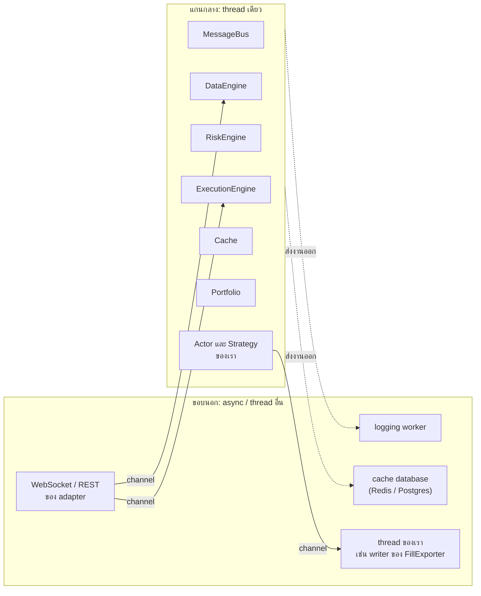
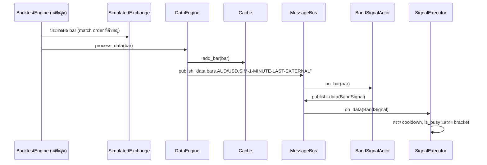
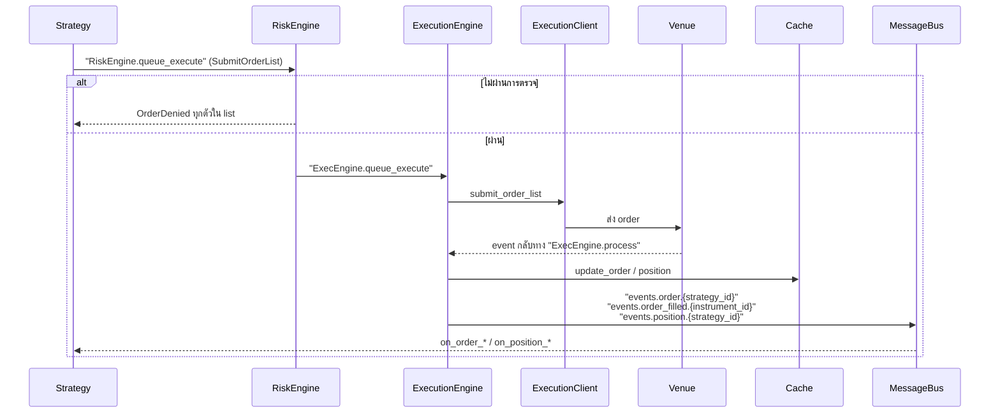
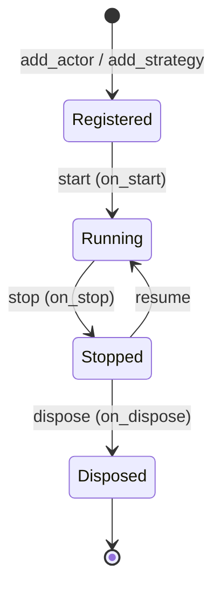

หน้า [Architecture](../concepts/architecture.md) ในหมวดแนวคิดอธิบาย component ทีละตัว หน้านี้มองจากอีกด้าน
คือเอาระบบที่เราสร้างในบทนี้มาเดินตามจริงว่าข้อมูลและคำสั่งผ่านมือใครบ้าง ตามลำดับไหน แล้วสรุปว่าการออกแบบแบบนี้
บังคับให้โค้ดของเราต้องเขียนอย่างไร

ถ้าเข้าใจหน้านี้ การต่อระบบเพิ่ม (หน้า [Integration](integration.md)) และการอ่าน adapter (หน้า [Adapter](adapters.md))
จะเป็นเรื่องของการหาว่าโค้ดใหม่ไปเสียบตรงไหนในภาพเดียวกันนี้

## ภาพรวม: แกนกลาง thread เดียว ล้อมด้วยงาน async [#mental-model]

สองข้อที่ต้องจำ:

1. **ทุกอย่างที่แตะ state ของการเทรดรันบน thread เดียวกัน** ได้แก่ message bus, engine ทั้งสาม, cache, portfolio
   และ handler ทุกตัวของ actor/strategy ภายใน thread นี้จึงไม่มี lock และไม่มี race condition
2. **งานที่ช้าหรือต้องรอ อยู่ที่ขอบนอก** เช่น network, การเขียน log, การเขียน database งานเหล่านี้คุยกับแกนกลางผ่าน
   channel เท่านั้น

message bus เป็น `thread_local!` (`crates/common/src/msgbus/mod.rs`) และ handler ของมันถือ `Rc` ไม่ใช่ `Arc`
ข้อนี้ไม่ใช่รายละเอียดการ implement แต่เป็นสัญญาของ framework: โค้ดของเราที่อยู่ในแกนกลางห้ามถูกย้ายไป thread อื่น

## Kernel ประกอบด้วยอะไร [#kernel]

`NautilusKernel` (`crates/system/src/kernel.rs`) เป็นเจ้าของ component ทั้งหมดของ node หนึ่งตัว
`BacktestEngine` และ `LiveNode` ต่างก็ห่อ kernel ตัวเดียวกันนี้ ต่างกันแค่นาฬิกาและสิ่งที่ต่ออยู่ด้านนอก

| Component | เป็นเจ้าของ / ทำอะไร | โค้ดของเราใช้ผ่าน |
| --- | --- | --- |
| `Cache` | state ปัจจุบันทั้งหมด: instrument, ข้อมูลล่าสุด, order, position, account | `self.cache()` |
| `Portfolio` | มุมมองที่คำนวณจาก cache: net position, PnL, exposure | `self.portfolio()` |
| `Clock` | เวลาปัจจุบันและ timer (จำลองใน backtest, จริงใน live) | `self.clock()` |
| `DataEngine` | รับข้อมูลเข้า เก็บลง cache แล้ว publish | `subscribe_*` ของ `DataActor` |
| `RiskEngine` | ตรวจ order ทุกตัวก่อนออกจาก node | ทางผ่านอัตโนมัติของ `submit_order*` |
| `ExecutionEngine` | route คำสั่งไปยัง execution client และประมวลผล event ที่กลับมา | ทางผ่านอัตโนมัติ |
| `Trader` | ลงทะเบียนและคุม lifecycle ของ actor และ strategy | `add_actor`, `add_strategy` |
| `OrderEmulator` | จำลอง order type ที่ venue ไม่รองรับ | `emulation_trigger` ของ order |

ตัว message bus ไม่ได้เป็นฟิลด์ของ kernel kernel สร้างแล้วติดตั้งไว้เป็น thread-local ตอนเริ่มต้น

## เดินตาม bar หนึ่งแท่ง [#life-of-a-bar]

ใน backtest ของเรา bar แต่ละแท่งเดินทางแบบนี้:

1. loop ของ `BacktestEngine` ส่ง bar ให้ **venue จำลองก่อน** (`crates/backtest/src/engine.rs`) order ที่ค้างอยู่จึงถูก match
   กับราคาของแท่งนี้ก่อนที่ strategy จะได้เห็นแท่งนี้
2. จากนั้นจึงส่งให้ `DataEngine` ซึ่งเก็บลง cache แล้ว publish ไปที่ topic `data.bars.{bar_type}`
3. message bus เรียก handler ของทุกตัวที่ subscribe topic นี้ **ทันทีและตามลำดับ** ใน thread เดียวกัน
   นอกจาก actor ของเราแล้ว `Portfolio` ก็ subscribe bar แบบ external ไว้เพื่ออัปเดตราคา
4. เมื่อ `BandSignalActor` publish `BandSignal` handler `on_data` ของ `SignalExecutor` ทำงานเสร็จ **ก่อน** ที่
   `publish_data` จะ return กลับมาที่ actor

ผลที่ตามมาจากข้อ 1: order ที่ส่งตอนเห็น bar แท่งที่ t จะ match ได้เร็วที่สุดกับ bar แท่งที่ t+1
backtest จึงไม่ได้ fill ที่ราคาปิดของแท่งที่ใช้ตัดสินใจ ซึ่งเป็นสิ่งที่ป้องกัน look-ahead bias ให้โดยโครงสร้าง

ผลที่ตามมาจากข้อ 3–4: การแยก logic ออกเป็นหลาย component ที่คุยกันผ่าน bus **ไม่เปลี่ยนลำดับเหตุการณ์**
test `split_design_trades_exactly_like_the_single_strategy` ในหน้า [Integration](integration.md#split-components)
ยืนยันข้อนี้: แบบแยก component กับแบบ strategy ตัวเดียวให้จำนวน order, position และ PnL เท่ากันทุกหลัก

## เดินตาม bracket order หนึ่งชุด [#life-of-an-order]

- คำสั่งเดินผ่าน **endpoint** แบบชื่อตายตัว (`RiskEngine.queue_execute`, `ExecEngine.queue_execute`) ส่วน event
  ขากลับ publish ไปที่ **topic** ที่ใครก็ subscribe ได้ ความต่างนี้สำคัญ: คำสั่งมีผู้รับคนเดียว event มีผู้ฟังกี่คนก็ได้
- `ExecutionEngine` อัปเดต cache **ก่อน** publish event เมื่อ `on_order_filled` ของ strategy ทำงาน
  `self.cache()` จึงเห็น order ที่ fill แล้ว
- ผู้ฟัง `events.order.*` ไม่ได้มีแค่ strategy เจ้าของ order: `Portfolio`, `RiskEngine` และ `FillExporter` ของเราก็ฟังอยู่
  นี่คือช่องทางที่ทำให้ส่ง event ออกไปภายนอกได้โดยไม่ต้องแก้ strategy
- ใน backtest `ExecutionClient` คือ `BacktestExecutionClient` ที่คุยกับ `SimulatedExchange` ใน live คือ execution client
  ของ adapter เช่น Bybit ส่วนที่เหลือของภาพนี้เหมือนกันทุกบรรทัด

## ใครเป็นเจ้าของ state [#state-ownership]

| คำถาม | ถามใคร | เหตุผล |
| --- | --- | --- |
| order นี้สถานะอะไร | `cache()` | execution engine อัปเดต cache จาก event ของ venue และจาก reconciliation |
| ถือ position อยู่ไหม | `portfolio()` หรือ `cache()` | คำนวณจาก fill จริง ไม่ใช่จากสิ่งที่เราคิดว่าส่งไป |
| เงินในบัญชีเท่าไร | `cache().account_for_venue(..)` | venue เป็นคนบอก ไม่ใช่เราคำนวณเอง |
| indicator ค่าเท่าไร | ฟิลด์ใน struct ของเรา | เป็น state ของเราเองจริง ๆ ไม่มีใครอื่นรู้ |

กฎคือ **อย่าเก็บสำเนาของสิ่งที่ cache รู้อยู่แล้ว** strategy ในบทนี้ไม่มีฟิลด์ `position` หรือ `open_orders` เลย
`is_busy()` ถาม portfolio และ cache ทุกครั้ง สำเนาที่เก็บเองจะผิดเมื่อมี partial fill, order ถูก cancel จากฝั่ง venue
หรือ reconciliation แก้ state หลัง restart และทั้งสามอย่างเกิดขึ้นจริงใน live

## Lifecycle ของ component [#lifecycle]

- `on_start` คือที่สำหรับ subscribe และตั้ง timer เพราะตอนนี้ component ลงทะเบียนกับ kernel แล้ว
- `on_stop` คือที่สำหรับยกเลิก subscription ที่ไม่ได้ผ่าน facade และจัดการ order/position ที่ค้าง
- `on_dispose` เรียกตอน dispose ก่อน component ถูกทำลาย ใช้ปล่อย resource ที่ต้องปิดอย่างเป็นขั้นตอน เช่น flush ไฟล์

:::warning[dispose ไม่เกิดขึ้นเอง]
ทั้ง `BacktestEngine` และ `LiveNode` ไม่มี `Drop` ที่เรียก dispose ให้ และ registry ของ actor เป็น thread-local
ที่อยู่ได้นานกว่าตัว engine ถ้าไม่เรียก `engine.dispose()` หรือ `node.dispose()` เอง actor และ strategy จะยังมีชีวิตอยู่
พร้อมทุกอย่างที่มันถือไว้ ตัวอย่างในบทนี้เจอปัญหานี้จริง: thread ที่เขียนไฟล์ fill รอข้อมูลต่อไปเรื่อย ๆ
เพราะ sender ของ channel ที่ actor ถือไว้ยังไม่ถูกทำลาย รายละเอียดอยู่ที่ [Integration](integration.md#egress-bug)
:::

## กฎสำหรับโค้ดของเรา [#rules]

สรุปจากทุกข้อข้างบน:

1. **handler ต้องจบเร็วและห้าม block** ห้าม `sleep`, ห้ามรอ network, ห้ามเขียนไฟล์ขนาดใหญ่ใน handler
   ทุก millisecond ที่ handler ใช้ คือเวลาที่ทั้ง node หยุดรับข้อมูล
2. **งานที่ช้าส่งออกไปทาง channel** ใช้ channel แบบมีขอบเขตและ `try_send` เพื่อไม่ให้ consumer ที่ช้าลากแกนกลางให้ช้าตาม
3. **ห้ามส่ง actor, `Rc` หรือ handle ของ cache ข้าม thread** compiler จะห้าม `Rc` ไว้ให้แล้ว แต่ข้อนี้รวมถึงการพยายาม
   หลบด้วย `unsafe` หรือ global ด้วย
4. **ใช้เวลาจาก `self.clock()` เสมอ** ห้ามใช้ `SystemTime::now()` ในโค้ดเทรด ไม่อย่างนั้น backtest จะใช้เวลาจริง
   แทนเวลาของข้อมูล และผลจะไม่ซ้ำเดิม
5. **ถาม cache อย่าจำเอง** ดูหัวข้อ [ใครเป็นเจ้าของ state](#state-ownership)
6. **คำสั่งกับ event แยกทางกัน** ส่งคำสั่งผ่าน facade ของ strategy (`submit_order*`, `cancel_*`) และรับผลผ่าน event
   ห้ามสมมติว่า order fill แล้วทันทีหลังส่ง
7. **ปิดของที่เปิดเอง** subscription แบบ raw ปิดใน `on_stop` และเรียก `dispose()` ของ engine/node เมื่อเลิกใช้
   เพื่อให้ component ทุกตัวถูก retire พร้อม resource ที่มันถือ

กฎเหล่านี้คือเหตุผลที่โค้ดชุดเดียวกันรันได้ทั้งใน backtest และ live: ทุกอย่างที่ต่างกันระหว่างสองโลกอยู่ที่ขอบนอก
ส่วนแกนกลางที่โค้ดของเราอยู่ทำงานเหมือนเดิมทุกประการ

อ่านต่อ: [Message bus](../concepts/message_bus.md), [Callback dispatch](../developer_guide/callback_dispatch.md)
และ [Rust developer guide](../developer_guide/rust.md)
