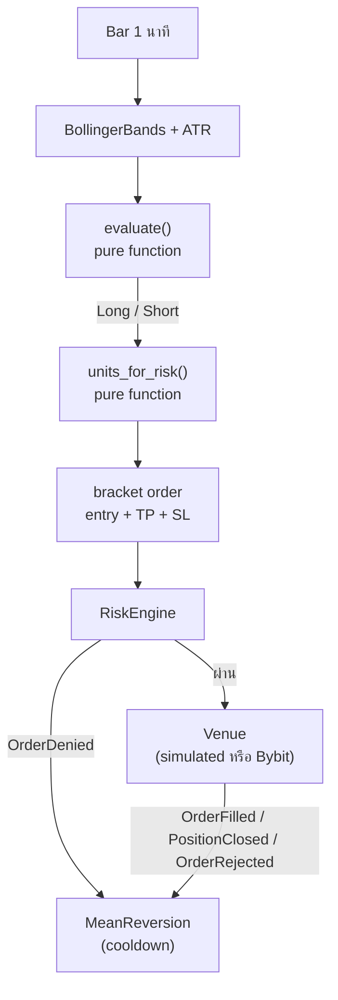

บทอื่นในเอกสารชุดนี้อธิบายทีละส่วน เช่น actor, order, cache หรือ backtest engine บทนี้นำทุกส่วนมาต่อกันเป็นระบบเดียว
โดยสร้างโปรเจกต์ Rust จริงตั้งแต่ศูนย์ แล้วพาไปตามลำดับที่ทำงานจริง: ตั้งโปรเจกต์ เตรียมข้อมูล เขียน strategy จัดการ order
และความเสี่ยง backtest เขียน test แล้วจึงต่อเข้ากับ exchange

:::note[บทนี้ไม่ได้แปลจากต้นฉบับ]
เนื้อหาบท Deep Dive เขียนขึ้นใหม่สำหรับเอกสารฉบับภาษาไทย ไม่มีในเอกสาร NautilusTrader ต้นฉบับ
โค้ดทุกบรรทัดในบทนี้ build และรันได้จริงกับ NautilusTrader ที่ commit `04f766b4` (เวอร์ชัน workspace `0.67.0`)
ซึ่งเป็น commit เดียวกับที่ใช้แปลเอกสารชุดนี้
:::

## สิ่งที่จะสร้าง [#what-we-build]

strategy แบบ **mean reversion ด้วย Bollinger Bands** บนแท่งเทียน 1 นาที:

- เมื่อราคาปิดหลุด band ล่าง ให้ buy โดยตั้ง take profit ที่เส้นกลาง (middle band)
- เมื่อราคาปิดทะลุ band บน ให้ sell โดยตั้ง take profit ที่เส้นกลางเช่นกัน
- วาง stop loss ห่างจากราคาปิดเป็นจำนวนเท่าของ ATR (Average True Range)
- ส่ง entry, take profit และ stop loss พร้อมกันเป็น bracket order
- คำนวณขนาด position ให้ถ้าโดน stop แล้วเสียเงินเท่ากับสัดส่วนคงที่ของ equity
- มีเกราะป้องกัน: เคารพขนาด order ขั้นต่ำ/สูงสุดของ instrument, rate limit ของ risk engine และพักการเทรดหลัง order ถูกปฏิเสธ

strategy นี้เลือกมาเพราะใช้ API ของ Nautilus ครบหลายส่วนในโค้ดไม่ยาว ไม่ได้เลือกเพราะทำกำไร
หน้า [Backtest](backtest.md) จะแสดงให้เห็นว่า strategy นี้ **ขาดทุน** ในตลาดที่ไม่มีพฤติกรรม mean reversion

:::warning
เนื้อหาบทนี้มีไว้เพื่อการเรียนรู้การใช้งาน framework ไม่ใช่คำแนะนำการลงทุน ผล backtest ในบทนี้มาจากข้อมูลสังเคราะห์
ซึ่งพิสูจน์ได้แค่ว่าโค้ดทำงานถูกต้อง ไม่ได้บอกอะไรเกี่ยวกับตลาดจริง
:::

## การไหลของข้อมูลและคำสั่ง [#flow]



ส่วนที่เป็นการตัดสินใจ (`evaluate` และ `units_for_risk`) แยกออกมาเป็น pure function ที่ไม่รู้จัก Nautilus เลย
จึง test ได้ทันทีโดยไม่ต้องสร้าง engine ส่วน strategy มีหน้าที่แค่เชื่อมข้อมูลจาก engine เข้ากับฟังก์ชันเหล่านี้
และส่ง order ออกไป

## โครงสร้างโปรเจกต์ [#layout]

โค้ดฉบับเต็มอยู่ใน repository นี้ที่
[`examples/nautilus-meanrev`](https://github.com/chai-rs/dxckboi/tree/main/examples/nautilus-meanrev)

```text
nautilus-meanrev/
├── Cargo.toml            dependency ที่ pin ไว้กับ commit ของ NautilusTrader
├── rust-toolchain.toml   Rust 1.99.1 ตามที่ NautilusTrader ต้องการ
├── src/
│   ├── lib.rs
│   ├── signal.rs         กฎการเข้าเทรด (pure)
│   ├── sizing.rs         การคำนวณขนาด position (pure)
│   ├── data.rs           ตัวสร้างข้อมูล bar สังเคราะห์แบบ deterministic
│   ├── strategy.rs       strategy MeanReversion
│   ├── backtest.rs       ประกอบ BacktestEngine
│   ├── main.rs           CLI: `run` และ `sweep`
│   └── bin/live.rs       รันบน Bybit testnet (feature `live`)
└── tests/backtest.rs     integration test ผ่าน engine จริง
```

## ลำดับการอ่าน [#reading-order]

| หน้า | เนื้อหา |
| --- | --- |
| [ตั้งค่าโปรเจกต์](project_setup.md) | toolchain, การ pin dependency, feature flag และการวางโมดูล |
| [ข้อมูล](data.md) | bar type, precision, timestamp, price type ที่ risk engine ใช้ได้ และข้อมูลสังเคราะห์ |
| [เขียน strategy](strategy.md) | โครงสร้าง strategy, indicator, lifecycle และ hook |
| [Order และความเสี่ยง](orders_and_risk.md) | bracket order, position sizing, ข้อจำกัดของ instrument และ risk engine |
| [Backtest](backtest.md) | ประกอบ engine, fill/fee model, อ่านผล, parameter sweep และ control market |
| [Testing](testing.md) | unit test, integration test และการตรวจว่าผลซ้ำได้ |
| [ไปสู่ live](live.md) | ต่อ Bybit testnet, credential และ reconciliation |
| [Production checklist](production.md) | สิ่งที่ต้องเตรียมก่อนใช้เงินจริง |

## สิ่งที่ต้องมี [#prerequisites]

- Rust toolchain ผ่าน `rustup` (โปรเจกต์ล็อกไว้ที่ 1.99.1 ผ่าน `rust-toolchain.toml`)
- พื้นที่ดิสก์สำหรับ build ราว 5–10 GB และเวลา build ครั้งแรกหลายนาที เพราะต้อง compile crate ของ Nautilus ทั้งหมด
- พื้นฐาน Rust ระดับเขียน trait, enum และ `Result` ได้
- ควรอ่าน [Actors](../concepts/actors.md), [Strategies](../concepts/strategies.md) และ
  [Orders](../concepts/orders/index.md) มาก่อน หรือเปิดคู่กันไประหว่างอ่าน

## บทเรียนจากการลงมือจริง [#lessons]

ระหว่างเขียนบทนี้ โค้ดเวอร์ชันแรกเจอปัญหาจริงหลายข้อ ทุกข้อถูกเก็บไว้ในหน้าที่เกี่ยวข้องพร้อมวิธีแก้:

- order ทุกตัวถูกปฏิเสธด้วย `MARKET_PRICE_UNAVAILABLE` เพราะใช้ bar แบบ `MID` ([ข้อมูล](data.md#price-type))
- strategy ส่ง order ที่ถูก deny ซ้ำทุกแท่งหลายพันครั้ง เพราะขนาดเกิน `max_quantity` ของ instrument
  ([Order และความเสี่ยง](orders_and_risk.md#instrument-limits))
- test ของ position sizing พังเพราะ floating point ([Testing](testing.md#floating-point))
- ตั้ง log level เป็น `Off` แล้ว log ยังออกมาเต็มจอ เพราะ logger เป็นของทั้ง process ([Backtest](backtest.md#logging))
- ผล backtest ดีเกินจริง และวิธีพิสูจน์ว่ากำไรมาจากข้อมูล ไม่ใช่จากบั๊ก ([Backtest](backtest.md#control-market))
