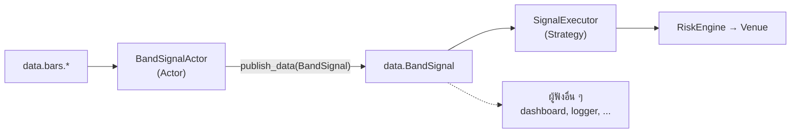
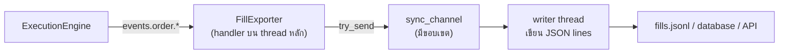

ระบบเทรดจริงไม่ได้มีแค่ strategy เดียวที่ทำทุกอย่าง มักต้องแยกส่วนที่คิดสัญญาณออกจากส่วนที่ส่ง order ต้องส่ง fill
ไปเก็บใน database ต้องรับสัญญาณจาก model ภายนอก และต้องรันหลาย strategy พร้อมกัน หน้านี้แสดงว่าแต่ละเรื่อง
เสียบเข้ากับสถาปัตยกรรมใน [หน้าที่แล้ว](architecture.md) ตรงไหน โดยใช้โค้ดที่ build และ test ผ่านจริง

## เลือกจุดเชื่อมให้ถูก [#choosing]

| ต้องการ | ใช้ | ตัวอย่างในบทนี้ |
| --- | --- | --- |
| ส่ง order | `Strategy` | `MeanReversion`, `SignalExecutor` |
| ประมวลผลข้อมูลโดยไม่ส่ง order | `Actor` | `BandSignalActor` |
| ส่งค่าสั้น ๆ ระหว่าง component เป็น string | `publish_signal` / `subscribe_signal` | ไม่ได้ใช้ |
| ส่งข้อมูลที่มีโครงสร้างระหว่าง component | custom data (`#[custom_data]`) + `publish_data` / `subscribe_data` | `BandSignal` |
| ฟัง event ของทุก strategy | subscribe topic บน message bus โดยตรง | `FillExporter` |
| ส่งข้อมูลออกไปนอก node | channel ไปยัง thread หรือ task อื่น | `FillExporter` + `spawn_jsonl_writer` |
| ส่ง message bus ทั้งเส้นไปที่อื่น | external egress (Redis stream) | ไม่ได้ใช้ ดู [Message bus](../concepts/message_bus.md#external-egress-and-ingress) |
| รับข้อมูลจากระบบภายนอกเข้า node | data event sender, external ingress หรือเขียน adapter | อธิบายในหัวข้อ [Ingress](#ingress) |
| เก็บ state ข้าม restart | cache database (Redis / Postgres) | อธิบายในหัวข้อ [Persistence](#persistence) |
| ต่อ exchange ใหม่ | adapter (`DataClient` + `ExecutionClient`) | หน้า [Adapter](adapters.md) |

## รูปแบบที่ 1: แยกสัญญาณออกจาก execution [#split-components]

`MeanReversion` ทำทุกอย่างในตัวเดียว: คำนวณ indicator, ตัดสินใจ, คำนวณขนาด และส่ง order
ถ้าต้องการใช้สัญญาณเดียวกันกับหลาย instrument, ส่งสัญญาณไปให้ระบบอื่นดูด้วย หรือเปลี่ยนวิธีคิดสัญญาณโดยไม่แตะ
ส่วนที่ส่ง order ก็ควรแยกเป็นสองส่วนที่ไม่รู้จักกัน รู้จักกันแค่ผ่าน message:



### Message คือสัญญาระหว่างสองฝั่ง [#message-contract]

```rust
/// A trade idea: enter at about `close`, exit at `take_profit` or `stop_loss`.
#[custom_data]
pub struct BandSignal {
    pub instrument_id: InstrumentId,
    pub long: bool,
    pub close: f64,
    pub take_profit: f64,
    pub stop_loss: f64,
    pub ts_event: UnixNanos,
    pub ts_init: UnixNanos,
}
```

```rust
/// The message-bus data type both sides agree on.
pub fn band_signal_type() -> DataType {
    DataType::new("BandSignal", None, None)
}
```

`#[custom_data]` สร้าง `new(..)`, serde, `Display` และ trait ที่ message bus ต้องใช้ให้ struct ต้องมีฟิลด์
`ts_event` และ `ts_init` เป็น `UnixNanos` และ crate ของเราต้องมี `serde`, `serde_json`, `anyhow`,
`nautilus-core` และ `nautilus-model` เป็น dependency โดยตรง เพราะโค้ดที่ macro สร้างอ้างถึง crate เหล่านี้

ทั้งสองฝั่งต้องใช้ `DataType` เดียวกัน การรวมไว้ในฟังก์ชัน `band_signal_type()` ทำให้ไม่มีทางพิมพ์ชื่อผิดคนละที่

### ฝั่งผู้สร้างสัญญาณ: Actor [#signal-actor]

```rust
fn on_bar(&mut self, bar: &Bar) -> anyhow::Result<()> {
    self.bb.handle_bar(bar);
    self.atr.handle_bar(bar);
    if !self.bb.initialized() || !self.atr.initialized() {
        return Ok(());
    }

    let close = bar.close.as_f64();
    let bands = Bands {
        upper: self.bb.upper,
        middle: self.bb.middle,
        lower: self.bb.lower,
        atr: self.atr.value,
    };
    let (long, take_profit, stop_loss) =
        match evaluate(close, bands, self.atr_stop, self.min_reward_atr) {
            Signal::Long {
                take_profit,
                stop_loss,
            } => (true, take_profit, stop_loss),
            Signal::Short {
                take_profit,
                stop_loss,
            } => (false, take_profit, stop_loss),
            Signal::None => return Ok(()),
        };

    let signal = BandSignal::new(
        self.instrument_id,
        long,
        close,
        take_profit,
        stop_loss,
        bar.ts_event,
        bar.ts_init,
    );
    self.publish_data(
        &band_signal_type(),
        &CustomData::new(Arc::new(signal), band_signal_type()),
    );
    Ok(())
}
```

actor ไม่มี `order()` หรือ `submit_order` เลย สิ่งที่มันทำได้คือคิดแล้วประกาศผล ซึ่งเป็นการจำกัดขอบเขตที่ดี:
ถ้า actor มีบั๊ก มันส่ง order ผิดไม่ได้

actor ต้องมี `ActorId` ที่ไม่ซ้ำ ถ้าไม่ตั้ง ค่า default คือ `DataActor` และ actor ตัวที่สองที่ไม่ได้ตั้ง ID จะถูกปฏิเสธตอนลงทะเบียน

### ฝั่ง execution: Strategy ที่ฟังสัญญาณ [#executor]

```rust
fn on_data(&mut self, data: &CustomData) -> anyhow::Result<()> {
    let Some(signal) = data.data.as_any().downcast_ref::<BandSignal>() else {
        return Ok(());
    };
    if signal.instrument_id != self.config.instrument_id
        || signal.ts_event.as_u64() < self.cooldown_until_ns
        || is_busy(self, self.config.instrument_id, self.config.strategy_id)
    {
        return Ok(());
    }
    let side = if signal.long {
        OrderSide::Buy
    } else {
        OrderSide::Sell
    };
    enter_bracket(
        self,
        self.config.instrument_id,
        side,
        signal.close,
        signal.take_profit,
        signal.stop_loss,
        self.config.risk,
    )
}
```

- `subscribe_data(band_signal_type(), None, None)` ใน `on_start` ใช้ `client_id = None` ซึ่งแปลว่า subscribe แค่ topic บน bus
  ไม่ส่งคำขอข้อมูลไปที่ data client ใด ๆ เหมาะกับการคุยกันภายใน node
- `on_data` ได้ `CustomData` ที่ห่อ `Arc<dyn CustomDataTrait>` ต้อง downcast กลับเป็น `BandSignal` เอง
  ถ้า downcast ไม่ได้ก็ไม่ใช่ message ของเรา ให้ข้ามไป
- การตรวจ cooldown และ `is_busy` อยู่ฝั่งนี้ เพราะเป็นเรื่องของ execution ไม่ใช่ของสัญญาณ

ส่วนที่คำนวณขนาดและส่ง bracket ถูกย้ายไปอยู่ใน `src/execution.rs` (`enter_bracket`, `is_busy`) ซึ่งทั้ง `MeanReversion`
และ `SignalExecutor` เรียกใช้ร่วมกัน ฟังก์ชันเหล่านี้รับ strategy ใดก็ได้ที่ implement `Strategy + StrategyNative + DataActorNative`

### พิสูจน์ว่าการแยกไม่เปลี่ยนพฤติกรรม [#proof]

```rust
#[test]
fn split_design_trades_exactly_like_the_single_strategy() {
    let single = run_with(options(Design::SingleStrategy)).unwrap();
    let split = run_with(options(Design::ActorAndExecutor)).unwrap();
    assert!(single.total_positions > 0);
    assert_eq!(single.total_orders, split.total_orders);
    assert_eq!(single.total_positions, split.total_positions);
    assert_eq!(pnl(&single), pnl(&split));
}
```

```bash
$ cargo run --release -- compare
design            orders  positions   pnl_total
SingleStrategy      6012       2004   802602.31
ActorAndExecutor    6012       2004   802602.31
```

ผลเท่ากันทุกหลัก เพราะ message bus ส่ง message แบบ synchronous บน thread เดียว (ดู [เดินตาม bar หนึ่งแท่ง](architecture.md#life-of-a-bar))
การ refactor ที่มี test แบบนี้รองรับทำได้อย่างมั่นใจ ถ้าวันหนึ่งผลไม่เท่ากัน test จะบอกทันที

ข้อที่ต้องปรับเพื่อให้เทียบได้: cooldown เดิมนับเป็น "จำนวน bar" ซึ่ง executor ไม่เห็น bar จึงเปลี่ยนเป็นนับเวลา
(`cooldown_mins`) ใช้เวลาจาก `self.clock()` ซึ่งทั้งสองแบบเห็นตรงกัน

## รูปแบบที่ 2: ส่ง event ออกไปภายนอก (egress) [#egress]

ต้องการเก็บทุก fill ลง database หรือส่งไป dashboard โดยไม่แก้ strategy ใดเลย ทำได้ด้วย actor ที่ฟัง topic ของ event โดยตรง
แล้วส่งต่อออกไปนอกแกนกลางผ่าน channel:



```rust
fn on_start(&mut self) -> anyhow::Result<()> {
    let sink = self.sink.clone();
    let dropped = self.dropped.clone();
    // DataActor has no order callbacks, so subscribe on the message bus directly.
    let handler = TypedHandler::from(move |event: &OrderEventAny| {
        if let OrderEventAny::Filled(fill) = event {
            match sink.try_send(FillRecord::from(fill)) {
                Ok(()) => {}
                Err(TrySendError::Full(_)) => dropped.set(dropped.get() + 1),
                Err(TrySendError::Disconnected(_)) => {}
            }
        }
    });
    msgbus::subscribe_order_events(ORDER_EVENTS.into(), handler.clone(), None);
    self.handler = Some(handler);
    Ok(())
}
```

- `DataActor` ไม่มี callback ของ order event (มีเฉพาะใน `Strategy` และเฉพาะ order ของ strategy นั้นเอง)
  actor จึง subscribe topic `events.order.*` ด้วย `msgbus::subscribe_order_events` ซึ่งได้ event ของทุก strategy ใน node
- handler ทำแค่แปลง event เป็น `FillRecord` แล้ว `try_send` ไม่มี I/O ใด ๆ บน thread หลัก
- channel เป็น `sync_channel` ที่มีขอบเขต ถ้า consumer ช้าจน channel เต็ม record จะถูกทิ้งและนับไว้ แทนที่จะทำให้
  การเทรดช้าตาม นโยบายเดียวกับ external egress ของ message bus เอง ถ้าทิ้งไม่ได้เลยต้องออกแบบใหม่ทั้งทาง
  (เช่น ให้ consumer อ่านจาก cache database แทน)
- subscription แบบ raw ไม่ได้อยู่ในความดูแลของ actor core จึงต้องเก็บ handler ไว้แล้ว unsubscribe เองใน `on_stop`

```rust
/// A bounded channel plus a thread that writes each record as one JSON line.
///
/// The thread ends when every sender is dropped and returns the number of lines
/// written. The exporter holds a sender until the engine or node is disposed.
pub fn spawn_jsonl_writer(
    path: &Path,
    capacity: usize,
) -> anyhow::Result<(SyncSender<FillRecord>, JoinHandle<anyhow::Result<usize>>)> {
    let mut out = BufWriter::new(File::create(path)?);
    let (sender, receiver): (SyncSender<FillRecord>, Receiver<FillRecord>) = sync_channel(capacity);
    let handle = std::thread::spawn(move || {
        let mut lines = 0;
        for record in receiver {
            serde_json::to_writer(&mut out, &record)?;
            out.write_all(b"\n")?;
            lines += 1;
        }
        out.flush()?;
        Ok(lines)
    });
    Ok((sender, handle))
}
```

### บั๊กที่เจอจริง: writer ไม่ยอมจบ [#egress-bug]

เวอร์ชันแรกของคำสั่ง `export` เขียนไฟล์ครบทุกบรรทัดแล้ว **ค้างไม่จบ** writer thread วนรอ record ต่อไปเรื่อย ๆ
เพราะ channel จะปิดก็ต่อเมื่อ sender ทุกตัวถูกทำลาย และ `FillExporter` ยังถือ sender อยู่

ทั้งที่ตัวแปร `engine` หมดอายุไปแล้ว actor ยังไม่ถูกทำลาย เพราะ registry ของ actor เป็น thread-local ที่อยู่นานกว่า engine
และ `BacktestEngine` ไม่มี `Drop` ที่เคลียร์ registry ให้ ทางแก้คือเรียก `dispose()` ก่อนเลิกใช้ engine
ซึ่งจะ retire actor และ strategy ทุกตัว (`Trader::dispose_components`) ทำให้ทุกอย่างที่ component ถือไว้รวมถึง sender ถูกทำลาย:

```rust
let result = engine.get_result();
// Disposing retires every actor and strategy, dropping what they own (such as the
// exporter's channel sender). Dropping the engine alone does not: the actor
// registry is thread-local and outlives it.
engine.dispose();
```

ใน live เป็นแบบเดียวกัน `live.rs` เรียก `node.dispose()` หลัง `node.run()` จบ ก่อนจะรอ writer thread

และเพิ่ม test ที่จะ fail แทนที่จะค้าง ถ้าปัญหานี้กลับมา:

```rust
#[test]
fn writer_thread_finishes_after_the_run() {
    let path = std::env::temp_dir().join("meanrev-writer-test.jsonl");
    let (sink, writer) = spawn_jsonl_writer(&path, 100_000).unwrap();
    let result = run_with(RunOptions {
        fill_sink: Some(sink),
        ..options(Design::ActorAndExecutor)
    })
    .unwrap();

    // join() would hang forever if any sender were still alive, so wait with a deadline.
    let (done, finished) = std::sync::mpsc::channel();
    std::thread::spawn(move || done.send(writer.join()));
    let lines = finished
        .recv_timeout(Duration::from_secs(30))
        .expect("writer thread did not finish: a sender is still alive")
        .unwrap()
        .unwrap();
    assert!(lines >= 2 * result.total_positions);
    std::fs::remove_file(path).ok();
}
```

### จำนวน fill ไม่เท่ากับจำนวน order [#partial-fills]

test แรกของ exporter assert ว่า fill มีสองเท่าของ position (entry หนึ่ง exit หนึ่ง) แล้วพัง: ในการรัน 5 วันมี 342 position
แต่มี fill 1,736 รายการ และ order 686 จาก 699 ตัวที่ fill ถูก fill เป็นหลายชิ้น (มากสุด 4 ชิ้นต่อ order)

สาเหตุคือ venue จำลองกระจาย volume ของ bar (1,000,000) ไปตามจุด Open, High, Low, Close จุดละหนึ่งในสี่
order ที่ใหญ่กว่า 250,000 จึงถูก fill หลายครั้งที่หลายราคา และ bracket แบบ OUO ทำให้ take profit fill ไปบางส่วนก่อน
stop loss จะ fill ส่วนที่เหลือได้

บทเรียนคือ **ระบบปลายทางต้องรับ partial fill ได้เสมอ** ไม่ว่าใน backtest หรือ live test ที่ถูกจึงตรวจสิ่งที่ไม่ขึ้นกับการแตก fill:

```rust
#[test]
fn exporter_receives_every_fill() {
    // Large enough that nothing is dropped in this test.
    let (sink, receiver) = sync_channel(100_000);
    let result = run_with(RunOptions {
        fill_sink: Some(sink),
        ..options(Design::ActorAndExecutor)
    })
    .unwrap();
    let fills: Vec<_> = receiver.try_iter().collect();

    // Orders often fill in pieces (bar volume is spread over open/high/low/close),
    // so count quantity, not fills: the strategy ends flat, so every unit bought
    // was sold again.
    assert!(fills.len() >= 2 * result.total_positions);
    let net: f64 = fills
        .iter()
        .map(|f| {
            if f.side == "Buy" {
                f.quantity
            } else {
                -f.quantity
            }
        })
        .sum();
    assert_eq!(net, 0.0);
    assert!(fills.iter().all(|f| f.instrument_id == "AUD/USD.SIM"));
    assert!(fills.windows(2).all(|w| w[0].ts_event <= w[1].ts_event));
}
```

strategy ปิด position ทั้งหมดตอนหยุด ปริมาณที่ซื้อรวมจึงต้องเท่ากับปริมาณที่ขายรวมพอดี ซึ่งเป็นจริงทั้งที่ 1, 2 และ 5 วัน

```bash
$ cargo run --release -- export fills.jsonl
positions=2004 fills_written=10645 file=fills.jsonl
$ head -1 fills.jsonl
{"ts_event":1704069840000000000,"strategy_id":"EXECUTOR-001","instrument_id":"AUD/USD.SIM","client_order_id":"O-20240101-004400-001-001-1","side":"Sell","quantity":250000.0,"price":0.68201,"commission":"8.53 USD"}
```

## รูปแบบที่ 3: รับข้อมูลจากภายนอก (ingress) [#ingress]

ทิศทางกลับกัน เช่น model ML ที่รันเป็น service แยกต้องส่งสัญญาณเข้า node มีสามทาง เรียงจากง่ายไปยาก:

1. **ส่งเข้าทาง data event channel ของ live node** task ใน tokio ส่ง `DataEvent::Data(Data::Custom(..))` ผ่าน sender
   ที่ได้จาก `nautilus_common::live::get_data_event_sender()` (ต้องเปิด feature `live` ของ `nautilus-common`)
   data engine จะ publish ข้อมูลนั้นบน thread หลักให้ component ที่ subscribe ได้รับตามปกติ
   ข้อควรระวังคือ getter นี้อ่านค่าจาก thread-local จึงต้องเรียกบน thread หลัก (เช่นใน `on_start`) แล้วค่อยย้าย sender
   ที่ clone แล้วเข้าไปใน task
2. **external ingress ของ message bus** ระบบภายนอกเขียน message ลง Redis stream ตามรูปแบบที่ node อ่านได้ แล้ว node
   republish ภายใน ดู [External egress และ ingress](../concepts/message_bus.md#external-egress-and-ingress)
3. **เขียน adapter** ถ้าแหล่งข้อมูลนั้นเป็น "venue" ในตัวเอง (มี subscribe/unsubscribe, reconnect, ข้อมูลย้อนหลัง)
   การเขียนเป็น `DataClient` ทำให้ได้พฤติกรรมเหมือนแหล่งข้อมูลอื่นทุกประการ ดูหน้า [Adapter](adapters.md)

:::note
ตัวอย่างในบทนี้ไม่ได้ implement ทางที่ 1 และ 2 คำอธิบายข้างบนมาจากการอ่าน source ที่ commit `04f766b4`
ถ้าจะใช้ให้เริ่มจากเขียน test ที่ยืนยันว่าข้อมูลไปถึง `on_data` ก่อนต่อกับระบบจริง
:::

## รูปแบบที่ 4: หลาย strategy และหลาย instrument ใน node เดียว [#multiple]

- เรียก `add_strategy` / `add_actor` ได้หลายครั้ง (หรือ `add_strategies` สำหรับหลายตัวของ type เดียวกัน)
- `StrategyId` ต้องไม่ซ้ำ `order_id_tag` ต้องไม่ซ้ำและห้ามมี `-` และ `ActorId` ต้องไม่ซ้ำ
- strategy แต่ละตัวมี OMS type ของตัวเองได้
- strategy ตัวเดียว subscribe หลาย instrument หรือหลาย bar type ได้ ไม่มีข้อจำกัดเรื่องจำนวน

เมื่อมีหลาย strategy เทรด instrument เดียวกันบนบัญชีแบบ netting position ที่ venue จะเป็นผลรวมของทุก strategy
`portfolio().is_net_flat` จึงตอบตามผลรวม ไม่ใช่ของ strategy เดียว ถ้าต้องการแยกให้ถามจาก `cache()` โดยกรองด้วย
`StrategyId` อย่างที่ `has_orders_open` ใน `is_busy` ทำ หรือใช้บัญชีแบบ hedging

## รูปแบบที่ 5: เก็บ state ข้าม restart [#persistence]

cache ปกติอยู่ในหน่วยความจำ หลัง restart สิ่งที่กลับมาได้มีแค่สิ่งที่ reconciliation ดึงจาก venue
([order ที่ค้างจากรอบก่อน](live.md#external-orders)) ถ้าต้องการให้ node จำ state ของตัวเองด้วย ให้ต่อ cache database:

- crate `nautilus-infrastructure` มี `RedisCacheConfig` (feature `redis` เปิดโดย default) และ `PostgresCacheConfig`
  (feature `postgres`)
- ส่งให้ `LiveNode::builder(..)` ด้วย `.with_cache_database_factory(Box::new(..))` ร่วมกับ `.with_load_state(true)`
  และ `.with_save_state(true)`

ตัวอย่างในบทนี้ไม่ได้ใช้ cache database เพราะ strategy ออกแบบให้ไม่มี state สำคัญนอกจาก cache อยู่แล้ว
(indicator สร้างใหม่ได้จากข้อมูลย้อนหลัง) ซึ่งเป็นแนวทางที่ restart ง่ายที่สุด ดูรายละเอียดที่ [Cache](../concepts/cache.md)

## ใช้รูปแบบเหล่านี้ใน live [#live-wiring]

`src/bin/live.rs` ประกอบ actor, executor และ exporter ชุดเดียวกับที่ test ใน backtest เข้ากับ Bybit testnet:

```rust
let bar_type = BarType::from("BTCUSDT-LINEAR.BYBIT-1-MINUTE-LAST-EXTERNAL");
node.add_actor(BandSignalActor::new(
    "BAND-SIGNAL-001",
    instrument_id,
    bar_type,
    20,  // Bollinger period
    2.0, // Bollinger k
    14,  // ATR period
    1.5, // stop distance in ATRs
    1.0, // minimum reward in ATRs
))?;
node.add_strategy(SignalExecutor::new(SignalExecutorConfig {
    strategy_id: StrategyId::from("EXECUTOR-001"),
    order_id_tag: "001".to_string(),
    instrument_id,
    risk: RiskSettings {
        risk_fraction: 0.001,
        max_notional: 200.0, // USDT; keep testnet orders small
    },
    cooldown_mins: 30,
}))?;

let (fill_sink, writer) = spawn_jsonl_writer("fills.jsonl".as_ref(), 10_000)?;
node.add_actor(FillExporter::new("FILL-EXPORTER-001", fill_sink))?;
```

ไม่มีบรรทัดไหนใน `components.rs` หรือ `exporter.rs` ที่ต้องแก้เมื่อย้ายจาก backtest มา live ที่เปลี่ยนมีแค่ instrument ID,
bar type, ค่าความเสี่ยง และการเรียก `node.dispose()` ก่อนรอ writer ด้วยเหตุผลเดียวกับใน backtest
