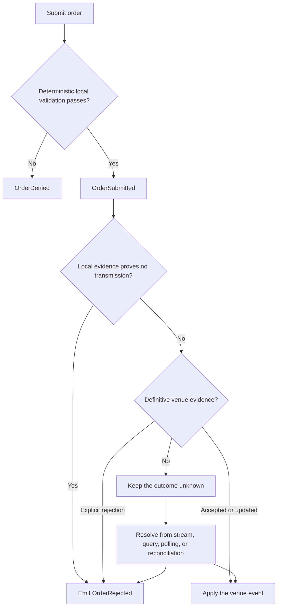
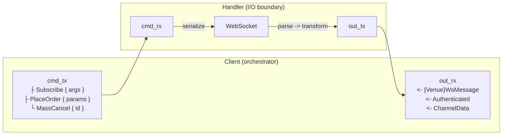

# Adapters

## บทนำ {#introduction}

คู่มือนี้ใช้สำหรับสร้างหรือขยาย adapter แบบ Rust-native สำหรับ NautilusTrader โดย adapter เชื่อมต่อ
แพลตฟอร์มเข้ากับ venue และผู้ให้บริการข้อมูล รักษา semantics ของ venue สร้าง domain event ของ Nautilus
ที่ถูกต้อง และทำให้ผลลัพธ์ที่ไม่แน่นอนปรากฏอย่างชัดเจน adapter จะ implement trait ของ data client และ
execution client ของแพลตฟอร์มใน Rust

คู่มือนี้ครอบคลุม adapter แบบ Rust ที่อยู่ใน repository (in-tree)

ให้เลือกใช้ adapter อ้างอิงอย่างพิจารณา เพราะโครงสร้างของแต่ละตัวสะท้อนโปรโตคอลของ venue, กลุ่มผลิตภัณฑ์
และประวัติการพัฒนาที่แตกต่างกัน

| Adapter            | สิ่งที่ใช้อ้างอิงได้                                                                                          |
| ------------------ | ---------------------------------------------------------------------------------------------------------- |
| [Bybit][bybit]     | HTTP และ WebSocket client แบบหลายผลิตภัณฑ์, ข้อมูล option และการจัดการผลลัพธ์ของ execution                     |
| [OKX][okx]         | WebSocket endpoint แบบ public, private และ business พร้อมครอบคลุม instrument อย่างกว้างขวาง                    |
| [Binance][binance] | การแยกผลิตภัณฑ์ spot และ futures, trading WebSocket และ market data แบบ SBE                                  |
| [Kraken][kraken]   | submodule ของ spot และ futures ที่มีเส้นทาง HTTP, WebSocket, data และ execution แยกกัน                       |
| [Lighter][lighter] | การ sign บน Layer-2, canonical benchmark, coverage-guided fuzzing และการจัดการ execution state อย่างละเอียด |
| [Derive][derive]   | data และ execution แบบ JSON-RPC, การ sign แบบ EIP-712, canonical benchmark และ fuzzing แบบอิง invariant     |

คู่มือนี้แบ่งแนวทางออกเป็นสี่ประเภท:

- **กฎร่วม (shared rules)** มาจาก trait ร่วม, network abstraction, hook หรือ CI
- **รูปแบบที่ใช้กันทั่วไป (common patterns)** ปรากฏในหลาย adapter แต่ยังเปิดให้ออกแบบแบบอื่นได้
- **ตัวอย่าง (examples)** แสดง implementation ที่ดีแบบหนึ่งโดยไม่บังคับ
- **ข้อยกเว้น (exceptions)** ใช้ได้เมื่อ semantics ของ venue หรือขอบเขตของโปรโตคอลบังคับให้ต้องทำเช่นนั้น

## Conformance {#conformance}

adapter ถือว่า conform เมื่อเป็นไปตามกฎแต่ละข้อด้านล่างที่เกี่ยวข้อง หรือมีการบันทึกข้อยกเว้นไว้ ให้ระบุ
พฤติกรรมของ venue ที่ทำให้ต้องมีข้อยกเว้นนั้น เก็บข้อยกเว้นไว้ภายใน adapter และเพิ่ม test ที่จะ
fail หาก venue ไม่ต้องการข้อยกเว้นนั้นอีกต่อไป [Phase 7](#phase-7-prove-conformance) เรียงลำดับงาน
ที่ใช้พิสูจน์ conformance

### พื้นฐานของ adapter {#adapter-foundations}

| กฎ                                                                                              | ใช้กับ                |
| ----------------------------------------------------------------------------------------------- | -------------------- |
| [การเชื่อมต่อกับ repository](#repository-and-python-wiring)                                      | adapter crate ใหม่    |
| [Credential และการจัดการ secret](#credentials-and-secret-handling)                              | ทุก adapter           |
| [Configuration](#configurations-configrs)                                                       | ทุก adapter           |
| [Symbol และ identity ของ instrument](#symbols-and-instrument-identity)                          | ทุก adapter           |
| [การ model payload ของ venue และ precision](#modeling-venue-payloads)                           | ทุก adapter           |
| [Client trait และ factory](#client-traits-and-factories-datars-executionrs-factoriesrs)         | ทุก adapter           |

### Runtime และวงจรชีวิตของ client {#runtime-and-client-lifecycle}

| กฎ                                                      | ใช้กับ                         |
| ------------------------------------------------------- | ----------------------------- |
| [วงจรชีวิตของ connection](#connection-lifecycle-connect) | data client และ execution client |
| [Data event และความสดของ request](#data-client)         | data client                   |
| [Backpressure](#backpressure)                           | ทุก adapter                    |
| [การจัดการ task](#task-management)                      | ทุก adapter                    |
| [Deterministic simulation](#deterministic-simulation)   | adapter ที่มีการดูแลรักษา       |

### Execution และ reconciliation {#execution-and-reconciliation}

| กฎ                                                                                                    | ใช้กับ             |
| ----------------------------------------------------------------------------------------------------- | ----------------- |
| [ขอบเขตของ execution client](#execution-client)                                                       | execution client  |
| [Reconciliation report](#reconciliation-reports)                                                      | execution client  |
| [การจัดการเมื่อ commission ล้มเหลว](#commission-failure-handling)                                       | execution client  |
| [Mass-status report แบบมีขอบเขต](#bounded-mass-status-reports)                                         | execution client  |
| [การ resolve instrument ระหว่าง reconciliation](#instrument-resolution-during-reconciliation)           | execution client  |
| [Execution update ที่ติดตามอยู่และจากภายนอก](#tracked-and-external-execution-updates)                     | execution client  |
| [ลำดับของ event และการตัดรายการซ้ำ](#event-ordering-and-deduplication)                                  | execution client  |
| [Policy ของผลลัพธ์คำสั่ง order](#order-command-outcome-policy)                                          | execution client  |
| [การตั้งชื่อประเภทหลักฐาน](#naming-the-evidence-classes)                                                 | execution client  |
| [Diagnostics และเหตุผลที่แสดงต่อ strategy](#separate-diagnostics-from-strategy-facing-reasons)           | execution client  |

### Transport และ streaming {#transport-and-streaming}

| กฎ                                                                                | ใช้กับ                                  |
| --------------------------------------------------------------------------------- | -------------------------------------- |
| [ลำดับการทำงานของ request](#request-flow)                                          | HTTP client                            |
| [การ sign request และ authentication](#request-signing-and-authentication)          | เส้นทาง request ของ HTTP และ WebSocket |
| [การจัดการ error และ retry logic](#error-handling-and-retry-logic)                 | เส้นทาง request ของ HTTP และ WebSocket |
| [Rate limiting](#rate-limiting)                                                   | HTTP client และ WebSocket client        |
| [Handshake ตอน initialize handler](#handler-initialization-handshake-setclient)    | WebSocket client                       |
| [Authentication](#authentication)                                                 | WebSocket client                       |
| [การจัดการ subscription](#subscription-management)                                 | WebSocket client                       |
| [การ route message](#message-routing)                                             | WebSocket client                       |
| [Reconnection และ shutdown](#reconnection-and-shutdown)                           | WebSocket client                       |

[ข้อกำหนดการทดสอบ data](spec_data_testing.md) และ
[ข้อกำหนดการทดสอบ execution](spec_exec_testing.md) รวบรวม scenario ที่ใช้พิสูจน์
contract เหล่านี้กับ venue จริง

### Baseline ร่วม {#shared-baseline}

ให้ใช้ implementation ร่วมของแต่ละส่วนด้านล่าง จากนั้นจึงเลือกโครงสร้าง state ใดก็ได้ที่เป็นไปตาม contract ของมัน
type ร่วมเป็นผู้ถือ contract และทำให้พฤติกรรมเทียบกันได้ข้าม venue ส่วนโครงสร้างที่สร้างขึ้นเองต้องพิสูจน์
contract เดียวกันผ่าน implementation ของตัวเอง

baseline นี้ไม่ใช้กับ execution client สองตัวที่ implement trait เดียวกันโดยไม่ได้ซื้อขาย
ผ่าน API ของ venue:

- [Sandbox](https://github.com/nautechsystems/nautilus_trader/blob/04f766b4d434d67fc8672026fefa25135bdc01be/crates/adapters/sandbox/src/execution.rs) จำลอง fill ที่ฝั่ง local
- [Blockchain](https://github.com/nautechsystems/nautilus_trader/blob/04f766b4d434d67fc8672026fefa25135bdc01be/crates/adapters/blockchain/src/execution/client.rs) execute บน chain ภายใต้
  feature `defi`

deterministic simulation เป็นข้อบังคับสำหรับ adapter ที่มีการดูแลรักษา adapter แต่ละตัวต้องเป็นไปตาม
[adapter DST contract](../concepts/dst.md#adapter-dst-contract) หรือมี migration record ระดับ venue ที่ติดตามส่วนที่ยังขาดอยู่ โดย OKX เป็น implementation อ้างอิง
[Deterministic simulation](#deterministic-simulation) กำหนด seam, gate และเกณฑ์สำหรับ adapter ใหม่

| เป้าหมาย                     | ส่วนร่วม                                                                                                  | Contract                                                                     |
| -------------------------- | ------------------------------------------------------------------------------------------------------ | ---------------------------------------------------------------------------- |
| หลักฐานผลลัพธ์ของคำสั่ง         | [`CommandFailure`](https://github.com/nautechsystems/nautilus_trader/blob/04f766b4d434d67fc8672026fefa25135bdc01be/crates/live/src/execution/failure.rs)                                         | [การตั้งชื่อประเภทหลักฐาน](#naming-the-evidence-classes)                         |
| identity และ context ของ order | [`OrderIdentity` and `OrderContext`](https://github.com/nautechsystems/nautilus_trader/blob/04f766b4d434d67fc8672026fefa25135bdc01be/crates/live/src/execution/context.rs)                       | [Update ที่ติดตามอยู่และจากภายนอก](#tracked-and-external-execution-updates)        |
| การตัดรายการซ้ำตอน replay      | [`FifoCache` and `FifoCacheMap`](https://github.com/nautechsystems/nautilus_trader/blob/04f766b4d434d67fc8672026fefa25135bdc01be/crates/common/src/cache/fifo.rs)                                | [ลำดับของ event และการตัดรายการซ้ำ](#event-ordering-and-deduplication)           |
| เหตุผลการ deny order          | [`OrderDeniedReason`](https://github.com/nautechsystems/nautilus_trader/blob/04f766b4d434d67fc8672026fefa25135bdc01be/crates/model/src/events/order/denied_reason.rs)                            | [Diagnostics และเหตุผล](#separate-diagnostics-from-strategy-facing-reasons)      |
| วงจรชีวิตของ task             | [`TaskGroup`](https://github.com/nautechsystems/nautilus_trader/blob/04f766b4d434d67fc8672026fefa25135bdc01be/crates/live/src/task.rs) and [`TaskHandles`](https://github.com/nautechsystems/nautilus_trader/blob/04f766b4d434d67fc8672026fefa25135bdc01be/crates/common/src/live/task.rs) | [การจัดการ task](#task-management)                                            |
| precision ตอนรับข้อมูลเข้า      | [Domain numeric types](rust.md#domain-numeric-types)                                                   | [การ model payload ของ venue](#modeling-venue-payloads)                        |
| HTTP transport             | [`HttpClient`](https://github.com/nautechsystems/nautilus_trader/blob/04f766b4d434d67fc8672026fefa25135bdc01be/crates/network/src/http/client.rs)                                                | [ลำดับการทำงานของ request](#request-flow)                                      |
| state ของ authentication    | [`AuthTracker`](https://github.com/nautechsystems/nautilus_trader/blob/04f766b4d434d67fc8672026fefa25135bdc01be/crates/network/src/websocket/auth.rs)                                            | [Authentication](#authentication)                                            |
| identity ของ subscription   | [`SubscriptionState`](https://github.com/nautechsystems/nautilus_trader/blob/04f766b4d434d67fc8672026fefa25135bdc01be/crates/network/src/websocket/subscription.rs)                              | [การจัดการ subscription](#subscription-management)                             |
| คำขอ reconnect              | [`request_reconnect`](https://github.com/nautechsystems/nautilus_trader/blob/04f766b4d434d67fc8672026fefa25135bdc01be/crates/network/src/websocket/client.rs)                                    | [Reconnection และ shutdown](#reconnection-and-shutdown)                       |
| กลไก retry                  | [`RetryManager`](https://github.com/nautechsystems/nautilus_trader/blob/04f766b4d434d67fc8672026fefa25135bdc01be/crates/network/src/retry.rs)                                                    | [การจัดการ error และ retry logic](#error-handling-and-retry-logic)             |
| commission ของ inferred fill | [`ExecutionClient`](https://github.com/nautechsystems/nautilus_trader/blob/04f766b4d434d67fc8672026fefa25135bdc01be/crates/common/src/clients/execution.rs)                                      | [การจัดการเมื่อ commission ล้มเหลว](#commission-failure-handling)                 |
| เวลา, task และ runtime        | [`nautilus_common::live::dst`](https://github.com/nautechsystems/nautilus_trader/blob/04f766b4d434d67fc8672026fefa25135bdc01be/crates/common/src/live/dst.rs)                                    | [Deterministic simulation](#deterministic-simulation)                        |
| การอ่าน wall-clock           | [`duration_since_unix_epoch`](https://github.com/nautechsystems/nautilus_trader/blob/04f766b4d434d67fc8672026fefa25135bdc01be/crates/core/src/time.rs)                                           | [Deterministic simulation](#deterministic-simulation)                        |

venue อาจส่งค่าที่เป็นค่าไม่ต่อเนื่อง (discrete) เป็นฟิลด์ IEEE-754 แทนที่จะเป็น decimal string หรือ JSON number ใน
กรณีนี้ให้บันทึกข้อยกเว้นไว้ที่ขอบเขตการ parse และเก็บ `f64` ไว้ภายในขอบเขตนั้น

การจัดประเภท retry เป็นข้อยกเว้นของตารางนี้ คือยังคงเป็นความรับผิดชอบของ adapter เพราะ status
code ของ venue และ semantics ของ rate limit แตกต่างกัน แต่กลไกร่วมที่อยู่รอบ ๆ ไม่ใช่ ดู
[การจัดการ error และ retry logic](#error-handling-and-retry-logic) สำหรับทั้งสองส่วน

### Deterministic simulation {#deterministic-simulation}

adapter ที่มีการดูแลรักษาทุกตัว ซึ่งคือ adapter ระดับ Official ตาม
[ADAPTERS.md](https://github.com/nautechsystems/nautilus_trader/blob/04f766b4d434d67fc8672026fefa25135bdc01be/ADAPTERS.md#adapter-tiers) ต้องเป็นไปตาม
[adapter DST contract](../concepts/dst.md#adapter-dst-contract) adapter ที่ยังไม่
conform ต้องมี migration record ระดับ venue ที่ติดตามส่วนที่ยังขาด ส่วน capability ที่ยังไม่ได้อ้างสิทธิ์
จะอยู่นอก contract จนกว่าจะมี slice ที่พิสูจน์ได้

OKX เป็น implementation อ้างอิง ซึ่งพิสูจน์ contract ผ่าน seam ร่วม, static gate และ
behavioral gate:

- **Seam**: facade `nautilus_common::live::dst` จัดหาเวลา, task, runtime และ signal ส่วน seam
  `nautilus_core::time` จัดหาการเข้าถึง wall-clock และ `nautilus-network` จัดหา HTTP และ
  WebSocket transport แบบจำลอง ตาราง baseline ด้านบนแสดงกลไกร่วมของ subscription, reconnect และ retry
- **Static gate**: `check-dst-conventions` ครอบคลุมทุกไฟล์ production ที่อยู่บนเส้นทาง DST (`ADAPTER_PATHS`
  ใน `.pre-commit-hooks/check_dst_conventions.sh`) และ gate `dst-smoke` ที่รันทุกคืนจะรัน
  Clippy และ test ในโหมด simulation
- **Behavioral gate**: `crates/adapters/okx/tests/integration/dst.rs` ตรึง byte ของการ subscribe ที่แน่นอน และ
  ฟิลด์ wire ของแต่ละ operation ที่แน่นอนกับ local peer ที่ควบคุมได้ ส่วนการเปรียบเทียบแบบ fresh-process ครบตั้งแต่ wire ถึง domain
  อยู่ใน harness ปลายน้ำ (downstream)

[ส่วน DST ในคู่มือ integration ของ OKX](../integrations/okx.md#deterministic-simulation-testing)
บันทึก slice ที่ผ่านการ audit แล้ว

adapter ใหม่พิสูจน์ contract ตั้งแต่ transport แรก:

1. เพิ่ม gate สำหรับไฟล์บนเส้นทาง DST แต่ละไฟล์ทันทีที่เพิ่มไฟล์นั้น
1. ขับแต่ละ endpoint ตั้งแต่ configuration ไปจนถึง local peer
1. ตรึง byte บน wire ก่อนจะขยาย slice

อย่าสร้าง abstraction ร่วมจนกว่าจะมี adapter ตัวที่สองพิสูจน์ว่าต้องการขอบเขตเดียวกัน

## โครงสร้างของ adapter {#structure-of-an-adapter}

Rust crate เป็นแหล่งความจริง (source of truth) ของพฤติกรรมโปรโตคอล โดยทั่วไป adapter จะแยก
ส่วนรับผิดชอบเหล่านี้ออกจากกัน:

```text
crates/adapters/<adapter>/
├── Cargo.toml
├── src/
│   ├── common/              # Shared credentials, enums, models, parsing, symbols, and URLs
│   ├── http/                # Typed requests, responses, signing hooks, and transport client
│   │   ├── client.rs
│   │   ├── error.rs
│   │   ├── models.rs
│   │   ├── parse.rs
│   │   └── query.rs
│   ├── websocket/           # Streaming transport, protocol messages, parsing, and routing
│   │   ├── client.rs
│   │   ├── handler.rs
│   │   ├── messages.rs
│   │   ├── parse.rs
│   │   ├── subscription.rs  # When subscription identity or replay needs a boundary
│   │   └── dispatch.rs      # When execution routing needs a boundary
│   ├── config.rs
│   ├── data.rs              # Or data/ when product implementations need a split
│   ├── execution.rs         # Or execution/ when product implementations need a split
│   ├── factories.rs
│   ├── signing/             # When authentication or transaction signing is a subsystem
│   └── lib.rs
├── tests/                   # Public Rust boundary tests
├── test_data/               # Canonical venue payloads and protocol vectors
├── benches/                 # When confirmed hot paths warrant benchmarks
│   ├── common/              # Shared benchmark fixtures
│   ├── data.rs
│   ├── exec.rs
│   └── micros.rs
├── fuzz/                    # When untrusted codecs warrant coverage-guided fuzzing
│   ├── fuzz_targets/
│   └── README.md
├── examples/                # Rust tester nodes and focused usage examples
├── bin/                     # Optional protocol inspection or capture tools
└── README.md
```

เอกสารสำหรับผู้ใช้อยู่นอก crate:

```text
docs/integrations/<adapter>.md              # User-facing integration guide
```

มีเพียง `Cargo.toml` และ `src/lib.rs` ที่เป็นขอบเขตสากลของ crate ให้เพิ่ม module อื่นเมื่อ
adapter ต้องการ:

- วาง symbol, credential, URL, enum ร่วม และการ parse ร่วมไว้ใต้ `common/`
- วาง transport model, typed request, การ sign และ HTTP client ไว้ใต้ `http/`
- วาง frame, message, subscription state, การ route และ WebSocket client ไว้ใต้ `websocket/`
- implement trait ของ live data และ execution ใน `data.rs` และ `execution.rs` หาก venue มีโปรโตคอลที่
  ต่างกันอย่างมีนัยสำคัญ อาจใช้ submodule ตามผลิตภัณฑ์แทนได้
- จัด integration test ตามขอบเขต public หรือตามผลิตภัณฑ์ ไม่จำเป็นต้องบังคับให้ทุก adapter ใช้
  ชื่อไฟล์เหมือนกัน

การแยกตามผลิตภัณฑ์เป็นสิ่งที่ถูกต้องเมื่อกลุ่มผลิตภัณฑ์มีโปรโตคอลต่างกัน และ client ร่วมก็สามารถ
ครอบคลุมหลาย endpoint ได้เมื่อ semantics ของ request และ state ยังเหมือนกัน ให้ยึดตามขอบเขตจริงของ
venue และวางพฤติกรรมร่วมไว้เหนือการแยกเหล่านั้น

### การเชื่อมต่อกับ repository {#repository-and-python-wiring}

adapter crate ใหม่ต้องถูกค้นพบได้โดย build surface แต่ละจุดที่เป็นเจ้าของมัน:

| Surface                       | การเปลี่ยนแปลงที่ต้องทำ                                                                                      | การบังคับใช้หรือการพิสูจน์                                                                                    |
| ----------------------------- | ------------------------------------------------------------------------------------------------------- | --------------------------------------------------------------------------------------------------------- |
| Root Rust workspace           | เพิ่ม crate ลงใน members และ workspace dependencies ใน [`Cargo.toml`](https://github.com/nautechsystems/nautilus_trader/blob/04f766b4d434d67fc8672026fefa25135bdc01be/Cargo.toml)                     | workspace metadata และ Cargo check เฉพาะจุดจะค้นพบ crate                                                    |
| Workspace test inventory      | เพิ่ม crate ลงใน `ADAPTER_CRATES` ใน [`Makefile`](https://github.com/nautechsystems/nautilus_trader/blob/04f766b4d434d67fc8672026fefa25135bdc01be/Makefile)                                          | [workspace coverage check](https://github.com/nautechsystems/nautilus_trader/blob/04f766b4d434d67fc8672026fefa25135bdc01be/scripts/ci/check-workspace-test-coverage.sh) กำหนดให้มี test inventory หนึ่งชุด |
| User guide                    | เพิ่ม integration guide เฉพาะ capability ที่ adapter เปิดให้ใช้                                               | documentation check ครอบคลุม surface นี้                                                                     |

## ลำดับการ implement adapter {#adapter-implementation-sequence}

ใช้ phase เหล่านี้เพื่อจัดระเบียบงาน phase อธิบายความสัมพันธ์ของการพึ่งพา ไม่ใช่ gate ของการ release
adapter ที่มีเฉพาะ market data จะข้ามส่วน execution ไป และ adapter สามารถทำผลิตภัณฑ์หนึ่งให้เสร็จก่อนเริ่ม
อีกผลิตภัณฑ์ได้ ให้ปรับ capability matrix ให้เป็นปัจจุบันตลอดการทำงาน แทนที่จะรอถึง phase
เอกสารสุดท้าย ข้าม phase และขั้นตอนที่ไม่เกี่ยวกับ adapter ได้

### Phase 0: กำหนดขอบเขต {#phase-0-define-scope}

| Step | Component           | Work                                                                                                   |
| ---- | ------------------- | ------------------------------------------------------------------------------------------------------ |
| 0.1  | Capability matrix   | ระบุผลิตภัณฑ์, environment, account mode, data type, order type และ report ที่อยู่ในขอบเขต                 |
| 0.2  | Venue constraints   | บันทึกข้อจำกัดของ venue, capability ที่ไม่รองรับ และความแตกต่างของ testnet                                 |
| 0.3  | Protocol boundaries | ระบุ API ของผลิตภัณฑ์ที่แยกกัน, endpoint แบบ public และ private และ transport แบบ binary หรือ JSON           |
| 0.4  | Initial slice       | เลือก slice ที่เล็กที่สุดที่พิสูจน์เส้นทางแบบ end-to-end ได้                                                 |
| 0.5  | Repository wiring   | เพิ่ม crate ลงใน Rust workspace และ test inventory แล้วเพิ่มเฉพาะ projection surface ที่ crate เปิดให้ใช้       |

**Exit**: integration guide มี capability matrix เบื้องต้น, ช่องว่างที่ทราบ และแผนการทดสอบ

### Phase 1: สร้างแกนของโปรโตคอล {#phase-1-build-the-protocol-core}

| Step | Component             | Work                                                                                                                       |
| ---- | --------------------- | -------------------------------------------------------------------------------------------------------------------------- |
| 1.1  | HTTP error types      | model ความล้มเหลวด้าน transport, HTTP status, venue, การ parse และการ validate และจัดประเภทว่า retry ได้หรือไม่เมื่อรองรับ          |
| 1.2  | HTTP client           | implement การ resolve endpoint และ typed request รวมถึง credential, การ sign, rate limit, retry และ pagination ตามที่จำเป็น       |
| 1.3  | HTTP API models       | กำหนด typed request และ response โดยทั่วไปอยู่ใต้ `http/` หรือ module เฉพาะผลิตภัณฑ์                                            |
| 1.4  | HTTP parsing          | แปลง response ของ venue เป็น domain type ที่ขอบเขตแบบ deterministic ใน `http/parse.rs` หรือ `common/parse.rs`                  |
| 1.5  | WebSocket error types | model ความล้มเหลวด้าน connection, โปรโตคอล และการ parse รวมถึงความล้มเหลวด้าน authentication และคำสั่งเมื่อเกี่ยวข้อง              |
| 1.6  | WebSocket client      | implement วงจรชีวิตและ shutdown รวมถึง authentication, heartbeat, subscription state และ reconnection เมื่อเกี่ยวข้อง            |
| 1.7  | WebSocket messages    | กำหนด frame และ message ใต้ `websocket/` หรือ module เฉพาะผลิตภัณฑ์ รวม acknowledgement และ error ของ venue ตามที่จำเป็น          |
| 1.8  | WebSocket parsing     | decode แต่ละ frame เพียงครั้งเดียว แปลงเป็น domain event และ route message ของ data หรือ execution ตาม typed identity            |
| 1.9  | Protocol tests        | พิสูจน์ fixture, canonical request, signing vector ที่เกี่ยวข้อง, วงจรชีวิต และการแลกเปลี่ยนข้อมูลดิบกับ mock peer                  |

**Exit**: crate compile ผ่าน, fixture ของโปรโตคอล parse ได้, signing vector ที่เกี่ยวข้องผ่าน และ request แบบ mock หรือแบบ
ควบคุมได้ทำ authentication ที่จำเป็นได้ครบและแลกเปลี่ยน message ดิบของ venue ได้

### Phase 2: Implement instrument {#phase-2-implement-instruments}

| Step | Component          | Work                                                                                                  |
| ---- | ------------------ | ----------------------------------------------------------------------------------------------------- |
| 2.1  | Instrument parsing | parse ทุกกลุ่มที่รองรับพร้อม identity, precision, currency และฟิลด์ของสัญญาครบถ้วน                          |
| 2.2  | Instrument loading | load, filter, cache และ emit definition ที่ขอบเขตการ parse แต่ละจุดที่ต้องการ context                       |
| 2.3  | Symbol mapping     | กำหนดการแปลงสองทางระหว่าง venue symbol กับ `InstrumentId` โดยไม่รวม instrument ที่ต่างกันให้เป็นตัวเดียวกัน   |
| 2.4  | Instrument updates | implement request ของ instrument แบบสด และ update ของ definition หรือ status ที่รองรับ                       |

**Exit**: fixture ที่แตกต่างกันครอบคลุมทุกกลุ่ม instrument ที่รองรับ, definition ที่ไม่ถูกต้อง fail
อย่างชัดเจน และ data client emit หรือคืนค่า instrument ของ Nautilus ที่ครบถ้วน

### Phase 3: Implement market data {#phase-3-implement-market-data}

เริ่มจาก public stream หนึ่งตัวและ instrument หนึ่งตัว ก่อนจะขยายไปยังหลายผลิตภัณฑ์หรือหลาย endpoint

| Step | Component                | Work                                                                                                   |
| ---- | ------------------------ | ------------------------------------------------------------------------------------------------------ |
| 3.1  | Public WebSocket streams | subscribe และ unsubscribe live data type แต่ละตัวที่ประกาศไว้ โดยรักษาเจตนาของ subscription                  |
| 3.2  | Historical data requests | request bar, trade, quote หรือ order book snapshot ที่รองรับ ด้วยกฎ correlation และความสดที่แน่นอน         |
| 3.3  | Data client              | implement request, subscription และวงจรชีวิตของ `DataClient` และการ emit `DataEvent` ที่ครบถ้วน              |
| 3.4  | Order book handling      | รักษาขอบเขตของ snapshot, incremental update, sequence, clear และ batch                                     |
| 3.5  | Stream recovery          | จัดการ input ที่ผิดรูปแบบ, gap, unsubscribe, disconnect, reconnect และการ replay subscription               |

**Exit**: unit test และ mock transport test พิสูจน์ domain event ที่ครบถ้วนสำหรับ matrix ของ request และ
subscription ที่รองรับ

### Phase 4: Implement execution {#phase-4-implement-execution}

สร้าง account state และ reconciliation ให้เรียบร้อยก่อนเปิดให้ส่ง order

| Step | Component              | Work                                                                                                       |
| ---- | ---------------------- | ---------------------------------------------------------------------------------------------------------- |
| 4.1  | Account bootstrap      | สร้าง identity ของ account, account state เริ่มต้น, private subscription และความพร้อมแบบ connected          |
| 4.2  | Reconciliation reports | สร้าง report ของ order, fill, position และ mass-status ที่เกี่ยวข้อง ตอน startup และเมื่อมีการร้องขอ             |
| 4.3  | Basic order submission | implement การ submit order แบบ market และ limit ที่รองรับ พร้อมการ validate ฝั่ง local แบบ deterministic       |
| 4.4  | Order modification     | implement คำสั่ง modify และ cancel ที่รองรับ รวมถึง semantics แบบ cancel-replace ของ venue                    |
| 4.5  | Execution client       | implement คำสั่ง, วงจรชีวิต, การ route แบบติดตามอยู่และจากภายนอก และการ emit event ตามลำดับของ `ExecutionClient` |
| 4.6  | Outcome recovery       | รักษาผลลัพธ์ที่ไม่ทราบ, ตัด fill ซ้ำ และ resolve state ผ่าน stream, query หรือ reconciliation                   |

**Exit**: mock transport test ครอบคลุมทุกคำสั่งที่รองรับ, การ reject ที่ชัดเจน, การส่งที่ไม่แน่นอน
(uncertain transmission), update ที่ซ้ำหรือผิดลำดับ และ reconciliation ตอน startup

### Phase 5: เพิ่ม capability เสริมของ venue {#phase-5-add-optional-venue-capabilities}

เพิ่มส่วนเหล่านี้หลังจากวงจรชีวิตพื้นฐานเสถียรแล้วเท่านั้น

| Step | Component                  | Work                                                                                             |
| ---- | -------------------------- | ------------------------------------------------------------------------------------------------ |
| 5.1  | Advanced order types       | เพิ่ม order แบบมีเงื่อนไข, stop, take-profit, trailing-stop หรือ advanced order อื่นที่เกี่ยวข้อง          |
| 5.2  | Batch operations           | เพิ่ม batch submission, batch cancellation และ mass cancel พร้อมจัดการผลลัพธ์ราย order               |
| 5.3  | Venue-specific data        | เพิ่ม funding, greeks, liquidation หรือส่วนขยายของ venue เป็น capability slice แยกกัน                |
| 5.4  | Product or endpoint splits | แยกความเป็นเจ้าของเฉพาะเมื่อขอบเขตของโปรโตคอล, authentication, quota หรือการกู้คืนบังคับให้ต้องทำ        |
| 5.5  | Capability proof           | เพิ่ม fixture, functional test, acceptance case และบันทึกข้อจำกัดสำหรับแต่ละ capability                 |

**Exit**: capability เสริมแต่ละตัวทดสอบได้อย่างอิสระ และไม่ทำให้เส้นทางพื้นฐานที่มีอยู่
อ่อนแอลง

### Phase 6: ทำ factory และ projection ให้ครบ {#phase-6-complete-factories-and-projection}

| Step | Component             | Work                                                                                                |
| ---- | --------------------- | --------------------------------------------------------------------------------------------------- |
| 6.1  | Configuration structs | สรุป config แบบ typed ของ data และ execution, ค่าเริ่มต้น, การ fallback ไปยัง environment และการ redact secret |
| 6.2  | Client factories      | implement Rust factory ที่รับ `CacheView` เป็น input และใช้ clock ของ data client                       |

**Exit**: Rust factory test ผ่าน

### Phase 7: พิสูจน์ conformance {#phase-7-prove-conformance}

| Step | Component              | Work                                                                                                  |
| ---- | ---------------------- | ----------------------------------------------------------------------------------------------------- |
| 7.1  | Rust unit tests        | พิสูจน์ parser, serializer, symbol, signature, state transition และ input ที่ผิดรูปแบบ                      |
| 7.2  | Rust integration tests | ทดสอบขอบเขต public ของ HTTP, WebSocket, data และ execution กับ mock transport แบบ deterministic           |
| 7.3  | Acceptance tests       | รันทุก case ที่เกี่ยวข้องของ `DataTester` และ `ExecTester` บน testnet หรือ account ที่ควบคุมได้              |
| 7.4  | Recovery tests         | ทดสอบความล้มเหลวของ connection, reconnect, shutdown, rate limit และการกู้คืน state                        |
| 7.5  | Specification gaps     | บันทึกทุก specification case ที่ข้ามไปพร้อมเหตุผลด้าน venue หรือ capability                               |

**Exit**: ข้อกำหนดการทดสอบ data และ execution ที่เกี่ยวข้องผ่านทั้งหมด และทุก capability ที่ประกาศไว้
มีหลักฐานทั้งแบบ deterministic และจาก venue

### Phase 8: วัดประสิทธิภาพและความทนทาน {#phase-8-measure-performance-and-robustness}

| Step | Component            | Work                                                                                                   |
| ---- | -------------------- | ------------------------------------------------------------------------------------------------------ |
| 8.1  | Canonical benchmarks | วัด hot path แบบ end-to-end ของ data และ execution ที่ยืนยันแล้ว ด้วย fixture ที่เป็นตัวแทนได้                   |
| 8.2  | Microbenchmarks      | แยกวัดต้นทุนของการ sign, hashing, authentication, codec, การ parse หรือ serialization ที่ยืนยันแล้ว          |
| 8.3  | Fuzz targets         | fuzz ขอบเขตการ parse, decode, normalize, sign และ encode ที่รับข้อมูลไม่น่าเชื่อถือ ด้วย corpus ที่สมจริง       |
| 8.4  | Invariants           | assert คุณสมบัติด้าน domain และโปรโตคอลที่เข้มกว่าแค่การไม่ panic                                            |

**Exit**: canonical benchmark และ fuzz suite รันได้ด้วย fixture ที่เป็นตัวแทนได้ มี invariant
ที่บันทึกไว้ และไม่มีหมวดบังคับที่ adapter ไม่ได้ใช้

### Phase 9: ทำเอกสารและการปฏิบัติการให้เสร็จ {#phase-9-finish-documentation-and-operations}

| Step | Component           | Work                                                                                           |
| ---- | ------------------- | ---------------------------------------------------------------------------------------------- |
| 9.1  | Capability matrix   | ตรวจสอบให้ทุกคำกล่าวอ้างเรื่องการรองรับและข้อยกเว้นตรงกับ implementation ที่ทดสอบแล้ว                   |
| 9.2  | Integration guide   | บันทึก credential, config, ข้อจำกัด, reconciliation, ความแตกต่างของ environment และช่องว่างที่ทราบ       |
| 9.3  | Tester entry points | จัดเตรียม data tester และ execution tester ฝั่ง Rust ที่เกี่ยวข้อง พร้อมค่าเริ่มต้นที่ปลอดภัย              |
| 9.4  | Operations          | บันทึกการกู้คืน, การแก้ปัญหา และพฤติกรรมใด ๆ ของ venue ที่ผู้ดูแลระบบต้องเข้าใจ                          |
| 9.5  | Final verification  | ตรวจสอบลิงก์, output ที่ generate, ตัวอย่าง และ documentation check ที่เกี่ยวข้อง                       |

**Exit**: ผู้ใช้สามารถตั้งค่า, ทดสอบ, ใช้งาน และวินิจฉัย adapter ได้โดยไม่ต้องอ่าน source code

## รูปแบบของ Rust adapter {#rust-adapter-patterns}

นโยบายการ import ระดับ repository ใช้กับ code ของ adapter ด้วย: ให้ import type ของ Nautilus และใช้ชื่อสั้น
แทนการเขียนชื่อเต็ม (fully qualified) ที่จุดเรียกใช้
[Nautilus conventions hook](https://github.com/nautechsystems/nautilus_trader/blob/04f766b4d434d67fc8672026fefa25135bdc01be/.pre-commit-hooks/check_nautilus_conventions.sh) บังคับใช้
กฎนี้และอธิบาย marker สำหรับข้อยกเว้นเฉพาะจุดไว้

### Configuration (`config.rs`) {#configurations-configrs}

ให้ทำตาม[คู่มือ configuration](../concepts/configuration.md) ร่วม โดยเฉพาะ config ของ Rust
ต้องใช้ฟิลด์แบบ typed, การ decode ด้วย Serde แบบเข้มงวด, แหล่งความจริงเดียวสำหรับค่าเริ่มต้น และ `bon::Builder`
จากนั้น config ของ adapter จึงเพิ่มเฉพาะ semantics ของ venue:

- ใช้ enum สำหรับชุดค่าแบบปิด เช่น environment, กลุ่มผลิตภัณฑ์, account mode หรือ endpoint
- ใช้ `Option<T>` เฉพาะเมื่อการไม่มีค่ามีความหมายเฉพาะ รวมถึงการ fallback ไปหา credential ตอน runtime
- แยก config ของ data และ execution เมื่อ capability หรือ credential ต่างกัน
- เก็บฟิลด์ที่ต้องไม่ปรากฏใน `Debug` เป็น `SecretString` ให้ derive `Debug` เมื่อฟิลด์อ่อนไหวทุกตัว
  ใช้ type ที่ redact ได้ และเขียน implementation เองเฉพาะเมื่อมีเงื่อนไขข้อใดข้อหนึ่ง:

  - มีฟิลด์ที่ใช้ type ที่ redact ได้ไม่ได้
  - type ต้องการ output ที่จำกัดมากกว่านั้น

รวมการ resolve HTTP และ WebSocket endpoint ค่าเริ่มต้นไว้ที่จุดเดียว เพื่อไม่ให้การเลือก environment เดียวผสม
endpoint ของ live และ test เข้าด้วยกัน คงการ override URL แบบระบุชัดไว้เฉพาะเมื่อ gateway ที่กำหนดเอง, mock server หรือ
deployment ของ venue ต้องการ ทดสอบทุก environment ที่รองรับ และลำดับความสำคัญระหว่างการเลือก
environment กับการ override แบบระบุชัด

จัดเรียงฟิลด์ของ config ตามลำดับนี้:

| ลำดับ | กลุ่มฟิลด์                                    | กฎการวาง                                                                  |
| ----- | ------------------------------------------ | ------------------------------------------------------------------------ |
| 1     | Account identity, credentials, environment | ค่าที่เทียบเท่าของ venue นับรวมด้วย: `network`, `deployment`, `region`         |
| 2     | URL overrides                              | อยู่ติดกันเป็นกลุ่มเดียว: `base_url_http` ก่อน แล้วตามด้วย `base_url_ws*` แต่ละตัว |
| 3     | `proxy_url`                                | อยู่ถัดจากกลุ่ม URL ทันที                                                    |
| 4     | ที่เหลือทั้งหมด                                 | timeout, retry, พฤติกรรมเฉพาะของ venue                                    |

resolve override ที่เป็น `None` แต่ละตัวให้เป็นค่าเริ่มต้นของ environment ใน method ของ config แล้วส่ง URL ที่ resolve แล้วไปยัง
constructor ของ client โดย constructor จะไม่อ่านฟิลด์ `Option` โดยตรง

รักษาลำดับสัมพัทธ์เดียวกันระหว่างฟิลด์ของ struct และ accessor ของ `bon::Builder`

### Credential และการจัดการ secret {#credentials-and-secret-handling}

เมื่อ HTTP client และ WebSocket client ใช้ key material เดียวกัน ให้รวมการจัดการ credential ไว้ใน type เดียว โดยทั่วไป
อยู่ใต้ `common/credential.rs` ให้ config เป็นเพียง data transfer object และ resolve credential ตอนสร้าง
credential, factory หรือ client อย่า resolve credential ใน method ของ request แต่ละตัว

#### จัดประเภทค่าที่อ่อนไหว {#classify-sensitive-values}

จัดประเภทค่าก่อนเลือก type และ output สำหรับ diagnostic ให้ใช้กฎที่เข้มงวดกว่า
เมื่อ venue ให้ค่าเดียวมีมากกว่าหนึ่งบทบาท

| ประเภทค่า                      | ตัวอย่าง                                                                                                     | Output สำหรับ diagnostic                                                                    |
| ---------------------------- | ---------------------------------------------------------------------------------------------------------- | ----------------------------------------------------------------------------------------- |
| Secret material              | password, private key, API secret, passphrase, bearer token และ session token, refresh token และ signature  | แสดง `<redacted>` เสมอ                                                                    |
| Credential identity          | API key, client ID, username และ account identifier ที่ใช้ระหว่าง authentication                              | redact โดยค่าเริ่มต้น ใช้ API key แบบ mask เฉพาะเมื่อจำเป็นต้องเชื่อมโยงข้อมูลในการปฏิบัติการ             |
| Secret-bearing location      | proxy URL, RPC URL, request path และ query parameter ที่อาจมี credential                                     | แสดงได้อย่างมากแค่ public origin (ดูด้านล่าง) และ redact ทั้ง location หาก origin เป็น secret        |
| Deliberately public identity | wallet address, vault address และชื่อ account สาธารณะที่ venue เปิดเผยต่อสาธารณะ                               | แสดงเฉพาะเมื่อ type และ contract ของ adapter จัดประเภทค่านั้นเป็น public อย่างจงใจ                  |

API key, username หรือ URL อาจไม่เพียงพอที่จะ authenticate ได้ด้วยตัวเอง แต่อย่าสรุปจากข้อนี้ว่า
พิมพ์ออกมาได้อย่างปลอดภัย config มักข้ามขอบเขตของ logging และ error ซึ่ง identity ของ credential
แม้เพียงบางส่วนก็ยังถือว่าอ่อนไหว

เมื่อ adapter จัดประเภท scheme, host และ port ของ URL เป็น public แล้ว diagnostic อาจแสดงได้เฉพาะ
origin นั้น ให้ตัด user information, path, query และ fragment ออก หาก origin เองมี credential
identity อยู่ อย่างที่ RPC URL บางตัวเป็น ให้ redact ทั้ง URL ด้วย `SecretString` หรือ `REDACTED`

#### ใช้ secret type ร่วม {#use-the-common-secret-types}

ใช้ `nautilus_core::string::secret`, `nautilus_network` และ `zeroize` แทนการกำหนดแนวทางการ
redact หรือ zeroize เฉพาะใน adapter

| กลไก                               | การใช้งาน                                                                                                                            |
| ---------------------------------- | ---------------------------------------------------------------------------------------------------------------------------------- |
| `SecretString`                     | ถือ string ที่ต้อง zeroize เมื่อ drop และแสดงเป็น `<redacted>` เมื่อใช้ `Debug`                                                           |
| `ConnectionUrl`                    | เก็บ URL ที่มี public origin โดย `Debug` จะแสดง origin นั้น ยืมค่าเดิมผ่าน `expose()` เฉพาะเมื่อจำเป็น                                     |
| `url_origin`                       | format public origin ของ URL แบบ HTTP หรือ WebSocket รวมถึงฟิลด์ `String` ที่เก็บไว้ซึ่งเข้ากันได้ มิฉะนั้นแสดง `<redacted>`                    |
| `TransportError::redacted_message` | รักษาหมวดของ transport แบบ typed, ชนิด I/O และ HTTP rejection status โดยตัด payload ของ error ที่ไม่แน่นอนออก                                |
| `REDACTED`                         | แทนที่ฟิลด์ secret แบบไม่มีเงื่อนไขใน implementation ของ `Debug` หรือ `Display` ที่เขียนเอง                                                |
| `redact_option`                    | รักษาความต่างระหว่าง `Some` กับ `None` ขณะ redact ฟิลด์ optional ใน `Debug` ที่เขียนเอง                                                     |
| `mask_api_key`                     | เชื่อมโยง API key ผ่าน method สำหรับ identity แบบ mask ที่ระบุชัดเท่านั้น อย่าใช้กับ secret material                                          |
| `Zeroizing<T>`                     | จำกัดอายุของ `String` แบบ plaintext ที่ถือครอง, byte buffer, key ที่ decode แล้ว, canonical payload หรือ authentication message ที่ serialize แล้ว |
| `Zeroize` and `ZeroizeOnDrop`      | ล้างฟิลด์ที่มี secret ใน struct ที่ใช้ `SecretString` ไม่ได้ รวมถึง byte array และ type สำหรับการ sign                                        |
| `zeroize_json_value`               | ล้าง string ที่ถือครองใน JSON value ที่แก้ไขได้ หลังจาก serialize ฟิลด์ที่มี secret                                                        |

#### ใช้ `SecretString` อย่างปลอดภัย {#use-secretstring-safely}

- ถือว่าการ serialize คือ plaintext เพราะ `SecretString` ใช้ string ข้างในเพื่อให้เข้ากันได้กับ wire
  format ดังนั้นห้าม serialize config, credential หรือ authentication model เพื่อใช้ทำ diagnostic
- อย่าใช้การเปรียบเทียบความเท่ากันแบบปกติของ `SecretString` เพื่อตรวจสอบ secret ที่ผู้โจมตีควบคุมได้ เพราะไม่ใช่ constant-time
- ยืม plaintext ผ่าน `expose_secret()` เฉพาะที่ขอบเขตการ sign, encode หรือ transport
  ที่ต้องใช้เท่านั้น
- ใช้ `into_inner()` เฉพาะเพื่อโอนความเป็นเจ้าของ หาก API ปลายทางต้องการ `String` ให้สร้าง
  สำเนาสุดท้ายที่ขอบเขตการเรียก และอย่าเก็บสำเนานั้นไว้ใน code ของ adapter
- หาก function แค่อ่านค่า ให้ส่ง `&SecretString` หาก function เก็บหรือใช้ค่านั้นจนหมด ให้ส่ง
  แบบ by value
- วางฟิลด์ที่มี secret ไว้ใน wire model ที่ authenticate แล้ว แทนการสร้าง model ที่สองเพียง
  เพื่อเปลี่ยน `Debug` ให้ derive `Serialize` และ derive `Debug` เมื่อฟิลด์อ่อนไหวทุกตัว redact ได้
- credential บางชนิดใช้ byte array, signing key หรือ type อื่นที่เก็บฟิลด์ secret เป็น
  `SecretString` ไม่ได้ สำหรับ credential เหล่านี้ให้เขียน `Debug` เอง
- หลีกเลี่ยง `Display` สำหรับ type ที่มี secret เว้นแต่ผู้เรียกต้องการ และ implementation ใด ๆ ต้อง
  redact secret material

#### Resolve และแชร์ credential {#resolve-and-share-credentials}

- กำหนดชื่อ environment variable เพียงครั้งเดียว และเลือกจากค่า environment และผลิตภัณฑ์แบบ typed
- บันทึกชื่อ environment variable ที่กำหนดไว้ใน integration guide ของ adapter
- ลงทะเบียน environment variable ทุกตัวของ adapter ใน `scripts/strip-adapter-env.bash` เพราะ `make pre-flight`
  รันผ่าน wrapper นั้นโดย unset ตัวแปรทั้งหมด ตัวแปรที่ไม่ได้ลงทะเบียนอาจทำให้ test ผ่าน
  บนเครื่อง local ทั้งที่พึ่งพา credential ที่มีอยู่ในสภาพแวดล้อม
- resolve ทุกฟิลด์เป็น credential set เดียว public client อาจไม่ต้อง authenticate ได้ แต่
  client ที่ authenticate ต้องปฏิเสธชุดที่ไม่ครบหรือไม่ถูกต้องก่อนส่ง request
- แปลง string จาก config และ environment เป็นเจ้าของแบบ zeroizing ที่ขอบเขตของ credential และอย่า
  เก็บสำเนา plaintext ที่ไม่ zeroize ไว้ใน state ของ adapter หลังการแปลง
- แชร์ที่เก็บ credential ข้าม transport เฉพาะเมื่อใช้ key material เดียวกัน ให้แยก method การ sign ของ HTTP,
  WebSocket และ transaction เมื่อ canonical payload ต่างกัน

#### จำกัดอายุของ plaintext {#bound-plaintext-lifetime}

- zeroize การ allocate แบบ plaintext ที่ถือครองแต่ละตัวหลังใช้งานครั้งสุดท้าย ซึ่งรวมถึง key ที่ normalize และ decode แล้ว,
  signing payload ที่มี secret, authentication message ที่ serialize แล้ว, ค่าของ form ที่ encode แล้ว และ request model
  ที่แก้ไขได้
- เลือกใช้ slice แบบยืมและเจ้าของแบบ zeroizing ที่มีอยู่ แทนการทำสำเนาเป็น `String` และ `Vec<u8>`
  ระหว่างทาง
- จำกัดการรับประกันไว้เฉพาะการ allocate ที่ adapter ถือครอง เพราะ serialization library, transport, TLS
  และระบบปฏิบัติการอาจทำสำเนาที่ adapter เข้าไม่ถึง
- ทำให้อายุของ plaintext สั้น และอย่าสัญญาว่าจะลบข้อมูลได้ทั้ง process หรือทั้ง transport

#### Redact diagnostic และ transport error {#redact-diagnostics-and-transport-errors}

- ห้ามใส่ credential, signature, secret material หรือส่วนของ URL ที่มี secret ลงใน error
  หรือ log ไม่ว่าระดับใด แสดงได้อย่างมากแค่ origin ที่จัดประเภทเป็น public ตามกฎ location ด้านบน
- log metadata ของ request เช่น method, จำนวนฟิลด์ และความยาว byte แทน credential หรือ
  authentication payload โดย transport ร่วมจะ log metadata แทนเนื้อหาของ payload
- ถือว่า TRACE เป็น output สำหรับ diagnostic ที่มีไว้สำหรับนักพัฒนา อนุญาตให้มี payload ขาเข้าดิบได้เมื่อ
  schema ของมันไม่สามารถมี credential material ได้
- ถือว่า TRACE output ดิบของ private stream เป็นข้อมูลอ่อนไหว เพราะอาจเปิดเผย order, balance,
  position และ identity ของ account ให้ redact ก่อนแชร์
- เลือกใช้ metadata หรือข้อความบางส่วนที่ sanitize และจำกัดขนาดแล้ว เมื่ออย่างใดอย่างหนึ่งเพียงพอสำหรับวินิจฉัยโปรโตคอล
- ล้าง source model ที่แก้ไขได้หลัง serialize เมื่อ model นั้นถือสำเนา plaintext อีกชุด
- ห้าม log authentication request หรือ response ดิบ หรือ frame ใด ๆ ที่ schema อาจมี secret
  material

| Surface                      | การจัดการที่ต้องทำ                                                                                                  | ขอบเขต                                                                     |
| ---------------------------- | -------------------------------------------------------------------------------------------------------------- | ------------------------------------------------------------------------ |
| HTTP secret body             | ใช้ `HttpClient::request_with_secret_body`                                                                      | client ถือเจ้าของแบบ zeroizing ไว้ ชั้นที่ต่ำกว่าอาจทำสำเนา                      |
| HTTP path or `HashMap` query | ใช้ `HttpClient::request`                                                                                       | client เพิ่มเฉพาะ origin ของ request เป็น URL context                       |
| HTTP typed query             | ใช้ `HttpClient::request_with_params`                                                                           | client เพิ่มเฉพาะ origin ของ request เป็น URL context                       |
| HTTP secret origin           | ตั้ง `HttpClient::builder().redact_url(true)` สำหรับ endpoint ที่ origin เป็น secret                               | client ไม่เพิ่ม URL context ใด ๆ                                           |
| HTTP headers and proxy       | สร้าง string ที่มี credential ที่ขอบเขตของ client, หลีกเลี่ยงการ clone และอย่าเก็บไว้ใน state ของ adapter                 | client หรือ transport ร่วมอาจเก็บสำเนาไว้                                    |
| WebSocket authentication     | เก็บฟิลด์และ frame ที่ serialize แล้วใน `SecretString` และสร้าง `String` สุดท้ายทันทีก่อน `send_text`                     | client ร่วมไม่มี method ส่งที่รักษาเจ้าของ secret ไว้                          |
| Unsupported combination      | ขยาย client ร่วมแทนการ implement การ scrub URL หรือ error เฉพาะใน adapter                                            | API ร่วมต้องกำหนดกฎความเป็นเจ้าของและการ redact ที่เป็นผลลัพธ์                  |

policy ของ HTTP URL ควบคุม URL context ที่ `HttpClient` เพิ่มเข้าไป ส่วน diagnostic message จาก
ชั้นที่ต่ำกว่าจะไม่เปลี่ยนแปลง ตัวอย่างเช่น การตรวจสอบ TLS certificate อาจใส่ hostname
ไว้ใน error และ log ของ dependency แม้จะตั้ง `redact_url(true)` แล้วก็ตาม

:::warning ปิด redirect สำหรับ request ที่ authenticate

client ที่ส่ง credential หรือ payload ที่ sign แล้วต้องตั้ง `HttpRedirectPolicy::Reject` สำหรับ
HTTP transport อื่นให้ใช้ policy ที่ไม่ redirect ในลักษณะเดียวกัน เพื่อไม่ให้ redirect ส่งต่อ credential
หรือ payload ที่ sign แล้วไปยังปลายทางอื่น

:::

#### ตรวจสอบการจัดการ credential {#verify-credential-handling}

ทดสอบ contract ของการจัดการ secret นอกเหนือจากการ authenticate สำเร็จ:

- ครอบคลุมค่าที่ระบุชัด, การ fallback ไปยัง environment, credential ที่ไม่ครบ และ credential ที่ไม่ถูกต้อง
- assert ว่า output ของ `Debug` จาก config, credential, request, response และ client ไม่มี secret
  ที่ใส่เข้าไปตรงตัว ทดสอบ `Display` แยกต่างหากสำหรับทุก type ที่มี secret และ implement `Display`
- assert ว่าการ serialize และ transport รักษาค่าบน wire ที่แน่นอนไว้ในจุดที่ venue ต้องการ
  plaintext
- บังคับให้ transport ล้มเหลวสำหรับ URL ที่มี credential แล้ว assert ว่าทั้ง output ของ error แบบ `Display` และ `Debug`
  ไม่มี user information, secret ใน path, secret ใน query และ fragment และ assert ว่า
  public origin ที่อนุญาตยังมองเห็นได้ มิฉะนั้นให้ assert ว่า redact ทั้งหมด
- ใช้ trait assertion ตอน compile สำหรับ `Zeroize` หรือ `ZeroizeOnDrop` และทดสอบการล้างค่าอย่างชัดเจนสำหรับ
  request model และ response model ที่แก้ไขได้
- เก็บ signature vector แบบ deterministic ไว้ เพื่อไม่ให้การเปลี่ยนแปลงด้าน redaction และ zeroization เปลี่ยน byte ของการ sign,
  ลำดับฟิลด์ หรือ encoding

### Symbol และ identity ของ instrument {#symbols-and-instrument-identity}

แยก venue symbol ออกจากค่า `InstrumentId` ของ Nautilus โดยทั่วไป symbol module จะรับผิดชอบ:

- การ parse และ format venue symbol
- suffix ของผลิตภัณฑ์หรือสัญญาที่จำเป็นเพื่อให้ได้ Nautilus symbol ที่ไม่ซ้ำ
- การ validate identity ของ venue และผลิตภัณฑ์
- round-trip test สำหรับรูปแบบที่รองรับ และ test การปฏิเสธสำหรับรูปแบบที่กำกวม

เลือกการ map ตามรูปแบบ identity ของ venue:

| Identity ของ venue                                   | รูปแบบใน Nautilus                                  | ตัวอย่าง                                              |
| --------------------------------------------------- | ------------------------------------------------ | --------------------------------------------------- |
| native symbol แยกแยะผลิตภัณฑ์ได้อยู่แล้ว                  | คง symbol ไว้แล้วเพิ่ม venue                         | `BTC-USDT-SWAP` -> `BTC-USDT-SWAP.OKX`              |
| raw symbol ถูกใช้ซ้ำข้ามกลุ่มผลิตภัณฑ์                      | เพิ่มและ validate suffix ของผลิตภัณฑ์ที่คงที่           | Bybit linear `BTCUSDT` -> `BTCUSDT-LINEAR.BYBIT`    |
| Nautilus และ venue ใช้เครื่องหมายสัญญาต่างกัน              | implement ทั้งสองทิศทางไว้ที่ขอบเขตเดียว              | Binance USD-M `BTCUSDT` -> `BTCUSDT-PERP.BINANCE`   |
| ตัวพิมพ์เล็กใหญ่ใน transport ต่างจาก identity แบบ canonical | แปลงเฉพาะตอนสร้างค่าสำหรับ transport                 | Binance stream `BTCUSDT-PERP.BINANCE` -> `btcusdt`  |

wrapper [`BybitSymbol`](https://github.com/nautechsystems/nautilus_trader/blob/04f766b4d434d67fc8672026fefa25135bdc01be/crates/adapters/bybit/src/common/symbol.rs) และ
[การแปลง symbol ของ Binance](https://github.com/nautechsystems/nautilus_trader/blob/04f766b4d434d67fc8672026fefa25135bdc01be/crates/adapters/binance/src/common/symbol.rs) แสดงรูปแบบการใช้ suffix
และการแปลงสองทิศทาง ให้ถือเป็นตัวอย่าง ไม่ใช่รูปแบบ suffix ร่วม

อย่า normalize instrument ของ venue ที่แตกต่างกันให้เป็น `InstrumentId` เดียวกัน ให้ test fixture มี
symbol, precision, currency และฟิลด์ของสัญญาที่ต่างกัน เพื่อให้การสลับหรือการตกหล่นทำให้ test fail อย่างเห็นได้ชัด

สำหรับทุกกลุ่มผลิตภัณฑ์ที่รองรับ ให้ทดสอบ venue symbol -> `InstrumentId` -> venue symbol ให้ normalize
ตัวพิมพ์เล็กใหญ่เพียงครั้งเดียวที่ขอบเขตของ identity และรักษาตัวพิมพ์ที่มีความหมายต่อ venue ไว้ในส่วนอื่น เมื่อการ map
ต้องใช้ marker ของผลิตภัณฑ์ ให้ปฏิเสธ marker ที่ขาดหายหรือกำกวมก่อนนำ instrument เข้า cache

สร้าง instrument จาก definition ปัจจุบันของ venue ให้ validate identity และ precision ที่จำเป็น
ก่อนนำเข้า cache หรือ emit และทำให้ function การ parse เป็นแบบ deterministic และไม่ขึ้นกับ state ของ live client
เท่าที่ทำได้

### การ model payload ของ venue {#modeling-venue-payloads}

ให้ model ตาม wire format จริง ไม่ใช่ subset ที่คิดว่าคงที่:

- ใช้ typed request struct และ response struct สำหรับฟิลด์ที่รู้จัก
- ใช้ Serde alias หรือ custom deserializer เฉพาะเมื่อ payload ที่รองรับจำเป็นต้องใช้
- ปฏิเสธค่าที่ไม่รู้จักสำหรับชุดค่าแบบปิดที่ความหมายมีผลต่อพฤติกรรมของ domain
- รักษาไว้หรือจัดประเภทอย่างชัดเจนสำหรับค่าที่ไม่รู้จักในชุดค่าแบบเปิดของ venue ที่อาจขยายเพิ่มได้โดยไม่มี
  การเปลี่ยน version ของโปรโตคอล
- แยก raw model ออกจาก domain object ของ Nautilus และแปลงที่ขอบเขตเดียวที่ตรวจสอบได้
- ส่ง context ที่จำเป็นต่อการ parse อย่างชัดเจน รวมถึง precision ของ instrument, currency, identity
  ของ account และ `ts_init` และเก็บ state ของ live client ไว้นอก parser
- จัดการค่าที่หายไป, null และค่าว่างตาม schema ของ venue อย่ารวมทั้งหมดเป็น
  fallback เดียวเมื่อแต่ละแบบมีความหมายต่างกัน
- ใช้ timestamp ของ venue สำหรับ `ts_event` เมื่อ payload มีให้ และกำหนด `ts_init` จาก clock
  ของ adapter ตอนที่ได้รับหรือสร้าง event ใช้เวลาที่ได้รับเป็นเวลาของ event เฉพาะเมื่อ venue ไม่มี
  timestamp ที่เชื่อถือได้ และให้ทดสอบ fallback นั้นด้วย

หลีกเลี่ยง fallback แบบหละหลวมที่เปลี่ยนค่าใหม่จาก venue ให้กลายเป็นค่าทาง semantics ที่มีอยู่แล้วอย่างเงียบ ๆ
การจัดการ error ที่คงที่เป็นส่วนหนึ่งของ contract ของ parser

#### Numeric precision {#numeric-precision}

deserialize ราคา, ปริมาณ, เงิน, ค่าธรรมเนียม และค่าแบบ discrete อื่น ๆ เป็น `Decimal` แล้วสร้างค่า domain
ด้วย `Price::from_decimal`, `Price::from_decimal_dp`, `Quantity::from_decimal`, `Quantity::from_decimal_dp`,
`Money::from_decimal` หรือ `Money::zero` ห้ามส่งค่าจาก wire ผ่าน `f64` เด็ดขาด ดู
[domain numeric types](rust.md#domain-numeric-types)

เลือก precision ของ domain ตาม contract ของฟิลด์ ไม่ใช่ตามการ format ของ payload ที่บังเอิญเป็น:

| Contract ของฟิลด์                                     | ผลลัพธ์ของ `"25.000"`       | การแปลง                                                              |
| --------------------------------------------------- | ------------------------ | ------------------------------------------------------------------- |
| scale ที่ venue ประกาศมีความหมาย                        | `25.000` ที่ precision 3  | ใช้ `Price::from_decimal` หรือ `Quantity::from_decimal`               |
| ศูนย์ท้ายที่ระบุในเอกสารเป็นเพียง padding ที่ไม่มีความหมาย       | `25` ที่ precision 0      | เรียก `Decimal::normalize` แล้วใช้ constructor ที่อนุมาน scale เอง     |
| precision ของ instrument หรือ currency เป็นตัวกำหนดค่า      | `25.00` ที่ precision 2   | ใช้ `Price::from_decimal_dp` หรือ `Quantity::from_decimal_dp`         |

ใช้ precision ของ instrument หรือ currency สำหรับค่าใน event และ report เมื่อมีให้ใช้ venue อาจส่งค่าเดียวกัน
เป็น `"25"`, `"25.0"` หรือ `"25.000"` ก็ได้ อย่าอนุมาน precision จากแต่ละ payload เว้นแต่ adapter จะกำหนดและ
ทดสอบ compatibility fallback ไว้อย่างชัดเจน constructor ที่ประกาศ precision จะใช้ banker's rounding เมื่อ
ค่ามีตัวเลขที่ไม่ใช่ศูนย์เกินมา หาก contract ของฟิลด์ต้องการการแทนค่าที่ตรงทุกประการ ให้ validate ความเท่ากันแบบ
round-trip ระหว่าง reconciliation ให้ทำตาม
[การ resolve instrument](#instrument-resolution-during-reconciliation) เมื่อ metadata ของ precision
ขาดหายไป

#### Fallback ของ enum ของ venue {#venue-enum-fallbacks}

venue ขยาย enum บน wire โดยไม่แจ้งล่วงหน้า: สถานะ order ใหม่, order type ใหม่ และรหัสหมวดหมู่ใหม่ปรากฏใน
production ก่อนที่ client จะอัปเดต ให้ enum ของ venue ที่ขยายได้แต่ละตัวมี variant สำหรับ fallback ที่รองรับอนาคต
ด้วย `#[serde(other)]` ใช้ `Unknown` สำหรับสถานะของ venue และใช้ `Other` สำหรับชุดค่าแบบเปิด เช่น type และ
หมวดหมู่ ดังนั้นค่าใหม่ค่าเดียวจะไม่ทำให้การ deserialize ของ message ที่ถือค่านั้นล้มเหลว ส่วนชุดค่าแบบปิดที่
adapter กำหนดเองยังคงเข้มงวด

fallback เปลี่ยนตำแหน่งที่ความเข้มงวดอยู่ ไม่ได้ทำให้ความเข้มงวดหายไป:

- ห้าม panic เมื่อเจอ wire variant ที่ไม่รู้จัก fallback ช่วยให้ connection และ record อื่นใน
  payload เดียวกันยังทำงานต่อได้
- ห้าม map variant ที่ไม่รู้จักไปยังค่า domain ที่มีอยู่ ให้การ map ไปยัง domain เป็นแบบที่ล้มเหลวได้
  (`TryFrom`) เพื่อให้ variant ของ fallback ถูกปฏิเสธอย่างชัดเจนที่ขอบเขตการ map
- รักษาข้อมูลใน payload ที่สำคัญต่อความปลอดภัยไว้ แม้การจัดประเภทข้างเคียงจะ map ไม่ได้ หากสถานะ order หรือ
  order type ไม่รู้จัก adapter ยังต้อง parse และ emit fill เพราะฟิลด์ของ fill มีราคา,
  ปริมาณ และค่าธรรมเนียมของตัวเอง
- ข้ามเฉพาะการจัดประเภทที่ map ไม่ได้ และ log warning พร้อม identifier ของ venue (order ID, instrument)
  ที่จำเป็นต่อการตรวจสอบ เมื่อ message ไม่มีข้อมูลที่ควรเก็บรักษา ให้ fail record นั้นอย่างชัดเจนแทน
  การสร้างสถานะขึ้นมาเอง reconciliation จะเติมช่องว่างเมื่อ order ไปถึงสถานะที่ map ได้ ค่าที่ map ไม่ได้
  จะ fail แบบเดียวกันบนเส้นทาง reconciliation ดังนั้นให้ถือว่า warning เป็นสัญญาณให้เพิ่มการ map

#### แยก authority ออกจาก projection {#separate-authority-from-projections}

endpoint อาจคืนทั้งหลักฐานด้าน authority และข้อมูลสำหรับการอ่านที่แคบกว่า โดยหลักฐานนั้นใช้ยืนยัน
สิทธิ์หรืออนุญาตให้เปลี่ยน state สำหรับ endpoint แบบนี้ให้ใช้ response model แยกกัน

| ขอบเขต                      | จุดประสงค์                                                          | การ validate                                                                                        | ความหมายของความสำเร็จ                                                           |
| -------------------------- | ----------------------------------------------------------------- | -------------------------------------------------------------------------------------------------- | ---------------------------------------------------------------------------- |
| **Authoritative response** | ยืนยันสิทธิ์หรืออนุญาตให้เปลี่ยน state                                 | ต้องมีฟิลด์ authority ครบทั้งหมด และปฏิเสธข้อขัดแย้งแบบ legacy และรายการซ้ำทาง semantics ก่อนการ map        | response สามารถรองรับการตัดสินใจด้าน authority ที่มัน model ไว้ได้                    |
| **Narrow projection**      | อ่าน balance, ค่า health หรือ metadata โดยไม่ใช้ authority             | decode เฉพาะฟิลด์ที่คืนมา และ type ของมันไม่สามารถเปิดเผย, ให้ หรืออนุมาน authority ที่ถูกละไว้ได้               | เฉพาะค่าที่ project ออกมา ส่วนหลักฐานด้านสิทธิ์หรือ account ที่ถูกละไว้ถือว่าไม่ทราบ       |

ใช้ projection เมื่อฟิลด์ authority ที่ผิดรูปแบบต้องไม่ขัดขวางการอ่านที่แคบกว่า และให้
authoritative model เข้มงวดเสมอ

### Client trait และ factory (`data.rs`, `execution.rs`, `factories.rs`) {#client-traits-and-factories-datars-executionrs-factoriesrs}

trait ร่วม [`DataClient`](https://github.com/nautechsystems/nautilus_trader/blob/04f766b4d434d67fc8672026fefa25135bdc01be/crates/common/src/clients/data.rs),
[`ExecutionClient`](https://github.com/nautechsystems/nautilus_trader/blob/04f766b4d434d67fc8672026fefa25135bdc01be/crates/common/src/clients/execution.rs) และ
[client factory](https://github.com/nautechsystems/nautilus_trader/blob/04f766b4d434d67fc8672026fefa25135bdc01be/crates/common/src/factories/client.rs) กำหนดขอบเขตของ adapter
ให้ implement method ที่รองรับ และระบุ capability ที่ไม่รองรับไว้อย่างชัดเจนใน integration
guide

client trait ใช้ `#[async_trait(?Send)]` object ของ client ไม่ได้ออกแบบมาให้ย้ายข้าม
thread และอาจถือ state ที่ไม่เป็น `Send` ไว้ เมื่องาน asynchronous ต้องอยู่นานกว่าการเรียก trait แบบ synchronous
ให้ move input ที่เป็นเจ้าของและเป็น `Send` เข้าไปใน runtime task ที่สร้างอย่างชัดเจน

#### การตั้งชื่อและลงทะเบียน client {#client-naming-and-registration}

ตั้งชื่อแต่ละกลุ่มของ client ให้สมมาตรกัน:

- **Data**: `<Venue>DataClient`, `<Venue>DataClientConfig` และ `<Venue>DataClientFactory`
- **Execution**: `<Venue>ExecutionClient`, `<Venue>ExecutionClientConfig` และ
  `<Venue>ExecutionClientFactory`

factory แต่ละตัวรับ client config ที่คู่กันโดยตรง อย่าเพิ่ม wrapper ของ factory config แยกต่างหาก
live node ส่ง `LiveNodeConfig.trader_id` ไปยัง execution factory ขณะที่ค่าเฉพาะของ venue เช่น
`account_id` อยู่ใน config ของ execution client

อย่าใส่ prefix `Live` ให้กลุ่ม client ปกติ เพราะ client ที่เชื่อมต่อแล้วเป็นค่าเริ่มต้นอยู่แล้ว ชื่ออย่าง
`SandboxExecutionClient` และ `DatabentoHistoricalClient` ใช้ระบุพฤติกรรมทางเลือก ให้คง `Live` ไว้เฉพาะเมื่อ
ใช้แยกแยะ sibling ด้าน runtime หรือโปรโตคอลอย่างชัดเจน ส่วน runtime type อย่าง `LiveNode`, `LiveClock` และกลุ่ม
`Live*EngineConfig` ยังคงใช้คำนำหน้านี้

อย่าย่อ `Execution` ในชื่อ type แบบ PascalCase ที่เป็น public และโปรเจกต์เป็นเจ้าของ type ภายใน
implementation อาจคงชื่อ `Exec` ที่ใช้กันมาได้ และให้คง `Exec` ไว้ในจุดที่
[แนวทางการตั้งชื่อทั่วไป](coding_standards.md#naming-conventions) อนุญาต รวมถึงคำศัพท์ในโปรโตคอลของ venue
เช่น `ExecType` ตั้งชื่อ wire model เฉพาะโปรโตคอลตามแนวคิดของ venue เช่น
`HyperliquidExchangeAction` ให้คงชื่อ public ที่ใช้กันมาแล้ว และใช้แนวทางนี้กับ
API ใหม่

#### Input ของ factory และความเป็นเจ้าของ cache {#factory-inputs-and-cache-ownership}

factory ได้รับ `ClientConfig` ที่ downcast แล้ว และ
[`CacheView`](https://github.com/nautechsystems/nautilus_trader/blob/04f766b4d434d67fc8672026fefa25135bdc01be/crates/common/src/cache/mod.rs) แบบอ่านอย่างเดียว ส่วน data factory ได้รับ clock ร่วมด้วย
ใช้ view นี้เพื่อ resolve instrument และ state ที่มีอยู่ การเขียน cache ของ engine ยังคงอยู่ใน engine:
ให้ emit domain event และ report แทนการแก้ไข cache ของ engine จาก adapter ส่วน protocol cache
แบบ private ใช้ได้เมื่อการ parse, การ replay subscription หรือการจับคู่ response ต้องใช้

### State ที่ adapter เป็นเจ้าของ {#adapter-owned-state}

เลือก collection ตามความเป็นเจ้าของและพฤติกรรมการอัปเดต:

- ใช้ `AHashMap` หรือ `AHashSet` ธรรมดาสำหรับ state ที่ task เดียวเป็นเจ้าของ
- ใช้ `AtomicMap` หรือ `AtomicSet` สำหรับ snapshot แบบ immutable ที่อ่านบ่อยและเขียนไม่บ่อย ใช้ `rcu` เมื่อ
  writer อาจแข่งกัน (race) เพราะการ load และ store แยกกันอาจทำให้ update ของ writer อีกตัวหายไป
- ใช้ `DashMap` หรือ `DashSet` สำหรับ key ที่เป็นอิสระต่อกันซึ่งได้รับ entry update พร้อมกัน

adapter ใช้รูปแบบเหล่านี้ผสมกันแตกต่างกันไป ให้เก็บ collection ไว้หลัง component ที่เป็นเจ้าของ
invariant ของมัน แทนการแชร์เพียงเพื่อเลี่ยงการส่ง message ใช้ `Ustr` สำหรับ string ของโปรโตคอลที่ซ้ำกัน
เมื่อการ intern ช่วยลดต้นทุนการ allocate หรือการเปรียบเทียบ ส่วน request ID ที่ไม่ซ้ำและข้อความ payload อายุสั้นให้เก็บใน
type ตามธรรมชาติของมัน

### วงจรชีวิตของ connection (`connect`) {#connection-lifecycle-connect}

ถือว่า method ของวงจรชีวิตแต่ละตัวเป็น contract:

| Method       | ความรับผิดชอบ                                                                                              | Postcondition เมื่อสำเร็จ                                                              |
| ------------ | -------------------------------------------------------------------------------------------------------- | ----------------------------------------------------------------------------------- |
| `start`      | ติดตั้งระบบส่ง event ฝั่ง local และเริ่มงาน background ที่ client เป็นเจ้าของ                                   | เส้นทาง event ฝั่ง local มีอยู่ก่อนที่ task ใดจะ publish ได้                             |
| `connect`    | สร้าง transport, authenticate, load definition หรือ account state ที่จำเป็น และเริ่มประมวลผล stream            | คำสั่ง public ใช้ transport ได้ และ state สำหรับ bootstrap ที่จำเป็นสังเกตได้แล้ว            |
| `disconnect` | หยุดงาน network ใหม่และปิด transport                                                                        | client ไม่ส่งหรือรับ traffic ของ venue อีก                                             |
| `stop`       | ยุติงานที่ client เป็นเจ้าของผ่านเส้นทางแบบ idempotent                                                           | การ teardown ซ้ำปลอดภัย                                                              |
| `reset`      | ล้าง cache ที่ reconnect ได้, counter, state ของการ cancel และ state ของ in-flight ที่เก่าแล้ว                      | การ start หรือ connect ครั้งถัดไปจะไม่รับ state ของ session ที่ไม่ถูกต้องสืบทอดมา            |
| `dispose`    | ปล่อย background task, thread และ handle ภายนอก                                                              | ไม่มี resource ที่ client เป็นเจ้าของเหลือทำงานอยู่                                       |

อย่ารายงานว่า connected จนกว่าคำสั่ง public จะใช้ transport ได้ และ state ที่จำเป็นฝั่ง engine
สังเกตได้แล้ว reconciliation และการเริ่มต้น strategy ถือว่า **connected เป็นสัญญาณความพร้อม**:

- execution client ที่ emit account state เริ่มต้นแบบ asynchronous ต้องรอจนกว่า cache ของ engine
  จะมี account ก่อนเรียก `set_connected`
- ใช้กฎความพร้อมเดียวกันกับ state สำหรับ bootstrap ของ instrument หรือ stream ที่จำเป็น
- เมื่อการเชื่อมต่อ transport เสร็จก่อนที่ socket จะ active ให้ใช้ขั้นตอน `wait_until_active`
  แบบมีขอบเขตก่อน subscribe หรือรายงานความพร้อม

หากการเชื่อมต่อล้มเหลวหลังจาก resource บางส่วนเริ่มทำงานแล้ว ให้ cleanup resource เหล่านั้น และทิ้ง state ให้สอดคล้องสำหรับการ retry
หรือการ dispose

#### การตั้งค่า sender ของ execution event {#execution-event-sender-setup}

สำหรับ execution client ที่ใช้
[`ExecutionEventEmitter`](https://github.com/nautechsystems/nautilus_trader/blob/04f766b4d434d67fc8672026fefa25135bdc01be/crates/live/src/execution/emitter.rs) ให้ติดตั้ง sender ทั้งสองขั้นตอน:

1. **ตอนสร้าง factory**: resolve sender ด้วย `try_get_exec_event_sender` เมื่อคืนค่า `Some` ให้ติดตั้ง
   sender ใน `create` ก่อนคืน client `LiveNodeBuilder` จะ bind sender ของ runner เข้ากับ
   thread-local storage ก่อนเรียก factory ที่ลงทะเบียนไว้ ดังนั้น sender จึงพร้อมใช้ในทุก factory

   `None` หมายความว่า thread ที่เรียกไม่มี sender ที่ bind ไว้ ซึ่งเป็นเรื่องปกติใน unit test ของ factory หรือ
   host ที่ bind ภายหลัง และไม่ถือว่าการสร้างล้มเหลว
1. **ตอน client start**: ติดตั้ง sender จาก `get_exec_event_sender` ใน `start` โดยไม่มีเงื่อนไข
   `LiveNode` จะ bind sender ของ runner ใหม่บน thread ที่เรียกก่อน start client ดังนั้น
   การติดตั้งนี้จึงเป็นตัวที่มีผลจริง emitter แชร์ช่องเก็บ sender เดียวกันข้าม clone ทั้งหมด จึงไปถึง
   ทุก clone ที่สร้างระหว่างการ construct รวมถึง clone ที่ส่งให้ task ที่ client เป็นเจ้าของ

หาก host เรียก factory นอก `LiveNodeBuilder` ต้อง bind sender ของ runner บน thread ของ client
ก่อน `start` เพราะ `get_exec_event_sender` อ่านเฉพาะช่อง thread-local และจะ panic หากไม่มีใคร bind
ช่องนั้น

sender ที่ส่งผ่าน factory หรือ constructor ของ client ของ host จะไปถึงช่องร่วมของ emitter ผ่าน
`set_sender` แต่ไม่ได้เติมช่อง thread-local ดังนั้น constructor injection เพียงอย่างเดียวจึงไม่เพียงพอสำหรับ
การ lookup

constructor injection ใช้ได้โดยลำพังเฉพาะเมื่อ `start` ของ client ยอมรับ sender ที่ติดตั้งไว้แล้ว
แทนการ lookup แบบไม่มีเงื่อนไข execution client ที่ใช้ emitter ทั้งหมดใน
repository นี้ทำการ lookup ดังกล่าว

#### ลำดับการ bootstrap {#bootstrap-ordering}

code ของการเชื่อมต่อแตกต่างกันไป แต่ความสัมพันธ์ของการพึ่งพาไม่เปลี่ยน โดยทั่วไป data client จะ:

1. resolve environment และ validate credential ที่จำเป็นระหว่าง bootstrap
1. fetch definition ของ instrument ที่จำเป็นและเติม context สำหรับการ parse
1. publish definition ที่ engine ต้องสังเกตเห็นก่อนข้อมูลจะมาถึง
1. start transport และรอให้เส้นทางคำสั่ง active
1. subscribe หรือ replay เจตนาหลังจาก handler initialize แล้วเท่านั้น
1. รายงาน connected หลังจาก state ของ engine และโปรโตคอลที่จำเป็นพร้อมแล้ว

execution client โดยทั่วไปจะ:

1. validate credential, identity ของ account และ context ของ instrument ที่จำเป็น
1. สร้างและ authenticate private transport
1. เริ่มประมวลผล stream และ subscription ในลำดับที่ไม่ทำให้ acknowledgement หรือ
   account update สูญหาย
1. fetch และ emit account state เริ่มต้น หรือรอ snapshot จาก stream ที่เชื่อถือได้
1. รอให้ account state และ instrument state ที่จำเป็นสังเกตได้จากฝั่ง engine
1. รายงาน connected หลังจากคำสั่งและ reconciliation รันได้แล้วเท่านั้น

ให้ถือสิ่งเหล่านี้เป็นข้อจำกัดด้านการพึ่งพา ไม่ใช่ชื่อ function ที่บังคับ venue สามารถรวมหรือสลับลำดับ
ขั้นตอนได้เมื่อ test พิสูจน์ postcondition เดียวกัน หากขั้นตอนใดล้มเหลวหลังจาก resource เริ่มทำงานแล้ว ให้ teardown
resource เหล่านั้นก่อนคืน error

### Data client {#data-client}

subscription แสดงเจตนาที่ต่อเนื่อง ส่วน request คือการขอข้อมูลปัจจุบันหรือข้อมูลย้อนหลังจาก provider
ให้แยก semantics ด้านความสดของทั้งสองอย่างออกจากกัน:

- request ของ instrument แบบระบุชัดจะ fetch จาก provider เว้นแต่ contract ของ API จะอนุญาตให้ใช้ผลจาก
  cache อย่างชัดเจน
- private cache สามารถให้ context สำหรับการ parse ได้ แต่ต้องไม่ทำให้ request ใหม่กลายเป็น response ที่เก่า
- emit response เฉพาะข้อมูลที่ตรงกับ identity และ filter ของ request
- รักษา correlation ID และ parameter ดั้งเดิมของ request ไว้ใน response event

envelope ร่วม [`DataEvent`](https://github.com/nautechsystems/nautilus_trader/blob/04f766b4d434d67fc8672026fefa25135bdc01be/crates/common/src/messages/mod.rs) เป็นตัวกำหนดว่าข้อมูล
จะเข้าสู่ engine อย่างไร:

| Variant                       | การใช้งาน                                                              | Contract ที่ต้องรักษา                                                                   |
| ----------------------------- | -------------------------------------------------------------------- | ------------------------------------------------------------------------------------ |
| `DataEvent::Instrument`       | definition ของ instrument จาก bootstrap, request หรือ update            | รักษา identity, precision และ timestamp ของ venue ให้ครบเมื่อมี                           |
| `DataEvent::InstrumentStatus` | การเปลี่ยนสถานะการซื้อขายหรือความพร้อมใช้งาน                                | emit transition ที่มีความหมาย แทน snapshot จากการ poll ที่ไม่เปลี่ยนแปลง                   |
| `DataEvent::Data`             | trade, quote, ข้อมูล order book, bar และ market data แบบ typed อื่น ๆ     | parse และสร้างขอบเขตของ event ให้เสร็จก่อน emit                                         |
| `DataEvent::Response`         | ผลลัพธ์ของ request ข้อมูลปัจจุบันหรือข้อมูลย้อนหลัง                              | รักษา correlation, parameter, filter และ semantics ด้านความสดของ request               |
| `DataEvent::FundingRate`      | update ของ funding rate สำหรับ derivative                                | รักษาเวลาที่มีผลหรือเวลาของ event จาก venue และ identity ของ instrument                    |
| `DataEvent::OptionGreeks`     | option greeks ที่ venue ให้มา                                           | รักษา instrument ต้นทาง และแยกค่าจาก venue ออกจากการคำนวณฝั่ง local                       |
| `DataEvent::DeFi`             | ข้อมูล decentralized finance ที่อยู่หลัง feature flag                      | emit เฉพาะเมื่อ adapter และ build เปิด feature ร่วม `defi`                                 |

เพิ่ม regression test ที่เปลี่ยน response ของ instrument จาก upstream ระหว่างสอง request
response ที่สองต้องสะท้อน state ใหม่ของ venue แทนที่จะเป็น entry ใน private cache

publish ข้อมูลแบบ typed ผ่านเส้นทาง data event ของ engine ให้ parse และ validate ก่อน emit และอย่าถือ
state ของ adapter ที่แก้ไขได้ค้างไว้ระหว่างการ dispatch ไปปลายทาง event receiver ที่ปิดแล้วโดยปกติหมายความว่า engine กำลัง
หยุดทำงาน ให้ log ความล้มเหลวในการส่ง และให้การ teardown ตามวงจรชีวิตเป็นผู้จัดการการกู้คืน แทนการ retry event เดิม
ไปเรื่อย ๆ

สำหรับ order-book delta ให้ทำตาม
[contract ของ delta flag และขอบเขตของ event](../concepts/data/index.md#delta-flags-and-event-boundaries)
update เชิงตรรกะแต่ละครั้งจบด้วย `F_LAST` ส่วน snapshot ใช้ `F_SNAPSHOT` และจบด้วย `F_SNAPSHOT | F_LAST`
รวมถึง snapshot ว่างที่แทนด้วย `Clear` เพียงอย่างเดียว

หาก venue ให้สถานะของ instrument เป็น snapshot จากการ poll เท่านั้น ให้เปรียบเทียบกับ snapshot เต็มครั้งก่อน
แล้ว emit เฉพาะการเปลี่ยนแปลง ไม่ใช่ส่งสถานะทั้งหมดซ้ำ จัดการ instrument ที่หายไปจาก snapshot ตาม
contract ของ venue โดย map การหายไปเป็น `NotAvailableForTrading` เฉพาะเมื่อการหายไปหมายความว่า instrument นั้น
ใช้งานไม่ได้ ให้อัปเดต private cache ทั้งหมดแม้การ emit จะถูกกรองเหลือเฉพาะ subscription ที่ active

### ความเป็นเจ้าของการกู้คืน order book {#order-book-recovery-ownership}

[`nautilus_live::book`](https://github.com/nautechsystems/nautilus_trader/blob/04f766b4d434d67fc8672026fefa25135bdc01be/crates/live/src/book/mod.rs) มีกลไกการกู้คืนร่วมให้ใช้ ให้เก็บ
การ synchronize และการกู้คืน book เฉพาะของ venue ไว้ใน `src/book/` ของแต่ละ adapter โดยให้ stream handler
เป็นผู้ dispatch คำสั่งและ frame

#### การ sync ราย book {#per-book-sync}

`BookSync` เก็บ phase ของ book หนึ่งตัว (รอ snapshot แรก, sync แล้วที่ตำแหน่งหนึ่งของ venue หรือ
กำลังกู้คืน), snapshot ที่ค้างอยู่ และ state ของการกู้คืน มันไม่ทำ I/O ใด ๆ ดังนั้น
[L0 property test](spec_data_testing.md#validation-levels) จึงขับมันผ่านลำดับเหตุการณ์ใด ๆ ของ
subscribe, snapshot, gap, rejection, reconnect และ deadline ได้

book ที่ไม่ sync ต้องมีเจ้าของ: การกู้คืนที่กำลังทำงานอยู่ หรือ snapshot deadline ที่ตั้งไว้
`BookSync::gap` จะขอการกู้คืนเฉพาะเมื่อไม่มีทั้งสองอย่าง และ `BookSync::claim` ยอมให้มีการกู้คืนที่ทำงานอยู่
เพียงหนึ่งตัวในแต่ละครั้ง ดังนั้นการรายงาน gap ซ้ำ ๆ จึงไม่ทำให้เกิดการกู้คืนที่แข่งกัน ให้ตั้ง deadline เฉพาะ
ในจุดที่มี monitor คอยตรวจ มิฉะนั้น book จะมีเจ้าของที่ไม่เคยทำอะไรเลย ส่วนการรายงาน feed ที่ค้าง (stale) จะครอบคลุม
ทุก book ที่ไม่มีการกู้คืนที่ทำงานอยู่เป็นเจ้าของ

- OKX, Polymarket, Binance, Hyperliquid, Bybit และ AX Exchange เก็บ `BookSync` หนึ่งตัวต่อหนึ่ง book
- Derive เก็บ `BookSync` หนึ่งตัวต่อ wire channel ที่ตรงกันพอดี โดยแชร์ระหว่างผู้ใช้ delta และ depth ที่มี argument ตรงกัน
- Betfair เก็บ `BookSync` หนึ่งตัวต่อหนึ่ง market เพราะมันสร้างภาพ (image) ของทั้ง market
- Lighter เก็บ `BookRecoveryState` หนึ่งตัวต่อหนึ่ง book ไว้ใน tracker ที่ handler เป็นเจ้าของ

#### การเริ่มการกู้คืน {#starting-recovery}

การกู้คืนของ book ที่ใช้ `BookSync` ผ่านสี่ขั้นตอน และ book อาจหยุดระหว่างขั้นตอนใดก็ได้:

1. **Mark**: `BookSync::gap` ย้าย book ไปเป็น `Recovering` ซึ่งจะไม่ emit อะไรเลย
1. **Request**: การเรียกเดียวกันจะคืนค่า `BookSequenceOutcome::Recover` เฉพาะเมื่อไม่มีการกู้คืนที่ทำงานอยู่
   หรือ snapshot deadline ที่ตั้งไว้เป็นเจ้าของ book การ request ไม่ได้ให้ความเป็นเจ้าของ ดังนั้นการเรียกครั้งต่อ ๆ ไปจะคืน
   `Recover` อีกจนกว่าจะมีการ claim episode
1. **Claim**: `BookSync::claim` รับ episode หนึ่งตัว ซึ่งจะเป็นเจ้าของ book และยกเลิกการรอ snapshot
   ที่ค้างอยู่
1. **Run**: adapter spawn `BookRecovery::run` สำหรับ episode ที่ claim แล้วภายใน task scope ของตัวเอง

Binance ทำการ claim ในขั้นตอนเดียวกับที่ตรวจพบ gap: ทุก diff ของ book ที่ยังไม่ sync จะลอง
`claim` ซึ่งจะปฏิเสธขณะที่มี episode ทำงานอยู่

เมื่อเริ่มการกู้คืนไม่ได้ ให้ book ยังสามารถขอใหม่ได้:

- ตรวจสอบสิ่งที่การแทนที่ต้องใช้ เช่น socket, channel หรือ token ก่อน claim เพื่อให้การ return
  ก่อนกำหนดทิ้ง book ไว้โดยไม่มีเจ้าของ
- ส่ง incremental update ทุกตัวของ book ที่ยังไม่ sync ผ่าน `BookSync::gap` รวมถึง update
  ที่มาถึงขณะที่ book กำลังกู้คืนอยู่แล้ว การระงับ update โดยดูแค่ phase จะทิ้ง book ที่
  ไม่มีใครเป็นเจ้าของไว้: output ของมันจะเงียบไปจนกว่า snapshot จะบังเอิญมาถึง
- หาก task scope ปฏิเสธ task ของ episode ที่ claim แล้ว ให้ cancel episode นั้น เช่น ใช้ drop guard บน
  cancellation token ของ episode โดย task จะรับความเป็นเจ้าของ guard นี้ไป episode ที่ทำงานอยู่โดยไม่มี task จะเป็นเจ้าของ
  book และปฏิเสธการ claim ทุกครั้งหลังจากนั้น
- อย่าเริ่มอะไรหลัง unsubscribe หรือ shutdown การลบ book จะ cancel episode ของมัน และ
  task scope ที่ปิดแล้วจะปฏิเสธ task ดังนั้น drop guard จะ cancel การ claim ที่มาช้า

#### State ของการกู้คืนและงบการ retry {#recovery-state-and-retry-budgets}

เก็บ `BookRecoveryState` หนึ่งตัวต่อหนึ่ง book ที่ subscribe ไว้ ภายใต้ state lock ที่มีอยู่ของ adapter หรือ task ที่เป็นเจ้าของ จะเก็บ
โดยตรงหรือเก็บไว้ใน `BookSync` ร่วมราย book ก็ได้ มันยอมให้มีการกู้คืนที่ทำงานอยู่หนึ่งตัวและ cancel งาน
ที่ล้าสมัย book จะไม่จบลงในสถานะล้มเหลวเลย

`BookRecovery::run` เป็นเจ้าของความพยายามแทนที่, child cancellation token, การรอ snapshot, backoff และขีดจำกัดการ retry
มันจะพยายามได้สูงสุดแปดครั้งภายใน 180 วินาที หลังจากใช้งบนั้นหมด ช่วงเวลาการ retry จะเพิ่มเป็นสองเท่าจากหนึ่ง
นาทีจนถึงสิบห้านาที การ retry จะดำเนินต่อไปจนกว่า book จะยอมรับ snapshot หรือ episode ถูก cancel ส่วน
error ที่ classifier ปฏิเสธจะข้ามไปใช้ช่วงเวลานั้นทันที

แต่ละความพยายามหลังจากใช้งบหมดจะมีขอบเขต `max(snapshot_timeout, 60 seconds)` ดังนั้นการเขียนที่ค้างหรือ
snapshot deadline ที่ปิดไว้จะไม่สามารถหยุดการ retry ได้ adapter เป็นผู้จัดหา operation สำหรับการแทนที่และ
error classifier

ให้ invocation ที่ทำงานอยู่ยังคงอยู่ข้ามการ reconnect เพื่อไม่ให้การ reconnect เติมงบใหม่
หรือละทิ้งการเขียนเพื่อแทนที่ การ reconnect ไม่เคยขัดจังหวะความพยายามหรือทำให้ backoff สั้นลง
ภายในงบ แต่จะปลุก invocation ที่กำลังรอระหว่างความพยายามหลังจากใช้งบหมด เพื่อให้
ความพยายามถัดไปใช้ connection ใหม่ทันที ส่วนการ reconnect ที่เกิดขึ้นระหว่างความพยายาม หรือก่อน
งบจะหมด จะไปยุติการรอระหว่างความพยายามครั้งถัดไปหลังจากใช้งบหมดแทน

#### การยอมรับ snapshot {#snapshot-acceptance}

การเขียนที่ได้รับการยืนยันเพียงอย่างเดียวไม่ได้ทำให้ได้ book ที่ใช้งานได้ ให้ประสานการแทนที่และการยอมรับตาม
ลำดับนี้:

1. ปิด `SnapshotGate` ก่อนการแทนที่
1. เปิด gate หลังจาก connection ที่ตั้งใจใช้ยืนยันการเขียน subscription แล้ว
1. ยอมรับ snapshot ภายใต้ขอบเขตความเป็นเจ้าของเดียวกับที่เริ่มการกู้คืน แล้วแทนที่ทุก
   level รวมถึงกรณี snapshot ว่าง

`PendingSnapshot` จะ cancel การรอเริ่มต้นเมื่อ snapshot ถูกยอมรับ หรือเมื่อเจ้าของที่ค้างอยู่ถูกลบออก

#### กฎของ venue และการตัดสินใจร่วม {#venue-rules-and-shared-decisions}

adapter เป็นเจ้าของการจัดลำดับ (sequencing), การ route channel, คำสั่งบน wire, การจับคู่ acknowledgement และ
การ parse snapshot ส่วน type ร่วมอธิบายผลลัพธ์ของการ validate และการ monitor:

- `BookSequenceOutcome`: accept, suppress หรือ recover โดย adapter ยังคงกฎการ validate และ
  diagnostic ของ gap ไว้เอง
- `BookSyncSignal`: feed ที่ค้างหรือ snapshot ที่ขาดหายของ book หนึ่งตัว

- **Lighter**: คง generation ของ subscription และการจับคู่ control-ack/typed-snapshot ไว้
- **OKX**: คง
  [ข้อจำกัดของการจับคู่ acknowledgement](../integrations/okx.md#snapshot-correlation-limitation) ที่บันทึกไว้
- **Hyperliquid**: ยอมรับทุก frame `l2Book` เป็น snapshot เมื่อเปิดการกู้คืน stream ที่ค้าง
  stream health monitor ของมันจะเริ่มการกู้คืนสำหรับ delta book ที่ค้าง
- **Betfair**: มี market subscription หนึ่งตัวต่อหนึ่ง connection ดังนั้นการแทนที่จะสร้างภาพใหม่ของทุก market
  การกู้คืนจะเข้าร่วมกับ image request ที่ค้างอยู่แทนการเขียน subscription ที่แข่งกัน และการ reconnect จะกลับมาใช้
  book ที่ sync แล้วต่อจาก clock ของ subscription
- **AX Exchange**: ยอมรับทุก frame ของ L2 และ L3 เป็น snapshot และเก็บ book ไว้ข้ามการ reconnect ของ client
  เพราะ WebSocket client ของมัน replay subscription ตอน connect
- **Derive**: ยอมรับ full snapshot เฉพาะเมื่อ timestamp เดินหน้า และคงค่าต่ำสุดนั้นไว้ข้าม
  การ reconnect snapshot ว่างที่ timestamp เดินหน้าจะนับเป็น update การแทนที่ใช้คู่ unsubscribe/subscribe บน
  socket ที่มีอยู่ ดู [การกู้คืน order book ของ Derive](../integrations/derive.md#order-book-recovery) สำหรับ
  ค่าเริ่มต้นของ timer และข้อจำกัดของการจับคู่ notification

adapter แบ่งออกเป็นสองกลุ่มตามการกู้คืน ซึ่งเป็นตัวกำหนด oracle ที่ stress harness ใช้ได้:

- Push (OKX, Polymarket, Lighter, Hyperliquid, Bybit, Betfair, AX Exchange, Derive): การแทนที่
  จะ subscribe ใหม่ และ stream ของ venue จะส่ง snapshot มา
- Pull (Binance): diff stream ยังคง subscribe อยู่ การแทนที่จะ fetch REST snapshot และ
  adapter จะยอมรับเฉพาะเมื่อ diff ที่ buffer ไว้ต่อเนื่องจาก `lastUpdateId` ของมันโดยไม่มี gap

#### อายุของ task และการ cancel {#task-lifetime-and-cancellation}

รันงาน asynchronous ภายใน task scope ของ client หรือ future ที่ handler เป็นเจ้าของ handler ต้อง
ดึงคำสั่งและ frame ออกมาประมวลผลต่อไปขณะที่การเขียนรออยู่ เพื่อให้ unsubscribe, shutdown และ
recovery deadline สามารถ cancel operation ที่ล้าสมัยได้

#### การตั้งชื่อและการตั้งค่า {#naming-and-configuration}

adapter ที่ implement กลไกนี้ใช้ชื่อและการปรับจูนร่วมกัน เพื่อให้ผู้ดูแลระบบย้ายไปมาระหว่าง venue
ได้โดยไม่ต้องเรียนรู้พฤติกรรมใหม่:

- เก็บ state ของการ sync book ไว้ใน `src/book/sync.rs` หลัง `BookSyncTracker`
- รอ snapshot ด้วย `book_snapshot_timeout_secs` ซึ่งมีค่าเริ่มต้นเป็นค่าร่วม
  `DEFAULT_BOOK_SNAPSHOT_TIMEOUT_SECS` (10 วินาที) ใน `nautilus_live::book` ค่านี้ยังปรับได้ตาม
  deployment
- ถือว่า timeout เป็นศูนย์คือการปิด snapshot deadline บนเส้นทางการรอทั้งหมด ซึ่งรวมถึงการส่งที่ adapter เป็นเจ้าของและ
  การรอ snapshot นอก runner ร่วม เมื่อไม่มี deadline การรอเหล่านั้นจะจบเฉพาะเมื่อถูก cancel ส่วน
  runner ร่วมยังคงจำกัดการกู้คืนด้วยงบเริ่มต้น 180 วินาที และด้วยความพยายามครั้งละหนึ่งนาทีหลังจากนั้น
- เก็บ live stress harness ไว้ที่ `tests/stress/book_stress.rs` ในฐานะ test target
  `<venue>-book-stress` โดยข้อกำหนด [order book sync conformance](spec_data_testing.md#order-book-sync-conformance)
  กำหนด contract ที่มันตรวจสอบและ fault ที่มันบังคับให้เกิด

### Execution client {#execution-client}

execution client แปลคำสั่ง, รักษา identity ของ order, publish account state และสร้าง
report สำหรับ reconciliation โดยต้องรองรับขอบเขตเหล่านี้อย่างสม่ำเสมอ:

- validate ข้อจำกัดฝั่ง local แบบ deterministic ก่อน submit
- emit `OrderSubmitted` เฉพาะเมื่อคำสั่งเข้าสู่เส้นทางการ submit ของ adapter แล้ว
- จับคู่ response ของ venue และ stream update กับ client order ID และ venue order ID ที่ถูกต้อง
- emit balance และ margin ด้วย account type และ base currency ที่ factory ใช้
- สร้าง report ของ order, fill, position และ mass-status จาก state ของ venue สำหรับ reconciliation
- ปล่อยการยืม (borrow) ของ clock, cache หรือ account ร่วมก่อน publish account state เพราะ
  subscriber อาจเข้าถึง state เดียวกันแบบ synchronous

เก็บการตรวจสอบเฉพาะ adapter แบบ deterministic ไว้ใน function `validate_order` เดียวที่คืนค่า
`OrderDeniedReason` และเรียกก่อน emit `OrderSubmitted` จากทั้งเส้นทางการ submit แบบ order เดียวและแบบ
order list

อย่าอนุมานการรองรับจาก API ของ venue เพียงอย่างเดียว ให้ implement และทดสอบ semantics ของคำสั่งและ event
ของ Nautilus ก่อน แล้วจึงประกาศ capability นั้น

#### Reconciliation report {#reconciliation-reports}

reconciliation อ่าน state ของ venue ผ่าน method สำหรับ report ห้าตัวของ
[`ExecutionClient`](https://github.com/nautechsystems/nautilus_trader/blob/04f766b4d434d67fc8672026fefa25135bdc01be/crates/common/src/clients/execution.rs) โดย method เหล่านี้คืน
report แทนการ emit order event และปล่อยให้ execution engine ตัดสินว่าความแตกต่าง
ระหว่าง state ใน cache กับ state ของ venue หมายถึงอะไร

| Method                             | สิ่งที่สร้าง                                                                             | ถูกเรียกโดย                                                               |
| ---------------------------------- | ------------------------------------------------------------------------------------ | ---------------------------------------------------------------------- |
| `generate_order_status_report`     | [`OrderStatusReport`](https://github.com/nautechsystems/nautilus_trader/blob/04f766b4d434d67fc8672026fefa25135bdc01be/crates/model/src/reports/order.rs) แบบ optional หนึ่งตัว   | probe เฉพาะเจาะจงสำหรับ order หนึ่งตัวที่ open-order check ยัง resolve ไม่ได้   |
| `generate_order_status_reports`    | ค่า [`OrderStatusReport`](https://github.com/nautechsystems/nautilus_trader/blob/04f766b4d434d67fc8672026fefa25135bdc01be/crates/model/src/reports/order.rs)                     | mass status และ open-order check แบบเป็นรอบ                              |
| `generate_fill_reports`            | ค่า [`FillReport`](https://github.com/nautechsystems/nautilus_trader/blob/04f766b4d434d67fc8672026fefa25135bdc01be/crates/model/src/reports/fill.rs)                             | mass status                                                            |
| `generate_position_status_reports` | ค่า [`PositionStatusReport`](https://github.com/nautechsystems/nautilus_trader/blob/04f766b4d434d67fc8672026fefa25135bdc01be/crates/model/src/reports/position.rs)               | mass status และ position check แบบเป็นรอบ                                |
| `generate_mass_status`             | [`ExecutionMassStatus`](https://github.com/nautechsystems/nautilus_trader/blob/04f766b4d434d67fc8672026fefa25135bdc01be/crates/model/src/reports/mass_status.rs) แบบ optional หนึ่งตัว | reconciliation ตอน startup หนึ่งครั้งต่อ execution client               |

[Execution reconciliation](../concepts/execution/reconciliation.md) อธิบายว่า engine ทำอะไรกับ
report เหล่านี้ รวมถึงขั้นตอนตอน startup, การตรวจสอบตอน runtime ที่ขับ request แบบเป็นรอบและแบบเฉพาะเจาะจง
และกฎการ retry และ throttling ของ request เหล่านั้น case TC-E84 ถึง TC-E87 และ TC-E101 ใน
[ข้อกำหนดการทดสอบ execution](spec_exec_testing.md) ทดสอบ reconciliation ตอน startup กับ
venue จริง ส่วน case TC-E88 และ TC-E89 ใช้ fixture แบบ deterministic เพื่อทดสอบความล้มเหลวของ commission ทั้งจาก REST และ
private stream

##### Mass status ตอน startup {#startup-mass-status}

`generate_mass_status` รันหนึ่งครั้งต่อ execution client ก่อนเริ่มซื้อขาย implementation
ค่าเริ่มต้นของมัน:

- ประกอบ bulk method ทั้งสามตัวพร้อมกันจาก `ts_init` เดียว
- คำนวณ `start` ของแต่ละคำสั่งจาก `lookback_mins`
- ขอประวัติ order ทั้งหมดด้วย `open_only=false`

ดังนั้นการ implement bulk method จึงเพียงพอสำหรับ startup ให้ override การประกอบเมื่อ
client ประกาศขอบเขตของประวัติ ตามที่อธิบายใน
[mass-status report แบบมีขอบเขต](#bounded-mass-status-reports) หรือเมื่อไม่ได้ใช้ realtime clock

การคืน `Ok(None)` จะ log warning และปล่อยให้ client นั้นไม่ได้ reconcile ส่วน error จะทำให้ startup ล้มเหลว

##### หลักฐานของ order ใน mass status {#mass-status-order-evidence}

ให้ fill report แต่ละตัวมีหลักฐานของ order จากแหล่งใดแหล่งหนึ่งต่อไปนี้:

- order report ของ venue order ID นั้นใน mass status เดียวกัน
- order ที่ cache ถืออยู่แล้ว

reconciliation จะทิ้งกลุ่ม fill ที่ไม่มีทั้งสองอย่างและ log warning ยกเว้นเมื่อ fill ของกลุ่มนั้นมี
`venue_position_id` สำหรับข้อยกเว้นนี้ reconciliation จะสร้าง order เมื่อเปิด `generate_missing_orders`
และข้ามไปในกรณีอื่น

ดังนั้น mass status ที่มีเฉพาะ order ที่เปิดอยู่จะสูญเสีย fill ของ order ที่ปิดแล้วซึ่ง cache ไม่มี
ตัวอย่างเช่น order ที่วางจากนอก node หรือก่อน restart โดยไม่มี cache ที่ persist ไว้

หาก venue ไม่มี record ของ order ที่ query ได้ ให้สร้าง order report สถานะ `FILLED` จาก fill ของมัน ตัวอย่างเช่น
venue ที่ไม่มีประวัติ order ที่ปิดแล้ว, fill จาก block trade และ fill จากการ settle แต่ให้ระงับ fill ไว้แทนเมื่อ
การ apply จะทำให้ position ผิดเพี้ยน เช่น เมื่อ fill เหล่านั้นไม่ได้รวมการเปลี่ยนแปลง balance ที่เกิดขึ้นโดยไม่มี trade

##### ราคาเข้าเฉลี่ยใน position report {#position-report-entry-averages}

ส่งราคาเข้าเฉลี่ยของ venue ผ่านไปโดยไม่ปัดเศษเป็น `avg_px_open` และระบุว่า
reconciliation ใช้ค่านี้ได้อย่างไร:

- Nautilus คำนวณค่าเฉลี่ยถ่วงน้ำหนักด้วยปริมาณของ fill ที่เปิด position การลด position ไม่เปลี่ยนค่านี้ และการกลับฝั่ง
  จะ reset ค่านี้ หากค่าเฉลี่ยของ venue เป็นไปตามกฎเดียวกัน ให้ใช้ค่าเริ่มต้น
- เรียก `with_avg_px_open_reconciliation(AvgPxReconciliation::OpeningOnly)` เมื่อ venue คำนวณ
  ค่าเฉลี่ยด้วยวิธีอื่น เช่น ตาม FIFO lot แล้ว reconciliation จะใช้ค่านี้เฉพาะเพื่อเปิด
  position จาก flat และจะไม่เปรียบเทียบกับค่าเฉลี่ยใน cache
- เรียก `with_avg_px_open_precision(precision)` เมื่อ venue ปัดหรือตัดค่าเฉลี่ย การเปรียบเทียบ
  จะยอมให้คลาดได้หนึ่งหน่วยที่ precision นั้น การจับคู่ปริมาณไม่เปลี่ยน ให้เอา marker ออกเมื่อ adapter
  แทนค่าเฉลี่ยด้วยค่าที่แน่นอน

[Reported entry averages](../concepts/execution/reconciliation.md#reported-entry-averages) อธิบาย
ผลของแต่ละแบบ

##### Contract ของ timestamp ใน mass status {#mass-status-timestamp-contract}

`ExecutionMassStatus.ts_init` ระบุจุดเริ่มต้นของการเก็บ snapshot สำหรับผู้สร้างทุกราย
รวมถึง snapshot ตอน reconnect และ implementation ของ `generate_mass_status` ที่เขียนเอง:

- **เก็บก่อนการรวบรวม**: อ่าน local clock ของ adapter ก่อน request แรก,
  การอ่าน cache หรือ task รวบรวมข้อมูลที่ทำงานพร้อมกัน
- **ใช้ clock ที่สอดคล้องกัน**: ใช้ local clock ตัวเดียวกับ timestamp ตอน initialize ของ execution fill และ
  fill-void ห้ามใช้ timestamp ของ venue หรือศูนย์แทน
- **รักษาขอบเขตไว้**: คงค่านั้นไว้ตลอดการสร้างและ publish snapshot
  ทั้งเวลาที่เสร็จและ timestamp ของ report แต่ละตัวต่างไม่ได้มาแทนที่ค่านี้

runtime reconciliation จะข้าม snapshot ของ order เมื่อ fill หรือ fill void ใน cache มี `ts_init`
ตรงหรือหลังขอบเขตนี้ ส่วน trade ที่มาคู่กันยังประมวลผลตามปกติ

timestamp ที่ไม่ถูกต้องจะเปลี่ยนพฤติกรรมของ reconciliation:

- **timestamp ตอนเสร็จ** อาจทำให้ snapshot ที่เก่ากว่าดูใหม่กว่า fill ที่ซ้อนทับกัน
  ส่งผลให้ engine void fill นั้นอย่างผิดพลาด
- **timestamp เป็นศูนย์** อาจระงับการแก้ไข snapshot ที่ถูกต้องไปอย่างไม่มีกำหนด

สำหรับผู้สร้างที่เขียนเอง ให้หน่วง response ของ report แล้ว assert ว่า timestamp ของ mass status ถูกเก็บก่อน
การรวบรวมเริ่ม และ assert ว่า timestamp ไม่เปลี่ยนเมื่อการรวบรวมเสร็จสิ้น

ดู [Snapshot freshness and fill corrections](../concepts/execution/reconciliation.md#snapshot-freshness-and-fill-corrections)
สำหรับความแตกต่างตอน startup และข้อจำกัดเมื่อ state ของ venue เก่าอยู่แล้ว

##### Filter ของ bulk report {#bulk-report-filters}

bulk method รับคำสั่ง filter ที่มี `instrument_id`, `start` และ `end` รวมถึง
`open_only` สำหรับ order report และ `venue_order_id` สำหรับ fill report ให้ใช้ทุก filter ที่ endpoint ของ venue
รองรับ และทำส่วนที่เหลือให้ครบที่ฝั่ง local:

- `open_only` แยก order ที่เปิดอยู่ในปัจจุบันที่การตรวจสอบแบบเป็นรอบต้องการ ออกจากประวัติที่ mass status ต้องการ
  สำหรับ `open_only` ให้เก็บ report ที่สถานะเป็น open **หรือ** in-flight ไม่ใช่ open อย่างเดียว venue จะรายงาน
  order เป็น `SUBMITTED` หากถือ order ไว้แต่ยังไม่ได้ตอบรับ สถานะนี้เป็น in-flight ไม่ใช่ open
- ใช้ `start` และ `end` กับ report ที่ปิดแล้วเท่านั้น order ที่ทำงานอยู่ที่ venue ถือเป็นข้อมูลที่เชื่อถือได้ ไม่ว่า
  จะค้างอยู่นานแค่ไหนโดยไม่มี update
- ทดสอบว่า report อยู่ในสถานะ terminal ด้วย `is_closed()` ห้ามใช้ `!is_open()` ซึ่งจัดให้
  `SUBMITTED` เป็น terminal

log จำนวน report ที่ `log_receipt_level` ของคำสั่ง เพื่อให้การตรวจสอบแบบเป็นรอบอยู่ที่ระดับ debug ขณะที่ mass
status log ที่ระดับ info

หาก request ของการตรวจสอบแบบเป็นรอบล้มเหลว engine จะทำเครื่องหมายว่า client นั้นล้มเหลวสำหรับรอบนั้น และหยุดอนุมาน
ว่าไม่มี order และ position ที่ client นั้นครอบคลุม ดังนั้นการคืน error จึงปลอดภัยกว่า
การคืนชุดว่าง

##### Probe สำหรับ order เดียว {#single-order-probes}

`generate_order_status_report` resolve order เดียว engine จะเรียกหลังจาก open-order
check retry แล้วยังยืนยัน order ใน cache ไม่ได้ ซึ่งต้องให้การตรวจสอบนั้นรันในโหมด full-history
(`open_check_open_only=false`) คำสั่งนี้มี `instrument_id` และ
`client_order_id` ที่ query รวมถึง `venue_order_id` เมื่อ order มี ดังนั้นต้องรองรับการ lookup ที่ยังไม่มี
venue identifier ด้วย engine จะทิ้ง report ที่ identity ไม่ตรงกับ query

แยกความแตกต่างระหว่าง "ไม่มี" กับ "ล้มเหลว" ใน probe นั้น เพราะ engine ทำงานต่างกันตามความแตกต่างนี้:

- `Ok(None)` ระบุว่า venue ตอบแล้วและไม่มี order ดังกล่าว engine ถือคำตอบนั้นเป็นหลักฐาน และ
  resolve order ที่ accepted, submitted หรือ partially filled ไปเป็นสถานะ terminal ส่วนสถานะ pending cancel และ pending update
  ยังคงไม่ถูก resolve
- error ระบุว่าการ lookup ไม่ได้คำตอบ ดังนั้น engine จะเลื่อนการ resolve order ที่หายไป
  ไปยังรอบถัดไป

การ lookup ที่ล้มเหลวแต่คืนเป็น `Ok(None)` จึงอาจทำให้ order ที่ยังทำงานอยู่ที่ venue ถูก reject หรือ cancel ได้
ค่าเริ่มต้นของ trait คืน `Ok(None)` หลังจาก log ว่ายังไม่ได้ implement handler ดังนั้น
ต้อง implement method นี้ก่อนที่ open-order check จะรันในโหมด full-history

##### การเปลี่ยนแปลง reconciliation ร่วม {#shared-reconciliation-changes}

execution engine และ live `ExecutionManager` apply report ของทุก adapter ผ่าน code เดียวกัน ดังนั้น
การเปลี่ยนแปลง logic ร่วมของ execution หรือ reconciliation จะเปลี่ยนพฤติกรรมของทุก venue พร้อมกัน ให้ประเมิน
การเปลี่ยนแปลงแบบนี้กับทุก adapter ที่มี execution client ไม่ใช่เฉพาะ venue ที่เป็นต้นเหตุ สำหรับแต่ละ adapter
ให้ตรวจสอบฟิลด์ของ report ที่การเปลี่ยนแปลงพึ่งพา เช่น:

- เวลาที่ `OrderStatusReport.ts_accepted` เก็บไว้: เวลาที่ venue ยอมรับ, เวลาที่ update ครั้งล่าสุด
  หรือ timestamp ฝั่ง local เวลาของ update ครั้งล่าสุดหรือเวลา local อาจทำให้การยอมรับ order ไปอยู่หลัง
  fill ของ order นั้นเอง
- เวลาที่ `OrderStatusReport.ts_last` เก็บไว้สำหรับ order ที่ปิดแล้ว: เวลาที่ปิด หรือเวลาก่อนหน้านั้น
  เช่น เวลาสร้าง เวลาก่อนหน้าอาจทำให้การ cancel ไปอยู่ก่อน fill ของ order นั้นเอง
- fill report มี `venue_order_id` เดียวกับ order report ของ order เดียวกันหรือไม่
- client order หนึ่งตัวมี venue order ID มากกว่าหนึ่งตัวใน mass status เดียวได้หรือไม่ เช่น
  หลังการแทนที่ราคา
- mass status รวม order ที่ปิดแล้วด้วย หรือมีเฉพาะ order ที่เปิดอยู่

จัดประเภท adapter แต่ละตัวเป็นได้ประโยชน์, ไม่ได้รับผลกระทบ หรือมีความเสี่ยง โดยอ้างอิง code ที่ใช้ตัดสินการจัดประเภท
และใส่ผลลัพธ์ไว้ในคำอธิบายของ pull request

#### การจัดการเมื่อ commission ล้มเหลว {#commission-failure-handling}

commission เป็นส่วนหนึ่งของบันทึกทางเศรษฐกิจของ fill ให้คำนวณด้วยเลขคณิตทศนิยมแบบแม่นยำ แล้ว
สร้างค่า [`Money`](https://github.com/nautechsystems/nautilus_trader/blob/04f766b4d434d67fc8672026fefa25135bdc01be/crates/model/src/types/money.rs) ในสกุลเงินของ venue โดย hook ร่วม
`ExecutionClient::calculate_commission` แยกแยะผลลัพธ์เหล่านี้:

| ผลลัพธ์                  | ความหมาย                                                                                       |
| ---------------------- | -------------------------------------------------------------------------------------------- |
| `Ok(Some(commission))` | ใช้สูตรของ venue ได้และได้ commission ที่แทนค่าได้ ให้ใช้ค่านั้นตรงตัว                                   |
| `Ok(None)`             | adapter ไม่มีการ override ของ venue ผู้เรียกอาจใช้สูตร commission ทั่วไปได้                           |
| `Err(error)`           | ใช้สูตรของ venue แต่ไม่สามารถได้ค่าที่แทนได้ ให้ fail closed                                          |

ห้ามแทน `Err(error)` ด้วย commission เป็นศูนย์หรือสูตรทั่วไป เพราะการแทนที่นั้นจะบันทึก
trade ที่ยืนยันแล้วด้วยข้อมูลทางเศรษฐกิจที่ venue ไม่ได้รายงาน

##### การสร้าง report จาก REST {#rest-report-construction}

การสร้าง commission เป็นส่วนหนึ่งของ REST report request หากการสร้าง commission ล้มเหลวสำหรับ fill
ที่จำเป็น ให้คืน error จาก request ที่ได้รับผลกระทบ:

- request ของ fill report โดยตรง
- targeted recovery
- mass status ที่สมบูรณ์

ห้ามทิ้ง fill, คืน mass status บางส่วน หรือทำเครื่องหมายว่าชุด report แบบมีขอบเขตไม่สมบูรณ์ด้วยความล้มเหลว
นี้ มิฉะนั้น order report หรือ position report อาจทำให้ engine อนุมานปริมาณเดียวกัน
โดยไม่มี commission ของ venue

ระหว่าง startup error นี้จะป้องกันไม่ให้ node เริ่มทำงาน และทิ้ง mass status ของ client นั้นไว้โดยไม่
apply ส่วน reconciliation แบบเป็นรอบและแบบเฉพาะเจาะจงจะเลื่อนงานที่ได้รับผลกระทบไปยังรอบถัดไป

##### Inferred fill {#inferred-fills}

เรียก hook นี้สำหรับทุก inferred fill ที่มาจาก adapter: order ภายนอกและ order ใน cache, continuous
reconciliation และ targeted order recovery หากการคำนวณ commission ล้มเหลว engine อาจ apply
fill ที่ระบุชัดและถูกต้องได้ แต่จะทิ้งปริมาณ inferred ที่เหลือและ terminal transition
ที่ขึ้นกับมันไว้ในสถานะ pending

สำหรับ order ภายนอก ให้คำนวณ commission ก่อนที่การเปลี่ยนแปลงของ cache หรือ event จะขัดขวางการ retry หาก
execution client ที่รับผิดชอบไม่พร้อมใช้งาน ให้เลื่อน inferred fill ออกไป อย่าถือว่า client ที่หายไปนั้นเป็น
response แบบ `Ok(None)`

ส่งปริมาณ, ราคา และฝั่ง liquidity เดียวกับ inferred-fill event order ใน cache อาจมี fill
ก่อนหน้า สำหรับ order แบบนั้น ให้คำนวณ commission จากราคาที่คำนวณย้อนกลับของปริมาณส่วนเพิ่มที่ยังไม่ได้บันทึก
อย่าใช้ราคาเฉลี่ยสะสมจาก report ของ venue สำหรับ commission นั้น

การแก้ไขแบบสังเคราะห์เฉพาะ position ไม่มีหลักฐาน trade รองรับ และอาจไม่ระบุ commission ได้ อย่า
นำค่ารวมหรือค่าทั่วไปมาแสดงเป็น commission ที่แน่นอนของ fill ที่ไม่รู้จักนั้น กรณีนี้แตกต่าง
จากการคำนวณของ venue ที่ล้มเหลว

##### การประมวลผล trade จาก WebSocket {#websocket-trade-processing}

ประมวลผล trade จาก WebSocket แต่ละตัวแบบ atomic ให้สร้าง fill report ของ maker และ taker ที่เป็นเจ้าของทั้งหมดก่อนการกระทำ
ใด ๆ ต่อไปนี้:

- การ emit report
- การแก้ไข fill tracker
- การใช้ deduplication key ของ trade

ใช้ key เฉพาะหลังจาก report ทั้งหมด route สำเร็จแล้ว

เมื่อล้มเหลว ให้ log error และทิ้ง trade ไว้โดยไม่ประมวลผล อย่ายืนยันหรือทำให้ order ที่ได้รับผลกระทบเป็น terminal
หรือทำเครื่องหมายว่า reconcile ไม่ได้อย่างถาวร การ replay จากรายการซ้ำหรือการ reconnect สามารถ retry trade ได้ REST
reconciliation ตามกำหนดเวลายังคงเป็นเส้นทางการกู้คืนที่เชื่อถือได้ และ WebSocket handler จะไม่เริ่ม REST
request ทันที

#### Mass-status report แบบมีขอบเขต {#bounded-mass-status-reports}

เมื่อ execution client ใช้ขอบเขตเวลาล่างกับ reconciliation report ย้อนหลัง ให้บันทึก
contract ด้วย `ExecutionMassStatus::set_report_window(Some(lookback_start),
reports_complete)` เก็บ cutoff เพียงค่าเดียวสำหรับ mass-status request และใช้กับทุก query ย้อนหลังของ
order และ fill cutoff ที่เลื่อนไปมาอาจทำให้ record ตกหล่นที่ขอบเขตต่างกันและได้ชุด report
ที่ไม่เคยมีอยู่จริงที่ venue

ตั้ง `reports_complete=true` เฉพาะเมื่อทั้งสองเงื่อนไขเป็นจริง:

- แหล่งข้อมูลทั้งหมดที่จำเป็นต่อการตีความประวัติแบบมีขอบเขตทำงานเสร็จ
- record ที่จำเป็นทั้งหมดถูก parse, map และเชื่อมกับ order ของมันแล้ว

แหล่งข้อมูลที่จำเป็นที่ล้มเหลว, แถวที่จำเป็นที่ parse หรือ map ไม่ได้ หรือ fill ย้อนหลังที่ไม่มี
order report ที่จำเป็น จะทำให้ชุดนั้นไม่สมบูรณ์ ให้เก็บส่วนที่สำเร็จและ order ที่ active อย่างเชื่อถือได้ไว้ แต่
อย่าแสดง query ย้อนหลังที่ล้มเหลวเป็นผลลัพธ์ว่างที่สำเร็จ

การสร้าง commission เป็นข้อยกเว้นของประวัติแบบมีขอบเขตบางส่วน ให้ทำตาม
[การจัดการเมื่อ commission ล้มเหลว](#commission-failure-handling) และ fail report request แทน
การคืนชุดที่ตัด fill ที่ได้รับผลกระทบออก

:::danger[การ parse position report คือ market exposure]
**parse position report ให้ถูกต้องแม่นยำ engine ถือว่า report ที่ระบุชัดแต่ละตัวคือ position แล้ว
ปรับให้ตรงกับมันภายใน tolerance ของ reconciliation หรือ fail closed** ปริมาณที่ผิด, ฝั่งที่ผิด,
แถวที่ตกหล่น หรือ flat ที่สร้างขึ้นเอง จะกลายเป็น exposure ที่ strategy จะซื้อขาย

โดยค่าเริ่มต้น engine จะสร้าง order และ fill ที่จำเป็นเพื่อไปให้ถึง report ที่คุณ emit มัน
ไม่สามารถกู้ข้อเท็จจริงของ position ที่คุณทิ้งหรือสร้างขึ้นเองได้

emit report เฉพาะข้อเท็จจริงที่ venue ระบุไว้:

- ปริมาณและทิศทางที่เปิดอยู่ ในรูป open report
- ไม่มี position ในรูป flat report ที่ระบุชัด และเฉพาะหลังจาก coverage พิสูจน์แล้วว่า position เป็น flat

อย่า emit report สำหรับ:

- instrument ที่ถูกละไว้โดยไม่มี coverage ที่เชื่อถือได้
- ปริมาณที่เป็น null
- แถวที่ parse ไม่ได้
- venue ที่ไม่เผยแพร่ position

การทิ้งค่าศูนย์หรือ flat ที่ถูกรายงาน หรือการสร้างค่าศูนย์ขึ้นเองโดยไม่มี coverage ที่เชื่อถือได้ ถือเป็นข้อผิดพลาด
ในการเขียน code ของ adapter snapshot ที่สมบูรณ์ของ venue จะยืนยัน flat ได้เฉพาะเมื่อ coverage ที่ระบุในเอกสารรวม position นั้นไว้
response ที่หายไปหรือล้มเหลวยืนยันไม่ได้
:::

เมื่อ position มาจาก stream ที่ cache ไว้ การไม่มีอยู่จะพิสูจน์ว่า flat ได้เฉพาะเมื่อ snapshot ที่สมบูรณ์จาก
connection epoch ปัจจุบันครอบคลุม instrument นั้นอย่างชัดเจน ให้ยกเลิก coverage ของ snapshot เมื่อ
reconnect และถือว่าแถวที่ parse หรือ map ไม่ได้ไม่อยู่ใน coverage ให้ emit flat
report ที่ระบุชัดสำหรับ instrument ที่เคยแตะแต่ไม่มีอยู่ หลังจากยืนยัน coverage แล้วเท่านั้น

รักษา identity ของ venue order และ trade ให้คงที่ทั้งใน live dispatch และ mass status ใส่การเชื่อมโยงกับ client order
เมื่อ venue ให้มา และใส่ `venue_position_id` เมื่อ venue ให้มา ฟิลด์เหล่านี้ช่วยให้
execution engine แยกแยะวงจรชีวิตที่สอดคล้องกันออกจากประวัติที่กำกวมได้ ดู
[Bounded history safety](../concepts/execution/reconciliation.md#bounded-history-safety) สำหรับกฎ
การ apply ทางเศรษฐกิจของ engine

#### การ resolve instrument ระหว่าง reconciliation {#instrument-resolution-during-reconciliation}

การสร้าง report จะ resolve instrument ของแต่ละ record เพื่อ parse payload ของ venue ด้วย precision ของราคาและขนาด
ที่ถูกต้อง ให้ resolve จาก instrument ที่ adapter load ไว้ตอน connect และจัดประเภทกรณีที่หาไม่พบตามว่า
record อยู่ในขอบเขตหรือไม่

อย่า request instrument จาก venue ระหว่างการสร้าง report:

- request ราย record จะคูณจำนวน bulk query ที่ reconciliation ตอน startup ส่งไปแล้วซึ่งกิน
  rate limit ของ venue
- request ที่ซ่อนอยู่ทำให้จังหวะเวลาและผลลัพธ์ของ reconciliation ทำซ้ำไม่ได้
- request ที่ล้มเหลวไม่สามารถแยกออกจาก instrument ที่ venue ไม่มีได้

ให้ load สิ่งที่ adapter ต้องการตอน connect แทน

record ที่อยู่ในขอบเขตแต่หา instrument ไม่พบจะไม่ถูกทิ้งอย่างเงียบ ๆ เด็ดขาด เพราะ engine ไม่สามารถแยกแยะ
open order report ที่ถูกทิ้งออกจาก order ที่ venue ไม่มีได้ จึงจะ resolve order ที่ยังทำงานอยู่ว่า
หายไปที่ venue ขอบเขตเป็นตัวตัดสินว่าการหาไม่พบเป็นเรื่องที่คาดไว้หรือไม่ ดังนั้นให้ประเมินก่อนจัดประเภท record:

| Record                                             | ผลลัพธ์                                   | ชุด report                            |
| -------------------------------------------------- | --------------------------------------- | ------------------------------------ |
| อยู่นอกขอบเขตของ `load_ids`                          | log ที่ระดับ debug แล้วทิ้ง                  | ไม่ได้รับผลกระทบ                       |
| อยู่ในขอบเขต เป็น open order หรือ position status report | คืน error จาก report request              | ไม่ถูกคืน                              |
| อยู่ในขอบเขต เป็น record ที่ปิดแล้วหรือย้อนหลัง             | log warning ระบุชื่อ instrument            | ไม่สมบูรณ์เมื่อประวัติมีขอบเขต             |

`InstrumentProviderConfig.load_ids` กำหนดขอบเขตนั้น หากระบุชุดที่ชัดเจน record ของ instrument
นอกชุดนั้นถือเป็นการไม่มีอยู่ที่คาดไว้ ไม่ใช่ error ดังนั้น node ที่จำกัดขอบเขตไว้ที่ instrument เดียวจะไม่ fail หรือ
warn เมื่อ venue คืน record ของ instrument อื่น

query ย้อนหลังมักเลยขอบเขตของชุด instrument ที่ load ไว้ เพราะการหมดอายุทำให้ instrument
ถูกปลดออกทั้งที่ fill ก่อนหน้ายังอ้างอิงถึง การทำให้ query ประวัติแบบมีขอบเขตล้มเหลวเพราะ instrument
ที่หมดอายุตัวเดียวจะระงับ record อื่นทั้งหมดที่คืนมา ดังนั้นให้บันทึกความไม่สมบูรณ์ผ่าน
`set_report_window`

**ผลต่อ position**:

- ความไม่สมบูรณ์ไม่ได้ยับยั้ง position report ที่ระบุชัด
- fill แบบมีขอบเขตของ instrument ที่ไม่มี position report ที่ระบุชัดจะไม่เปลี่ยน position
- emit flat report ที่ระบุชัดเฉพาะเมื่อ coverage พิสูจน์ว่า venue ไม่มี position อย่าละ
  แถวไว้แล้วคาดหวังให้ engine อนุมานว่า flat

`reconciliation_instrument_ids` กรอง report หลังจาก execution engine ได้รับแล้ว ดังนั้นจึง
ป้องกันความล้มเหลวในการ resolve ภายใน adapter ไม่ได้ ให้กำหนดขอบเขตของ adapter ไว้ใน configuration ของ
instrument provider

#### Execution update ที่ติดตามอยู่และจากภายนอก {#tracked-and-external-execution-updates}

route execution update ตามความเป็นเจ้าของ order โดยไม่ขึ้นกับการจัดวาง module ของการ dispatch:

- สำหรับ order ที่ client นี้ submit และติดตามอยู่ ให้ emit order event แบบ typed ผ่าน
  order state machine ตามปกติ
- สำหรับ order ที่ไม่ได้ติดตามหรือ order ภายนอก ให้ emit ค่า `OrderStatusReport` และ `FillReport` โดย report เหล่านี้ช่วยให้
  execution engine reconcile หรือสร้าง order ภายนอกได้

อย่าสร้าง identity ของ strategy หรือ client ขึ้นเองสำหรับ order ที่ไม่ได้ติดตาม ให้รักษา identity
ของ venue ที่มีอยู่ไว้ใน report และให้ engine ใช้
[ความเป็นเจ้าของ order ภายนอก](../concepts/execution/reconciliation.md#external-order-creation) adapter อาจใช้
โครงสร้าง state ใดก็ได้ที่พิสูจน์การตัดสินใจ route นี้ได้

model ความเป็นเจ้าของแบบติดตามด้วยสองชั้นเชิงแนวคิด:

- **Order identity** มีฟิลด์ที่คงที่ซึ่งเชื่อม update เข้ากับ order ที่ submit:
  client order ID, strategy, instrument, side และ order type
- **Order context** รวม identity นั้นเข้ากับรูปร่างของ order ที่ submit โดยรูปร่างนี้ให้ฟิลด์
  ที่จำเป็นต่อการสร้าง event ภายหลังโดยไม่ต้องเข้าถึง cache ของ engine ฟิลด์เหล่านี้รวมถึงปริมาณ, ราคา
  และรายละเอียดของ trigger, time in force และ execution flag

เก็บการผูก venue order, การจับคู่ request, fill สะสม และ state ของการแทนที่ไว้ใน context ที่ adapter เป็นเจ้าของ
รอบ ๆ surface ร่วมนั้น

[`OrderIdentity` and `OrderContext`](https://github.com/nautechsystems/nautilus_trader/blob/04f766b4d434d67fc8672026fefa25135bdc01be/crates/live/src/execution/context.rs) ให้
surface ดังกล่าว ให้เริ่มจากสิ่งเหล่านี้ และคงโครงสร้างเฉพาะ adapter ไว้เฉพาะที่พิสูจน์การตัดสินใจ route
แบบเดียวกันได้

ลงทะเบียน order context ก่อนส่งหรือ spawn งานที่อาจสร้าง update ขาเข้า
กู้คืน context ของ order ฝั่ง local ที่ active ก่อนประมวลผล live update ของมัน และเก็บไว้ตราบที่
order ยังสร้าง update ที่เป็นเจ้าของได้ อย่า evict context ที่ active เพียงเพื่อจำกัดขนาด state ของการ replay

ให้ execution update ทุกตัวไปตามเส้นทางที่ชัดเจนเพียงเส้นทางเดียว:

| เส้นทาง      | หลักฐาน                                                    | ผลลัพธ์                                                             |
| ---------- | -------------------------------------------------------- | ----------------------------------------------------------------- |
| Tracked    | context ที่ active หรือ pending เป็นเจ้าของ order              | emit, ตัดรายการซ้ำ หรือเลื่อน order event แบบ typed อย่างปลอดภัย       |
| External   | ไม่มีความเป็นเจ้าของแบบ tracked, pending หรือ terminal           | ส่งต่อ report สำหรับ reconciliation หรือการสร้าง order ภายนอก         |
| Suppressed | พิสูจน์แล้วว่า update ซ้ำ, เก่า หรือถูกแทนที่แล้ว                  | ไม่ emit ทั้ง event และ report                                      |

metadata ของการติดตามที่หายไป, การ parse ที่ล้มเหลว หรือการผูก venue ที่ยัง resolve ไม่ได้ ไม่ได้พิสูจน์ว่า
update นั้นมาจากภายนอก สถานะแบบ tracked ที่ไม่มี lifecycle event ของ Nautilus ที่ตรงกันถือเป็น tracked
no-op หรือ update ที่เลื่อนไว้ เว้นแต่ adapter จะบันทึกและทดสอบข้อยกเว้นแบบ report ไว้

##### Parent order และ child order ที่ถูก trigger {#triggered-parent-and-child-orders}

venue บางแห่งแทนที่ parent venue order ที่ติดตามอยู่ด้วย child หลังจาก trigger ให้ถือว่า venue ID ทั้งสอง
เป็น order context เดียวกัน:

- รักษา identity ของ client ให้คงที่
- ผูก child แบบ atomic พร้อมกับ trigger transition โดย child ID จะกลายเป็นตัวที่เชื่อถือได้สำหรับ
  event และคำสั่งภายหลัง
- หาก child มาถึงระหว่าง race ของการผูก ให้ใช้การเชื่อมโยงของ venue เพื่อทำ tracked transition ให้เสร็จ
  หรือเลื่อน update ไว้ อย่า route เป็น external
- เมื่อ child เป็นตัวที่เชื่อถือได้แล้ว ให้ระงับการยอมรับของ parent ที่เก่าแล้ว และ update ใด ๆ ของ parent ที่ถูกแทนที่ซึ่ง
  จะทำให้ความเชื่อถือของ child ถอยหลัง

##### Update ที่ไม่สมบูรณ์และที่มาช้า {#incomplete-and-late-updates}

แยกกรณีเหล่านี้ออกจาก tracked event ปกติ:

- สถานะรวมของ parent ที่ไม่มี trade identity หรือฟิลด์อื่นที่จำเป็นต่อ event แบบ typed
  ยังคงเป็น tracked no-op หรือ update ที่เลื่อนไว้ child ที่เชื่อถือได้จะสร้าง live event ขณะที่
  การกู้คืนแบบอิง report ยังคงอยู่ในเส้นทาง reconciliation
- fill ที่มี trade identity ใหม่ซึ่งมาถึงหลังจาก tracked lifecycle ไปถึงสถานะ terminal แล้ว
  ยังคงเป็น `FillReport` เพราะ order context ที่ active ไม่มีให้ใช้สำหรับ event แบบ typed อีกแล้ว ดังนั้น
  reconciliation จะ apply หลักฐานจาก venue ที่มาช้านั้น

ระงับการ replay สถานะ terminal และ fill ที่ trade identity เคยถูกประมวลผลไปแล้ว

#### ลำดับของ event และการตัดรายการซ้ำ {#event-ordering-and-deduplication}

venue อาจรายงาน transition เดียวกันผ่าน order response, private stream, query และ
ผลของ reconciliation ให้ตัดรายการซ้ำด้วย identity ของ venue ที่คงที่ ไม่ใช่ด้วย transport ที่ส่ง
update มา:

- ใช้ trade ID หรือ match ID ของ venue สำหรับ fill และใส่ identity ของ account, instrument หรือผลิตภัณฑ์เมื่อ
  venue ไม่รับประกันความไม่ซ้ำแบบ global
- แชร์ identity ของ fill ระหว่าง live dispatch และ reconciliation เมื่อเส้นทางเหล่านั้นอาจซ้อนทับกัน
- อย่าใช้ deduplication key ก่อนที่การ parse และ route จะสำเร็จ หาก implementation
  จองไว้ก่อน ให้ปล่อย key หลังจากล้มเหลว เพื่อให้การ replay กู้ event คืนได้
- จำกัดขนาด state ของการตัดรายการซ้ำที่อยู่นาน แต่เก็บประวัติข้ามการ reconnect ไว้มากพอที่จะครอบคลุมการ replay ของ
  venue และ reset เฉพาะเมื่อโปรโตคอลพิสูจน์ได้ว่า identifier เก่าจะไม่กลับมาอีก
- ใช้ [`FifoCache` and `FifoCacheMap`](https://github.com/nautechsystems/nautilus_trader/blob/04f766b4d434d67fc8672026fefa25135bdc01be/crates/common/src/cache/fifo.rs) ร่วมเมื่อ
  การ evict แบบ first-in, first-out ตรงกับ contract ของการ replay และคงการ lock เฉพาะ adapter ไว้ในจุดที่
  การเปลี่ยน state หลายอย่างต้องเป็น atomic
- ทำให้ acknowledgement และ order snapshot ที่ซ้ำเป็น idempotent โดยต้องไม่ทำให้ state ถอยหลังหรือ
  emit lifecycle event ซ้ำเป็นครั้งที่สอง

state object หนึ่งตัวอาจเป็นเจ้าของทั้ง order context ที่ active, การจับคู่ที่ค้างอยู่, การตัดรายการซ้ำตอน replay และ
tombstone ของ terminal ถึงอย่างนั้นก็ให้แยกเป็นแนวคิดวงจรชีวิตต่างหากกัน จำกัดขนาด state ของ replay และ tombstone โดยไม่
ปล่อยให้การ evict ทำให้ update ของ order ที่ active ถูกจัดประเภทใหม่เป็น external

สำหรับ order ที่ติดตามอยู่ fill ที่ชัดเจนอาจมาถึงก่อน acknowledgement หรือ open-order update ให้ emit
lifecycle event ก่อนหน้าที่จำเป็นเฉพาะเมื่อทั้งสองเงื่อนไขเป็นจริง:

- adapter มี order identity ครบถ้วน
- หลักฐานจาก venue พิสูจน์ state นั้น

บันทึก transition ที่สังเคราะห์ขึ้นไว้ เพื่อไม่ให้ acknowledgement ที่มาภายหลังทำซ้ำ ส่วน order ที่ไม่ได้ติดตามจะดำเนินต่อ
ผ่าน report แทน strategy event ที่สังเคราะห์ขึ้น

เมื่อ update ของ parent และ child อาจมาถึงทาง stream ที่ต่างกัน:

- serialize การผูก venue order ID เข้ากับ lifecycle event ที่ publish มัน
- emit event `OrderAccepted`, `OrderUpdated` และ `OrderTriggered` ที่จำเป็นก่อน route
  fill หรือการ cancel ของ child
- route คำสั่งจากการผูกที่เชื่อถือได้ตัวเดียวกัน อย่าอนุมานจาก cache ของ engine ที่อาจ
  ยังประมวลผล event เหล่านั้นอยู่

เมื่อ venue implement การ modify เป็น cancel-replace ให้อัปเดตการ map venue order ID ก่อน route
ขาที่มาแทนที่ แยกการ cancel ที่เก่าแล้วของขาเดิมออกจากการ cancel ขาแทนที่ที่ active และ
คำนวณปริมาณของขาแทนที่จาก fill สะสมปัจจุบัน พฤติกรรมนี้เฉพาะของแต่ละ venue และต้องมี
race test ที่เจาะจง ซึ่งไม่ได้หมายความว่าต้องใช้โครงสร้าง dispatch state ร่วม

test ที่เจาะจงจะแยกแยะ update แบบ tracked และ external, fill ที่มาก่อน acknowledgement,
รายการซ้ำจากแหล่งที่ซ้อนทับ, race ของการ submit หรือการผูก venue และ update ที่เก่าแล้วหลัง
terminal ให้ทดสอบการคง context ที่ active แยกจากการ evict ของ replay แบบมีขอบเขต

#### Policy ของผลลัพธ์คำสั่ง order {#order-command-outcome-policy}

ใช้ [Execution policies](../concepts/execution/policies.md) เป็น contract ข้าม adapter สำหรับ
การส่งคำสั่ง, การ apply event, การ persist และการกู้คืน

แยกหลักฐานออกเป็นสามประเภท:

- **ความล้มเหลวฝั่ง local ที่ชัดเจน**: หลักฐานฝั่ง local พิสูจน์ว่าคำสั่งไม่เคยถูกส่งออกไป การ validate
  แบบ deterministic ก่อน submit เป็นตัวอย่างหนึ่ง ให้ emit `OrderDenied` ก่อน `OrderSubmitted` ระหว่างการเตรียม cancel หรือ
  modify ให้ emit rejection ที่ตรงกันเฉพาะเมื่อทั้งสองเงื่อนไขเป็นจริง:

  - ความล้มเหลวเกิดจากคำสั่งนั้น
  - ความล้มเหลวพิสูจน์ว่าคำสั่งไม่ได้ถูกส่ง

  มิฉะนั้นให้ log ความล้มเหลวโดยไม่สร้าง rejection ขึ้นเอง
- **ผลลัพธ์จาก venue ที่ชัดเจน**: response หรือสถานะที่มีโครงสร้างจาก venue ยอมรับ, อัปเดต
  หรือปฏิเสธคำสั่งหนึ่งอย่างชัดเจน ให้ emit domain event ที่ตรงกัน
- **ผลลัพธ์ที่ไม่ทราบ**: request อาจไปถึง venue แล้ว แต่ไม่มีผลลัพธ์ที่ชัดเจน
  ให้คงคำสั่งไว้ในสถานะ in flight เพื่อรอ stream update, การ poll, query หรือ reconciliation



หาก submit ล้มเหลวหลัง `OrderSubmitted` ให้ emit `OrderRejected` เมื่อหลักฐานฝั่ง local พิสูจน์
ว่าคำสั่งไม่เคยถูกส่งออกไป มิฉะนั้นให้ปล่อย order ไว้ในสถานะ in flight เว้นแต่หลักฐาน
จาก venue ที่ชัดเจนจะ resolve ได้

transport error, timeout, disconnect, การ cancel task, retry ที่ใช้หมดแล้ว, HTTP 5xx response,
rate limit, acknowledgement ที่หายไป และการ parse ที่ล้มเหลวหลังการส่ง มักทิ้ง
ผลลัพธ์ที่ไม่ทราบไว้ อย่าแปลงสิ่งเหล่านี้เป็น venue rejection

สำหรับคำสั่งแบบ batch ให้ apply หลักฐานราย order ความล้มเหลวของทั้ง request ไม่ได้พิสูจน์ว่า child command แต่ละตัว
ล้มเหลว ให้จัดการ message ของ venue อย่าง "not found" หรือ "already closed" ตาม semantics ของ venue ที่บันทึกไว้
เพราะอาจอธิบาย race กับ fill หรือการ cancel แทนที่จะเป็นการปฏิเสธคำสั่งที่ชัดเจน

ให้ policy นี้ไม่ขึ้นกับว่าใช้เส้นทาง HTTP หรือ WebSocket ในการส่งคำสั่ง

#### การตั้งชื่อประเภทหลักฐาน {#naming-the-evidence-classes}

ใช้ชื่อที่สอดคล้องกัน เพื่อให้เปรียบเทียบการจัดประเภทความล้มเหลวของคำสั่งข้าม adapter ได้ และ
สภาพบน wire แบบเดียวกันถูกจัดประเภทอย่างสม่ำเสมอ ให้จัดประเภทความล้มเหลวของคำสั่ง order ที่เปลี่ยน state ทุกตัวเป็น
variant หนึ่งของ [`CommandFailure`](https://github.com/nautechsystems/nautilus_trader/blob/04f766b4d434d67fc8672026fefa25135bdc01be/crates/live/src/execution/failure.rs):

| ประเภทหลักฐาน                 | Variant ของ `CommandFailure` | Terminal event จากหลักฐานนี้ |
| -------------------------- | -------------------------- | -------------------------- |
| ความล้มเหลวฝั่ง local ที่ชัดเจน   | `NotSent`                  | ใช้ได้                       |
| venue rejection ที่ชัดเจน      | `VenueRejected`            | ใช้ได้                       |
| ผลลัพธ์ที่ไม่ทราบ               | `Ambiguous`                | ไม่เคย                      |

การจัดประเภทเป็น `Ambiguous` จะไม่ emit terminal event ด้วยตัวเองเลย หลักฐานที่ชัดเจนที่มาภายหลัง
จาก stream update, query, poll หรือ reconciliation ยังคง resolve คำสั่งได้ทั้งสองทาง

การยอมรับหรือการอัปเดตที่ชัดเจนจาก venue ไม่ใช่ความล้มเหลวและไม่มี variant ให้ apply event ของ venue
โดยตรง

ใช้หลักฐานที่ชั้นล่างรักษาไว้เพื่อจัดประเภทเพียงครั้งเดียวที่ขอบเขตของ execution อย่าแยก branch ใหม่
ตาม error enum ที่จุด emit แต่ละจุด ใช้กฎนี้กับคำสั่ง order ที่เปลี่ยน state ทุกตัว ทั้ง submit, modify และ
cancel เหมือนกัน รวมถึงรูปแบบ batch และ list classifier ที่จำกัดอยู่กับคำสั่งประเภทเดียวจะปล่อยให้ประเภทอื่น
คลาดเคลื่อนไป ส่วน query ไม่สร้าง terminal command event และไม่ต้องจัดประเภท

แยกแกนนี้ออกจาก `is_retryable` ความสามารถในการ retry ตอบว่าจะส่ง request ใหม่หรือไม่ ส่วนความกำกวม
ตอบว่า venue อาจดำเนินการกับความพยายามแรกไปแล้วหรือไม่ error หนึ่งอาจเป็นทั้งสองอย่าง, อย่างใดอย่างหนึ่ง หรือ
ไม่เป็นเลย และการรวมสองอย่างนี้เข้าด้วยกันคือสิ่งที่ทำให้ผลลัพธ์ที่ไม่ทราบดูเหมือน rejection

มีสองสภาพที่มักจัดประเภทผิด:

- HTTP 5xx ที่ไม่มีหลักฐานของคำสั่งที่ชัดเจนถือว่ากำกวม มันพิสูจน์ได้เพียงว่าคำสั่งไม่ได้รับ
  การยืนยัน ไม่ได้พิสูจน์ว่า venue ไม่ได้ apply คำสั่งนั้น และ gateway 5xx ก็ไม่ได้พิสูจน์ว่า
  request ไปไม่ถึง venue
- การ parse response ที่ล้มเหลวถือว่ากำกวม ขณะที่การ encode request ที่ล้มเหลวเป็น `NotSent` ทั้งสองอาจ
  ปรากฏเป็น serialization error variant เดียวกัน ดังนั้นให้จัดประเภทตามว่าความล้มเหลวเกิดขึ้นฝั่งใดของ
  ขอบเขตการเขียน

#### แยก diagnostic ออกจากเหตุผลที่แสดงต่อ strategy {#separate-diagnostics-from-strategy-facing-reasons}

รักษา diagnostic error ที่มีโครงสร้างไว้ตลอดการจัดประเภทและการ log ให้สร้าง
เหตุผลที่แสดงต่อ strategy เฉพาะที่ขอบเขตของ execution event หลังจากตัดสินใจเรื่องผลลัพธ์และการ retry แล้ว

สำหรับ error แบบ opaque จาก client trait ให้ log เฉพาะ operation และ metadata ของคำสั่งที่เป็น public และเชื่อถือได้
เก็บ typed status, venue code หรือหมวดของ transport ไว้ที่ขอบเขตของ adapter ที่รู้ type ของมัน
อย่า format payload ของ error ที่ไม่แน่นอนเพื่อดึงรายละเอียดเหล่านั้นกลับมา command logger ร่วมยังคงรับ parameter
error เพื่อความเข้ากันได้กับผู้เรียก แต่จะไม่แสดงข้อความของมัน

| รูปแบบ                  | ผู้ใช้                                                | เนื้อหาที่ต้องมี                                                                                              |
| ---------------------- | --------------------------------------------------- | ------------------------------------------------------------------------------------------------------- |
| Diagnostic error       | การจัดประเภท, การควบคุม retry, log และผู้ดูแลระบบ        | source แบบ typed พร้อม status, venue code, endpoint, backoff, transport และ context ของการ decode ที่มี       |
| Strategy-facing reason | rejection event ที่ strategy ใช้                       | ความหมายจาก venue แบบจำกัดขนาด โดยไม่มี HTTP prefix, response envelope, markup, control character หรือ secret |

format ข้อความ denial ฝั่ง local แบบมาตรฐานจาก
[`OrderDeniedReason`](https://github.com/nautechsystems/nautilus_trader/blob/04f766b4d434d67fc8672026fefa25135bdc01be/crates/model/src/events/order/denied_reason.rs) โดยใช้ suffix น้อยที่สุด
ที่จำเป็นต่อการระบุ context ของ diagnostic:

- emit `CODE` เมื่อ denial ไม่ต้องการ suffix สำหรับ diagnostic
- ใช้ `CODE: value` สำหรับค่า typed หนึ่งค่าหรือ diagnostic แบบข้อความอิสระ code ระบุค่า
  เดียวอยู่แล้ว จึงไม่ต้องใส่ชื่อซ้ำ
- ใช้ `CODE: key=value, key=value` เฉพาะเมื่อค่า typed หลายค่าต้องแยกแยะกัน
- ใช้ `CODE: value; free text` เมื่อมีค่า typed หนึ่งค่านำหน้า diagnostic แบบข้อความอิสระ

เฉพาะ code นำหน้าเท่านั้นที่เป็น canonical อย่า parse suffix ของ diagnostic เพื่อดึงการจัดประเภท,
ความสามารถในการ retry หรือผลลัพธ์ของคำสั่งกลับมา

ใช้กฎเหล่านี้ที่ขอบเขต:

- จัดประเภทจากหลักฐานแบบ typed หรือมีโครงสร้าง ห้ามดึง status, ความสามารถในการ retry หรือผลลัพธ์ของคำสั่ง
  กลับมาจากข้อความที่ format สำหรับแสดงผล
- การดึงเหตุผลที่สะอาดออกมาต้องไม่ลบ diagnostic error หรือหลักฐานที่ใช้จัดประเภท
  มัน
- เลือกใช้ฟิลด์และ code ของ error ที่ venue บันทึกไว้ในเอกสาร ให้ sanitize และจำกัดขนาดข้อความดิบที่เป็น fallback ก่อน
  log, intern หรือ emit และใช้ fallback ที่คงที่เมื่อไม่มีข้อความที่มีประโยชน์เหลืออยู่
- ใช้ function การจัดประเภทและเหตุผลที่ adapter เป็นเจ้าของตัวเดียวกันกับหลักฐานจาก venue ที่เทียบเท่ากัน ไม่ว่าจะมาจาก HTTP,
  WebSocket, การ poll หรือ reconciliation

ตั้ง `OrderRejected.due_post_only` จาก venue code หรือ flag ที่มีโครงสร้างเมื่อโปรโตคอลมี
ให้ มิฉะนั้นให้ใช้ message classifier แบบแคบที่ adapter เป็นเจ้าของและมีแหล่งอ้างอิงตัวเดียวในทุกเส้นทาง
ของ venue ทดสอบ case บวกที่ตรงทุกตัวอักษรและ message ที่ใกล้เคียงแต่ไม่ตรง อย่าสร้าง
venue classifier ข้าม adapter

## รูปแบบของ HTTP client {#http-client-patterns}

### โครงสร้างของ client {#client-structure}

การออกแบบที่พบบ่อยแยกความรับผิดชอบออกเป็นสามส่วน:

| Layer            | รับ                                       | สร้าง                                           | เป็นเจ้าของ                                                                   |
| ---------------- | ---------------------------------------- | ---------------------------------------------- | -------------------------------------------------------------------------- |
| Raw client       | type ของ request และ query ของ venue        | response model ของ venue และ transport error     | transport, authentication, rate limit และการ encode บน wire ที่แน่นอน         |
| Domain client    | identifier และค่า domain ของ Nautilus      | domain object, report หรือ acknowledgement     | semantics ของ operation, context การ parse, caching และการ map ไปยัง domain   |
| Execution client | คำสั่ง execution ของ Nautilus               | lifecycle event และ execution report           | วงจรชีวิตของคำสั่ง, การจัดประเภทหลักฐานความล้มเหลว และ policy ของ terminal event |

execution client เป็นขอบเขตร่วมของผลลัพธ์คำสั่ง raw client และ domain client รักษาหลักฐาน
เฉพาะ adapter ไว้มากพอที่จะแยกความล้มเหลวก่อนการส่งออกจากความล้มเหลวหลังจากที่ venue อาจได้
รับ request แล้ว โดยยังคง return type ตามธรรมชาติของ venue และ domain ไว้ อย่าบังคับให้คืน
`CommandFailure` เพียงเพื่อทำให้การจัดการคำสั่งเป็นมาตรฐาน

แชร์ประเภทหลักฐานของ `CommandFailure` และ policy ของ terminal event ข้าม adapter แต่เก็บ error code ของ venue,
response status, semantics ของโปรโตคอล และการ map ไปยังประเภทหลักฐานไว้ภายใน
adapter อย่าสร้าง venue classifier ข้าม adapter หรือ classification trait ร่วม

ใช้ HTTP client ชั้นเดียวเมื่อโปรโตคอลเล็กและการแยก raw/domain จะเพิ่มแค่
method สำหรับส่งต่อ ให้แยกตามผลิตภัณฑ์เมื่อ endpoint, signature หรือ response model เปลี่ยนไปตาม
กลุ่มผลิตภัณฑ์ ขอบเขตของ execution ยังคงเหมือนเดิมในทั้งสองโครงสร้าง

ตั้งชื่อ method ระดับล่างตาม operation ของ venue เมื่อทำได้ เช่น `get_instruments` หรือ
`place_order` และตั้งชื่อ domain method ตาม semantics ของ Nautilus เช่น `request_instruments`,
`submit_order` หรือ `cancel_order`

#### ลำดับการทำงานของ request {#request-flow}

ไม่ว่าจะมี client หนึ่งหรือสองตัวเป็นเจ้าของความรับผิดชอบเหล่านี้ ให้ขอบเขตชัดเจนเสมอ:

1. ที่ขอบเขต domain ให้ validate input ของ Nautilus และสร้าง parameter ของ venue แบบ typed
1. ที่ขอบเขต transport ให้เลือก HTTP method และ path แล้ว serialize query หรือ
   body ที่แน่นอน
1. จัดสรร request identity, timestamp หรือ nonce ที่จำเป็น sign รูปแบบบน wire ที่แน่นอน
   เมื่อจำเป็น แล้วส่งผ่าน `nautilus_network::http::HttpClient` ร่วมพร้อม
   rate-limit key ที่เกี่ยวข้อง
1. decode response envelope และรักษาความล้มเหลวด้าน transport, HTTP status, venue และการ parse ไว้
1. ที่ขอบเขต domain ให้แปลง payload ที่สำเร็จเป็น domain type ด้วย context ของ instrument,
   account และเวลาที่ระบุชัด

แยกการสร้าง typed request ออกจากการส่ง ซึ่งทำให้ทดสอบ signature และการ encode canonical query
ได้โดยไม่ต้องมี server ให้วางการแปลง response ไว้ใน parser function แบบ pure เมื่อไม่
ต้องใช้ live state

typed request builder และ query builder รักษาความแตกต่างระหว่างฟิลด์ที่ละไว้, ศูนย์ที่ระบุชัด และ
ค่าว่าง ให้ parameter ของ venue ที่จำเป็นยังคงจำเป็น ละ parameter ที่เป็น optional ที่ไม่มีค่าออกจากรูปแบบบน wire
และทดสอบ query หรือ body ที่ serialize แล้วให้ตรงทุกประการ

test ของ pagination ครอบคลุมทิศทางของ cursor, ขอบเขตแบบรวมปลาย (inclusive), record ซ้ำที่ขอบเขต และ
cursor ที่ซ้ำหรือหน้าว่าง เพื่อให้ pagination ไม่วนไม่รู้จบ

### การ sign request และ authentication {#request-signing-and-authentication}

สำหรับแต่ละความพยายาม ให้สร้าง canonical byte ที่แน่นอนตามที่ venue ต้องการ แล้ว sign รูปแบบ
นั้นเพียงครั้งเดียว ให้ทดสอบ:

- ลำดับฟิลด์และตัวคั่น
- หน่วยของ timestamp และ receive-window
- การ encode decimal และ enum
- การ hash body หรือ query
- identifier ของ environment และ account
- vector ที่รู้จักของ venue เมื่อมี

ระบุความเป็นเจ้าของ nonce หรือ sequence ให้ชัดเจน หากคำสั่งรันพร้อมกันได้ ให้กำหนดว่า adapter
serialize, จัดสรร หรือปฏิเสธ nonce ที่ขัดแย้งกันอย่างไร ห้าม retry request ที่ sign แล้วและเปลี่ยน state
ด้วย identity ใหม่ เว้นแต่ semantics ของ venue ทำให้ปลอดภัย

ถือว่า request identity, timestamp และ nonce เป็นฟิลด์โปรโตคอลแยกกัน แม้ venue จะรวม
ไว้ใน signed payload เดียว component ที่จัดสรร nonce ยังเป็นเจ้าของกฎการเรียงลำดับของมันด้วย

สำหรับการเตรียม request และการกู้คืน:

1. สร้างและ sign จากค่าที่จองไว้ค่าเดียวกัน
1. จัดการความล้มเหลวก่อนส่ง, การส่งที่ไม่แน่นอน และการที่ venue ปฏิเสธ nonce ตาม semantics การใช้ nonce
   ของ venue ที่บันทึกไว้
1. เมื่อ sequence ไม่ตรงกัน ให้ resynchronize จากแหล่งที่เชื่อถือได้ก่อนส่งคำสั่งที่เปลี่ยน state
   เพิ่มเติม

ทดสอบ vector แบบ deterministic, การจัดสรรพร้อมกัน, ความเป็น monotonic หรือความไม่ซ้ำ และการกู้คืนหลัง
sequence ถูกปฏิเสธ

### การจัดการ error และ retry logic {#error-handling-and-retry-logic}

map ความล้มเหลวด้าน transport, HTTP status, venue error, การ parse และการ validate โดยไม่ลบแหล่งที่มาของมัน ให้ retry
เฉพาะเมื่อความล้มเหลวถูกจัดประเภทเป็นแบบชั่วคราว (transient) และ operation นั้นทำซ้ำได้อย่างปลอดภัย ให้ประกอบการตัดสินใจทั้งสอง
ที่ขอบเขตของ client predicate ที่ดูเฉพาะ error ไม่ใช่ retry policy ที่สมบูรณ์ contract นี้ใช้
กับเส้นทาง request ทั้ง HTTP และ WebSocket

#### จัดประเภทความล้มเหลวชั่วคราว {#classify-transient-failures}

ให้การจัดประเภทความล้มเหลวชั่วคราวเป็นของ adapter เพราะ status code, error code และ
semantics ของ rate limit ของ venue แตกต่างกัน ให้ transport แต่ละตัวของ adapter มี entry point ของ classifier สำหรับ production เพียงหนึ่งจุด
กำหนดกฎที่ HTTP และ WebSocket ใช้ร่วมกันเพียงครั้งเดียวภายใน adapter แล้วเรียกจาก entry
point เหล่านั้น ลบเส้นทาง classifier ที่ถูกแทนที่แล้วออก อย่าสร้าง venue classifier ข้าม adapter หรือ
trait ร่วม

#### กั้นการ retry ด้วยความปลอดภัยของ operation {#gate-retries-by-operation-safety}

ที่แต่ละจุดเรียก ให้ข้ามการ retry สำหรับ operation ที่ไม่ปลอดภัย หรือส่ง predicate `should_retry` ที่
รวมการจัดประเภทความล้มเหลวชั่วคราวเข้ากับความปลอดภัยของ operation `POST` อาจ retry ได้อย่างปลอดภัย และ
`DELETE` อาจไม่ปลอดภัย นี่คือการ implement [safety test](../concepts/execution/policies.md#safety-test)

การทำซ้ำจะปลอดภัยก็ต่อเมื่อเงื่อนไขทั้งหมดนี้เป็นจริง:

- ไม่สามารถ apply การเปลี่ยน state ซ้ำสองครั้ง
- ไม่สามารถเปลี่ยน order ที่ความพยายามแรกไม่ได้ระบุ
- ไม่สามารถรายงานความสำเร็จก่อนหน้าเป็น rejection

ใช้เงื่อนไขเหล่านี้กับแต่ละ operation:

- การอ่านหรือ operation แบบ idempotent อื่นอาจ retry ความล้มเหลวชั่วคราวที่จัดประเภทแล้วได้ `POST` แบบ
  อ่านอย่างเดียวอาจ retry ได้ allowlist ตาม method เช่น `GET` และ `DELETE` ไม่ได้พิสูจน์ความปลอดภัย
- request ของ session token จะ retry ได้เฉพาะภายใต้เงื่อนไขเหล่านี้:

  - การทำซ้ำเพียงสร้าง token อายุสั้นเพิ่มอีกตัว
  - ไม่ได้ revoke session ที่มีอยู่
  - ไม่ได้สร้าง credential ที่คงอยู่ถาวร
- ส่งคำสั่ง submit, submit order list, modify, cancel, batch cancel และ cancel-all เพียงครั้งเดียว retry
  เฉพาะเมื่อการตรวจจับรายการซ้ำสำหรับ request identity ที่คงที่ หรือ semantics แบบ idempotent สำหรับเป้าหมายเดียวกัน ยังคงใช้ได้
  ตลอดช่วงเวลาของการ retry

ช่วงเวลานั้นไม่ได้มีแค่เวลาที่ order แรกค้างอยู่:

- รวมถึงเวลาหลังจาก order เป้าหมาย fill หรือ cancel แล้ว
- ดำเนินไปจนกว่า clock การตัดรายการซ้ำของ venue จะหมดอายุ ให้งบการ retry จบภายใน clock นั้น

Betfair กำหนดงบการ retry ของ order ไว้ 45 วินาทีภายในช่วง `customerRef` 60 วินาที

เมื่อ test นั้นไม่เป็นจริง ให้ส่งคำสั่งเพียงครั้งเดียว และปล่อยผลลัพธ์ที่ไม่ทราบไว้ให้ stream update,
query, การ poll หรือ reconciliation ดู [รักษา identity และความกำกวม](#preserve-identity-and-ambiguity)

#### รักษา identity และความกำกวม {#preserve-identity-and-ambiguity}

จัดสรร request identity เชิง semantics ไว้นอก retry closure และให้คงที่ตลอด
ความพยายาม สร้าง timestamp ของ authentication, signature หรือฟิลด์ transport อื่นใหม่เฉพาะเมื่อ
การเปลี่ยนไม่ได้เปลี่ยน request identity ของ venue หรือการตรวจจับรายการซ้ำ

ความกำกวมเป็นแบบ monotonic ข้ามความพยายามของคำสั่งเชิง semantics เดียวกัน เมื่อความพยายามใดอาจไปถึง venue แล้ว
ความล้มเหลวที่ตามมาจะยังคงกำกวม venue rejection ที่ตามมาจะ resolve ความกำกวมได้เฉพาะเมื่อ semantics ที่บันทึกไว้ทำให้
response นั้นเชื่อถือได้สำหรับ request identity เดียวกัน และ semantics เหล่านั้นต้องพิสูจน์ด้วยว่าไม่มีความพยายามใด
ถูก apply

การยอมรับจะ resolve ความกำกวมได้เฉพาะเมื่อจับคู่กับคำสั่งเชิง semantics เดียวกัน ก่อนสร้าง
domain identifier หรือผูกกับ order ฝั่ง local ให้ validate venue identifier ที่คืนมา ตรวจ syntax และ
ขอบเขตที่คาดไว้ string ที่ไม่ว่างเพียงอย่างเดียวไม่ใช่หลักฐาน identifier ที่ผิดรูปแบบหรือไม่ตรงกันจะทำให้ผลลัพธ์
ยังกำกวม เว้นแต่มีหลักฐานที่เชื่อถือได้แยกต่างหากพิสูจน์การปฏิเสธ

response ของ venue ที่แจ้งว่า identity ซ้ำแสดงว่า venue เคยเห็น request ก่อนหน้าที่มี wire identity นั้น อย่า
ถือว่าเป็นการปฏิเสธคำสั่งเดิมโดยปริยาย ให้ใช้เพื่อ resolve คำสั่งปัจจุบันเฉพาะ
เมื่อ adapter พิสูจน์ได้ว่าเป็น identity เชิง semantics เดียวกัน หาก identity อาจชนกันหรือขอบเขตไม่แน่นอน
ให้คงผลลัพธ์เป็นกำกวมและ reconcile กับ state ของ venue

#### จัดการ backoff และการยุติ {#handle-backoff-and-termination}

เคารพสัญญาณ backoff และ rate limit ของ venue และหยุด retry เมื่อถูก cancel ใช้
[`RetryManager`](https://github.com/nautechsystems/nautilus_trader/blob/04f766b4d434d67fc8672026fefa25135bdc01be/crates/network/src/retry.rs) ร่วมเมื่อ model การ cancel และ backoff ของมันเหมาะสม

`RetryManager` ส่ง [`RetryError`](https://github.com/nautechsystems/nautilus_trader/blob/04f766b4d434d67fc8672026fefa25135bdc01be/crates/network/src/retry.rs) แบบ typed ไปยัง error
callback ของผู้เรียก: `Canceled`, `OperationTimeout`, `ElapsedBudgetExceeded` หรือ `InvalidConfiguration` ให้ match variant
เมื่อ adapter ต้องแยกแยะเหตุผลของการควบคุม ห้ามแยก branch ตามข้อความที่แสดง error ที่คืนมาสำหรับ
`OperationTimeout` จะถูกประเมินโดย `should_retry` ดังนั้นให้ map ไปยัง variant timeout แบบชั่วคราวของ adapter เมื่อ
ต้องการให้ timeout retry ส่วนเหตุผลที่สังเคราะห์ขึ้นอื่น ๆ จะยุติโดยไม่จัดประเภทใหม่

`InvalidConfiguration` ถูกสร้างก่อนที่ operation จะรันได้ จึงเป็นความล้มเหลวฝั่ง local
ที่ชัดเจน ให้รักษาหลักฐานนั้นไว้แทนการ map ไปเป็นผลลัพธ์ด้าน transport หรือแบบกำกวม

control error ของ `RetryManager` ไม่ได้บันทึกว่า operation ได้รันหรือไม่ ให้ติดตามความเป็นไปได้ของการส่งที่
ขอบเขตของ adapter สำหรับคำสั่งที่เปลี่ยน state โดยถือว่าการเข้าสู่ send operation คือการส่งที่อาจเกิดขึ้นแล้ว
เว้นแต่มีหลักฐานที่แม่นยำกว่า จัดประเภทการ cancel, timeout ต่อความพยายาม และการใช้ retry หมดเป็น
`CommandFailure::NotSent` เฉพาะเมื่อหลักฐานฝั่ง local พิสูจน์ว่าไม่มีความพยายามใดถูกส่ง หากไม่มีหลักฐานดังกล่าว
ให้จัดประเภทเป็น `CommandFailure::Ambiguous`

map แต่ละเส้นทางการยุติเพราะงบเวลาหมดตามหลักฐานการส่ง แทนที่จะดูจากรูปร่างของ error ที่คืนมา
หาก error กำหนด delay ขั้นต่ำและ retry delay ที่มีผลไม่สามารถอยู่ในงบที่เหลือได้
`RetryManager` จะคืน error ดั้งเดิมของ operation โดยไม่สังเคราะห์ budget error ในกรณีนี้

#### ทดสอบพฤติกรรมการ retry {#test-retry-behavior}

test ที่เจาะจงจะแยกแยะ:

- ความล้มเหลวชั่วคราวออกจากความล้มเหลวถาวร
- HTTP 429 response ทั้งแบบที่มีและไม่มีคำแนะนำ backoff จาก venue เมื่อโปรโตคอลเปิดเผย
- operation แบบอ่านอย่างเดียวหรือ idempotent ที่ retry รวมถึง request ที่ไม่ใช่ `GET` และ submit,
  modify, cancel, batch cancel หรือ cancel-all ที่ส่งครั้งเดียว โดย mock server ได้รับ
  request เพียงหนึ่งครั้งพอดีสำหรับคำสั่งเหล่านั้น ความล้มเหลวชั่วคราวหลังจากอาจส่งไปแล้วจะทิ้ง
  ผลลัพธ์ไว้เป็นกำกวมและไม่ emit rejection
- ความล้มเหลวสุดท้ายหลังจากความพยายามก่อนหน้าที่อาจส่งไปแล้ว รวมถึง venue rejection ที่ตามมา
- response ที่แจ้ง identity ซ้ำสำหรับคำสั่งเชิง semantics เดียวกัน และการชนกันของ wire identity กับ
  คำสั่งอื่น
- request identity เชิง semantics ที่คงที่ข้ามความพยายาม รวมถึงการ retry ที่รีเฟรชฟิลด์ authentication
  เมื่อโปรโตคอลอนุญาต
- การ cancel, timeout ต่อความพยายาม และทุกเส้นทางการยุติเพราะงบเวลาหมด ทั้งก่อนและหลัง
  การส่งที่อาจเกิดขึ้น

#### Conformance ของ retry gate {#retry-gate-conformance}

ตารางนี้ครอบคลุมเฉพาะ HTTP retry gate ไม่ใช่การสำรวจที่สมบูรณ์ และไม่ได้ประเมิน
การ retry ของ WebSocket หรือ gRPC adapter ใหม่ต้องทำตาม safety test และอย่าคัดลอก gate ที่ไม่ปลอดภัย

คอลัมน์ status ใช้นิยามเหล่านี้:

- **Conforms**: adapter ตัดสินใจตาม operation และส่งคำสั่ง order ครั้งเดียว เว้นแต่การทำซ้ำ
  จะปลอดภัย
- **Over-restricts**: คำสั่ง order ถูกส่งครั้งเดียว แต่ gate คือ HTTP method ดังนั้น `POST` ที่ปลอดภัย
  จะไม่ถูก retry
- **Unsafe**: คำสั่ง order หรือการเปลี่ยน state อื่นอาจถูก apply ซ้ำสองครั้ง

| Adapter      | Retry gate                                                 | คำสั่ง order                                                                                                              | Status         | หมายเหตุ                                                                                                                                 |
| ------------ | ---------------------------------------------------------- | ----------------------------------------------------------------------------------------------------------------------- | -------------- | ------------------------------------------------------------------------------------------------------------------------------------- |
| Architect AX | allowlist ตาม method: `GET`, `HEAD` และ `OPTIONS`             | ส่งครั้งเดียว                                                                                                              | Over-restricts | `POST /authenticate` ไม่ถูก retry                                                                                                     |
| Binance      | allowlist ตาม method: `GET`                                  | ส่งครั้งเดียว                                                                                                              | Over-restricts |                                                                                                                                       |
| Betfair      | การ retry order ที่กำกวมใช้ `customerRef` เดิม                    | retry ภายในงบ 45 วินาทีและช่วง `customerRef` 60 วินาที                                                                     | Conforms       |                                                                                                                                       |
| Bybit        | ทุก method เมื่อ error retry ได้                                 | submit, submit order list, modify, cancel และ batch cancel บน demo จะ retry ส่วน cancel-all retry ในทุก environment            | Unsafe         |                                                                                                                                       |
| Coinbase     | allowlist ตาม method: `GET` และ `DELETE`                       | ส่งครั้งเดียว                                                                                                              | Over-restricts | `POST` แบบ preview ที่อ่านอย่างเดียวไม่ถูก retry                                                                                         |
| Derive       | การอ่าน retry การเขียนส่งครั้งเดียว                               | ส่งครั้งเดียว                                                                                                              | Conforms       | place, cancel และ replace ใช้ `send_private_write` ส่วน cancel-all และ cancel-by-label ใช้ `send_private_once`                         |
| Hyperliquid  | `/info` retry ส่วน `/exchange` ไม่ retry                       | ส่งครั้งเดียว                                                                                                              | Conforms       |                                                                                                                                       |
| Kraken spot  | `send_request` retry                                       | cancel เดี่ยว retry ส่วน submit และ amend ส่งครั้งเดียว cancel-all ของ execution เลือก ID ที่ระบุชัดและส่งครั้งเดียว                   | Unsafe         | `CancelAll` และ `EditOrder` retry แต่ execution client ไม่ได้เรียกใช้ HTTP 4xx ที่ไม่เกี่ยวกับ auth ถูกจัดประเภทเป็น network error            |
| Lighter      | การเขียน order และ referral ส่งครั้งเดียว                          | ส่งครั้งเดียว                                                                                                              | Conforms       |                                                                                                                                       |
| OKX          | เส้นทาง submit ได้รับการยกเว้น ส่วน `POST` request อื่น retry       | submit, modify และ cancel ปกติใช้ WebSocket ส่วน algo cancel, spread cancel และ spread cancel-all retry ผ่าน HTTP             | Unsafe         |                                                                                                                                       |

### Rate limiting {#rate-limiting}

[`HttpClient`](https://github.com/nautechsystems/nautilus_trader/blob/04f766b4d434d67fc8672026fefa25135bdc01be/crates/network/src/http/client.rs) ร่วมรองรับ rate
limiter ได้ตั้งแต่หนึ่งตัวขึ้นไป ให้กำหนดขอบเขต state ของ limiter ตาม quota ของ venue ไม่ใช่ตาม object ของ Rust ที่สะดวก:

- แชร์ bucket ระหว่าง client และ operation ที่ใช้ allowance เดียวกัน
- แยก bucket เฉพาะเมื่อ venue เผยแพร่ quota ที่เป็นอิสระต่อกัน
- ขอ quota ที่จำเป็นทั้งหมดก่อนส่ง request
- ให้ loop ของ pagination และ retry อยู่ภายใต้ policy เดียวกัน

ให้ตรงกับมาตรวัดจริงของ venue: รูปร่างของ window, พฤติกรรม burst, น้ำหนักของ endpoint และ traffic ภายนอกที่ใช้
ร่วมกัน token bucket ที่อัตราตามประกาศยังอาจเกิน rolling window แบบเข้มงวดได้หลังจาก burst หลังช่วงว่าง
อย่าคิดว่า latency บน wire จะสร้างช่องว่างเผื่อให้

เมื่อ venue จำกัดจำนวนคำสั่งที่ยังไม่ได้ตอบรับพร้อมกันแยกต่างหาก ให้เพิ่ม in-flight gate แบบ closed-loop
ข้าง ๆ send-rate limiter ปล่อย slot ของมันเมื่อได้รับ terminal acknowledgement, rejection หรือ
send failure ทุกครั้ง และ reset gate เมื่อ reconnect rate limiter เพียงอย่างเดียวไม่สามารถสังเกต latency ของ acknowledgement
ได้

อย่าคัดลอกชื่อ bucket หรือ quota ของ adapter หนึ่งไปใช้กับอีกตัว ให้บันทึกข้อจำกัดที่ผู้ใช้มองเห็นและ
configuration ไว้ใน integration guide

## รูปแบบของ WebSocket client {#websocket-client-patterns}

การ dispatch ของ WebSocket เป็นไปตาม contract ร่วมด้านความเป็นเจ้าของและการ route ขณะที่การจัดวาง module และ
container ของ state ยังเป็นเรื่องเฉพาะของ adapter ให้ code ใหม่สอดคล้องกับ network abstraction ร่วม,
cache primitive แบบมีขอบเขต และ protocol peer ที่ใกล้เคียงที่สุด อย่าถือว่า dispatch module ของ adapter
ตัวใดตัวหนึ่ง หรือการรวม state ของหลาย venue เป็นสถาปัตยกรรมเป้าหมาย

### โครงสร้างของ client {#client-structure-1}

รูปแบบที่พบบ่อยแยก outer client ออกจาก handler task:

- outer client เป็นเจ้าของวงจรชีวิต, การประสานงาน authentication, เจตนาของ subscription และ
  stream ที่เปิดให้ data client หรือ execution client ใช้
- handler เป็นเจ้าของ `WebSocketClient`, serialize คำสั่ง, decode frame และ emit message
  แบบ typed
- channel ใช้ส่งคำสั่งและ message ที่เป็นเจ้าของข้ามขอบเขต

บาง adapter ใช้ stream mode และทำ reconnection เองใน adapter ส่วนบางตัวใช้ handler mode ของ network
client และ reconnection อัตโนมัติ ทั้งสองแบบใช้ได้ ให้แยก handler ของ market data และ
trading เฉพาะเมื่อ endpoint, authentication, throughput หรือ semantics ของโปรโตคอลคุ้มค่ากับ
วงจรชีวิตที่เพิ่มขึ้น

เลือกขอบเขตของ client จากข้อเท็จจริงของโปรโตคอล:

| รูปร่างของโปรโตคอล                                       | โครงสร้างที่ควรพิจารณา                                         | ข้อผูกพัน                                                                        |
| ---------------------------------------------------- | ---------------------------------------------------------- | ------------------------------------------------------------------------------ |
| endpoint เดียวและโปรโตคอลแบบ multiplex เดียว             | client และ handler อย่างละหนึ่ง                               | route ตาม typed channel identity โดยไม่ทำซ้ำ state ของวงจรชีวิต                    |
| โปรโตคอลเดียวข้าม endpoint ของผลิตภัณฑ์ที่แยกกัน              | orchestrator หนึ่งตัวพร้อม collection ของ client               | connect, close และ replay เจตนาสำหรับ product client ที่ active ทุกตัว              |
| endpoint แบบ public, private หรือ trading ที่แยกกัน        | transport แยกกันพร้อม model ร่วมเมื่อมีประโยชน์                   | authenticate และกู้คืนแต่ละ endpoint ตาม contract ของตัวเอง                         |
| wire format, การ sign หรือกฎการ reconnect ที่ต่างกัน          | protocol module แยกกันหลัง logic ร่วมของ data หรือ exec          | วาง identity ร่วมของ instrument และ order ไว้เหนือ code เฉพาะโปรโตคอล               |

ตารางนี้เป็นเครื่องช่วยตัดสินใจ ไม่ใช่สถาปัตยกรรม dispatch เป้าหมาย อย่าแยก client เพียงเพื่อให้ตรงกับ
ชื่อไฟล์ของ adapter อื่น และอย่ารวม endpoint หากจะซ่อน authentication, quota หรือการกู้คืนที่เป็นอิสระต่อกัน



แผนภาพแสดงขอบเขตความเป็นเจ้าของที่พบบ่อย ไม่ใช่ชื่อ type หรือชื่อฟิลด์ที่บังคับ

#### Handshake ตอน initialize handler (`SetClient`) {#handler-initialization-handshake-setclient}

หลาย adapter ย้าย `WebSocketClient` ที่เชื่อมต่อแล้วเข้าไปใน handler ที่ทำงานอยู่แล้วผ่านคำสั่ง
`SetClient` ส่วนตัวอื่นสร้างหรือ publish handler ด้วยวิธีอื่น ไม่ว่าจะออกแบบแบบใด ให้รักษา invariant นี้
ไว้:

> ไม่มีคำสั่ง subscribe, order หรือ control แบบ public ใดที่แซงหน้าการ initialize handler ได้

สำหรับ client ที่ทำงานด้วยคำสั่ง ให้ใช้ลำดับการเริ่มต้นนี้:

1. สร้าง transport และ command channel แบบ private
1. เข้าคิว `SetClient`, การ initialize cache ที่จำเป็น และการ replay subscription เริ่มต้น
1. publish sender ที่ initialize แล้วภายใต้ publication lock ที่มีอยู่
1. publish connection epoch หากมี แล้วจึงตามด้วยสถานะ connection แบบ active

ให้ writer ของ cache synchronize กับ startup snapshot และการ publish sender เพื่อให้ update เข้าไปอยู่ใน
snapshot หรือไปถึง handler ใหม่อย่างใดอย่างหนึ่ง หากการ dispatch ของ cache ขึ้นกับสถานะ active ให้ publish สถานะนั้น
ก่อนปล่อย guard ส่วน writer ของ cache แบบ synchronous ต้องรักษาลำดับเดียวกัน

ให้ authentication ที่ต้องรอ response จาก handler อยู่หลังการเริ่ม handler และอยู่นอก lock เหล่านี้

client ที่สร้าง handler พร้อม transport หรือ publish slot ของ connection pool ที่ initialize แล้ว
ต้องรักษา invariant เดียวกัน ให้ทดสอบคำสั่งที่ส่งตรงขอบเขตของ connection เพื่อไม่ให้ race
ทิ้งคำสั่งนั้นไปอย่างเงียบ ๆ และทดสอบด้วยว่า client ยังคง inactive ขณะที่การ publish sender ถูก block

### Authentication {#authentication}

ใช้ [`AuthTracker`](https://github.com/nautechsystems/nautilus_trader/blob/04f766b4d434d67fc8672026fefa25135bdc01be/crates/network/src/websocket/auth.rs) เมื่อ state ของ authentication ต้อง
แชร์ระหว่าง client, handler และเส้นทาง reconnect โดย adapter ยังคงเป็นเจ้าของรายละเอียดของโปรโตคอล:

- เริ่มความพยายาม authenticate หนึ่งครั้งและจับคู่ response
- ทำเครื่องหมายความสำเร็จหรือความล้มเหลวที่ชัดเจนจาก frame ของ venue ที่ชัดเจน
- ทำให้ authentication เป็นโมฆะเมื่อ connection หลุดแบบที่ reconnect ได้
- ทำให้ผู้ที่รออยู่ล้มเหลวเมื่อ shutdown แบบ terminal
- กั้นการ replay แบบ private และคำสั่งไว้จนกว่า authentication จะสำเร็จ

token ที่รีเฟรชได้, session ของหลาย account และ endpoint แบบผสม public/private ต้องใช้
state เฉพาะ adapter ให้เก็บ state นั้นไว้ใกล้กับเส้นทางของ credential และ subscription และครอบคลุม
การหมุนเวียน (rotation) หรือการหมดอายุด้วย test ที่เจาะจง

### การจัดการ subscription {#subscription-management}

ใช้ [`SubscriptionState`](https://github.com/nautechsystems/nautilus_trader/blob/04f766b4d434d67fc8672026fefa25135bdc01be/crates/network/src/websocket/subscription.rs) เมื่อ venue มี
subscription ที่ต้องตอบรับหรือมีการ replay ตอน reconnect มันแยกเจตนาออกจากการยืนยัน และมี
reference count สำหรับ subscriber ที่ซ้ำกัน

| State               | ความหมาย                                                                        |
| ------------------- | ----------------------------------------------------------------------------- |
| Pending subscribe   | client ตั้งใจจะ subscribe และกำลังรอการยืนยันจาก venue หรือข้อมูลแรก                  |
| Confirmed           | venue ตอบรับ subscription แล้ว หรือส่งข้อมูลที่เชื่อถือได้ของ subscription นั้นมาแล้ว         |
| Pending unsubscribe | client ตั้งใจจะลบ subscription และกำลังรอการยืนยัน                                  |

| Trigger                                                | Operation ร่วม                            | ผลลัพธ์                                                             |
| ------------------------------------------------------ | ---------------------------------------- | ----------------------------------------------------------------- |
| subscriber ฝั่ง local ตัวแรก                              | `try_mark_subscribe` or `mark_subscribe` | บันทึกเจตนา pending subscribe และส่งเมื่อจำเป็น                        |
| acknowledgement ของ subscribe หรือ frame แรกที่เชื่อถือได้    | `confirm_subscribe`                      | ย้ายเจตนาที่ pending ไปเป็น confirmed                                  |
| subscribe ล้มเหลว                                       | `mark_failure`                           | คงเจตนา subscribe ไว้เป็น pending เพื่อการกู้คืน                       |
| subscriber ฝั่ง local ตัวสุดท้าย                           | `mark_unsubscribe`                       | ลบเจตนาที่ active และบันทึก pending unsubscribe                       |
| acknowledgement ของ unsubscribe                         | `confirm_unsubscribe`                    | ลบ pending unsubscribe โดยไม่ลบ resubscribe ที่เกิดขึ้นภายหลัง          |

ให้ยืนยันจาก acknowledgement ที่ชัดเจนของ venue เมื่อโปรโตคอลมีให้ หาก acknowledgement
ไม่มีหรือเชื่อถือไม่ได้ ข้อมูลแรกที่เชื่อถือได้สามารถยืนยัน topic ได้ ทั้งสองเส้นทางอยู่ร่วมกันได้
เพราะการยืนยันเป็น idempotent ห้ามยืนยันจากการส่งฝั่ง local สำเร็จเพียงอย่างเดียว

เมื่อผล subscribe เป็นลบ ให้เรียก `mark_failure` เพื่อให้ reconnect ยังคงเจตนาไว้ ให้จับคู่
ผลของ unsubscribe แยกกัน เพื่อไม่ให้ acknowledgement ของ subscribe ที่มาช้าทำให้เจตนาที่ลบไปแล้วกลับมา
และไม่ให้ acknowledgement ของ unsubscribe ที่เก่าแล้วลบ resubscription ที่เกิดขึ้นภายหลัง

สร้าง topic key ที่คงที่จาก argument ของ subscription ของ venue หากการ replay จะต้อง parse key นั้น
แบบสูญเสียข้อมูล ให้เก็บ argument ดั้งเดิมไว้ เมื่อ reconnect:

1. ทำให้ state ของ connection และ authentication เป็นโมฆะ
1. สร้าง transport ใหม่
1. authenticate เมื่อจำเป็น
1. replay เจตนา subscribe ที่ active และที่ pending
1. ยืนยัน subscription จาก acknowledgement ที่ชัดเจนหรือข้อมูลที่เชื่อถือได้
1. แจ้งผู้ใช้ปลายทางเมื่อต้อง reset state ของโปรโตคอล

อย่า replay unsubscription ที่ pending อยู่ และจัดการ acknowledgement ที่มาช้าหรือเก่าแล้วโดยไม่ทำให้
subscription ที่ลบไปแล้วกลับมา `SubscriptionState` จัดหา state transition เหล่านี้ ส่วน adapter จัดหาการจับคู่
บน wire

### การ route message {#message-routing}

ให้ขอบเขตของการ route ตรวจสอบได้:

- decode raw frame เพียงครั้งเดียว
- จัดการ transport control, authentication และ acknowledgement ของ subscription ก่อนข้อมูล domain
- validate identity ของ channel และผลิตภัณฑ์ก่อนเลือก parser
- แปลง payload ของ venue เป็น typed adapter message หนึ่งตัวหรือลำดับ message ที่มีขอบเขต
- dispatch domain event นอก state ของโปรโตคอลที่แก้ไขได้เท่าที่ทำได้
- รักษา identity ไว้มากพอที่จะจับคู่ execution response และตัดรายการซ้ำจากแหล่งที่ซ้อนทับกัน

handler เป็นเจ้าของ transport control, authentication, acknowledgement ของ subscription, การ decode frame
และการจับคู่ของโปรโตคอล ส่วน data client หรือ execution client ที่ใช้งานเป็นเจ้าของการ route และการ emit ด้าน domain
การ parse อาจอยู่ใน handler ได้เมื่อขึ้นกับ state ของโปรโตคอลที่ handler เป็นเจ้าของ แต่การตัดสินความเป็นเจ้าของ
execution แบบ tracked หรือ external ยังคงเป็นการตัดสินใจของ client

เมื่อรายงาน frame ที่ผิดรูปแบบ ให้ log parse error แยกจากข้อความบางส่วนของ payload ที่ sanitize และจำกัดขนาดแล้ว
ห้าม log raw authentication frame หรือ frame ที่ schema อาจมี secret material ให้ log close
code ของ peer ที่ชั้น transport ที่ได้รับ เก็บเหตุผลที่ server ควบคุมได้ตามอำเภอใจไว้นอก diagnostic
แต่รักษาไว้สำหรับการจัดประเภท retry หรือการส่งต่อเมื่อจำเป็น adapter ไม่ควร log ซ้ำกับ
log ของ transport ร่วม

การจัดวาง dispatch module, ชื่อ enum ระหว่างกลาง, context registry, การผูก venue และ container ของ state ยังคง
เป็นเรื่องเฉพาะของ adapter ให้เลือกการออกแบบที่เล็กที่สุดที่ทำให้ความเป็นเจ้าของโปรโตคอลและ state transition ทดสอบได้
แยก component ออกมาเพิ่มเฉพาะเมื่อหลาย adapter ใช้ semantics และความเป็น atomic ของมันร่วมกัน

### Reconnection และ shutdown {#reconnection-and-shutdown}

reconnection ต้องกู้คืน state ของโปรโตคอล ไม่ใช่แค่ socket:

- สร้างใหม่หรือแทนที่เส้นทางคำสั่งก่อนรายงานว่า client active
- authenticate private session ใหม่
- กู้คืนเจตนาของ subscription และ context ของ instrument ที่จำเป็น
- reset state ของ sequence, snapshot หรือ gap เมื่อ venue ต้องการ bootstrap ใหม่
- รักษา state ของ execution ที่ in-flight ซึ่งจำเป็นต่อการจับคู่ response ที่มาช้าหรือ reconciliation

รองรับทั้ง WebSocket control frame และ text heartbeat ของ venue เมื่อเกี่ยวข้อง ปล่อยให้ client ร่วมจัดการ
protocol control frame และเก็บ application heartbeat message ไว้ใน venue handler

#### ความเป็นเจ้าของการ reconnect {#reconnect-ownership}

client แบบ handler mode ขอ reconnect ผ่าน client ร่วมแทน reconnect loop แบบ private
`request_reconnect` ของมันคืน `true` เฉพาะเมื่อการเรียกนั้นย้าย client ที่ active ไปเป็นสถานะ reconnecting หาก adapter
ต้องแยกแยะ variant ของ `ReconnectRequestOutcome` ให้ใช้ `request_reconnect` ของ reconnect handle
transport ที่กำลัง reconnect อยู่แล้ว, กำลัง disconnect, ปิดแล้ว หรือไม่รองรับ ต่างต้องการ
การตอบสนองที่ต่างกัน client แบบ stream mode เป็นเจ้าของ reconnect loop ของตัวเอง และ handle ของมันจะรายงาน `Unsupported`

:::note
อย่ากำหนดให้ socket เดิมต้องยังทำงานจนกว่าตัวแทนที่จะพร้อม ให้ใช้เส้นทาง reconnect
ที่มีอยู่ แทนการเพิ่มความเป็นเจ้าของ connection แบบขนาน, buffering และการประสาน epoch เพื่อเลี่ยง
ช่องว่างตอน reconnect

execution reconciliation มักกู้ state ของ order และ fill ที่พลาดไปได้ ส่วนช่องว่างของ market data ให้ใช้ snapshot
หรือ replay ที่ venue รองรับ การกู้คืนขึ้นกับ coverage ของ venue และไม่รับประกันว่าจะได้รับ
ทุก message ที่พลาดไป
:::

#### Shutdown {#shutdown}

shutdown ส่งสัญญาณให้ task, ขอให้ transport ปิด แล้ว join หรือ abort งานที่เป็นเจ้าของตาม
policy แบบมีขอบเขต ทำให้ shutdown ซ้ำปลอดภัย และอย่าคิดว่า `JoinHandle` ของ handler มี
เจ้าของเดียวเมื่อ object ของ client สามารถ clone ได้

### Backpressure {#backpressure}

WebSocket transport ร่วมและเส้นทาง event ของ adapter ใช้ Tokio channel แบบ **unbounded** เพื่อให้ receive
loop ไม่ต้องรอความจุของคิว ให้รักษาแนวทางนี้สำหรับเส้นทาง live event การเพิ่ม
bounded channel, การรวม (coalescing), การทิ้ง หรือ policy แบบ disconnect-on-full จะเปลี่ยน semantics ของแพลตฟอร์ม และ
ต้องมีการออกแบบร่วมที่ชัดเจน ไม่ใช่การเปลี่ยนแปลงเฉพาะใน adapter

คิวแบบ unbounded แลก backpressure กับการเติบโตของหน่วยความจำ ให้งานใน receive loop กระชับ, เปิดเผย
ความล้มเหลวของ handler และทดสอบการกู้คืนจาก consumer ที่หลุดการเชื่อมต่อ ห้ามทิ้ง execution event เด็ดขาด
market data สามารถใช้ snapshot และ resynchronization ได้เฉพาะเมื่อ contract ของโปรโตคอลกำหนด
การกู้คืนนั้นไว้

## การจัดการ task {#task-management}

จัดประเภททุก task ใน production ตามเจ้าของก่อนเลือกที่เก็บและเส้นทาง shutdown ของมัน

| ความเป็นเจ้าของ         | การใช้งาน                                                                                      | พฤติกรรมที่ต้องมี                                                                                       |
| ------------------- | ------------------------------------------------------------------------------------------- | --------------------------------------------------------------------------------------------------- |
| Session-scoped      | stream consumer, keepalive, health poll, refresh loop และ reconnect driver                    | session group หนึ่งเป็นเจ้าของ task ตั้งแต่รับเข้าสำเร็จจนถึง disconnect หรือ startup ล้มเหลว                  |
| Command-scoped      | งานที่ spawn จาก data request แบบ synchronous หรือคำสั่ง execution                              | command group แยกต่างหากเป็นเจ้าของ task โดยไม่ผูกผลลัพธ์ไว้กับ transport session                           |
| Explicitly singular | task เดียวที่ handle หรือผลลัพธ์แบบ typed ต้องอยู่ใน state ของเจ้าของเพื่อ join โดยตรง                   | เก็บ handle ที่มีชื่อหนึ่งตัว และใช้กฎเดียวกันเรื่อง bounded join, forced abort และการรายงานความล้มเหลว          |
| Handler-local       | retry future, send worker และงานลูกที่สร้างและ join ภายใน handler เดียว                          | handler ระบายงานให้หมดก่อนออก และเปิดเผยความล้มเหลวต่อเจ้าของ                                           |
| Protocol exception  | ผลลัพธ์ fan-out แบบ typed, timeout แบบมี key หรืองานที่การ join ฝั่ง local รักษาความหมายของโปรโตคอล  | เก็บข้อยกเว้นไว้เฉพาะที่, ระบุว่าทำไม group ร่วมจะทำให้ความหมายหายไป และทดสอบเส้นทาง shutdown ของมัน          |

ใช้ session group และ command group แยกกันแม้ทั้งสอง group จะมี timeout policy เดียวกัน
disconnect ยุติ session ขณะที่คำสั่งที่รับแล้วอาจยังต้องการ reconciliation หรือ
ผลลัพธ์แบบกำกวมที่ระบุชัด อย่าปล่อยให้ transport shutdown จัดประเภทผลลัพธ์ของคำสั่งนั้นใหม่อย่างเงียบ ๆ

### การเก็บและการสังเกต task {#task-storage-and-observation}

[`TaskHandles`](https://github.com/nautechsystems/nautilus_trader/blob/04f766b4d434d67fc8672026fefa25135bdc01be/crates/common/src/live/task.rs) เก็บ unit task handle โดยไม่กำหนด
policy ของ spawn, cancellation, generation หรือ join ให้ใช้ภายใน component ที่กำหนดกฎเหล่านั้น

[`TaskGroup`](https://github.com/nautechsystems/nautilus_trader/blob/04f766b4d434d67fc8672026fefa25135bdc01be/crates/live/src/task.rs) จัดหา policy ร่วมของ live client สำหรับ session task และ command task
ที่ output เป็น unit ใช้ `TaskGroup::spawn_named` เมื่อ state ของ client ต้องสังเกตชื่อเชิงตรรกะ, identity
ของ instance หรือสถานะ terminal ของ task ใน group `TaskRef` ของมันเป็นแบบอ่านอย่างเดียว: group
ยังคงเป็นเจ้าของการ cancel และการ join แต่เพียงผู้เดียว การสังเกตแบบอ่านอย่างเดียวไม่ได้ทำให้ task เป็น
explicitly singular

`TaskRef::is_active` และ `TaskRef::is_finished` เปิดเผย state ของวงจรชีวิตแบบทางเดียวเดียวกัน active หมายความว่า task
ได้รับเข้าแล้วและยังไม่ถึงสถานะ terminal task อาจเสร็จก่อนที่ `spawn_named` จะคืนค่า และไม่มี
state ใดพิสูจน์ว่า future ของผู้ใช้ได้รับการ poll ครั้งแรกแล้ว

function `finish_task` ใน task module เดียวกันใช้ policy แบบมีขอบเขตกับ handle แบบ explicitly singular
โดยไม่ลบผลลัพธ์แบบ typed สำหรับรูปแบบความเป็นเจ้าของแบบระบุชัดอื่น ให้ spawn ผ่าน
`nautilus_common::live::get_runtime().spawn()` ตามที่อธิบายใน
[Async code](rust.md#async-code) แล้วเก็บไว้หรือ await handle ที่ได้คืนมาในที่นั้น

### Spawn ผ่าน task group {#spawn-through-a-task-group}

method ของ client trait แบบ synchronous ต้องไม่ block Tokio runtime ที่ active ให้ clone input ที่เป็นเจ้าของ, spawn
operation แบบ asynchronous และคืนผลการ validate ฝั่ง local ลงทะเบียนงานที่ client เป็นเจ้าของ
ผ่าน `TaskGroup` ของมัน group จะเก็บ handle ก่อนเปิด start gate ของ task ดังนั้น
shutdown ที่เกิดพร้อมกันจะเป็นเจ้าของ task หรือปฏิเสธการรับเข้าอย่างใดอย่างหนึ่ง

[Tokio usage hook](https://github.com/nautechsystems/nautilus_trader/blob/04f766b4d434d67fc8672026fefa25135bdc01be/.pre-commit-hooks/check_tokio_usage.sh) ปฏิเสธ `tokio::spawn` ใน
production code ของ adapter และกำหนดให้ใช้ path แบบเต็มสำหรับ spawn, time และ sync ของ Tokio

ทำให้ขอบเขตแบบ synchronous เล็กที่สุด:

```rust
fn spawn_request<F>(&self, description: &'static str, future: F)
where
    F: Future<Output = anyhow::Result<()>> + Send + 'static,
{
    let future = async move {
        if let Err(e) = future.await {
            log::warn!("{description} failed: {e:?}");
        }
    };

    if let Err(e) = self.command_tasks.spawn(future) {
        log::warn!("Skipping {description} after shutdown began: {e}");
    }
}
```

validate คำสั่งและ clone input แต่ละตัวก่อนสร้าง future งานที่อยู่นานกว่าการเรียก trait
ต้องไม่ capture ค่าเหล่านี้:

- การยืม `RefCell`
- cache guard
- การยืม clock
- reference ไปยังคำสั่ง

เมื่อ task อายุยาวสร้าง task ลูก ให้ capture `TaskSpawner` จาก group ที่เป็นเจ้าของ ใช้
`TaskSpawner::spawn_named` เมื่อ task ลูกเหล่านั้นต้องมี identity ในความล้มเหลวตอน shutdown ด้วย spawner จาก
generation ที่เก่ากว่าไม่สามารถลงทะเบียนงานใน generation ที่มาแทนได้

ให้แต่ละ task มี:

- เจ้าของหนึ่งรายที่รับผิดชอบการ join หรือ abort
- คำอธิบายที่คงที่สำหรับ log ความล้มเหลว
- เส้นทางการ cancel
- input ที่เป็นเจ้าของซึ่งไม่ถือการยืม `RefCell` หรือ engine ค้างไว้

เก็บผลลัพธ์แบบ typed ของ task ไว้เฉพาะใน component ที่ await มัน อย่าลบ type ของ `JoinHandle<T>` เพื่อ
ให้เข้ากับ group แบบ unit-output เมื่อ `T` มีหลักฐานของ order, transport หรือ startup

### Shut down และเปิด task generation ใหม่ {#shut-down-and-reopen-task-generations}

task shutdown แบ่งเป็นช่วง synchronous และ asynchronous แยกกัน:

1. `stop`, `reset` และ `dispose` เรียก `begin_shutdown` ซึ่งปิดการรับเข้าและ cancel
   generation ปัจจุบันโดยไม่ block runtime
   ใช้ `abort` แทนเฉพาะเมื่อ contract แบบ synchronous ที่มีอยู่ต้องการให้ cancel task
   ทันที
1. `disconnect` หรือ `connect` แบบ asynchronous ครั้งถัดไป จะปิด transport ของ generation ตาม
   ลำดับโปรโตคอลที่กำหนด และเรียก `finish_shutdown` ด้วยช่วงเวลา graceful และ forced ที่มีขอบเขต
1. `finish_shutdown` ระบาย task ที่ลงทะเบียนเข้ามาจาก race ที่อนุญาตซ้ำ ๆ และรายงานการ cancel
   และความล้มเหลวของการ join ที่ไม่คาดคิด หลังช่วง graceful มันจะ abort งานที่ยังไม่เสร็จ และรอ
   การ forced abort ภายในขอบเขตที่สอง
1. `start_generation` เปิด group ใหม่หลังจาก generation ก่อนหน้าระบายหมดแล้วเท่านั้น timeout จะเก็บ
   handle ที่เหลือไว้และคงการรับเข้าไว้ในสถานะปิด

เมื่อ `connect` ล้มเหลวหลังจากสร้าง transport หรือรับ task เข้าแล้ว ให้ใช้ลำดับเดียวกันก่อนคืน
startup error ปิด transport ทั้งหมดที่สร้างโดยความพยายามนั้น ระบายทั้งงาน session และงาน command ที่
อยู่รอดจากความล้มเหลวไม่ได้ และรวมความล้มเหลวของการ teardown ไว้ในหลักฐานที่คืนหรือ log

ทำให้การเรียก `begin_shutdown` และ `finish_shutdown` ซ้ำปลอดภัย method ของวงจรชีวิตแบบ synchronous อาจ
เริ่ม teardown มากกว่าหนึ่งครั้งก่อนที่ขอบเขต asynchronous จะทำให้เสร็จ

### ห้ามใช้ `block_on` ใน trait method {#never-use-block_on-in-trait-methods}

live runner เรียก method ของ data และ execution แบบ synchronous จากภายใน Tokio การเรียก `block_on`
ในจุดนั้นอาจ panic เพราะมี runtime ทำงานอยู่แล้ว

| ขอบเขต                                          | สิ่งที่ adapter ทำ                                             | เหตุผล                                                                  |
| ---------------------------------------------- | ---------------------------------------------------------- | ---------------------------------------------------------------------- |
| `DataClient` หรือ `ExecutionClient` แบบ synchronous | clone input ที่เป็นเจ้าของ, spawn operation แล้ว return         | live runner อาจกำลังรัน method นั้นภายใน Tokio อยู่แล้ว                    |
| method ของ async client, handler หรือ task      | await operation หรือ select คู่กับการ cancel                   | ขอบเขต async มีส่วนร่วมกับ runtime ที่ active อยู่แล้ว                       |
| binary ระดับบนสุดหรือ thread เฉพาะที่ไม่ใช่ Tokio     | block เฉพาะเมื่อขอบเขตนั้นเป็นเจ้าของวงจรชีวิตของ runtime           | ไม่มี runtime แวดล้อมอยู่เมื่อสร้างขอบเขตนั้นอย่างถูกต้อง                      |
| Test                                           | ใช้ `#[tokio::test]` หรือ runtime ที่ test เป็นเจ้าของ            | harness เป็นเจ้าของการตั้งค่า runtime และหลีกเลี่ยงการเรียก `block_on` ซ้อน     |

อย่าใช้ข้อยกเว้นของระดับบนสุดและ test มาอ้างเพื่อ block ภายใน method ของ live client trait
ให้ออกแบบขอบเขตที่กำกวมใหม่เป็น async

### Graceful shutdown ด้วย `CancellationToken` {#graceful-shutdown-with-cancellationtoken}

ใช้ `CancellationToken` เมื่อหลาย task มีวงจรชีวิตร่วมกัน ให้ select การ cancel ควบคู่กับ
stream, timer หรือ response channel สำหรับ task ใน group ให้ขอ child token จาก generation
group หรือ spawner และปล่อยให้ `begin_shutdown` cancel parent ของมัน ขอ token สำหรับตัวแทนที่
หลังจาก `finish_shutdown` ระบายทุก handle และ `start_generation` เปิด group ใหม่แล้วเท่านั้น การใช้
token ที่ถูก cancel แล้วซ้ำจะทำให้ task ที่มาแทนออกทันที ขณะที่การแทนที่ก่อนระบายเสร็จจะปล่อยให้
งานเก่าข้ามขอบเขตของการ reconnect

## การทดสอบ {#testing}

test พิสูจน์ semantics ของ adapter ที่ขอบเขตที่กว้างขึ้นเป็นลำดับ ให้เก็บ fixture ที่ถูกต้องแบบ canonical ไว้ใต้
`test_data/` และไม่ให้ unit test และ integration test ทั่วไปเข้าถึง network ให้ได้ payload ที่ถูกต้องมาจาก
เอกสารทางการของ venue หรือ response ของ venue ที่บันทึกไว้ อย่าประดิษฐ์ขึ้นเอง ส่วน input ที่ผิดรูปแบบหรือ
ถูกดัดแปลงแบบสังเคราะห์ยังมีประโยชน์สำหรับ negative test, property test และ fuzz test เมื่อ test ระบุไว้ชัดเจน

| ขอบเขต                        | ตำแหน่งทั่วไป                       | สิ่งที่ต้องพิสูจน์                                                                                        |
| --------------------------- | -------------------------------- | ---------------------------------------------------------------------------------------------------- |
| Pure protocol logic         | test module ใน `src/**`           | symbol, enum, timestamp, decimal, signature, codec, parser และ input ที่ผิดรูปแบบ                         |
| Public Rust client boundary | `tests/`                         | พฤติกรรมแบบ typed ของ HTTP และ WebSocket ผ่าน mock server, การ dispatch event, วงจรชีวิต และการ retry       |
| Live venue acceptance       | ตัวอย่างของ adapter หรือ test node   | authentication, subscription, execution, report, การกู้คืน และข้อจำกัดที่ประกาศไว้                         |

### การทดสอบ Rust {#rust-testing}

policy การทดสอบร่วมของ repository ใช้ `#[rstest]` สำหรับ test function ของ Rust, อนุญาต
`#[tokio::test]` สำหรับ async test และไม่อนุญาต comment แบบ arrange/act/assert
[testing conventions hook](https://github.com/nautechsystems/nautilus_trader/blob/04f766b4d434d67fc8672026fefa25135bdc01be/.pre-commit-hooks/check_testing_conventions.sh) บังคับใช้กฎ
ระดับ repository เหล่านี้

#### Fixture และ assertion ของ parser {#fixtures-and-parser-assertions}

ใช้ค่า fixture ที่แน่นอนและ assert ทุกฟิลด์ output ที่คงที่ input ที่แตกต่างกันควรทำให้เห็นการสลับ
ฟิลด์, ค่าที่ตกหล่น, precision ที่ผิด และค่าเริ่มต้นที่เกิดขึ้นโดยไม่ตั้งใจ

test ของ parser และ serializer ควรครอบคลุม:

- fixture ที่สมจริงหนึ่งตัวสำหรับทุกกลุ่ม message หรือ instrument ที่รองรับ
- ค่าขอบเขตของ precision ทศนิยม, ปริมาณ, timestamp, ID และรหัส enum
- ฟิลด์ที่ไม่รู้จัก, หายไป, null และผิดรูปแบบตาม contract ของ venue
- round trip หรือ canonical byte ในจุดที่โปรโตคอลกำหนด
- error ที่คงที่สำหรับ input ที่ถูกปฏิเสธ

เก็บ envelope ของ venue ไว้ครบเมื่อฟิลด์ status, cursor ของ pagination, timestamp หรือ wrapper ของผลลัพธ์ที่ซ้อนกัน
มีผลต่อพฤติกรรม บันทึกที่มาของ fixture ไว้ใน fixture เอง, README ที่อยู่ใกล้ ๆ หรือ source manifest ใช้
payload จริงแยกกันสำหรับ state ที่ต่างกันเชิงโครงสร้าง เช่น long, short, flat, ว่าง และ partially filled อย่า
ดัดแปลง fixture แบบ happy-path ตัวเดียวให้เป็นทุก case ที่ถูกต้อง

หาก test ของ HTTP และ WebSocket ใช้ fixture loader หรือ model builder ร่วมกัน ให้วาง code สำหรับ test ไว้ใน
module `common::testing` อย่าคัดลอก code test ร่วมนั้นไปไว้ใน production module รูปแบบนี้เป็นทางเลือก
เมื่อไม่มี code test ที่ใช้ร่วมกัน

#### การ synchronize ของ client {#client-synchronization}

ขับ method ของ public client ผ่าน mock HTTP server หรือ mock WebSocket server แล้ว assert event ที่ emit,
request, สถานะ connection, สถานะ subscription, จำนวน retry และพฤติกรรม shutdown

เลือกใช้ notification ที่ test หรือ mock เป็นเจ้าของเมื่อ operation เปิดให้ใช้ ให้ subscribe ก่อน
อ่าน state ที่เชื่อถือได้ แล้วตรวจซ้ำหลังทุก notification เพื่อไม่ให้พลาด transition ที่เกิดระหว่าง
การอ่านกับการ await เมื่อไม่มีสัญญาณที่เหมาะสม ให้ใช้
[`wait_until_async`](https://github.com/nautechsystems/nautilus_trader/blob/04f766b4d434d67fc8672026fefa25135bdc01be/crates/common/src/testing.rs) การ sleep สั้น ๆ ใช้ได้เมื่อช่วงเวลา
นั้นคือสิ่งที่กำลังทดสอบ แต่ไม่ควรใช้ปกปิดจุด synchronization ที่ขาดหายไป

### การทดสอบเชิงฟังก์ชันและ integration {#functional-and-integration-testing}

ทดสอบแต่ละขอบเขต public ด้วยหลักฐานของโปรโตคอลทั้งแบบสำเร็จและแบบมีปัญหา:

| Surface          | หลักฐานแบบสำเร็จ                                                                              | หลักฐานของความล้มเหลวและการกู้คืน                                                                              |
| ---------------- | ------------------------------------------------------------------------------------------- | ------------------------------------------------------------------------------------------------------- |
| HTTP client      | method, path, query หรือ body, authentication และ typed response ที่ตรงทุกประการ                   | credential ที่หายไป, venue error, body ที่ผิดรูปแบบ, การจัดประเภท retry และการจบ pagination                    |
| WebSocket client | connection, authentication, heartbeat, acknowledgement ของ subscription และการ route แบบ typed   | authentication ล้มเหลว, frame ที่ผิดรูปแบบ, acknowledgement ที่เก่าแล้ว, disconnect, replay และ shutdown         |
| Data client      | request และ subscription สร้าง domain event ที่ครบถ้วนพร้อม identity และเวลาที่ถูกต้อง               | ความสด, การกรอง, input ที่ผิดรูปแบบ, gap ของ stream, unsubscribe และพฤติกรรม reconnect                        |
| Execution client | คำสั่งสร้าง event ตามลำดับ, account state และ reconciliation report                               | local denial, rejection ที่ชัดเจน, ผลลัพธ์ที่ไม่ทราบ, รายการซ้ำ, batch บางส่วน และการกู้คืนตอน startup            |

mock transport ควรเปิดเผย state มากพอที่จะ assert request, จำนวน connection, authentication,
subscription และ event ที่ emit ให้รอเงื่อนไขที่สังเกตได้เหล่านั้นแทนการ sleep
assert ทั้งสองฝั่งของขอบเขต: request ของ venue ที่แน่นอน และ event หรือ report ของ Nautilus
ที่เป็นผลลัพธ์

data test ครอบคลุมทุก request และ subscription ที่ประกาศไว้ รวมถึง:

- identity, precision และความสดของ instrument
- ขอบเขตของ snapshot และ incremental ของ order book
- หลาย symbol หรือหลายกลุ่มผลิตภัณฑ์ที่ใช้ connection ร่วมกัน
- พฤติกรรมของ acknowledgement, rejection, unsubscribe, reconnect และ resubscribe
- message ที่ผิดรูปแบบหรือไม่รู้จัก โดยไม่สูญเสียข้อมูลที่ถูกต้องที่ตามมา

execution test ครอบคลุมทุกคำสั่งและ report ที่ประกาศไว้ รวมถึง:

- local denial ก่อน submit
- venue rejection ที่ชัดเจน
- context ของ diagnostic และเหตุผลที่แสดงต่อ strategy แบบสะอาดที่ตรงทุกประการสำหรับทุกเส้นทาง rejection ที่เปลี่ยนแปลง
- ผลลัพธ์ของ transport ที่ไม่ทราบซึ่งยังคง reconcile ได้
- ความพยายามที่กำกวมตามด้วย response ที่ดูเหมือนชัดเจน
- venue identifier ที่คืนมาซึ่งหายไป, ผิดรูปแบบ และไม่ตรงกัน
- ฟิลด์ error ที่มีโครงสร้าง และ fallback ของ raw body แบบมีขอบเขต: ว่าง, plain text, ข้อมูลที่มีโครงสร้าง
  แต่ผิดรูปแบบ, markup, UTF-8 ที่ไม่ถูกต้อง และ input ที่ใหญ่เกินไป
- หลักฐานที่เทียบเท่ากันจาก HTTP, WebSocket, การ poll และ reconciliation ให้เหตุผลและ
  การจัดประเภทเดียวกัน
- หลักฐาน post-only ที่มีโครงสร้าง หรือ text classifier ที่ตรงทุกตัวอักษร รวมถึง message ที่ใกล้เคียงแต่ไม่ตรง
- ผลลัพธ์ของ batch แบบบางส่วนและราย order
- stream update ที่ซ้ำหรือผิดลำดับ
- account state, order ที่เปิดอยู่, fill, position และ reconciliation ตอน startup
- cutoff คงที่ค่าเดียวข้าม query ของ order และ fill แบบมีขอบเขต รวมถึง record ที่อยู่ตรงขอบเขต
- mass status ที่สมบูรณ์และไม่สมบูรณ์สำหรับแหล่ง report แต่ละแหล่งที่ล้มเหลวได้อย่างอิสระ
- coverage ของ position snapshot หลัง reconnect, แถวที่ถูกข้าม, flat ที่ระบุชัด และ instrument ที่ไม่มีอยู่
- การกู้คืน order ที่แน่นอนโดยไม่มีผลต่อ position หรือ portfolio เมื่อประวัติแบบมีขอบเขตไม่สมบูรณ์หรือ
  กำกวม
- stop, reset และ dispose ที่เป็น idempotent

ให้ test ของ adapter โฟกัสที่พฤติกรรมของ adapter
[ข้อกำหนดการทดสอบ data](spec_data_testing.md) และ
[ข้อกำหนดการทดสอบ execution](spec_exec_testing.md) กำหนด catalog ของ scenario ร่วมและ
กฎการข้าม ให้ลิงก์ไปยังเอกสารเหล่านั้นแทนการคัดลอกรายการบางส่วนไปไว้ใน README ของ adapter

### Acceptance testing {#acceptance-testing}

รัน acceptance test หลังจาก deterministic test ผ่านแล้วเท่านั้น ใช้ testnet หรือ account ที่ควบคุมได้ และ
บันทึก:

- environment และผลิตภัณฑ์ของ venue
- specification case ที่รองรับและที่ข้าม
- order type และ flag ที่ทดสอบ
- case ของ reconnect หรือการกู้คืนที่ทดสอบ
- ข้อจำกัดของ venue, rate limit และช่องว่างที่ทราบ

acceptance test ต้องตรวจสอบ event และ state ของ venue ไม่ใช่แค่ว่าไม่มี error ให้เก็บกวาด order
และ position ที่เปิดอยู่ตามแผนการทดสอบ และอย่าอนุมานว่ารองรับ production จาก happy
path เพียงเส้นเดียว

จัดเตรียม tester entry point ที่เกี่ยวข้อง:

- Rust: `crates/adapters/<adapter>/examples/node_data_tester.rs` และ
  `node_exec_tester.rs` พร้อม subdirectory ตามผลิตภัณฑ์เมื่อโปรโตคอลแยกตามผลิตภัณฑ์

**Execution tester วาง order จริงโดยค่าเริ่มต้น** ให้ระบุเรื่องนี้เป็นคำเตือนไว้ที่ด้านบนของ module ตั้ง
`dry_run=False` อย่างชัดเจนใน `ExecTesterConfig` เพื่อให้เห็นว่ามี option dry-run อยู่ การควบคุมของ Rust tester แตกต่างกันไป
ให้ตรวจสอบก่อนรัน

## ประสิทธิภาพและความทนทาน {#performance-and-robustness}

เพิ่ม suite เหล่านี้ในช่วงท้าย หลังจากงาน functional, integration และ acceptance ยืนยันพฤติกรรมที่ถูกต้องแล้ว
suite เหล่านี้เพิ่มความมั่นใจให้กับ hot path ที่ยืนยันแล้วและ input จาก venue ที่ไม่น่าเชื่อถือ แต่ไม่ได้แทนที่ conformance test

### Canonical benchmark {#canonical-benchmarks}

ใช้ Criterion สำหรับการตรวจประสิทธิภาพเชิงลึกบนขอบเขตของ production ที่การวัดระบุว่า
สำคัญ suite ของ Lighter และ Derive เป็นโครงสร้างอ้างอิง:

| Suite               | ขอบเขตแบบ canonical                                                                                                  | อ้างอิง                                                                                                                                |
| ------------------- | ------------------------------------------------------------------------------------------------------------------- | ------------------------------------------------------------------------------------------------------------------------------------ |
| `benches/data.rs`   | raw frame หรือ payload ของ venue ผ่านการ decode, parse, lookup ใน cache เมื่อจำเป็น และการสร้าง domain ของ Nautilus           | [Lighter data](https://github.com/nautechsystems/nautilus_trader/blob/04f766b4d434d67fc8672026fefa25135bdc01be/crates/adapters/lighter/benches/data.rs), [Derive data](https://github.com/nautechsystems/nautilus_trader/blob/04f766b4d434d67fc8672026fefa25135bdc01be/crates/adapters/derive/benches/data.rs)           |
| `benches/exec.rs`   | คำสั่ง order ผ่านการ serialize และ sign และเมื่อเกี่ยวข้อง payload ของ execution ขาเข้าผ่านการ dispatch event               | [Lighter execution](https://github.com/nautechsystems/nautilus_trader/blob/04f766b4d434d67fc8672026fefa25135bdc01be/crates/adapters/lighter/benches/exec.rs), [Derive execution](https://github.com/nautechsystems/nautilus_trader/blob/04f766b4d434d67fc8672026fefa25135bdc01be/crates/adapters/derive/benches/exec.rs) |
| `benches/micros.rs` | ต้นทุนเฉพาะการ decode, เฉพาะการ parse และ component ที่เจาะจง เพื่อระบุตำแหน่ง regression ที่พบที่ขอบเขตของ pipeline             | [Lighter micros](https://github.com/nautechsystems/nautilus_trader/blob/04f766b4d434d67fc8672026fefa25135bdc01be/crates/adapters/lighter/benches/micros.rs), [Derive micros](https://github.com/nautechsystems/nautilus_trader/blob/04f766b4d434d67fc8672026fefa25135bdc01be/crates/adapters/derive/benches/micros.rs)   |

วาง instrument, payload, state ของ signer และ fixture อื่นที่สมจริงและใช้ร่วมกันไว้ใน
`benches/common/` สร้าง setup, การ allocate และ state ที่คงที่ไว้นอกช่วงที่จับเวลา เมื่อ
production ไม่ได้จ่ายต้นทุนนั้นต่อ operation และให้รวม setup ไว้เมื่อมันเป็นส่วนหนึ่งของ hot
path จริง

วัด pipeline แบบ end-to-end ที่เป็นตัวแทนได้ก่อน เพิ่ม component สำหรับวินิจฉัยเพื่ออธิบาย
regression ไม่ใช่เพื่อทำให้ suite ใหญ่ขึ้น ตั้ง throughput เมื่อ byte, message, order หรือหน่วยอื่น
ช่วยให้เห็นความสามารถในการปฏิบัติการชัดเจนขึ้น

เพิ่ม suite เฉพาะของ venue สำหรับ hot path ที่ยืนยันแล้ว เช่น การ sign, hashing, binary codec หรือ
authentication โดย Lighter มี suite ด้าน cryptography ที่เจาะจง และ Derive มี suite สำหรับการ sign อย่า
บังคับหมวดที่ adapter ไม่ได้ใช้ ตัวเลขการ sign ของ Lighter ที่บันทึกไว้และการเปรียบเทียบกับ
Go ทางการอยู่ใน
[Lighter adapter benchmarks](https://github.com/nautechsystems/nautilus_trader/blob/04f766b4d434d67fc8672026fefa25135bdc01be/crates/adapters/lighter/benches/BENCHMARKS.md)

ทำตาม[คู่มือ benchmarking](https://github.com/nautechsystems/nautilus_trader/blob/04f766b4d434d67fc8672026fefa25135bdc01be/BENCHMARKING.md) ของ repository สำหรับการเลือกเครื่องมือ, baseline, การควบคุม
noise และการรายงานผล และใช้
[Criterion practitioner guide](benchmarking.md#writing-criterion-benchmarks) สำหรับโครงสร้าง
benchmark และคำสั่งที่รันบนเครื่อง local

### Fuzz testing {#fuzz-testing}

coverage-guided fuzzing เพิ่มความมั่นใจในจุดที่ byte หรือค่าใด ๆ จาก venue ข้ามขอบเขตความเชื่อถือ
ให้จัดลำดับความสำคัญ:

- การ decode raw WebSocket frame หรือ binary frame
- การ normalize decimal, timestamp, symbol และ enum
- signing payload และ canonical encoding
- hash และ binary codec
- การจัดสรร nonce หรือ sequence
- parser และ encoder เฉพาะของ venue อื่น ๆ ที่รับ input ที่ไม่น่าเชื่อถือ

ใส่ seed ให้ corpus ของ parser และ decoder ด้วย payload ที่เป็นตัวแทนจาก `test_data/` เมื่อช่วยเพิ่ม
coverage ให้ harness อยู่ต่ำกว่าชั้น live network และ runtime เว้นแต่ target ต้องการ
ขอบเขตเหล่านั้นโดยเฉพาะ

การไม่ panic เป็นเพียง baseline ให้ assert คุณสมบัติแบบ deterministic เช่น:

- round trip ของ encode/decode
- canonical encoding และ idempotence
- ขอบเขตของความยาว, precision, ช่วงค่า และการ allocate
- hash และ signature แบบ deterministic
- model ของ nonce หรือ sequence แบบ monotonic
- ความสอดคล้องกับ implementation ที่เป็นอิสระ
- การปฏิเสธ input ที่ไม่ถูกต้องอย่างคงที่

ใช้ differential fuzzing เมื่อมี reference ที่เป็นอิสระเพียงพอ target การคูณ scalar ของ Lighter
และ nonce model ของ Derive แสดงวิธีเปรียบเทียบ implementation โดยไม่ใส่
state ของ network ไว้ใน harness

การเชื่อมต่อแบบ canonical ของ adapter คือ:

| Surface                                                    | การเชื่อมต่อที่ต้องทำ                                                                  | การบังคับใช้หรือการใช้งาน                                                       |
| ---------------------------------------------------------- | ---------------------------------------------------------------------------------- | -------------------------------------------------------------------------- |
| Adapter `[features]`                                       | `fuzz = ["nautilus-live/fuzz"]`                                                    | เปิดการรองรับ fuzz ร่วมโดยไม่เปลี่ยน build ปกติ                                  |
| Adapter `[package.metadata]`                               | `cargo-fuzz = true`                                                                | ให้ `cargo fuzz` ถือว่า manifest ของ adapter เป็น fuzz package                  |
| Adapter `[[bin]]`                                          | หนึ่ง entry ต่อหนึ่ง target พร้อม feature `fuzz` และตั้ง `test`, `doc` และ `bench` เป็น false | ลงทะเบียน binary ที่ค้นพบได้โดยไม่เพิ่มเข้าไปในการรัน test ปกติ                      |
| `fuzz/fuzz_targets/`                                       | target ที่เจาะจงซึ่งอยู่ต่ำกว่าชั้น live network และ runtime                                | ให้ input ใด ๆ อยู่ที่ขอบเขตของ parser, codec, การ normalize หรือ model             |
| [`scripts/fuzz-adapter.sh`](https://github.com/nautechsystems/nautilus_trader/blob/04f766b4d434d67fc8672026fefa25135bdc01be/scripts/fuzz-adapter.sh) | การค้นหา target ของ adapter และการรันซ้ำแบบแบ่งช่วงเวลา                                 | ใช้ binary ที่ลงทะเบียนไว้และรักษาตำแหน่งของ corpus และ artifact                     |

adapter crate ต้องไม่พึ่งพา `libfuzzer-sys` โดยตรง
[Cargo conventions hook](https://github.com/nautechsystems/nautilus_trader/blob/04f766b4d434d67fc8672026fefa25135bdc01be/.pre-commit-hooks/check_cargo_conventions.sh) บังคับใช้เส้นทาง
feature ร่วม ให้ใช้ [Lighter fuzz README][lighter-fuzz] และ
[Derive fuzz README][derive-fuzz] ที่เจาะจงสำหรับคำสั่ง setup, corpus, artifact และ target แทนการ
คัดลอกทุกคำสั่งมาไว้ที่นี่

## เอกสาร {#documentation}

สร้างหรืออัปเดต `docs/integrations/<adapter>.md` ให้มี:

- ผลิตภัณฑ์, environment, data type, order type และ report ที่รองรับ
- authentication และ environment variable
- ตัวอย่าง config และการลงทะเบียน factory
- ข้อจำกัดของ venue, พฤติกรรม reconciliation และช่องว่างที่ทราบ
- ความแตกต่างของ testnet หรือ sandbox
- ลิงก์ไปยังเอกสารโปรโตคอลของ venue ที่ implementation ใช้

ทำให้คำกล่าวอ้างเรื่อง capability ทดสอบได้ และระบุข้อยกเว้นที่ชอบธรรม ให้ลิงก์ไปยังคู่มือร่วมด้าน
[configuration](../concepts/configuration.md), [benchmarking](https://github.com/nautechsystems/nautilus_trader/blob/04f766b4d434d67fc8672026fefa25135bdc01be/BENCHMARKING.md) และการทดสอบ
แทนการคัดลอก policy ของคู่มือเหล่านั้น

ทำตาม[คู่มือเอกสาร](docs.md) และ
[คู่มือรูปแบบ Markdown](markdown_style.md) ของ repository ให้เปลี่ยน input ของ generator แล้ว generate output ใหม่

## อ้างอิงข้อกำหนดการทดสอบ {#testing-spec-references}

ใช้ข้อกำหนดร่วมเหล่านี้เพื่อวางแผนและรายงาน conformance ของ adapter:

- [ข้อกำหนดการทดสอบ data client](spec_data_testing.md)
- [ข้อกำหนดการทดสอบ execution client](spec_exec_testing.md)

[binance]: ../../crates/adapters/binance/src/lib.rs
[bybit]: ../../crates/adapters/bybit/src/lib.rs
[derive]: ../../crates/adapters/derive/src/lib.rs
[derive-fuzz]: ../../crates/adapters/derive/fuzz/README.md
[kraken]: ../../crates/adapters/kraken/src/lib.rs
[lighter]: ../../crates/adapters/lighter/src/lib.rs
[lighter-fuzz]: ../../crates/adapters/lighter/fuzz/README.md
[okx]: ../../crates/adapters/okx/src/lib.rs
