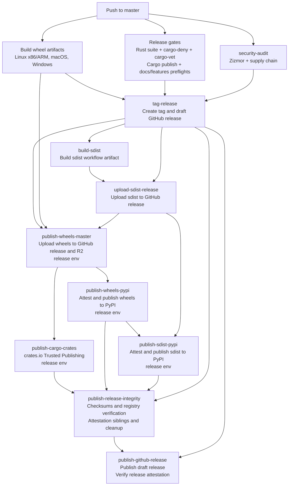

# Releases

คู่มือนี้อธิบายกระบวนการ release และมาตรฐานในการเขียน release notes

## ภาพรวม {#overview}

NautilusTrader ใช้โมเดลสาม branch:

- **`develop`**: การพัฒนาที่กำลังดำเนินอยู่ publish dev wheel ไปยัง Cloudflare R2 ทุกครั้งที่ push
- **`nightly`**: การทดสอบก่อน release publish pre-release wheel ที่รองรับทั้งหมดและ binary ของ CLI
- **`master`**: release เวอร์ชันเสถียร trigger pipeline release เต็มรูปแบบ

เมื่อ commit สำหรับ release ถูก merge เข้า `master` pipeline จะทำงานต่อไปนี้โดยอัตโนมัติ:

- ติด tag เวอร์ชันจาก `python/pyproject.toml`
- สร้าง GitHub release แบบ draft
- อัปโหลด release asset
- publish Cargo crate ไปยัง crates.io
- publish wheel และ sdist ไปยัง PyPI
- publish GitHub release
- build Docker image
- trigger การ rebuild เอกสาร

## Workflow ของ stable release {#stable-release-workflow}

workflow `build` ใช้ GitHub release เป็นจุดยึดของ stable release โดยจะสร้าง release แบบ draft ก่อน แล้วอัปโหลด
asset ของ wheel และ sdist ไปยัง draft นั้น หลังจากนั้นจึง publish package เหล่านั้นไปยัง package index ต่าง ๆ
workflow จะ publish GitHub release ก็ต่อเมื่อการตรวจสอบ registry และ asset ด้าน integrity ขั้นสุดท้ายเสร็จสมบูรณ์แล้ว



เมื่อแก้ไข `.github/workflows/build.yml` ให้คงกฎเรื่องลำดับเหล่านี้ไว้:

- GitHub release แบบ draft ต้องมีอยู่ก่อนการอัปโหลด release asset หรือการ publish ไปยัง package registry ใด ๆ
- `tag-release` ต้องขึ้นกับ `security-audit` เพื่อไม่ให้การติด tag ของ stable release ดำเนินต่อได้หลังจาก audit ล้มเหลว
- asset ของ wheel และ sdist ต้องถูกแนบกับ GitHub release ก่อนเริ่ม publish ไปยัง package index
  (`packages.nautechsystems.io`, PyPI, crates.io)
- job สำหรับ Trusted Publishing ของ PyPI และ crates.io ต้องคง `environment: release` และ `id-token: write` ไว้
  เพราะการลงทะเบียนเหล่านั้นขึ้นกับ environment `release`
- job ด้าน integrity และการอัปโหลด asset ที่ไม่ใช้ OIDC ควรหลีกเลี่ยง `environment: release` เว้นแต่ต้องใช้ secret
  หรือการอนุมัติของ release environment
- `publish-release-integrity` ต้องรันหลังการ publish ไปยัง PyPI และ crates.io โดยจะสร้าง release manifest ก่อน
  ตรวจสอบ registry เทียบกับ manifest นั้น แล้วจึงแนบ asset ด้าน integrity ขั้นสุดท้ายหลังการตรวจสอบผ่านแล้วเท่านั้น
- `publish-github-release` ต้องเป็น job สุดท้ายของ stable release GitHub แนะนำให้สร้าง release แบบ draft แนบ asset
  ทั้งหมด แล้วจึง publish draft ก่อนเปิด release immutability หากเปิด release immutability ของ GitHub ไว้สำหรับ repo
  release asset ที่ publish แล้วและ release tag จะเปลี่ยนแปลงไม่ได้ แก้ไขได้เฉพาะชื่อเรื่องและ release notes เท่านั้น
  job นี้จะตรวจชุด asset ของ draft ขั้นสุดท้ายก่อน publish และตรวจ release attestation ของ GitHub หลัง publish draft

## การกู้คืน release tag ที่หายไป {#recovering-a-missing-release-tag}

ขั้นตอน `Create git tag` จะสร้าง `v<version>` ก็ต่อเมื่อ commit ของการรันนั้นเปลี่ยนเวอร์ชันจาก parent (`HEAD~1`)
และจะไม่สร้างเลยหาก tag มีอยู่แล้ว หากเวอร์ชันไม่เปลี่ยนและ tag หายไป `Verify release tag` จะล้มเหลวเสมอไม่ว่าจะ
รัน job ที่ล้มเหลวซ้ำกี่ครั้งก็ตาม

release ที่ถูก retry มักจะมี commit หนึ่งตัวหรือมากกว่าบน `master` หลังจาก bump เวอร์ชัน ดังนั้นการรันที่ retry
จะมีเวอร์ชันเดียวกับ parent และไม่สร้าง tag เนื่องจาก `tag-release` เป็นจุดยึดของ release แบบ draft และของ
job publish ปลายน้ำทุกตัว การรันจึงดำเนินต่อไม่ได้ขณะที่ tag ยังหายไป

ขั้นแรกให้ตรวจว่า tag มีอยู่หรือไม่ และ commit ของการรันนั้น bump เวอร์ชันหรือไม่:

- หาก tag หายไปและ commit ของการรัน bump เวอร์ชัน ให้รัน job ที่ล้มเหลวซ้ำ ไม่ต้องสร้าง tag ด้วยมือ เมื่อ job ผ่าน
  `tag-release` จะสร้าง tag ให้เอง
- หาก tag หายไปและ commit ของการรันมีเวอร์ชันเดียวกับ parent การรันซ้ำจะไม่สร้าง tag ให้ ให้กู้คืนด้วยขั้นตอน
  สร้าง tag ด้วยมือด้านล่าง

การกู้คืนด้วยการสร้าง tag ด้วยมือได้ผลเพราะกลไกที่เหลือของ `tag-release`:

- เมื่อรันซ้ำหลัง push tag ด้วยมือ `Create git tag` จะข้ามการสร้างตามกฎเดิม
- `Verify release tag` กำหนดให้ `v<version>` ต้อง resolve ไปยัง commit ของการรันนั้น (`GITHUB_SHA`) tag ที่ push
  ด้วยมือที่ commit นั้นพอดีจึงผ่านการตรวจ
- การสร้าง release แบบ draft เป็น idempotent การรันซ้ำจึงอัปเดต draft ที่มีอยู่แล้วหากเคยสร้างไว้

ในการกู้คืน maintainer จะสร้าง tag ด้วยมือและรัน job ที่ล้มเหลวซ้ำ:

1. จากหน้าการรันที่ล้มเหลว ให้จด commit SHA ของการรันไว้ checkout commit นั้นในเครื่องและยืนยันเวอร์ชันที่ commit นั้นมี:

   ```bash
   ./scripts/package-version.sh
   ```

1. สร้าง signed annotated tag ที่ commit ของการรันนั้นพอดี โดยใช้รูปแบบข้อความ tag ที่มีอยู่ แล้ว push:

   ```bash
   git tag -s v<version> -m "Released version <version>" <run-commit-sha>
   git push origin v<version>
   ```

1. ตรวจสอบ tag ในเครื่อง signature ต้องถูกต้อง และ `git rev-parse 'v<version>^{commit}'` ต้องเท่ากับ commit SHA
   ของการรัน:

   ```bash
   git tag -v v<version>
   git rev-parse 'v<version>^{commit}'
   ```

1. ในการรันที่ล้มเหลว ให้เลือก "Re-run failed jobs" `Verify release tag` จะผ่านด้วย tag ที่ push ไว้ และการสร้าง
   release แบบ draft กับ job publish ปลายน้ำจะดำเนินต่อ

ทำขั้นตอนนี้เฉพาะเมื่อ commit และเวอร์ชันของ release เป็นค่าสุดท้ายแล้วเท่านั้น tag คือจุดยึดถาวรของ release และเมื่อ
release immutability มีผลแล้ว release tag ที่ publish ไปแล้วจะเปลี่ยนไม่ได้ หาก `v<version>` ชี้ไปที่ commit อื่น
อย่าย้ายหรือ push tag ที่มีอยู่ซ้ำ ให้ตรวจสอบหาสาเหตุของความไม่ตรงกัน ซึ่งในกรณีนี้ `Verify release tag` ถูกออกแบบ
มาให้ล้มเหลวโดยตั้งใจ

## การกู้คืน release ที่ทำไม่สมบูรณ์ {#recovering-a-partial-release}

ใช้ workflow `recover-release` เมื่อ package มีอยู่แล้วบน PyPI และ crates.io แต่การตรวจสอบ release integrity หรือ
การ publish GitHub ขั้นสุดท้ายล้มเหลว workflow นี้ตรวจสอบ package ที่มีอยู่โดยไม่ build หรือ publish ใหม่ และยังตรวจ
release ที่ maintainer publish ด้วยมือไปแล้วได้ด้วย

แหล่งที่มาต้องเป็นการรัน workflow `build` ที่เสร็จสมบูรณ์จากการ push ไปยัง `master` ใน repository นี้ และมี job
`tag-release` ที่สำเร็จ release tag ต้อง resolve ไปยัง commit ของการรันนั้น และเวอร์ชันของ tag ต้องตรงกับ
`python/pyproject.toml` ที่ commit นั้น การกู้คืนจะ checkout แหล่งที่มานั้น และกำหนดให้รายการ package ทั้งหมดของ release
ตรงกับ wheel matrix ของ stable ปัจจุบัน รวมถึง sdist ที่ตรงกันด้วย release ในอดีตที่มี matrix ต่างออกไปจะไม่ผ่านการตรวจสอบ

1. รอให้ build เดิมและความพยายามกู้คืนอื่น ๆ เสร็จสิ้นก่อน อย่ารัน build ต้นทางซ้ำระหว่างการกู้คืน job ที่เขียน tag
   หรือ GitHub release จะใช้ lock ร่วมกันตาม release tag GitHub อนุญาตให้มี job ที่รอคิวได้หนึ่งตัวต่อ lock และ job
   ที่รอคิวตัวใหม่กว่าจะแทนที่ตัวที่รออยู่ก่อนหน้า
1. เปิด **Actions > recover-release > Run workflow** แล้วเลือก `master`
1. ใส่ release tag ที่มีอยู่และ run ID ของ build เดิม แล้วเลือกโหมด:
   - `verify`: กำหนดให้ต้องมี release ที่ publish แล้ว และตรวจสอบโดยไม่เปลี่ยน asset, notes หรือสถานะการ publish
   - `recover`: ดำเนินการ release แบบ draft ต่อ หากถูก publish ไปแล้ว จะรันการตรวจสอบโดยไม่เปลี่ยนแปลงอะไร
1. ตรวจดู artifact ของการกู้คืนแม้ workflow จะล้มเหลว หลังแก้สาเหตุแล้ว ให้รันซ้ำด้วย tag และ run ID ต้นทางเดิม

การกู้คืนจะตรวจ attestation ของ package และ bundle ที่คู่กันเทียบกับ build workflow และ commit ต้นทางเดิม ตรวจ
envelope แต่ละตัวเทียบกับ bundle ที่ผ่านการตรวจแล้ว จากนั้นตรวจเนื้อหาใน registry มันเปรียบเทียบ asset ที่มีอยู่บน
GitHub ตามเนื้อหา อัปโหลดเฉพาะ asset ที่ขาด และหยุดเมื่อพบความไม่ตรงกัน asset `dist-manifest.json` และ
`crates-manifest.json` ที่มีอยู่จะคง byte เดิมไว้หากเนื้อหา JSON ตรงกันยกเว้น `generated_at` การกู้คืนจะอัปเดต
checksum notes เฉพาะเมื่อจำเป็น ตรวจชุด asset ของ draft ทั้งหมด ตรวจความพร้อมของ Rekor, publish draft และตรวจ
release attestation ของ GitHub

การกู้คืนจะคืน package หรือ provenance ที่ขาดไปจาก artifact ที่ยังไม่หมดอายุของการรันต้นทางที่เลือกเท่านั้น หากหลักฐาน
ที่จำเป็นไม่มีอยู่ การกู้คืนจะหยุด release ที่ publish แล้วและมีข้อมูลครบถ้วนไม่จำเป็นต้องมี artifact ของการรันต้นทาง
เก็บไว้ หลังจากเกิดความล้มเหลวที่ตามมาหลังการ publish ให้รันโหมดใดก็ได้ซ้ำเพื่อตรวจ release อีกครั้งโดยไม่ publish ซ้ำ

หากการอัปโหลด asset ล้มเหลว การกู้คืนจะหยุดหลังความพยายามนั้น ให้รันการกู้คืนซ้ำเพื่อตรวจ asset ที่มาถึงแล้วและอัปโหลด
เฉพาะไฟล์ที่เหลือ การอัปโหลดที่ถูกขัดจังหวะอาจทิ้ง asset ที่ไม่สมบูรณ์หรือไฟล์ที่เนื้อหาไม่ตรงไว้ การกู้คืนจะระบุชื่อ asset
ที่ได้รับผลกระทบแล้วหยุด ให้ยืนยันว่า release ยังเป็น draft และ asset ที่ระบุมาจากการอัปโหลดที่ถูกขัดจังหวะจริง แล้วลบ
เฉพาะ asset เสียที่ยืนยันแล้วนั้นออกจาก draft จากนั้นรันการกู้คืนซ้ำ ห้ามลบหรือแทนที่ asset บน release ที่ publish แล้ว

GitHub CLI ของ runner ต้องรองรับ `gh attestation verify --source-digest` และ `gh release verify` การกู้คืนจะตรวจ
ความสามารถทั้งสองก่อนเปลี่ยนแปลง release workflow จะเก็บ metadata ของต้นทาง, เวอร์ชันของเครื่องมือ, checkpoint
ของขั้นตอนล่าสุด, log รายขั้นตอนและของการ retry, exit status, response จาก registry, input สำหรับการตรวจสอบที่ดาวน์โหลด
มา และ cache ของ verifier ที่แยกไว้เป็นเวลา 30 วัน job ด้าน integrity และการ publish ขั้นสุดท้ายของ build ปกติก็เก็บ
artifact สำหรับวินิจฉัยไว้เมื่อล้มเหลวเช่นกัน และการรันซ้ำที่สำเร็จในภายหลังจะคง artifact เหล่านั้นไว้

## การกำหนดเวอร์ชัน {#versioning}

โปรเจกต์ดูแลหมายเลขเวอร์ชันสองชุด:

| ไฟล์                     | ขอบเขต          |
| ------------------------ | -------------- |
| `python/pyproject.toml`  | Python package |
| `Cargo.toml` (workspace) | Rust crate     |

ทั้งสองถูก bump แยกกันอย่างอิสระ เวอร์ชันของ Python เป็นตัวกำหนด release tag `v<python-version>` เวอร์ชันที่ลงท้าย
ด้วย `aN`, `bN` หรือ `rcN` จะสร้าง GitHub pre-release ส่วนเวอร์ชัน final จะสร้าง release ปกติ

## การ publish ไปยัง crates.io {#cratesio-publishing}

workflow `build` publish Cargo crate จาก job `publish-cargo-crates` job นี้ใช้ crates.io Trusted Publishing ผ่าน
GitHub Actions OIDC จึงไม่ใช้ cargo token แบบถาวร ให้ตั้งค่าแต่ละ crate บน crates.io ด้วย:

| Field       | Value             |
| ----------- | ----------------- |
| Owner       | `nautechsystems`  |
| Repository  | `nautilus_trader` |
| Workflow    | `build.yml`       |
| Environment | `release`         |

เปิด Trusted Publishing Only สำหรับ crate หลังจากตั้งค่า trusted publisher ของ crate นั้นแล้ว crate ที่ไม่เคย publish
มาก่อนยังต้อง publish ด้วยมือครั้งแรกก่อนที่ crates.io จะยอมให้ตั้งค่า trusted publisher

อย่าใช้ `cargo publish --workspace` สำหรับ release ใน CI job ของ release จะรัน `scripts/ci/publish-cargo-crates.sh`
ซึ่ง:

- publish crate ทีละตัวตามลำดับ dependency
- ข้ามเวอร์ชันที่มีอยู่แล้วบน crates.io
- รอให้เวอร์ชันใหม่แต่ละตัวปรากฏใน crates.io API และ sparse index ก่อน publish crate ที่ขึ้นกับมัน

script จะล้มเหลวก่อนอัปโหลดหาก crate ที่ publish ได้ขึ้นกับ crate ใน local ที่ตั้ง `publish = false` และไม่มีอยู่บน
crates.io dependency ใน local แบบ optional ก็ขัดขวางการ publish เช่นกัน เพราะ public feature ที่ resolve ไปยัง crate
ที่ไม่มีอยู่จะใช้งานไม่ได้

การตรวจสอบหลัง publish จะถือว่าเวอร์ชันของ crate ที่มีอยู่แล้วเป็น `previously_published` ก็ต่อเมื่อ crates.io แสดงว่า
เวอร์ชันนั้นถูก trusted-publish โดย repository นี้เท่านั้น

**การกู้คืนด้วยมือ**: เวอร์ชันที่ผู้ใช้ publish เองจะไม่ผ่านการตรวจสอบ เว้นแต่ `CRATES_IO_MANUAL_PUBLISH_EXCEPTIONS`
จะระบุ `crate@version` ที่กู้คืนแต่ละตัวไว้สำหรับการกู้คืนฉุกเฉินด้วยการ publish ผ่าน token รายการที่ยอมรับจะปรากฏใน
`crates-manifest.json` พร้อม `release_status: "manual_token_publish"` รายการยกเว้นที่รูปแบบผิดหรือไม่ได้ใช้จะทำให้
job ล้มเหลว

repository ของ trusted-publishing ที่ผิด และความไม่ตรงกันของ checksum หรือ sparse index ก็ทำให้การตรวจสอบล้มเหลวเช่นกัน

## Checklist ของ release {#release-checklist}

### ก่อน release (บน `develop`) {#pre-release-on-develop}

- [ ] ปิดงาน `RELEASES.md`: ทบทวนทุกรายการ ลบหมวดที่ว่าง
- [ ] ตรวจว่าตั้งเวอร์ชันไว้ใน `python/pyproject.toml` และ workspace ของ `Cargo.toml` แล้ว
- [ ] ตรวจว่าตั้งค่า crates.io Trusted Publishing ไว้สำหรับทุก crate ที่ CI publish:
  `bash scripts/ci/check-crates-io-trusted-publishing.sh`
- [ ] รัน `make check-features` ในเครื่องกับ release candidate ตัวสุดท้าย
- [ ] รัน `make check-docsrs` ในเครื่องกับ release candidate ตัวสุดท้าย
- [ ] ตรวจว่า CI check ทั้งหมดผ่านบน `develop`

### Release {#release}

- [ ] merge `develop` เข้า `nightly` แล้วตรวจว่า nightly CI ผ่าน
- [ ] merge `nightly` เข้า `master`
- [ ] ตรวจว่า workflow `build` ทำงานเสร็จ:
  - build wheel สำหรับ Linux x86/ARM, macOS, Windows แล้ว
  - `cargo-deny` และ `cargo-vet` ผ่าน
  - `security-audit` ผ่านการตรวจของ Zizmor และ supply-chain
  - preflight ของ release docs/features และ Cargo publish ผ่านก่อนติด tag
  - สร้าง tag และ GitHub release แบบ draft แล้ว
  - แนบ wheel และ sdist กับ GitHub release ก่อน publish ไปยัง package registry
  - publish Cargo crate ไปยัง crates.io แล้ว หรือข้ามไปเพราะมีเวอร์ชันนั้นอยู่แล้ว
  - publish wheel และ sdist ไปยัง PyPI แล้ว
  - การตรวจสอบ registry ผ่านก่อนแนบ release checksum, crates manifest และ attestation sibling
  - publish GitHub release หลังแนบ release asset และ asset ด้าน integrity ครบทั้งหมดแล้ว
  - หากการรันล้มเหลวเพราะ release tag หายไป ให้ทำตาม
    [การกู้คืน release tag ที่หายไป](#recovering-a-missing-release-tag) แล้วรัน job ที่ล้มเหลวซ้ำ
  - หาก package มีอยู่แล้วแต่การตรวจสอบ integrity หรือการ publish GitHub ล้มเหลว ให้ทำตาม
    [การกู้คืน release ที่ทำไม่สมบูรณ์](#recovering-a-partial-release)
- [ ] ตรวจว่า workflow `docker` ทำงานเสร็จ (build และ push image แล้ว)
- [ ] ตรวจว่า workflow `build-docs` ทำงานเสร็จ (trigger การ rebuild เอกสารแล้ว)

### หลัง release (บน `develop`) {#post-release-on-develop}

- [ ] อัปเดตวันที่ release ใน `RELEASES.md` สำหรับเวอร์ชันที่ publish แล้ว
- [ ] เพิ่มเส้นคั่นแนวนอน `---` ใต้ release ที่เสร็จแล้ว
- [ ] เพิ่ม template ของเวอร์ชันถัดไปไว้ด้านบนของ `RELEASES.md` (ดูด้านล่าง)
- [ ] bump เวอร์ชันใน `python/pyproject.toml` เป็นหมายเลข release ถัดไป
- [ ] bump เวอร์ชันของ crate ใน snippet `Cargo.toml` ของ tutorial และ how-to
  (`docs/concepts/rust.md`, `docs/how_to/run_rust_backtest.md`,
  `docs/how_to/run_rust_live_trading.md`)

## Release notes {#release-notes}

ส่วนนี้อธิบายมาตรฐานในการเขียน release notes ใน `RELEASES.md`

### หมวด {#sections}

ใช้หมวดต่อไปนี้ตามลำดับ:

1. Enhancements
2. Breaking Changes
3. Security
4. Fixes
5. Internal Improvements
6. Documentation Updates
7. Deprecations

ละหมวดที่ไม่มีรายการใน release นั้นออก

### Enhancements {#enhancements}

feature ใหม่และการปรับปรุงที่ผู้ใช้มองเห็นได้

**รูปแบบ**:

```markdown
- Added `subscribe_order_fills(...)` and `unsubscribe_order_fills(...)` for `Actor`
- Added Bybit conditional orders support
- Added support for `OrderBookDepth10` requests (#2955), thanks @faysou
```

**แนวทาง**:

- ขึ้นต้นด้วย "Added"
- ใช้ backtick สำหรับส่วนที่เป็นโค้ด
- ระบุให้ชัดว่าเพิ่ม *อะไร* ไม่ใช่เพิ่ม *อย่างไร*

### Breaking Changes {#breaking-changes}

การเปลี่ยนแปลงที่อาจทำให้โค้ดเดิมใช้งานไม่ได้

**รูปแบบ**:

```markdown
- Removed `nautilus_trader.analysis.statistics` subpackage - must import from `nautilus_trader.analysis`
- Renamed `BinanceAccountType.USDT_FUTURE` to `USDT_FUTURES`
- Changed `start` parameter to required for `Actor` data request methods
```

**แนวทาง**:

- ขึ้นต้นด้วย "Removed", "Renamed" หรือ "Changed"
- อธิบายวิธี migrate สั้น ๆ

### Security {#security}

การเสริมความปลอดภัยและการแก้ไขที่ป้องกัน crash, undefined behavior หรือข้อมูลเสียหาย
รวมถึงการเสริมความแข็งแกร่ง (hardening) ที่สำคัญซึ่งยกระดับมาจาก Internal Improvements

**รูปแบบ**:

```markdown
- Fixed divide-by-zero and overflow bugs in model crate that could cause crashes
- Fixed core arithmetic operations to reject NaN/Infinity values and improve overflow handling
```

**แนวทาง**:

- รวมการแก้ overflow/underflow, การปรับปรุง memory safety, FFI guard และการแก้ไขด้าน data integrity
- เน้นผลกระทบต่อผู้ใช้: อะไรที่อาจเกิดขึ้นได้
- ไม่รวมการอัปเดต dependency ตามปกติ, hardening เล็กน้อย หรือการแก้ที่เกี่ยวกับ test เท่านั้น
- ละหมวดนี้ทั้งหมดหาก release นั้นไม่มีรายการด้าน security

### Fixes {#fixes}

การแก้ bug ที่ช่วยให้ทำงานถูกต้องขึ้น แต่ไม่เข้าข่ายปัญหาด้าน security

**รูปแบบ**:

```markdown
- Fixed reduce-only order panic when quantity exceeds position
- Fixed Binance order status parsing for external orders (#3006), thanks for reporting @bmlquant
```

**แนวทาง**:

- ขึ้นต้นด้วย "Fixed"

### Internal Improvements {#internal-improvements}

รายละเอียดของ implementation และการเปลี่ยนแปลงด้าน infrastructure

**รูปแบบ**:

```markdown
- Added ARM64 support to Docker builds
- Ported `PortfolioAnalyzer` to Rust
- Improved clock and timer thread safety
- Upgraded Rust (MSRV) to 1.90.0
- Upgraded `pyo3` crates to v0.26.0
```

**แนวทาง**:

- ใช้ "Added", "Implemented", "Improved", "Optimized", "Upgraded", "Refined", "Standardized"
- ใส่หมายเลขเวอร์ชันสำหรับการอัปเกรด dependency

### Documentation Updates {#documentation-updates}

การเปลี่ยนแปลงของคู่มือและตัวอย่าง

**รูปแบบ**:

```markdown
- Added rate limit tables with links to official docs
- Improved dark and light themes for readability
- Fixed broken links
```

### Deprecations {#deprecations}

feature ที่ถูกกำหนดให้ลบออกในอนาคต

**รูปแบบ**:

```markdown
- Deprecated `some_config_option`; disable (`False`) to maintain consistent behavior. Will be removed in future version
```

**แนวทาง**:

- อธิบายวิธี migrate และให้ทางเลือกอื่น

## การให้เครดิต {#attribution}

- ให้เครดิตผู้ร่วมพัฒนาภายนอก: `thanks @username` หรือ `thanks for reporting @username`
- ใส่หมายเลข issue/PR สำหรับการมีส่วนร่วมจากชุมชนและ feature ที่ซับซ้อน: `(#1234)`

## รูปแบบการเขียน {#style}

- ใช้ sentence case (ขึ้นต้นตัวพิมพ์ใหญ่เฉพาะคำแรก)
- ไม่ลงท้ายด้วยจุด
- ใช้ backtick สำหรับส่วนที่เป็นโค้ด
- เน้นว่า **อะไร** เปลี่ยนไป ไม่ใช่เปลี่ยนอย่างไร

**เขียนให้เจาะจง**:

```markdown
Bad:  Improved Binance adapter
Good: Improved Binance fill handling when instrument not cached
```

## การจัดประเภทด้าน security {#security-classification}

ใส่ไว้ในหมวด Security หากการเปลี่ยนแปลงนั้นแก้ปัญหาเรื่อง:

- memory safety (overflow, underflow, การหารด้วยศูนย์ที่คุกคามเสถียรภาพ)
- undefined behavior หรือ crash ที่อาจทำให้ state เสียหาย
- data integrity (การแพร่กระจายของ NaN/Infinity, race condition ที่นำไปสู่ความเสียหาย)
- การตรวจสอบ input เพื่อป้องกันการ injection หรือการโจมตี (SQL injection, command injection, path traversal)
- build hardening (non-exec stack, FFI guard)
- hardening ที่สำคัญซึ่งผู้ใช้ควรรู้

กรณีอื่นให้ใช้ Fixes (สำหรับ logic bug และ panic) หรือ Internal Improvements (สำหรับ hardening เล็กน้อย)

หมายเหตุ: panic จาก logic ธรรมดาให้อยู่ใน Fixes เว้นแต่จะคุกคามเสถียรภาพของระบบหรือทำให้ข้อมูลเสียหาย

## ตัวอย่าง {#examples}

**Security** (อาจทำให้เกิด crash/ความเสียหาย):

```markdown
- Fixed divide-by-zero in margin calculations that could crash the engine
- Fixed integer overflow in model arithmetic that could crash the process
```

**Fixes** (ไม่ถูกต้องแต่ปลอดภัย):

```markdown
- Fixed Binance order status parsing for external orders
- Fixed position purge logic to prevent purging re-opened position
```

**Enhancements** (ผู้ใช้มองเห็น):

```markdown
- Added Bybit conditional orders support
```

**Internal** (implementation):

```markdown
- Implemented Bybit ping/pong handling
```

## Template ของ release notes {#release-notes-template}

```markdown
# NautilusTrader <VERSION> Beta

Released on TBD (UTC).

### Enhancements

### Breaking Changes

### Security

### Fixes

### Internal Improvements

### Documentation Updates

### Deprecations

---
```
