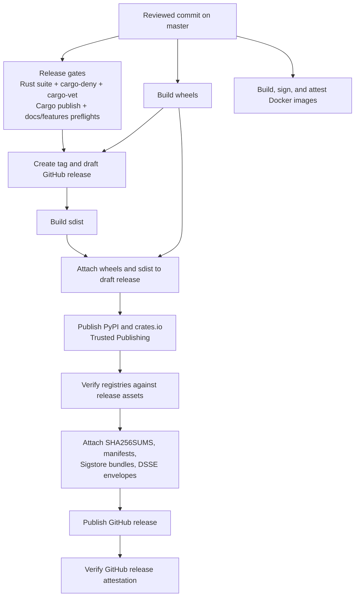

หน้านี้อธิบายโมเดลความปลอดภัยของ release pipeline ของ NautilusTrader
ว่า artifact ของ release ถูก build, publish, attest และตรวจสอบอย่างไร

ใช้หน้านี้ควบคู่กับ:

- [Supply chain policy](https://nautilustrader.io/security/supply-chain/) ซึ่งระบุพันธะสาธารณะเรื่อง
  dependency และความถูกต้องสมบูรณ์ (integrity) ของ release
- [Releases](releases.md) ซึ่งอธิบาย workflow และ checklist ของการ release
- [Security Policy](https://github.com/nautechsystems/nautilus_trader/blob/04f766b4d434d67fc8672026fefa25135bdc01be/SECURITY.md) ซึ่งให้คำสั่งตรวจสอบสำหรับผู้ใช้งาน
- [GitHub Actions overview](https://github.com/nautechsystems/nautilus_trader/blob/04f766b4d434d67fc8672026fefa25135bdc01be/.github/OVERVIEW.md#security) ซึ่งอธิบายการควบคุมใน CI/CD

## เป้าหมายด้านความปลอดภัย [#security-goals]

release pipeline มีเป้าหมายสี่ข้อ:

- build artifact ทางการทุกตัวจาก commit ใน repository ที่ผ่านการ review แล้ว
- publish package (รวมถึง Rust crate) โดยไม่ใช้ token ของ package registry ที่มีอายุยาว
- แนบ checksum, manifest และ provenance ก่อน publish GitHub release
- ให้ข้อมูลสาธารณะแก่ผู้ใช้เพียงพอที่จะตรวจสอบได้ว่า artifact ที่ดาวน์โหลดตรงกับ release

GitHub release เป็นจุดยึด integrity ของ package release แบบ stable จะแนบ artifact ของ package
ไว้กับ draft GitHub release ก่อนที่จะเริ่ม publish ไปยัง package index ใด ๆ จากนั้น pipeline จะ publish
ไปยัง package index, ตรวจสอบ index เหล่านั้นเทียบกับ asset ของ GitHub release, แนบ asset ด้าน
integrity ชุดสุดท้าย แล้วจึง publish GitHub release

## Threat model [#threat-model]

pipeline ป้องกันสิ่งต่อไปนี้:

- GitHub Actions ของบุคคลที่สามที่ถูกเจาะหรือเปลี่ยนแปลงได้ โดย pin action ไว้กับ commit SHA
- การ release โดยไม่ตั้งใจจาก workflow, branch หรือ environment ที่ผิด โดยผูก OIDC publisher
  ไว้กับ `nautechsystems/nautilus_trader`, `build.yml` และ environment `release`
- การขโมย token ของ package registry ที่มีอายุยาว โดยใช้ Trusted Publishing ของ PyPI และ crates.io
- ความล่าช้าในการกระจายข้อมูลของ registry หรือการรันซ้ำบางส่วน โดยทำให้ script สำหรับ publish และ verify
  เป็นแบบ idempotent และทนต่อการ retry
- การสลับ artifact ใน registry หรือการ upload ที่คลาดเคลื่อน โดยเปรียบเทียบ artifact บน PyPI และ crates.io
  กับ release manifest และ metadata ของ registry
- การกู้คืน crate ด้วยมือแบบเงียบ ๆ โดยบังคับให้ต้องมีรายการ `CRATES_IO_MANUAL_PUBLISH_EXCEPTIONS`
  ที่ระบุชัดเจน และบันทึกข้อยกเว้นเหล่านั้นไว้ใน `crates-manifest.json`

pipeline ไม่ได้ป้องกันสิ่งต่อไปนี้:

- maintainer ที่ประสงค์ร้ายและมีสิทธิ์แก้ไข release workflow และอนุมัติ release
- การถูกเจาะของ GitHub, PyPI, crates.io หรือ Sigstore ที่สามารถปลอม trust root ที่ผู้ใช้พึ่งพาได้
- เครื่องของผู้ใช้ปลายทางที่ถูกเจาะก่อนการตรวจสอบจะทำงาน
- การถูกเจาะขณะ runtime ของ exchange, broker, ผู้ให้บริการข้อมูล หรือ trading strategy ของผู้ใช้

## Trust root [#trust-roots]

- กฎของ GitHub repository ปกป้อง source ที่ผ่านการ review, release branch และ release tag
  โดยมี `master` ที่ถูก protect และ release tag `v*` ที่เปลี่ยนแปลงไม่ได้เป็นบันทึกที่เกี่ยวข้อง
- OIDC issuer ของ GitHub Actions ให้ identity ของ workflow อายุสั้นจาก
  `https://token.actions.githubusercontent.com`
- environment `release` ของ GitHub เป็นด่านควบคุมการ publish package และการอนุมัติ release
  environment นี้จำกัดการ deploy ไว้ที่ `master` และต้องได้รับการอนุมัติจาก reviewer
- Trusted Publishing ของ crates.io ใช้ publish Rust crate โดยไม่มี token ถาวร
  โดยผูกไว้กับ owner `nautechsystems`, repository `nautilus_trader`, workflow
  `build.yml` และ environment `release`
- Sigstore Fulcio, Rekor และ TUF ผูก artifact เข้ากับ OIDC identity และ transparency log
  GitHub artifact attestation และ Docker cosign signature พึ่งพา root นี้
- ความไม่เปลี่ยนแปลง (immutability) ของ GitHub release ป้องกันการแทนที่ asset และ tag หลัง publish
  asset ของ release ที่ publish แล้วและ release tag จะเปลี่ยนแปลงไม่ได้

## ลำดับการ release [#release-flow]



Docker workflow แยกจาก package release workflow แต่ใช้โมเดล identity เดียวกัน image signature และ
SBOM attestation ผูก image digest เข้ากับ identity ของ GitHub Actions workflow ที่คาดหวัง

## บันทึกของ artifact [#artifact-records]

| Artifact              | Publish ไปที่               | บันทึกด้าน integrity                         | บันทึกด้าน provenance                                                       |
| --------------------- | --------------------------- | -------------------------------------------- | --------------------------------------------------------------------------- |
| Rust crates           | crates.io                   | checksum ของ crates.io, `crates-manifest.json` | `trustpub_data` ของ crates.io เว้นแต่จะมีข้อยกเว้นแบบ manual ที่ระบุชัดเจน   |
| Docker images         | GitHub Container Registry   | Image digest                                 | Sigstore cosign signature, SPDX SBOM attestation                            |
| บันทึก GitHub release  | GitHub Releases             | asset ของ release ที่ publish แล้ว, tag ที่เปลี่ยนแปลงไม่ได้ | GitHub release attestation                                                  |

## แผนที่การตรวจสอบสำหรับผู้ใช้ [#consumer-verification-map]

คำสั่งโดยละเอียดอยู่ใน
[Verifying releases](https://github.com/nautechsystems/nautilus_trader/blob/develop/SECURITY.md#verifying-releases)
การตรวจสอบด้านล่างแสดงข้อมูลสาธารณะที่ผู้ใช้แต่ละกลุ่มควรตรวจสอบ

### Rust crate [#rust-crates]

ตรวจสอบว่า:

- checksum ของเวอร์ชันบน crates.io ตรงกับไฟล์ `.crate` ที่ดาวน์โหลดมา
- `trustpub_data.provider` เป็น `github`
- `trustpub_data.repository` เป็น `nautechsystems/nautilus_trader`
- `published_by` เป็น `null` เว้นแต่ `crates-manifest.json` จะบันทึกข้อยกเว้น
  `manual_token_publish` ไว้อย่างชัดเจน

ตัวอย่าง:

```bash
CRATE=${CRATE:-nautilus-core}
: "${VERSION:?Set VERSION to the crate version}"
REPO=nautechsystems/nautilus_trader
VERSION_JSON=$(curl -sS "https://crates.io/api/v1/crates/$CRATE/versions" | \
  jq -c --arg version "$VERSION" '.versions[] | select(.num == $version)')
CRATE_SHA256=$(printf '%s\n' "$VERSION_JSON" | jq -r '.checksum')

printf '%s\n' "$VERSION_JSON" | jq -e --arg repo "$REPO" \
  '.trustpub_data.provider == "github" and .trustpub_data.repository == $repo and .published_by == null'
curl -sSL "https://static.crates.io/crates/$CRATE/$CRATE-$VERSION.crate" -o "$CRATE-$VERSION.crate"
test "$(sha256sum "$CRATE-$VERSION.crate" | cut -d ' ' -f 1)" = "$CRATE_SHA256"
```

### Docker image [#docker-images]

ตรวจสอบว่า:

- tag ที่เปลี่ยนแปลงได้ resolve ไปยัง digest ที่ต้องการรันจริง
- identity ของ cosign signature ตรงกับ Docker workflow
- SPDX SBOM attestation ผูกกับ image digest เดียวกัน

ตัวอย่าง:

```bash
export IMAGE_BASE=ghcr.io/nautechsystems/nautilus_trader
export DIGEST=$(crane digest "$IMAGE_BASE:latest")
export IMAGE=$IMAGE_BASE@$DIGEST
export ISSUER=https://token.actions.githubusercontent.com
export IDENTITY='^https://github\.com/nautechsystems/nautilus_trader/\.github/workflows/docker\.yml@refs/heads/(master|nightly)$'

cosign verify "$IMAGE" --certificate-identity-regexp "$IDENTITY" --certificate-oidc-issuer "$ISSUER"
cosign verify-attestation \
  --type https://spdx.dev/Document/v2.3 \
  "$IMAGE" \
  --certificate-identity-regexp "$IDENTITY" \
  --certificate-oidc-issuer "$ISSUER"
```

## แนวทางการกู้คืนด้วยมือ [#manual-recovery-posture]

release ตามปกติใช้ Trusted Publishing เท่านั้น การ publish package ด้วยมือเป็นเส้นทางกู้คืน
ทางเลือกสุดท้ายหลังจากการ release ที่สำเร็จเพียงบางส่วน

กฎสำหรับการกู้คืนด้วยมือ:

- เมื่อ registry หรือ Sigstore verifier ล้มเหลว ให้รัน job หรือ workflow ที่ล้มเหลวซ้ำก่อน
- อย่าแทนที่ release tag หรือ asset ของ GitHub release หลังจาก publish แล้ว
- อย่ายอมรับ crate ที่ publish ด้วยมือแบบเงียบ ๆ
- หากจำเป็นต้องกู้คืน crate ด้วย token ให้ระบุ `crate@version` แต่ละตัวไว้ใน
  `CRATES_IO_MANUAL_PUBLISH_EXCEPTIONS`
- บันทึกข้อยกเว้นไว้ใน release note และใน `crates-manifest.json` ด้วย
  `release_status: "manual_token_publish"`

ไม่มีเส้นทาง release ตามปกติใดที่พึ่งพา token ของ PyPI หรือ crates.io ที่มีอายุยาว

## แนวทางการรับมือเหตุการณ์ [#incident-response-posture]

- publisher ของ crates.io ที่คลาดเคลื่อนจะถูกตรวจพบโดยการตรวจ trusted publishing หรือ
  registry verifier ให้แก้การตั้งค่า publisher ของ crate แล้วรันใหม่ ใช้ข้อยกเว้นแบบ manual
  เฉพาะสำหรับการกู้คืนบางส่วนเท่านั้น
- asset ของ GitHub release ที่ไม่ตรงกันจะถูกตรวจพบโดยการตรวจ checksum หรือ manifest
  ให้หยุดการ release ก่อน publish หรือออก advisory หาก asset ถูกปล่อยออกไปแล้ว
- ความล่าช้าของ Sigstore, Rekor หรือ TUF จะตรวจพบได้จาก transparency error ที่ retry ได้
  ให้ retry ด้วย backoff ที่มีขอบเขต แล้วพักการปิดผนึก release หากความล่าช้ายังคงอยู่
- ข้อกังวลเรื่อง trust root ของ Sigstore จะปรากฏเมื่อผลการตรวจ attestation กำกวม
  ให้พักการ release, ตรวจสอบเทียบกับบันทึกของ registry และหมุนเวียน trust root เมื่อรองรับ
- identity ของ workflow ที่ไม่ตรงกันจะถูกตรวจพบโดยการตรวจ identity ของ GitHub, PyPI หรือ cosign
  ให้ถือว่าเป็นการตั้งค่าที่คลาดเคลื่อนหรือการถูกเจาะจนกว่าจะได้รับการ review
- ข้อยกเว้นการ publish crate ด้วยมือจะถูกตรวจพบเมื่อ crates.io แสดง `published_by` แทน
  `trustpub_data` ให้บันทึกข้อยกเว้นอย่างชัดเจน, ระบุ crate ที่ได้รับผลกระทบ และเก็บรักษา audit trail ไว้

## แนวทางด้าน SLSA [#slsa-posture]

Docker image มี Sigstore signature และ SPDX SBOM attestation ส่วน Rust crate พึ่งพา
metadata ของ Trusted Publishing บน crates.io และ `crates-manifest.json` ของ release

หน้านี้ไม่ได้อ้างระดับ SLSA ที่ระบุชื่อสำหรับ artifact ทุกประเภท การอ้างระดับ SLSA ในอนาคตต้องอ้างอิง
สถาปัตยกรรมนี้และระบุประเภท artifact ที่ครอบคลุม และต้องมีการตรวจสอบใน CI ว่า provenance ที่ publish
นั้น parse ได้ตาม predicate type ที่อ้าง
