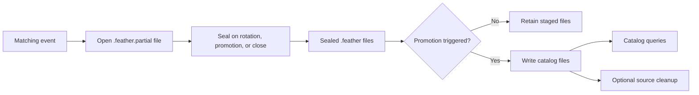

ใช้ Parquet streaming writer เพื่อพักข้อมูล (stage) record จาก live หรือ backtest ไว้ในรูปแบบ Feather แล้ว promote
เป็นไฟล์ catalog ที่ query ได้ ส่วนการเรียก `ParquetDataCatalog.write_*` โดยตรงจะเขียนข้อมูล catalog โดยไม่ผ่าน
lifecycle การ stage นี้

## ตั้งค่า writer [#configure-the-writer]

กำหนด `writer_path` ในเครื่องสำหรับไฟล์ Feather และ `catalog` ที่จะ promote ไฟล์เข้าไปให้กับ `StreamingConfig`
หากไม่มี `catalog` writer จะเก็บไว้เพียงไฟล์ Feather สำหรับการแปลงด้วยมือ

> หมายเหตุ: ต้นฉบับมีเฉพาะตัวอย่าง Python จึงตัดออก (ตัวอย่างตั้ง `writer_path`, `catalog`,
> `promotion_interval_ms`, `promote_on_close` และ `delete_feather_after_promotion` แล้วส่ง `StreamingConfig`
> เป็นฟิลด์ `streaming` ของ `BacktestEngineConfig`)

ส่ง engine config นั้นเป็นอาร์กิวเมนต์ `engine` ของ `BacktestRunConfig` runtime เป็นเจ้าของ sink: backtest จะปิด sink
เมื่อการรันจบ ส่วน live node จะ flush เมื่อหยุดและปิดเมื่อ dispose ดังนั้น event ที่ประมวลผลระหว่าง shutdown จะยังถูก
stage ไว้ ข้อมูลของการรันจะถูก stage ไว้ใต้ `<writer_path>/<backtest|sandbox|live>/<instance_id>` ซึ่งต้องเป็น path
ในเครื่อง เพราะ writer จะต่อท้ายข้อมูลลงไฟล์ที่เปิดอยู่ catalog เก็บข้อมูลที่ promote แล้วซึ่งใช้ในการ query และจะเป็น
แบบในเครื่องหรือระยะไกลก็ได้ เช่น catalog ที่มี `path` เป็น `bucket/catalog` และ `fs_protocol` เป็น `s3`
`catalog_backend` ของ catalog เป็นตัวเลือก writer ที่ promote เข้าไป Parquet writer จะสร้าง directory ของ catalog
ในเครื่องให้หากยังไม่มี

| Setting                          | Default | ความหมาย                                                   |
| -------------------------------- | ------- | --------------------------------------------------------- |
| `promotion_interval_ms`          | ไม่ตั้ง    | ไม่มีการ promote ตามช่วงเวลา หากตั้งค่าต้องเป็นค่าบวก                 |
| `promote_on_close`               | `true`  | promote ไฟล์ที่ stage ไว้เมื่อ sink ปิด                           |
| `delete_feather_after_promotion` | `false` | เก็บไฟล์ Feather ต้นทางไว้หลังการ promote สำเร็จ                   |
| `use_ts_event_for_ts_init`       | `false` | คง timestamp ตอน initialize ไว้ระหว่างการ promote                |

runtime จะตรวจสอบ config ก่อนเปิด writer หากไม่มี `catalog` ต้องไม่ตั้ง `promotion_interval_ms` และ
`delete_feather_after_promotion` กับ `use_ts_event_for_ts_init` ต้องเป็น false

หากต้องการ stage การรันไว้ภายใน directory ของ catalog ให้ตั้ง `writer_path` และ `path` ของ catalog เป็น directory
ในเครื่องเดียวกัน `ParquetDataCatalog.convert_stream_to_data()` เขียนเข้า catalog ที่ถูกเปิดอยู่ ดังนั้นการแปลงด้วยมือ
สำหรับการรันที่ stage ไว้ที่อื่นจะเขียนเข้า catalog ที่เปิดไว้ที่ `writer_path`

### การหมุนไฟล์ (rotate) [#rotate-files]

`rotation_config` จะปิดผนึก (seal) ไฟล์ที่เปิดอยู่ของ type หนึ่งและเริ่มไฟล์ใหม่ตามขนาด, ตามช่วงเวลา หรือตามตาราง
เวลา ค่าเริ่มต้น `RotationConfig.no_rotation()` จะ seal ไฟล์เฉพาะตอน promote และตอนปิดเท่านั้น ตัวเลือกอื่นได้แก่
`RotationConfig.size(...)`, `RotationConfig.interval(...)` และ `RotationConfig.scheduled_dates(...)`

`scheduled_dates` รับระยะเวลาของช่วงหน่วย nanosecond และเวลาของวันหน่วย nanosecond นับจากเที่ยงคืนตาม
`timezone` แบบ IANA ของมัน ซึ่งค่าเริ่มต้นคือ `UTC` ขนาดและช่วงเวลาต้องเป็นค่าบวก

การ rotate และการ promote ตามช่วงเวลาจะ seal ไฟล์ Feather ที่เปิดอยู่ และอาจแยกแถวที่มี `ts_init` เดียวกันไปอยู่คนละ
ไฟล์ได้ จากนั้นการ promote ไฟล์ที่ตามมาจะปฏิเสธช่วงของ catalog ที่ซ้อนทับกันและเก็บไฟล์ต้นทางนั้นไว้ หากแถวที่มี
`ts_init` เดียวกันต้องอยู่ในไฟล์เดียวกัน ให้ไม่ใช้การ rotate และไม่ตั้ง `promotion_interval_ms`

## ทำความเข้าใจการมองเห็นใน query [#understand-query-visibility]

แกนกลางของ writer ที่ใช้ร่วมกันรับผิดชอบการกรอง, การต่อท้ายไฟล์ Feather, การ rotate และการจัดตารางการ promote
ส่วน backend ของ Parquet จะแปลงไฟล์ที่ seal แล้วและบันทึก replay identity ของการ promote ที่เสร็จสมบูรณ์

ข้อมูลหรือ record แต่ละ type จะ stage ไฟล์ที่เปิดอยู่หนึ่งไฟล์ใต้ folder ของการรัน และ instrument จะ stage หนึ่งไฟล์ต่อ
instrument class แถวของทุก identifier ใช้ไฟล์ของ type ร่วมกันและมีคอลัมน์ `identifier` ซึ่งการ promote ใช้ในการเขียน
directory ของ catalog ของแต่ละ identifier จากนั้นการ promote จะตัดคอลัมน์นี้ทิ้ง ไฟล์ที่ promote แล้วจึงมี schema
เหมือนกับไฟล์ที่เขียนลง catalog โดยตรง

การ flush จะต่อท้าย record ที่ buffer ไว้ตั้งแต่การ flush ครั้งก่อนลงในไฟล์ที่เปิดอยู่เป็น Arrow record batch หนึ่งชุด
โดยไม่เริ่มไฟล์ใหม่ การ promote จะ seal ไฟล์ที่เปิดอยู่ก่อน ดังนั้นการ promote แต่ละครั้งจะได้ record ที่เขียนไว้จนถึงตอนนั้น
แต่ไม่ได้รับประกันว่าจะมองเห็นใน catalog ได้ทันที หากไม่มีช่วงเวลาการ promote record จะยังถูก stage ไว้จนกว่าจะมีการ
promote ตอนปิดหรือการแปลงด้วยมือ query จะเห็น record หลังการ promote สำเร็จ

ช่วงเวลาที่เป็นค่าบวกจะเริ่ม timer การ promote ตามเวลาจริง (wall-clock) สำหรับ clock แบบ live รวมถึงช่วงที่ไม่มีข้อมูล
ด้วย backtest ใช้ test clock ที่จัดให้และตรวจช่วงเวลาระหว่างการเขียนหรือการ flush การเลื่อนเวลาจำลองเพียงอย่างเดียว
ไม่ได้เริ่ม timer แบบ live ที่เป็นอิสระ การ flush อาจ trigger การ promote เมื่อถึงกำหนดช่วงเวลา การปิดจะรองานที่ค้างอยู่
และโดยค่าเริ่มต้นจะ promote record ที่เหลือ

## การเก็บและกู้คืนไฟล์ที่ stage ไว้ [#retain-and-recover-staged-files]

คง `delete_feather_after_promotion` เป็น false เพื่อเก็บไฟล์ Feather ต้นทางไว้หลังการ promote สำเร็จ เปิดเฉพาะเมื่อ
ต้องการเก็บกวาดไฟล์ต้นทาง การเก็บกวาดจะเกิดหลัง commit สำเร็จ และแยกจากการทำให้ข้อมูลใน catalog query ได้
promotion identity ป้องกันไม่ให้ไฟล์ต้นทางที่ promote เสร็จแล้วถูก import ซ้ำ

ให้ปิด writer อย่างชัดเจนและจัดการ error ของมัน การ drop writer ให้เพียงการเก็บกวาดแบบ best-effort และไม่ใช่หลักฐาน
ว่าการ promote สำเร็จ หากการ promote ล้มเหลว ให้เก็บไฟล์ที่ stage ไว้และตรวจสอบ error ก่อน retry เมื่อ
`promote_on_close` เป็น false การปิดอาจจงใจทิ้งการรันที่เสร็จแล้วไว้ในสถานะ stage เพื่อแปลงภายหลังผ่าน
`ParquetDataCatalog.convert_stream_to_data()` ให้ส่ง `environment` ของการรัน (เช่น live) เพื่อแปลงการรันที่อยู่นอก
folder backtest ค่าเริ่มต้น

writer ถือ exclusive lock บนไฟล์ `.feather.partial` แต่ละไฟล์จนกว่าจะ seal ไฟล์นั้น โปรเซสที่ crash จึงทิ้งไฟล์ที่เปิดอยู่
ไว้โดยไม่มี lock การกู้คืนจะ seal ไฟล์ partial ปกติที่ไม่มี lock แต่ละไฟล์: เก็บ record batch ที่สมบูรณ์ไว้ ตัด byte ที่ตามหลัง
ทิ้งพร้อมคำเตือน และเปลี่ยนชื่อไฟล์เป็น `.feather` มันจะลบไฟล์ partial ที่ไม่มี record batch สมบูรณ์เลย และคงไฟล์ว่างไว้
ที่เดิม error ในการอ่านที่ไม่ใช่การเขียนที่ถูกตัดกลางคันจะทิ้งไฟล์ไว้ให้การกู้คืนรอบถัดไป

การกู้คืนจะทำงานเมื่อ streaming writer เริ่มทำงานบน folder ของการรัน และเมื่อ
`ParquetDataCatalog.read_backtest()`, `read_live_run()` หรือ `convert_stream_to_data()` อ่านการรันนั้น writer ที่ยอมแพ้
กับไฟล์หลังจากการต่อท้าย, flush หรือ seal ล้มเหลว จะพยายามกู้คืนไฟล์นั้นทันที เพื่อให้การ promote รวม record batch
ที่ไปถึงไฟล์แล้ว หากการกู้คืนนั้นล้มเหลว writer จะ log error และทิ้งไฟล์ partial ไว้ให้การกู้คืนรอบถัดไป

การ promote แบบ Parquet อาจเขียนไฟล์ปลายทางหลายไฟล์ และไม่ได้มี snapshot transaction หรือการตรึง query ย้อนหลัง
แบบที่ catalog backend เชิง transaction มี หากแอปพลิเคชันต้องการให้ไฟล์ทั้งหมดจากการ promote หนึ่งครั้งมองเห็นได้
พร้อมกัน ให้ประสานงานฝั่งผู้อ่านเอง

### ช่วงเวลาของ schema group ที่ซ้อนทับกัน [#overlapping-schema-group-intervals]

การ promote จัดกลุ่ม Feather batch ที่กู้คืนมาตาม identifier และตาม schema รวมถึง metadata ด้าน precision
กลุ่มถูกแบ่งตาม schema ไม่ใช่ตามเวลา ดังนั้นสองกลุ่มของ identifier เดียวกันอาจมีช่วง `ts_init` ร่วมกันได้
ไฟล์ Feather หนึ่งไฟล์จะสร้างสองกลุ่มแบบนี้เมื่อ record ในไฟล์มี schema ต่างกัน เช่น order book depth ที่ว่างถูก
stage ไว้คู่กับตัวที่มีข้อมูลสำหรับ instrument เดียวกัน ชื่อไฟล์ของ catalog ยังมี hash ของ promotion identity อยู่ด้วย

ภายในไฟล์ Feather แต่ละไฟล์ batch ที่มีเฉพาะ CLEAR โดยไม่มี side, ราคาเป็นศูนย์หรือไม่ได้กำหนด, ขนาดเป็นศูนย์ และ
order ID เป็นศูนย์ จะใช้ precision ของ order batch ที่ไม่ว่างตัวถัดไปของ instrument เดียวกันก่อนการจัดกลุ่ม CLEAR batch
ที่อยู่ท้ายจะใช้ precision ของ order batch ที่ไม่ว่างตัวล่าสุดก่อนหน้า หากไฟล์มีเฉพาะแถว CLEAR สำหรับ instrument หนึ่ง
precision ที่เป็นศูนย์จะคงเดิม ค่าราคาและขนาดดิบจะไม่เปลี่ยน ฟิลด์ที่เป็นศูนย์จะ decode ด้วย precision ที่เลือก ส่วนราคา
ที่ไม่ได้กำหนดจะยังไม่ได้กำหนดที่ precision ศูนย์

catalog กำหนดให้ช่วง `ts_init` แบบปิดต่อ directory ของ identifier ต้องไม่ซ้อนทับกัน ก่อนเขียนไฟล์ Feather หนึ่งไฟล์
การ promote จะรวมกลุ่มที่ metadata ด้าน precision ต่างกันเพียงเพราะ precision เป็นศูนย์ และกลุ่มที่ precision เป็นศูนย์
ไม่มีค่าทศนิยม การ promote จะเขียนไฟล์เดียวสำหรับช่วงที่รวมกัน และคงลำดับของแถวที่มี `ts_init` เท่ากันตามต้นทาง
รวมถึง batch ที่ไม่ติดกันแต่มี schema เดียวกัน
กลุ่มที่ยังซ้อนทับกัน หรือรวมไม่ได้หากไม่เปลี่ยนค่าทศนิยม จะล้มเหลวก่อนที่ไฟล์ catalog ใด ๆ จากไฟล์ Feather ต้นทางนั้น
จะถูกเขียน ไฟล์ Feather ต้นทางที่ stage ไว้จะถูกเก็บไว้ และจะไม่บันทึก promotion identity สำหรับต้นทางนั้น การ promote
อัตโนมัติและ `ParquetDataCatalog.convert_stream_to_data()` วางแผนไฟล์ Feather แต่ละไฟล์ในแบบเดียวกัน error ด้าน
storage หลังการตรวจนั้น หรือไฟล์ Feather ที่ตามมาในการรันเดียวกัน ยังอาจทิ้งไฟล์ที่เขียนไปแล้วไว้ได้ เพราะการ promote
ไม่ใช่ snapshot transaction การ promote ซ้ำสำหรับไฟล์ที่เขียนไปแล้วจะถูกข้าม

ดู[คู่มือ catalog](../concepts/data/catalog.md) สำหรับพฤติกรรมของ query และ storage และ
[Parquet migration](migrate_parquet_catalog.md) สำหรับการ import catalog รุ่นเก่า
