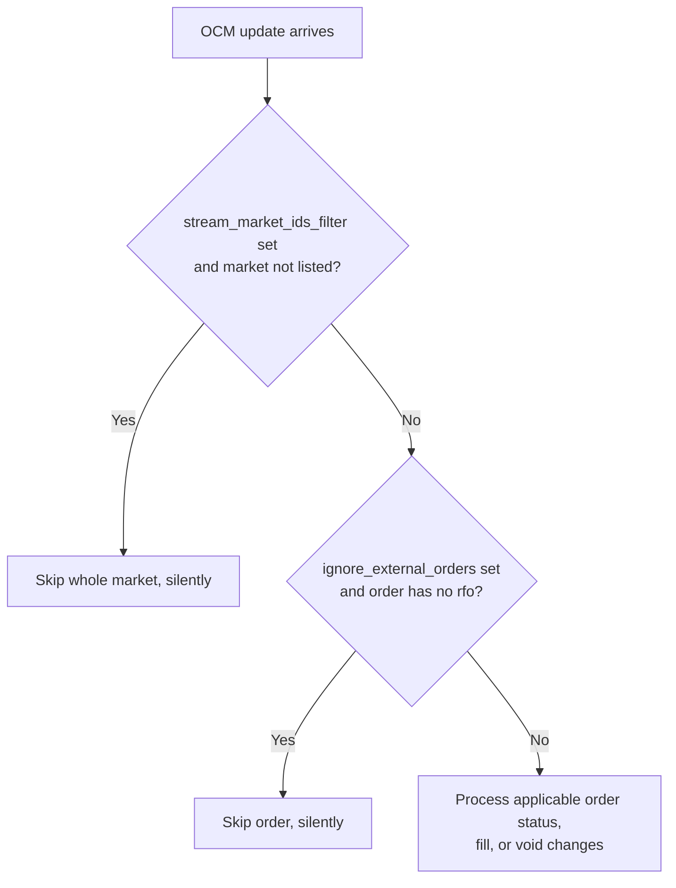

# Betfair

Betfair ก่อตั้งในปี 2000 และให้บริการ betting exchange ออนไลน์ที่ใหญ่ที่สุดในโลก integration นี้รองรับ
การค้นหา instrument, market data แบบ live, สถานะ account, การจัดการ order และการอัปเดตการ execute
ผ่าน Betting API, Accounts API และ Exchange Streaming API ของ Betfair

adapter นี้ implement ด้วย Rust

## ภาพรวม {#overview}

adapter ประกอบด้วย component หลายตัว ซึ่งใช้แยกกันหรือใช้ร่วมกันก็ได้:

- `BetfairHttpClient`: การเชื่อมต่อระดับ low-level กับ Betting API และ Accounts API
- `BetfairStreamClient`: การเชื่อมต่อระดับ low-level กับ Exchange Streaming API สำหรับ market stream และ order stream
- `BetfairRaceStreamClient`: การเชื่อมต่อระดับ low-level สำหรับ data stream ของการแข่งม้า (race) และคริกเก็ต
- `BetfairInstrumentProvider`: โหลด market ของ Betfair และแปลงเป็น instrument ของ Nautilus
- `BetfairDataClient`: ตัวจัดการ market data feed
- `BetfairExecutionClient`: gateway สำหรับการจัดการ account และการ execute bet
- `BetfairDataClientFactory`: factory สำหรับ data client ของ Betfair
- `BetfairExecutionClientFactory`: factory สำหรับ execution client ของ Betfair

:::note
ผู้ใช้ส่วนใหญ่ตั้งค่า live trading node และไม่จำเป็นต้องใช้ component ระดับ low-level เหล่านี้โดยตรง
:::

## การติดตั้ง {#installation}

ติดตั้ง NautilusTrader ตาม[คู่มือการติดตั้ง](../getting_started/installation.md) ไม่ต้องติดตั้งส่วนเสริมเฉพาะของ adapter นี้

## ตัวอย่าง {#examples}

- [ตัวอย่าง Rust](https://github.com/nautechsystems/nautilus_trader/tree/develop/crates/adapters/betfair/examples/)
- [tutorial backtest แบบ book imbalance](../tutorials/backtest_book_imbalance_betfair.md)

## เอกสารของ Betfair {#betfair-documentation}

- [Betfair Developer Program](https://developer.betfair.com/)
- [Exchange API Guide](https://developer.betfair.com/exchange-api/)
- [Application keys](https://betfair-developer-docs.atlassian.net/wiki/spaces/1smk3cen4v3lu3yomq5qye0ni/pages/2687105/Application+Keys)
- [Interactive login](https://betfair-developer-docs.atlassian.net/wiki/spaces/1smk3cen4v3lu3yomq5qye0ni/pages/2687772/Interactive+Login+-+API+Endpoint)

## Credential {#credentials}

Betfair ต้องใช้ application key เพื่อยืนยันตัวตนของ API request หลังจากลงทะเบียนและเติมเงินเข้า account แล้ว
ให้ขอ key ด้วย [API-NG Developer AppKeys Tool](https://apps.betfair.com/visualisers/api-ng-account-operations/)
Betfair ให้ key สองตัวต่อ account คือ key แบบ **Live** ซึ่งต้องจ่ายค่าเปิดใช้งานครั้งเดียว และ key แบบ
**Delayed** สำหรับการพัฒนาและทดสอบ

ระบุ credential ของ account ผ่าน configuration หรือ environment variable:

```bash
export BETFAIR_USERNAME=<your_username>
export BETFAIR_PASSWORD=<your_password>
export BETFAIR_APP_KEY=<your_app_key>
```

adapter ใช้ endpoint interactive login ของ Betfair และไม่ใช้ client certificate

## นโยบาย timestamp {#timestamp-policy}

adapter แยกเวลาของ event ฝั่ง venue ออกจากเวลาการสร้าง object ฝั่ง local:

- `ts_event` บันทึกเวลาที่ Betfair ระบุว่า event เกิดขึ้น
- `ts_init` บันทึกเวลาที่ live adapter ได้รับ stream message ที่บรรจุ event นั้น

callback ของ live stream แต่ละตัวอ่าน atomic clock แบบ real-time หนึ่งครั้งก่อน decode message ผลลัพธ์ทุกตัว
ที่ decode จาก message นั้นจะมี `ts_init` เดียวกัน

| Input                  | แหล่งของ `ts_event`                                                                                                                                                                                                      | แหล่งของ `ts_init`                                                             |
| ---------------------- | ----------------------------------------------------------------------------------------------------------------------------------------------------------------------------------------------------------------------- | ----------------------------------------------------------------------------- |
| Market change (`mcm`)  | เวลา publish ของ message (`pt`)                                                                                                                                                                                         | เวลาที่ได้รับฝั่ง local                                                           |
| Race change (`rcm`)    | เวลาของ feed ของ runner หรือ race (`ft`) และใช้เวลา publish ของ message (`pt`) แทนเมื่อไม่มี `ft`                                                                                                                             | เวลาที่ได้รับฝั่ง local                                                           |
| Cricket change (`ccm`) | เวลา publish ของ message (`pt`)                                                                                                                                                                                         | เวลาที่ได้รับฝั่ง local                                                           |
| Order change (`ocm`)   | เวลาใน lifecycle ของ order ที่เกี่ยวข้อง การ accept ใช้ `pd`; fill ใช้ `md` และใช้ `pt` แทนเมื่อไม่มี; event ด้านสถานะและการ cancel ใช้ค่าล่าสุดของ `md`, `cd` หรือ `ld` และใช้ `pt` แทนเมื่อไม่มี; custom data ระดับ OCM ใช้ `pt` | เวลาที่ได้รับฝั่ง local                                                           |
| Historical data loader | กฎเวลาของ feed เดียวกับข้อมูล live                                                                                                                                                                                       | เวลา publish ของ message (`pt`) เพราะข้อมูลที่บันทึกไว้ไม่มีเวลาที่ได้รับฝั่ง local       |

เมื่อ OCM เข้ามาระหว่าง reconciliation หลัง reconnect adapter จะ buffer message ไว้พร้อม `ts_init` ที่บันทึกไว้
การ drain buffer จะคงเวลาที่ได้รับเดิมไว้ แทนที่จะใช้เวลาของการ replay ที่เกิดทีหลัง

## การกู้คืน order book {#order-book-recovery}

### Market image {#market-images}

data client stream ทุก market ที่ subscribe ไว้ผ่าน market subscription เดียวต่อหนึ่ง connection การ subscribe
market เพิ่มจะเขียน subscription ใหม่โดยรวมทุก market ที่ subscribe ไว้ Betfair จึงส่ง image ของทุก market
มาใหม่ client จะเข้าคิวการเขียนแต่ละครั้งทันที subscription จึงไปถึง Betfair ตามลำดับคำสั่ง และ subscription
ล่าสุดจะมีทุก market

Betfair ส่ง image ทั้ง market market change ที่ตั้ง `img` ไว้จะแทนที่ book ของทุก runner ใน market นั้น
adapter จึงติดตามการ synchronize ของ book เป็นราย market market จะไม่ปล่อย book delta จนกว่า image ของมัน
จะมาถึงหลังจากการเขียน subscription เข้าคิวแล้ว market change ที่ไปถึง market ก่อน image หรือ runner change
ที่ adapter parse ไม่ได้ จะระงับ output ของ book ของ market นั้นและขอ image ใหม่ request จะเริ่มการกู้คืน
ก็ต่อเมื่อยังไม่มีการกู้คืนที่กำลังทำงานเป็นเจ้าของ market นั้นอยู่

image แต่ละตัวจะแทนที่ book ของทุก runner ที่มันบรรจุ runner ที่นิยามของ market ใน image ระบุไว้แต่ image
ไม่ได้ใส่มาจะได้รับ snapshot ว่าง เพราะ image บรรจุราคาทั้งหมดของ market message ของ Betfair ไม่มี sequence
ราย market ลำดับของ stream connection จึงใช้แทนการตรวจจับช่องว่าง (gap detection) market ที่นิยามรายงาน
ว่า `CLOSED` จะหยุดติดตาม เพราะ Betfair จะไม่ส่ง change หรือ image ของมันอีก

book subscription คงอยู่จนกว่า client จะ disconnect: การ unsubscribe ไม่เปลี่ยน market subscription

### กำหนดเวลาของ snapshot {#snapshot-deadlines}

subscription เริ่มต้นและ subscription เพื่อกู้คืนจะรอ image ของแต่ละ market ได้นานสุด
`book_snapshot_timeout_secs` (ค่าเริ่มต้น **10 วินาที**) หลังจากการเขียน subscription เข้าคิวแล้ว
image ที่ไม่มาจะเริ่มหรือลองการกู้คืนใหม่

ตั้ง `book_snapshot_timeout_secs` เป็น `0` เพื่อปิดกำหนดเวลาของ snapshot market change ที่มาก่อน image
ยังคงเริ่มการกู้คืน ถ้า image ไม่มาเลย ความพยายามกู้คืนจะรอจนหมดงบ retry 180 วินาที ความพยายามครั้งต่อๆ ไป
ที่เพดาน retry จะรอได้นานสุดหนึ่งนาที

### ขีดจำกัดของ retry และการ reconnect {#retry-limits-and-reconnects}

การกู้คืนจะส่ง market subscription ใหม่โดยไม่มี clock ภายใต้ ID ใหม่ subscription แต่ละครั้งแทนที่ครั้งก่อน
Betfair จึงตอบด้วย image ใหม่ของทุก market ที่ subscribe ไว้ การกู้คืนจะเข้าร่วมกับ subscription ที่เขียนไว้ภายใน
snapshot timeout ซึ่ง image ยังไม่เริ่ม แทนการเขียนใหม่ market ที่ต้องกู้คืนพร้อมกันจึงใช้ image เดียวกัน
เมื่อปิดกำหนดเวลาของ snapshot ไว้ ทุกความพยายามจะเขียนใหม่

การกู้คืนแต่ละรอบพยายาม**ได้สูงสุดแปดครั้งภายใน 180 วินาที** พร้อม exponential backoff และ jitter
จากนั้นจะ retry ต่อไปจนกว่าจะรับ image ได้ ช่วงเวลา retry เพิ่มเป็นสองเท่าจากหนึ่งนาทีไปถึงสิบห้านาที
การกู้คืนไม่เคยจบในสถานะล้มเหลว การ disconnect และ shutdown จะยกเลิกมัน การที่ venue ปฏิเสธการ resubscribe
จะถูก log ไว้ และความพยายามนั้นจะ retry เมื่อเลยกำหนดเวลาของ snapshot

การ reconnect จะ replay market subscription พร้อม `clk` และ `initialClk` ล่าสุด Betfair จึง patch book ที่
sync แล้วในที่เดิมด้วย change แบบ `RESUB_DELTA` และส่ง image ของ market ที่ patch ไม่ได้ book ที่ sync แล้ว
ยังคง sync อยู่ข้ามการ reconnect subscription ที่ replay โดยไม่มี clock เช่น subscription เพื่อกู้คืนที่ image
ยังไม่มา หรือที่ถูกล้างหลัง `INVALID_CLOCK` จะได้รับ image เต็มแทน การกู้คืนที่กำลังทำงานจะคงงบที่เหลือไว้
และการกู้คืนที่รออยู่ระหว่างความพยายามหลังหมดงบแล้วจะ retry ทันทีบน connection ใหม่

ดู [Order book recovery ownership](../developer_guide/adapters.md#order-book-recovery-ownership)
สำหรับกลไกการกู้คืนที่ใช้ร่วมกันและความรับผิดชอบของ adapter

### การตรวจสอบการกู้คืนแบบ live {#live-recovery-validation}

harness `betfair-book-stress` เป็นเครื่องมือพัฒนาสำหรับการเปลี่ยนแปลงด้านการ synchronize และการกู้คืน book
มันเชื่อมต่อกับ market data บน mainnet ของ Betfair ด้วย credential ของ account และไม่ส่ง order ใดๆ
มัน subscribe ทุก runner ของ market match odds สี่ตัวที่มีการเทรดมากที่สุด ซึ่งเริ่มระหว่างหนึ่งชั่วโมงก่อน
ถึงสิบสองชั่วโมงข้างหน้า แล้วตรวจ book ของแต่ละ runner เทียบกับ contract ของ book stream และเทียบกับการสร้าง
10 ระดับที่ดีที่สุดขึ้นใหม่อย่างอิสระจากบรรทัดดิบของ stream proxy ของ harness ส่งต่อ stream เป็นบรรทัดที่คั่นด้วย
CRLF ผ่าน TCP ธรรมดาไปยัง adapter และผ่าน TLS ไปยัง Betfair

จาก root ของ repository โดยตั้ง `BETFAIR_USERNAME`, `BETFAIR_PASSWORD` และ `BETFAIR_APP_KEY`
สำหรับ application key แบบ live แล้ว ให้รัน:

```bash
CARGO_BUILD_JOBS=16 cargo test -p nautilus-betfair --features examples \
  --test betfair-book-stress -- --timeout 10 --rounds 10
```

application key แบบ delayed จะรวม (conflate) stream เป็นการอัปเดตทุกสามนาที ซึ่งนานเกินขีดจำกัดการกู้คืน
ของ harness

`--scenario` เลือกรูปแบบการรัน:

- `churn` (ค่าเริ่มต้น): หมุนเวียน runner change ที่ parse ไม่ได้, การ resubscribe ที่ถูกปฏิเสธ, การ reconnect
  แบบ resume, การ reconnect ระหว่างการกู้คืน และการหยุด traffic 25 วินาทีหรือการตัด connection อย่างใดอย่างหนึ่ง
- `boundaries`: ทดสอบการหมด retry จนถึงเพดาน retry และการ shutdown ระหว่าง reconnect

`--timeout` ตั้ง snapshot timeout เป็นวินาที โดย `0` ปิดกำหนดเวลาของ snapshot และขั้นการ resubscribe ที่ถูกปฏิเสธ
`--rounds` ตั้งจำนวนรอบของ `churn` (ค่าเริ่มต้น 10) ส่วน `boundaries` รันลำดับของมันครั้งเดียว `--markets`
รับ market ID ที่เปิดอยู่คั่นด้วยจุลภาคเพื่อทดสอบแทน

harness ต้องใช้ Exchange Stream API และ Identity, Navigation และ Betting API ซึ่งใช้ login, โหลด instrument
ของ market และเลือก market ดู [Stress harnesses](../developer_guide/spec_data_testing.md#stress-harnesses)
สำหรับ flag ที่ใช้ร่วมกันและรูปแบบ output

## ความสามารถด้าน order {#orders-capability}

Betfair เป็น betting exchange แนวคิดหลายอย่างจาก venue ทางการเงินแบบดั้งเดิมจึงใช้ไม่ได้

### ประเภทของ order {#order-types}

| ประเภท order            | รองรับ | หมายเหตุ                                                          |
| ---------------------- | ------ | ----------------------------------------------------------------- |
| `MARKET`               | ✓*     | รองรับ `AT_THE_CLOSE` ซึ่ง map เป็น `MARKET_ON_CLOSE` ของ Betfair    |
| `LIMIT`                | ✓      | รองรับ limit order ปกติและ limit order แบบ BSP on-close             |
| `STOP_MARKET`          | -      | ไม่รองรับ                                                          |
| `STOP_LIMIT`           | -      | ไม่รองรับ                                                          |
| `MARKET_IF_TOUCHED`    | -      | ไม่รองรับ                                                          |
| `LIMIT_IF_TOUCHED`     | -      | ไม่รองรับ                                                          |
| `TRAILING_STOP_MARKET` | -      | ไม่รองรับ                                                          |

การส่ง order แบบ `MARKET` ด้วย time in force อื่นที่ไม่ใช่ `AT_THE_CLOSE` จะถูกปฏิเสธ เพราะ Betfair
ไม่มี market order แบบทันที

:::warning
คำสั่ง BSP on-close ใช้ **liability** ไม่ใช่ stake สำหรับ order แบบ `MARKET_ON_CLOSE` และ
`LIMIT_ON_CLOSE` adapter จะส่ง quantity ของ order เป็น liability ของ Betfair ให้กำหนดขนาด order แบบ BSP
ตามจำนวนเงินที่คุณพร้อมจะเสีย ไม่ใช่ตาม stake ที่ต้องการให้ match
:::

bet แบบ BSP เพิกถอนไม่ได้: เมื่อวางแล้ว venue จะปฏิเสธ cancel request ของมัน ขณะที่ bet แบบ BSP ยังรออยู่
ทั้ง stream และ `listCurrentOrders` จะรายงานมันเป็น `EXECUTION_COMPLETE` โดยรายงานขนาด matched, remaining,
cancelled, lapsed และ voided เป็นศูนย์ และแยก liability ไว้ต่างหาก adapter จะคง bet นั้นไว้ที่ `ACCEPTED`
จนถึง BSP reconciliation ซึ่ง bet ที่ match จะกลายเป็น `FILLED` และ bet ที่ lapse จะกลายเป็น `CANCELED`
`CancelOrder` หรือ `BatchCancelOrders` ที่ส่งให้ bet แบบ BSP อย่างชัดเจนจะปล่อย `OrderCancelRejected`
พร้อมเหตุผล `BET_TAKEN_OR_LAPSED` จาก venue แทนการปิด order ส่วน `CancelAllOrders` ไม่ปล่อย event ราย
order ตามที่อธิบายไว้ใน [Cancel all orders](#cancel-all-orders)

### Time in force {#time-in-force}

| Time in force  | รองรับ | หมายเหตุ                                                     |
| -------------- | ------ | ------------------------------------------------------------ |
| `GTC`          | ✓      | map เป็น `PERSIST` ของ Betfair                                 |
| `DAY`          | ✓      | map เป็น `LAPSE` ของ Betfair                                   |
| `FOK`          | ✓      | map เป็น `FILL_OR_KILL` ของ Betfair                            |
| `IOC`          | ✓      | map เป็น `FILL_OR_KILL` พร้อม `min_fill_size=0`                 |
| `AT_THE_CLOSE` | ✓      | ใช้สำหรับ BSP `LIMIT_ON_CLOSE` และ `MARKET_ON_CLOSE` ของ Betfair |
| `GTD`          | -      | ไม่รองรับ; เวลาหมดอายุถูกละเลยและ map เป็น `LAPSE`               |

order แบบ `LIMIT` ในโหมด `AT_THE_OPEN` จะถูก route ไปเป็น `LIMIT_ON_CLOSE` เช่นกัน เพราะ Betfair ไม่มี
คำสั่งแบบ at-the-open

### คำสั่งการ execute {#execution-instructions}

| คำสั่ง          | รองรับ | หมายเหตุ                              |
| ------------- | ------ | ------------------------------------- |
| `post_only`   | -      | ไม่เกี่ยวข้องกับ betting exchange        |
| `reduce_only` | -      | ไม่เกี่ยวข้องกับ betting exchange        |

### ความสามารถขั้นสูงของ order {#advanced-order-features}

| ความสามารถ          | รองรับ | หมายเหตุ                            |
| ------------------ | ------ | ----------------------------------- |
| Order Modification | ✓      | ราคาและขนาดเปลี่ยนแยกกัน              |
| Bracket/OCO Orders | -      | ไม่รองรับ                            |
| Iceberg Orders     | -      | ไม่รองรับ                            |

### การทำงานแบบ batch {#batch-operations}

| การทำงาน      | รองรับ | หมายเหตุ                                  |
| ------------ | ------ | ---------------------------------------- |
| Batch Submit | ✓      | implement ผ่าน `SubmitOrderList`         |
| Batch Modify | -      | ไม่รองรับ                                 |
| Batch Cancel | ✓      | implement ผ่าน `BatchCancelOrders`       |

### Cancel all orders {#cancel-all-orders}

เมื่อไม่ระบุ order side `CancelAllOrders` จะส่ง request ระดับทั้ง market หนึ่งครั้ง และ cancel order ของ
ทุก selection ใน market นั้น

เมื่อระบุ order side คำสั่งจะเลือก order ที่เปิดอยู่ใน cache สำหรับ instrument และ side ที่ตรงกันพอดี
โดยไม่สนว่าเป็นของ strategy ใด order เหล่านี้ต้องเป็นของ execution client และ account ปัจจุบัน ซึ่งรวมถึง
external order ที่ reconcile แล้วและถูกกำหนดให้ client นั้น และไม่รวม order ที่ไม่ได้กำหนด client คำสั่งนี้
ใช้ venue order ID ที่อยู่ใน cache แล้วและไม่ refresh สถานะของ order ก่อน ถ้ามี order ที่เข้าเกณฑ์ใดไม่มี
venue order ID ใน cache คำสั่งจะไม่ส่ง request ใดเลย มิฉะนั้นจะส่งคำสั่ง cancel ราย bet เป็น batch
ละไม่เกิน 60 รายการ

`CancelAllOrders` ไม่สร้างคำสั่ง cancel ราย order ความล้มเหลวของ request และคำสั่งจึงไม่ปล่อย order event
สถานะสุดท้ายของ order มาจาก OCM และ mass-status reconciliation

### การจัดการ position {#position-management}

| ความสามารถ        | รองรับ | หมายเหตุ                                      |
| ---------------- | ------ | -------------------------------------------- |
| Query positions  | -      | exposure ติดตามราย bet ไม่ใช่ราย position     |
| Position mode    | -      | ไม่เกี่ยวข้องกับ betting exchange              |
| Leverage control | -      | betting exchange ไม่มี leverage              |
| Margin mode      | -      | betting exchange ไม่มี margin                |

ตั้ง `position_check_interval_secs=None` ใน `LiveExecutionEngineConfig` เพราะ Betfair ไม่รายงาน position
ฝั่ง venue ให้ตรวจเทียบ

### การ query order {#order-querying}

| ความสามารถ             | รองรับ | หมายเหตุ                                            |
| --------------------- | ------ | -------------------------------------------------- |
| Query open orders     | ✓      | สร้างจาก `listCurrentOrders`                         |
| Order status updates  | ✓      | การเปลี่ยนสถานะ bet แบบ real-time จาก order stream    |
| Fill reports          | ✓      | ขนาดและราคาที่ match จาก `listCurrentOrders`           |
| Cleared order history | -      | adapter ไม่ request ประวัติการ settle                  |

`LiveNode` ดึง order report และ fill report แบบ bulk ผ่าน HTTP บน worker จากนั้นก่อน reconciliation
main thread ของมันจะ resolve ตัวตนและ fill แบบ incremental เทียบกับสถานะ OCM ปัจจุบัน mass status ตอน
startup และหลัง reconnect จะข้าม hook เหล่านี้

- report ของ order เดี่ยวคืน error ว่าไม่รองรับ และยืนยันไม่ได้ว่า order ที่เปิดอยู่ใน cache แต่ไม่พบในการตรวจแบบ
  bulk นั้นไม่มีอยู่จริง การ resolve order ที่หายไปจึงถูกเลื่อนออกไป ส่วนการอัปเดตจาก OCM และ mass status
  ยังใช้ได้ `QueryOrder` ยังรองรับการตรวจ order ที่ inflight
- position report คืน error ว่าไม่รองรับ ให้[ปิดการตรวจ position](#position-management)

## Flow การควบคุมการ execute {#execution-control-flow}

ตอน startup:

1. เชื่อมต่อ HTTP client และดึงยอดเงินเริ่มต้นของ account
2. ตั้งต้นสถานะ OCM จาก order ใน cache
3. เชื่อมต่อ execution stream ของ Betfair และ subscribe การอัปเดต order
4. สร้าง order report และ fill report จากการสังเกต `listCurrentOrders` ชุดเดียวกัน
5. reconcile order report และ fill report เข้าสู่ execution engine

order ที่เปิดอยู่ใน cache ซึ่งมีตัวตนฝั่ง venue จะถูกกู้คืนเป็นสถานะที่ accept แล้ว adapter ยังกู้คืนตัวตน
ที่เก็บไว้ของ order ที่ปิดแล้วล่าสุดใน cache ได้สูงสุด 10,000 รายการ ทั้งสองเส้นทางไม่ปล่อย `OrderAccepted` ซ้ำ

ทุกครั้งที่ stream reconnect adapter จะดึง mass status ของ order และ fill ซ้ำในช่วงเวลาล่าสุด และหยุดรับการส่ง
order ใหม่หลังจาก transport หลุดหรือได้รับสถานะ `connectionClosed` จาก server จนกว่า recovery generation
ล่าสุดจะ dispatch mass status ของมัน

ดูลำดับการเปลี่ยนสถานะทั้งหมดได้ที่
[reconciliation หลัง reconnect](#post-reconnect-reconciliation)

พฤติกรรมของ reconciliation:

- `stream_market_ids_filter` กรองการอัปเดต OCM แบบ live
- reconciliation ใช้ `reconcile_market_ids` เฉพาะเมื่อ `reconcile_market_ids_only=True` และตั้ง
  `reconcile_market_ids` ไว้
- ในกรณีอื่นทั้งหมด รวมถึง `reconcile_market_ids_only=True` แต่ไม่มี `reconcile_market_ids`
  adapter จะใช้ `stream_market_ids_filter` เป็นขอบเขตของ reconciliation แทน
- `ignore_external_orders=True` ข้ามการอัปเดต OCM ที่ไม่มี `rfo`

## การจัดการ session และการ reconnect {#session-management-and-reconnection}

Betfair ทำให้ session token หมดอายุ adapter จึงต่ออายุ token ล่วงหน้าแทนการรอให้ล้มเหลว โดยจัดการการต่ออายุ
และการกู้คืนผ่านกลไกสี่แบบ:

| กลไก                  | ตัวกระตุ้น                                          | การทำงาน                                                                                                     |
| -------------------- | ------------------------------------------------ | ---------------------------------------------------------------------------------------------------------- |
| Periodic keep-alive  | ทุก 10 ชั่วโมง (36,000 วินาที)                        | ต่ออายุ session token และอัปเดตการยืนยันตัวตนของ stream ที่เก็บไว้โดยไม่ reconnect                                 |
| Keep-alive fallback  | keep-alive คืน `LoginFailed`                      | login ใหม่, อัปเดตการยืนยันตัวตนของ stream ที่ active ทั้งหมด แล้ว request transport ของ stream ตัวใหม่                |
| Stream reconnect     | order image ปัจจุบันหลังกู้คืน transport               | ลอง keep-alive ถ้าได้ `LoginFailed` จะ login ใหม่ทั้งหมด ความล้มเหลวแบบอื่นจะคง session เดิมไว้                     |
| HTTP report recovery | query report คืน error ด้าน session                  | ลอง keep-alive แล้ว retry หนึ่งครั้ง ถ้า keep-alive ล้มเหลวแบบใดก็ตามจะ login ใหม่ทั้งหมดก่อน retry ครั้งนั้น            |

task keep-alive แบบเป็นระยะและ handler การ reconnect ของ data stream จะ log และข้าม error ชั่วคราวของ
keep-alive เช่น network timeout และ response 5xx handler การ reconnect ของ execution ก็คง session token
เดิมไว้เช่นกัน แต่จะทำ reconciliation ของ report ต่อ ในขั้น keep-alive แบบเป็นระยะหรือระดับ handler มีเพียง
`LoginFailed` ที่ทำให้ login ใหม่ทั้งหมด ส่วน HTTP report recovery ต่างออกไป: หลัง error ด้าน session
ความล้มเหลวของ keep-alive แบบใดก็ตามจะ login ใหม่ทั้งหมดก่อน retry ระดับ report

ทั้ง data client และ execution client ใช้นโยบายการต่ออายุ session เดียวกัน แต่ละตัวจะ spawn:

- **task keep-alive** ที่พยายามต่ออายุเป็นระยะ keep-alive ที่สำเร็จตามปกติจะอัปเดตการยืนยันตัวตนที่เก็บไว้
  โดยไม่แทนที่ transport
- **handler การ reconnect** ที่รอให้ order subscription ตัวใหม่เป็นปัจจุบัน แล้วพยายาม refresh session

หลังการ login ใหม่ทั้งหมด adapter จะอัปเดตการยืนยันตัวตนของทุก stream ที่ active ซึ่งได้รับผลกระทบก่อน
request การ reconnect ใดๆ connection ใหม่แต่ละตัวจะส่งการยืนยันตัวตนล่าสุดก่อน subscription ที่เก็บไว้หรือ traffic
ที่ buffer ไว้ระหว่าง reconnect market stream และ order stream คง subscription ID และค่า resume
`clk`/`initialClk` ไว้ response สถานะที่ correlate กันจะแยกความพร้อมของ socket, การยืนยันตัวตน, subscription
ที่รออยู่, subscription ปัจจุบัน, request ที่ถูกปฏิเสธ และ stream ที่เสื่อมสภาพ (degraded) ออกจากกัน

data client ใช้การอัปเดตเดียวกันกับ market stream, race stream และ cricket stream ที่ active keep-alive fallback
แบบเป็นระยะจะ request transport ใหม่ทันทีหลังอัปเดตการยืนยันตัวตน ส่วน HTTP report recovery จะ request
execution stream ตัวใหม่หลัง query เสร็จ

เมื่อการ login ใหม่ทั้งหมดเกิดขึ้นภายใน handler การ reconnect ของ execution stream handler นั้นจะดึงและ dispatch
mass status ก่อน แล้วจึง request execution stream ตัวใหม่ message `Connection` ของ stream ตัวใหม่จะเริ่ม
handler รอบใหม่ keep-alive ที่สำเร็จจะอัปเดตการยืนยันตัวตนที่เก็บไว้โดยไม่ request การแทนที่อีก ลำดับนี้ป้องกัน
reconnect loop

## Reconciliation หลัง reconnect {#post-reconnect-reconciliation}

หลัง handshake เริ่มต้น การที่ execution transport ของ Betfair หลุดจะหยุดรับการส่ง order ใหม่ทันที
ซึ่งใช้กับทั้งการ reconnect ของ network แบบอัตโนมัติและการแทนที่ที่ request หลังการ login ใหม่ทั้งหมด adapter
ถือว่า cache อาจไม่ตรงกับความจริงแล้วระหว่างที่ transport ตัวเดิมใช้งานไม่ได้ โดยเฉพาะ fill อาจเกิดครบและหลุด
ออกจาก unmatched book ไปก่อนที่ stream image หลัง reconnect จะมาถึง adapter จึงดึงและ dispatch mass status
ในช่วงเวลาล่าสุดก่อนเปิดให้ส่ง order ใหม่

| ขั้น | ตัวกระตุ้น                                                | การทำงาน                                                                                                                 |
| --- | ------------------------------------------------------ | ---------------------------------------------------------------------------------------------------------------------- |
| 1   | transport หลุด หรือสถานะ `connectionClosed` จาก server     | เลื่อน reconciliation generation และหยุดรับการส่ง order ใหม่ทันที                                                          |
| 2   | message `Connection` ของตัวใหม่                         | ทำเครื่องหมายการยืนยันตัวตนและ subscription ที่เก็บไว้ว่า pending และตั้ง `pending_resync`                                       |
| 3   | `SUB_IMAGE` หรือ `RESUB_DELTA` ที่สมบูรณ์                 | เข้าคิว generation ปัจจุบันหนึ่งครั้ง OCM ยังถูก buffer ไว้จนกว่าการกู้คืนจะเสร็จ                                                |
| 4   | task reconnect ได้รับ generation                        | refresh session, request `getAccountFunds` แล้วดึง order snapshot หนึ่งชุดโดยพยายามได้สูงสุดสี่ครั้งแบบมีขอบเขต                    |
| 5   | snapshot ทุกหน้าสำเร็จ                                   | dispatch mass status ที่สมบูรณ์, commit การกรอง fill ซ้ำ และเปิดรับการส่ง order อีกครั้งภายใต้การตรวจ generation ครั้งเดียว      |

การ refresh สถานะ account เป็นแบบ best effort: ความล้มเหลวของ request หรือการ parse จะถูก log แต่ไม่กันการ
dispatch mass status หรือการเปิดประตู (gate) ความล้มเหลวของ keep-alive ที่ไม่ใช่ `LoginFailed` จะดำเนินต่อด้วย
session ที่เก็บไว้ เพราะ query ของ report มี logic การ retry และการกู้คืน session ของตัวเอง การกู้คืน mass status
แบบอ่านอย่างเดียว retry สี่ครั้งพร้อม exponential backoff การ retry ที่หมดลง, การ login ใหม่ทั้งหมดที่ล้มเหลว
หรือการ dispatch report ที่ล้มเหลวจะทำให้ gate ยังปิดอยู่จนกว่าการ reconnect ครั้งต่อไปจะสำเร็จหรือ client
disconnect การหลุดของ transport, การ reconnect, การ disconnect หรือ shutdown ที่ใหม่กว่าจะยกเลิกงานกู้คืนที่ค้างอยู่
พฤติกรรมแบบ fail-closed นี้ครอบคลุมถึง socket ที่ active แต่การยืนยันตัวตนหรือ order subscription ไม่เป็นปัจจุบันด้วย

การ dispatch mass status และการ commit การกรอง fill ซ้ำเป็นขอบเขตการเสร็จสิ้นของ generation ที่จัดการ
การกู้คืนที่ล้มเหลวหรือค้างจะไม่เลื่อนสถานะการกรอง fill ซ้ำ gate ไม่รอการยืนยันแยกต่างหากว่า execution engine
ได้นำ report ไปใช้กับ cache แล้ว

ระหว่างที่ execution stream ใช้งานไม่ได้หรือกำลังทำ reconciliation:

- `submit_order` และ `submit_order_list` ปล่อย `OrderDenied` พร้อมเหตุผล
  `STREAM_RECONCILING: execution stream unavailable or recovering, retry after recovery`
- `cancel_order`, `batch_cancel_orders` และ `modify_order` ผ่านไปตามปกติ
- `pending_resync` buffer OCM ที่ได้รับหลัง message `Connection` ของตัวใหม่ การ poll connectivity และ
  entry point ของ command หรือ report จะเรียก `process_pending_resync` บน engine thread ซึ่ง synchronize
  สถานะ OCM จาก cache และ drain buffer

ถ้า client disconnect ขณะที่ reconciliation ยังทำงานอยู่ `clear_resync_state` จะล้างการหยุดที่ active อยู่
เพื่อให้รอบ connect/submit ถัดไปเริ่มต้นใหม่อย่างสะอาด

ช่วงเวลาย้อนหลังสำหรับการดึง mass status คือ `stream_gap_recovery_lookback_mins` (ค่าเริ่มต้น `10`) order report
และ fill report ใช้การสังเกต `OrderProjection::All` ชุดเดียวกันจากการไล่ `listCurrentOrders` แบบแบ่งหน้าหนึ่งรอบ
เมื่อมี market filter request จะใช้ batch ละไม่เกิน 250 market ID ถ้าหน้าต่างๆ มี Bet ID ซ้ำ report ทั้งสองจะใช้
การสังเกตล่าสุดของมัน

การกู้คืน fill เลือก order ฝั่ง local ตาม `matchedDate` โดยรวมขอบทั้งสองของช่วงเวลา และเรียงตามเวลาที่ match
order ที่วางก่อนช่วงเวลาย้อนหลังยังเข้าเกณฑ์ถ้า match ระหว่างช่วงที่ขาดหาย ซึ่งรวมถึง order ที่ execution-complete
และที่ settle แล้วซึ่ง `listCurrentOrders` ยังคืนมา order ที่อยู่นอกช่วงเวลาของ fill ยังให้ข้อมูลสถานะและประวัติ
การแทนที่ โดยไม่เลื่อนสถานะการกรอง fill ซ้ำ

การสร้าง mass status ตามปกติใช้ `lookback_mins` (ไม่บังคับ) ของผู้เรียกเป็นขอบล่าง โดยไม่มีขอบบน เมื่อไม่ได้ระบุ
lookback ทุก order ที่มี `matchedDate` จะเข้าเกณฑ์ การสร้างตามปกติจะ commit การกรองซ้ำเฉพาะเมื่อ report
ที่สมบูรณ์พร้อมจะคืนค่าแล้ว

## การค้นหาเฉพาะ order ที่เปิดอยู่ {#open-only-order-discovery}

reconciliation แบบเฉพาะ order ที่เปิดอยู่ (open-only) จะค้นหา bet ที่ยัง execute ได้และ order ทั้งหมดใน market
ที่เปิดใช้ BSP

### ประวัติการแทนที่ {#replacement-history}

adapter จะ query Bet ID ของการแทนที่ที่รู้จักสำหรับ order ที่ค้นพบและการแก้ไขที่ยังไม่ resolve การค้นหาเพิ่มเติม
เหล่านี้กู้คืน fill สะสมและ quantity ที่ยืนยันแล้ว:

- ถ้า Bet ID ของการแทนที่หรือของการแก้ไขที่ค้างอยู่ซึ่งจำเป็นยังหายไปหลัง query เพิ่มเติม การ scan จะล้มเหลว
  แทนที่จะถือว่า fill ของมันเป็นศูนย์
- order ที่เปิดอยู่ใน cache แต่ไม่พบในการค้นหาฝั่ง venue ไม่ได้ทำให้เกิดความล้มเหลวนี้ด้วยตัวเอง

### ขอบเขตของ market {#market-scope}

query การค้นหาใช้[ขอบเขต market ของ reconciliation ที่ตั้งค่าไว้](#execution-control-flow) คำสั่งสำหรับ
instrument เฉพาะจะจำกัดการค้นหาให้แคบลงเหลือ market ของ instrument นั้น และไม่คืน report ใดเลยเมื่อ market
อยู่นอกขอบเขตที่ตั้งค่าไว้

การค้นหาเพิ่มเติมตาม Bet ID และ `customerOrderRef` ไม่ถูกกรองตาม market และยัง query การแก้ไขที่ยังไม่ resolve
ของ order ที่ติดตามอยู่นอกขอบเขตการค้นหาด้วย แถวเหล่านั้นไม่ถูกรวมใน report แต่ประวัติที่จำเป็นที่หายไปยังทำให้
การ scan ล้มเหลว

### Bet แบบ BSP ที่รออยู่ {#resting-bsp-bets}

เพื่อกู้คืน[bet แบบ BSP](#order-types) ที่รออยู่ รวมถึง bet ที่ adapter ไม่ได้ติดตาม adapter จะค้นหา market
ที่เปิดใช้ BSP ซึ่งมี order ของ account ที่ execution-complete ด้วย โดย query market เหล่านี้ด้วย
`listCurrentOrders` แบบ `ALL` และรายงาน bet แบบ BSP ที่รออยู่เป็น `ACCEPTED`

การค้นหา market แบบ BSP ขึ้นกับขอบเขตของ query:

- **ทั้ง account**: `listEvents` ค้นหา event แล้ว `listMarketCatalogue` query แต่ละ event ด้วย
  `maxResults=1000` ถ้า event คืน market มา 1,000 ตัว การ scan จะล้มเหลวแทนการเสี่ยงได้ชุด order ที่เปิดอยู่
  ไม่ครบ
- **เฉพาะ market**: catalog request แต่ละครั้งมี market ID ได้ไม่เกิน 250 ตัว

market ที่ไม่มี BSP จะไม่ถูก scan หาประวัติ order ที่ไม่เกี่ยวข้อง order ในอดีตภายใน market ที่เปิดใช้ BSP
ที่ค้นพบ รวมถึง limit bet ธรรมดา ยังอาจเพิ่มประวัติการแทนที่ที่จำเป็นและเพิ่มงานของการ scan ได้

## Tick scheme และราคา {#tick-scheme-and-pricing}

Betfair ใช้ tick scheme แบบเป็นขั้น (tiered) ที่ increment ต่างกันตามช่วงราคา:

| ช่วงราคา          | ขนาด tick |
| ---------------- | --------- |
| 1.01 - 2.00      | 0.01      |
| 2.00 - 3.00      | 0.02      |
| 3.00 - 4.00      | 0.05      |
| 4.00 - 6.00      | 0.10      |
| 6.00 - 10.00     | 0.20      |
| 10.00 - 20.00    | 0.50      |
| 20.00 - 30.00    | 1.00      |
| 30.00 - 50.00    | 2.00      |
| 50.00 - 100.00   | 5.00      |
| 100.00 - 1000.00 | 10.00     |

ราคาต่ำสุดคือ 1.01 และสูงสุดคือ 1000.00

## การแก้ไข order {#order-modification}

- ราคาและขนาดเปลี่ยนพร้อมกันแบบ atomic ไม่ได้ ต้องทำแยกกัน
- การแก้ราคาใช้ `ReplaceOrders` (cancel + order ใหม่ที่ราคาใหม่)
- การลดขนาดใช้ `CancelOrders` พร้อม parameter `size_reduction`
- ไม่รองรับการเพิ่มขนาด ให้ส่ง order ใหม่แทน

การแทนที่ราคาที่สำเร็จยังคงเป็น order เชิงตรรกะ (logical order) ตัวเดิมของ Nautilus adapter จะ map Bet ID
เก่าและใหม่ไปยัง `client_order_id` เดียวกัน ระงับการ cancel ของ bet เก่า และปล่อย `OrderUpdated` หนึ่งครั้ง
พอดีพร้อม Bet ID ใหม่ ซึ่งเป็นจริงไม่ว่า REST response หรือ order change message (OCM) จะมาถึงก่อน ถ้า OCM ของ
การแทนที่มี fill อยู่แล้ว `OrderUpdated` จะมาก่อน `OrderFilled`

Betfair อาจคืน `CANCELLED_NOT_PLACED` เมื่อการ replace cancel bet เก่าได้แต่วาง bet ตัวแทนไม่สำเร็จ
adapter จะปล่อย `OrderCanceled` สำหรับ order เชิงตรรกะนั้นแทน `OrderModifyRejected` fill ที่มาช้าของ Bet ID
ที่ถูก cancel ยังถูกนำไปใช้หนึ่งครั้ง หลังจากนั้น order ยังคงเป็น `CANCELED` ผลลัพธ์สุดท้ายแบบเดียวกันนี้ใช้เมื่อ
OCM การ cancel ของ bet เก่ามาถึงขณะที่การแทนที่ยังค้างอยู่ และ REST call คืนความล้มเหลวของการ replace
แบบเด็ดขาดใดๆ ในภายหลัง

### การกู้คืนการแก้ไขที่กำกวม {#recovering-an-ambiguous-modification}

เมื่อ REST response หายไปหรือกำกวม adapter จะ resolve การแก้ไขจาก OCM stream หรือจากผล `listCurrentOrders`
ที่ยืนยัน มีเพียง reconciliation ที่ไล่แบ่งหน้าครบทั้งหมดเท่านั้นที่พิสูจน์ได้ว่า order เดิมไม่เปลี่ยนแปลง หรือปิดไป
โดยไม่มีการแทนที่:

- bet ที่แสดงภายใต้ `customerOrderRef` เดียวกันแต่ Bet ID ต่างกันจะยืนยันการ replace ที่ค้างอยู่ ทั้งรายการที่
  active และที่ปิดแล้วจะปล่อย `OrderUpdated` พร้อม Bet ID ใหม่, ราคาของมัน และขนาดเดิม รายการที่ active
  จะถูกกันออกจากชุด report ที่ใช้ resolve ส่วนรายการที่ปิดแล้วจะตามการอัปเดตด้วย order status report สถานะ
  terminal ของมัน
- bet ที่ขนาด active ลดลงจนอย่างน้อยเท่ากับขนาดที่ขอแต่น้อยกว่าขนาดเดิม จะยืนยันการลดขนาด ขนาด active คือ
  matched บวก remaining บวก voided (`sizeVoided` หรือ `sv` บน stream) และรวมขนาด matched และ voided
  ของ bet ที่ถูกแทนที่ทั้งหมด การ void จึงไม่ทำให้ค่านี้ลดลง รายการที่ active จะปล่อย `OrderUpdated` พร้อมขนาด
  ที่ลดลง ส่วนรายการที่ปิดแล้วจะมีขนาดที่ยืนยันอยู่ใน report สถานะ terminal โดยไม่มี `OrderUpdated` ขนาด active
  ที่เล็กกว่านั้นคือการ lapse ไม่ใช่การลดขนาดที่ขอ และขนาดที่ไม่เปลี่ยนหมายความว่า Betfair ยังไม่ได้ลดขนาด
  ทั้งสองกรณีจึงคงคำสั่งไว้ในสถานะ inflight

ช่องทางใดที่ resolve การแก้ไขได้ก่อนจะเป็นผู้ชนะ และช่องทางอื่นจะไม่มีผล ดังนั้นการลดขนาดที่ stream ยืนยันแล้ว
จะไม่ถูกทำซ้ำเมื่อ REST response ของมันกลับมา

ขณะที่ REST request อาจยังทำงานอยู่ รายการที่มีเพียง bet เดิมไม่ได้พิสูจน์อะไร order จึงยังเป็น `PENDING_UPDATE`
หลังจากผล REST กลายเป็นกำกวม reconciliation ที่ไล่แบ่งหน้าครบซึ่งแสดงว่า Bet ID เดิมยัง execute ได้จะปล่อย
`OrderModifyRejected`, คง report ที่ active ไว้ และล้างการแทนที่ที่ค้างอยู่ ถ้า `customerOrderRef` resolve
ไปยัง order ที่ค้างอยู่ได้ไม่ซ้ำกัน reconciliation เดียวกันที่พบ Bet ID เดิมปิดแล้วและไม่มีการแทนที่จะล้างสถานะ
ค้าง และให้ report สถานะ terminal เป็นตัวบอกการ cancel ถ้า `customerOrderRef` resolve ไปยัง order ได้ไม่เป็นตัวเดียว adapter
จะระบุ Bet ID ใหม่ที่อาจมีอยู่ไม่ได้ การแทนที่จึงยังค้างอยู่ ความล้มเหลวของการแก้ไขแบบเด็ดขาดก็ล้างสถานะค้าง
เช่นกัน เพื่อไม่ให้การ lapse ภายหลังถูกเข้าใจผิดว่าเป็นการลดขนาดที่ขอ

reconciliation จะกัน order status report ที่จะซ้ำหรือขัดแย้งกับสถานะที่ resolve แล้วออก:

- replace leg ที่ถูกแทนที่ในรอบที่ resolve ไม่ว่าตัวแทนจะ active หรือ terminal เพราะ report `CANCELED` ของมัน
  จะไป cancel order เชิงตรรกะ
- report ที่ active ซึ่งทำให้เกิด `OrderUpdated` เพราะ order ยังค้างอยู่ฝั่ง local ขณะ reconciliation ทำงาน

report ที่คงไว้พร้อม `OrderModifyRejected` และ report สถานะ terminal จะไปตามเส้นทาง report ปกติ report
การแทนที่ที่เป็น terminal จะตาม `OrderUpdated` ของมันเข้าสู่ lifecycle สถานะ terminal ที่คงไว้ การลดขนาดที่เป็น
terminal จะ resolve โดยไม่มี `OrderUpdated` report นั้นและ report ต่อๆ มาจะมีขนาดที่ยืนยันแล้วแทน stake เดิม
ของ Betfair

รอบที่ resolve จะระงับ Bet ID ในอดีตตามที่อธิบายข้างต้น เมื่อ order ตัวแทนเชิงตรรกะเป็น terminal แล้ว query
แบบระบุและแบบ mass status ในภายหลังจะคง order status report ของ Bet ID ในอดีตของมันไว้

## ความล้มเหลวและการ retry ของคำสั่ง order {#order-command-failures-and-retries}

### การ correlate request {#request-correlation}

Betfair มีค่าแยกกันสำหรับการ correlate order เชิงตรรกะและการกรอง request ซ้ำ:

| ฟิลด์               | ขอบเขต             | พฤติกรรมของ adapter                                                                                                         |
| ------------------ | ----------------- | -------------------------------------------------------------------------------------------------------------------------- |
| `customerOrderRef` | order เชิงตรรกะหนึ่งตัว | สร้างจาก `client_order_id`, คืนกลับมาเป็น `rfo` ของ OCM และคงไว้ข้าม Bet ID ของการแทนที่                                          |
| `customerRef`      | คำสั่ง REST หนึ่งครั้ง  | สร้างใหม่สำหรับแต่ละ request place, replace หรือ cancel และใช้ซ้ำโดยไม่เปลี่ยนในทุก retry รวมถึง batch และการลดขนาด               |

:::warning
client order ID ที่ยาวเกิน 32 ตัวอักษรจะใช้ 32 ตัวอักษรสุดท้ายเป็น `customerOrderRef` ให้ส่วนท้ายเหล่านั้นไม่ซ้ำกัน
ระหว่าง order ที่ติดตาม การส่ง order ใหม่ที่ reference ตรงกับ order อื่นที่ติดตามอยู่จะปล่อย `OrderDenied`
ก่อน `OrderSubmitted` หรือก่อน dispatch HTTP พร้อม
`VALIDATION_FAILED: customerOrderRef <ref> collides with another tracked order` ใน order list
จะ deny เฉพาะ leg ที่ชนกัน
:::

เมื่อ synchronize สถานะ OCM จาก order ใน cache adapter ยังรู้จักรูปแบบเดิมที่ใช้ 32 ตัวอักษรแรกด้วย ถ้าการตัดทอน
แบบใดแบบหนึ่งระบุ order ที่ติดตามได้มากกว่าหนึ่งตัว order status report และ fill report ของ OCM และ reconciliation
จะละ `client_order_id` และคง Bet ID ไว้ เพื่อให้ reconciliation match ด้วยตัวตนฝั่ง venue ได้

### Retry และความกำกวม {#retry-and-ambiguity}

การเรียก order ที่เปลี่ยน state ใช้ retry ได้สูงสุดสามครั้งโดยค่าเริ่มต้น ภายในงบเวลารวม 45 วินาที ขีดจำกัดเวลาที่ผ่านไป
ทำให้ทุก retry อยู่ภายในช่วงการกรองซ้ำ `customerRef` 60 วินาทีของ Betfair adapter จัดการความล้มเหลวดังนี้:

| ความล้มเหลวหรือ response                                                          | การจัดการคำสั่ง order                                                                          |
| ------------------------------------------------------------------------------ | ------------------------------------------------------------------------------------------- |
| transport ล้มเหลว, client timeout, response สำเร็จที่ผิดรูปแบบ หรือ HTTP 5xx          | ทำเครื่องหมายว่าความพยายามนั้นกำกวม และ retry ด้วย `customerRef` เดิม                             |
| HTTP 429, `TOO_MANY_REQUESTS` หรือ `SERVICE_BUSY`                               | retry ด้วย `customerRef` เดิม                                                               |
| `UNEXPECTED_ERROR`                                                             | ทำเครื่องหมายว่าความพยายามนั้นกำกวม และ retry ด้วย `customerRef` เดิม                             |
| `TIMEOUT_ERROR` หรือการยกเลิกโดย adapter                                          | ปล่อยให้คำสั่งกำกวมโดยไม่ retry                                                                  |
| report `TIMEOUT` หรือ `BET_IN_PROGRESS`                                          | ปล่อยให้คำสั่งกำกวมเพื่อให้ OCM หรือ reconciliation จัดการ                                           |
| report ที่ไม่สมบูรณ์หรือขัดแย้งกัน                                                     | ปล่อยให้คำสั่งกำกวม เว้นแต่ error ระดับบนสุดแบบเด็ดขาดจะพิสูจน์ว่าถูกปฏิเสธ                             |
| error ด้าน validation, การยืนยันตัวตน, สิทธิ์ หรือ error เด็ดขาดอื่นของ venue ที่รู้จัก      | ปฏิเสธคำสั่งที่ได้รับผลกระทบโดยไม่ retry                                                          |
| API error ที่ซ้อนอยู่ใต้ server error ซึ่งหายไป, ผิดรูปแบบ หรือไม่รู้จัก                    | ปล่อยให้คำสั่งกำกวมโดยไม่ retry จนกว่าจะรองรับความหมายของมันอย่างชัดเจน                               |

การวาง order ที่กำกวมจะยังเป็น `SUBMITTED` การแทนที่ที่กำกวมจะยังเป็น `PENDING_UPDATE` และการ cancel ที่กำกวม
จะยังเป็น `PENDING_CANCEL` จนกว่า OCM หรือ reconciliation จะ resolve adapter ไม่ปล่อยการปฏิเสธ เพราะ Betfair
อาจนำ request ไปใช้แล้ว เมื่อความพยายามที่ dispatch ไปแล้วมีผลลัพธ์ที่ไม่รู้ ความพยายามที่ล้มเหลวภายหลังจะทำให้
ผลรวมกลายเป็นแบบเด็ดขาดไม่ได้

ความล้มเหลวแบบเด็ดขาดของการวาง, การ cancel และการแก้ไข order ปกติจะปล่อย `OrderRejected`,
`OrderCancelRejected` และ `OrderModifyRejected` ตามลำดับ ส่วนความล้มเหลวแบบเด็ดขาดของการแทนที่ราคาจะปล่อย
`OrderCanceled` แทนเมื่อการ cancel ของ bet เก่ามาถึงแล้ว เพราะ bet นั้น execute ไม่ได้อีก `BET_TAKEN_OR_LAPSED`
ทำให้การ cancel เสร็จสมบูรณ์ด้วยเหตุผลสถานะ terminal เดียวกัน ยกเว้นกับ bet แบบ BSP ซึ่ง venue ยังไม่ได้ cancel:
กรณีนั้นจะปล่อย `OrderCancelRejected` และ bet ยังเปิดอยู่จนถึง BSP reconciliation

### JSON-RPC error {#json-rpc-errors}

JSON-RPC error ของ Betfair มี `code` ที่เป็นตัวเลขและ `message` ชั้นนอก และอาจมี `errorCode` และ
`errorDetails` ของ API ซ้อนอยู่ด้วย ค่าชั้นนอกอธิบาย envelope ของ JSON-RPC Betfair มักใช้ `-32099` พร้อม
API error ที่นำไปใช้งานได้เก็บอยู่ใน object ที่ชื่อตาม `data.exceptionname` เช่น `APINGException` หรือ
`AccountAPINGException` adapter เก็บทั้งฟิลด์ชั้นนอกและชั้นใน และใช้ API error ที่ซ้อนอยู่เมื่อมี ข้อมูลที่ซ้อนอยู่
ซึ่งไม่รู้จัก, หายไป หรือผิดรูปแบบยังมองเห็นได้ผ่าน code และ message ชั้นนอก และได้รับการจัดการ order แบบ
ระมัดระวังตามตารางข้างต้น การเรียกแบบอ่านอย่างเดียวยังคงนโยบาย retry ที่กว้างกว่า และ retry `TIMEOUT_ERROR`
หรือ error ชั้นนอกทั่วไปที่ retry ได้

## การจัดการ fill จาก order stream {#order-stream-fill-handling}

execution client ประมวลผลการอัปเดต order จาก Exchange Streaming API ของ Betfair
มี option ของ configuration สองตัวที่ควบคุมการกรองการอัปเดต:

- `stream_market_ids_filter`: กรองที่ระดับ market (ออกก่อนกำหนด, ข้ามโดยไม่แจ้ง)
- `ignore_external_orders`: กรองที่ระดับ order (ข้ามการอัปเดต OCM ที่ไม่มี `rfo`)



หลังผ่าน filter ทั้งสองแล้ว adapter จะปล่อยเฉพาะ output ที่เกี่ยวข้องกับการอัปเดตนั้น การกรองระดับ market
จะออกก่อนทำงานใดๆ ราย runner และ filter ทั้งสองไม่ log warning

:::warning
ถ้าตั้ง `stream_market_ids_filter` ไว้ ต้องแน่ใจว่ามันรวมทุก market ที่คุณเทรด order ที่วางบน market ที่ถูกกรองออก
จะพลาดการอัปเดต fill และ cancel แบบ live จาก stream
:::

### การจัดการ fill {#fill-handling}

adapter จัดการ edge case หลายแบบเมื่อประมวลผล fill จาก stream:

- **Incremental fill**: Betfair รายงานขนาด matched แบบสะสมต่อ Bet ID adapter ติดตาม fill cursor แยกสำหรับ
  ทุก Bet ID ปัจจุบันหรือในอดีต และกู้คืน cursor เหล่านั้นจาก event ใน cache ระหว่าง reconciliation
- **ป้องกัน overfill**: fill ที่จะทำให้เกิน quantity ของ order จะถูกปฏิเสธ
- **Race condition**: เมื่อ fill จาก stream มาถึงก่อน HTTP response ของ order adapter จะ cache venue order ID
  ทันทีเพื่อให้ match order ได้ถูกต้อง
- **Fill ของการแทนที่**: fill ที่รายงานกับ Bet ID เก่าจะอัปเดต order เชิงตรรกะตัวเดิมหนึ่งครั้งโดยไม่แทนที่ Bet ID
  ปัจจุบันของมัน partial fill ที่ได้รับขณะ order เป็น `PENDING_UPDATE` หรือ `PENDING_CANCEL` จะอัปเดต
  filled quantity โดยคงสถานะของคำสั่งที่ค้างอยู่ไว้
- **การแก้ราคาย้อนหลัง (price restatement)**: การถอนตัวตาม Rule 4 จะ publish Bet ที่ match แล้วใหม่ด้วยราคา
  matched เฉลี่ยที่ลดลงและขนาด matched เท่าเดิม adapter จะปล่อยราคาใหม่เป็น fill ที่มี trade ID ของ Bet นั้น
  ซึ่งแก้ค่าเฉลี่ยของ order และ position ที่เปิดอยู่โดยไม่เปลี่ยน quantity การแก้ย้อนหลังนี้ใช้เมื่อมี fill lot
  เหลืออยู่บน Bet พอดีหนึ่ง lot การอัปเดตที่มี lot เหลือมากกว่าหนึ่ง หรือที่การ void และค่าเฉลี่ยใหม่มาพร้อมกัน
  จะไม่ปล่อยอะไรเลย

  การแก้ย้อนหลังของ fill ที่ปิด position จะแก้เฉพาะค่าเฉลี่ยของ order ส่วนการบัญชีการปิด position ยังคงค่าเดิม
  การแก้ย้อนหลังของ fill ที่เปิด position หลังการปิดบางส่วนจะอัปเดตเฉพาะค่าเฉลี่ยของส่วนที่เปิดอยู่ realized PnL
  ของ quantity ที่ปิดไปแล้วยังคงค่าเดิม การแก้ย้อนหลังบน Bet ที่ถูก cancel แล้วจะไม่ปล่อย cancel ซ้ำ
- **การแก้ไขสถานะ terminal ที่มาช้า**: adapter เก็บ correlation และสถานะ fill และ void ราย Bet ไว้สำหรับตัวตน
  terminal ล่าสุด 10,000 รายการ รวมถึงตัวตนที่กู้คืนจาก order ที่ปิดแล้วใน cache ตัวตนที่เป็นของ local และ Bet ID
  terminal จากภายนอกใช้ขีดจำกัดนี้ร่วมกัน fill และ void correction ที่มาช้าสำหรับ order ที่เก็บไว้ซึ่งไม่กำกวม
  จะปล่อย order event โดยตรง หลังนำ fill ที่มาช้าไปใช้กับ order ที่ถูก cancel แล้ว adapter จะปล่อย
  `OrderCanceled` อีกครั้งเพื่อคงสถานะ terminal ไว้ ถ้าการอัปเดตเดียวกันมี void correction ด้วย cancel จะมาก่อน
  correction เหล่านั้น สถานะ correlation และการกรองซ้ำหมดอายุพร้อมกัน replay ที่เก่ากว่าจึงอาจกลับมาทาง
  เส้นทาง report ได้
- **Fill ในช่วงที่ขาดหาย**: fill ที่เกิดครบและหลุดออกจาก unmatched book ระหว่างที่ stream disconnect จะถูกกู้คืน
  โดย mass-status reconciliation หลัง reconnect ดู
  [Reconciliation หลัง reconnect](#post-reconnect-reconciliation)

### Fill ที่ถูก void {#voided-fills}

Betfair อาจ void bet ที่ match แล้วหลังจากรายงานไปแล้ว เช่น หลังคำตัดสินด้าน integrity หรือคำตัดสินของ VAR
order stream ส่งยอดสะสมมาใน `sv` (size voided) การ void ที่เกิดจากการถอน runner จะ settle แทนการส่งผ่าน
stream จึงไม่มาถึงเส้นทางนี้

adapter จัดสรรการเพิ่มขึ้นของ `sv` แต่ละครั้งให้ fill lot ที่นำไปใช้ใน local แล้วโดยเริ่มจากตัวใหม่สุดก่อน และปล่อย
[`OrderFillVoided`](../concepts/events/order_fill_voided.md) แบบสะสมหนึ่งตัวต่อ `trade_id` ที่ได้รับผลกระทบ
snapshot ที่เห็นครั้งแรกจะตั้งต้นสถานะ void สะสมโดยไม่ย้อน exposure ที่ Nautilus ไม่เคยนำไปใช้ การ reconnect
จึงไม่แก้ไขซ้ำสองครั้ง การเพิ่มขึ้นของ `sv` ใดๆ ยังกระตุ้นการ refresh account ด้วย

การอัปเดต `EXECUTION_COMPLETE` ที่ไม่มี fill lot ใน local จะไปทางเส้นทาง terminal แทน: correction หนึ่งตัวภายใต้
trade ID สังเคราะห์ `VOID-{bet_id}` ที่พา order ไปสู่ `VOIDED` สถานะนั้นจะเกิดเฉพาะเมื่อ `sv` เป็นบวก และ
quantity ที่ cancelled และ lapsed เป็นศูนย์ทั้งคู่ การอัปเดตแบบผสมที่มี `sc` หรือ `sl` มาพร้อม `sv` จึงไม่ปล่อย
correction การ void ของ Betfair ไม่เคยตั้ง `is_reopened` ดังนั้น `VOIDED` จึงเป็นที่สิ้นสุด

adapter ยัง publish custom data type [`BetfairOrderVoided`](#custom-data-types) ที่มีรายละเอียดการ void
ดิบจาก venue ด้วย

## Rate limiting {#rate-limiting}

adapter ใช้ rate limit bucket แยกกัน เพื่อไม่ให้การ poll สถานะ account และ reconciliation ไปจำกัดการวาง order:

| Bucket  | ค่าเริ่มต้น | Endpoint                                        | ตั้งค่าได้ที่                         |
| ------- | -------- | ----------------------------------------------- | -------------------------------- |
| General | 5/s      | สถานะ account, reconciliation, keep-alive        | `request_rate_per_second`        |
| Orders  | 20/s     | `placeOrders`, `replaceOrders`, `cancelOrders`  | `order_request_rate_per_second`  |

การเรียก Betting API แบบอ่านอย่างเดียวใช้งบ retry ของ HTTP ทั่วไป โดย retry ได้สูงสุดสามครั้งโดยค่าเริ่มต้น
การเรียกที่เปลี่ยน state ใช้นโยบายใน[ความล้มเหลวและการ retry ของคำสั่ง order](#order-command-failures-and-retries)

หลังจาก query report คืน error ด้าน session หรือ rate limit เส้นทาง order status report และ fill report
จะพยายามเพิ่มอีกหนึ่งครั้งในระดับ report error ด้าน session จะลอง keep-alive ก่อน และ login ใหม่ทั้งหมดถ้า
keep-alive ล้มเหลวแบบใดก็ตาม การ login ใหม่ทั้งหมดจะอัปเดตการยืนยันตัวตนของ execution stream และ request
ตัวแทนหลัง query เสร็จ error `TOO_MANY_REQUESTS` จะรอ 5 วินาทีก่อน retry ระดับ report

ขีดจำกัดของ API ของ Betfair เองละเอียดกว่า request rate เพียงค่าเดียว:

| หมวด                      | ขีดจำกัด              | หมายเหตุ                                                                                    |
| ------------------------ | ------------------- | ------------------------------------------------------------------------------------------ |
| Order operations         | 1,000 transactions/s | คำสั่งรวมทั้งหมดใน `placeOrders`, `cancelOrders`, `replaceOrders`                           |
| Order projection queries | 3 concurrent        | `listMarketBook` (พร้อม `OrderProjection`), `listCurrentOrders`, `listMarketProfitAndLoss` |
| Best practice            | 5 requests/s        | แนะนำสำหรับ `listMarketBook` ต่อ market                                                      |

ดู [Why am I receiving the TOO_MANY_REQUESTS error?](https://support.developer.betfair.com/hc/en-us/articles/360000406111)
สำหรับวิธีที่ Betfair ใช้ขีดจำกัดเหล่านี้

## การป้องกันราคาด้วย market version {#market-version-price-protection}

Betfair มี `version` อยู่ในนิยามของ market ซึ่งเปลี่ยนเมื่อ market ถูกนิยามใหม่ เช่น เมื่อ runner ถูกถอนออกหรือ
สถานะของ market เปลี่ยน มันไม่ได้ติดตามการอัปเดตราคาปกติหรือ volume ที่ match การแนบ version นั้นไปกับ order
เป็นการขอให้ Betfair ทำให้ bet lapse แทนที่จะ match เข้ากับ market ที่ถูกนิยามใหม่ไปแล้ว

:::warning
ปัจจุบัน `use_market_version` ไม่ได้ให้การป้องกันใดๆ adapter อ่าน market version จาก dictionary `info` ของ
instrument แต่สร้าง instrument ของ Betfair ทุกตัวโดยไม่ได้ตั้ง `info` จึงไม่มี version ถูกแนบไปกับ request
`placeOrders` หรือ `replaceOrders` เลย `use_market_version=True` จึงไม่เปลี่ยนอะไร อย่าพึ่งมันเพื่อป้องกันราคา
:::

## Custom data type {#custom-data-types}

adapter ปล่อย custom data ผ่าน market stream, order stream, race stream และ cricket stream custom data
ของ market จะไหลเข้ามาโดยอัตโนมัติเมื่อ subscribe market

| Type                       | Stream  | Metadata key    | คำอธิบาย                                                |
| -------------------------- | ------- | --------------- | ------------------------------------------------------ |
| `BetfairTicker`            | Market  | `instrument_id` | ราคาที่เทรดล่าสุด, volume ที่เทรด, ตัวบ่งชี้ BSP              |
| `BetfairStartingPrice`     | Market  | `instrument_id` | BSP ที่เกิดขึ้นจริงหลัง market ปิด                          |
| `BetfairBspBookDelta`      | Market  | `instrument_id` | การอัปเดต book ที่คาดการณ์ของ BSP                          |
| `BetfairSequenceCompleted` | Market  |                 | ระบุจุดสิ้นสุดของลำดับ market change                        |
| `BetfairOrderVoided`       | Order   | `instrument_id` | รายละเอียด order ที่ถูก void (ขนาดที่ void, ราคา, side)       |
| `BetfairRaceRunnerData`    | Race    | `selection_id`  | การติดตาม GPS แบบ live ต่อ runner (TPD)                    |
| `BetfairRaceProgress`      | Race    | `race_id`       | เวลาแต่ละช่วง, ลำดับการวิ่ง, ข้อมูลการกระโดด                    |
| `BetfairCricketMatch`      | Cricket | `event_id`      | ข้อมูล fixture, ทีม, สถิติการแข่งขัน และเหตุการณ์               |

subscribe ด้วยชื่อ type จาก actor หรือ strategy ทุก type ในตารางข้างต้นมี metadata key อยู่บน topic ที่ publish
subscription จึงต้องระบุ key นั้นพร้อมค่าที่กำหนดขอบเขต `BetfairSequenceCompleted` เป็นข้อยกเว้น: มัน publish
โดยไม่มี metadata จึง subscribe ด้วยชื่อ type อย่างเดียว สำหรับการอัปเดตแบบแบ่ง segment adapter จะปล่อย
marker นี้ตอน `SEG_END` หลังจาก publish การอัปเดตของ segment นั้นแล้ว และไม่ปล่อย marker ตอน `SEG_START`
หรือ `SEG`

ข้อมูล race ต้องมีความครอบคลุมของ Total Performance Data (TPD) และ API key ของ Betfair ที่มีสิทธิ์เข้าถึง TPD
เปิดใช้ด้วย `subscribe_race_data=True` ไม่ใช่ทุก race ที่มีการติดตาม GPS ข้อมูลคริกเก็ตต้องใช้
`subscribe_cricket_data=True`

## ข้อมูลย้อนหลัง {#historical-data}

`BetfairDataLoader` แปลงไฟล์ stream ของ Betfair ที่บันทึกไว้เป็น type เหล่านี้:

- instrument, order book delta และ trade tick
- event สถานะและการปิดของ instrument
- custom data type ของ market, race และคริกเก็ตข้างต้น

ไฟล์เก็บ JSON แบบคั่นด้วยบรรทัดใหม่ (newline-delimited) ทั้งแบบธรรมดาหรือบีบอัดด้วย gzip (`.gz`) หรือ bzip2
(`.bz2`) loader parse message `mcm`, `rcm` และ `ccm` และข้าม message อื่น จึงไม่สร้าง `BetfairOrderVoided`
เพราะ type นั้นมาจาก order stream ใช้ `load_instruments` เมื่อต้องการเฉพาะนิยามของ instrument เพราะมันข้าม
การ parse อื่นทั้งหมด

trade tick คำนวณจาก volume ที่เทรดแบบสะสม loader จึงเก็บ state นั้นข้ามบรรทัดภายในไฟล์ เรียก `reset`
ก่อนโหลดไฟล์ที่ไม่เกี่ยวข้องเพื่อล้าง volume และ instrument ที่ cache ไว้ ดู
[ตัวอย่าง Rust](https://github.com/nautechsystems/nautilus_trader/tree/develop/crates/adapters/betfair/examples/)
สำหรับการโหลดไฟล์และรันผ่าน backtest

## การ deploy หลาย node {#multi-node-deployment}

เมื่อ trading node หลายตัวใช้ account ของ Betfair เดียวกันในคนละ market:

1. ตั้ง `stream_market_ids_filter` ให้รวมเฉพาะ market ของ node นั้น
2. ตั้ง `reconcile_market_ids_only=True` พร้อม `reconcile_market_ids` เพื่อจำกัดขอบเขตของ reconciliation
3. ตั้ง `ignore_external_orders=True` เพื่อทิ้ง bet ที่วางจากนอก NautilusTrader

การแยก market ระหว่าง node มาจาก `stream_market_ids_filter` และขอบเขตของ reconciliation ไม่ใช่จาก
`ignore_external_orders` ทุก bet ที่ adapter นี้ส่งมี customer order reference bet ของ node อื่นจึงผ่าน filter
นั้นได้ มีเพียง bet ที่ไม่มี reference เช่น bet ที่วางบนเว็บไซต์ Betfair เท่านั้นที่ถูกทิ้ง ถ้าไม่มี market filter
แต่ละ node จะ reconcile และรายงานทั้ง account

## Configuration {#configuration}

adapter ตั้งค่าความมีชีวิต (liveness) ของ stream และขนาด message ดังนี้:

- market subscription และ order subscription ตั้ง `heartbeatMs` เป็น `5,000` Betfair จึงส่ง message
  อย่างน้อยหนึ่งครั้งทุก 5 วินาที เมื่อไม่มีการอัปเดต Betfair จะส่ง heartbeat change message ว่าง subscription
  เหล่านี้ยังเปิดใช้ segmentation ด้วย ส่วน race subscription และ cricket subscription ไม่รองรับฟิลด์เหล่านี้
- `stream_heartbeat_secs` ควบคุม heartbeat request แยกต่างหากที่ client เป็นผู้เริ่มบนทุก stream connection
  ค่าเริ่มต้นคือ `None` ซึ่งไม่ส่งเลย Betfair แนะนำให้ปิด request เหล่านี้ไว้ เว้นแต่ firewall หรือ proxy ต้องการ
  traffic เพื่อคง connection ไว้ เพราะ heartbeat response จะ block connection ขณะให้บริการ ดู
  [แนวทางเรื่อง heartbeat ของ Exchange Stream API](https://betfair-developer-docs.atlassian.net/wiki/spaces/1smk3cen4v3lu3yomq5qye0ni/pages/2687396/Exchange+Stream+API#ExchangeStreamAPI-Heartbeat/HeartbeatMessage)
  ของ Betfair heartbeat ขาออกไม่ได้ตั้ง interval ของ subscription ฝั่ง server และไม่ได้กำหนดความพร้อมของ
  market stream และ order stream สำหรับ race stream และ cricket stream ค่า timeout ที่ไม่ได้ตั้งจะใช้
  interval ของ heartbeat ขาออกสองช่วงในการตรวจจับ peer ที่ตายแล้ว
- `stream_heartbeat_timeout_secs` override การตรวจจับ peer ที่ตายแล้ว เมื่อไม่ได้ตั้ง adapter จะใช้ interval
  ของ heartbeat ฝั่ง server ที่มีผลจริงสองช่วง ปัดขึ้นเป็นวินาทีเต็ม และตาม interval ที่ถูกต้องซึ่ง Betfair รายงาน
  การ override อย่างชัดเจนต้องครอบคลุมอย่างน้อยสอง interval ที่ขอ การตรวจจับ peer ที่ตายแล้วเริ่มหลัง market
  subscription หรือ order subscription แรก เพื่อหลีกเลี่ยง reconnect loop ก่อนที่ data client จะ subscribe
  race stream และ cricket stream ไม่รองรับ subscription heartbeat
- change message ที่มีสถานะ 503 จะทำเครื่องหมาย subscription ของมันว่า degraded โดยไม่แทนที่ socket
  message ปัจจุบันที่มาภายหลังจะคืนความพร้อมของข้อมูลหลังจากได้รับ initial image ที่ถูกต้องแล้ว initial image
  ที่ degraded ยังต้องมี `SUB_IMAGE` ที่ถูกต้องตามมา สำหรับ execution message การกู้คืนจะเข้าคิว mass-status
  reconciliation และจะเปิดรับการส่ง order อีกครั้งหลังจาก report ถูก publish แล้วเท่านั้น การส่ง order
  ฝั่ง execution จะยังปิดอยู่ตลอดเวลาที่ order stream อยู่ในสถานะ pending, rejected, degraded,
  disconnected หรือกำลัง reconcile

### Configuration ของ data client {#data-client-configuration}

| Option                              | ค่าเริ่มต้น | หมายเหตุ                                                     |
| ----------------------------------- | -------- | ---------------------------------------------------------- |
| `account_currency`                  | `GBP`    | สกุลเงินของ account Betfair                                  |
| `username`                          | `None`   | ใช้ `BETFAIR_USERNAME` แทนเมื่อไม่ได้ตั้ง                       |
| `password`                          | `None`   | ใช้ `BETFAIR_PASSWORD` แทนเมื่อไม่ได้ตั้ง                       |
| `app_key`                           | `None`   | ใช้ `BETFAIR_APP_KEY` แทนเมื่อไม่ได้ตั้ง                        |
| `proxy_url`                         | `None`   | proxy URL สำหรับ HTTP request (ไม่บังคับ)                      |
| `request_rate_per_second`           | `5`      | rate limit ของ HTTP ทั่วไป                                   |
| `default_min_notional`              | `None`   | override ค่า minimum notional (ไม่บังคับ)                      |
| `event_type_ids`                    | `None`   | navigation filter (ไม่บังคับ)                                 |
| `event_type_names`                  | `None`   | navigation filter (ไม่บังคับ)                                 |
| `event_ids`                         | `None`   | navigation filter (ไม่บังคับ)                                 |
| `country_codes`                     | `None`   | navigation filter (ไม่บังคับ)                                 |
| `market_types`                      | `None`   | navigation filter (ไม่บังคับ)                                 |
| `market_ids`                        | `None`   | navigation filter (ไม่บังคับ)                                 |
| `min_market_start_time`             | `None`   | navigation filter (ไม่บังคับ)                                 |
| `max_market_start_time`             | `None`   | navigation filter (ไม่บังคับ)                                 |
| `stream_host`                       | `None`   | override host ของ stream (ไม่บังคับ)                          |
| `stream_port`                       | `None`   | override port ของ stream (ไม่บังคับ)                          |
| `stream_heartbeat_secs`             | `None`   | interval ของ heartbeat ขาออกเป็นวินาที; `None` ไม่ส่งเลย         |
| `stream_heartbeat_timeout_secs`     | `None`   | override การตรวจ dead-peer; `None` ใช้สอง interval ของ server  |
| `stream_reconnect_delay_initial_ms` | `2,000`  | delay เริ่มต้นของการ reconnect                                 |
| `stream_reconnect_delay_max_ms`     | `30,000` | delay สูงสุดของการ reconnect                                  |
| `stream_use_tls`                    | `True`   | ใช้ TLS สำหรับ stream connection                             |
| `stream_conflate_ms`                | `None`   | การตั้งค่า conflation อย่างชัดเจน                                |
| `subscription_delay_secs`           | `3`      | delay ก่อน market subscription แรก                           |
| `subscribe_race_data`               | `False`  | subscribe การอัปเดต RCM                                       |
| `subscribe_cricket_data`            | `False`  | subscribe การอัปเดต CCM ของคริกเก็ต                              |
| `book_snapshot_timeout_secs`        | `10`     | เวลารอ market image ตอนเริ่มต้นและตอนกู้คืน; `0` ปิด            |

:::warning
เมื่อ `stream_conflate_ms` เป็น `None` adapter จะละ `conflateMs` ออกจาก subscription และปล่อยให้ Betfair
กำหนดอัตรา conflation ตั้ง `stream_conflate_ms=0` เพื่อขอไม่ให้ conflate อย่างชัดเจนและรับทุกการอัปเดตราคา
:::

### Configuration ของ execution client {#execution-client-configuration}

| Option                              | ค่าเริ่มต้น      | หมายเหตุ                                                             |
| ----------------------------------- | ------------- | ------------------------------------------------------------------ |
| `account_id`                        | `BETFAIR-001` | account ID สำหรับ client core                                       |
| `account_currency`                  | `GBP`         | สกุลเงินของ account Betfair                                          |
| `username`                          | `None`        | ใช้ `BETFAIR_USERNAME` แทนเมื่อไม่ได้ตั้ง                               |
| `password`                          | `None`        | ใช้ `BETFAIR_PASSWORD` แทนเมื่อไม่ได้ตั้ง                               |
| `app_key`                           | `None`        | ใช้ `BETFAIR_APP_KEY` แทนเมื่อไม่ได้ตั้ง                                |
| `proxy_url`                         | `None`        | proxy URL สำหรับ HTTP request (ไม่บังคับ)                              |
| `request_rate_per_second`           | `5`           | rate limit ของ HTTP ทั่วไป                                           |
| `order_request_rate_per_second`     | `20`          | rate limit ของ endpoint ด้าน order                                   |
| `stream_host`                       | `None`        | override host ของ stream (ไม่บังคับ)                                  |
| `stream_port`                       | `None`        | override port ของ stream (ไม่บังคับ)                                  |
| `stream_heartbeat_secs`             | `None`        | interval ของ heartbeat ขาออกเป็นวินาที; `None` ไม่ส่งเลย                 |
| `stream_heartbeat_timeout_secs`     | `None`        | override การตรวจ dead-peer; `None` ใช้สอง interval ของ server          |
| `stream_reconnect_delay_initial_ms` | `2,000`       | delay เริ่มต้นของการ reconnect                                         |
| `stream_reconnect_delay_max_ms`     | `30,000`      | delay สูงสุดของการ reconnect                                          |
| `stream_use_tls`                    | `True`        | ใช้ TLS สำหรับ stream connection                                     |
| `stream_market_ids_filter`          | `None`        | market filter ของ OCM แบบ live (ไม่บังคับ)                             |
| `ignore_external_orders`            | `False`       | ข้ามเฉพาะการอัปเดต OCM ที่ไม่มี `rfo`                                   |
| `calculate_account_state`           | `True`        | เปิดการ poll สถานะ account เป็นระยะ                                    |
| `request_account_state_secs`        | `300`         | interval การ poll ยอดเงินของ account (`0` ปิด)                         |
| `reconcile_market_ids_only`         | `False`       | เมื่อเป็น `True` จะใช้ `reconcile_market_ids`                          |
| `reconcile_market_ids`              | `None`        | market ID สำหรับ reconciliation ตอน startup อย่างชัดเจน                 |
| `use_market_version`                | `False`       | แนบ market version ไปกับ order; ปัจจุบันยังไม่มีผล                       |
| `stream_gap_recovery_lookback_mins` | `10`          | ช่วงเวลาย้อนหลังสำหรับ mass-status reconciliation หลัง reconnect         |

## การมีส่วนร่วม {#contributing}

:::info
หากต้องการ feature เพิ่มเติมหรือร่วมพัฒนา adapter ของ Betfair โปรดดู
[contributing guide](https://github.com/nautechsystems/nautilus_trader/blob/develop/CONTRIBUTING.md)
:::
