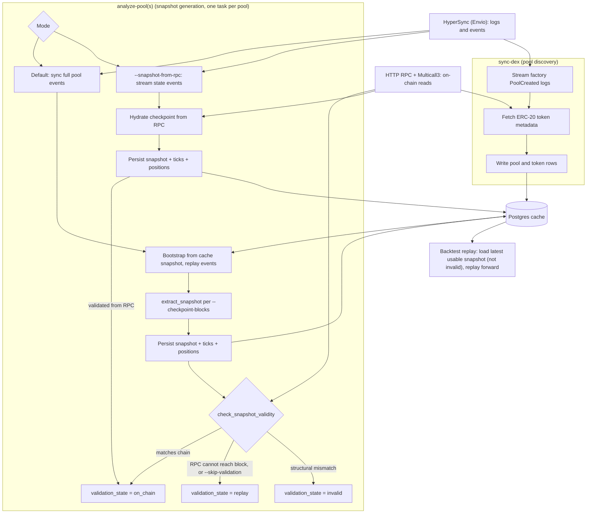

## ภาพรวม [#overview]

adapter สำหรับ blockchain รับข้อมูล DeFi จาก EVM chain และเปิดให้ใช้ผ่าน data model ของ NautilusTrader
นอกจากนี้ยังมี execution client สำหรับ market swap บน Uniswap V3 ที่ sign ในเครื่อง ซึ่ง execution client นี้
ยังไม่พร้อมสำหรับ production adapter ใช้ backend สามตัว:

- HyperSync: block และ contract log ในอดีตแบบ throughput สูง ดูรูปแบบ query, pagination และการปรับแต่งได้ที่
  [เอกสาร Envio HyperSync](https://docs.envio.dev/docs/HyperSync/hypersync-usage)
- HTTP RPC: การเรียก contract, การอ่านผ่าน Multicall และการเติมสถานะสุดท้ายบน chain (hydration)
- Postgres: (optional) สถานะ cache แบบถาวร, metadata ของ pool, event ที่ decode แล้ว และ snapshot

## สถานะของความสามารถ [#capability-status]

| Capability                | ขอบเขต                                                                       | ความพร้อม                                                       |
| ------------------------- | -------------------------------------------------------------------------- | ------------------------------------------------------------- |
| Historical blocks         | `Chain` ใดก็ได้ที่ตั้งค่าไว้และเข้าถึง HyperSync endpoint ได้                       | ใช้ได้ผ่าน Rust service และ `sync-blocks`                         |
| Live blocks               | HyperSync หรือ WSS RPC สำหรับ chain ที่มี RPC client                          | ใช้ได้ผ่าน data client ฝั่ง Rust                                  |
| DEX pool discovery        | ชุด chain และ DEX ที่มี parser สำหรับการสร้าง pool ลงทะเบียนไว้                    | ใช้ได้ผ่าน data client และ `sync-dex`                            |
| Pool snapshots and replay | integration แบบ concentrated-liquidity ที่มีชุด parser ของ snapshot ครบ          | ใช้ได้เมื่อมี Postgres และอยู่ภายใต้ข้อจำกัดของผู้ให้บริการด้านล่าง          |
| Live pool events          | parser ที่ลงทะเบียนไว้สำหรับ swap, liquidity, collect, flash และ fee-protocol   | ใช้ได้ผ่าน data client ฝั่ง Rust                                  |
| Transaction execution     | market swap แบบ BUY และ SELL บน Uniswap V3 ที่ sign ในเครื่อง                   | Experimental ยังไม่พร้อมสำหรับ production                         |

มี WSS RPC client โดยตรงสำหรับ Ethereum, Polygon, Base, Arbitrum และ BSC ค่า chain อื่นที่ตั้งค่าไว้
ใช้ประวัติ block จาก HyperSync ได้เมื่อเข้าถึง endpoint ได้ แต่ไม่รองรับโหมด live ผ่าน WSS

### คำสั่งที่รองรับตาม chain และ DEX [#chain-and-dex-command-support]

การรองรับคำสั่งได้มาจาก parser ที่ลงทะเบียนไว้สำหรับแต่ละ chain และ DEX คำสั่ง help ของ CLI สำหรับ
`sync-dex` และ `analyze-pool(s)` จะแสดงขอบเขตความสามารถแบบเดียวกัน

| Tier            | ความหมาย                                                      | DEXes                                               | Chains                                      |
| --------------- | ------------------------------------------------------------ | --------------------------------------------------- | ------------------------------------------- |
| Replay-ready    | มี parser สำหรับ discovery, snapshot และ fee-protocol replay   | Uniswap V3 และ PancakeSwap V3                       | Ethereum, Base, Arbitrum และ BSC            |
| Analysis only   | มี parser ของ snapshot แต่ไม่มี pool discovery ผ่าน CLI           | Aerodrome Slipstream                                | Base                                        |
| Discovery only  | มี pool discovery แต่ชุด parser ของ snapshot ไม่ครบ              | Uniswap V2 และ Uniswap V4                           | Ethereum, Base และ Arbitrum                 |
| Discovery only  | มี pool discovery แต่ชุด parser ของ snapshot ไม่ครบ              | Camelot V3 และ Fluid DEX                            | Arbitrum                                    |
| Registered only | ลงทะเบียน metadata แต่ไม่มี event parser ที่ใช้กับคำสั่งได้          | Curve Finance และ Fluid DEX                         | Ethereum                                    |
| Registered only | ลงทะเบียน metadata แต่ไม่มี event parser ที่ใช้กับคำสั่งได้          | Aerodrome V1, BaseSwap V2, BaseX และ SushiSwap V3   | Base                                        |
| Registered only | ลงทะเบียน metadata แต่ไม่มี event parser ที่ใช้กับคำสั่งได้          | Curve Finance, SushiSwap V2 และ SushiSwap V3        | Arbitrum                                    |
| Blocks only     | ไม่มีการลงทะเบียน DEX แต่ยังใช้ `sync-blocks` ได้                  | -                                                   | chain อื่นที่ตั้งค่าไว้ รวมถึง Polygon          |

`sync-dex` ต้องมี parser สำหรับการสร้าง pool ส่วน `analyze-pool(s)` ต้องมี parser ของ Initialize, Swap, Mint, Burn
และ Collect integration แบบ replay-ready ยัง parse `SetFeeProtocol` ด้วย integration ที่มี parser ของ
`CollectProtocol` จะ replay การถอนค่าธรรมเนียมของ protocol ได้

Aerodrome Slipstream ไม่มี parser สำหรับการสร้าง pool และ CLI ไม่มีคำสั่งลงทะเบียน pool แยกต่างหาก การวิเคราะห์
จะทำได้ก็ต่อเมื่อ metadata ของ pool และ token มีอยู่ใน cache แล้วผ่านเส้นทาง integration อื่น snapshot ที่ได้จากการ
replay ของมันไม่สามารถตรวจสอบกับสถานะบน chain ได้ DEX แบบ registered-only จะไม่แสดงใน help ของคำสั่ง
และจะไม่ผ่านการตรวจสอบความสามารถที่เกี่ยวข้อง

### ช่องทางที่ใช้งานได้ [#interface-availability]

| Surface                               | Rust                                      | CLI                                      |
| ------------------------------------- | ----------------------------------------- | ---------------------------------------- |
| Data configuration and factory        | config และ factory แบบ public              | -                                        |
| Live data subscriptions               | subscription API ของ data client          | -                                        |
| Block sync, discovery, and analysis   | service ของ adapter                       | `sync-blocks`, `sync-dex` และการวิเคราะห์   |
| Stored snapshot loading               | Cache API                                 | -                                        |
| Execution configuration               | config แบบ public                          | -                                        |
| Execution factory and order routing   | factory และ client แบบ public              | -                                        |
| Preflight, wrap, approve, and storage | เรียก `BlockchainExecutionClient` โดยตรง     | -                                        |

### ตัวอย่าง [#examples]

มีตัวอย่าง data client ที่รันได้:

- [Rust LiveNode data tester](https://github.com/nautechsystems/nautilus_trader/blob/04f766b4d434d67fc8672026fefa25135bdc01be/crates/adapters/blockchain/examples/node_data_tester.rs)

repository ไม่มีตัวอย่างการตั้งค่า execution ที่รันได้และได้รับการดูแล ให้สร้าง integration ด้าน execution ด้วย Rust
และปฏิบัติตามข้อจำกัดใน [Execution](#execution)

## Primitive หลัก [#core-primitives]

domain model ของ DeFi อยู่ใน `nautilus_model::defi`

### Chain [#chain]

`Chain` กำหนด blockchain เป้าหมายและ service endpoint เริ่มต้นของมัน

| Field                      | Type             | คำอธิบาย                                                            |
| -------------------------- | ---------------- | ------------------------------------------------------------------ |
| `name`                     | `Blockchain`     | ค่า enum ของ chain เช่น `Ethereum` หรือ `Arbitrum`                    |
| `chain_id`                 | `u32`            | EVM chain ID เช่น `1` สำหรับ Ethereum                               |
| `hypersync_url`            | `String`         | HyperSync endpoint ค่าเริ่มต้นคือ `https://{chain_id}.hypersync.xyz`   |
| `rpc_url`                  | `Option<String>` | RPC endpoint โดยตรง (optional) ที่เก็บไว้ใน model ของ chain            |
| `native_currency_decimals` | `u8`             | precision ทศนิยมของ gas token ดั้งเดิม ปกติคือ `18`                    |

โหลด chain ได้ด้วย ID ตัวเลขผ่าน `Chain::from_chain_id` หรือด้วยชื่อผ่าน `Chain::from_chain_name`

| Chain family     | Code | Name         | Decimals |
| ---------------- | ---- | ------------ | -------- |
| Ethereum and L2s | ETH  | Ethereum     | 18       |
| Polygon          | POL  | Polygon      | 18       |
| Avalanche        | AVAX | Avalanche    | 18       |
| BSC              | BNB  | Binance Coin | 18       |

### DEX และ pool [#dex-and-pools]

integration ของ DEX จะลงทะเบียน:

- factory address
- event signature และฟังก์ชัน parser
- ประเภท AMM

นิยามของ pool ผูก chain และ DEX เข้ากับ address ของ pool contract หรือ pool ID ของ protocol เพื่อสร้าง
instrument ID ของ Nautilus ที่คงที่ คู่ token, fee tier, tick spacing และ block ที่สร้างยังคงเป็น metadata ของ pool

เมื่อ data engine ประมวลผลนิยามของ pool จะ cache และ publish `CurrencyPair` ภายใต้ instrument ID เดียวกับ pool
instrument จะได้ base และ quote จาก `Pool::get_base_token` และ `Pool::get_quote_token` ข้อมูล trade ของ swap
และการ execute ใช้การวางทิศทางตามลำดับความสำคัญของ token แบบเดียวกันนี้ instrument คำนวณ price และ size precision
จากจำนวนทศนิยมของ token โดยไม่เกิน `FIXED_PRECISION` ตัวระบุ pool ที่ต่างกันทำให้ pool ที่ใช้ token คู่เดียวกัน
อยู่ร่วมกันได้ทั้งใน cache และบน message bus

pool ของ Uniswap V3 และ pool แบบ concentrated-liquidity ที่เข้ากันได้ยังใช้:

- `Initialize(uint160,int24)` สำหรับสถานะราคาเริ่มต้น
- event `Mint` และ `Burn` สำหรับ replay สถานะของ position และ tick
- event `Swap` สำหรับการเคลื่อนไหวของราคา pool แบบ live
- การอ่านสถานะสุดท้ายผ่าน HTTP RPC สำหรับ `slot0`, liquidity, tick ที่ active และข้อมูล position

## Configuration ของ data client [#data-client-configuration]

| Option                            | Default                       | คำอธิบาย                                                |
| --------------------------------- | ----------------------------- | ------------------------------------------------------ |
| `chain`                           | Required                      | `Chain` เป้าหมาย เช่น Ethereum หรือ Arbitrum             |
| `dex_ids`                         | `[]`                          | integration ของ DEX ที่จะลงทะเบียนและ sync                 |
| `http_rpc_url`                    | Required                      | HTTP RPC endpoint สำหรับการอ่าน contract และ Multicall    |
| `wss_rpc_url`                     | `None`                        | WSS endpoint จำเป็นสำหรับ live stream ผ่าน RPC            |
| `rpc_requests_per_second`         | `None`                        | การจำกัดอัตรา RPC request (optional)                     |
| `multicall_calls_per_rpc_request` | `200`                         | จำนวน target สูงสุดของ Multicall ที่ร้องขอต่อหนึ่ง RPC request |
| `use_hypersync_for_live_data`     | `false`                       | เมื่อเป็น true stream ของ block และ event แบบ live จะใช้ HyperSync |
| `from_block`                      | `None`                        | block เริ่มต้นสำหรับการ sync ข้อมูลในอดีต (optional)          |
| `pool_filters`                    | `DexPoolFilters()`            | กฎการกรองชุด pool                                       |
| `postgres_cache_database_config`  | `None`                        | configuration ของ Postgres cache (optional)             |
| `proxy_url`                       | `None`                        | proxy URL สำหรับ HTTP และ WebSocket (optional)           |
| `transport_backend`               | `Sockudo`                     | backend ของ WebSocket transport                         |

:::note
การร้องขอ pool snapshot ต้องใช้ฐานข้อมูล Postgres cache cache ในหน่วยความจำเก็บ token และ pool ได้
แต่การ bootstrap ของ pool profiler ล่าสุดจะอ่านสถานะ snapshot และ event ผ่านเส้นทางฐานข้อมูลของ cache
:::

## Environment [#environment]

ตั้งค่า credential ไว้นอก repository:

```bash
export ENVIO_API_TOKEN="<envio-token>"
export RPC_HTTP_URL="https://your-rpc.example"
export RPC_WSS_URL="wss://your-rpc.example"
```

หากใช้ไฟล์ `.env` ในเครื่อง อย่าใส่ไฟล์นี้ไว้ใน version control:

```dotenv
ENVIO_API_TOKEN=<envio-token>
RPC_HTTP_URL=https://your-rpc.example
RPC_WSS_URL=wss://your-rpc.example
```

- Rust HyperSync client ต้องใช้ `ENVIO_API_TOKEN` หาก token หายไปหรือรูปแบบไม่ถูกต้อง การสร้าง client
  จะล้มเหลวก่อนส่ง query ใด ๆ
- ต้องมี `RPC_HTTP_URL` หรือ `--rpc-url` สำหรับการอ่าน contract และการเติมสถานะ snapshot
- ต้องมี `RPC_WSS_URL` เมื่อ `use_hypersync_for_live_data = false` ซึ่งโหมดนี้ใช้ live stream ผ่าน WSS RPC

execution ต้องใช้ตัวแปรเพิ่มเติม (ดู [Execution](#execution)):

- private key ของ signer อ่านจากตัวแปรที่ระบุชื่อไว้ใน field `signer_private_key_env` ของ configuration
  ไม่ได้อ่านจาก configuration โดยตรง
- การป้องกัน signed payload อ่าน key ขนาด 32 byte ทั้งตัวที่ active และตัวที่ retire แล้วจากตัวแปรที่ระบุชื่อไว้ใน
  `payload_key_env` และ `payload_key_retired_env` field ใน configuration เหล่านี้เก็บชื่อตัวแปร ไม่ใช่ค่าของ key

ดูรายละเอียดการตั้งค่า token และ quota ได้ที่
[เอกสาร HyperSync API token](https://docs.envio.dev/docs/HyperSync/api-tokens) ของ Envio

### ข้อกำหนดของผู้ให้บริการ RPC [#rpc-provider-requirements]

`RPC_HTTP_URL` หรือ `--rpc-url` ต้องชี้ไปยัง EVM JSON-RPC endpoint ของ chain เป้าหมาย data client ใช้สำหรับ
การอ่าน contract และการ sync pool ครั้งแรกจะอ่านสถานะบน chain ผ่าน endpoint นี้ client อ่าน HyperSync endpoint
จาก `Chain::hypersync_url` chain ในตัวมีค่าเริ่มต้นเป็น `https://{chain_id}.hypersync.xyz`

เลือกผู้ให้บริการ RPC ที่รองรับ block เป้าหมายและปริมาณงาน Multicall ที่ต้องการ ป้ายกำกับของผู้ให้บริการ
ไม่เพียงพอที่จะยืนยันว่าเข้าถึง archive ได้ ให้ตรวจสอบด้วย `eth_getCode` หรือ `eth_call` กับ block ในอดีต
ที่ workflow จะใช้ การคืน block header ได้อย่างเดียวไม่ได้พิสูจน์ว่ามีสถานะ contract ในอดีตให้ใช้ pool ขนาดใหญ่
อาจต้องการขีดจำกัด payload, gas, timeout และ request rate ที่สูงขึ้นด้วย

การรองรับ archive มีผลต่อการตรวจสอบ ไม่ได้มีผลว่าการ sync event จะทำงานหรือไม่:

- บน archive node snapshot ที่ block ในอดีตจะตรวจสอบกับสถานะบน chain และถูกเก็บด้วย
  `validation_state = on_chain`
- บน node ที่ไม่ใช่ archive การอ่านข้อมูลในอดีตจะล้มเหลว และ snapshot จะคงเป็น `validation_state = replay`
  ซึ่งยังใช้เป็นจุดเริ่มต้นของ replay ได้
- สำหรับการ sync ครั้งแรกบน node ที่ไม่ใช่ archive ให้ใช้ `--to-block` ที่เป็น block ล่าสุด เพราะ bootstrap
  จะอ่านสถานะบน chain ที่ block เป้าหมาย และ node ที่ไม่ใช่ archive ให้บริการเฉพาะสถานะล่าสุดเท่านั้น

## Service ในเครื่อง [#local-services]

ไฟล์ Docker Compose สำหรับการพัฒนาจะเริ่ม Postgres, Redis และ pgAdmin หากต้องการสร้าง container,
รอ Postgres และ initialize schema ของฐานข้อมูล ให้รัน:

```bash
make init-services
```

ใช้ `make start-services` เพื่อเริ่ม stack ที่ initialize แล้ว และรัน `make init-db` เพื่อ initialize
หรือใช้ schema ของ Postgres ซ้ำอีกครั้ง

ค่าเริ่มต้นของ Postgres ในเครื่อง:

| Field    | Value            |
| -------- | ---------------- |
| Host     | `127.0.0.1:5432` |
| Database | `nautilus`       |
| User     | `nautilus`       |
| Password | `pass`           |

ตรวจสอบว่ามี schema แล้ว:

```bash
docker exec nautilus-database psql -U nautilus -d nautilus -Atc \
    "select count(*) from information_schema.tables where table_schema='public'"
```

การสร้าง pool snapshot และการร้องขอ snapshot ต้องใช้ Postgres cache ที่ initialize schema แล้ว
pool discovery และการสร้าง snapshot จะเขียนแถวใน `token`, `pool`, `pool_*_event`, `pool_snapshot`,
`pool_position` และ `pool_tick` ให้ใช้ฐานข้อมูลเฉพาะหรือ Docker volume ที่ reset ได้สำหรับงานข้อมูล
ที่ต้องทำซ้ำได้หรือมีการลบข้อมูล

## การไหลของข้อมูล [#data-flow]

### สถาปัตยกรรม [#architecture]

`sync-dex` ค้นหาและเก็บ pool และ token จากนั้น `analyze-pool(s)` จะสร้างแถวใน `pool_snapshot`
แผนภาพแสดงเส้นทาง replay เริ่มต้นและเส้นทาง `--snapshot-from-rpc`



`analyze-pools` รันหนึ่ง task ต่อหนึ่ง pool โดยจำกัดด้วย `--concurrency` แต่ละ task มี data client ของตัวเอง
snapshot ใช้เป็นจุดเริ่มต้นของ replay ได้ เว้นแต่ `validation_state` ของมันเป็น `invalid`

### Data client ที่ใช้งานได้ [#data-client-surface]

data client แบบ public รองรับ subscription และ request ด้าน DeFi ต่อไปนี้:

| Surface           | Commands                                                           | พฤติกรรม                                                                                             |
| ----------------- | ------------------------------------------------------------------ | -------------------------------------------------------------------------------------------------- |
| Blocks            | `SubscribeBlocks`, `UnsubscribeBlocks`                             | เริ่มหรือหยุด block feed ที่ใช้ร่วมกันจาก HyperSync หรือ WSS RPC                                       |
| Complete pool     | `SubscribePool`, `UnsubscribePool`                                 | เลือก swap, mint, burn, collect, flash และ event ของ fee-protocol ทั้งสองแบบ                         |
| Pool swaps        | `SubscribePoolSwaps`, `UnsubscribePoolSwaps`                       | เลือก event ของ swap สำหรับ pool instrument หนึ่งตัว                                                 |
| Liquidity updates | `SubscribePoolLiquidityUpdates`, `UnsubscribePoolLiquidityUpdates` | เลือก event ของ mint และ burn สำหรับ pool instrument หนึ่งตัว                                         |
| Fee collections   | `SubscribePoolFeeCollects`, `UnsubscribePoolFeeCollects`           | เลือก event ของ collect สำหรับ pool instrument หนึ่งตัว                                              |
| Flash events      | `SubscribePoolFlashEvents`, `UnsubscribePoolFlashEvents`           | เลือก event ของ flash สำหรับ pool instrument หนึ่งตัว                                                |
| Pool snapshot     | `RequestPoolSnapshot`                                              | publish นิยามของ pool แล้วตามด้วย snapshot ที่ใช้ได้เมื่อ bootstrap จาก cache และการตรวจสอบสำเร็จ           |

subscription ใช้ feed ของ block และ event ของ DEX เบื้องหลังร่วมกัน client นับจำนวนเจ้าของของแต่ละ pool address
และ event type ดังนั้นการลบ subscription หนึ่งตัวจะไม่หยุด feed ที่ subscription อื่นยังเป็นเจ้าของอยู่ หลักนี้ใช้
เมื่อ subscription แบบ complete pool ซ้อนกับแบบที่แคบกว่าด้วย: event type ที่แคบกว่าจะยัง active หลัง
`UnsubscribePool` และในทางกลับกันก็เช่นกัน data engine จะเก็บ profiler updater ของ pool ไว้จนกว่าจะไม่มี
data client ใดเหลือ subscription ของ pool นั้น

response ของ pool snapshot จะมี ID ของ request ที่เป็นต้นทาง data engine จะทิ้ง response ที่ bootstrap
ถูกยกเลิกไปแล้วจากการ unsubscribe ครั้งสุดท้าย, การ reset หรือการ disconnect การร้องขอ pool snapshot ต้องใช้
Postgres เพราะ bootstrap อ่านสถานะของ pool และ event ที่เก็บไว้ผ่านฐานข้อมูลของ cache

:::warning
นิยามของ DeFi pool และ update ของ account state จะ publish บน router ของ message bus แบบ typed
handler แบบ `subscribe_any` จะไม่ได้รับ message เหล่านี้เลย ให้ใช้ `subscribe_defi_pools` และ
`subscribe_account_state` หรือ subscription API ของ actor ที่ตรงกัน
:::

### Pool discovery [#pool-discovery]

pool discovery จะ:

- stream event ของ factory ของ DEX จาก HyperSync
- ดึง metadata ของ ERC-20 ผ่าน RPC
- เก็บ token และ pool ที่ถูกต้องลงใน cache
- ข้าม metadata ของ token ที่ไม่ถูกต้อง และ `DexPoolFilters` ยังสามารถตัด metadata ของ token ที่ว่างออกได้

### Live data [#live-data]

- `use_hypersync_for_live_data = true`: subscribe block ผ่าน HyperSync เพื่อใช้ timestamp แบบ live
  และเปิด stream ของ DEX event จาก HyperSync แบบไม่มีจุดสิ้นสุดค้างไว้หนึ่งตัวต่อ DEX filter ที่ subscribe
- `use_hypersync_for_live_data = false`: ใช้ subscription ของ block และ pool log ผ่าน WSS RPC สำหรับ swap,
  liquidity update, fee collection, flash event และ fee-protocol event แบบ live

### Snapshot bootstrap [#snapshot-bootstrap]

สำหรับ snapshot ที่เข้ากันได้กับ Uniswap V3 การ bootstrap เริ่มต้นจะ replay event ของ pool ที่เก็บไว้เพื่อสร้าง
ราคา, liquidity, tick, position, ค่าธรรมเนียม และตัวนับขึ้นใหม่ จากนั้นการตรวจสอบจะอ่านสถานะบน chain
ผ่าน HTTP RPC และ Multicall

โหมดของ bootstrap:

- ค่าเริ่มต้น: เก็บประวัติ event ของ pool ทั้งหมดจนถึง block เป้าหมาย แล้ว bootstrap จากฐานข้อมูล
- `--snapshot-from-rpc`: ข้ามการเก็บ swap ทั้งหมด stream event ของ Initialize, Mint, Burn, SetFeeProtocol
  และ CollectProtocol จาก HyperSync เพื่อนับ tick และ position จากนั้นเติมสถานะของ checkpoint block
  ที่ตรงพอดีจาก RPC

ใช้ `--snapshot-from-rpc` กับ pool เก่าที่มีปริมาณสูงเมื่อผลลัพธ์ที่ต้องการคือ snapshot สุดท้าย ไม่ใช่ประวัติ swap
ที่เก็บไว้ ใช้ร่วมกับ `--from-block`, `--reset` หรือ `--require-existing-snapshot` ไม่ได้

ในโหมด `--snapshot-from-rpc` การเติมสถานะสุดท้ายจาก RPC คือแหล่งที่มาของสถานะ checkpoint หากล้มเหลว
คำสั่งจะล้มเหลวแทนที่จะส่ง snapshot ที่ได้จากการ replay ซึ่งมีสถานะราคาที่ล้าสมัยออกมา

### การตรวจสอบ snapshot [#snapshot-validation]

สำหรับ snapshot ที่ได้จากการ replay การ bootstrap จะเปรียบเทียบ profiler กับสถานะบน chain ก่อนทำเครื่องหมายว่าถูกต้อง

| กลุ่ม           | Fields                                                                      | ผลเมื่อไม่ตรงกัน                                    |
| -------------- | --------------------------------------------------------------------------- | ---------------------------------------------- |
| Structural     | current tick, active liquidity, liquidity ราย tick และ liquidity ของ position | เก็บเป็น `invalid` และตัดออกจากการโหลดเริ่มต้น        |
| Non-structural | sqrt price, fee protocol และ balance ของค่าธรรมเนียม protocol                  | warn แล้วยอมรับ snapshot เป็น `on_chain`          |

ความต่างแบบ non-structural อาจเกิดจากเหตุผลเหล่านี้:

- การ replay event มีขอบเขตระดับ transaction แต่ snapshot จาก RPC มีขอบเขตระดับ block
- fork หรือช่วงของ replay ไม่ได้รวม update ของ fee-protocol
- การปัดเศษของ replay ต่างจากตัวสะสมค่าธรรมเนียมบน chain

การยอมรับ field เหล่านี้สอดคล้องกับพฤติกรรมของ backtest replay

### Guard ของ snapshot bootstrap [#snapshot-bootstrap-guard]

ใช้ `--require-existing-snapshot` เมื่อต้องการให้การวิเคราะห์รันจาก snapshot cache ในเครื่องเท่านั้น:

- ตรวจหา `pool_snapshot` ล่าสุดที่ใช้ได้ ณ หรือก่อน block เป้าหมาย
- คืน `needs_bootstrap` หากไม่มี snapshot ที่ใช้ได้
- ถือว่า snapshot ว่างที่ block ตอนสร้างซึ่งไม่มี position หรือ tick เป็นสิ่งที่ใช้ไม่ได้
- ข้ามการ bootstrap ตั้งแต่ตอนสร้างจนถึงเป้าหมายสำหรับ pool นั้น

#### ผลลัพธ์ของการวิเคราะห์ [#analysis-output]

`analyze-pool(s)` จะแสดง:

- ผลลัพธ์ JSON หนึ่งรายการต่อหนึ่ง entry ใน `--checkpoint-blocks`
- ผลลัพธ์ JSON หนึ่งรายการที่ `--to-block` เมื่อไม่ได้ระบุ checkpoint

pool ที่ต้อง bootstrap ครั้งแรกจะมีรูปแบบนี้:

```json
{
  "chain": "Ethereum",
  "dex": "UniswapV3",
  "pool_address": "0x1111111111111111111111111111111111111111",
  "target_block": 25218797,
  "status": "needs_bootstrap"
}
```

ผลลัพธ์ที่สำเร็จจะมี `validation_state`:

- `on_chain`: เติมสถานะแล้วและตรงกับ chain
- `replay`: ได้จากการ replay หรือยังไม่ได้ตรวจสอบ แต่ยังใช้เป็นจุดเริ่มต้นของ replay ได้
- `invalid`: เติมสถานะแล้วแต่ไม่ตรงกัน ใช้ไม่ได้

```json
{
  "chain": "Ethereum",
  "dex": "UniswapV3",
  "pool_address": "0x1111111111111111111111111111111111111111",
  "target_block": 25218797,
  "status": "success",
  "snapshot_block": 25218790,
  "positions": 2,
  "ticks": 7,
  "validation_state": "replay",
  "already_valid": false,
  "liquidity_utilization_rate": 0.25
}
```

### Checkpoint และ concurrency [#checkpoints-and-concurrency]

- `--checkpoint-blocks b1,b2,...`: สร้าง snapshot ในการ bootstrap รอบเดียว block จะถูกเรียงลำดับ,
  ตัดตัวซ้ำ และจำกัดไม่ให้เกิน `--to-block`
- `--concurrency`: ควบคุมความขนานของ `analyze-pools` ค่าเริ่มต้น: `4`
- `--skip-validation`: ข้ามการเปรียบเทียบกับ chain และเก็บ snapshot ที่ได้จากการ replay เป็น `replay`
- `--snapshot-from-rpc`: เติมสถานะจาก chain ที่ checkpoint block และบันทึก snapshot เป็น `on_chain`

key ของ snapshot:

- โหมดเริ่มต้น: ใช้ key เป็น pool event ล่าสุด ณ หรือก่อน checkpoint checkpoint ที่ไม่มี event อยู่ระหว่างกัน
  อาจใช้แถวที่เก็บไว้แถวเดียวกัน
- `--snapshot-from-rpc`: ใช้ key เป็น checkpoint block ที่ร้องขอ พร้อม sentinel transaction/log index
  ระดับ block

### Backtest replay [#backtest-replay]

backtest replay ต้องมี snapshot อยู่ในข้อมูล input adapter จะไม่ให้บริการ request ของ snapshot แบบ live
ระหว่าง backtest

ใน Rust โหลด snapshot แบบเต็มที่เก็บไว้ใน Postgres รวมถึง position และ tick ได้ผ่าน Cache API
โดยเลือก snapshot ล่าสุด ณ หรือก่อน block เริ่มต้นของ replay

> หมายเหตุ: ต้นฉบับมีเฉพาะตัวอย่าง Python (`load_pool_snapshot`) จึงตัดออก

กฎของ replay:

- โดยค่าเริ่มต้น snapshot ที่ถูกทำเครื่องหมาย `invalid` จะถูกตัดออก ทั้ง snapshot แบบ `on_chain` และ `replay`
  อาจถูกคืนมาได้ ยอมรับ snapshot แบบ `invalid` เฉพาะเมื่อผู้เรียกตั้งใจรับ snapshot เหล่านั้นด้วย
- ถือว่าการไม่ได้ snapshot กลับมาเป็นความล้มเหลวของการ setup อย่า replay โดยไม่มีสถานะของ profiler
- ส่ง snapshot เป็นข้อมูล DeFi แบบ pool snapshot เข้า backtest engine พร้อมกับ event ของ pool
- replay pool event ทุกตัวตั้งแต่ block ของ snapshot เป็นต้นไป การเริ่มหลัง block ของ snapshot อาจทำให้
  profiler ล้าสมัย

timestamp ของ block ที่ cache ไว้จะโหลดเข้า data object ของ Nautilus เป็น UNIX nanoseconds แถวใน cache
ที่เขียนด้วย timestamp ของ block ความละเอียดระดับวินาทีจะถูก normalize เป็นนาโนวินาทีเมื่อโหลด snapshot และ
pool event ส่วนแถวที่เป็นนาโนวินาทีจะคง precision ที่เก็บไว้

### ข้อจำกัดของการวิเคราะห์ pool [#pool-analysis-constraints]

`analyze-pool(s)` ตรวจสอบสิ่งที่ต้องมีก่อน และรายงานผลแต่ละ pool แยกกัน ขอบเขตเหล่านี้ใช้เช่นกันเมื่อเรียก
service การวิเคราะห์เบื้องหลังจาก Rust

| เงื่อนไข                    | พฤติกรรม                                                                                   | ข้อจำกัด                                                                                                         |
| -------------------------- | ---------------------------------------------------------------------------------------- | ---------------------------------------------------------------------------------------------------------------- |
| ไม่มี metadata ของ pool      | ล้มเหลวด้วย `Pool <address> is not registered`                                           | ค้นหา pool ก่อน การวิเคราะห์ไม่สามารถอนุมานหรือลงทะเบียน metadata ได้                                                 |
| ไม่มีความสามารถของ parser    | ล้มเหลวก่อน sync                                                                          | ใช้ชุดที่รองรับ snapshot จาก [คำสั่งที่รองรับตาม chain และ DEX](#chain-and-dex-command-support)                     |
| address ไม่ได้ checksum     | ล้มเหลวด้วย `Blockchain address '<address>' has incorrect checksum`                      | ระบุ address แบบ EIP-55 ผลลัพธ์จาก `getPool` ของ factory อาจต้องแปลง checksum                                         |
| ขีดจำกัด Multicall ของผู้ให้บริการ | error แบบ `out of gas`, payload หรือ timeout จะยกเลิกการเติมสถานะสุดท้าย                      | ลด `multicall_calls_per_rpc_request` หรือใช้ผู้ให้บริการที่มีขีดจำกัดสูงกว่า                                              |
| ไม่มีสถานะในอดีต             | bootstrap ครั้งแรกอ่านสถานะสุดท้ายที่ `--to-block` เก่าไม่ได้                                    | ใช้เป้าหมายล่าสุดหรือผู้ให้บริการที่รองรับ archive ดู [ข้อกำหนดของผู้ให้บริการ RPC](#rpc-provider-requirements)           |
| quota ของ HyperSync ถูกจำกัด | pool ที่มีกิจกรรมสูงจะ back off และการ sync เต็มครั้งแรกอาจต้องใช้หลายพัน request                   | ลด `--concurrency` หรือใช้ `--snapshot-from-rpc` เมื่อไม่ต้องการประวัติ swap ที่เก็บไว้                                  |
| `--from-block` กลางอายุ pool | การข้าม `Initialize` อาจทำให้ profiler ไม่มีราคาเริ่มต้น                                        | sync ตั้งแต่ตอนสร้าง pool เมื่อสร้าง snapshot ครั้งแรก                                                                |
| ไม่มี liquidity event         | `analyze-pool` คืน error ส่วน `analyze-pools` ส่งผลลัพธ์ความล้มเหลวแล้วทำ pool อื่นต่อ              | เลือก pool ที่มี Mint หรือ Burn ณ หรือก่อน block เป้าหมาย                                                             |
| ความล้มเหลวราย pool ใดก็ตาม   | ส่ง `"status": "failure"` และทำให้ `analyze-pool(s)` จบด้วย exit code ที่ไม่ใช่ศูนย์               | ใช้ exit code สำหรับผลรวม และใช้ status ใน JSON แต่ละรายการสำหรับผลราย pool                                               |

การเติมสถานะสุดท้ายจาก RPC ในโหมด `--snapshot-from-rpc` เป็นแหล่งอ้างอิงหลักของสถานะ checkpoint
หากการเติมสถานะล้มเหลว การวิเคราะห์จะถูกยกเลิกแทนที่จะเก็บ snapshot ที่มีสถานะราคาล้าสมัย

## การดำเนินการวิเคราะห์ pool [#pool-analysis-operations]

### ค้นหา pool ก่อนวิเคราะห์ [#discover-pools-before-analysis]

`analyze-pool(s)` อ่าน metadata ของ pool จาก Postgres cache และล้มเหลวด้วย
`Pool <address> is not registered` เมื่อ pool ยังไม่ถูกค้นพบ ให้รัน `sync-dex` สำหรับ chain และ DEX นั้น
ก่อนวิเคราะห์ เพื่อเติมข้อมูลในตาราง `pool` และ `token`

### ตรวจสอบคำสั่งที่รองรับ [#check-command-support]

ดู [คำสั่งที่รองรับตาม chain และ DEX](#chain-and-dex-command-support) หรือ help ของคำสั่งก่อนเริ่ม sync
`sync-dex` และ `analyze-pool(s)` จะปฏิเสธชุด chain และ DEX ที่ไม่รองรับก่อน query event แทนที่จะคืนผลลัพธ์ว่าง

```bash
./target/debug/nautilus blockchain sync-dex --help
./target/debug/nautilus blockchain analyze-pools --help
```

### ใช้ address ของ pool แบบ checksum [#use-checksummed-pool-addresses]

address ของ pool ต้องใช้ checksum แบบ EIP-55 address ตัวพิมพ์เล็กจะล้มเหลวด้วย
`Blockchain address '<address>' has incorrect checksum` ให้แปลง address ที่ค้นพบเป็นรูปแบบ checksum
ก่อนส่งผ่าน `--address` หรือเพิ่มลงในไฟล์ address

### ลดขนาด request ของ Multicall [#reduce-the-multicall-request-size]

ผู้ให้บริการ RPC อาจปฏิเสธ Multicall ขนาดใหญ่สำหรับสถานะสุดท้ายด้วย error แบบ out-of-gas, payload หรือ timeout
ให้ลด `--multicall-calls-per-rpc-request` จากค่าเริ่มต้น `200` เพื่อให้แต่ละ request อยู่ภายในขีดจำกัดของผู้ให้บริการ

### เลือก block เป้าหมายที่ผู้ให้บริการ RPC ให้บริการได้ [#choose-a-target-block-the-rpc-provider-can-serve]

การ sync ครั้งแรกจะอ่านสถานะบน chain ที่ `--to-block` หากใช้ผู้ให้บริการ RPC ที่ไม่ใช่ archive ให้ใช้เป้าหมายล่าสุด
หรือใช้ผู้ให้บริการที่ให้สถานะ contract ที่ block ในอดีตที่ร้องขอได้ ดู
[ข้อกำหนดของผู้ให้บริการ RPC](#rpc-provider-requirements)

### ควบคุมปริมาณ request ของ HyperSync [#control-hypersync-request-volume]

การ sync เต็มครั้งแรกของ pool ขนาดใหญ่หรือเก่าอาจต้องใช้หลายพัน request ให้ลด `--concurrency` เมื่อ token
ที่ตั้งค่าไว้มี quota จำกัด ใช้ `--snapshot-from-rpc` เมื่อ snapshot ที่ checkpoint ตรงพอดีก็เพียงพอและไม่ต้องการ
ประวัติ swap ที่เก็บไว้

### เริ่ม replay ครั้งแรกตั้งแต่ตอนสร้าง pool [#start-an-initial-replay-at-pool-creation]

การเริ่ม `--from-block` กลางประวัติของ pool อาจข้าม event `Initialize` ไป หากไม่มีราคาเริ่มต้น การ bootstrap
snapshot จะล้มเหลวด้วย
`Pool is not initialized and it doesn't contain initial price, cannot bootstrap profiler`
ให้ sync ตั้งแต่ตอนสร้าง pool เมื่อสร้าง snapshot ครั้งแรก

### การตีความความล้มเหลวของ pool [#interpret-pool-failures]

pool ที่ไม่มี event Mint หรือ Burn ที่ประมวลผลแล้ว ณ หรือก่อน block เป้าหมายอาจขาดสถานะที่จำเป็นสำหรับ snapshot
`analyze-pool` จะคืน error ส่วน `analyze-pools` จะส่ง JSON line ที่มี `"status": "failure"` ทำ pool อื่นต่อ
และจบด้วย exit code ที่ไม่ใช่ศูนย์หลังจากมีความล้มเหลวราย pool ใดก็ตาม ใช้ exit code ของ process สำหรับผลรวม
และ status ใน JSON แต่ละรายการสำหรับผลแต่ละรายการ

## Runbook: ตรวจสอบการ sync pool แบบ live [#runbook-validate-a-live-pool-sync]

ใช้ขั้นตอนนี้เพื่อตรวจสอบ pool discovery, การ parse event และการสร้าง snapshot สำหรับ DEX หนึ่งตัวบน chain หนึ่ง
ตัวอย่างใช้ PancakeSwap V3 บน Arbitrum โดยทำเฉพาะ query แบบอ่านอย่างเดียวบน chain และเขียนเฉพาะลงใน
Postgres cache ที่ตั้งค่าไว้

### สิ่งที่ต้องมีก่อน [#prerequisites]

- มี Docker สำหรับ service Postgres ในเครื่อง
- `ENVIO_API_TOKEN` มี HyperSync token ที่ถูกต้อง
- `RPC_HTTP_URL` ชี้ไปยังผู้ให้บริการ RPC ของ Arbitrum ที่ให้บริการ block เป้าหมายได้
- `POOL_ADDRESS` มี address ของ pool PancakeSwap V3 แบบ checksum ตาม EIP-55

### เริ่ม service ในเครื่องและ build CLI [#start-the-local-services-and-build-the-cli]

```bash
make init-services
cargo build -p nautilus-cli --features defi --bin nautilus
```

### ค้นหา pool [#discover-pools]

รัน discovery ทันทีก่อนการวิเคราะห์เมื่อฐานข้อมูลในเครื่องถูก reset:

```bash
./target/debug/nautilus blockchain sync-dex \
    --chain arbitrum \
    --dex PancakeSwapV3 \
    --rpc-url "$RPC_HTTP_URL" \
    --host 127.0.0.1 \
    --port 5432 \
    --username nautilus \
    --password pass \
    --database nautilus
```

### วิเคราะห์ pool [#analyze-the-pool]

คง concurrency ไว้ที่หนึ่งสำหรับการตรวจสอบรอบนี้:

```bash
./target/debug/nautilus blockchain analyze-pools \
    --chain arbitrum \
    --dex PancakeSwapV3 \
    --address "$POOL_ADDRESS" \
    --rpc-url "$RPC_HTTP_URL" \
    --host 127.0.0.1 \
    --port 5432 \
    --username nautilus \
    --password pass \
    --database nautilus \
    --concurrency 1
```

### ตรวจสอบข้อมูลที่เก็บไว้ [#check-the-stored-data]

นับจำนวนแถวที่เขียนสำหรับ pool ใน:

- `pool_swap_event`
- `pool_liquidity_event`
- `pool_collect_event`
- `pool_flash_event`
- `pool_fee_protocol_update_event`
- `pool_fee_protocol_collect_event`
- `pool_snapshot`
- `pool_position`
- `pool_tick`

ตารางของ fee-protocol จะว่างเมื่อช่วงที่ sync ไม่มี event `SetFeeProtocol` หรือ `CollectProtocol`
หลังจาก reset ฐานข้อมูลในเครื่อง ให้รัน discovery ใหม่ก่อนวิเคราะห์เพื่อให้มีแถวของ pool ดู
[การดำเนินการวิเคราะห์ pool](#pool-analysis-operations) สำหรับความล้มเหลวด้าน address, ผู้ให้บริการ,
ช่วงของ replay และปริมาณ request

## Contracts [#contracts]

### Base contract และ Multicall3 [#base-contract-and-multicall3]

`BaseContract` รวมการเรียก contract เป็น batch ผ่าน Multicall3
(`0xcA11bde05977b3631167028862bE2a173976CA11`):

- Multicall ใช้ `tryAggregate(requireSuccess: false)` ดังนั้นผลลัพธ์แต่ละรายการจะรายงานความสำเร็จหรือล้มเหลว
  ของตัวเอง และ wrapper ของ contract เป็นผู้ตัดสินว่าจะปฏิเสธหรือไม่
- การอ่านทำงานภายใต้บริบทของ block เดียว
- ความล้มเหลวของ transport และผู้ให้บริการจะแสดงเป็น RPC error

### Metadata ของ ERC-20 [#erc-20-metadata]

`Erc20Contract` อ่าน `name`, `symbol` และ `decimals` ผ่าน Multicall adapter สามารถข้าม pool
ที่ metadata ของ token ผิดรูปแบบ เป็น raw bytes หรือว่างได้

### Pool ของ Uniswap V3 [#uniswap-v3-pools]

`UniswapV3PoolContract` อ่านสถานะระดับ global ของ pool, tick ที่ active และ position

- pool ขนาดใหญ่อาจเกินขีดจำกัด payload, gas หรือ timeout ของผู้ให้บริการ
- การเติมสถานะ snapshot จาก RPC จะล้มเหลวแบบ fail closed หากการอ่านสถานะสุดท้ายล้มเหลว
- pool ขนาดใหญ่มากอาจต้องลด `multicall_calls_per_rpc_request` หรือใช้ผู้ให้บริการที่แข็งแรงกว่า

PancakeSwap V3 ใช้ read contract ของ Uniswap V3 ซ้ำ เพราะการอ่าน `slot0`, `ticks`, `positions`,
`liquidity` และ fee-growth ใช้ ABI เดียวกัน แต่การ encode ของ fee-protocol ต่างกัน:

- Uniswap V3 รวมตัวหารค่าธรรมเนียมขนาด 4 bit สองตัวไว้ใน `uint8` ตัวเดียว
- PancakeSwap V3 เก็บสัดส่วนแบบ basis point ขนาด 16 bit สองตัวไว้ใน `slot0.feeProtocol` และ emit
  `SetFeeProtocol(uint32,uint32,uint32,uint32)`
- snapshot ของ PancakeSwap V3 เก็บ `fee_protocol0_basis_points` และ `fee_protocol1_basis_points`
  และ replay คำนวณค่าธรรมเนียมของ protocol เป็น `fee * basis_points / 10000`

## Execution [#execution]

:::warning
execution client ยังไม่พร้อมสำหรับ production `BlockchainExecutionClient` implement preflight,
การ wrap WETH และการ approve ERC-20 แบบระบุชัดเจน, การ sign แบบ EIP-1559 ในเครื่อง, reconciliation แบบถาวร
และ flow การ swap ของ Uniswap V3 หนึ่งแบบ การทำงานกับ order แบบอื่นจะล้มเหลวแบบ fail closed โดยไม่มีผลข้างเคียง
ทั้งบน chain และในที่เก็บข้อมูลถาวร
:::

section นี้ใช้คำศัพท์ต่อไปนี้:

| คำศัพท์               | ความหมาย                                                                                                       |
| ------------------- | ------------------------------------------------------------------------------------------------------------- |
| Decision height     | head ใหม่ที่ต่ำที่สุดซึ่งยอมรับได้จาก RPC ทั้งสามแหล่งสำหรับชุดการอ่านที่ใช้อนุญาตหนึ่งชุด                                   |
| Verification source | endpoint หลัก (authoritative) หนึ่งตัว หรือหนึ่งใน verifier แบบอ่านอย่างเดียวสองตัวพอดีที่อยู่ใน failure domain ต่างกัน |
| Deployment manifest | contract, code hash, proxy binding, identity, pool, token และ call edge ที่อนุญาตซึ่งผ่านการ review แล้ว          |
| Intent              | การทำงาน wrap, approve หรือ swap เชิงตรรกะหนึ่งรายการที่เก็บแบบถาวร ไม่ขึ้นกับประวัติ hash ของ transaction                |
| Signer ownership    | การควบคุมแต่เพียงผู้เดียวเหนือ signer ของ wallet และหลังจากกำหนดแล้วรวมถึง nonce ที่ active ของมัน                       |
| Finalized boundary  | จุดที่ทุกแหล่งเห็นตรงกันเรื่อง finalized ancestry จนถึง block ที่ transaction ถูกรวมเข้าไป                              |

### การเชื่อมต่อและสถานะ account [#connection-and-account-state]

การสร้าง client ต้องมี RPC endpoint หลักหนึ่งตัวและผู้ให้บริการตรวจสอบแบบอ่านอย่างเดียวสองตัวพอดี แต่ละแหล่งต้องมี
endpoint, provider ID, operator ID ที่ต่างกัน และชุด failure-domain ID ที่ไม่ซ้อนกันเป็นคู่ ๆ

#### เงื่อนไขการทำงานที่บังคับใช้ [#enforced-operating-conditions]

- endpoint หลักของ execution และ endpoint ของ verifier ทั้งสองต้องใช้ HTTPS ยอมรับ HTTP แบบ cleartext
  เฉพาะ IPv4 loopback แบบ canonical ใน `127.0.0.0/8` หรือ `[::1]` เท่านั้น hostname, IPv6 ที่ map จาก IPv4,
  address แบบ private และ link-local และรูปแบบตัวเลขที่ไม่ใช่ canonical ไม่เข้าเงื่อนไข
- HyperSync ใช้กฎ HTTPS เดียวกัน การตรวจสอบนี้ทำงานก่อนโหลด HyperSync token หรือสร้าง client
- HTTP client ของ blockchain ปฏิเสธ redirect การเชื่อมต่อ RPC แบบ loopback ที่เป็น canonical จะข้าม proxy
  ทั้งที่ตั้งค่าไว้และที่มาจาก environment ส่วน execution RPC client แบบ HTTPS ระยะไกลยังเคารพ proxy
  จาก environment variable
- การเชื่อมต่อ execution ที่ใช้ Postgres ต้องมี payload key ที่ active, deployment ID ที่คงที่, protected storage
  ที่พร้อม และทุก key ที่ envelope ที่เก็บไว้อ้างถึง การเชื่อมต่อจะ authenticate payload ที่เก็บไว้ทุกตัวก่อนโหลด signer
  หรือเรียก execution RPC
- ฐานข้อมูล Postgres ที่เชื่อมไว้จะไม่ได้รับการป้องกันได้เฉพาะขณะที่ client disconnect อยู่เพื่อทำงานตรวจสอบ, ป้องกัน
  หรือ rollback การ rewrap ต้องใช้ protected storage ฐานข้อมูลที่ไม่ได้รับการป้องกันไม่สามารถให้ความสามารถด้าน execution ได้

#### สมมติฐานที่ผู้ดูแลระบบต้องรับผิดชอบ [#operator-assumptions]

failure domain หมายถึง upstream, reseller, gateway, proxy, account, เส้นทาง network หรือ control plane ของ hosting
ใดก็ตามที่ใช้ร่วมกัน URL ที่ต่างกันและ identity ที่ตั้งค่าไว้ต่างกันไม่ได้พิสูจน์ว่าเป็นอิสระต่อกันในการทำงานจริง
ผู้ดูแลระบบต้องตรวจสอบว่าผู้ให้บริการทั้งสามไม่ได้ใช้ control domain หรือ failure domain ร่วมกัน

ผู้ดูแลระบบยังต้องระบุและติดตามทุกฝ่ายหรือกลไก governance ที่สามารถเปลี่ยนโค้ดของ deployment ที่ pin ไว้ใน manifest
หรือ implementation ของ proxy ที่ pin ไว้ใน manifest ได้ หากมีการประกาศหรือสงสัยว่ามีการเปลี่ยน deployment
หรือ upgrade proxy ดังกล่าว ให้หยุด execution และ revoke allowance ที่ค้างอยู่ทุกตัวที่ spender เป็น router address
ใน deployment ที่ได้รับผลกระทบ ทำการ revoke ให้เสร็จก่อนที่โค้ดหรือ implementation ที่เปลี่ยนจะปรากฏที่ decision block
ที่ใช้ในการ sign เพราะเมื่อปรากฏแล้ว การตรวจสอบ deployment ก่อน sign จะล้มเหลวแบบ fail closed สำหรับทุก transaction
ของ client รวมถึงการ revoke ด้วย

ผู้ดูแลระบบต้องเก็บ signing key ไว้ใช้กับ live client เพียงตัวเดียว และควบคุมการเข้าถึง environment ของ host,
ฐานข้อมูล, replica, backup และ export

ขั้นตอน connect จะทำการตรวจสอบเหล่านี้ให้เสร็จก่อนโหลด signer:

1. เปิดที่เก็บข้อมูล execution แบบถาวร เมื่อตั้งค่า Postgres ไว้ ต้องมี protected storage ที่พร้อม
   และ authenticate payload ที่เก็บไว้ทุกตัวก่อนโหลด verification ledger ที่มีอยู่
1. ทั้งสามแหล่งต้องตรงกับ chain ID ในเครื่องและ finalized checkpoint ที่ review แล้ว
1. ขยายหรือตรวจสอบ ancestry ของ finalized header แบบถาวรซ้ำ เป็นหน้าต่างละไม่เกิน 4,096 block
1. ต้องได้ signer nonce ที่ finalized height ตรงพอดีจากทั้งสามแหล่ง
1. ตรวจสอบ deployment manifest ที่ review แล้วที่ finalized height ซึ่งรวมถึง runtime code, proxy slot,
   implementation, ความสัมพันธ์ระหว่าง router และ factory, identity ของ pool, decimals ของ token และ quote contract ที่ pin ไว้
1. probe ความสามารถด้าน archive, finalized tag, state และ call ที่ height ระบุชัด, gas, storage, quote และ call trace
   บนทุกแหล่ง
1. ติดตั้ง verification ledger หรือย้ายประวัติ execution ที่เก็บไว้แบบ atomic พร้อมหลักฐานที่อนุญาตการจัดประเภทแต่ละรายการ
1. โหลด private key จาก `signer_private_key_env` ตรวจสอบว่า address ของมันเท่ากับ `wallet_address`
   และ reconcile intent ที่ active อยู่
1. อ่าน native balance และ balance ของ ERC-20 ที่ตั้งค่าไว้ ติดตั้ง wallet snapshot ที่สมบูรณ์ และ publish
   `AccountState` หนึ่งรายการภายใต้ account ID ที่ตั้งค่าไว้

หากไม่มี Postgres client จะเชื่อมต่อและ publish balance ได้ แต่การทำงานกับ transaction ทั้งหมดจะถูกปฏิเสธ
ความล้มเหลวของการตรวจสอบ, การย้ายข้อมูล, reconciliation, balance หรือการแปลงจำนวนแบบตรงพอดี จะทำให้ client
ยังคง disconnect อยู่ signer ที่โหลดไว้จะถูกลบออก snapshot ที่สมบูรณ์ตัวก่อนหน้ายังคงติดตั้งอยู่ และจะไม่มีการ publish
สถานะ wallet แบบไม่ครบ symbol ของ token ที่ซ้ำกันก็จะทำให้ snapshot ถูกปฏิเสธเช่นกัน เพราะ symbol กำหนด identity
ของสกุลเงิน

ผู้ให้บริการตรวจสอบจะไม่ได้รับ byte ของ signed transaction และไม่มีเมธอด broadcast มีเพียง endpoint หลักเท่านั้นที่ได้รับ
`eth_sendRawTransaction` การอ่านแบบ unsigned ที่สำคัญต่อความปลอดภัยซึ่งใช้อนุญาตการ sign, การ rebroadcast หรือ
การเปลี่ยนสถานะแบบถาวร จะส่งไปยังทั้งสามแหล่ง ส่วน preflight เพื่อการวินิจฉัยและการ publish balance ตอน connect
ใช้ endpoint หลักและไม่สามารถอนุญาตการ execute ได้ การออกแบบนี้ปกป้องความถูกต้อง (integrity) ไม่ใช่ความลับของ order
ผู้ดูแลระบบที่ต้องการความลับของเส้นทางหรือจำนวนต้องใช้การออกแบบ execution แยกต่างหาก

balance ที่ publish ใช้ `total = free` และ `locked = 0` wallet account จะใช้การจองในเครื่องเมื่อคำนวณ
free และ locked balance ที่มีผลจริง ตามที่อธิบายใน [Wallet accounts](../concepts/accounting.md#wallet-accounts)

หลังจาก client เริ่มทำงาน `QueryAccount` จะ publish snapshot ที่ติดตั้งไว้ซ้ำโดยไม่อ่าน RPC อีก และจะล้มเหลวเมื่อ:

- account ID ที่ร้องขอต่างจาก account ID ของ client
- client ยังไม่ได้เริ่ม
- ไม่มี snapshot ที่สมบูรณ์

การ disconnect จะลบ signer และยกเลิก task การส่งที่กำลังทำงานอยู่ การทำงานกับ transaction จะปฏิเสธ client
ที่ disconnect อยู่ก่อนเรียก execution RPC ใด ๆ

### ขอบเขต order ที่รองรับ [#supported-order-slice]

client รับ market order ได้เพียงรูปแบบเดียว:

| แกน          | ที่ยอมรับ                                                                                          | ที่ปฏิเสธ                                                               |
| ----------- | ----------------------------------------------------------------------------------------------- | --------------------------------------------------------------------- |
| Chain       | chain ที่ตั้งค่าไว้บน execution client                                                              | venue ของ instrument ที่เป็นของ chain อื่น                               |
| DEX         | Uniswap V3                                                                                      | DEX อื่นทั้งหมด รวมถึง PancakeSwap V3                                  |
| Pool        | pool แบบอิง address ใน `Cache::pool` ที่มี fee tier                                               | pool ที่ไม่รู้จัก, pool ID ของ V4 และ pool ที่ไม่มี fee tier               |
| Order       | `MarketOrder` เดี่ยวที่มี side เป็น `BUY` หรือ `SELL`                                               | order ที่ไม่ใช่ market ที่ส่งผ่าน `SubmitOrder`                          |
| Quantity    | ขนาดในหน่วย base ภายใน `max_order_amount` สำหรับ BUY ต้องมี quote-spend limit ที่ตรงกันด้วย              | input ในหน่วย quote หรือจำนวนที่เกินเพดานที่เกี่ยวข้องตัวใดตัวหนึ่ง            |
| Orientation | token ที่มีลำดับความสำคัญใน model ต่างกัน                                                             | คู่ที่ token มีลำดับความสำคัญเท่ากันและกำกวม                                 |

`InstrumentId` เป็นตัวเลือก pool เช่น
`0xC6962004f452bE9203591991D15f6b388e09E8D0.Arbitrum:UniswapV3` venue ของมันต้อง parse เป็น `<Chain>:<DexType>` ได้
และ symbol ต้อง parse เป็น `PoolIdentifier` แบบ address ได้ `Pool::get_base_token` และ `Pool::get_quote_token`
ใช้ convention ลำดับความสำคัญของ token ใน model:

- stablecoin เป็น quote asset
- native asset แบบ wrapped มีลำดับความสำคัญรองลงมา
- token อื่นเป็น base asset เมื่อจับคู่กับสองกลุ่มข้างต้น

ค่า `Token::get_token_priority` ที่เท่ากันถือว่ากำกวมและจะปฏิเสธ order

การ route ตาม venue ยอมรับ Uniswap V3 บน chain ใดก็ได้ที่ตั้งค่าไว้และ venue ตรงกัน การเตรียม swap ยังต้องมี
deployment และ factory ของ Uniswap V3 ที่ลงทะเบียนไว้สำหรับ chain นั้นด้วย

order list จะปฏิเสธ order ที่เปิดอยู่แต่ละตัวด้วย `OrderDenied` คำสั่ง modify, cancel และ batch-cancel จะปฏิเสธ order
ที่ cache ไว้แต่ละตัวที่อ้างถึงด้วย `OrderModifyRejected` หรือ `OrderCancelRejected` คำสั่ง cancel-all และ
การ query order จะ log warning โดยไม่มี event mass status คืน `Ok(None)` เพื่อให้ reconciliation ตอน startup
log แล้วทำงานต่อ ส่วนการ probe report ของ order, fill และ position จะคืน error เพื่อไม่ให้ LiveNode ตีความคำตอบว่าง
ว่าไม่มีข้อมูล เส้นทางเหล่านี้ไม่เคย sign, broadcast หรือ persist intent

swap จะคงสถานะ `Submitted` จนกว่าจะ finality และการ query สถานะจาก venue ไม่สามารถ resolve ได้ client ต้องการ
submission retention เมื่อการตรวจสอบ order ที่ค้างอยู่ใช้ retry จนหมด LiveNode จะ log warning และคง swap ไว้เป็น
`Submitted` แทนที่จะ reject ดังนั้น fill หรือการ reject ที่ finalize แล้วยังคงใช้กับ order นั้นได้ หาก node หยุดก่อน
finality ขั้นตอน shutdown จะรายงานว่าการกู้คืนการส่งยังไม่เสร็จสำหรับแต่ละ swap ที่ส่งในรอบการรันนั้น และ intent ที่ persist
ไว้จะ reconcile ในการ connect ครั้งถัดไป ให้ปิดการตรวจสอบ open order ไว้

การ route ของ execution เป็นไปตาม pattern แบบ multi-venue broker ของ Nautilus client แทน wallet และการเชื่อมต่อ RPC
สำหรับ chain หนึ่ง venue ของแต่ละ instrument ระบุทั้ง chain และ DEX

strategy อาจเลือก client อย่างชัดเจนผ่าน `client_id` หรือ configuration ของ node อาจลงทะเบียน client สำหรับ venue
ของ instrument ผ่าน `RoutingConfig.venues` หรือใช้เป็น execution client เริ่มต้น หลังจากเลือก client แล้ว
`ExecutionClient::handles_order_venue` จะยอมรับเฉพาะ venue ที่ chain ที่ parse ได้ตรงกับ configuration ของ client
และ DEX เป็นแบบที่ client รองรับ instrument จะคง venue แบบ `<Chain>:<DexType>` ไว้ ไม่ได้ถูกเขียนใหม่เป็น `BLOCKCHAIN`

order จะ map เป็นการเรียก `exactInputSingle` ครั้งเดียวบน SwapRouter ดั้งเดิมของ Uniswap (deployment ที่ signature
มี deadline) `allowed_token_pairs` เป็นแบบมีทิศทาง `(token_in, token_out)`: SELL ต้องมีคู่ base-to-quote และ BUY
ต้องมีคู่ quote-to-base การระบุเพียงทิศทางเดียวไม่ได้อนุญาตอีกทิศทางหนึ่ง

| Parameter           | ที่มา                                                                                       |
| ------------------- | ------------------------------------------------------------------------------------------ |
| `tokenIn`           | SELL: base token ของ pool BUY: quote token ของ pool                                        |
| `tokenOut`          | SELL: quote token ของ pool BUY: base token ของ pool                                        |
| `fee`               | fee tier ของ pool                                                                          |
| `recipient`         | address ของ execution wallet                                                               |
| `deadline`          | timestamp ของ decision header ที่ตรวจสอบแล้วบวก `deadline_seconds` ที่ตั้งค่าไว้                  |
| `amountIn`          | SELL: `Quantity` เป็นหน่วย base แบบ raw BUY: quote input จาก exact-output quote ที่ตรวจสอบแล้ว |
| `amountOutMinimum`  | คำนวณจาก quote ที่ตรวจสอบแล้วที่ decision height (ดูด้านล่าง)                                    |
| `sqrtPriceLimitX96` | `0` (slippage ถูกจำกัดด้วย `amountOutMinimum`)                                             |

### ขีดจำกัดการใช้ quote ของ BUY [#buy-quote-spend-limits]

BUY ทุกตัวต้องมี entry ใน `quote_spend_limits` หนึ่งรายการสำหรับคู่ quote-to-base ที่มีทิศทางของมัน entry จะระบุ
address และ decimals ของ quote token ซ้ำไว้ข้าง `max_amount` ซึ่งเป็น string ฐานสิบในหน่วย raw ของ token
การสร้าง client จะปฏิเสธ entry เหล่านี้:

- entry ที่สองสำหรับคู่ที่มีทิศทางเดียวกัน
- `spend_token` ที่ต่างจาก `token_in`
- `max_amount` ที่ไม่ใช่จำนวนเต็มไม่ติดลบฐานสิบภายในช่วง `U256`
- คู่ที่อยู่นอก `allowed_token_pairs`

การเตรียม order ยังตรวจสอบ token และ decimals ที่ตั้งค่าไว้กับ pool ที่เลือกด้วย (ดูตัวอย่าง entry ใน
[Configuration ของ execution](#execution-configuration))

client จะเปรียบเทียบ `amountIn` ของ exact-output quote ที่ตรวจสอบแยกกันแล้วกับขีดจำกัดนี้ก่อน sign ค่าเท่ากันถือว่ายอมรับได้
quote ที่สูงกว่าขีดจำกัดหนึ่งหน่วย raw จะถูกปฏิเสธ `max_order_amount` ยังคงเป็นเพดานแยกต่างหากสำหรับ base quantity
ที่ส่ง และ SELL order ไม่ใช้ `quote_spend_limits`

### การป้องกัน slippage [#slippage-protection]

`amountOutMinimum` ถูกคำนวณเสมอ ไม่เคยรับจากผู้เรียก:

1. ต้องมี `PoolProfiler` ที่ initialize แล้วและมี event watermark ที่ประมวลผลแล้วใน engine cache ที่ใช้ร่วมกัน
   (`Cache::pool_profiler`) การจำลองในเครื่องของมันต้องใช้ input ของ SELL ทั้งหมด หรือสร้าง input ของ BUY
   ที่ไม่เป็นศูนย์ แต่จำนวนที่ได้ไม่ได้ใช้กำหนด field ที่ sign โดยปกติ subscription ฝั่ง data แบบ live จะดูแลสถานะนี้
1. เลือก decision height จาก head ใหม่ที่ต่ำที่สุดที่ทั้งสามแหล่งรายงาน ความต่างของ head ต้องอยู่ภายใน
   `verification.chain_anchor.max_head_skew_blocks`
1. watermark ของ profiler ต้องมี block hash ที่สังเกตได้ระหว่าง ingestion ทั้งสามแหล่งต้องคืน header
   ที่ height ระบุชัดนั้นตรงกันทุกประการ snapshot ระดับ block ต้องใช้ hash ของ header เป็นตัวระบุ snapshot ด้วย
1. สำหรับ event watermark ต้องมี receipt แบบ canonical ที่สำเร็จ ซึ่ง metadata ของ transaction, block และ index
   ตรงกับตำแหน่งของ profiler log ที่เลือกต้องมาจาก pool ที่คาดไว้และใช้ signature ของ pool event ที่รองรับ
1. ตรวจสอบ ancestry แบบเชื่อมโยง parent ที่ทุกแหล่งเห็นตรงกันตั้งแต่ height ของ profiler ไปจนถึง decision height
   ระยะห่างต้องไม่เกิน `max_quote_age_blocks` ซึ่งต้องอยู่ใน `1..=4095`
1. เรียก contract `IQuoterV2` ที่ pin ไว้ใน manifest ที่ decision height ผ่านทั้งสามแหล่ง SELL ใช้
   `quoteExactInputSingle` ส่วน BUY ใช้ `quoteExactOutputSingle` ผลลัพธ์ที่ decode แล้วทั้งหมดต้องตรงกัน
   รวมถึงจำนวน, square-root price ที่ได้, จำนวน tick ที่ initialize แล้วที่ข้ามไป และค่าประมาณ gas
1. ทันทีก่อน sign ให้อ่าน checkpoint, header ของ profiler, decision header, ancestry และ quote ซ้ำ
   ผลลัพธ์ที่ไม่มีหรือเปลี่ยนไปจะขวางการ sign
1. สำหรับ SELL คำนวณ `amountOutMinimum` จาก output ของ exact-input ที่ตรวจสอบแล้ว สำหรับ BUY ใช้ input ของ
   exact-output ที่ตรวจสอบแล้วเป็น `amountIn` และคำนวณ `amountOutMinimum` จาก base output ที่ร้องขอ
   การคำนวณแบบจำนวนเต็มจะปฏิเสธค่าต่ำสุดที่เป็นศูนย์

การที่ profiler แตกต่างออกไปอาจทำให้ร้องขอการ refresh ข้อมูลได้ แต่ไม่สามารถ override quote ที่ตรวจสอบแล้ว
หรือผ่อนปรนขีดจำกัดที่ sign ได้

field `slippage_bps` ใน configuration กำหนด slippage entry `slippage_bps` ใน `params` ของคำสั่ง submit
จะ override ค่าสำหรับ order นั้น override ที่สูงกว่าเพดาน `max_slippage_bps` จะถูกปฏิเสธก่อน sign

แถวของ event จากก่อน upgrade อาจไม่มี block hash ตอน ingestion เพราะการ migrate schema ไม่ได้ backfill ให้
แถวเหล่านั้นไม่สามารถอนุญาตการ execute ได้ ให้ refresh pool ที่เทรดผ่าน live data subscription ตามปกติ
หรือ resync event และสร้าง snapshot ใหม่ก่อนส่ง order

### Preflight, การ wrap และการ approve [#preflight-wrapping-and-approval]

preflight, การ wrap WETH และการ approve router เป็นการทำงานแบบระบุชัดเจนบน client แยกจาก `submit_order`:

| Operation | การเปลี่ยนสถานะ                       | การตรวจสอบก่อน broadcast                                                                                                        | การตรวจสอบเมื่อเสร็จ                                    |
| --------- | ---------------------------------- | --------------------------------------------------------------------------------------------------------------------------- | --------------------------------------------------- |
| Preflight | ไม่มี                                | การวินิจฉัย chain, โค้ดที่ deploy, balance, allowance และค่าธรรมเนียมปัจจุบันจากแหล่งหลัก                                          | คืน report แบบมีโครงสร้างที่ผ่านการ sanitize แล้ว             |
| Wrap      | เรียก `deposit()` ของ WETH พร้อม value | decision ancestry ที่ตรวจสอบแล้ว, deployment, WETH balance, native balance, gas, ค่าธรรมเนียม, nonce และการจำลองที่ height ระบุชัด     | WETH balance เพิ่มขึ้นเท่ากับจำนวนที่ wrap พอดี               |
| Approve   | เรียก `approve(router, amount)`     | การตรวจสอบของ wrap รวมกับนโยบาย router, identity ของ factory และ WETH, การเป็นสมาชิกของ input token, allowance เป็นศูนย์ และการจำลอง approval | allowance ที่ block ที่ถูกรวมเท่ากับเป้าหมาย                  |

preflight resolve pool จาก `Cache::pool` report ไม่มี RPC URL, private key หรือ signed transaction แบบ raw
โดยรายงานค่าและการตรวจสอบเหล่านี้:

- chain ID ที่คาดไว้และที่สังเกตได้
- การตรวจสอบโค้ดของ pool, router และ token
- balance และ allowance ของ token และ native balance
- base fee และ priority fee, maximum fee ที่คำนวณได้ และค่าธรรมเนียมนั้นอยู่ภายในเพดานหรือไม่
- ความพร้อมโดยรวมและการตรวจสอบทุกตัวที่ไม่ผ่าน

การ approve จะปฏิเสธการคืนค่า `false` แบบมาตรฐาน และยอมรับ token ที่ไม่คืนข้อมูล การ approve ที่ไม่เป็นศูนย์
จำกัดเฉพาะ input token ที่ตั้งค่าไว้ และต้องมี allowance เดิมเป็นศูนย์ เมื่อใช้ `unlimited_approval` ทุก request
ที่ไม่เป็นศูนย์จะตั้งเป้าเป็น `U256::MAX` allowance สุดท้ายต้องเท่ากับเป้าหมายพอดี request ที่เป็นศูนย์จะ revoke
router ที่อยู่ใน allowlist แม้ metadata ของ deployment ของ router จะไม่มี ดังนั้นการตรวจสอบ router ที่เสียจะไม่ขัดขวาง
การ revoke

ระหว่างการเรียกที่ไม่ถูกขัดจังหวะ wrap และ approve ใช้เส้นทาง EIP-1559 ร่วมกัน โดย persist intent และ signed hash
ก่อน broadcast และคืนผลหลังจาก finality ที่เสถียรและ postcondition ของการทำงานนั้น wrap จะเปรียบเทียบ WETH balance
ทันทีก่อนและที่ block ที่ถูกรวม ซึ่งหลีกเลี่ยงค่าฐานก่อน broadcast ที่ล้าสมัย postcondition ที่ไม่ผ่านจะคืน error
หลัง finality ดังนั้น transaction อาจยังเปลี่ยนสถานะบน chain ไปแล้ว

ก่อน sign swap การส่ง order ต้องได้ความเห็นตรงกันทุกประการจากทั้งสามแหล่งในเรื่องต่อไปนี้:

- decision header และ ancestry แบบเชื่อมโยง parent จาก finalized ledger แบบถาวร
- deployment manifest ที่ decision height รวมถึง code hash, proxy binding และ role probe ทุกตัวที่ตั้งค่าไว้
- router รายงาน factory ที่ลงทะเบียนไว้และ WETH ที่ตั้งค่าไว้ และ factory resolve pool ที่ตรงพอดีสำหรับ
  input token, output token และ fee tier
- token ทั้งสองรายงาน decimals ตามที่เก็บไว้ใน manifest ที่ review แล้ว
- quote contract ที่ pin ไว้ใน manifest คืน quote ที่ตรงพอดีหนึ่งค่า
- allowance ของ router และ balance ของ input token เพียงพอสำหรับจำนวน input แบบ raw
- native balance เพียงพอสำหรับ value ของ transaction บวกค่า gas สูงสุด
- การสังเกต nonce แบบ canonical และ pending ที่สอดคล้องกับ nonce ledger แบบถาวร
- ค่าประมาณ gas สูงสุด, priority fee แบบ median และเพดาน gas และค่าธรรมเนียมในเครื่อง

decision header ให้ deadline, ขอบเขตอายุของ quote, `created_block` แบบถาวร และ base fee ของ EIP-1559
การอ่าน state, call, code, storage, gas, balance และ allowance ใช้หมายเลข block ที่ระบุชัดของมัน

ทันทีก่อน sign ในเครื่อง client จะตรวจสอบ chain, header, ancestry, deployment, quote, canonical nonce
และ pending nonce ซ้ำอีกครั้ง และ persist หลักฐานนี้แบบ atomic พร้อมกับการกำหนด nonce ความล้มเหลวก่อน sign
จะได้ `OrderDenied` และไม่มีการ broadcast client จะปล่อย preparation slot ก็ต่อเมื่อการเปลี่ยนสถานะเป็นแบบ
recoverable ที่ถาวรสำเร็จแล้วเท่านั้น การเปลี่ยนสถานะที่ล้มเหลวจะคงความเป็นเจ้าของไว้สำหรับ reconciliation

input token คือ base token สำหรับ SELL และ quote token สำหรับ BUY ความพร้อมของ preflight ยังรายงาน allowance
ของ base token ที่ใช้ในการตั้งค่า SELL BUY ต้องมีการ approve quote token แยกต่างหาก การส่งจะปฏิเสธ order
หาก allowance หรือ balance นั้นไม่พอ

การส่ง order ไม่เคย wrap หรือ approve ให้ allowance หรือ balance ที่ไม่พอจะส่ง `OrderDenied`

### การ sign และ broadcast transaction [#transaction-signing-and-broadcast]

#### การ sign ในเครื่อง [#local-signing]

client สร้างและ sign typed transaction แบบ EIP-1559 ในเครื่องด้วย Alloy:

- สร้าง `alloy::consensus::TxEip1559` ด้วย chain ID, nonce, gas, ค่าธรรมเนียม, ปลายทาง, value และ calldata
- sign `SignableTransaction::signature_hash()` ด้วย `alloy::signers::local::PrivateKeySigner`
  ได้ผลเป็น `Signed<TxEip1559>`
- encode envelope แบบ EIP-2718 ด้วย `alloy::eips::eip2718::Encodable2718::encoded_2718()`
  แล้วส่ง raw bytes ผ่าน `eth_sendRawTransaction`

private key มาจาก environment variable ที่ระบุชื่อไว้ใน `signer_private_key_env` ไม่เคยถูก log, serialize
หรือเก็บไว้ใน configuration buffer แบบ zeroizing จะเก็บข้อความ key ชั่วคราวและ byte ที่ decode แล้วระหว่างสร้าง signer
client รองรับ signer เพียงตัวเดียว ซึ่ง address ที่ derive ได้ต้องตรงกับ `wallet_address` ตอน connect

#### ความเป็นเจ้าของ signer และ nonce [#signer-and-nonce-ownership]

มี transaction ที่กำลังดำเนินการได้ไม่เกินหนึ่งตัวในทุก wrap, approval และ swap รวมกัน:

- client จอง slot ในเครื่องก่อนเรียก RPC ของการเตรียมครั้งแรก
- canonical nonce แบบถาวรมาจากการอ่านที่ finalized height ระบุชัดซึ่งทุกแหล่งเห็นตรงกัน pending nonce
  เป็นการสังเกต mempool เพิ่มเติมและไม่เคยพิสูจน์การใช้แบบ canonical
- signature ใหม่ต้องมี canonical nonce `N`, ไม่มีการใช้ pending ที่อธิบายไม่ได้ และมี intent ที่เป็นเจ้าของ `N`
  แบบ atomic พร้อมหลักฐานการตรวจสอบได้
- ความล้มเหลวในการเตรียมจะปล่อย slot ก็ต่อเมื่อยังไม่มี signature
- หลังจาก sign แล้ว slot ยังคงถูกจองตลอดการ persist, broadcast, finality และการ persist order event ที่จำเป็น
- error ของการ persist จะคงการจอง slot ไว้ เพราะ Postgres อาจ commit แล้วก่อนที่ client จะไม่ได้รับ acknowledgement
- การยกเลิกการทำงานระหว่าง persist หรือ broadcast ไม่ได้ปล่อย slot และไม่ได้อนุญาต transaction ใหม่

นโยบายค่าธรรมเนียมและ gas ก็ทำงานก่อน sign เช่นกัน:

- ทุกเส้นทางใช้ base fee ของ decision header ที่ทุกแหล่งเห็นตรงกัน ค่า priority fee สามค่าจะเลือก median ก่อน
  ใช้ `base_fee_buffer_bps` client จะปฏิเสธค่าธรรมเนียมที่คำนวณได้ซึ่งสูงกว่า `max_fee_per_gas_wei`
- ทั้งสามแหล่งประมาณ gas ของ unsigned transaction ที่ตรงพอดีที่ decision height client เลือกค่าประมาณสูงสุด
  ใช้ `gas_buffer_bps` และปฏิเสธผลที่สูงกว่า `gas_limit` โดยไม่ clamp ค่าประมาณ

#### Persist ก่อน broadcast [#persist-before-broadcast]

client จะจอง intent แบบถาวรก่อนกำหนด nonce หรือ sign จากนั้นเก็บ nonce, signed-payload envelope ที่ authenticate แล้ว
และ hash ในเครื่องก่อน broadcast transaction จะไม่สามารถส่งได้หากไม่มีที่เก็บข้อมูลถาวรที่ได้รับการป้องกันและพร้อมใช้งาน

ทันทีก่อนส่ง client จะบันทึกการเปลี่ยนสถานะเป็น `broadcast` ผลลัพธ์ใดก็ตามหลังจากการเขียนนั้น รวมถึงการถูก node ปฏิเสธ
จะถือว่าไม่แน่นอนจนกว่าการสังเกต canonical nonce และ receipt จะ resolve ได้

signed intent ที่ไม่มีการเปลี่ยนสถานะ broadcast แบบถาวรจะยังคง active และขวางการ connect จนกว่าจะมีการกู้คืนอย่างชัดเจน
adapter ไม่มีคำสั่งหรือเมธอดของ client สำหรับกู้คืนสถานะนั้นแบบอัตโนมัติ ผู้ดูแลระบบต้องตรวจสอบ record แบบถาวรใน
`execution_intent` และ `execution_transaction_hash` และต้องตัดสินใจกู้คืนอย่างชัดเจนผ่านการ review adapter
จะไม่ปล่อย signer slot หรือส่ง transaction ซ้ำโดยอัตโนมัติ

intent ที่มีสถานะ `broadcast` แบบถาวรอาจส่งซ้ำได้เฉพาะ byte ที่ persist ไว้ตรงพอดีเท่านั้นก่อนที่การสังเกตจะกลับมาทำงาน

การ broadcast และการจัดการ receipt เป็นไปตามกฎเหล่านี้:

- JSON-RPC request ของ execution แต่ละตัวมี timeout 10 วินาที error จะไม่รวม URL ของ endpoint, payload ของ request
  และ byte ที่ sign แล้ว
- `already known` ถือว่าเป็นการยอมรับ
- timeout, การ reset, การถูก node ปฏิเสธ, response ที่อ่านไม่ได้ หรือ hash ที่คืนมาต่างจาก hash ที่ sign
  จะเข้าสู่ reconciliation ภายใต้ intent ที่ persist ไว้
- receipt ที่เป็น null สามตัว retry ได้ การกระจายไม่ทั่วถึง retry ได้ receipt ที่มีอยู่แต่ขัดแย้งกันถือเป็นความเห็นไม่ตรงกัน
  และไม่สามารถอนุญาตการเปลี่ยนสถานะได้
- การสังเกต receipt จะ retry error ชั่วคราวของ RPC ภายในหน้าต่าง poll ของ finality ที่ตั้งค่าไว้
- เมื่อ poll จนหมดจะบันทึก `dropped` และคง signer slot ไว้
- การ rebroadcast แบบ byte ตรงพอดีใช้เฉพาะ envelope ที่เก็บไว้และ authenticate แล้ว ก่อนส่งซ้ำ ทั้งสามแหล่งต้องตรวจสอบ
  chain, ancestry, deployment, canonical และ pending nonce, การไม่มี receipt และการจำลองที่ height ระบุชัด
  ตามจุดประสงค์ มีเพียงแหล่งหลักเท่านั้นที่ได้รับ byte

### ขอบเขตของความเสี่ยงและการตรวจสอบ [#risk-and-validation-boundaries]

ความเสี่ยงก่อนเทรดแบบทั่วไปยังอยู่ใน engine ส่วนด่านเฉพาะของ venue อยู่ใน adapter ในรูปของ limiter ที่ขับเคลื่อนด้วย configuration:

| การตรวจสอบ             | ขอบเขต          | การบังคับใช้                                                                                                      |
| --------------------- | -------------- | ---------------------------------------------------------------------------------------------------------------- |
| Chain identity        | Adapter        | checkpoint ที่ review แล้ว, chain ID จากสามแหล่ง, header ใหม่ และ ancestry แบบเชื่อมโยง parent                         |
| Deployment identity   | Adapter + risk | code hash, proxy binding, role probe, identity ของ pool และ call graph ตอนรวมเข้า block ที่ review แล้ว               |
| Token-pair allowlist  | Risk (adapter) | คู่แบบมีทิศทางสำหรับ swap การเป็นสมาชิกของ input token สำหรับการ approve ที่ไม่เป็นศูนย์                                  |
| Order amount          | Risk (adapter) | `max_order_amount` สำหรับ base quantity ที่ส่ง และ `quote_spend_limits` รายคู่สำหรับ quote input ของ BUY ที่ตรวจสอบแล้ว |
| Quote provenance      | Adapter        | watermark ของ profiler แบบ canonical, ancestry ที่มีขอบเขต, ผลจาก QuoterV2 ที่ pin ไว้ และการตรวจซ้ำครั้งสุดท้ายก่อน sign  |
| Gas and fee           | Risk (adapter) | ค่าประมาณ gas สูงสุดจากสามแหล่ง, priority fee แบบ median และเพดาน `gas_limit` และ `max_fee_per_gas_wei` ในเครื่อง     |
| Balance sufficiency   | Adapter + risk | การตรวจสอบ balance ของ input token และ native จากสามแหล่งที่ height ระบุชัด                                             |
| Allowance sufficiency | Adapter        | การตรวจสอบ allowance ของ router จากสามแหล่งที่ height ระบุชัด                                                         |
| Slippage              | Risk (adapter) | เพดาน `max_slippage_bps` และ output ขั้นต่ำที่คำนวณจาก quote ที่ตรวจสอบแล้ว                                            |
| In-flight limit       | Adapter + DB   | slot ในเครื่องรวมกับ canonical nonce แบบถาวรและความเป็นเจ้าของ signer                                                  |

การปฏิเสธจาก limiter ทุกครั้งจะปฏิเสธ order ก่อน sign และรายงานเหตุผลแบบมีโครงสร้าง

### Order events [#order-events]

การส่ง order จะส่งเฉพาะ event ที่มีเหตุผลรองรับจากสถานะ transaction ที่ทราบเท่านั้น:

| การสังเกต                                                   | Event             | ผล                                                                                                                                                                                                                                 |
| ---------------------------------------------------------- | ----------------- | -------------------------------------------------------------------------------------------------------------------------------------------------------------------------------------------------------------------------------- |
| ล้มเหลวก่อนการเปลี่ยนสถานะ broadcast ที่ persist ไว้              | `OrderDenied`     | ไม่มี transaction ใดออกจาก client                                                                                                                                                                                                 |
| ความพยายาม broadcast ที่ persist แล้ว รวมถึงการตอบกลับที่ไม่ชัดเจน    | `OrderSubmitted`  | signed intent ยังคงเป็นแหล่งอ้างอิงของการสังเกต                                                                                                                                                                                   |
| revert ที่ finalize แล้วและตรวจสอบแล้ว                            | `OrderRejected`   | event ID ที่คงที่และ terminal marker ทำให้ปล่อย signer ได้                                                                                                                                                                       |
| transaction, trace หรือ deployment ที่ finalize แล้วไม่ตรงกัน      | ไม่มี terminal event | client ปฏิเสธการสร้าง fill และกักความเป็นเจ้าของ signer ไว้                                                                                                                                                                       |
| สำเร็จแบบ finalize แล้วและตรวจสอบแล้วพร้อม transaction และ log ที่ตรงพอดี | `OrderFilled`     | การ refresh wallet และการ persist marker จะทำให้ intent เสร็จสมบูรณ์ BUY ที่ execute ได้ต่ำกว่าปริมาณของ order จะส่ง `OrderCanceled` สำหรับส่วนที่เหลือด้วย BUY ที่ execute ได้สูงกว่าปริมาณของ order จะรายงาน output ทั้งหมด |
| timeout, ความเห็นไม่ตรงกัน, การอ่านที่ไม่มี หรือ reorg               | ไม่มี terminal event | order ยังคงเป็น submitted และความเป็นเจ้าของ signer ยังคงถูกครอบครอง                                                                                                                                                            |

receipt ที่สำเร็จตอนถูกรวมครั้งแรกจะไม่ส่ง fill client จะรอ finalized boundary ที่เสถียรตามที่อธิบายด้านล่าง

### Persistence และ reconciliation [#persistence-and-reconciliation]

#### โมเดล record แบบถาวร [#durable-record-model]

execution schema เวอร์ชัน 2 แยกการทำงานเชิงตรรกะของ wallet ออกจาก hash ของ transaction ทางกายภาพ ส่วน
verification schema เวอร์ชัน 2 เพิ่ม ledger ของ canonical nonce, finalized header, หลักฐานการตัดสินใจ
และการสแกนหา replacement:

| Record            | แทนสิ่งใด                                                  | การใช้ในการกู้คืน                                                        |
| ----------------- | ------------------------------------------------------- | ------------------------------------------------------------------- |
| Intent            | การทำงาน `wrap`, `approve` หรือ `swap` เชิงตรรกะหนึ่งรายการ    | เป็นเจ้าของ signer, nonce, field ของการเรียก, identity ของ order และ marker |
| Hash history      | signed envelope ที่ authenticate แล้วและ hash ของมัน        | เลือก hash ปัจจุบันและเก็บการสังเกต receipt                             |
| Transition        | ประวัติสถานะแบบเพิ่มต่อท้ายอย่างเดียวของ intent และ hash         | บันทึกการสังเกต การกู้คืนอ่านสถานะปัจจุบันของ intent และ hash              |
| Canonical nonce   | signer nonce ถัดไปที่พิสูจน์แล้วที่ finalized height            | ป้องกันไม่ให้สถานะ pending ใน mempool ปล่อยหรือข้าม nonce                 |
| Finalized headers | header แบบเชื่อมโยง parent จาก checkpoint ที่ review แล้ว     | กลับมาต่อ ancestry และการสแกน replacement แบบมีขอบเขต                    |
| Decision evidence | ผลลัพธ์ที่ sanitize แล้วของการตรวจสอบที่ใช้อนุญาตแต่ละครั้ง          | พิสูจน์ว่าการอ่านประเภทใดอนุญาตการเปลี่ยนสถานะแบบถาวร                       |
| Scan cursor       | height ล่าสุดที่สแกนหา replacement แบบ finalized ครบแล้ว       | กลับมาต่อการสแกนหลายหน้าต่าง และสแกนส่วนท้ายที่ยังไม่ finalize ซ้ำ             |

`purpose` เป็น field ของ execution เฉพาะภายใน adapter ที่มีค่า `wrap`, `approve` และ `swap` ใช้บอก
reconciliation ว่า intent เป็นเจ้าของ lifecycle ของ order ใน Nautilus ด้วยหรือไม่ ไม่ใช่ field ใน specification
ทั่วไปของ order หรือ `SubmitOrder` ใน Nautilus

schema ยังคงตาราง execution transaction แบบ legacy ไว้ การ migrate ตอน connect จะ:

- ล็อกตาราง legacy แบบ exclusive
- ปฏิเสธแถว legacy ที่ยังไม่ resolve และ map ได้ไม่ปลอดภัย
- กั้นการเขียนแบบ legacy หลังจาก schema เวอร์ชัน 2 เริ่มใช้งาน
- เก็บข้อมูลที่มีอยู่ไว้

การเชื่อมต่อครั้งแรกหลังจากเปิดใช้การตรวจสอบแบบอิสระจะจัดประเภท execution intent ที่เก็บไว้ทุกตัวด้วย โดย authenticate
payload ที่เก็บไว้ทุกตัวก่อนสร้างใหม่จากระยะไกล intent แบบ `prepared` ที่ active และยังไม่ sign จะกลายเป็น
`recoverable` ที่ไม่ active intent ที่ sign แล้วและ active ที่ canonical nonce ยังคง active สำหรับ reconciliation
nonce ที่ถูกใช้แล้วต้องมีหลักฐานจาก archive ของ receipt, finalized ancestry, identity ของ transaction ทั้งหมด,
call trace, identity ของ deployment และสถานะสิ้นสุด

ประวัติที่ปล่อยแล้วต้องมี marker ที่สอดคล้องอยู่แล้วและต้องไม่คงความเป็นเจ้าของแบบ signed ไว้ ความเป็นเจ้าของ nonce
ที่ซ้ำกัน, สถานะ archive ที่ขาดหาย, payload ที่ไม่ตรงกัน หรือประวัติที่เปลี่ยนไป จะขวางการ migrate ก่อนที่ signer จะโหลด

partial unique index บังคับให้มี intent ที่ active หนึ่งตัวต่อ signer, เจ้าของที่ active หนึ่งรายต่อ signer และ nonce
และหนึ่ง intent ต่อ client order intent ยังเก็บ marker ของ acknowledgement, fill และ terminal event แยกกัน
intent ที่ finalize หรือ revert แล้วจะยังคง active จนกว่า marker ของ fill หรือ terminal จะถูกเก็บแบบถาวร

#### สถานะ [#states]

| State         | การตรวจพบหรือการเปลี่ยนสถานะ                                             | ผลต่อความเป็นเจ้าของและ event                                       |
| ------------- | ------------------------------------------------------------------- | --------------------------------------------------------------- |
| `prepared`    | จอง intent ไว้ก่อนกำหนด nonce                                        | เป็นเจ้าของ signer แต่ยังไม่มี transaction                             |
| `signed`      | กำหนด nonce แล้ว signature ที่เสร็จจะถูกเก็บก่อน broadcast                  | เป็นเจ้าของ signer และ nonce                                       |
| `broadcast`   | persist ความพยายาม broadcast ก่อนส่ง                                 | swap สามารถบันทึก marker ของ `OrderSubmitted` ได้                  |
| `included`    | block hash ของ receipt ตรงกับ block แบบ canonical ที่มีหมายเลขนั้น         | ยังไม่สิ้นสุด ไม่มี fill                                            |
| `replaced`    | hash แบบ canonical อื่นใช้ signer nonce ไปแล้ว                          | replacement จะเข้าร่วมกับ intent เดิม                               |
| `reorged`     | receipt หายไปหรือ block hash ไม่ตรงอีกต่อไป                              | กลับมาสังเกตต่อ ไม่มี terminal event                                 |
| `dropped`     | ไม่มี finalized receipt ที่เสถียรภายในหน้าต่าง poll                       | ยังคง active และขวางการ sign ใหม่                                   |
| `finalized`   | receipt ที่สำเร็จถึง finalized boundary ที่เสถียร                         | คง active จนกว่าจะมี marker ของ fill หรือ terminal                  |
| `reverted`    | receipt ที่ล้มเหลวถึง finalized boundary ที่เสถียร                        | terminal marker ปล่อยความเป็นเจ้าของ swap จะส่ง `OrderRejected`     |
| `recoverable` | การเตรียมล้มเหลว หรือการ restart พบ intent แบบ `prepared` ที่ยังไม่ sign     | กลายเป็นไม่ active เพราะไม่มี signature                              |

#### การ restart และ replacement [#restart-and-replacement]

เมื่อ connect client จะโหลด signer intent ที่ active กลับมาก่อนเปิดให้ sign ใหม่:

- intent แบบ `prepared` ที่ยังไม่ sign จะกลายเป็น `recoverable` และไม่ active
- intent แบบ `signed` ยังคง active และคงการจอง nonce ไว้ การ connect จะล้มเหลวจนกว่าจะมีการตัดสินใจกู้คืนอย่างชัดเจน
- intent แบบ `broadcast` ที่ถาวรอาจส่งซ้ำได้เฉพาะ byte ที่เก็บไว้และ authenticate แล้วตรงพอดี และเฉพาะหลังจากผ่าน
  การตรวจสอบ rebroadcast จากสามแหล่งแล้วเท่านั้น สถานะที่ตามมาจะกู้ in-flight slot ในเครื่องกลับมาและสังเกต hash
  ปัจจุบันโดยไม่ส่งอีก
- intent แบบ `recoverable` แบบ legacy ที่ยังมี byte ที่ sign แล้วก็จะทำให้ connect ล้มเหลวเช่นกัน แทนที่จะปล่อย nonce
- wrap หรือ approve ที่กู้คืนมาจะตรวจสอบปลายทาง, calldata และ value ใหม่ รวมถึง replacement ที่ใช้ nonce เดียวกัน
  แล้วรัน postcondition แบบ live ซ้ำก่อนรายงานความสำเร็จ
- swap ยังต้องมี order, instrument และ pool ของมันกู้คืนอยู่ใน engine cache สถานะที่ขาดหรือไม่สอดคล้องจะทำให้
  connect ล้มเหลว

เมื่อไม่มี receipt และ canonical signer nonce ที่ตรวจสอบแล้วเลื่อนไปแล้ว client จะสแกน full block แบบ canonical
ที่ทุกแหล่งเห็นตรงกันตั้งแต่ height ที่สร้าง intent แต่ละรอบครอบคลุมไม่เกิน 4,096 block cursor ที่ finalize แล้ว
จะ commit พร้อมหลักฐานการตรวจสอบ รอบถัดไปจะกลับมาต่อจากจุดนั้นและสแกนส่วนท้ายที่ยังไม่ finalize ซ้ำ

transaction ที่ใช้ nonce เดียวกันจะเชื่อมเข้าได้ก็ต่อเมื่อ hash และ identity ที่ decode แล้วทั้งหมดตรงกับ envelope
ที่เก็บไว้และ authenticate แล้วของ intent นั้น replacement ที่ไม่รู้จักหรือไม่ตรงกันจะถูกกักไว้ ไม่ส่งการ reject order
และไม่ปล่อยความเป็นเจ้าของ signer receipt ที่หายไปหรือ block แบบ canonical ที่เปลี่ยนจะบันทึก `reorged` และ
กลับมาสังเกตต่อ timeout ของการ poll จะบันทึก `dropped` และคง signer slot ไว้สำหรับความพยายาม connect ครั้งถัดไป

:::warning
เก็บ signing key ไว้ใช้กับ client นี้เพียงตัวเดียวขณะที่ intent ยัง active เมื่อ restart wrap หรือ approve
ที่กู้คืนมาต้องตรงกับปลายทาง, calldata และ value ที่ persist ไว้ รวมถึง replacement ที่ใช้ nonce เดียวกัน
จากนั้น wrap จะอ่าน WETH balance ที่ block ที่ถูกรวมและ block ก่อนหน้าซ้ำ ส่วน approve จะอ่าน allowance ของ router
ที่ block ที่ถูกรวมซ้ำ identity ของการเรียกที่ไม่ตรงกันหรือ postcondition ที่ไม่ผ่านจะคง intent ไว้ให้ active,
ครอบครอง in-flight signer slot และทำให้ connect ล้มเหลว รวมถึงใน process ภายหลังด้วย swap ที่ไม่ตรงกัน
จะไม่ส่ง terminal event และยังคง active
:::

#### Finality และ fill [#finality-and-fills]

finality ใช้ block tag `finalized` ของแต่ละแหล่งผ่าน `eth_getBlockByNumber` ไม่ได้ใช้จำนวน confirmation client จะ:

1. ต้องได้ receipt ที่ normalize แล้วและไม่เป็น null ซึ่งเหมือนกันทั้งสามตัว
1. จับคู่ block hash ของ receipt กับ inclusion header ที่ระบุชัดซึ่งทุกแหล่งเห็นตรงกันหนึ่งตัว
1. รอจนกว่า finalized height ต่ำสุดที่ตรวจสอบแล้วจะถึง inclusion height
1. ขยาย finalized ancestry แบบเชื่อมโยง parent ที่ทุกแหล่งเห็นตรงกัน
1. ต้องให้ transaction ทั้งหมดตรงกับ signed envelope ที่ authenticate แล้ว
1. ต้องได้ call tree จาก `debug_traceTransaction` ที่เหมือนกันทั้งสามตัว และยอมรับ internal call แต่ละตัวก็ต่อเมื่อ
   จุดประสงค์, ผู้เรียก, เป้าหมาย และประเภทของการเรียกตรงกับ manifest edge หนึ่งเส้นพอดี การสร้าง contract
   และการ self-destruct จะถูกปฏิเสธ
1. ตรวจสอบ deployment manifest ที่ inclusion ซ้ำ แล้ว commit หลักฐาน finality, สถานะ receipt, ancestry ของ header
   และการเลื่อน canonical nonce ใน database transaction เดียว

หลังจาก execute บน chain แล้ว deployment หรือ call trace ที่เปลี่ยนไปซึ่งตรวจพบโดยการตรวจสอบ final-inclusion จะทำให้
ความเป็นเจ้าของ signer ถูกกักไว้ การตรวจสอบเหล่านั้นไม่สามารถย้อนผลบน chain จากการ upgrade contract หลังจาก
decision block ที่ใช้ในการตรวจสอบก่อน sign ครั้งสุดท้ายได้ ซึ่งรวมถึงการ upgrade หลังจากการตรวจสอบนั้นเสร็จและก่อน
transaction จะ execute

RPC ทั้งสามแหล่งต้องรองรับ tag `finalized` tag ที่ไม่รองรับจะทำให้ reconciliation ล้มเหลวแบบ fail closed

สำหรับ swap ที่สำเร็จ transaction ที่ finalize แล้วทั้งหมดต้องตรงกับ signer, nonce, ปลายทาง, calldata และ value
ที่ persist ไว้ receipt ต้องมี log ของ `Swap` จาก pool ที่เลือกหนึ่งตัวพอดี SELL ต้องให้ base input ที่เป็นบวกใน log
เท่ากับจำนวนที่ persist ไว้ BUY ต้องให้ quote input ที่เป็นบวกใน log เท่ากับจำนวนที่ persist ไว้และมี base output
ที่เป็นลบ การ parse ของ Uniswap V3 ที่มีอยู่จะคำนวณจำนวนที่ execute ราคา fill ของ BUY คือ quote ที่ใช้หารด้วย
last quantity ที่ emit ออกมา

fill ประกอบด้วย:

- ปริมาณเดิมของ order สำหรับ SELL สำหรับ BUY คือ base output ที่ execute แล้วแปลงที่ `FIXED_PRECISION`
  BUY อาจ fill มากกว่าปริมาณที่ส่งเมื่อราคาของ pool ดีขึ้น ให้ตั้ง `allow_overfills = true` บน live execution engine
  เพื่อให้ fill นั้นถูกนำไปใช้
- ราคา fill เฉลี่ย สำหรับ BUY คือ quote ที่ใช้หารด้วย last quantity ที่ emit ออกมา
- transaction hash เป็น venue order ID
- trade ID แบบ deterministic ที่ได้จาก transaction hash และ log index
- `effectiveGasPrice * gasUsed` เป็น commission ในสกุลเงิน native

ก่อนส่ง fill client จะตรวจสอบสถานะ native และ token ที่ติดตามไว้ที่ finalized inclusion height ผ่านทั้งสามแหล่ง
จากนั้น publish order event ที่มี ID คงที่และ account state ของ wallet, เก็บ marker ของ fill และปล่อยความเป็นเจ้าของ
signer การ refresh wallet หรือการ dispatch event ที่ล้มเหลวจะคง intent ที่ finalize แล้วไว้ให้ active สำหรับ reconciliation

#### การส่ง event ข้ามการ restart [#event-delivery-across-restarts]

reconciliation จะตรวจสอบ marker ของ event ที่ persist ไว้และสถานะ order ที่กู้คืนมาก่อนส่ง order event ซ้ำ
terminal event ID เป็นแบบ deterministic จาก transaction hash และประเภท event ส่วน trade ID เป็นแบบ deterministic
จาก transaction hash และ log index identity เหล่านี้ช่วยกันการซ้ำเมื่อสถานะที่สอดคล้องกันถูกเก็บแบบถาวรแล้ว
และทำให้ผู้รับปลายทางตัดการซ้ำของการ retry หลัง crash ได้

การ publish event และการ persist marker เป็นการทำงานแยกกัน process ที่ crash ระหว่างสองขั้นนี้จึงอาจทำให้ event
ถูกส่งซ้ำหลัง restart ผู้รับต้องจัดการ order event แบบ idempotent adapter นี้ไม่ได้รับประกันการส่งแบบ exactly-once
แบบ atomic

### ที่เก็บ signed transaction [#signed-transaction-storage]

execution ที่ใช้ Postgres ต้องใช้ที่เก็บ signed transaction แบบมีการป้องกัน การป้องกันจะ seal signed transaction
แบบ EIP-2718 ทุกตัวด้วย AES-256-GCM และล้าง column แบบ plaintext ที่ใช้งานอยู่ authenticated context
ผูก byte ที่ sign แล้วแบบตรงพอดีเข้ากับ deployment, chain, signer, intent, signer nonce และ transaction hash

การดูแลที่เก็บข้อมูลใช้เมธอด Rust โดยตรงบน `BlockchainExecutionClient` ที่ disconnect อยู่ CLI ไม่ได้เปิดให้ใช้เมธอดเหล่านี้
การ connect ไม่เคยเปิดใช้, กลับมาทำต่อ หรือซ่อมแซมการป้องกันโดยปริยาย การ connect ที่ใช้ Postgres ทุกครั้งต้องมีสถานะ
ที่ได้รับการป้องกันและพร้อม และจะ authenticate payload ที่เก็บไว้ทุกตัวก่อนโหลด signer

protected storage มีข้อจำกัดด้าน key และ deployment ดังนี้:

- ระบุ payload sealing key ทุกตัวเป็น hexadecimal ของ raw bytes ขนาด 32 byte พอดี โดยมี prefix `0x` ได้
  ผู้ดูแลระบบต้องสร้าง byte เหล่านั้นด้วย cryptographically secure pseudorandom number generator (CSPRNG)
  และใช้ raw key ที่ไม่ซ้ำกันสำหรับแต่ละฐานข้อมูลที่ seal แยกกัน เก็บค่า key ไว้นอก configuration, log,
  shell history และ argument ของ process
- คง `payload_deployment_id` ไว้ตลอดอายุของฐานข้อมูลที่ได้รับการป้องกัน deployment ID ที่เปลี่ยนจะทำให้ envelope
  ที่มีอยู่อ่านไม่ได้โดยตั้งใจ
- ระบุตัวแปรของ key เก่าทุกตัวใน `payload_key_retired_env` จนกว่าจะไม่มี envelope ที่เก็บไว้อ้างถึงมัน key ที่ retire แล้ว
  เปิด envelope ที่มีอยู่ได้แต่ไม่เคย seal envelope ใหม่
- ต้องมีชุด key ครบทุกครั้งที่ connect key ที่ active หรือ retire แล้วที่หายไป, envelope ที่ผิดรูปแบบ, authentication tag
  ที่ไม่ผ่าน, durable context ที่ไม่ตรงกัน หรือแถว plaintext ที่ไม่คาดคิด จะล้มเหลวแบบ fail closed protected storage
  ไม่เคย fallback ไปใช้ `raw_transaction`
- ถือว่า `2^32` seal เป็นงบตลอดอายุของ raw key หนึ่งตัว ไม่ใช่ขีดจำกัดที่ reset ต่อฐานข้อมูล ให้ rotate key ที่ active
  ก่อนการใช้งานรวมถึงเพดานนั้น ขณะที่ client disconnect อยู่ ให้ตั้ง key ใหม่เป็น active, เก็บ key เก่าไว้เป็น retired
  และรันเมธอด rewrap ของ Rust ก่อนการ connect ครั้งถัดไป

  สำเนาที่กู้คืนมาซึ่งกลายเป็นแบบเขียนได้ด้วย raw key เดิมจะใช้งบร่วมกัน แต่ละฐานข้อมูลจองและนับ seal ของตัวเอง
  รวมถึงงาน migrate และ rewrap และจะปฏิเสธการใช้ในเครื่องเพิ่มเติมเมื่อตัวนับถึงเพดานตัวเลข แต่ตัวนับระดับฐานข้อมูล
  ไม่สามารถบังคับยอดรวมได้หลังจากสำเนาแยกทางกันแล้ว ผู้ดูแลระบบต้องนับประวัติร่วมก่อนการกู้คืนเพียงครั้งเดียว และนับ
  seal ภายหลังจากแต่ละสำเนาสำเนาละครั้ง

| Method                                 | ข้อกำหนด                                                         | ผล                                                                                                        |
| -------------------------------------- | ------------------------------------------------------------- | --------------------------------------------------------------------------------------------------------- |
| `protect_payload_storage()`            | key ที่ active, deployment ID ที่คงที่ และ client ที่ disconnect      | บันทึก marker ก่อน แล้ว seal แถว plaintext เป็น batch ที่มีขอบเขตและทำต่อได้                                    |
| `check_payload_storage(batch_size)`    | client ที่ disconnect และทุก key ที่ถูกอ้างถึง                      | authenticate snapshot ที่เสถียรโดยไม่คืน byte ของ payload และรายงานจำนวนแถว, key ID และ role                  |
| `rewrap_payload_storage(batch_size)`   | protected storage, key ใหม่ที่ active และเก็บ key เก่าทั้งหมดไว้        | rewrap เป็น batch ที่มีขอบเขตและทำต่อได้ ต้องผ่านการตรวจสอบเต็มก่อนลบ key เก่า                                  |
| `rollback_payload_storage(batch_size)` | การกู้คืนจาก incident, client ที่ disconnect และทุก key             | กู้คืนและตรวจสอบ plaintext ที่ตรงพอดี ล้าง envelope และลบ protection marker เป็นขั้นสุดท้าย                        |

รันการตรวจสอบเต็มหลังการป้องกัน, การกู้คืน, rewrap หรือ rollback report ด้าน role จะรวมเจ้าของตารางโดยตรงและ role
ที่มีสิทธิ์ `SELECT` report เต็มยังมีสถานะการป้องกัน, deployment ID, จำนวนแถว plaintext, original, replacement
และที่ authenticate แล้ว และ key ID ที่ถูกอ้างถึง สิทธิ์ของ superuser และสิทธิ์ที่สืบทอดมายังต้อง review ในระดับ server

rewrap เปลี่ยนสำเนาฐานข้อมูลหนึ่งชุด แต่ไม่สามารถเพิกถอน transaction หรือ envelope ที่ถูกคัดลอกไปก่อน rewrap ได้
rollback จะทำให้ execution ใช้ไม่ได้จนกว่าที่เก็บข้อมูลจะได้รับการป้องกันและผ่านการตรวจสอบแบบ protected เต็มอีกครั้ง
และไม่ได้ลบ byte ที่ sign แล้วออกจาก WAL, replica, backup, snapshot หรือ export ก่อนหน้า

:::warning
byte ของ signed transaction ยังคงเป็นสิทธิ์แบบ bearer จนกว่า signer nonce ของมันจะถูกใช้ protected storage
ครอบคลุม payload ในฐานข้อมูลที่ใช้งานอยู่ แต่ไม่ครอบคลุม:

- byte ก่อนการ persist หรือในหน่วยความจำของ process
- dead tuple, WAL หรือ archive สำหรับ point-in-time recovery
- replica, backup, snapshot, การกู้คืน หรือ export เพื่อการดำเนินงาน

การ log statement หรือ bind parameter ของ PostgreSQL อาจเก็บ plaintext ไว้ได้ทั้งในโหมดเริ่มต้นและระหว่าง rollback
ส่วน debug output, การตรวจสอบเพื่อการดำเนินงาน และ error ของ execution RPC ไม่เปิดเผย byte เหล่านี้

ฐานข้อมูลที่ได้รับการป้องกันซึ่งกู้คืนมาต้องใช้ `payload_deployment_id` เดิมและชุด key ครบ แต่ละฐานข้อมูลบังคับใช้
ความเป็นเจ้าของ signer และ nonce แยกกัน ดังนั้นห้ามรันสำเนาที่กู้คืนมากับ signer ที่ deployment แบบ live อื่นใช้อยู่
และอย่าให้สองสำเนาที่มี deployment ID เดียวกันชี้ไปที่ signer เดียวกัน
:::

### Configuration ของ execution [#execution-configuration]

`BlockchainExecutionClientConfig` ใช้ pattern เดียวกับ `BlockchainDataClientConfig` และมี field ต่อไปนี้:

| Field                            | Default   | คำอธิบาย                                                                  |
| -------------------------------- | --------- | ------------------------------------------------------------------------ |
| `client_id`                      | Required  | account ID ของ client                                                    |
| `chain`                          | Required  | configuration ของ blockchain chain                                       |
| `wallet_address`                 | Required  | wallet address ของ execution client                                      |
| `http_rpc_url`                   | Required  | RPC endpoint หลักเพียงตัวเดียวและเป็นปลายทางของการ broadcast                   |
| `verification`                   | Required  | ผู้ให้บริการแบบอ่านอย่างเดียวสองตัว, chain anchor ในเครื่อง และ deployment manifest |
| `signer_private_key_env`         | Required  | environment variable ที่เก็บ signer key                                   |
| `payload_key_env`                | `None`    | ตัวแปรของ key ขนาด 32 byte ที่ active จำเป็นเมื่อใช้ execution กับ Postgres     |
| `payload_key_retired_env`        | `[]`      | environment variable ของ key เก่าที่ใช้ได้เฉพาะเปิด envelope                   |
| `payload_deployment_id`          | `None`    | identity ของฐานข้อมูลที่คงที่ จำเป็นเมื่อใช้ execution กับ Postgres            |
| `router_addresses`               | Required  | allowlist ของ SwapRouter ต้องมีอย่างน้อยหนึ่ง address                       |
| `max_fee_per_gas_wei`            | Required  | ค่าธรรมเนียมต่อ gas สูงสุดที่คำนวณได้ หน่วย wei                                 |
| `base_fee_buffer_bps`            | Required  | buffer เหนือ base fee ของ decision header ที่ทุกแหล่งเห็นตรงกัน                |
| `gas_limit`                      | Required  | เพดาน gas ค่าประมาณที่รวม buffer แล้วสูงกว่านี้จะถูกปฏิเสธ                       |
| `gas_buffer_bps`                 | Required  | buffer ที่ใช้เหนือ `eth_estimateGas`                                      |
| `unlimited_approval`             | `false`   | ร้องขอ approval แบบไม่จำกัดแทนจำนวนที่ตรงพอดี                                 |
| `weth_address`                   | Required  | native token แบบ wrapped ที่ใช้โดย `wrap`                                 |
| `allowed_token_pairs`            | Required  | คู่ input/output แบบมีทิศทาง BUY ต้องมีคู่ในทิศกลับ                           |
| `quote_spend_limits`             | `None`    | เพดานของ quote token แบบมีทิศทาง BUY ที่ไม่มี entry ที่ตรงกันจะถูกปฏิเสธ          |
| `slippage_bps`                   | Required  | slippage เริ่มต้นที่ใช้คำนวณ output ขั้นต่ำ                                    |
| `max_slippage_bps`               | Required  | เพดานของการ override slippage ราย order                                  |
| `max_order_amount`               | Required  | เพดานแบบ `u64` ของ base quantity ที่ส่ง ในหน่วย raw ของ base token          |
| `deadline_seconds`               | Required  | offset ของ deadline ของ swap จาก timestamp ของ decision header ที่ตรวจสอบแล้ว |
| `max_quote_age_blocks`           | Required  | ระยะ ancestry สูงสุดจาก profiler ถึง decision หน่วย block                   |
| `receipt_timeout_secs`           | Required  | deadline ของ loop การ poll receipt และ finality                           |
| `tokens`                         | `None`    | address ของ ERC-20 ที่อ่านและ publish เมื่อ client connect                   |
| `rpc_requests_per_second`        | `None`    | rate limit ของ HTTP RPC ราย client ที่ใช้กับทั้งสามแหล่ง                       |
| `postgres_cache_database_config` | `None`    | ที่เก็บข้อมูล execution แบบถาวร การส่ง transaction ต้องใช้                       |
| `transport_backend`              | `Sockudo` | field เพื่อความเข้ากันได้ execution client ไม่ได้ใช้                            |

adapter บังคับใช้ข้อจำกัดเหล่านี้ระหว่างการตรวจสอบ configuration, การตั้งค่า client, การเชื่อมต่อ หรือการอนุญาต transaction:

| ข้อจำกัด               | กฎ                                                                                                                                                      |
| --------------------- | --------------------------------------------------------------------------------------------------------------------------------------------------------- |
| Transaction limits    | ต้องตั้ง `allowed_token_pairs`, field ของ slippage ทั้งสอง, `max_order_amount`, `deadline_seconds`, `max_quote_age_blocks` และ `receipt_timeout_secs` ทั้งหมด |
| Slippage              | `slippage_bps` ต้องไม่เกิน `max_slippage_bps` และ `max_slippage_bps` ต้องต่ำกว่า 10,000                                                                |
| Quote age             | `max_quote_age_blocks` ต้องอยู่ใน `1..=4095`                                                                                                            |
| Routers               | `router_addresses` ต้องมี address ที่ถูกต้องอย่างน้อยหนึ่งตัว                                                                                                  |
| Verification topology | configuration ต้องมี verifier สองตัวพอดี โดย identity ของ provider, operator, endpoint และ failure-domain ต่างกันทั้งสามแหล่ง                                   |
| Remote transport      | endpoint ของ execution, verifier และ HyperSync ระยะไกลต้องใช้ HTTPS เฉพาะ loopback literal แบบ canonical เท่านั้นที่ใช้ HTTP ได้                           |
| Durable execution     | การทำงานกับ transaction ต้องมี Postgres, payload key ที่ active, deployment ID ที่คงที่ และ protected storage ที่พร้อม                                       |

router ตัวแรกใน allowlist เป็นตัวที่ execute swap ดังนั้นความพร้อมของ preflight จึงต้องมี allowance บน router นั้น
`receipt_timeout_secs` ควบคุม deadline ของการ poll สำหรับ swap, wrap และ approval แต่ไม่ใช่ขอบเขตบนแบบเข้มงวด
ของการเรียกทั้งหมด เพราะการทำงาน RPC และ persistence ขั้นสุดท้ายอาจใช้เวลาเพิ่ม

`BlockchainVerificationConfig` ประกอบด้วย:

| Field                 | ข้อกำหนด                                                                                           |
| --------------------- | ------------------------------------------------------------------------------------------------- |
| `authoritative`       | identity ที่คงที่สำหรับ `http_rpc_url` โดยไม่มี URL ที่สองใน object นี้                                 |
| `verifiers`           | ค่า `BlockchainVerificationProviderConfig` สองตัวพอดีที่มี HTTP URL แบบอ่านอย่างเดียว                    |
| `chain_anchor`        | chain ID และชื่อ, finalized checkpoint height/hash/timestamp และขีดจำกัดความใหม่ของ head ที่ไม่เป็นศูนย์    |
| `manifest_version`    | เวอร์ชันของ deployment ที่ review แล้ว เท่ากับ `deployment_manifest.version`                          |
| `manifest_digest`     | digest แบบ Keccak-256 ของการ serialize `deployment_manifest` เป็น JSON แบบ canonical               |
| `deployment_manifest` | contract, token, pool, proxy binding, identity probe และ call edge ที่ตรงพอดีซึ่ง review แล้ว         |

`BlockchainProviderIdentity` แต่ละตัวมี `provider_id`, `operator_id` ที่คงที่ และ `failure_domain_ids`
แบบ opaque อย่างน้อยหนึ่งตัว provider ID และ operator ID ทั้งหมดต้องไม่ซ้ำกัน ชุด failure domain ทุกคู่ต้องไม่ซ้อนกัน
URI ของ endpoint ที่ normalize แล้วทั้งสามต้องต่างกัน ห้ามใส่ RPC URL, credential หรือ body ของ response
จากผู้ให้บริการไว้ใน manifest หรือหลักฐานที่เก็บไว้

manifest ถูก parse ในเครื่องและตรวจสอบ digest ที่ตั้งค่าไว้ก่อนสร้าง client แหล่ง RPC ไม่สามารถสร้าง, อัปเดต
หรืออนุมัติ manifest ได้ การ upgrade contract, token ใหม่, pool ใหม่ หรือ call edge ที่เปลี่ยน ต้องมี manifest
และ checkpoint ที่ review อย่างอิสระและอัปเดตแล้วก่อนกลับมา execute proxy binding รองรับ implementation slot
ของ EIP-1967 และ unstructured implementation slot ของ Zeppelinos ที่ deployment ของ Circle FiatToken ใช้
binding แต่ละตัว pin ค่า storage, address ของ implementation และ runtime code hash ของ implementation ไว้ตรงพอดี

entry ต่อไปนี้ใน `quote_spend_limits` อนุญาต BUY แบบ USDC-to-WETH เฉพาะเมื่อ USDC input ที่คำนวณได้ไม่เกิน 1,000 USDC:

| Field                  | Value                                        |
| ---------------------- | -------------------------------------------- |
| `token_in`             | `0xaf88d065e77c8cC2239327C5EDb3A432268e5831` |
| `token_out`            | `0x82aF49447D8a07e3bd95BD0d56f35241523fBab1` |
| `spend_token`          | `0xaf88d065e77c8cC2239327C5EDb3A432268e5831` |
| `spend_token_decimals` | `6`                                          |
| `max_amount`           | `"1000000000"`                               |

> หมายเหตุ: ต้นฉบับแสดง entry นี้เป็นโค้ด Python จึงแปลงเป็นตารางของค่า field

### ขอบเขตของการทดสอบ [#validation-coverage]

การทดสอบ execution มีสองชั้น:

| ชั้น              | สถานะภายนอก                                  | ขอบเขตหลัก                                                          |
| --------------- | ----------------------------------------- | ------------------------------------------------------------------ |
| Unit/mocked RPC | JSON-RPC response จากสามแหล่งที่เขียน script ไว้ | typed outcome, ความเห็นไม่ตรงกันแบบมุ่งร้าย, การ sign และ reconciliation   |
| Postgres        | schema ชั่วคราวเมื่อ Postgres ทำงานอยู่          | ลำดับของหลักฐาน, การ migrate, ความเป็นเจ้าของ nonce และการกู้คืนหลัง crash   |

การทดสอบเริ่มต้นไม่เชื่อมต่อกับ chain จริง โดยครอบคลุม:

- primitive ของ transaction ครอบคลุมกรณีเหล่านี้:

  - calldata ของ `deposit`, `approve`, `allowance` และ `exactInputSingle`
  - การ sign แบบ EIP-1559 กับ vector ที่ใช้ key คงที่
  - การเลือก canonical nonce พร้อมการตรวจสอบ pending nonce
  - การคำนวณค่าธรรมเนียมและ gas และการปฏิเสธเมื่อเกินเพดาน
- การตรวจสอบ RPC ครอบคลุมกรณีเหล่านี้:

  - chain หรือ checkpoint ผิด, head skew และความใหม่ และ ancestry ที่ขาด
  - การเปลี่ยน deployment และ proxy และ quote ที่เห็นไม่ตรงกัน
  - receipt ที่ pending และ revert, receipt ที่กระจายไม่ทั่วถึง และ receipt ที่หายไป
  - trace ที่ต่างกันและ internal call ที่ไม่ได้รับอนุญาต
  - replacement ที่ใช้ nonce เดียวกันและตรงกับ intent พอดี, `already known`, การถูก node ปฏิเสธ และ timeout หลังส่ง
- การตรวจสอบด้านความปลอดภัยครอบคลุมกรณีเหล่านี้:

  - ความเป็นอิสระของผู้ให้บริการที่ไม่ถูกต้อง, การเพิกถอน signer และการยกเลิกระหว่าง persistence และ dispatch
  - identity ของ router/factory/WETH/pool, การเปลี่ยนสถานะและค่าที่คืนของ approval และความพร้อมของ preflight
  - postcondition ของ wrap และ approval, wallet snapshot ที่ตรงพอดี, การ connect และการ query account ซ้ำ
  - การตรวจสอบ order, การปฏิเสธของ limiter, ที่มาของ quote แบบ canonical, slippage, การวางทิศทางของ token
    และขอบเขต quote-spend ที่ตรงพอดี
  - event ID ที่คงที่, field สุดท้ายของ fill และ commission
- ความคงทน: ลำดับการส่ง, transaction ที่กำลังดำเนินการหนึ่งตัว, การกัก signature ก่อน broadcast, การ rebroadcast
  แบบ byte ตรงพอดีที่ได้รับอนุญาต, การสแกน replacement ที่ authenticate แล้ว, การกลับมาต่อ ancestry แบบถาวร,
  การ migrate ประวัติที่เก็บไว้, identity ของการ retry event, ความเป็นเจ้าของการ refresh wallet และหลักฐานแบบ atomic
  พร้อมการเปลี่ยนสถานะที่ใช้อนุญาต การทดสอบฐานข้อมูลจะข้ามเมื่อไม่มี Postgres

fixture ของ JSON-RPC อยู่ใน `crates/adapters/blockchain/test_data/execution/` ชุด unit test ของ HTTP
ด้าน network ที่ใช้ร่วมกันครอบคลุมการปฏิเสธ redirect

การทดสอบ execution บน network สาธารณะต้องเป็นแบบอ่านอย่างเดียว ต้องไม่โหลด signer หรือเรียก
`eth_sendRawTransaction` การทดสอบที่เปลี่ยนสถานะต้องใช้ environment ในเครื่องที่แยกออกมา

## ข้อจำกัด [#limitations]

- การส่ง order รองรับ market order แบบ BUY และ SELL ผ่าน deployment ของ Uniswap V3 ที่ลงทะเบียนไว้บน chain
  ของ client order list จะถูกปฏิเสธ (denied) และการ modify และ cancel จะถูก reject การ probe report ของ venue
  คืน error ยกเว้น mass status ซึ่งคืน `Ok(None)` เส้นทางที่ไม่รองรับทั้งหมดนี้ล้มเหลวแบบ fail closed โดยไม่มีผลข้างเคียง
  ทั้งบน chain และในที่เก็บข้อมูลถาวร LiveNode ต้องปิดการตรวจสอบ open order ไว้

  ไม่รองรับ order ในหน่วย quote และแบบ multi-hop ดู [Execution](#execution)
- execution ที่ใช้ Postgres ต้องใช้ signed-transaction envelope ที่ authenticate แล้ว rollback ขณะ disconnect
  สามารถกู้ plaintext กลับมาเพื่อจัดการ incident ได้ แต่ adapter จะปฏิเสธ execution จนกว่าฐานข้อมูลจะได้รับการป้องกัน
  และผ่านการตรวจสอบเต็มอีกครั้ง ให้ถือว่าที่เก็บในฐานข้อมูล, replica, backup และ export เป็นข้อมูลที่ broadcast ได้
  ไม่ว่าจะอยู่ในรูปแบบใด ดู [ที่เก็บ signed transaction](#signed-transaction-storage)
- การกู้คืนยังไม่อัตโนมัติทั้งหมด signed intent ที่ไม่มีการเปลี่ยนสถานะ `broadcast` แบบถาวรจะขวางการ connect
  และการค้นหา replacement ที่ใช้ nonce เดียวกันซึ่งเกิน 4,096 block ต้องมีการตัดสินใจกู้คืนอย่างชัดเจน ดู
  [Persistence และ reconciliation](#persistence-and-reconciliation)
- การ publish order event และ marker แบบถาวรของมันเป็นการเขียนแยกกัน adapter จึงไม่รับประกันการส่ง event
  แบบ exactly-once แบบ atomic ข้ามการ crash ของ process
- pool ของ Uniswap V3 ที่ใหญ่มากยังอาจชนขีดจำกัด payload, timeout หรือ rate ของผู้ให้บริการระหว่างการเติมสถานะสุดท้าย
  ด้วย Multicall
- การตรวจสอบ snapshot บน chain รองรับ Uniswap V3 และ PancakeSwap V3 ผ่าน read ABI ของ V3 pool ที่ใช้ร่วมกัน
  pool ที่มี ABI ต่างออกไปสามารถ sync event และสร้าง replay snapshot ได้ แต่ไม่สามารถไปถึง
  `validation_state = on_chain` ได้
