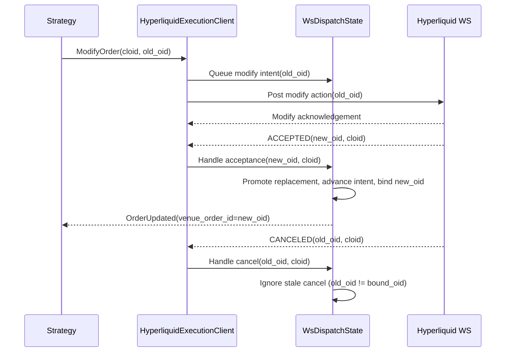

# Hyperliquid

[Hyperliquid](https://hyperliquid.gitbook.io/hyperliquid-docs) เป็น exchange แบบกระจายศูนย์สำหรับ perpetual
futures และ spot บน Hyperliquid L1 ซึ่งเป็น blockchain ที่สร้างมาเพื่อการเทรดโดยเฉพาะ order book และ
matching engine ของ HyperCore ทำงานบน on-chain ทั้งหมด adapter นี้ให้ข้อมูลตลาดแบบ live และการ execute order

## ภาพรวม {#overview}

adapter นี้เขียนด้วย Rust และเชื่อมต่อกับ REST และ WebSocket API ของ Hyperliquid โดยตรง โดยไม่ใช้ไลบรารี
client ภายนอก:

- `HyperliquidHttpClient`: การเชื่อมต่อ HTTP API, การโหลดและ parse instrument และ report สำหรับ reconciliation
- `HyperliquidWebSocketClient`: การเชื่อมต่อ WebSocket API สำหรับผู้เรียกจาก Rust
- `HyperliquidDataClient`: ตัวจัดการ feed ข้อมูลตลาด
- `HyperliquidExecutionClient`: gateway สำหรับการจัดการ account และการ execute trade
- `HyperliquidDataClientFactory`: factory สำหรับ data client ของ Hyperliquid (ใช้โดย live node builder)
- `HyperliquidExecutionClientFactory`: factory สำหรับ execution client ของ Hyperliquid (ใช้โดย live node builder)

:::note
ตั้งค่า [live trading node](#live-node-configuration) เพื่อใช้ component เหล่านี้ร่วมกัน และยังเข้าถึง client
โดยตรงได้สำหรับการเรียก API ในระดับที่ต่ำกว่า
:::

## ตัวอย่าง {#examples}

- [ตัวอย่าง Rust](https://github.com/nautechsystems/nautilus_trader/tree/develop/crates/adapters/hyperliquid/examples/)

## Builder code attribution {#builder-code-attribution}

order บน mainnet จะแนบ builder code ของ NautilusTrader ที่ **อัตราค่าธรรมเนียมเป็นศูนย์** การ attribution นี้
ไม่เพิ่มต้นทุนการเทรด และช่วยให้ทีมวัดการใช้งานและจัดลำดับความสำคัญของงาน maintenance ผู้ใช้ที่ attribute
order flow ในปริมาณมากอาจมีสิทธิ์ได้รับการ support โดยตรงผ่านระดับ
[Institutional](https://nautilustrader.io/institutional/)

สามารถเลือกไม่ attribute ได้ด้วย `include_builder_attribution: false` ใน config ที่ serialize แล้ว

order จะไม่ใส่ builder address ในกรณีต่อไปนี้:

- **Testnet**: order ไม่ใส่ builder เลย เพราะ testnet ปฏิเสธ builder address ที่ไม่ได้รับอนุมัติ และ wallet
  ที่ได้เงินจาก faucet มักไม่มีการอนุมัติ
- **Vault trading** (ตั้งค่า `vault_address` ไว้): vault อนุมัติ builder fee ไม่ได้ การใส่ address จะทำให้ถูกปฏิเสธ
- **ปิด attribution** (`include_builder_attribution` เป็น false)

### การอนุมัติ builder fee {#builder-fee-approval}

order ต้องมีการอนุมัติ `ApproveBuilderFee` แบบครั้งเดียวจึงจะแนบ builder address ได้:

- หากไม่ได้อนุมัติไว้ก่อน order จะถูกปฏิเสธด้วย `Builder fee has not been approved` การอนุมัติใดๆ ที่มีอยู่ก่อน
  รวมถึง 0% ก็ผ่านการตรวจนี้ได้
- การอนุมัติต้องใช้ private key ของ master wallet ซึ่งการตั้งค่าแบบ agent (API) wallet ไม่ได้ให้ adapter ไว้
  ให้รัน script อนุมัติครั้งเดียว เพราะการเริ่ม execution client จะไม่รันให้
- ค่าสูงสุด 0% อนุญาตให้ attribute ได้โดยไม่เก็บ builder fee การเพิ่มค่านี้ต้องมีการอนุมัติใหม่ที่คุณเซ็นเอง

รัน script อนุมัติครั้งเดียวต่อ wallet (อ่าน `HYPERLIQUID_PK` หรือ `HYPERLIQUID_TESTNET_PK` เมื่อ
`HYPERLIQUID_TESTNET=true`):

```bash
cargo run -p nautilus-hyperliquid --bin hyperliquid-builder-fee-approve
```

### การเพิกถอนการอนุมัติ {#revoking-the-approval}

การเพิกถอนจะจำกัด builder fee ที่เคยอนุมัติไว้ให้เหลือ 0% รวมถึงการอนุมัติจากเวอร์ชันที่เคยเก็บค่าธรรมเนียม
โดยยังเก็บบันทึกการอนุมัติไว้ attribution จึงยังดำเนินต่อเว้นแต่จะปิด `include_builder_attribution`

```bash
cargo run -p nautilus-hyperliquid --bin hyperliquid-builder-fee-revoke
```

script อนุมัติและเพิกถอนรับ `HYPERLIQUID_TESTNET=true` หรือ `1` สำหรับ testnet และ `false` หรือ `0` สำหรับ
mainnet (ค่าเริ่มต้นเมื่อไม่ได้ตั้ง) คำ boolean ไม่สนตัวพิมพ์เล็กใหญ่ ค่าอื่นรวมถึงสตริงว่างจะถูกปฏิเสธก่อนเซ็น request

script ของ Rust จะแสดงสรุป action และรอให้กด Enter ก่อนเซ็น ให้ยกเลิกด้วย `Ctrl+C` หากสรุปไม่ถูกต้อง หรือเติม
`-- --yes` ต่อท้าย `cargo run` เพื่อข้ามการถาม

## การตั้งค่า testnet {#testnet-setup}

ทดสอบ strategy ด้วยเงินจำลองบน Hyperliquid testnet

:::info
**ต้องฝากเงินบน mainnet ก่อน** faucet ของ testnet ให้บริการเฉพาะ wallet address ที่เคยฝากเงินบน mainnet แล้ว
:::

### การรับเงิน testnet {#getting-testnet-funds}

ใช้ wallet address เดียวกันในทั้งสอง environment:

1. เข้า [Hyperliquid mainnet portal](https://app.hyperliquid.xyz/) และฝากเงินด้วย wallet ของคุณ
2. เข้า [testnet faucet](https://app.hyperliquid-testnet.xyz/drip) ด้วย wallet เดียวกัน
3. รับ mock USDC จำนวน 1,000 จาก faucet

:::note
**ผู้ใช้ email wallet**: การ login ด้วย email จะสร้าง address ต่างกันสำหรับ mainnet และ testnet หากต้องการใช้
faucet ให้ export email wallet จาก mainnet แล้ว import เข้า MetaMask หรือ Rabby จากนั้นเชื่อม extension กับ testnet
:::

### การสร้าง testnet account {#creating-a-testnet-account}

1. เข้า [Hyperliquid testnet portal](https://app.hyperliquid-testnet.xyz/)
2. เชื่อมต่อ wallet ของคุณ (MetaMask, WalletConnect หรือ email)
3. testnet จะสร้าง account สำหรับ wallet address ของคุณโดยอัตโนมัติ

### การ export private key {#exporting-your-private-key}

export private key ของ testnet wallet เพื่อใช้กับ NautilusTrader:

**MetaMask**:

1. คลิกเมนูสามจุดข้าง account ของคุณ
2. เลือก "Account details"
3. คลิก "Show private key"
4. ใส่รหัสผ่านแล้วคัดลอก private key

:::warning
**ห้ามเปิดเผย private key** เก็บ private key อย่างปลอดภัยด้วย environment variable และห้าม commit ลง
version control
:::

### การตั้ง environment variable {#setting-environment-variables}

ตั้ง credential ของ testnet เป็น environment variable:

```bash
export HYPERLIQUID_TESTNET_PK="your_private_key_here"
# Optional: for vault trading
export HYPERLIQUID_TESTNET_VAULT="vault_address_here"
```

adapter จะโหลดตัวแปรเหล่านี้เมื่อ `environment=HyperliquidEnvironment.TESTNET`

:::warning
สำหรับ [agent (API) wallet](#agent-wallets) รวมถึง API wallet ที่สร้างใน UI ของ Hyperliquid ให้ตั้ง
`HYPERLIQUID_ACCOUNT_ADDRESS` เป็น address ของ master account มิฉะนั้น request `OrderStatusReport` และ
WebSocket user feed จะคืนผลว่างแม้จะมี order ที่ live อยู่
ดู [GH-4010](https://github.com/nautechsystems/nautilus_trader/issues/4010)
:::

## ผลิตภัณฑ์ที่รองรับ {#product-support}

Hyperliquid มี linear perpetual futures, perpetual แบบ HIP-3 ที่ builder deploy เอง, ตลาด spot แบบ native และ
ตลาด binary outcome แบบ HIP-4

| ชนิดผลิตภัณฑ์       | Data Feed | Trading | ความพร้อม     | หมายเหตุ                                            |
| ----------------- | --------- | ------- | ------------ | ------------------------------------------------ |
| Spot              | ✓         | ✓       | Stable       | ตลาด spot แบบ native                              |
| Perpetual Futures | ✓         | ✓       | Stable       | linear perp ที่ชำระด้วย USDC (validator เป็นผู้ดำเนินการ) |
| HIP-3 Perpetuals  | ✓         | ✓       | Stable       | perp ที่ builder deploy เอง มี collateral แยกราย dex  |
| HIP-4 Outcomes    | ✓         | ✓       | Experimental | side token ของ binary outcome ที่มี collateral เต็มจำนวน |

เครื่องหมายถูกระบุเส้นทาง data และ execution ที่ implement แล้วและมี automated test ครอบคลุม ความพร้อมสำหรับ
production ต้องตรวจสอบชนิด order และการตั้งค่า account ที่ strategy ของคุณใช้

การตรวจสอบ HIP-4 แบบ live ครอบคลุม fill ผ่าน HTTP และ WebSocket บน testnet แบบอ่านอย่างเดียว, fill ของ
settlement ทั้งฝั่งชนะและแพ้ และ position report แต่ไม่ครอบคลุมวงจรชีวิตของ order ใหม่หรือการ poll settlement
แบบสังเคราะห์ที่ live HIP-4 ยังเป็นแบบทดลอง ให้ [ปิดการ poll settlement แบบสังเคราะห์ไว้](#settlement-dispatch)

ผลิตภัณฑ์ทั้งสี่ชนิดจะโหลดอัตโนมัติตอน connect เมื่อมี metadata ไม่ต้องเลือกเปิดรายผลิตภัณฑ์

:::note
perpetual มาตรฐานของ Hyperliquid ชำระด้วย USDC ส่วน dex แบบ HIP-3 อาจชำระด้วย collateral token ของตัวเอง
เช่น USDH, USDE หรือ USDT0 โดยยังคง symbol ของ Nautilus ไว้เป็น quote แบบ `USD` ตลาด spot เป็นคู่สกุลเงิน
มาตรฐาน ดูรายละเอียดของแต่ละแบบได้ที่ [HIP-3 builder-deployed perpetuals](#hip-3-builder-deployed-perpetuals)
และ [HIP-4 outcome markets](#hip-4-outcome-markets)
:::

## Symbology {#symbology}

symbol ของ instrument ระบุผลิตภัณฑ์ และสำหรับ HIP-3 perpetual จะระบุ builder dex ด้วย

### ตลาด spot {#spot-markets}

รูปแบบ: `{Base}-{Quote}-SPOT`

ตัวอย่าง:

- `PURR-USDC-SPOT` - คู่ spot PURR/USDC
- `HYPE-USDC-SPOT` - คู่ spot HYPE/USDC

ใน strategy ให้ subscribe ด้วย instrument ID `PURR-USDC-SPOT.HYPERLIQUID`

instrument แบบ spot ที่โหลดจาก `spotMeta` จะเก็บ metadata ของ venue ไว้ใน `CurrencyPair.info`:

| ฟิลด์          | ค่า                                              |
| ------------- | ----------------------------------------------- |
| `name`        | label ดิบของคู่เทรดจาก venue                       |
| `tokens`      | index ของ base และ quote ใน `spotMeta.tokens`   |
| `index`       | index ของคู่เทรดก่อนบวก offset ของ spot asset `10000` |
| `isCanonical` | การจัดประเภท canonical ของ venue                  |

ใน Rust ใช้ `Params.get_bool("isCanonical")` เพื่อตรวจการจัดประเภท canonical ของ venue

:::note
instrument แบบ spot อาจรวม vault token (ขึ้นต้นด้วย `vntls:`) ซึ่ง Hyperliquid ไม่ได้ระบุไว้ใน `spotMeta`
HTTP client จึงสังเคราะห์ instrument `{coin}-USDC-SPOT` ขึ้นเมื่อพบครั้งแรก เพื่อให้ resolve balance และ fill ได้
instrument สังเคราะห์เหล่านี้ไม่มี metadata ของ venue: `info` เป็น `None`
:::

### Perpetual futures {#perpetual-futures}

รูปแบบ: `{Base}-USD-PERP`

ตัวอย่าง:

- `BTC-USD-PERP` - Bitcoin perpetual futures
- `ETH-USD-PERP` - Ethereum perpetual futures
- `SOL-USD-PERP` - Solana perpetual futures

ใน strategy ให้ subscribe ด้วย instrument ID เช่น `BTC-USD-PERP.HYPERLIQUID` และ `ETH-USD-PERP.HYPERLIQUID`

### HIP-3 perpetuals {#hip-3-perpetuals}

รูปแบบ: `{dex}:{Asset}-USD-PERP`

ตลาด [HIP-3](https://hyperliquid.gitbook.io/hyperliquid-docs/hyperliquid-improvement-proposals-hips/hip-3-builder-deployed-perpetuals)
ใช้ prefix ของ dex คั่นด้วยเครื่องหมาย colon ชื่อ dex ระบุว่าตลาดนั้นเป็นของ perp dex ที่ builder deploy ตัวใด

ตัวอย่าง:

- `xyz:TSLA-USD-PERP` - Tesla perp บน trade.xyz
- `xyz:GOLD-USD-PERP` - Gold perp บน trade.xyz
- `flx:NVDA-USD-PERP` - Nvidia perp บน Felix
- `vntl:SPACEX-USD-PERP` - SpaceX perp บน Ventuals

ใน strategy ให้ subscribe ด้วย instrument ID เช่น `xyz:TSLA-USD-PERP.HYPERLIQUID`

### Side token ของ HIP-4 outcome {#hip-4-outcome-side-tokens}

รูปแบบ: `{outcome_index}-{YES|NO}-OUTCOME.HYPERLIQUID` โดย `outcome_index` คือฟิลด์ `outcome` จาก
`outcomeMeta` และ `YES|NO` ระบุฝั่ง suffix ของผลิตภัณฑ์ใช้รูปแบบเดียวกับ `-PERP` และ `-SPOT`

side token ของ [HIP-4](https://hyperliquid.gitbook.io/hyperliquid-docs/hyperliquid-improvement-proposals-hips/hip-4-outcome-markets)
เป็นสัญญา binary ที่ชำระเป็น quote token ของตลาดที่ `0` (แพ้) หรือ `1` (ชนะ) symbol ของ Nautilus ใช้รูปแบบที่อ่าน
ง่ายด้านบน ส่วน `raw_symbol` บน wire ใช้รูปแบบ coin ของ venue คือ `#{encoding}` (โดย
`encoding = 10 * outcome_index + side` และ `side` เป็น `0` สำหรับ Yes / `1` สำหรับ No) ซึ่งเป็นรูปแบบที่
`l2Book` และ `allMids` รับ

ตัวอย่าง (outcome 25):

- `25-YES-OUTCOME.HYPERLIQUID`: ฝั่ง Yes, encoding `250`, wire coin `#250`, ชื่อ token `+250`,
  action asset id `100_000_250`
- `25-NO-OUTCOME.HYPERLIQUID`: ฝั่ง No, encoding `251`, wire coin `#251`, ชื่อ token `+251`,
  action asset id `100_000_251`

ใน strategy ให้ subscribe ด้วย instrument ID เช่น `25-YES-OUTCOME.HYPERLIQUID`

:::note
settlement จะเอา outcome ที่ได้ข้อสรุปแล้วออกจาก `outcomeMeta` และการลิสต์ครั้งถัดไปจะเลื่อน index ขึ้น
reconciliation จะสร้าง instrument ที่ settle แล้วขึ้นใหม่จาก coin `#{encoding}` เพื่อ resolve fill และ order ย้อนหลัง
instrument เหล่านี้ไม่มีชื่อตลาด, คำอธิบาย, วันหมดอายุ และ quote token ที่ `outcomeMeta` ให้มา ดู
[Settlement currency](#settlement-currency) สำหรับสกุลเงินสำรอง ตรวจดู universe ปัจจุบันได้ด้วย:

```bash
curl -s -X POST https://api.hyperliquid.xyz/info \
    -H 'Content-Type: application/json' \
    -d '{"type":"outcomeMeta"}'
```

:::

ดู [HIP-4 outcome markets](#hip-4-outcome-markets) สำหรับลำดับการเทรด, settlement และข้อจำกัดในปัจจุบัน

## HIP-3 builder-deployed perpetuals {#hip-3-builder-deployed-perpetuals}

[HIP-3](https://hyperliquid.gitbook.io/hyperliquid-docs/hyperliquid-improvement-proposals-hips/hip-3-builder-deployed-perpetuals)
อนุญาตให้ผู้ deploy ที่มีคุณสมบัติเปิด perp dex แบบ permissionless บน Hyperliquid ได้ ตลาดเหล่านี้รวมถึงหุ้น
(TSLA, NVDA, AAPL), สินค้าโภคภัณฑ์ (ทองคำ, น้ำมันดิบ), ดัชนี (S&P 500) และ token ก่อน IPO (SpaceX, OpenAI)

ตอน `LiveNode` connect, `allPerpMetas` จะโหลด perpetual มาตรฐานและ HIP-3 dex ทุกตัวโดยไม่ต้องตั้งค่าเพิ่ม
data client ไม่มีตัวกรองราย dex โดย strategy เลือกตลาดผ่าน `instrument_id`

การเรียก `HyperliquidHttpClient` โดยตรงจะไม่รวม HIP-3 dex เว้นแต่จะเลือกเปิดไว้

> หมายเหตุ: ต้นฉบับมีเฉพาะตัวอย่าง Python จึงตัดออก

### Reconciliation ของ open order และ position {#open-order-and-position-reconciliation}

#### Mass status ตอนเริ่มต้น {#startup-mass-status}

ตอน `LiveNode` เริ่มต้น reconciliation ของ open order และ position แบบไม่กรองจะ query perp dex ค่าเริ่มต้น และ
HIP-3 dex แต่ละตัวที่ปรากฏใน order หรือ fill ย้อนหลังล่าสุดของ wallet:

- dex ใน cache ที่ไม่มีกิจกรรมของ wallet จะไม่ถูก request ตอนเริ่มต้น
- หาก response ประวัติตัวใดตัวหนึ่งถึงขีดจำกัด 2,000 record, reconciliation จะ query ทุก dex ที่ venue คืนมาใน
  รายการ perp dex ปัจจุบันแทน เพื่อไม่ให้ประวัติที่มีขอบเขตซ่อน open order หรือ position ที่เก่ากว่า
- reconciliation ของ position ยังรวม spot holding ด้วย

mass status ที่ได้จะบันทึกขอบเขตการครอบคลุมตาม
[mass-status history contract](../concepts/execution/reconciliation.md#mass-status-history-contract) เมื่อตั้ง
lookback ไว้ `lookback_start` จะเก็บขอบล่างของมัน snapshot ที่สมบูรณ์และไม่มี lookback ยังคงไม่มีขอบเขต
หาก response ประวัติตัวใดตัวหนึ่งถึงขีดจำกัดจำนวน record, request แบบไม่มีขอบเขตจะประกาศ timestamp ของ raw fill
ที่เก่าที่สุดเป็นขอบล่างแทนเมื่อมี raw fill การประกาศนี้คง fill ที่ถูกต้องทั้งหมดไว้และไม่ได้อ้างว่าครอบคลุมครบ
หากไม่มี raw fill จะไม่ประกาศขอบล่าง แถวที่ใช้ไม่ได้ซึ่งไม่ได้มาจาก response ที่ถูกตัดจะไม่เพิ่มขอบเขตเวลา
`reports_complete` จะเป็น `false` ในเงื่อนไขใดเงื่อนไขหนึ่งต่อไปนี้:

- response ประวัติถึงขีดจำกัดจำนวน record และอาจถูกตัด
- แถวของ venue ที่จำเป็นไม่สามารถ decode, resolve เป็น instrument หรือแปลงเป็น report ได้

แถวที่ถูกต้องยังอยู่ในชุด report ส่วน response ที่ decode ได้ครบภายในขีดจำกัดจำนวน record จะถือเป็น snapshot ที่
เชื่อถือได้ แม้จะว่างก็ตาม

สำหรับหน้าต่างที่ประกาศไว้ fill ที่ไม่มี position report ระบุชัดเจนจะอัปเดตเฉพาะ order ซึ่งป้องกันไม่ให้ประวัติที่ถูกตัด
สร้าง position ขึ้น แต่อาจทำให้ position ใน cache ยังเปิดอยู่หลังการปิดขณะออฟไลน์ เมื่อ position ที่เป็นศูนย์ไม่ได้
อยู่ใน report ดู [bounded history safety](../concepts/execution/reconciliation.md#bounded-history-safety)

#### ปริมาณ fill ของ reduce-only {#reduce-only-fill-quantity}

Hyperliquid อาจรายงาน reduce-only order เป็น `filled` โดยไม่มีส่วนที่เหลือเมื่อปิด position ที่เล็กกว่า order ระหว่าง
mass status ตอนเริ่มต้นหรือการค้นหา order เดียวด้วย venue order ID, adapter จะ clamp order แบบนั้นให้เท่ากับ fill
ทั้งหมด จึงปิดเป็น `Filled` ที่ปริมาณน้อยกว่าขนาดที่ส่งไป การ clamp นี้ใช้เฉพาะเมื่อประวัติ `userFills` สมบูรณ์และ
ต่ำกว่าขีดจำกัด 2,000 record มิฉะนั้น adapter จะคงปริมาณของ venue ไว้ และ reconciliation สามารถอนุมาน fill
ที่หายไปได้

สำหรับการ clamp นี้ การค้นหา order เดียวจะดึง `userFills` เฉพาะสำหรับ reduce-only order ที่ถูกรายงานเป็น `Filled`
ส่วน `QueryOrder` ยังอ่านประวัติ fill สำหรับ [order ปกติที่ filled และมีสิทธิ์](#order-fill-recovery) ด้วย

#### Command และ request โดยตรง {#command-and-direct-requests}

นอกเหนือจาก mass status ตอนเริ่มต้น command สำหรับ report ของ open order และ position แบบไม่กรองของ
`LiveNode` และ request โดยตรงของ `HyperliquidHttpClient` จะ query perp dex ค่าเริ่มต้น และ builder dex แต่ละตัวที่มี
perpetual instrument อยู่ใน cache:

- request ที่กรองด้วย HIP-3 instrument จะหา builder dex จาก prefix ของ dex ใน symbol และ query เฉพาะ dex นั้น
- ตัวกรองด้วย perpetual มาตรฐานจะ query เฉพาะ dex ค่าเริ่มต้น
- ตัวกรอง position ของ spot และ outcome ยังคงใช้การ routing เฉพาะ spot แบบเดิม
- หาก request ที่จำเป็นล้มเหลว request จะคืน error แทน snapshot ที่ไม่ครบ เช่นเดียวกันหากแถวของ venue ไม่สามารถ
  decode, resolve เป็น instrument หรือแปลงเป็น report ได้ request สำหรับ report ของ fill และ order ย้อนหลังก็ล้มเหลว
  ในลักษณะเดียวกัน
- หากการค้นหาสถานะ order ผ่าน HTTP แบบเจาะจงพบแถวของ venue ที่ใช้ไม่ได้ จะคืน error แทนการรายงานว่า order หายไป
  command `GenerateOrderStatusReport` ก็ทำเช่นเดียวกันเมื่อไม่เหลือ fallback ด้วย venue order ID แล้ว

#### Commission ของ fill ที่อนุมาน {#inferred-fill-commissions}

event `OrderFilled` ที่อนุมานขึ้นจะมี `commission=None` เพราะ adapter ไม่ประมาณค่าธรรมเนียมของ fill เหล่านี้
ปริมาณและราคายังคง reconcile ได้ แต่ realized PnL ของ fill เหล่านี้ไม่รวมค่าธรรมเนียมการเทรด

### ความแตกต่างจาก perpetual มาตรฐาน {#differences-from-standard-perpetuals}

ตลาด HIP-3 ซื้อขายบน matching engine ของ HyperCore ตัวเดียวกันและใช้ order API เดียวกัน ความแตกต่างหลักคือ:

- **ค่าธรรมเนียมสูงกว่า**: แต่ละ dex ตั้ง deployer fee scale ของตัวเอง ซึ่งคูณค่าธรรมเนียม perp พื้นฐานด้วย
  `scale + 1` เมื่อต่ำกว่า `1` และด้วย `scale * 2` เมื่อเท่ากับหรือสูงกว่า โดยผู้ deploy ได้ไปสูงสุดครึ่งหนึ่ง ให้ตรวจอัตรา
  ปัจจุบันของ dex แทนการสันนิษฐานว่าใช้ตารางค่าธรรมเนียม perp มาตรฐาน
- **Isolated margin**: ตลาด HIP-3 ใช้ isolated margin อย่างเดียวเป็นค่าเริ่มต้น
- **Collateral ราย dex**: HIP-3 dex แต่ละตัวประกาศ settlement token ผ่านรายการ `collateralToken` ใน
  `allPerpMetas` โดย Nautilus จะ resolve token นั้นผ่าน `spotMeta` และคงขา quote ของ symbol ไว้เป็น `USD` หาก
  collateral token ที่ไม่ใช่ USDC resolve จาก `spotMeta` ไม่ได้ การโหลด instrument จะคืน error แทนการ fallback ไปใช้ USDC
- **Oracle ที่ผู้ deploy จัดการ**: ผู้ deploy เป็นผู้ดำเนินการ oracle feed ไม่ใช่ validator
- **Growth mode**: dex ที่ตลาดไม่ทับซ้อนกับ perp ที่ validator ดำเนินการสามารถเลือกเข้า growth mode ได้ ซึ่ง
  Hyperliquid ระบุว่าลดค่าธรรมเนียมรวมอย่างน้อย 90%

เอกสารอ้างอิงของโปรโตคอล:

- [HIP-3 proposal](https://hyperliquid.gitbook.io/hyperliquid-docs/hyperliquid-improvement-proposals-hips/hip-3-builder-deployed-perpetuals)
- [HIP-3 deployer actions](https://hyperliquid.gitbook.io/hyperliquid-docs/for-developers/api/hip-3-deployer-actions)
- [Asset IDs](https://hyperliquid.gitbook.io/hyperliquid-docs/for-developers/api/asset-ids)
- [Fees](https://hyperliquid.gitbook.io/hyperliquid-docs/trading/fees)

### การ sanitize อักขระ wildcard {#wildcard-character-sanitization}

ชื่อบน venue ของ HIP-3 อาจมี `*` หรือ `?` เช่น `dex:STREAMABCD****-USD-PERP` อักขระเหล่านี้หมายถึงการจับคู่
ศูนย์ตัวขึ้นไปและหนึ่งตัวใน pattern ของ message bus ของ Nautilus การปล่อยไว้ใน topic string จึงทำให้การ routing
ของ subscription เสียหาย

adapter จะแทนที่ทั้งสองอักขระด้วย `x` ใน `InstrumentId.symbol` ให้ subscribe ด้วย symbol ที่ sanitize แล้ว เช่น
`dex:STREAMABCDxxxx-USD-PERP.HYPERLIQUID`

มีเพียง symbol ที่ใช้ใน topic, cache, log และ config ของ Nautilus เท่านั้นที่เปลี่ยน `raw_symbol` ยังคงชื่อของ venue
ไว้สำหรับการเรียก HTTP และ WebSocket และ order ใช้ asset index แบบตัวเลข การสื่อสารไปกลับกับ venue จึงไม่ได้รับ
ผลกระทบ symbol ที่ไม่มี `*` หรือ `?` จะไม่เปลี่ยน

การแทนที่นี้ทำให้ข้อมูลสูญหาย: ชื่อบน venue สองชื่อที่ต่างกันเช่น `dex:FOO*` และ `dex:FOO?` จะถูก normalize เป็น
symbol ของ Nautilus ตัวเดียวกัน การชนกันแบบนี้จะใช้พฤติกรรม first-write-wins ตามที่อธิบายไว้ใน
[Instrument loading](#instrument-loading)

## HIP-4 outcome markets {#hip-4-outcome-markets}

ตลาด [HIP-4](https://hyperliquid.gitbook.io/hyperliquid-docs/for-developers/api/asset-ids#outcomes) เป็นสัญญา
binary ที่มี collateral เต็มจำนวน token Yes และ No ของแต่ละตลาดจะชำระเป็น quote token `1` (ชนะ) หรือ `0` (แพ้)
ในวันที่ได้ข้อสรุป หาก `outcomeMeta` ใช้ไม่ได้ รวมถึงกรณีที่ endpoint หายไปหรือถูกเปลี่ยนชื่อ adapter จะข้าม
instrument ของ HIP-4 โดยไม่ทำให้การโหลด perp หรือ spot ล้มเหลว

การรองรับ HIP-4 ยังเป็นแบบทดลอง ดูขีดจำกัดของการตรวจสอบได้ที่ [Product support](#product-support) ก่อนใช้งาน

### การโหลด outcome instrument {#loading-outcome-instruments}

`LiveNode` จะโหลด outcome instrument โดยอัตโนมัติเมื่อมี `outcomeMeta` โดยไม่ต้องตั้งค่าใดๆ

สำหรับการใช้ `HyperliquidHttpClient` โดยตรง ให้เลือกเปิดผ่าน `load_instrument_definitions`

แต่ละ outcome จะสร้าง instrument แบบ `BinaryOption` สองตัว ฝั่งละหนึ่งตัว ตั้งชื่อเป็น
`{outcome_index}-{YES|NO}-OUTCOME.HYPERLIQUID` ราคาขยับทีละ `0.00001` และขนาดใช้จำนวน token เต็ม adapter
จะ parse `expiration_ns` จาก `expiry:YYYYMMDD-HHMM` (UTC) ในคำอธิบายของ venue binary แบบเดี่ยวจะมีวันหมดอายุ
ของตัวเอง ส่วน outcome แบบมีชื่อและแบบ fallback จะใช้วันหมดอายุของคำถามแม่

ใน Rust อ่าน metadata ของ venue จาก `BinaryOption.info` ด้วย `Params.get_str(...)` ตัวระบุที่คำนวณได้จะมีเสมอ
ส่วนฟิลด์จากคำอธิบายจะมีเฉพาะเมื่อ venue ให้มา

| ฟิลด์               | แหล่งที่มา                       | หมายเหตุ                                             |
| ------------------ | ------------------------------ | ------------------------------------------------- |
| `outcome_index`    | derived                        | `outcome` จาก `outcomeMeta`                       |
| `outcome_side`     | derived                        | `0` = Yes, `1` = No                               |
| `side_name`        | `outcomeMeta` `sideSpecs`      | label ฝั่งของ venue, `"Yes"` / `"No"` เมื่อไม่มี       |
| `encoding`         | derived                        | `10 * outcome_index + side`                       |
| `asset_id`         | derived                        | `100_000_000 + encoding`                          |
| `market_name`      | `outcomeMeta.outcomes[*].name` | label ตลาดของ venue                                |
| `class`            | description                    | `priceBinary` หรือ `priceBucket`                  |
| `underlying`       | description                    | รหัสของสินทรัพย์อ้างอิง                               |
| `expiry`           | description                    | `YYYYMMDD-HHMM` UTC                               |
| `target_price`     | description                    | เกณฑ์ settlement ของ binary                         |
| `period`           | description                    | รอบการเกิดซ้ำ (เช่น `1d`, `3m`)                      |
| `price_thresholds` | description                    | เกณฑ์คั่นด้วย comma (ตลาดแบบ bucket)                 |
| `named_index`      | named-outcome description      | ตำแหน่งใน array `named_outcomes` ของคำถามแม่         |
| `is_fallback`      | fallback-outcome description   | `true` สำหรับ outcome `other` ของคำถาม               |
| `question`         | parent question                | id ของคำถาม                                        |
| `question_name`    | parent question                | label ของคำถาม                                     |
| `question_*`       | parent question description    | ทุกฟิลด์ของคำถามที่ parse ได้ โดยมี prefix `question_`  |

key ในคำอธิบายจะถูกแปลงจาก camelCase ของ venue เป็น snake_case (`targetPrice` -> `target_price`,
`priceThresholds` -> `price_thresholds`) ค่าถูกเก็บเป็นสตริงเพื่อคงความถูกต้องตาม wire ส่วนตัวระบุที่เป็นตัวเลข
(`outcome_index`, `outcome_side`, `encoding`, `asset_id`, `question`, `named_index`) ถูกเก็บเป็นตัวเลข JSON

### สกุลเงินของ settlement {#settlement-currency}

`quoteToken` ของแต่ละ outcome ใน `outcomeMeta` กำหนด `BinaryOption.currency`, `quote_currency` และสกุลเงินของ
settlement fill ที่ค่าธรรมเนียมเป็นศูนย์และมี side token เป็น `feeToken` จะใช้ quote currency ของ instrument เป็น
commission USDH ถูกลงทะเบียนไว้อย่างชัดเจนที่ความละเอียด 8 ตำแหน่งทศนิยม แทนการพึ่งการลงทะเบียนสกุลเงินอัตโนมัติ

หากไม่มี `quoteToken` จะใช้ USDC เป็นค่าเริ่มต้น ซึ่งตรงกับ outcome บน mainnet และ testnet ที่พบในเดือนตุลาคม 2026
outcome ที่ settle แล้วและถูกเอาออกจาก metadata จะยังคงสกุลเงินไว้ใน instrument cache ในหน่วยความจำ แต่หลัง
restart จะกลับไปใช้ USDC เว้นแต่จะส่ง instrument เข้า cache นั้นอีกครั้ง asset encoding ไม่มีข้อมูล quote token
จึงกู้คืนสกุลเงินในอดีตแบบอื่นไม่ได้หากไม่มี instrument ใน cache

instrument ที่สร้างขึ้นใหม่จะเข้า cache ด้วย USDC เช่นกัน และคงสกุลเงินนั้นไว้จนกว่าจะมี instrument ที่ส่งเข้ามาแทนที่
แม้ metadata ในภายหลังจะระบุ quote token อื่นก็ตาม

balance spot ของ USDH จะรวมเข้ากับมุมมอง clearinghouse ของ perp ดังนั้น `AccountState` จะมี USDH ควบคู่กับ USDC
และ spot holding อื่นที่ไม่เป็นศูนย์

### ลำดับการเทรด {#trading-flow}

เทรด side token ของ outcome ด้วยคำสั่ง `SubmitOrder` ปกติ execution client จะส่ง action `Order` มาตรฐานไปยัง
order book `#{encoding}` โดย `encoding = 10 * outcome_index + outcome_side` ไม่ต้องเรียกอะไรที่เฉพาะกับ HIP-4

settlement ขับเคลื่อนโดย venue ดู [Settlement dispatch](#settlement-dispatch)

#### Workflow ขั้นสูง {#advanced-workflows}

ใช้ action `userOutcome` บน `HyperliquidHttpClient` เพื่อจัดการ inventory ของ side token นอก order book

> หมายเหตุ: ต้นฉบับมีเฉพาะตัวอย่าง Python จึงตัดออก

| Action                  | กรณีใช้งาน                                                                             |
| ----------------------- | ------------------------------------------------------------------------------------ |
| `submit_split_outcome`  | mint token Yes + No เป็นคู่จาก quote (market making ช่วงเริ่มต้น, hedge สองฝั่ง)               |
| `submit_merge_outcome`  | burn คู่ Yes + No ที่จับคู่กันกลับเป็น quote โดยไม่ต้อง cross spread                          |
| `submit_merge_question` | ปิดตะกร้า multi-outcome ทั้งชุดกลับเป็น quote แบบ atomic                                   |
| `submit_negate_outcome` | แปลงหุ้น No ของ outcome หนึ่งเป็นหุ้น Yes ของทุก outcome อื่นในคำถามเดียวกัน                    |

ใช้คำสั่ง `SubmitOrder` ปกติสำหรับการเทรดแบบมีทิศทาง ส่วน action เหล่านี้สร้างหรือทำลาย inventory นอก order book

### ข้อจำกัดของ order {#order-constraints}

side token ของ outcome ทำงานเหมือน spot token (ไม่มี margin, ไม่มี funding, ไม่มี liquidation) execution client
จะปฏิเสธฟีเจอร์ที่ไม่เกี่ยวข้อง:

- order แบบ `reduce_only`
- ชนิด order แบบ trigger (`StopMarket`, `StopLimit`, `MarketIfTouched`, `LimitIfTouched`, trailing stop)

รองรับ order แบบ `Limit` และ `Market` ที่มี time-in-force เป็น `GTC`, `IOC` หรือ `ALO` ขั้นต่ำของ venue คือ notional
10 quote token ให้กำหนด `order_qty` เป็นจำนวน token เต็มโดยให้ `order_qty * limit_price >= 10`

### การ dispatch settlement {#settlement-dispatch}

เมื่อหมดอายุ venue จะปิด balance ของ side token ที่ถืออยู่และ emit fill แบบ `Settlement` ฝั่งละหนึ่งตัว adapter จะรับ
fill เหล่านี้ผ่านการ poll user fill ทาง HTTP และการอัปเดตทาง WebSocket โดยคง commission ของ venue ไว้

settlement แต่ละครั้งจะสร้าง `FillReport` ฝั่ง `SELL` ที่ `1` quote token สำหรับฝั่งชนะ หรือ `0` สำหรับฝั่งแพ้
การ dispatch ทาง WebSocket ยัง emit `OrderFilled` เมื่อเชื่อม position เข้ากับ order ที่ติดตามอยู่

fill แบบ `Settlement` ของ venue ครอบคลุม outcome แบบ `priceBinary` เดี่ยวและคำถาม `priceBucket` แบบ
multi-outcome อย่างเท่าเทียมกัน

option `outcome_settlement_poll_secs` เปิดการ poll settlement แบบสังเคราะห์สำหรับคำถามแบบ multi-outcome
และปิดอยู่โดยค่าเริ่มต้น

:::warning

ให้ปิดการ poll แบบสังเคราะห์ไว้และใช้ fill ของ settlement จาก venue การอนุมานนี้สันนิษฐานว่ารายการ
`settledNamedOutcomes` ที่ไม่ว่างระบุ outcome ที่ชนะภายใน `namedOutcomes` และ outcome แบบมีชื่ออื่นทั้งหมดกับ
fallback แพ้ แต่ metadata ของ testnet ที่พบในเดือนตุลาคม 2026 กลับลิสต์ outcome ที่ถูกเอาออกไว้ใน
`settledNamedOutcomes` ขณะที่ outcome แบบมีชื่ออื่นยังอยู่ในรายการ ภายใต้รูปแบบนั้น การ poll อาจ emit fill ปิด
สำหรับ position ในตลาดที่ยังซื้อขายอยู่

:::

fill แบบสังเคราะห์มี commission เป็นศูนย์ใน quote currency ของ instrument ใน cache หรือ quote token จาก metadata
เมื่อไม่มี instrument ใน cache โดยใช้ USDC เป็นค่าสำรอง fill เหล่านี้ไม่มี `client_order_id` และถูก dispatch เป็น
`FillReport`

### Reconciliation ของ position {#position-reconciliation}

side token ของ HIP-4 มาใน `spotClearinghouseState` โดยตั้ง `coin` เป็นรูปแบบ token `+E` และไม่มีฟิลด์ `token`
adapter จะ:

- ถือว่า `SpotBalance.token` เป็น optional ระหว่าง deserialize
- resolve coin `+E` / `#E` เป็น instrument `BinaryOption` เมื่อสร้าง `PositionStatusReport`
- ข้ามการดึง clearinghouse ของ perp เมื่อตัวกรอง position-status เป็น outcome instrument (outcome ไม่เคยปรากฏใน
  `assetPositions`)

### ตลาด multi-outcome (priceBucket) {#multi-outcome-pricebucket-markets}

array `outcomeMeta.questions` ระดับบนสุดกำหนดตลาด multi-outcome แต่ละตลาดพร้อม fallback และ outcome แบบมีชื่อ
คำอธิบายของ outcome แบบมีชื่อแต่ละตัวอ้างถึงคำถามแม่ด้วย `index:N` และ side token แต่ละตัวเป็น `BinaryOption`
อิสระ ใช้ `HyperliquidHttpClient.submit_merge_question` เพื่อปิดตะกร้าของคำถาม และ `submit_negate_outcome`
สำหรับการหมุนข้าม outcome

## การโหลด instrument {#instrument-loading}

ตอน connect, data client จะโหลดตลาด spot, perpetual มาตรฐาน, HIP-3 dex ทุกตัว และ side token ของ HIP-4 โดยไม่มี
ตัวกรองผลิตภัณฑ์หรือ symbol strategy เลือก instrument ผ่านการตั้งค่า `instrument_id` ของตัวเอง

loader รวมทั้งคู่ canonical และไม่ใช่ canonical จาก `spotMeta.universe` และ cache คู่ canonical ก่อน เพื่อให้ balance
และ fill ที่ระบุด้วย base token resolve ไปยัง instrument แบบ canonical นิยามที่มาทีหลังซึ่งมี symbol ของ Nautilus
ชนกันจะถูกทิ้งพร้อมคำเตือนและไม่สามารถเทรดได้

การเชื่อมต่อ data แต่ละตัวเป็นเจ้าของ refresh task หนึ่งตัว ซึ่งจะดึง universe ใหม่หลัง connect
`update_instruments_interval_mins` นาที และหลังแต่ละรอบเสร็จ การ disconnect, reset และ stop จะยกเลิก task นี้
รวมถึงการดึงที่กำลังดำเนินอยู่ การ reconnect จะโหลด universe อีกครั้งและเริ่ม task ใหม่

การ refresh แต่ละครั้ง:

- publish นิยามที่ใหม่หรือเปลี่ยนแปลงอย่างมีนัยสำคัญ นิยามที่ไม่เปลี่ยนจะไม่ถูก publish ซ้ำ
- อัปเดต asset index และ mapping ของความละเอียดใน execution client ทำให้ตลาดใหม่และนิยามที่เปลี่ยนมีผลโดยไม่ต้อง restart

`RequestInstrument` และ `RequestInstruments` ก็ดึง universe ทั้งหมดใหม่และ publish นิยามที่ใหม่หรือเปลี่ยนแปลง
ตั้ง `update_instruments_interval_mins=0` เพื่อปิดการ refresh เป็นระยะ ส่วน request และการ reconnect ยังดึงใหม่อยู่

การส่ง order สำหรับ symbol ที่ execution client ไม่เคยโหลดจะถูกปฏิเสธด้วย `INSTRUMENT_NOT_FOUND`

ความล้มเหลวจะลดระดับเป็นรายผลิตภัณฑ์แทนการยกเลิกการโหลดทั้งหมด:

- metadata ของ spot หรือ perp ที่หายไปจะถูก log เป็นคำเตือนและข้ามผลิตภัณฑ์นั้น
- payload `outcomeMeta` ที่ไม่มีจะถูกข้ามที่ระดับ debug
- perp dex ที่ collateral token ซึ่งไม่ใช่ USDC resolve ผ่าน `spotMeta` ไม่ได้เป็นความล้มเหลวแบบ hard เพียงกรณีเดียว
  เพราะการเดาสกุลเงินของ settlement จะทำให้ตั้งราคาตลาดผิด

หากต้องการดึงชุดที่แคบลงนอก `LiveNode` ให้เรียก `load_instrument_definitions` บน `HyperliquidHttpClient` โดยตรง
พร้อม flag ของผลิตภัณฑ์ที่ต้องการ

### สถานะของ instrument {#instrument-status}

Hyperliquid ไม่มีสตรีมสถานะตลาด adapter จึงหา `InstrumentStatus` จากการ refresh instrument ซึ่ง poll ตามช่วงเวลา
ที่ตั้งด้วย `update_instruments_interval_mins`

- ตลาดที่ active เป็น `TRADING` และตลาดที่ถูก delist เป็น `CLOSE`
- ตลาดที่ถูกเอาออกจาก venue จะเป็น `NOT_AVAILABLE_FOR_TRADING` การดึง metadata ที่ล้มเหลวไม่นับเป็นการเอาออก
- การ subscribe จะ emit สถานะปัจจุบันทันที

## Data subscription {#data-subscriptions}

mark price, index price และ funding rate ใช้กับทั้ง perpetual มาตรฐานและ HIP-3

| ชนิดข้อมูล           | Sub. | Snapshot | Hist. | Nautilus type                 | หมายเหตุ                                            |
| ----------------- | ---- | -------- | ----- | ----------------------------- | ------------------------------------------------ |
| Trade ticks       | ✓    | -        | ✓     | `TradeTick`                   | WebSocket trades; `recentTrades`                 |
| Public trades     | ✓    | -        | ✓     | `HyperliquidPublicTrade`      | custom data แบบ opt-in พร้อมคู่สัญญาและ hash        |
| Quote ticks       | ✓    | -        | -     | `QuoteTick`                   | Best bid/offer                                   |
| Order book deltas | ✓    | ✓        | -     | `OrderBookDelta`              | L2 snapshot                                      |
| Order book depth  | ✓    | -        | -     | `OrderBookDepth`              | L2 snapshot 10 ระดับบนสุด                           |
| Bars              | ✓    | -        | ✓     | `Bar`                         | ดูช่วงเวลาที่รองรับด้านล่าง                             |
| Mark prices       | ✓    | -        | -     | `MarkPriceUpdate`             | tick ของ mark price ของ perpetual                   |
| Index prices      | ✓    | -        | -     | `IndexPriceUpdate`            | ราคาอ้างอิงของสินทรัพย์อ้างอิง                         |
| Funding rates     | ✓    | -        | ✓     | `FundingRateUpdate`           | endpoint `fundingHistory`                        |
| Instrument status | ✓    | ✓        | -     | `InstrumentStatus`            | poll ไปพร้อมกับการ refresh instrument               |
| Open interest     | ✓    | -        | -     | `HyperliquidOpenInterest`     | custom data จาก `activeAssetCtx`                 |
| All mids          | ✓    | -        | -     | `HyperliquidAllMids`          | custom data จาก `allMids`                        |
| All dex contexts  | ✓    | -        | -     | `HyperliquidAllDexsAssetCtxs` | custom data จาก `allDexsAssetCtxs`               |
| TWAP history      | ✓    | -        | -     | `HyperliquidTwapHistory`      | custom data แบบ opt-in จาก `userTwapHistory`     |
| TWAP slice fills  | ✓    | -        | -     | `HyperliquidTwapSliceFill`    | custom data แบบ opt-in จาก `userTwapSliceFills`  |

:::note
ไม่รองรับ quote ย้อนหลัง `request_trades` ใช้ `recentTrades` ซึ่งเป็น snapshot เรียงจากใหม่ไปเก่าที่ query ช่วงเวลา
ไม่ได้ โดยจะกรองให้อยู่ใน `[start, end]` และเก็บ trade ล่าสุดตามจำนวน `limit` request ที่เก่ากว่า snapshot จะ log
คำเตือนและคืนส่วนที่มีอยู่ ซึ่งอาจว่าง node `/info` ที่ host เองไม่มี indexer ที่จำเป็นและจะคืน HTTP 422 ซึ่ง adapter
ถือว่าไม่มีข้อมูลครอบคลุมและตอบด้วย response ว่าง trade แบบ live ยังได้รับผ่าน WebSocket `trades`
:::

### การควบคุมความละเอียดของ order book {#order-book-precision-controls}

หากต้องการลดความละเอียดของการรวม `l2Book` ฝั่ง venue ให้ส่ง `n_sig_figs` และ `mantissa` ใน `params` ของ
`subscribe_book_deltas` หรือ `subscribe_book_depth` adapter จะส่งต่อเป็น `nSigFigs` และ `mantissa`

Hyperliquid รับค่า `nSigFigs` เป็น `2`, `3`, `4`, `5` หรือไม่ระบุเพื่อใช้ความละเอียดเต็ม ส่วน `mantissa` ใช้ได้เฉพาะ
เมื่อ `nSigFigs=5` และรับค่า `1`, `2` หรือ `5`

การไม่ระบุทั้งสอง param จะ subscribe ที่ความละเอียดราคาเต็ม

book delta และ depth snapshot ของ instrument เดียวกันใช้สตรีม `l2Book` ของ venue ร่วมกันหนึ่งสตรีม:

- subscription แรกจะเปิดสตรีมและกำหนด option ความละเอียด
- การขอ option ที่ต่างออกไปขณะที่สตรีมเปิดอยู่จะ log คำเตือนและคง option เดิมไว้
- สตรีมจะปิดเมื่อการใช้งานตัวสุดท้ายจากทั้งสองแบบ unsubscribe
- การ reconnect จะคืนสตรีมพร้อม option ความละเอียดเดิม

### ข้อมูลเฉพาะของ Hyperliquid {#hyperliquid-specific-data}

adapter มี custom data type ต่อไปนี้:

- `HyperliquidAllMids` จาก feed `allMids` ทาง WebSocket แต่ละการอัปเดตมี mid price ทั้งหมดที่รายงานอยู่ใน payload เดียว
- `HyperliquidAllDexsAssetCtxs` จาก feed `allDexsAssetCtxs` ทาง WebSocket แต่ละการอัปเดตมีรายการ asset context
  ราย instrument ที่ normalize แล้ว ครอบคลุม perp dex ค่าเริ่มต้นและ builder dex ของ HIP-3
- `HyperliquidOpenInterest` จาก feed `activeAssetCtx` ที่ใช้ร่วมกับ mark price, index price และ funding rate
- `HyperliquidPublicTrade` จาก `trades` และ `recentTrades` แต่ละ event สมบูรณ์ในตัวและมีผู้ซื้อ, ผู้ขาย และ hash ของ venue
- `HyperliquidTwapHistory` จาก feed `userTwapHistory` ทาง WebSocket แต่ละ event คือแถวประวัติ/วงจรชีวิตหนึ่งแถวของ
  user address
- `HyperliquidTwapSliceFill` จาก feed `userTwapSliceFills` ทาง WebSocket แต่ละ event คือ fill ของ child slice ของ
  TWAP หนึ่งตัว

#### All mids {#all-mids}

| ฟิลด์       | Type                        | คำอธิบาย                                                                |
| ---------- | --------------------------- | -------------------------------------------------------------------------- |
| `mids`     | `dict[InstrumentId, Price]` | mapping จาก instrument ID แบบ canonical ของ Nautilus ไปยัง mid price          |
| `ts_event` | `int`                       | UNIX timestamp หน่วยนาโนวินาทีที่การอัปเดตเกิดขึ้น มีค่าเท่ากับ `ts_init`             |
| `ts_init`  | `int`                       | UNIX timestamp หน่วยนาโนวินาทีที่ object ถูกสร้าง                               |

subscribe จาก actor หรือ strategy ด้วยชนิดข้อมูล `HyperliquidAllMids` ซึ่งครอบคลุม perp dex ค่าเริ่มต้น หากต้องการ
ติดตาม builder dex ของ HIP-3 แทน ให้ส่ง identifier ของ venue ใน `metadata["dex"]`

ค่า `dex` คือ identifier ของ builder dex ที่ venue กำหนดจาก `perpDexs` เช่น `xyz`, `flx` หรือ `vntl` ให้ละ key นี้
(หรือส่งสตริงว่าง) สำหรับ perp dex ค่าเริ่มต้น

#### Open interest {#open-interest}

`HyperliquidOpenInterest` เก็บ open interest ล่าสุดของ perpetual instrument ให้ตั้ง ID แบบ canonical ของ Nautilus ไว้ใน
`metadata["instrument_id"]`:

| ฟิลด์            | Type           | คำอธิบาย                                                                |
| --------------- | -------------- | -------------------------------------------------------------------------- |
| `instrument_id` | `InstrumentId` | instrument ID แบบ canonical ของ Nautilus                                   |
| `open_interest` | `Decimal`      | open interest ที่ parse แล้วสำหรับใช้คำนวณได้โดยตรง                              |
| `ts_event`      | `int`          | UNIX timestamp หน่วยนาโนวินาทีที่การอัปเดตเกิดขึ้น มีค่าเท่ากับ `ts_init`             |
| `ts_init`       | `int`          | UNIX timestamp หน่วยนาโนวินาทีที่ object ถูกสร้าง                               |

open interest ใช้ subscription `activeAssetCtx` ที่มีอยู่แล้วของ coin ร่วมกับ mark price, index price และ funding rate
จึงไม่เปิด subscription เพิ่มที่ venue

#### Public trades {#public-trades}

`HyperliquidPublicTrade` เป็นทางเลือกแบบ opt-in แทน `TradeTick` ทั่วไป สำหรับการวิจัย order flow สาธารณะ โดยมี
`instrument_id`, `price`, `size`, `aggressor_side`, `trade_id`, `buyer`, `seller`, `hash`, `ts_event` และ `ts_init`
ให้ subscribe ด้วย metadata ของ instrument แบบ canonical แบบเดียวกัน

public trade ใช้ subscription `trades` ของ venue ร่วมกับ `TradeTick` เมื่อขอทั้งสองแบบ แต่ละ event มีข้อมูลคู่สัญญาและ
serialize เป็น Arrow ได้อย่างอิสระ การบันทึกลง catalog และการ query จึงไม่ต้อง join กับ event `users` แยกต่างหาก
`RequestCustomData` ใช้ snapshot `recentTrades` แบบล่าสุดเท่านั้นเช่นเดียวกับ request trade ย้อนหลัง

#### TWAP history และ fill {#twap-history-and-fills}

เลือกเปิด `HyperliquidTwapHistory` และ `HyperliquidTwapSliceFill` โดยใส่ wallet address เป้าหมายใน
`metadata["user"]` ซึ่งไม่จำเป็นต้องเป็น account ที่ใช้เทรด `subscribe_all_user_channels` ไม่รวม feed เหล่านี้

ฟิลด์ของ `HyperliquidTwapHistory`:

| ฟิลด์                 | Type                    | คำอธิบาย                                                   |
| -------------------- | ----------------------- | ------------------------------------------------------------- |
| `user`               | `str`                   | user address จาก envelope ของ subscription                     |
| `twap_id`            | `int \| None`           | `twapId` ของ venue เมื่อมีในแถวประวัติ                            |
| `coin`               | `str`                   | coin symbol ดิบของ Hyperliquid                                 |
| `instrument_id`      | `InstrumentId \| None`  | instrument ID ของ Nautilus ที่ resolve ได้เมื่อรู้จัก coin           |
| `side`               | `OrderSide`             | ฝั่งของ TWAP order                                             |
| `size`               | `Decimal`               | ขนาด TWAP ทั้งหมด                                               |
| `executed_size`      | `Decimal`               | ขนาดที่ execute แล้วถึงตอนนี้                                      |
| `executed_notional`  | `Decimal`               | notional ที่ execute แล้วถึงตอนนี้                                 |
| `minutes`            | `int`                   | ระยะเวลาของ TWAP หน่วยนาที                                      |
| `reduce_only`        | `bool`                  | TWAP เป็น reduce-only หรือไม่                                   |
| `randomize`          | `bool`                  | สุ่มจังหวะของ slice หรือไม่                                       |
| `status`             | `HyperliquidTwapStatus` | สถานะจาก venue (`activated`/`terminated`/`finished`/`error`/…) |
| `status_description` | `str`                   | คำอธิบายสถานะจาก venue (มักมีเมื่อสถานะเป็น `error`)               |
| `state_timestamp`    | `int`                   | `state.timestamp` ในรูป UNIX นาโนวินาที                          |
| `is_snapshot`        | `bool`                  | แถวนี้เป็นส่วนหนึ่งของ snapshot batch จาก venue หรือไม่               |
| `ts_event`           | `int`                   | เวลาของแถวประวัติ (`history.time`) ในรูป UNIX นาโนวินาที             |
| `ts_init`            | `int`                   | UNIX timestamp หน่วยนาโนวินาทีที่ object ถูกสร้าง                  |

ฟิลด์ของ `HyperliquidTwapSliceFill`:

| ฟิลด์            | Type                   | คำอธิบาย                                              |
| --------------- | ---------------------- | -------------------------------------------------------- |
| `user`          | `str`                  | user address จาก envelope ของ subscription                |
| `twap_id`       | `int`                  | ตัวระบุ TWAP order ของ venue                               |
| `coin`          | `str`                  | coin symbol ดิบของ Hyperliquid                            |
| `instrument_id` | `InstrumentId \| None` | instrument ID ของ Nautilus ที่ resolve ได้เมื่อรู้จัก coin      |
| `price`         | `Decimal`              | ราคา fill                                                 |
| `size`          | `Decimal`              | ขนาด fill                                                 |
| `side`          | `OrderSide`            | ฝั่งของ fill                                               |
| `hash`          | `str`                  | hash ของธุรกรรม L1                                         |
| `oid`           | `int`                  | venue order id ของ slice                                   |
| `tid`           | `int`                  | venue trade id                                            |
| `crossed`       | `bool`                 | fill นี้ cross spread หรือไม่ (taker)                         |
| `fee`           | `Decimal`              | จำนวนค่าธรรมเนียม (ค่าลบหมายถึง rebate)                          |
| `fee_token`     | `str`                  | token ที่ใช้จ่ายค่าธรรมเนียม                                      |
| `dir`           | `str`                  | สตริงทิศทางจาก frontend ของ venue                            |
| `closed_pnl`    | `Decimal`              | closed PnL ของ fill                                        |
| `is_snapshot`   | `bool`                 | fill นี้เป็นส่วนหนึ่งของ snapshot batch จาก venue หรือไม่          |
| `ts_event`      | `int`                  | เวลาของ fill ในรูป UNIX นาโนวินาที                             |
| `ts_init`       | `int`                  | UNIX timestamp หน่วยนาโนวินาทีที่ object ถูกสร้าง             |

snapshot batch จาก venue จะตั้ง `is_snapshot=True` ให้ทุกแถว/fill ใน batch นั้น เพื่อให้ผู้ใช้ล้างและสร้างสถานะ TWAP
ในเครื่องขึ้นใหม่ได้

#### All dex asset contexts {#all-dex-asset-contexts}

`HyperliquidAllDexsAssetCtxs` รวม feed ทั้งหมดไว้ด้วยกัน ให้ subscribe ครั้งเดียวแล้วกรองรายการที่ normalize แล้ว
เพราะไม่มี topic ราย instrument ตารางนี้อธิบาย type ฝั่ง Rust:

| ฟิลด์              | Type                              | คำอธิบาย                                                                |
| ----------------- | --------------------------------- | -------------------------------------------------------------------------- |
| `dex`             | `str`                             | identifier ของ perp dex จาก `perpDexs` ของ Hyperliquid โดย `""` คือ dex ค่าเริ่มต้น |
| `instrument_id`   | `InstrumentId`                    | instrument ID แบบ canonical ของ Nautilus สำหรับรายการนี้                       |
| `mark_price`      | `Price`                           | mark price ปัจจุบัน                                                          |
| `oracle_price`    | `Price`                           | ราคาอ้างอิง oracle / index ปัจจุบัน                                          |
| `prev_day_price`  | `Price`                           | ราคาอ้างอิงของวันก่อนจาก payload ของ venue                                     |
| `mid_price`       | `Price \| None`                   | mid price เมื่อมีใน payload ของ venue                                        |
| `impact_prices`   | `HyperliquidImpactPrices \| None` | impact price ของ best bid / ask เมื่อมี                                     |
| `funding_rate`    | `Decimal`                         | funding rate ที่ parse แล้วสำหรับใช้คำนวณได้โดยตรง                              |
| `open_interest`   | `Decimal`                         | open interest ที่ parse แล้วสำหรับใช้คำนวณได้โดยตรง                             |
| `premium`         | `Decimal \| None`                 | premium เมื่อมีใน payload ของ venue                                          |
| `day_ntl_volume`  | `Decimal`                         | notional volume 24 ชั่วโมง                                                    |
| `day_base_volume` | `Decimal`                         | base volume 24 ชั่วโมง                                                       |
| `ts_event`        | `int`                             | UNIX timestamp หน่วยนาโนวินาทีที่การอัปเดตเกิดขึ้น มีค่าเท่ากับ `ts_init`             |
| `ts_init`         | `int`                             | UNIX timestamp หน่วยนาโนวินาทีที่ object ถูกสร้าง                               |

`ts_event` และ `ts_init` เป็นจำนวนเต็มบนตัว aggregate เอง

adapter จะ normalize payload `ctxs: [[dex, ctxs[]], ...]` ของ venue เป็นรายการเหล่านี้ก่อนส่งให้ strategy aggregate
นี้ใช้เฉพาะ live และเก็บเป็น JSON จึงไม่ถูกเขียนลง Parquet catalog

universe ของ dex ที่เรียงลำดับแล้วมาจาก `meta` / `allPerpMetas` โดยมี identifier ของ builder จาก `perpDexs`
`""` ระบุ perp dex ค่าเริ่มต้น ส่วนค่าที่ไม่ว่างเช่น `xyz`, `flx` และ `vntl` เป็นค่าที่ venue กำหนด

feed นี้ไม่มีชื่อ coin รายรายการ adapter จึง map รายการตามตำแหน่งโดยใช้ instrument ใน cache และสร้าง mapping ใหม่
ตอน connect, ทุกครั้งที่ refresh instrument และทุกครั้งที่ request instrument perp ที่ลิสต์ทีหลังจะปรากฏหลังการสร้างใหม่
นั้น หากไม่มี `allPerpMetas` จะสร้างใหม่เฉพาะ dex ค่าเริ่มต้น และ mapping ของ builder ที่มีอยู่จะคงไว้ จำนวน context
ของ dex ที่ไม่ตรงกันจะ log คำเตือนจนกว่าจะสร้างใหม่ครั้งถัดไป การจัดตำแหน่งตามลำดับนี้ทำให้ mapping ถูกต้องสำหรับ
การลิสต์ที่ต่อท้ายเข้ามา

### ช่วงเวลาของ bar ที่รองรับ {#supported-bar-intervals}

| Resolution | Hyperliquid candle |
| ---------- | ------------------ |
| 1-MINUTE   | `1m`               |
| 3-MINUTE   | `3m`               |
| 5-MINUTE   | `5m`               |
| 15-MINUTE  | `15m`              |
| 30-MINUTE  | `30m`              |
| 1-HOUR     | `1h`               |
| 2-HOUR     | `2h`               |
| 4-HOUR     | `4h`               |
| 8-HOUR     | `8h`               |
| 12-HOUR    | `12h`              |
| 1-DAY      | `1d`               |
| 3-DAY      | `3d`               |
| 1-WEEK     | `1w`               |
| 1-MONTH    | `1M`               |

## ความสามารถด้าน order {#orders-capability}

ในตารางเหล่านี้ "Perpetuals" รวมทั้ง perp มาตรฐานที่ validator ดำเนินการและ perp แบบ HIP-3 ที่ builder deploy เอง
ทั้งสองแบบรองรับชนิด order, option ของ time-in-force และ execution instruction ชุดเดียวกัน

### ชนิดของ order {#order-types}

| ชนิด order           | Perpetuals | Spot | หมายเหตุ                                               |
| ------------------- | ---------- | ---- | --------------------------------------------------- |
| `MARKET`            | ✓          | ✓    | IOC limit พร้อม slippage ที่ตั้งได้จาก best BBO          |
| `LIMIT`             | ✓          | ✓    |                                                     |
| `STOP_MARKET`       | ✓          | ✓    | order แบบ stop loss                                  |
| `STOP_LIMIT`        | ✓          | ✓    | stop loss ที่ execute แบบ limit                        |
| `MARKET_IF_TOUCHED` | ✓          | ✓    | take profit ที่ราคาตลาด                               |
| `LIMIT_IF_TOUCHED`  | ✓          | ✓    | take profit ที่ execute แบบ limit                      |

order แบบ stop และ if-touched ใช้ trigger แบบ native ที่ตรวจโหมด TP/SL โดยอัตโนมัติ trigger ทั้งหมดประเมินจาก
[mark price](https://hyperliquid.gitbook.io/hyperliquid-docs/trading/robust-price-indices) trigger แบบเดี่ยวจะรออยู่ที่
venue จนกว่าจะถูก trigger ไม่ว่าจะเป็น `reduce_only` หรือไม่ adapter จะส่ง child ของ TP/SL แบบกลุ่ม (bracket) เป็น
reduce-only เสมอ

### การตั้งราคา market order {#market-order-pricing}

market order ใช้ IOC limit ที่ตั้งราคาจาก best ask สำหรับฝั่งซื้อ หรือ best bid สำหรับฝั่งขาย บวก slippage buffer ตั้ง
`market_order_slippage_bps` บน `HyperliquidExecutionClientConfig` (ค่าเริ่มต้น 50 bps) หรือ override ราย order ใน
`SubmitOrder.params` ราคาจะถูกปัดตามข้อจำกัดของ venue ก่อนส่ง

สำหรับ `STOP_MARKET` และ `MARKET_IF_TOUCHED` ที่ไม่มีราคา limit, adapter จะคำนวณราคา limit จากราคา trigger ด้วย
buffer เดียวกัน โดยปัดเป็นเลขนัยสำคัญ 5 ตัว และจำกัดตามขีดจำกัดทศนิยมของ venue ใช้ปัดขึ้นสำหรับฝั่งซื้อและปัดลงสำหรับ
ฝั่งขาย ซึ่งรับประกันว่า `limit_px >= trigger_px` สำหรับฝั่งซื้อ และ `limit_px <= trigger_px` สำหรับฝั่งขาย

:::info
**market order ต้องมีข้อมูล quote ใน cache** หากไม่มี quote ใน cache, adapter จะ emit `OrderDenied` แทนการเดาราคา
ให้ subscribe quote ของทุก instrument ที่ตั้งใจจะเทรดด้วย market order
:::

### ปริมาณที่ระบุเป็นหน่วย quote {#quote-denominated-quantities}

Hyperliquid ต้องการขนาดเป็นหน่วย base (`s`) สำหรับทุก order เมื่อตั้ง `quote_quantity=True` บน order factory,
adapter จะแปลงเป็นขนาด base ตอนส่ง โดยใช้ best ask ใน cache สำหรับฝั่งซื้อ หรือ best bid สำหรับฝั่งขาย แล้วปัดตาม
size increment ของ instrument

- venue จะ execute ขนาด base นั้น notional ที่ fill จึงอาจต่างจากจำนวน quote ที่ขอเล็กน้อย
- fill จาก venue มาเป็นหน่วย base ขณะที่ปริมาณในเครื่องของ order ยังเป็นหน่วย quote order เหล่านี้จึง reconcile
  จาก status report ของ venue แทนการเปรียบเทียบปริมาณในเครื่อง
- การ modify order ที่ระบุเป็นหน่วย quote จะถูกปฏิเสธในเครื่อง เพราะการ modify ของ venue แทนที่ขนาด base ซึ่ง
  reconcile กับเป้าหมายที่เป็น quote ไม่ได้ ให้ cancel แล้วส่งใหม่ด้วยจำนวนใหม่แทน
- method ของ HTTP และ WebSocket client แบบดิบ (`submit_order`, `modify_order`) รับขนาด base ที่ระบุชัดเจน และ
  การส่งแบบดิบที่ใช้ OrderAny (`submit_orders`, `submit_order_from_order_any`) จะปฏิเสธ order ที่ระบุเป็นหน่วย quote

:::info
**การแปลงต้องมี quote ใน cache** หากไม่มี quote ใน cache หรือขนาด base ที่ปัดแล้วเป็นศูนย์ adapter จะ emit
`OrderDenied` แทนการเดาขนาด ให้ subscribe quote ของทุก instrument ที่ตั้งใจจะเทรดด้วยปริมาณที่ระบุเป็นหน่วย quote
:::

### การ normalize ราคา {#price-normalization}

:::warning
**การ normalize ราคาเปิดอยู่โดยค่าเริ่มต้น** Hyperliquid จำกัดราคา order ไว้ที่เลขนัยสำคัญ 5 ตัว และขีดจำกัดทศนิยม
ราย asset ตาม `szDecimals` (`6 - szDecimals` สำหรับ perp, `8 - szDecimals` สำหรับ spot) ตัวอย่างเช่น หาก ETH
ซื้อขายอยู่ที่ $2,600 (จำนวนเต็ม 4 หลัก) จะใช้ทศนิยมได้เพียง 1 ตำแหน่ง แม้ instrument จะมี `price_precision=2`

adapter จะปัดราคา limit และ trigger ขาออกทั้งหมดเป็นเลขนัยสำคัญ 5 ตัว และจำกัดตาม price precision ของ instrument
เพื่อป้องกันการถูกปฏิเสธ ราคาที่ส่งอาจขยับเล็กน้อย ตั้ง `normalize_prices=False` ใน
`HyperliquidExecutionClientConfig` หากต้องการควบคุมรูปแบบเอง

หากปิด normalization ให้ปัดราคาในลักษณะเดียวกันใน strategy ของคุณเอง

เมื่อปิด normalization, adapter จะปฏิเสธในเครื่องสำหรับราคา limit และ trigger ที่เกินขีดจำกัดทศนิยมของ instrument
เพื่อเลี่ยงความล้มเหลวของ signature: venue จะ canonicalize ราคาก่อนตรวจ signature ความละเอียดเกินจึงทำให้เกิด error
ที่ชวนเข้าใจผิดว่า "user or API wallet does not exist" แทน error ด้านการตรวจสอบความถูกต้อง

:::

### Time in force {#time-in-force}

| Time in force | Perpetuals | Spot | หมายเหตุ                |
| ------------- | ---------- | ---- | -------------------- |
| `GTC`         | ✓          | ✓    | Good Till Canceled   |
| `IOC`         | ✓          | ✓    | Immediate or Cancel  |
| `FOK`         | -          | -    | *ไม่รองรับ*           |
| `GTD`         | -          | -    | *ไม่รองรับ*           |

payload `orderStatus` และ `historicalOrders` ของ venue อาจรายงาน `FrontendMarket` หรือ `LiquidationMarket` แทน
`IOC` adapter จะ map ทั้งสองเป็น `IOC` และไม่ส่ง label เหล่านั้น

:::note
เมื่อ IOC order ไม่สามารถ match กับสภาพคล่องที่รออยู่ได้เลย Hyperliquid จะรายงาน `iocCancelRejected` พร้อม
`Order could not immediately match against any resting orders` adapter จะคงการปฏิเสธนี้ไว้เป็น `OrderRejected`
โดยไม่สังเคราะห์ `OrderAccepted` ตามด้วย `OrderCanceled` ส่วน IOC ที่ fill บางส่วนยังคง fill ไว้และยกเลิกเฉพาะส่วนที่
เหลือ

สำหรับ order ที่ติดตามอยู่ การปฏิเสธแบบ terminal หลัง fill บางส่วนจะปิดส่วนที่ยังไม่ fill ด้วย `OrderCanceled` หาก
สถานะรายงาน fill ที่ยังมาไม่ถึง adapter จะรอ fill เหล่านั้นก่อนปิด order fill ที่ไม่ซ้ำซึ่งได้รับหลังปิดแล้วยัง reconcile
ด้วยปริมาณและ commission ของ venue
:::

### Execution instruction {#execution-instructions}

| Instruction      | Perpetuals | Spot | หมายเหตุ                                                        |
| ---------------- | ---------- | ---- | ------------------------------------------------------------ |
| `post_only`      | ✓          | ✓    | เทียบเท่ากับ time in force แบบ ALO                              |
| `reduce_only`    | ✓          | ✓    | order สำหรับปิดอย่างเดียว                                        |
| `quote_quantity` | ✓          | ✓    | จำนวน quote ที่แปลงเป็นขนาด base จาก quote ใน cache                |

:::info
post-only order ใช้ช่อง ALO (Add-Liquidity-Only) ของ Hyperliquid order ที่จะ match ทันทีจะถูกปฏิเสธและ emit
`OrderRejected`
:::

### การดำเนินการกับ order {#order-operations}

| การดำเนินการ         | Perpetuals | Spot | หมายเหตุ                                          |
| ----------------- | ---------- | ---- | ---------------------------------------------- |
| Submit order      | ✓          | ✓    | ส่ง order ทีละตัว                                 |
| Submit order list | ✓          | ✓    | ส่ง order เป็น batch (เรียก API ครั้งเดียว)           |
| Modify order      | ✓          | ✓    | ต้องมี venue order ID                            |
| Cancel order      | ✓          | ✓    | ยกเลิกด้วย client order ID                        |
| Cancel all orders | ✓          | ✓    | `cancelByCloid` แบบ batch สำหรับ open order      |
| Batch cancel      | ✓          | ✓    | `cancelByCloid` แบบ batch สำหรับรายการที่ระบุ       |

:::info
การยกเลิกใช้ `cancelByCloid` และ fallback ไปใช้ `cancel` ด้วย OID แบบตัวเลขเมื่อไม่มี CLOID ใน cache การยกเลิก
แบบเร็วและแบบมาตรฐานแยก batch กัน request ยกเลิกหนึ่งครั้งจึงอาจเรียก venue หลายครั้ง

ความล้มเหลวในเครื่องที่แน่นอนและการปฏิเสธจาก venue ที่เชื่อถือได้จะ emit `OrderCancelRejected` ราย order ที่ได้รับผล
โดยคงข้อความ error ของ venue ไว้ error ราย order ใน batch จะไม่กระทบการยกเลิกอื่น ส่วนการปฏิเสธทั้ง request จะมีผล
กับการยกเลิกทุกตัวใน action นั้น ความล้มเหลวของ transport หรือ response ที่ไม่รู้ผลจาก venue จะปล่อย order ไว้ให้
reconciliation จัดการหลัง dispatch
:::

:::info
order จาก UI ของ Hyperliquid หรือ client อื่นจะถูกติดตามเป็น external order ใน status report และ reconciliation
ของ position
:::

report ของ order และ fill แบบ bulk ของ `HyperliquidHttpClient` จะเก็บ CLOID ของ venue เป็น `client_order_id`
เมื่อมี mass status ตอนเริ่มต้นจะส่งต่อโดยไม่เปลี่ยน และ reconciliation จะจับคู่ด้วย venue order ID เพื่อคง client order ID
ใน cache ไว้

`GenerateFillReports` จะแทนที่ CLOID ดิบด้วย client order ID ใน cache ของ venue order ID นั้น หากไม่มี order ใน cache
ที่ map กับ venue order ID นั้น `GenerateFillReports` จะไม่ตั้ง `client_order_id`

CLOID คือ hash ของ client order ID ของ Nautilus หากไม่มี cache ที่เก็บไว้ การเริ่มต้นจะใช้ CLOID ดิบสำหรับ external
order และไม่สามารถสร้าง ID เดิมกลับคืนได้

### การยกเลิกตามกำหนดเวลา {#scheduled-cancellation}

[dead man's switch](https://hyperliquid.gitbook.io/hyperliquid-docs/for-developers/api/exchange-endpoint#schedule-cancel-dead-mans-switch)
ของ Hyperliquid จะยกเลิก open order เมื่อถึง deadline ที่กำหนดไว้ deadline ใหม่จะแทนที่ตัวก่อนหน้า การอัปเดต
`scheduledCancel` ของ venue จะ map เป็นสถานะ `CANCELED` ของ Nautilus

:::warning
เมื่อหมดเวลาจะยกเลิก **open order ทุกตัว** ของ account ที่เซ็น รวมถึง order ที่วางนอก NautilusTrader API wallet ทำงาน
แทน master account ของตน ส่วน vault address ที่ตั้งไว้จะเล็งไปที่ vault หรือ subaccount นั้น การยกเลิกตามกำหนดเวลา
ไม่ได้ปิด position
:::

venue กำหนดให้ต้องมี trading volume $1,000,000 และ trigger ได้สูงสุดสิบครั้งต่อวัน โดยตัวนับจะรีเซ็ตที่ 00:00 UTC
schedule จะคงอยู่ข้ามการ disconnect, การ stop และการ restart process

:::warning[การตรวจสอบแบบ live]
การตั้ง, แทนที่, ล้าง และหมดเวลาที่สำเร็จยังไม่ได้รับการยืนยันแบบ live เพราะ request บน mainnet ถูกปฏิเสธเนื่องจาก
account ไม่ถึงเกณฑ์ volume หากฟีเจอร์ล้มเหลวหรือทำงานผิดคาด ให้
[รายงาน issue บน GitHub](https://github.com/nautechsystems/nautilus_trader/issues)
:::

#### การ refresh อัตโนมัติ {#automatic-refresh}

สำหรับ node ที่กำลังรัน ให้ตั้ง `scheduled_cancel_timeout_secs` ใน `HyperliquidExecutionClientConfig` แล้วส่ง config
นี้ให้ `LiveNode.builder().add_exec_client` พร้อม `HyperliquidExecutionClientFactory`

- **การเริ่มต้น**: `None` (ค่าเริ่มต้น) จะไม่เปลี่ยน schedule ของ venue ค่าตั้งแต่ 15 วินาทีขึ้นไปจะตั้ง schedule ก่อนที่
  execution WebSocket จะ connect หากตั้งไม่สำเร็จ การเริ่มต้นจะล้มเหลว
- **การ refresh**: ทุกหนึ่งในสามของ timeout โดยใช้ signer และตัวนับ nonce ที่ใช้ร่วมกันของ execution client แต่ละ
  request มี timeout เท่ากับช่วงนั้น การ refresh จะหยุดชั่วคราวขณะที่ execution WebSocket disconnect และกลับมาทำงาน
  เมื่อ reconnect
- **การ shutdown**: การ stop และ disconnect จะปล่อย deadline ล่าสุดไว้ order ที่เหลือจึงยังถูกยกเลิกได้ การเชื่อมต่อ node
  ครั้งถัดไปจะแทนที่ deadline เมื่อเปิดใช้งาน

:::warning[ความล้มเหลวของการ refresh]
ความล้มเหลวของการ refresh จะถูก log และลองใหม่ในรอบถัดไป โดยไม่หยุดการส่ง order ดังนั้น deadline ล่าสุดที่ได้รับ
การยอมรับอาจหมดเวลาระหว่างที่ระบบขัดข้อง
:::

ใช้ process ที่จัดการเพียงตัวเดียวต่อ account หรือ vault เพราะการ refresh ทุกครั้งแทนที่ deadline ระดับ account อย่าใช้
การเรียก schedule ด้วยมือปนกับการ refresh อัตโนมัติสำหรับเป้าหมายเดียวกัน

#### การควบคุมด้วยมือ {#manual-control}

`HyperliquidHttpClient::schedule_cancel(Option<u64>)` ใช้ตั้งหรือแทนที่ deadline ให้ส่ง Unix timestamp หน่วย
**มิลลิวินาที** ที่ล่วงหน้าอย่างน้อยห้าวินาที โดยเผื่อเวลาสำหรับ rate limiting, latency และ clock skew ให้แปลงนาโนวินาที
ของ Nautilus เป็นมิลลิวินาทีก่อน ส่ง `None` เพื่อล้าง schedule

นอก node ที่กำลังรัน ให้เรียกจาก async task โดยตั้งค่า [API credentials](#api-credentials) ไว้

หากไม่มีการ refresh อัตโนมัติ ให้แทนที่หรือล้าง schedule ที่มีอยู่ตอนเริ่มต้น ความล้มเหลวของ transport อาจทำให้ request
ที่มีผลแล้วไม่ได้รับ acknowledge: ให้แทนที่ด้วย deadline ใหม่หรือล้างแล้วตรวจ acknowledgement

HTTP client ที่แยกกันมีตัวนับ nonce แยกกัน หากควบคุมด้วยมือควบคู่กับ execution client ให้ใช้ API wallet เฉพาะเพื่อเลี่ยง
nonce ชนกัน และตั้ง master address ตามที่อธิบายใน [Agent wallets](#agent-wallets) ดู
[nonce guidance](https://hyperliquid.gitbook.io/hyperliquid-docs/for-developers/api/nonces-and-api-wallets) ของ Hyperliquid

Rust มี `HyperliquidHttpClient::schedule_cancel(Option<u64>)` และ
`HyperliquidExecutionClient::schedule_cancel(Option<u64>)` ตัวหลังต้องเป็นเจ้าของ client ตัวจริงโดยตรงและใช้ signer
กับตัวนับ nonce ร่วมกัน ส่วน node ใช้การตั้งค่าด้านบน

[ตัวอย่าง scheduled-cancel](https://github.com/nautechsystems/nautilus_trader/blob/develop/crates/adapters/hyperliquid/examples/scheduled_cancel.rs)
จะไม่ยอมรันหากมี open order อยู่ โดยจะตั้งและแทนที่ deadline แล้วพยายามล้างแม้การอัปเดตจะล้มเหลว ค่าเริ่มต้นคือ testnet
ให้ตั้ง credential สำหรับ environment ที่เลือก ส่วน API wallet ต้องตั้ง `HYPERLIQUID_ACCOUNT_ADDRESS` เป็น master
account ด้วย จาก root ของ repository ให้รัน:

```bash
cargo run --example hyperliquid-scheduled-cancel --package nautilus-hyperliquid -- testnet
```

### Modify แบบ cancel-replace {#modify-as-cancel-replace}

Hyperliquid modify order ด้วยวิธี **cancel-replace** action `modify` บน
[exchange endpoint](https://hyperliquid.gitbook.io/hyperliquid-docs/for-developers/api/exchange-endpoint#modify-an-order)
จะยกเลิก order เดิม (`oid` เดิม) และเปิด order ตัวแทนที่มี `oid` ใหม่ ทั้งสองขาใช้ client order ID (`cloid`) เดียวกัน

Nautilus ไม่ใส่ [`always_place`](https://hyperliquid.gitbook.io/hyperliquid-docs/for-developers/api/exchange-endpoint#modify-an-order)
(`a`) ดังนั้นเป้าหมายที่ถูกยกเลิกหรือ fill เต็มแล้วจะไม่มีตัวแทน การตั้งเป็น true จะอนุญาตให้แทนที่แม้การยกเลิกล้มเหลว
ซึ่งเสี่ยงต่อการมี order เกินมาที่ไม่ต้องการ

กฎการแทนที่ขึ้นกับ order เดิม ตัวแทนแบบ limit ที่ execute ได้คือตัวที่ตั้งราคาให้ match ทันที

| Order เดิม                       | ตัวแทน                        | ผลจาก venue                                            |
| ------------------------------- | --------------------------- | ----------------------------------------------------- |
| Limit                           | ALO limit ที่ execute ไม่ได้     | ยอมรับ และยังเป็น post-only                              |
| Limit                           | GTC limit ที่ execute ไม่ได้     | ยอมรับ และ time in force เปลี่ยนเป็น ALO                  |
| Limit                           | ALO หรือ GTC limit ที่ execute ได้ | order เดิมถูกยกเลิก ตัวแทนถูกปฏิเสธในฐานะ post-only          |
| Limit                           | IOC limit                   | ถูกปฏิเสธโดยไม่ยกเลิก order เดิม                           |
| Limit                           | Trigger market หรือ limit     | ถูกปฏิเสธโดยไม่ยกเลิก order เดิม                           |
| Stop หรือ take profit ที่ยังไม่ trigger | trigger ชนิดเดียวกัน           | ยอมรับ                                                 |

คำอธิบาย API ที่ลิงก์ไว้อนุญาตเฉพาะตัวแทนที่ไม่ใช่ trigger เมื่อ `always_place` เป็น false แต่ venue ยังยอมรับตัวแทน
ชนิดเดียวกันสำหรับ trigger order ที่มีอยู่เมื่อไม่มี `a` การ modify จาก strategy ของ Nautilus จะคงชนิดและ time in force
ของ order ใน cache ไว้

execution client ส่ง action `modify` หนึ่งตัวต่อ `ModifyOrder` หนึ่งตัว สำหรับการเรียก `batchModify` โดยตรง venue จะ
ประมวลผลการ modify แต่ละตัวแยกกัน ตัวแทนที่ไม่ถูกต้องจะไม่ rollback การ modify ที่สำเร็จใน batch เดียวกัน ให้ตรวจผล
ของแต่ละรายการ

:::warning
ตัวแทนแบบ ALO หรือ GTC ที่ execute ได้อาจยกเลิก limit order เดิมก่อนที่ Hyperliquid จะปฏิเสธตัวแทน การปฏิเสธ modify
จึงไม่ได้พิสูจน์ว่า order เดิมยังเปิดอยู่ `OrderModifyRejected` อาจตามด้วย `OrderCanceled` หาก venue ยกเลิก order
เดิม ให้ตรวจสถานะที่ venue ก่อนตัดสินใจว่าจะส่ง order อื่นหรือไม่
:::

acknowledgement ของการ modify ยืนยันเพียงว่าสำเร็จ จากนั้น
[subscription `orderUpdates` ทาง WebSocket](https://hyperliquid.gitbook.io/hyperliquid-docs/for-developers/api/websocket/subscriptions)
จะส่ง status report `ACCEPTED(new_oid)` ตามด้วย `CANCELED(old_oid)` สำหรับขาเดิม

[`WsDispatchState`](https://github.com/nautechsystems/nautilus_trader/tree/develop/crates/adapters/hyperliquid/src/websocket/dispatch.rs)
ของ execution client จะตรวจจับและกำจัดตัวแทนที่ซ้ำ เพื่อให้ strategy ไม่เห็นเป็น order ใหม่:

- การส่ง order จะลงทะเบียน `OrderContext` ด้วย `client_order_id` ซึ่งเก็บ strategy, instrument, ฝั่ง, ชนิด, ปริมาณ และ
  ราคาล่าสุดที่รู้
- status report และ fill ขาเข้าของ order ที่ติดตามอยู่จะ emit event แบบมี type `OrderEventAny::*` ผ่าน
  `ExecutionEventEmitter::send_order_event` ส่วน external order ใช้ `OrderStatusReport` / `FillReport` ดิบสำหรับ
  reconciliation ของ engine
- `ACCEPTED` ที่มี `venue_order_id` ต่างไปสำหรับ `cloid` เดียวกันจะถูกยกระดับเป็น `OrderUpdated` และระงับการยกเลิก
  ที่ล้าสมัยซึ่งจับคู่กันอยู่



การ modify ที่สำเร็จจะ emit `OrderUpdated` หนึ่งตัวพร้อม `oid` ใหม่ ส่วนการยกเลิกที่จับคู่กับขาเดิมจะไม่ไปถึง strategy เลย

#### การยกเลิกที่มาก่อนตัวแทน {#early-cancel-before-the-replacement}

ก่อน dispatch, client จะเข้าคิว modify intent หาก `CANCELED(old_oid)` มาถึงก่อน `ACCEPTED(new_oid)` intent จะเก็บการ
ยกเลิกนั้นไว้แม้ request ยังดำเนินอยู่ การยอมรับที่ตามมาจะถูกยกระดับเป็น `OrderUpdated` และทิ้งการยกเลิกที่เก็บไว้

ความล้มเหลวก่อน dispatch หรือการปฏิเสธจาก venue จะ emit `OrderModifyRejected` และล้างเฉพาะ intent ของ request นั้น
ผลที่ไม่รู้หลัง dispatch จะคง intent ไว้ request ที่ timeout จึงยังเก็บการยกเลิกที่มาก่อนและยกระดับการยอมรับที่มาทีหลังได้
หากไม่มี intent การตรวจจับจะใช้ `venue_order_id` ใน cache ซึ่งการยอมรับของตัวแทนไม่ตรงอีกต่อไป ดู
[GH-3827](https://github.com/nautechsystems/nautilus_trader/issues/3827)

การยกเลิกจากที่อื่น เช่น ผู้ใช้ยกเลิกเองหรือ venue ยกเลิกแบบ reduce-only ก็มาถึงในลักษณะเดียวกันขณะที่ modify ของขานั้น
กำลังดำเนินอยู่ และทำให้ modify ล้มเหลว เมื่อไม่มี modify หรือ corrective reduce ใดเล็งขานั้นอยู่แล้ว adapter จะนำการยกเลิก
ที่เก็บไว้ไปใช้เป็น `OrderCanceled` ผ่านเส้นทางสตรีม การจัดการ bracket จึงทำงานเหมือนการยกเลิกอื่นๆ การยกเลิกที่ถูกเก็บไว้
หลัง request ที่ไม่รู้ผลจะรอจนกว่าการตรวจ in-flight จะได้ข้อสรุปของ order

#### Modify ต่อเนื่อง {#chained-modifies}

การ modify ซ้ำภายใต้ `cloid` เดียวจะเข้าคิวเป็นสายของ intent request ที่มาทีหลังคงการระงับขาเดิมของ request ก่อนหน้าไว้
ความล้มเหลวจะล้างเฉพาะความพยายามของตัวเอง โดย intent ที่ใหม่กว่ายังอยู่ `ACCEPTED` ของตัวแทนแต่ละตัวจะยกระดับ intent
ที่เก่าที่สุดและเลื่อนขาเดิมของ intent ถัดไปให้เป็นตัวแทนนั้น การยกเลิกที่ล้าสมัยของทุกขายังถูกระงับ และ `OrderUpdated`
แต่ละตัวมีปริมาณเป้าหมายของตัวเอง

venue order ID เพิ่มขึ้นเสมอ ดังนั้นการยอมรับหรือ fill ของขาที่เก่ากว่า รวมถึงการ replay ตอน reconnect จะไม่ย้อน binding
ถอยหลัง

สายเดียวกันนี้ป้องกันเส้นทาง inflight query และ reconcile ของ order เดียวด้วย ขณะที่ modify กำลังดำเนินอยู่ `query_order`
จะทิ้ง `Canceled` ของขาที่ถูกแทนที่แล้ว `generate_order_status_report` จะคืน error สำหรับ report นั้น เพื่อให้
reconciliation เลื่อนการสรุปผลแทนที่จะถือเป็นหลักฐานว่าไม่มี order modify ที่ไม่รู้ผลจาก venue จะคง intent ไว้ การยกเลิก
ของขาเดิมจึงถูกเลื่อนจนกว่า intent นั้นจะถูกล้าง ตัวกั้นการยกเลิกเหล่านี้ป้องกันไม่ให้การตรวจสถานะของขาเดิมปิด order ที่ยัง
live อยู่

`generate_order_status_report` ยังเลื่อน report `Accepted` และ `Triggered` ทุกครั้งที่ `oid` เก่ากว่าตัวที่ผูกไว้ แม้จะไม่มี
modify ค้างอยู่ การตรวจเหล่านี้ป้องกันไม่ให้ reconciliation ของ order เดียวนำสถานะของขาเก่ามาใช้หรือย้อน binding กลับไปที่
ขานั้น หลังการยกระดับ report `Canceled` ของขาในอดีตจะไปถึง reconciliation กลาง ซึ่งจะระงับการยกเลิกเก่าขณะกู้คืน fill
ที่หายไป report `Filled` ที่มาช้าก็ยังใช้กู้คืนได้

#### การยอมรับของตัวแทนที่หายไป {#dropped-replacement-acceptance}

หาก `ACCEPTED(new_oid)` หายไปและยังไม่มี fill มาถึง inflight query และ reconciliation ของ order เดียวจะหาตัวแทนด้วย
`cloid` ใน `frontendOpenOrders` แล้ว emit `OrderUpdated`, ผูกใหม่กับ `new_oid` และเลื่อนสาย modify ดังนั้น modify และ
การยกเลิกที่ตามมาจะเล็งไปที่ตัวแทนที่ live อยู่ ไม่ใช่ขาที่ถูกยกเลิก
ดู [GH-4270](https://github.com/nautechsystems/nautilus_trader/issues/4270)

#### Fill ที่แข่งกับตัวแทน {#fills-racing-the-replacement}

`FillReport` ของขาตัวแทนอาจมาถึงก่อน `ACCEPTED(new_oid)` ได้ เมื่อตั้ง marker ของ modify ที่ค้างอยู่ไว้และ `oid` ของ report
ไม่ตรงกับค่าใน cache การ dispatch จะยกระดับ binding โดยตรงจาก fill (`OrderUpdated` แล้วตามด้วย `OrderFilled`) โดยใช้
ราคาเป้าหมายของ modify หากไม่มีราคาให้ใช้ยกระดับ จะ buffer fill ไว้แทนและระบายออกเมื่อได้ `ACCEPTED` ที่ตรงกัน ดังนั้น
`OrderFilled` จะตามหลัง `OrderUpdated` ที่ยกระดับเสมอ บนสถานะที่เป็นปัจจุบัน ดู
[GH-3972](https://github.com/nautechsystems/nautilus_trader/issues/3972)

:::note
หาก fill ที่ล่าช้าจากขาก่อนหน้ามาถึงระหว่าง modify ใหม่ที่กำลังดำเนินอยู่และล้มเหลวในภายหลัง fill นั้นจะยังถูก buffer ไว้
จนถึงการ cleanup แบบ terminal reconciliation (`request_fill_reports`) จะกู้คืนได้ การกู้คืนโดยตรงจะต้องติดตาม venue order
ID ที่เลิกใช้แล้ว หรือระบาย fill เมื่อ modify ล้มเหลว
:::

## Order book {#order-books}

ข้อความ L2 ทาง WebSocket แต่ละข้อความเป็น snapshot สูงสุด 20 ระดับราคาต่อฝั่ง ไม่ใช่การอัปเดตแบบส่วนต่าง adapter จะ
สร้าง book ใหม่ด้วย event group เดียว: delta `Clear` แล้วตามด้วย `Add` ทั้งหมดมี flag `F_SNAPSHOT` และ delta ตัวสุดท้าย
มี `F_LAST`

:::note
trader instance หนึ่งตัวดูแล order book หนึ่งตัวต่อ instrument ผู้ subscribe ทุกรายของ instrument เดียวกันจึงใช้ book
เดียวกันและ option ความละเอียดฝั่ง venue เดียวกัน
:::

### การกู้คืน order book {#order-book-recovery}

data client ติดตาม subscription ของ order book delta แต่ละตัวด้วย
[กลไกการกู้คืน book กลาง](../developer_guide/adapters.md#order-book-recovery-ownership) ข้อความ `l2Book` ไม่มี
sequence number, client จึงยอมรับทุกข้อความเป็น snapshot โดยจะระงับ output ของ book ขณะที่การเขียน subscription กำลัง
ดำเนินอยู่และกลับมาทำงานเมื่อได้ snapshot ถัดไป

การกู้คืนจะแทนที่ subscription `l2Book` ด้วยการ unsubscribe และ subscribe บนการเชื่อมต่อเดิม โดยส่ง option ความละเอียด
ของสตรีมซ้ำ จะเริ่มเมื่อ:

- การเขียน subscription ครั้งแรกล้มเหลว
- ไม่มี snapshot มาถึงภายใน `book_snapshot_timeout_secs` (ค่าเริ่มต้น 10 วินาที) หลังการเขียน subscription ครั้งแรกเสร็จ
  หรือหลังการเชื่อมต่อ reconnect
- frame `l2Book` ที่ decode แล้วไม่ถูกต้อง เพราะแปลงราคา, ขนาด หรือ timestamp ไม่ได้ book จะหยุด emit จนกว่า snapshot
  ตัวแทนจะมาถึง และความพยายามปัจจุบันของการกู้คืนที่กำลังทำงานจะล้มเหลวโดยไม่รอ deadline ของ snapshot ข้อความที่ decode
  JSON ไม่ผ่านไม่ได้ระบุ book ใด client จึง log แล้วทิ้งไป
- ตัวเฝ้าดูสุขภาพสตรีมรายงานว่า book ล้าสมัยขณะที่ตั้ง `stale_stream_recovery_enabled` ไว้ ดู
  [Stream health and recovery](#stream-health-and-recovery)

subscription ที่ถูกปฏิเสธจะไม่ส่ง snapshot มา deadline ของ snapshot จึงเริ่มการกู้คืน subscription ที่ client ปฏิเสธก่อนส่ง
เช่นตัวที่เกินขีดจำกัด 1,000 subscription จะไม่เริ่มการกู้คืน และ book ของมันจะไม่ emit อะไรเลย

การกู้คืนจะพยายามต่อไปจนกว่าจะยอมรับ snapshot ได้:

- **งบเริ่มต้น**: สูงสุดแปดครั้งภายใน 180 วินาที ด้วย exponential backoff
- **หลังหมดงบ**: ช่วงการลองใหม่จะเพิ่มเป็นสองเท่าจากหนึ่งนาทีไปจนถึงสิบห้านาที
- **Reconnect**: การกู้คืนที่กำลังทำงานจะคงงบที่เหลือไว้ การรอหลังหมดงบจะจบทันทีเมื่อมีการเชื่อมต่อใหม่ ทำให้ลองใหม่ได้

การ unsubscribe หรือ shutdown จะยกเลิกการกู้คืน ซึ่งจะไม่จบในสถานะล้มเหลว

delta และ depth ของ instrument ใช้สตรีม `l2Book` ร่วมกัน การกู้คืน delta book จึง refresh depth snapshot ด้วย การ
subscribe delta ขณะที่ depth ถือสตรีมอยู่แล้วจะแทนที่สตรีม ทำให้ book เริ่มจาก snapshot ใหม่ สตรีมที่มีแต่ depth จะไม่ emit
delta

client ไม่ได้เชื่อม acknowledgement ของ subscription กับความพยายามในการกู้คืน snapshot ที่เข้าคิวไว้ก่อนการแทนที่จึงอาจทำให้
การกู้คืนสำเร็จได้เมื่อการเขียนตัวแทนเสร็จ

การตั้ง `book_snapshot_timeout_secs` เป็น `0` จะปิด deadline ของ snapshot การกู้คืนจะเริ่มจากการเขียนครั้งแรกที่ล้มเหลว,
frame ที่ไม่ถูกต้อง หรือรายงานสตรีมล้าสมัยเท่านั้น ภายในงบการลองใหม่ ตัวแทนที่ไม่ส่ง snapshot จะรอจนกว่าจะเกิดเหตุการณ์ใด
เหตุการณ์หนึ่งต่อไปนี้:

- client ยอมรับ snapshot
- frame ที่ไม่ถูกต้องทำให้ความพยายามนั้นล้มเหลว
- การกู้คืนถูกยกเลิก
- งบเริ่มต้น 180 วินาทีหมดลง

### การตรวจสอบการกู้คืนแบบ live {#live-recovery-validation}

harness สำหรับการพัฒนา `hyperliquid-book-stress` ตรวจการ sync และการกู้คืนของ book โดยใช้ข้อมูลสาธารณะบน mainnet
โดยไม่ส่ง order ใดๆ harness จะตรวจ perpetual book หกตัวเทียบกับสัญญาของสตรีม และเปรียบเทียบ 20 ระดับที่ดีที่สุดต่อฝั่ง
กับ frame `l2Book` ดิบที่ส่งต่อมาแต่ละ frame

จาก root ของ repository ให้รัน:

```bash
CARGO_BUILD_JOBS=16 bash scripts/strip-adapter-env.bash \
  cargo test -p nautilus-hyperliquid --features examples --test hyperliquid-book-stress -- --timeout 10 --rounds 12
```

`--scenario` เลือกรูปแบบการรัน:

- `churn` (ค่าเริ่มต้น): ตรวจการกู้คืนจาก frame ที่ไม่ถูกต้องโดยไม่มี reconnect จากนั้นหมุนเวียนสตรีมที่ตายซึ่งตัวเฝ้าดู
  ความล้าสมัยกู้คืน, snapshot ที่หายและล่าช้า, ตัวแทนที่ถูกปฏิเสธ, การ reconnect และการ restart ระหว่างการกู้คืน
- `initial`: ทิ้ง snapshot แรกของแต่ละ book และทำให้สตรีมเงียบ โดยใช้ session ใหม่ในแต่ละรอบ
- `boundaries`: ปฏิเสธทุกความพยายามในงบการลองใหม่ จากนั้นตรวจเพดานการลองใหม่, การ reconnect ที่จบการรอเพดาน, การ
  unsubscribe ระหว่างการกู้คืน และการ shutdown ระหว่าง reconnect ต้องใช้ `--timeout` ที่ไม่เป็นศูนย์ เพราะ deadline ของ
  snapshot เป็นตัวจบความพยายามที่ถูกปฏิเสธแต่ละครั้ง

`--timeout` ตั้ง snapshot timeout หน่วยวินาที โดย `0` จะปิด deadline ของ snapshot และ `--rounds` ตั้งจำนวนรอบ
(ค่าเริ่มต้น 12) harness เปิดการกู้คืนสตรีมล้าสมัยด้วยเกณฑ์ 20 วินาที เพราะ venue push `l2Book` ประมาณทุกห้าวินาที

harness ต้องใช้สตรีม WebSocket ของ mainnet และ info API สาธารณะ ดู
[Stress harnesses](../developer_guide/spec_data_testing.md#stress-harnesses) สำหรับ flag ที่ใช้ร่วมกันและรูปแบบ output

## การจัดการ account และ position {#account-and-position-management}

`AccountState` รวม margin ของ perp และ balance ของ spot เข้าด้วยกันตามโหมด account `userAbstraction`:

- **Unified หรือ portfolio margin**: balance และ hold ทั้งหมดมาจาก `spotClearinghouseState` โดย `hold` ของ USDC
  ฝั่ง spot คือ margin ระดับทั้ง account
- **โหมดอื่น**: margin ของ perp และการใช้ cross-margin มาจาก `clearinghouseState` ส่วน spot holding ที่ไม่เป็นศูนย์มาจาก
  `spotClearinghouseState` รวมถึง USDC, USDH, HYPE, vault token และ side token ของ HIP-4 โดย USDC ใช้สรุปของ perp
  เมื่อ collateral, margin หรือ balance ที่ถอนได้ไม่เป็นศูนย์ มิฉะนั้นใช้ USDC ฝั่ง spot โหมดที่ไม่รู้จักจะ log คำเตือนและใช้
  เส้นทางนี้

รายการ spot ที่เป็นศูนย์จะล้าง balance ที่ขายหมดหรือถอนออกไปแล้ว และ account ที่ไม่มี USDC จะรายงาน USDC เป็นศูนย์
นอกโหมด unified และ portfolio margin ทั้งสองกรณีของ balance เป็นศูนย์ต้องมีสรุปของ perp ใน response หากไม่มี balance
ก่อนหน้าจะยังคงอยู่

ความล้มเหลวในการดึงหรืออ่านโหมด account จะทำให้ทั้ง request สถานะ account และการ connect ล้มเหลว

perp มาตรฐานใช้ cross margin เป็นค่าเริ่มต้น ส่วน HIP-3 perp ใช้ isolated ตอน connect, execution client จะ reconcile order,
fill และ position กับสถานะ clearinghouse ของ Hyperliquid position ของ spot ถูกสร้างขึ้นใหม่จาก balance ที่ถืออยู่ (long
อย่างเดียว) side token ของ HIP-4 จะ reconcile กับ instrument `BinaryOption` ที่ตรงกัน ดู
[HIP-3 reconciliation](#open-order-and-position-reconciliation) สำหรับการกระจาย query ของ open order และ position ราย dex

:::note
leverage จัดการโดยตรงผ่าน web UI หรือ API ของ Hyperliquid ไม่ใช่ผ่าน adapter ให้ตั้ง leverage ที่ต้องการราย instrument
บน Hyperliquid ก่อนเทรด
:::

## การจัดการ liquidation และ ADL {#liquidation-and-adl-handling}

subscription `userEvents` ระบุการปิดที่ venue เป็นผู้เริ่มได้สามแบบ:

- **event `liquidation`**: รายงาน liquidation ID, address ของผู้ liquidate, ผู้ใช้ที่ถูก liquidate, notional ของ position และ
  มูลค่า account เมื่อ account ถูก liquidate adapter จะ log เป็นคำเตือน
- **metadata `liquidation` ระดับ fill**: แต่ละรายการใน array `fills` อาจมี object `liquidation` (ไม่บังคับ) ที่มี `method`,
  `markPx` และ `liquidatedUser` ค่า `method` เป็น `market` (ถูก liquidate เข้า book) หรือ `backstop` (ปิดกับ backstop vault
  ซึ่งเทียบเท่ากับการปิดแบบ ADL เมื่อกลไกประกันเข้ามาทำงาน)
- **ทิศทาง fill แบบ `Auto-Deleveraging`**: fill ที่มี `dir` เป็น `Auto-Deleveraging` คือการปิดแบบ ADL กับ position ของ
  คู่สัญญา ซึ่งไม่มี object `liquidation` adapter จึงรู้จากทิศทางอย่างเดียว และ log ที่ระดับคำเตือนพร้อม instrument, order ID,
  ราคา และขนาด

แต่ละ fill จะ emit `FillReport` มาตรฐาน พร้อม log รายละเอียดของ liquidation หรือ deleveraging เพื่อเชื่อมโยงกับ event ของ venue
risk และ reconciliation จัดการเหมือน fill แบบ TAKER อื่นๆ โดยไม่ต้องเปลี่ยน strategy

เอกสารอ้างอิงจากต้นทาง:

- [WebSocket `userEvents` (`liquidation` and `FillLiquidation`)](https://hyperliquid.gitbook.io/hyperliquid-docs/for-developers/api/websocket/subscriptions)
- [Liquidation mechanics](https://hyperliquid.gitbook.io/hyperliquid-docs/trading/liquidations)

## การกู้คืน fill ของ order {#order-fill-recovery}

`QueryOrder` จะกู้คืน fill จาก venue ที่พลาดไปก่อนส่งต่อ status report ของ order ที่ fill เต็มแล้ว

### Order ที่มีสิทธิ์ {#eligible-orders}

การกู้คืนต้องเป็นไปตามเงื่อนไขทั้งหมดนี้:

- order เป็น limit order ปกติใน cache ที่กำหนดขนาดเป็น base currency และถูกติดตามโดย client นี้ตั้งแต่ส่ง โดยไม่มี
  พฤติกรรม reduce-only หรือความสัมพันธ์แบบ contingent
- ตอนเริ่ม query มี venue order ID เดียว ไม่มีประวัติการ modify หรือ modify ที่ค้างอยู่ และไม่มี fill ที่นำไปใช้แล้ว
- venue รายงาน order เดียวกันเป็น `Filled` โดยมีปริมาณและปริมาณที่ fill เท่ากับปริมาณใน cache

### การกู้คืนและ fallback {#recovery-and-fallback}

หลังค้นหาสถานะ adapter จะอ่าน `userFills` หนึ่งครั้งด้วย `aggregateByTime=false` การกู้คืนต้องมี identity ของ fill
ที่ถูกต้อง, ครอบคลุม trade ที่ไม่ซ้ำได้ครบ และไม่สูญเสียความละเอียดในปริมาณ, ราคา หรือค่าธรรมเนียมของ fill ที่ตรงกัน
record ที่เหมือนกันนับเป็นหนึ่ง ส่วน record ที่ขัดกันสำหรับ trade ID เดียวจะทำให้ปฏิเสธการกู้คืน การครอบคลุมที่ครบอนุญาต
ให้กู้คืนได้แม้ที่เพดาน response 2,000 fill

adapter จะ emit fill ที่ตรวจสอบแล้วตามลำดับเวลา แล้วตามด้วย status report ปกติ โดยจะทิ้ง fill เหล่านั้นหาก binding หรือ
เงื่อนไขของ order เปลี่ยนระหว่างการอ่านประวัติ หรือมี modify ค้างอยู่หลังจากนั้น การ deduplicate ของ engine จัดการ fill
แบบ live ที่มาถึงระหว่าง request

ประวัติที่ใช้ไม่ได้, การครอบคลุมที่ไม่ครบ หรือแถวใดที่ไม่สามารถ decode, resolve เป็น instrument หรือแปลงเป็น report ได้
จะไม่ให้ fill สำหรับการกู้คืน การตรวจนี้รวมถึง fill ของ order อื่นด้วย reconciliation ของสถานะปกติยังดำเนินต่อ fill ที่อนุมาน
ขึ้นจะไม่มี commission (ดู [Inferred-fill commissions](#inferred-fill-commissions))

### ค่าธรรมเนียม {#fees}

การกู้คืนคงค่าธรรมเนียมที่เป็นศูนย์, rebate ที่เป็นลบ และสกุลเงินค่าธรรมเนียมที่รองรับไว้ `fee` รวม `builderFee` ค่าธรรมเนียม
ศูนย์ใน token ที่ไม่ได้ลงทะเบียนหรือใน side token ของ outcome จะใช้ quote currency ของ instrument ส่วนค่าธรรมเนียมที่ไม่เป็น
ศูนย์ในทั้งสองแบบจะทำให้ปฏิเสธการกู้คืน

### ข้อจำกัด {#limits}

`GenerateOrderStatusReport` และการรวบรวม mass status ไม่กระตุ้นการกู้คืนนี้ และไม่ครอบคลุม order ที่ fill บางส่วนหรือ
ถูกยกเลิก, สายการแทนที่, external order ที่ไม่รู้จัก หรือ order ที่โหลดกลับมาหลัง restart

การอ่านสถานะและประวัติเป็น request แยกกันไปยัง venue การกู้คืนจึงแทนที่ execution ที่ reconciliation อื่นอนุมานไว้ก่อนที่
fill ที่กู้คืนจะนำไปใช้ หรือซ่อม commission ของมันไม่ได้ และไม่มี pagination หรือ loop การลองใหม่เพิ่ม timeout, การลองใหม่
และการรอ rate limit ของ HTTP ที่มีอยู่ยังมีผล

## การจัดการการเชื่อมต่อ {#connection-management}

การ disconnect ของ WebSocket จะกระตุ้นการ reconnect อัตโนมัติด้วย exponential backoff ตั้งแต่ 250 ms ถึง 5 วินาที การ
reconnect จะเข้าคิว subscription ที่ active ทั้งหมดแล้วส่งต่อ `Reconnected` order book จะสร้างใหม่จาก snapshot โดยแต่ละตัว
รอได้ถึง `book_snapshot_timeout_secs` ก่อนที่[การกู้คืน](#order-book-recovery)จะเริ่ม ไม่ต้องดำเนินการด้วยมือ

heartbeat ping ถูกส่งทุก 30 วินาทีเพื่อรักษาการเชื่อมต่อ (Hyperliquid ปิดการเชื่อมต่อที่ว่างหลัง 60 วินาที) transport กลาง
ถือว่าการไม่มี frame ขาเข้าเลย 90 วินาทีเป็น peer ที่ตายแล้วและเริ่มเส้นทาง reconnect เดียวกัน

data client และ execution client แบบ live จะ publish `SocketStateChanged` บน `hyperliquid-data-streams` และ
`hyperliquid-user-streams` ทั้งสอง endpoint ลงทะเบียน reconnect handle ไว้ `reconnect_socket` จึงเล็งไปที่ endpoint
เหล่านี้ได้โดยไม่ต้องวนรอบ client ที่ครอบอยู่

### การกู้คืน execution หลัง reconnect {#execution-recovery-after-reconnect}

การ resubscribe `orderUpdates` และ `userEvents` ไม่ให้ snapshot สตรีมจึงไม่ส่ง event ในช่วงที่ขาดการเชื่อมต่อ หลัง reconnect,
execution client จะรอการยืนยัน subscription ทั้งสองแล้วอ่าน `historicalOrders` ของ account ตามด้วย `userFills` ผ่าน REST

การ reconnect จะใช้หน้าต่างการกู้คืนที่ค้างอยู่ซ้ำ หากไม่มี จะเปิดหน้าต่างที่ 30 วินาทีก่อนเวลาของ venue ของ report ล่าสุดที่
ส่งมา หรือก่อนเริ่มสตรีมหากยังไม่มี report การกู้คืนจะประมวลผล fill และสถานะล่าสุดของ venue order แต่ละตัวจากเก่าไปใหม่ผ่าน
เส้นทาง stream-update การอัปเดตใหม่จากสตรีมจะรอการกู้คืน event ที่กู้คืนจึงถูกนำไปใช้ก่อน

ประวัติอาจล้าหลังสถานะ live หลายวินาทีและขาด event ก่อน reconnect ไม่นาน ห้าวินาทีหลังการอ่านครั้งแรก การอ่านประวัติ
ติดตามผลจะครอบคลุมหน้าต่างเดิมผ่านเส้นทางเดิม นำ event ที่พลาดไปมาใช้และข้ามที่ใช้ไปแล้ว การอัปเดตจากสตรีมดำเนินต่อระหว่าง
การติดตามผล event ที่กู้คืนจึงอาจมาถึงหลังการอัปเดตที่ใหม่กว่าของ order เดียวกัน fill ของ order ที่ถูกปิดไปแล้วโดยการอัปเดต
ที่ใหม่กว่าจะไปถึง reconciliation เป็น external fill report

- client จะข้าม fill ที่ emit ไปแล้วและการอัปเดตแบบ `filled` ที่มีแต่สถานะ ซึ่งสถานะนั้นมีอยู่ใน fill ที่กู้คืนแล้ว engine จะ
  deduplicate fill อื่นที่นำไปใช้แล้วด้วย trade ID
- การอัปเดตของ order ที่ client นี้ส่งจะ resolve เป็น client order ID ผ่าน CLOID ของ venue การอัปเดตของ order อื่นจะไปถึง
  reconciliation เป็น external report เหมือนบนสตรีม
- modify ทำให้ order ได้ venue order ID ใหม่ order ที่ถูก modify ระหว่าง disconnect จึงครอบคลุมหลาย venue order การกู้คืน
  จะเปิด venue order แต่ละตัวที่ client ยังไม่เคยเห็นตามลำดับการวาง order จึงผูกใหม่กับแต่ละตัวตามลำดับด้วย `OrderUpdated`
  และ fill ของแต่ละตัวถูกนำไปใช้หลังจากนั้น การกู้คืนจะทิ้งการยกเลิกของ venue order ที่ถูกแทนที่และนำเฉพาะสถานะของตัวใหม่ที่สุด
  มาใช้
- modify หรือ corrective reduce ที่ยังค้างอยู่กับ venue order ตัวใหม่ที่สุดจะกั้นการปิดของ venue order นั้นไว้จนกว่า venue จะ
  สรุปผล request ตามที่อธิบายใน [Early cancel before the replacement](#early-cancel-before-the-replacement) การอ่านที่แสดง
  การปิดก่อนที่ตัวแทนจะปรากฏจึงไม่สามารถปิด order ที่ modify แทนที่ไปแล้วได้
- หาก venue ไม่ยืนยัน subscription ภายใน 10 วินาที client จะ log คำเตือนและอ่านประวัติต่อไป
- หาก request ประวัติล้มเหลว client จะ log error และกลับไปใช้สตรีม หน้าต่างการกู้คืนจะค้างอยู่จนกว่าการอ่านประวัติติดตามผล
  ของ reconnect ล่าสุดจะสำเร็จ การ reconnect ครั้งต่อๆ ไปจะลองใหม่จากจุดเริ่มหน้าต่างเดิม แม้สตรีมจะส่ง report ที่ใหม่กว่ามา
  จนกว่าการกู้คืนจะสำเร็จ การตรวจ in-flight และการตรวจ open order (เมื่อตั้ง `open_check_interval_secs`) เป็นทางสำรอง

endpoint ประวัติแต่ละตัวคืนเฉพาะ 2,000 record ล่าสุดของ account การกู้คืนจึงไปไม่ถึง event ที่เก่ากว่านั้น

### สุขภาพของสตรีมและการกู้คืน {#stream-health-and-recovery}

data client ติดตามความสดของการรับข้อมูลสำหรับ order book delta, depth-10 snapshot และ BBO quote:

- `stale_stream_receive_timeout_secs` ตั้งเกณฑ์ความล้าสมัย
- `stale_stream_warning_cooldown_secs` ควบคุมคำเตือนซ้ำ
- สตรีม BBO ที่สดของ instrument เดียวกันจะเปลี่ยนคำเตือน book ล้าสมัยเป็นคำเตือนความล้าสมัยเชิงเปรียบเทียบ BBO quote เป็น
  เพียงจุดอ้างอิงความสด ไม่ใช่ input ของ order book

การกู้คืนปิดอยู่โดยค่าเริ่มต้น เมื่อตั้ง `stale_stream_recovery_enabled` ไว้:

- การตรวจความล้าสมัยครั้งแรกจะเตือนเสมอ
- สตรีมที่ยังล้าสมัยจะถูกจัดการหนึ่งครั้งต่อ `stale_stream_recovery_cooldown_secs`
- สตรีม order book delta ที่ล้าสมัย หรือสตรีม depth ที่ใช้ร่วมกัน จะเริ่ม[การกู้คืน order book](#order-book-recovery) ซึ่งจะ
  resubscribe จนกว่าจะได้ snapshot ใหม่และไม่ร้องขอ reconnect
- สตรีมที่มีแต่ depth หรือ BBO ที่ล้าสมัยจะได้รับการ resubscribe แบบเจาะจง การ resubscribe `l2Book` จะคง option ความละเอียด
  เดิมไว้
- หลังการ resubscribe แบบเจาะจงของสตรีมที่มีแต่ depth หรือ BBO ครบ `stale_stream_max_targeted_resubscribes` ครั้ง
  client จะร้องขอ reconnect WebSocket ทั้งหมด
- ข้อมูลที่สดจะรีเซ็ตลำดับขั้นการกู้คืนของสตรีม

## API credentials {#api-credentials}

ส่ง credential ใน config ของ client หรือใช้ environment variable ต่อไปนี้:

| Environment                     | ตัวแปร                                                                          |
| ------------------------------- | ------------------------------------------------------------------------------- |
| Mainnet                         | `HYPERLIQUID_PK`; `HYPERLIQUID_VAULT` (ไม่บังคับ สำหรับ vault trading)              |
| Testnet                         | `HYPERLIQUID_TESTNET_PK`; `HYPERLIQUID_TESTNET_VAULT` (ไม่บังคับ สำหรับ vault trading) |
| ทั้งสองแบบ สำหรับ agent (API) wallet | `HYPERLIQUID_ACCOUNT_ADDRESS` (address ของ master account ใช้ร่วมกันทั้งสองแบบ)         |

:::tip
แนะนำให้ใช้ environment variable ในการจัดการ credential
:::

## Agent wallet {#agent-wallets}

master account สามารถอนุมัติ [agent wallet](https://hyperliquid.gitbook.io/hyperliquid-docs/for-developers/api/nonces-and-api-wallets)
(API wallet หรือ sub-key) ให้เซ็น order แทนได้ order เหล่านี้เป็นของ master account ไม่ใช่ address ของ agent

หาก `HYPERLIQUID_PK` หรือ `HYPERLIQUID_TESTNET_PK` เป็น key ของ agent ให้ตั้ง `account_address` หรือ
`HYPERLIQUID_ACCOUNT_ADDRESS` เป็น master account มิฉะนั้น query และ WebSocket subscription จะเล็งไปที่ account
ของ agent ที่ว่างเปล่า: order ที่ส่งจะไม่มีวัน reconcile โดยไม่มี `OrderStatusReport` หรือ fill ใดปรากฏ

execution factory ใช้ address ที่ resolve แล้วตัวเดียวสำหรับ account query ผ่าน REST และ WebSocket user subscription
การเซ็นใช้ private key ที่ตั้งไว้ ส่วน vault trading จะใส่ `vaultAddress` ใน payload ที่เซ็น

`account_address` และ `HYPERLIQUID_ACCOUNT_ADDRESS` รับ hex แบบตัวพิมพ์เล็กที่ขึ้นต้นด้วย `0x` หรือแบบ checksum ตาม
EIP-55 whitespace รอบๆ จะถูกตัดออกและ address ที่รับจะถูก normalize เป็นตัวพิมพ์เล็ก address ที่ไม่ถูกต้อง รวมถึง
`account_address` ที่ระบุเป็นค่าว่าง จะล้มเหลวก่อนเริ่ม network I/O ส่วน environment variable ที่ว่างจะถูกเพิกเฉย

environment variable จะเติมเฉพาะค่า config ที่ไม่ได้ระบุ ค่าที่ระบุชัดเจนมีลำดับความสำคัญกว่า

ลำดับการ resolve address ของ execution account ที่ใช้โดย info query และ WebSocket subscription:

1. `account_address` (master account เมื่อใช้ agent wallet)
2. `vault_address` (vault sub-account)
3. `HYPERLIQUID_ACCOUNT_ADDRESS`
4. `HYPERLIQUID_VAULT` หรือ `HYPERLIQUID_TESTNET_VAULT`
5. address ที่ได้จาก private key (ตัว wallet เอง)

:::note
`HYPERLIQUID_ACCOUNT_ADDRESS` ใช้ร่วมกันระหว่าง mainnet และ testnet ต่างจากตัวแปร private key ที่แยกกัน ค่าเดียวจึงครอบคลุม
ทั้งสอง environment เมื่อ agent wallet มี master account เดียวกันในแต่ละ environment
:::

:::tip
wallet ที่ login ด้วย email จะสร้าง address ต่างกันระหว่าง mainnet และ testnet ให้ตั้ง `account_address` อย่างชัดเจนราย
environment ใน `HyperliquidExecutionClientConfig` เมื่อ master account ต่างกัน
:::

## Vault trading {#vault-trading}

Hyperliquid รองรับ [vault trading](https://hyperliquid.gitbook.io/hyperliquid-docs/trading/vaults) ซึ่ง wallet จะทำงานแทน
vault (sub-account) order จะเซ็นด้วย private key ของ wallet แต่ใส่ vault address ใน payload ของ signature

หากต้องการเทรดผ่าน vault ให้ตั้ง `vault_address` ใน config ของ execution client (หรือตั้ง environment variable
`HYPERLIQUID_VAULT` / `HYPERLIQUID_TESTNET_VAULT`)

:::warning
สำหรับ vault trading ปกติ ให้ปล่อย `account_address` ว่างไว้ เพื่อให้ `vault_address` เป็น account address ที่ใช้สำหรับ
query ผ่าน REST และ WebSocket user subscription หากตั้งทั้ง `account_address` และ `vault_address` ไว้ `account_address`
จะมีผลกับ query และ subscription ขณะที่ `vault_address` ยังถูกใส่ใน exchange payload ที่เซ็น
:::

## Funding rate {#funding-rates}

perpetual futures ของ Hyperliquid ใช้ช่วง funding คงที่ 1 ชั่วโมง adapter ตั้ง `interval` เป็น `60` (นาที) ให้กับ object
`FundingRateUpdate` ทุกตัว

## Rate limiting {#rate-limiting}

Hyperliquid ใช้ limit ตาม IP address และ user address โดย adapter ใช้ limit คงที่ของ venue จาก
[เอกสาร rate limit ของ Hyperliquid](https://hyperliquid.gitbook.io/hyperliquid-docs/for-developers/api/rate-limits-and-user-limits)
และไม่เปิดให้ override เป็นค่าที่สูงกว่า

### REST limit {#rest-limits}

#### ขอบเขตการใช้ร่วมกัน {#sharing-scope}

client ใน process เดียวกันใช้ token bucket ขนาด 1,200 weight ต่อนาทีร่วมกัน เมื่อ environment, origin ของ HTTP endpoint
และเส้นทาง proxy ตรงกัน `/info` และ `/exchange` บน origin เดียวกันใช้ bucket เดียวกัน

process, โปรแกรม, เส้นทาง proxy และ HTTP client ภายนอกที่แยกกันไม่ได้ใช้ bucket ในหน่วยความจำนี้ร่วมกัน ให้เผื่อ
ความจุไว้สำหรับ traffic นั้นเมื่อใช้ egress IP ร่วมกัน

#### Weight ของ request {#request-weights}

| Endpoint    | Request                  | Weight พื้นฐาน                    |
| ----------- | ------------------------ | -----------------------------: |
| `/exchange` | All actions              | `1 + floor(batch length / 40)` |
| `/info`     | `l2Book`                 |                              2 |
| `/info`     | `allMids`                |                              2 |
| `/info`     | `clearinghouseState`     |                              2 |
| `/info`     | `orderStatus`            |                              2 |
| `/info`     | `spotClearinghouseState` |                              2 |
| `/info`     | `exchangeStatus`         |                              2 |
| `/info`     | `userRole`               |                             60 |
| `/info`     | request อื่นทั้งหมด         |                             20 |

batch ของ order หรือการยกเลิกนับเป็น IP request เดียว response ของ `/info` บางตัวจะเพิ่ม weight ตามจำนวนรายการที่คืนมา:

| ข้อมูล                      | Request                                                         | Weight ที่เพิ่ม               |
| ------------------------- | --------------------------------------------------------------- | -----------------------: |
| Candles                   | `candleSnapshot`                                                | +1 ต่อ 60 รายการที่คืนมา    |
| Trades และ orders          | `recentTrades`, `historicalOrders`                              | +1 ต่อ 20 รายการที่คืนมา    |
| Fills                     | `userFills`, `userFillsByTime`                                  | +1 ต่อ 20 รายการที่คืนมา    |
| Funding                   | `fundingHistory`, `userFunding`, `nonUserFundingUpdates`        | +1 ต่อ 20 รายการที่คืนมา    |
| TWAP                      | `twapHistory`, `userTwapSliceFills`, `userTwapSliceFillsByTime` | +1 ต่อ 20 รายการที่คืนมา    |
| Delegators และ validators  | `delegatorHistory`, `delegatorRewards`, `validatorStats`        | +1 ต่อ 20 รายการที่คืนมา    |

#### การลองใหม่ {#retries}

ความพยายาม HTTP แต่ละครั้งใช้ weight เต็มของ request

| Request หรือ response                       | พฤติกรรม                                            |
| --------------------------------------- | ------------------------------------------------- |
| transport ล้มเหลวหรือ timeout บน `/info`     | ลองใหม่ภายในงบการลองใหม่ของ info                       |
| HTTP 408, 429 หรือ 5xx จาก `/info`         | ลองใหม่ภายในงบการลองใหม่ของ info                       |
| response ที่ลองใหม่ได้และมี `Retry-After`      | รอตามจำนวนวินาทีใน header หรือจนถึงวันที่ HTTP ที่ระบุ        |
| ความล้มเหลวที่ลองใหม่ได้แต่ไม่มี delay ที่ถูกต้อง     | ใช้ full-jitter backoff แบบมีเพดาน                     |
| response ล้มเหลวจาก `/exchange`             | ไม่ลองใหม่ เพราะอาจไม่รู้ผลจาก venue                      |

การลองใหม่ของ `/info` ใน execution client รวมถึง account query และ reconciliation ใช้:

- `max_retries=3`: ลองใหม่ได้สูงสุดสามครั้งหลังความพยายามแรก รวมสี่ครั้ง ตั้ง `0` เพื่อปิดการลองใหม่
- `retry_delay_initial_ms=100` และ `retry_delay_max_ms=5000`: ขอบเขตของ exponential full-jitter ค่าสูงสุดยังจำกัด
  ขอบเขตเริ่มต้นด้วย และค่าใดค่าหนึ่งเป็น `0` จะปิด backoff
- `Retry-After` ที่ถูกต้อง: มีลำดับความสำคัญกว่าและอาจเกินเพดาน backoff ได้

data client และ HTTP client แบบ standalone ใช้การลองใหม่สามครั้ง ขอบเขตเริ่มต้น 125 ms และเพดาน 5,000 ms

การตั้งค่าเหล่านี้ไม่รวม exchange action (submit, modify, cancel และอื่นๆ) และ WebSocket post exchange action ที่เซ็นแต่ละตัว
ได้ nonce ใหม่ [การป้องกัน replay ด้วย nonce](https://hyperliquid.gitbook.io/hyperliquid-docs/for-developers/api/nonces-and-api-wallets)
จึงไม่ทำให้การส่งซ้ำปลอดภัยหลัง timeout หรือ response หาย adapter จะคืน error โดยไม่ส่งซ้ำ ส่วน WebSocket post ยังคง
[การลองใหม่ก่อนเขียน](#post-deadlines-and-retries)

### WebSocket limit {#websocket-limits}

#### ขอบเขตการใช้ร่วมกัน {#sharing-scope-1}

client ใน process เดียวกันใช้ WebSocket limit ร่วมกันเมื่อ environment, origin ของ WebSocket endpoint และเส้นทาง proxy ตรงกัน

#### Limit ที่บังคับใช้ {#enforced-limits}

| Limit             | สูงสุด         | ใช้กับ                                                            |
| ----------------- | -----------: | ---------------------------------------------------------------- |
| Outbound messages | 2,000/นาที    | subscription, unsubscription, post, heartbeat และ pong           |
| In-flight posts   |          100 | post request ที่เกิดพร้อมกัน                                         |
| Connections       |           10 | การเชื่อมต่อที่เกิดพร้อมกัน                                           |
| New connections   |    30/นาที    | การเชื่อมต่อครั้งแรกและความพยายาม reconnect                             |
| Subscriptions     |        1,000 | subscription ที่ active และที่ค้างอยู่                                  |
| Unique users      |           10 | subscription เฉพาะผู้ใช้ โดยจับคู่ address แบบไม่สนตัวพิมพ์เล็กใหญ่          |

#### Reconnect และการปล่อยคืน {#reconnects-and-releases}

การ reconnect อัตโนมัติจะคง slot ของการเชื่อมต่อเชิงตรรกะและการจอง subscription ที่ active ไว้ แต่ยังใช้อัตราการเชื่อมต่อใหม่
การ unsubscribe ที่ได้รับการยืนยัน, การ disconnect client อย่างชัดเจน หรือการจบของ handler แบบ terminal จะปล่อยการจอง
subscription ที่เกี่ยวข้องคืน

#### Deadline ของ post และการลองใหม่ {#post-deadlines-and-retries}

deadline ของผู้เรียกหนึ่งค่าครอบคลุมการรอ in-flight slot, command channel, outbound quota, การเชื่อมต่อที่ active และ response
post จะถูกลองใหม่เฉพาะเมื่อชั้น network พิสูจน์ได้ว่ายังไม่เริ่มเขียน timeout หรือ disconnect หลังเริ่มเขียนแล้วทำให้ไม่รู้ผลจาก
venue adapter จะคืน error โดยไม่ส่งซ้ำ

### Limit ของ address และ exchange {#address-and-exchange-limits}

Hyperliquid ยังบังคับใช้ limit ฝั่ง server ที่ process ของ adapter ตัวเดียวคำนวณได้ไม่แม่นยำ

#### Limit ของ action {#action-limits}

แต่ละ address เริ่มต้นด้วย action request 10,000 ครั้ง และได้เพิ่มหนึ่งครั้งต่อ USDC ที่เทรดสะสม เมื่อถูกจำกัดแล้ว address นั้น
ส่ง request ได้หนึ่งครั้งทุก 10 วินาที subaccount มี limit แยกเป็นอิสระ

#### โควตาการยกเลิก {#cancel-allowance}

การยกเลิกได้ request `min(action limit + 100,000, action limit * 2)` ครั้ง batch ของ `n` action ใช้ IP request หนึ่งครั้ง
แต่ใช้ address request `n` ครั้ง

#### Limit ของ open order {#open-order-limits}

แต่ละ address เริ่มต้นด้วย open order 1,000 ตัว ได้เพิ่มหนึ่งตัวต่อ volume สะสม $5 ล้าน และมีเพดานที่ 5,000 Hyperliquid จะ
ปฏิเสธ reduce-only หรือ trigger order ใหม่เมื่อ address มี open order อื่นอยู่แล้วอย่างน้อย 1,000 ตัว

#### ความแออัด {#congestion}

ระหว่างที่ระบบแออัด สัดส่วน maker ของ address ในวัน UTC ก่อนหน้าและ fee tier ของ asset จะกำหนดโควตา block space ของ address นั้น
อย่าส่งการยกเลิกซ้ำหลังจาก Hyperliquid ตอบกลับแล้ว

#### ขอบเขตการบังคับใช้ {#enforcement-boundary}

Hyperliquid ยังเป็นผู้มีอำนาจตัดสินสำหรับ limit เหล่านี้ เพราะ volume, open order และ request อาจมาจาก process และ client อื่น
การปฏิเสธจาก venue จะถูกส่งคืนให้ผู้เรียก

adapter ไม่ได้ใช้ explorer API ของ Hyperliquid หรือ EVM JSON-RPC endpoint อย่างเป็นทางการ weight และ request limit ที่แยกกัน
ของสิ่งเหล่านั้นจึงอยู่นอก limiter ของ adapter นี้

## การตั้งค่า {#configuration}

### Option ของ data client {#data-client-configuration-options}

| Option                                   | ค่าเริ่มต้น   | คำอธิบาย                                                                                          |
| ---------------------------------------- | --------- | ---------------------------------------------------------------------------------------------------- |
| `private_key`                            | `None`    | EVM signing key (ไม่บังคับ) สำหรับ endpoint ที่ต้องยืนยันตัวตน                                           |
| `base_url_ws`                            | `None`    | override URL ของ WebSocket                                                                          |
| `base_url_http`                          | `None`    | override URL ของ HTTP info                                                                          |
| `proxy_url`                              | `None`    | proxy สำหรับ HTTP และ WebSocket (ไม่บังคับ)                                                            |
| `environment`                            | `None`    | `MAINNET` หรือ `TESTNET` โดย `None` จะ resolve เป็น `MAINNET`                                         |
| `http_timeout_secs`                      | `60`      | timeout ของ REST หน่วยวินาที                                                                         |
| `ws_timeout_secs`                        | `30`      | timeout ของการเชื่อมต่อ WebSocket หน่วยวินาที                                                           |
| `stale_stream_receive_timeout_secs`      | `120`     | เกณฑ์การรับข้อมูลล้าสมัยหน่วยวินาที `0` ปิดการเฝ้าดูสุขภาพสตรีม                                               |
| `stream_health_check_interval_secs`      | `15`      | ช่วงการตรวจสุขภาพสตรีมหน่วยวินาที `0` ปิดการเฝ้าดู                                                         |
| `stale_stream_warning_cooldown_secs`     | `60`      | จำนวนวินาทีระหว่างคำเตือนความล้าสมัยของสตรีมเดียวกัน                                                        |
| `stale_stream_recovery_enabled`          | `False`   | การกู้คืนสตรีมล้าสมัย: กู้คืน book สำหรับ delta, resubscribe แล้ว reconnect สำหรับสตรีมที่มีแต่ depth และ BBO    |
| `stale_stream_recovery_cooldown_secs`    | `120`     | จำนวนวินาทีระหว่างการดำเนินการกู้คืนแต่ละครั้งต่อสตรีม ต้องเป็นค่าบวกการกู้คืนจึงจะทำงาน                             |
| `stale_stream_max_targeted_resubscribes` | `3`       | จำนวนครั้งการ resubscribe สตรีมที่มีแต่ depth หรือ BBO ก่อน reconnect WebSocket ทั้งหมด                       |
| `book_snapshot_timeout_secs`             | `10`      | เวลารอ snapshot ตอนเริ่มต้น, reconnect และกู้คืน หน่วยวินาที `0` ปิด deadline                                |
| `update_instruments_interval_mins`       | `60`      | ช่วงการ refresh instrument หน่วยนาที `0` ปิดการ refresh เป็นระยะ                                         |
| `transport_backend`                      | `Sockudo` | backend ของ WebSocket transport                                                                      |

### Option ของ execution client {#execution-client-configuration-options}

| Option                          | ค่าเริ่มต้น   | คำอธิบาย                                                                                                                                |
| ------------------------------- | --------- | ------------------------------------------------------------------------------------------------------------------------------------------ |
| `account_id`                    | `Venue`   | account ID ของ Nautilus ค่าเริ่มต้นคือ `HYPERLIQUID-001`                                                                                    |
| `private_key`                   | `None`    | EVM key อ่านจาก `HYPERLIQUID_PK` หรือ `HYPERLIQUID_TESTNET_PK` เมื่อไม่ได้ระบุ                                                              |
| `vault_address`                 | `None`    | vault address อ่านจาก `HYPERLIQUID_VAULT` หรือ `HYPERLIQUID_TESTNET_VAULT` เมื่อไม่ได้ระบุ                                                  |
| `account_address`               | `None`    | master address สำหรับ agent wallet อ่านจาก `HYPERLIQUID_ACCOUNT_ADDRESS` เมื่อไม่ได้ระบุ                                                    |
| `environment`                   | `None`    | `MAINNET` หรือ `TESTNET` โดย `None` จะ resolve เป็น `MAINNET`                                                                               |
| `base_url_ws`                   | `None`    | override URL ของ WebSocket                                                                                                                |
| `base_url_http`                 | `None`    | override URL ของ HTTP info                                                                                                                |
| `base_url_exchange`             | `None`    | override URL ของ Exchange API                                                                                                             |
| `max_retries`                   | `3`       | จำนวนการลองใหม่ของ `/info` แบบอ่านอย่างเดียวหลังความพยายามแรก `0` ปิดการลองใหม่                                                                  |
| `retry_delay_initial_ms`        | `100`     | ขอบเขตเริ่มต้นของ full-jitter backoff หน่วยมิลลิวินาทีสำหรับการลองใหม่ของ `/info`                                                                 |
| `retry_delay_max_ms`            | `5,000`   | ขอบเขตสูงสุดของ backoff ของ `/info` หน่วยมิลลิวินาที โดย `Retry-After` ที่ถูกต้องอาจเกินค่านี้ได้                                                     |
| `http_timeout_secs`             | `60`      | timeout ของ REST หน่วยวินาที                                                                                                               |
| `ws_post_timeout_secs`          | `10`      | timeout ของ request การเทรดผ่าน WebSocket หน่วยวินาที                                                                                       |
| `normalize_prices`              | `True`    | normalize ราคา order เป็นเลขนัยสำคัญ 5 ตัวก่อนส่ง                                                                                              |
| `include_builder_attribution`   | `True`    | builder attribution ของ Nautilus แบบไม่มีค่าธรรมเนียมบน order mainnet ที่มีสิทธิ์                                                                   |
| `market_order_slippage_bps`     | `50`      | slippage ของ MARKET และ stop-trigger หน่วย bps override ได้ใน `SubmitOrder.params`                                                         |
| `outcome_settlement_poll_secs`  | `0`       | ช่วงการ poll `outcomeMeta` ของ HIP-4 หน่วยวินาที ปิดไว้เพราะ fill จาก venue ครอบคลุม settlement แล้ว                                               |
| `scheduled_cancel_timeout_secs` | `None`    | timeout ระดับ account หน่วยวินาที อย่างน้อย 15 และ refresh ทุกหนึ่งในสามของ timeout ดู [Scheduled cancellation](#scheduled-cancellation)          |
| `proxy_url`                     | `None`    | proxy สำหรับ HTTP และ WebSocket (ไม่บังคับ)                                                                                                  |
| `transport_backend`             | `Sockudo` | backend ของ WebSocket transport                                                                                                            |

:::note
[การตั้งค่าการลองใหม่ของ `/info` แบบอ่านอย่างเดียว](#retries) ไม่รวม exchange action และ WebSocket post
:::

### การตั้งค่า live node {#live-node-configuration}

บน node builder ให้ลงทะเบียน `HyperliquidDataClientConfig` กับ `HyperliquidDataClientFactory` และ
`HyperliquidExecutionClientConfig` กับ `HyperliquidExecutionClientFactory` โดย node เป็นผู้ให้ `TraderId` ส่วน execution
config เป็นผู้ให้ `AccountId` ดูตัวอย่างการตั้งค่าได้ที่
[ตัวอย่าง Rust](https://github.com/nautechsystems/nautilus_trader/tree/develop/crates/adapters/hyperliquid/examples/)

เมื่อ `environment=HyperliquidEnvironment.TESTNET`, adapter จะใช้ `HYPERLIQUID_TESTNET_PK` และ
`HYPERLIQUID_TESTNET_VAULT` แทน environment variable ของ mainnet

## การมีส่วนร่วม {#contributing}

:::info
สำหรับคำขอฟีเจอร์หรือการมีส่วนร่วม ดู
[contributing guide](https://github.com/nautechsystems/nautilus_trader/blob/develop/CONTRIBUTING.md)
:::
