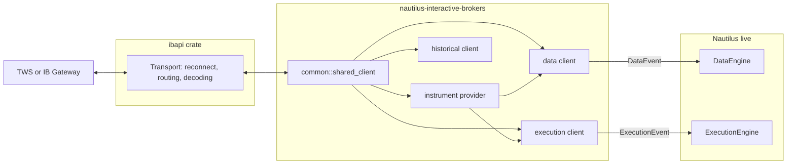
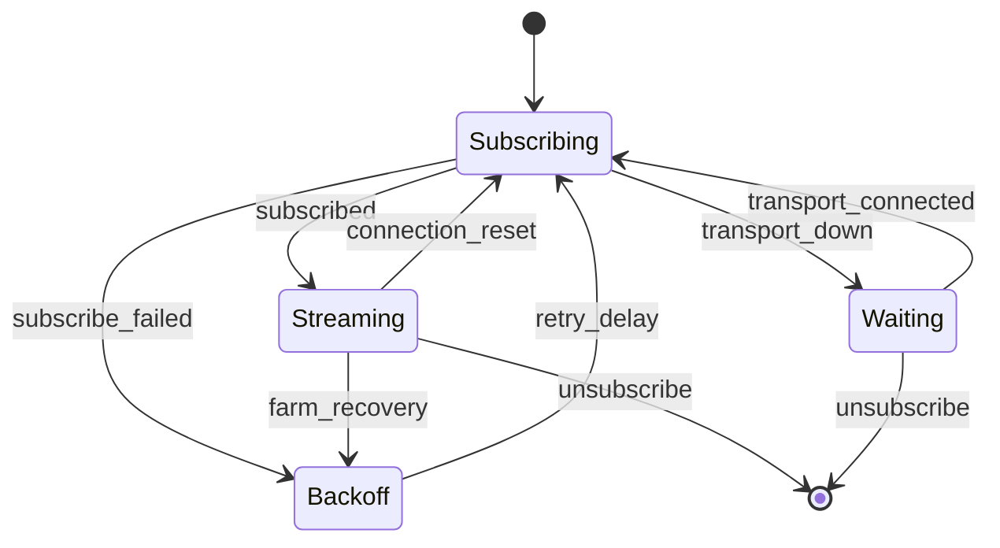
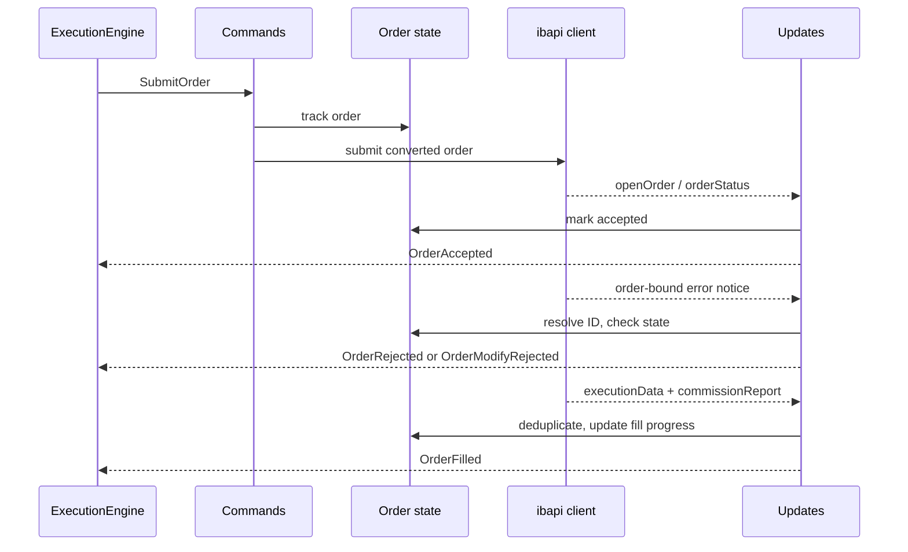
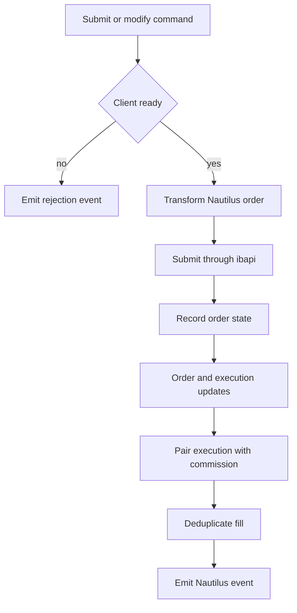
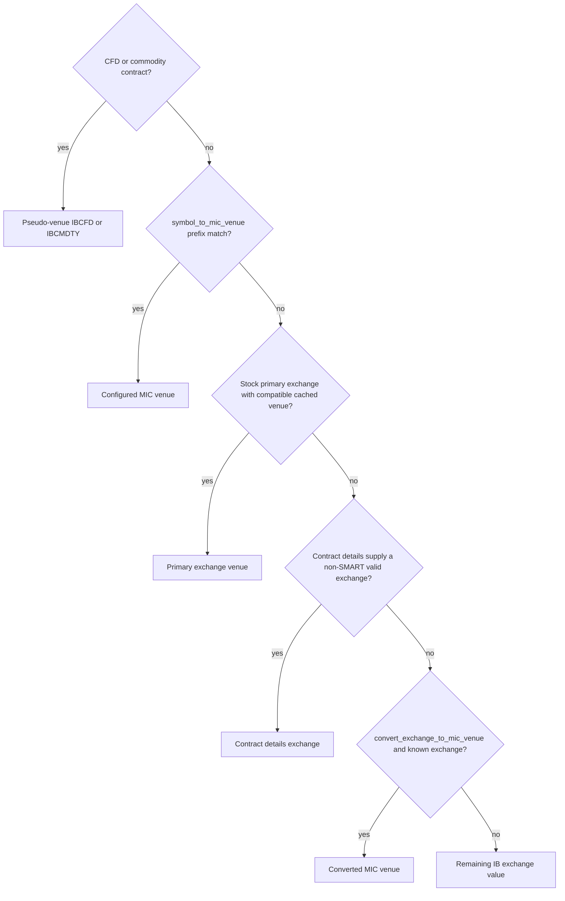

# Interactive Brokers

adapter ของ Interactive Brokers เชื่อมต่อ NautilusTrader กับ Trader Workstation (TWS) หรือ IB Gateway ผ่าน
[TWS API](https://ibkrcampus.com/campus/ibkr-api-page/twsapi-doc/) โดยให้บริการ market data แบบ live, การ execution,
การค้นหา instrument, การ request ข้อมูลย้อนหลัง และการจัดการ IB Gateway ที่รันใน Docker (ไม่บังคับ)

ตัวอย่างฝั่ง Rust ดูได้ที่หัวข้อ[ทดสอบ adapter](#test-the-adapter)

## เชื่อมต่อกับ TWS หรือ IB Gateway {#connect-to-tws-or-ib-gateway}

เปิดการเข้าถึง socket API ใน TWS หรือ IB Gateway ก่อนเริ่ม client IB ใช้ port ค่าเริ่มต้นดังนี้:

| แอปพลิเคชัน   | Paper trading | Live trading |
| ----------- | ------------- | ------------ |
| TWS         | `7497`        | `7496`       |
| IB Gateway  | `4002`        | `4001`       |

transport `ibapi 4.0.1` ที่ตรึงเวอร์ชันไว้ต้องการ server protocol version ของ TWS หรือ IB Gateway **213 ขึ้นไป** นี่คือ
เวอร์ชันของ API protocol ไม่ใช่หมายเลข release ของแอปพลิเคชัน server ที่เก่ากว่าไม่รองรับแม้ TCP port จะรับการเชื่อมต่อได้
[Issue #4796](https://github.com/nautechsystems/nautilus_trader/issues/4796) รายงานความล้มเหลวนี้กับ protocol 187
บน Gateway 10.41 ให้อัปเกรด TWS หรือ IB Gateway ก่อนเชื่อมต่อ

transport จะปฏิเสธเวอร์ชันที่เก่ากว่าก่อนส่ง `StartApi` เมื่อ server ทำ handshake แรกเสร็จ หาก server รุ่นเก่าไม่ตอบ
handshake นั้น connection timeout ก็จะมีผลด้วย การเพิ่ม timeout ไม่ได้ทำให้รองรับ protocol เพิ่มขึ้น

adapter ใช้ค่าเริ่มต้น `127.0.0.1:4002` แต่ละโปรเซสที่เชื่อมต่อกับ session ของ TWS หรือ Gateway เดียวกันต้องมี
`client_id` ของ IB API ที่ไม่ซ้ำกัน client ID ของ execution ต้องไม่เป็นผลคูณของ `1000` เพราะ adapter แบ่งช่วง order ID
ด้วย `client_id % 1000`

IB ปฏิเสธ order ID ที่เท่ากับหรือต่ำกว่า ID ที่ `client_id` เดียวกันเคยใช้แล้ว ข้าม session ด้วย (error 103) เมื่อเชื่อมต่อ
execution client จะเริ่มที่ค่าสูงกว่า order ID สูงสุดของ `client_id` นั้นในบรรดา order ที่เปิดอยู่และที่เสร็จแล้วของ IB และจะใช้
next valid ID ของ IB ก็ต่อเมื่อค่านั้นอยู่ในช่วงของ client เท่านั้น หาก next valid ID ของ IB อยู่สูงกว่าช่วงนั้น IB จะปฏิเสธทุก ID
ในช่วง การเชื่อมต่อจึงล้มเหลว ให้ใช้ `client_id` อื่น การเชื่อมต่อยังล้มเหลวหาก order ที่เสร็จแล้วมาไม่ครบภายใน `request_timeout`

IB แสดงรายการ order ที่เสร็จแล้วเพียงช่วงเวลาจำกัด client ที่ไม่มี order เปิดค้างไว้จึงอาจยังเริ่มที่ค่าต่ำกว่า ID ที่เคยใช้ก่อน
ช่วงเวลานั้นได้

data client และ execution client ใช้ provider configuration ชุดเดียวกันได้

> หมายเหตุ: ต้นฉบับมีเฉพาะตัวอย่าง Python จึงตัดออก

ส่ง factory และ config เหล่านี้ให้ builder ของ `LiveNode`

### โหมดของ market data {#market-data-modes}

| ค่า enum                        | โหมดของ IB                                     |
| ------------------------------- | -------------------------------------------- |
| `MarketDataType.REALTIME`       | ข้อมูล live ที่ subscribe ไว้                      |
| `MarketDataType.FROZEN`         | ข้อมูล live ล่าสุดที่มีหลังตลาดปิด                    |
| `MarketDataType.DELAYED`        | ข้อมูลแบบล่าช้า (delayed)                         |
| `MarketDataType.DELAYED_FROZEN` | ข้อมูลแบบล่าช้าล่าสุดที่มี                           |

สิทธิ์ของ IB ยังเป็นตัวกำหนดว่าโหมดและ instrument ใดจะได้รับข้อมูล ข้อมูลแบบ delayed หรือ delayed-frozen ใช้ตรวจสอบ
paper account นอกเวลาตลาดได้ แต่ไม่ได้พิสูจน์ว่าเส้นทาง tick แบบ live ทำงาน

### IB Gateway ใน Docker {#dockerized-ib-gateway}

`DockerizedIBGateway` จัดการ [container IB Gateway ของ gnzsnz](https://github.com/gnzsnz/ib-gateway-docker)
ให้ระบุ credential ใน config หรือตั้ง `TWS_USERNAME` และ `TWS_PASSWORD`

เริ่ม gateway ก่อนสร้าง client ที่จะเชื่อมต่อ `DockerizedIBGateway` เป็นผู้ดูแล lifecycle ของ container ส่วน config ของ
client รับเพียง `host` และ `port` ตั้ง `read_only_api` เป็น false เฉพาะเมื่อ gateway ต้องรับ order การตรวจความพร้อม
ใช้ข้อความ login จาก session ปัจจุบันของ container ดังนั้น log ที่ค้างจาก session ก่อนหน้าจะไม่ทำให้รายงานสถานะพร้อม
ผิดพลาด

## สถาปัตยกรรม {#architecture}

adapter เป็น implementation ของ Rust ชุดเดียวที่เปิดให้ใช้ผ่าน Rust API แบบ native มันแปลงระหว่าง TWS API ของ IB
กับ live engine ของ Nautilus โดยไม่ได้เป็นเจ้าของ transport เอง: `ibapi` เป็นผู้สื่อสารด้วย TWS socket protocol และ
reconnect ส่วน adapter รับผิดชอบการจับคู่ domain, lifecycle ของ subscription และนโยบาย (command, event, การแปลง
instrument, การ resubscribe stream และ execution reconciliation) ขอบเขตนี้อธิบายโครงสร้างของ crate และเป็นเหตุผลที่
ไม่มี module `http` และ `websocket` ซึ่งเป็นมาตรฐานใน adapter อื่น



data client, execution client และ historical client ที่มี `(host, port, client_id)` เดียวกันจะใช้ connection ของ `ibapi`
ร่วมกันหนึ่งตัวแบบนับ reference การขอใช้พร้อมกันด้วย key เดียวกันจะได้ connection เดียวกัน และ registry จะลบ connection
ออกหลังจาก client ตัวสุดท้ายปล่อย handle

| Module       | ความรับผิดชอบ                                                                       |
| ------------ | --------------------------------------------------------------------------------- |
| `common`     | contract, enum, generic spread ID, symbology และ connection ที่ใช้ร่วมกัน             |
| `providers`  | การ qualify contract, การค้นหา chain, การ resolve venue และ cache ของ instrument      |
| `data`       | subscription แบบ live, การ route request ข้อมูลย้อนหลัง, การแปลง และการกู้คืน stream     |
| `execution`  | command, state ของ order, การอัปเดต, report, condition, spread และ reconciliation   |
| `historical` | request ของ instrument, bar และ tick แบบ standalone                                |
| `gateway`    | configuration, lifecycle และความพร้อมของ Docker container                          |
| `config`     | configuration แบบมี type ของ data, execution, provider และ gateway                 |
| `factories`  | implementation ของ `DataClientFactory` และ `ExecutionClientFactory`                 |

พื้นผิวการเชื่อมต่อกับส่วนอื่นของ Nautilus ถูกออกแบบให้บางโดยตั้งใจ node builder ส่ง config แบบมี type ให้แต่ละ factory
factory จะสร้าง client และเติม instrument provider จาก cache ของ engine ซึ่ง adapter ไม่เคยเขียนลงไป

data client ส่ง data event แบบมี type (tick, bar, instrument และ response ของ request ที่เชื่อมโยงกัน) และ execution client
ส่ง execution event แบบมี type (order event, fill และ account state) เข้าสู่ engine ผ่าน event channel ของแต่ละ engine
channel เหล่านี้เป็นเส้นทางเดียวที่เข้าสู่ engine ส่วน reconciliation เป็น interface แบบ pull ที่ขับเคลื่อนโดย execution engine
(ดู [Reconciliation](#reconciliation))

### Reconnect และ resubscribe {#reconnect-and-resubscribe}

transport `ibapi` จะ reconnect socket ด้วย Fibonacci backoff จนถึงจำนวนครั้งที่จำกัดไว้ (`max_reconnect_attempts`)
แล้วจึงสร้าง session ที่สมบูรณ์ การเชื่อมต่อ TCP ที่ตามด้วย error ชั่วคราวระหว่าง handshake หรือการเริ่มต้นจะนับเป็นหนึ่งครั้ง
และ retry แทนที่จะยุติการกู้คืน การ reconnect ที่สำเร็จจะ reset channel ของ subscription ที่เปิดอยู่โดยส่ง error
connection-reset ไปยังแต่ละ channel เมื่อหมดจำนวนครั้ง transport จะปิดตัวลงและ adapter จะรายงานว่า disconnected

ทั้ง config ของ data client และ execution client รับ `max_reconnect_attempts` ค่า `None` ใช้ค่าเริ่มต้นของ ibapi คือ
20 ครั้ง ส่วน `0` ปิดการ retry reconnect อัตโนมัติ client ที่มี `(host, port, client_id)` เดียวกันจะใช้ connection ร่วมกัน
และใช้ค่าของผู้สร้างคนแรก ให้ตั้งค่าเดียวกันกับทุก client ที่ใช้ connection ร่วมกัน

จากนั้น data stream แต่ละตัวจะรอ transport, subscribe อีกครั้ง และ retry การ resubscribe ที่ล้มเหลวโดยมีการหน่วงเวลา
stream driver แบบ generic ตัวเดียวเป็นเจ้าของนโยบาย lifecycle นี้สำหรับ stream ทุกประเภท พฤติกรรมการกู้คืนจึงไม่เบี่ยงเบน
ระหว่าง quote, trade, depth, bar, greeks และ index price การแจ้งเตือนจาก market-data farm ใช้นโยบาย stream เดียวกัน
โดยไม่ถือว่า farm ล่มเป็นความล้มเหลวของ socket TWS จะ reset market-data type ของ session กลับเป็น realtime หลัง
reconnect ตัวเฝ้าการแจ้งเตือนจะคืนค่าโหมด frozen หรือ delayed ที่ตั้งไว้ก่อนปล่อย subscription ที่กู้คืนแล้ว

error frame ที่ผูกกับ order มาถึงทาง order update stream ในรูปการแจ้งเตือนพร้อม order ID หรือ request ID ต้นทาง ชั้น routing
ของ transport ส่งการแจ้งเตือนเหล่านี้แทน message variant ที่ decode แล้ว update stream จึงยังทำงานต่อได้แม้มี error frame



quote, trade, depth, bar, option greeks และ index price เป็นไปตาม lifecycle นี้ ก่อนที่ depth stream จะใช้ข้อมูลจาก
subscription ตัวใหม่ มันจะล้าง book เดิมเพื่อไม่ให้ level ที่ค้างอยู่หลงเหลือ หาก order update stream จบลงหรือให้ error
execution client จะทิ้ง subscription รอ แล้ว bind ใหม่ โดย retry หากการ bind ล้มเหลว order event ระหว่างการจบและการ
bind ใหม่จะไม่ถูก replay หาก transport ของ ibapi ปิดตัวลงแล้ว หรือ global notice stream จบลง execution client จะรายงาน
ว่า disconnected แทนที่จะดูเหมือนปกติทั้งที่ stream ตายแล้ว

### Identity ของ order และการยกเลิก {#order-identity-and-cancellation}

permanent ID ของ broker ที่ต่างกันแต่ใช้ client order reference เดียวกันยังคงเป็น order จริงคนละตัว adapter จะรายงาน order
เพิ่มเติมแต่ละตัวภายใต้ client order ID ของมันเอง: `DUP-<account length>:<account ID>:PERM-<permanent ID>` ดังนั้น
execution engine จะสร้างมันเป็น order ภายนอก โดยใช้การอ้างสิทธิ์ order ภายนอกของ instrument หรือไม่เช่นนั้นจะเป็น
strategy `EXTERNAL` กลุ่ม order ซ้ำที่ยัง resolve ไม่ได้จะขัดขวางการ modify

เมื่อ execution มาถึงสำหรับ order ที่ adapter ไม่ได้ติดตาม รวมถึง order ซ้ำแบบนี้ adapter จะถือ fill ไว้และ query รายละเอียด
และ execution ของ order นั้น จากนั้นจึงรายงาน order พร้อม fill จริง engine จึงสร้าง order ด้วยจำนวนเต็ม query นี้ถูกจำกัดด้วย
`request_timeout` และไม่เกิน 3 วินาที ซึ่งต่ำกว่าค่าเริ่มต้น `position_check_threshold_ms` ของ live node ที่ 5 วินาที หาก
query ล้มเหลว ไม่ได้อะไรกลับมา หรือหมดเวลา adapter จะ log คำเตือนและส่งต่อ fill ที่ถือไว้โดยไม่เปลี่ยนแปลง

เมื่อ `strategy_only` เป็น true (ค่าเริ่มต้น) strategy จะยกเลิก order ของตัวเองทีละตัว เมื่อ `strategy_only` เป็น false
cancel-all จะครอบคลุมทั้ง instrument ภายใน account และ side ที่เลือก cancel-all ที่กรองตาม side จะข้าม order ซ้ำที่ยังไม่ทราบ
side ฝั่ง broker การยกเลิก order ต้นฉบับจะพิจารณา order ซ้ำที่ทราบว่ายังทำงานอยู่ด้วย

adapter ยกเลิกเฉพาะ route ที่ bind แบบไม่ซ้ำและเป็นของ API client ที่ตั้งค่าไว้เท่านั้น order ที่กำกวมหรือไม่ได้ bind จะคงสถานะ
ยัง resolve ไม่ได้อย่างชัดเจน และต้องการการ bind ใน TWS หรือการดำเนินการของผู้ดูแล การยืนยันการยกเลิกหนึ่งครั้งไม่ได้
หมายความว่ากลุ่มทั้งหมดเสร็จสิ้น

การตรวจสอบความเสี่ยงและการ execution ใช้การ route account เดียวกัน risk engine จะ deny order ที่ resolve account ไม่ได้
แทนที่จะข้ามการตรวจ account

### Order flow ของการ execution {#execution-order-flow}

execution client ถูกแบ่งตามทิศทางของ message: command ขาออก (submit, modify, cancel), การอัปเดตขาเข้าจาก venue, การประกอบ
fill ของ combo และ account stream เป็น module แยกกันที่ใช้เจ้าของ state ของ order ร่วมกันหนึ่งตัว เจ้าของนี้เก็บ map ของ ID
ระหว่าง client กับ venue, order ที่ active และ cache ของ order ที่สิ้นสุดแล้วแบบจำกัดขนาดไว้หลัง lock เดียว cache ของ order
ที่สิ้นสุดแล้วรองรับการ replay execution ของ IB หลัง reconnect fill ที่ถูกส่งซ้ำของ order ที่เสร็จแล้วจึงถูกกำจัดความซ้ำแทนที่จะ
ซ้ำซ้อน client จะแปลง order ของ Nautilus เพียงครั้งเดียว ใส่ tag ของ IB (ถ้ามี) แล้วจึง submit ผ่าน `ibapi`





order event ทุกตัวที่ engine มองเห็นมีที่มาจากหลักฐานจาก venue บน update stream: `OrderAccepted` ต้องมี order status
หรือ open-order message ไม่ใช่เพียงการส่งสำเร็จในฝั่ง local การแจ้งเตือน error ของ IB ที่ผูกกับ order จะถูก resolve เทียบกับ
order ที่ติดตามอยู่และจัดการโดย state ของ order

ก่อนการตอบรับ code การปฏิเสธ order ในช่วง `[200, 399]` จะส่ง `OrderRejected` แบบสิ้นสุด error code อื่นจะ trigger การ
query venue order จะถูกปฏิเสธก็ต่อเมื่อ IB ไม่ได้แสดงว่าเป็นทั้ง order ที่เปิดอยู่และ order ที่เสร็จแล้ว IB ยังส่ง code แบบนี้กับ
order ที่ทำงานอยู่ด้วย (10349 ตั้ง time in force จาก order preset) query ตรวจการมีอยู่ที่ล้มเหลว หมดเวลา หรือจบก่อนกำหนด
จะคง order ไว้ในสถานะทำงาน

หลังการตอบรับ การแจ้งเตือนจะส่ง `OrderModifyRejected` เมื่อมีการ modify ค้างอยู่ หรือ `OrderCancelRejected` เมื่อมีการ
cancel ค้างอยู่ มิฉะนั้นจะ trigger query ตรวจการมีอยู่ที่ venue แทน event แบบสิ้นสุด IB รายงานการปฏิเสธ modify ด้วย code
เดียวกันขณะที่ order ต้นฉบับยังทำงานอยู่ query จึงป้องกัน event สิ้นสุดที่ผิดพลาด

code คำเตือนในช่วง `[2100, 2169]`, message ของ order ในรูปคำเตือน (code 399 ที่มีบรรทัด `Warning:`) และการยืนยันการ
ยกเลิก (202) จะไม่ทำให้ order สิ้นสุด global notice stream จัดการ error frame ที่ route ไปยัง request หรือ order แต่ละตัวไม่ได้

ผลลัพธ์ของ command ที่กำกวมจะ resolve ผ่านการ query venue ซึ่งกู้ fill ที่พลาดไปจากประวัติ execution ก่อนอนุมานสถานะสิ้นสุด
ใด ๆ fill จึงไม่มีทางถูกรายงานผิดเป็นการยกเลิก cancel-all เลือกใช้ TWS order ID ที่ติดตามไว้ก่อน permanent ID ทำให้ client
ต้นทางยกเลิก order live ของตัวเองได้โดยไม่ต้องค้นหาข้าม client

## ความสามารถด้านข้อมูล {#data-capabilities}

| Data type ของ Nautilus | Live subscribe | Historical request | หมายเหตุ                                     |
| ------------------ | -------------- | ------------------ | ----------------------------------------- |
| Instrument         | No             | Yes                | โหลดตอนเริ่มต้นและ request แบบระบุชัด            |
| Quote tick         | Yes            | Yes                | แบบ tick-by-tick หรือ `reqMktData` แบบ batch   |
| Trade tick         | Yes            | Yes                | trade แบบ tick-by-tick ทั้ง live และย้อนหลัง      |
| Bar                | Yes            | Yes                | time bar แบบ external                       |
| Book delta         | Yes            | No                 | market depth พร้อมล้าง book เมื่อกู้คืน          |
| Index price        | Yes            | No                 | event ของ index price                       |
| Option greeks      | Yes            | No                 | greeks พร้อม open interest ของ option        |

ตั้ง `batch_quotes` เป็น false เพื่อเลือกใช้การ subscribe bid/ask แบบ tick-by-tick client จะ fallback ไปใช้
`reqMktData` เมื่อไม่มี quote แบบ tick-by-tick และ quote ของ spread แบบ BAG จะใช้ `reqMktData` เสมอ
`ignore_quote_tick_size_updates` ที่เป็น true จะกรอง quote event ที่เปลี่ยนเฉพาะขนาดออก

quote cache ประกอบการอัปเดต bid และ ask เข้าเป็น quote tick ที่สมบูรณ์ ค่า sentinel แบบไม่มี quote ของ IB (ราคา `-1` ที่ไม่มี
ขนาด หรือราคาศูนย์กับขนาดศูนย์) จะถูกกรองออกก่อนสร้าง tick และล้าง side ของ book ที่ได้รับผลกระทบ ตลาดที่มีเพียงฝั่งเดียว
จึงไม่ส่งอะไรออกมาแทนที่จะส่งค่าเก่า สำหรับ contract ที่มี price magnifier IB จะส่ง `-1` คูณด้วย magnifier (`-100` สำหรับ
option ของ ZC) และ adapter ก็กรองในแบบเดียวกัน ราคาศูนย์และราคาติดลบที่เป็นของจริง รวมถึงราคา `-1` ที่มีขนาด ซึ่ง
calendar spread สร้างขึ้นเป็นประจำ จะผ่านไปได้ตามปกติ

IB รายงานราคาของ IDEALPRO ในขั้นที่ละเอียดกว่า `minTick` ของคู่เงิน ซึ่งเป็น price increment ของคู่นั้น adapter จะปัดราคา
bid ของคู่เงินลงและราคา ask ขึ้นให้ตรงกับ increment ดังนั้น bid ที่เผยแพร่จะไม่สูงกว่า bid ของ IB, ask ที่เผยแพร่จะไม่ต่ำกว่า ask
ของ IB และ quote ที่ IB ส่งมาแบบไม่ล็อกจะไม่กลายเป็นล็อกหรือ cross ซึ่งใช้กับ quote, tick bid และ ask ย้อนหลัง และราคาของ
bar ของ bid และ ask ราคาอื่นทั้งหมด (trade, midpoint, ราคา last และ index รวมถึง bar ที่สร้างจากราคาเหล่านั้น) จะปัดไปยัง
increment ที่ใกล้ที่สุด โดยกรณีเท่ากันจะปัดไปทางผลคูณที่เป็นเลขคู่ level ของ order book ไม่ถูกปัด เพราะ level ของ IB สองระดับ
อาจปัดได้ราคาเดียวกัน instrument อื่นไม่ถูกปัด

สำหรับข้อมูลย้อนหลัง `HistoricalInteractiveBrokersClient` รับ instrument provider และ config ของ data client

| Method                | Selector และการควบคุม                                                                                                                                          |
| --------------------- | ------------------------------------------------------------------------------------------------------------------------------------------------------------ |
| `request_instruments` | รับ instrument ID ของ Nautilus, dictionary ของ contract ของ IB หรือทั้งสองอย่าง                                                                                   |
| `request_bars`        | รับ string ของ bar specification, เวลาสิ้นสุด และเวลาเริ่มต้นหรือ duration string ของ IB โดย contract หรือ instrument ID ใช้เลือก instrument                           |
| `request_ticks`       | รับ `IbHistoricalTickType.TRADES` หรือ `BID_ASK`, ช่วงเวลาที่มีขอบเขต, contract หรือ instrument ID, การกรองเวลาซื้อขายปกติ, timeout และขีดจำกัดจำนวนผลลัพธ์           |

request tick ย้อนหลังต้องมีทั้งเวลาเริ่มต้นและเวลาสิ้นสุด โดยจะแบ่งหน้าย้อนหลังจากเวลาสิ้นสุด และจำกัดที่ 10,000 tick เป็น
ค่าเริ่มต้นเมื่อไม่ระบุขีดจำกัด request จะส่งเฉพาะขอบเขตสิ้นสุด เพราะ IB ตีความ request ที่มีทั้งสองขอบเขตผิด และจะกำจัด
ความซ้ำของวินาทีที่ขอบเขตซึ่ง IB ส่งซ้ำมาจากการเข้ารหัสเวลาสิ้นสุดแบบความละเอียดระดับวินาที เมื่อวินาทีหนึ่งมีข้อมูลเต็มหน้าและ
หน้าต่างถอยหลังต่อไม่ได้ request จะหยุดพร้อมคำเตือนแทนที่จะวนซ้ำ

request ของ bar ที่ segment ใดล้มเหลวจะคืน error แทนที่จะคืนชุดข้อมูลที่มีช่องโหว่อย่างเงียบ ๆ trade tick ย้อนหลังที่ IB ให้ขนาด
เป็นศูนย์จะถูกข้ามก่อนสร้าง type ของ Nautilus ที่ต้องมีจำนวนเป็นบวก การแปลงที่ไม่ถูกต้องแบบอื่นยังทำให้ request ล้มเหลว

IB เป็นผู้ควบคุม pacing, ประวัติข้อมูลที่มีให้, ขนาด bar ที่รองรับ และการกรองตามเวลาซื้อขายปกติ สำหรับ continuous futures
IB จะปฏิเสธเวลาสิ้นสุดของ bar ที่ระบุชัด adapter จึงละไว้และ request duration segment หนึ่งช่วงโดยยึดเวลาของ request
ผลลัพธ์จึงอาจอยู่นอกช่วงเวลาเริ่มต้นและสิ้นสุดที่ร้องขอ

## ความสามารถด้าน execution {#execution-capabilities}

### ประเภทของ order {#order-types}

| ประเภท order ของ Nautilus | ประเภท order ของ IB   | Input ด้านราคา                           |
| ---------------------- | ------------------- | ------------------------------------- |
| `MARKET`               | Market              | ไม่มี                                   |
| `LIMIT`                | Limit               | ราคา limit                             |
| `MARKET_TO_LIMIT`      | Market to limit     | ไม่มี                                   |
| `STOP_MARKET`          | Stop                | ราคา trigger                           |
| `STOP_LIMIT`           | Stop limit          | ราคา limit และ trigger                  |
| `MARKET_IF_TOUCHED`    | Market if touched   | ราคา trigger                           |
| `LIMIT_IF_TOUCHED`     | Limit if touched    | ราคา limit และ trigger                  |
| `TRAILING_STOP_MARKET` | Trailing stop       | trailing offset และ trigger (ไม่บังคับ)   |
| `TRAILING_STOP_LIMIT`  | Trailing stop limit | offset ของ limit และ trailing           |

adapter จับคู่ค่า time in force `DAY`, `GTC`, `IOC`, `FOK`, `GTD` และ `AT_THE_OPEN` order แบบ market หรือ limit ที่มี
`AT_THE_CLOSE` จะกลายเป็น order แบบ market-on-close หรือ limit-on-close ของ IB ที่สอดคล้องกัน order แบบ GTD จะใส่
เวลาหมดอายุของ Nautilus ไว้ใน order ของ IB

adapter ปฏิเสธ order แบบ post-only quote quantity ใช้ได้เฉพาะกับ inverse instrument และเฉพาะ order `MARKET` ฝั่ง BUY
ซึ่ง IB กำหนดขนาดด้วย `cashQty` (IB ปฏิเสธ cash quantity บน order ประเภทอื่นด้วย error 10244) trailing order รองรับ
offset แบบราคาและแบบ basis point ซึ่ง IB รับเป็น trailing percent การตรวจสอบเหล่านี้ รวมถึง order ใดที่ adapter resolve
หรือแปลงให้ IB ไม่ได้ จะส่งเหตุผล `OrderDenied` แบบมี code ก่อนที่ adapter จะส่ง order ไปยัง IB

### Command และคุณสมบัติของ order {#commands-and-order-attributes}

| ความสามารถ        | รองรับ | หมายเหตุ                                                        |
| ----------------- | ------- | ------------------------------------------------------------ |
| Submit order      | Yes     | order เดี่ยวและ generic spread                                 |
| Submit order list | Yes     | รวมถึง bracket order และ linked order                          |
| Modify order      | Yes     | การอัปเดตจำนวน, ราคา, trigger และพารามิเตอร์ของ IB               |
| Cancel order      | Yes     | ใช้ state ของ order ที่ venue ซึ่งติดตามไว้                          |
| Cancel all orders | Yes     | กำหนดขอบเขตผ่าน execution client                               |
| Query order       | Yes     | ตรวจ open order แล้วจึงตรวจ execution ก่อนอนุมานว่าถูกยกเลิก         |
| Mass status       | Yes     | order, fill และ position                                     |

ส่ง `params={"exchange": "IEX"}` ให้กับ command แบบ submit, submit-list หรือ modify เพื่อ override exchange ของ contract
ใน cache สำหรับ command นั้น หากไม่ระบุหรือเป็นค่าว่างจะใช้ exchange ใน cache ตามเดิม

IB รับราคา trailing stop ใหม่ได้ก็ต่อเมื่อมาพร้อม trailing amount ใหม่เท่านั้น (error 10067) การ modify ที่ตั้ง trigger ของ
trailing stop ต้องส่ง `params={"trailing_offset": <offset>}` ในหน่วย offset ของ order: เป็นจำนวนราคาสำหรับ offset แบบ
`PRICE` หรือเป็น basis point สำหรับ offset แบบ `BASIS_POINTS` offset ที่เท่ากับค่าปัจจุบันจะถูก IB ปฏิเสธ และการ modify
trigger ที่ไม่มีพารามิเตอร์นี้จะถูกปฏิเสธก่อนส่ง

ฟิลด์ของ order เฉพาะของ IB ใช้ tag ที่ขึ้นต้นด้วย `IBOrderTags:` ตามด้วย JSON object key ใช้ชื่อฟิลด์ของ order ใน `ibapi`
แบบ snake case หรือ lower camel case ฟิลด์ที่ไม่รู้จักจะทำให้การแปลง order ล้มเหลว adapter จะ normalize `order_type`,
`tif` หรือ `timeInForce`, `action`, `oca_type`, `trigger_method`, `origin`, `short_sale_slot`, `volatility_type`,
`reference_price_type`, `rule_80_a`, `open_close` และ `NonGuaranteed` timestamp ของ active, stop, cancel, manual และ
good-till ใช้รูปแบบ `%Y%m%d %H:%M:%S UTC`

adapter ติดตาม order แต่ละตัวด้วย order ID และ reference ของ IB และตรวจ execution แต่ละตัวเทียบกับ side ของ order ดังนั้น
tag จึงตั้ง `orderId`, `clientId`, `permId`, `orderRef`, `totalQuantity`, `cashQty`, `parentId` หรือ `transmit` ไม่ได้
`action` ที่ระบุใน tag ต้องคง side ของ order ไว้: order ฝั่ง SELL อาจใช้ `SSHORT` หรือ `SLONG` ได้ แต่ใช้ `BUY` ไม่ได้ tag
แบบนั้นจะทำให้การแปลง order ล้มเหลว

array `conditions` (ไม่บังคับ) รับรูปแบบเหล่านี้:

| Condition        | ฟิลด์ที่จำเป็น | ฟิลด์ที่ไม่บังคับและค่าเริ่มต้น                                                   |
| ---------------- | --------------- | --------------------------------------------------------------------------- |
| `price`          | ไม่มี            | `conId=0`, `exchange="SMART"`, `price=0`, `isMore=True`, `triggerMethod=0`. |
| `time`           | ไม่มี            | `time=""`, `isMore=True`.                                                   |
| `margin`         | ไม่มี            | `percent=0`, `isMore=True`.                                                 |
| `execution`      | `symbol`        | `secType="STK"`, `exchange="SMART"`.                                        |
| `volume`         | ไม่มี            | `conId=0`, `exchange="SMART"`, `volume=0`, `isMore=True`.                   |
| `percent_change` | ไม่มี            | `conId=0`, `exchange="SMART"`, `changePercent=0`, `isMore=True`.            |

ทุก condition รับ `conjunction="and"` หรือ `"or"` ค่าเริ่มต้นคือ `"and"`

### Account state {#account-state}

เมื่อเชื่อมต่อและทุกครั้งที่ query account execution client จะอ่าน snapshot ของ `reqAccountSummary` หนึ่งครั้งสำหรับ account
ที่ตั้งค่าไว้ และจับคู่ tag ต่าง ๆ เป็นยอดเงินและ margin แบบมี type จากนั้นอ่าน snapshot ของ `reqAccountUpdates` หนึ่งครั้ง
สำหรับ account เดียวกัน และยกเลิก stream นั้นเมื่อ IB แจ้งว่าการดาวน์โหลดสิ้นสุด tag และ key ดิบทุกตัวจากทั้งสอง snapshot
จะถูกเก็บใน `AccountState.info` ภายใต้ชื่อของ IB ดังนั้นค่าที่ IB เผยแพร่เฉพาะทาง `updateAccountValue` (เช่น
`PostExpirationExcess` และ `PostExpirationMargin`) จึงอ่านได้ควบคู่กับ tag ของ summary อย่าง `TotalCashValue` key ที่
รายงานหนึ่งครั้งต่อสกุลเงินจะเก็บค่าสุดท้ายที่ IB ส่งมา

account ไม่มี base currency เป็นค่าเริ่มต้นและเก็บยอดเงินแยกตามสกุลเงิน สำหรับ account สกุลเงินเดียว ให้ตั้ง `base_currency`
เป็น base currency ของ account ซึ่งคือสกุลเงินที่ IB ใช้รายงาน tag ของ summary จากนั้น portfolio จะแปลง P&L ในสกุลเงินอื่น
ด้วยอัตราแลกเปลี่ยนจาก cache เช่นเดียวกับ account ใด ๆ ที่มี base currency client จะ log error หาก IB รายงานยอดเงินใน
สกุลเงินอื่น

## Reconciliation {#reconciliation}

request แบบ mass status จะ query แหล่งข้อมูลของ IB ที่เป็นอิสระต่อกันสามแหล่ง:

- order ที่เปิดอยู่และที่เสร็จแล้วให้ order status report
- execution ที่จับคู่กับ commission report ให้ fill report
- position ของ account ให้ position status report

การอัปเดต position ไม่ได้สร้าง order status report แบบสังเคราะห์ หาก IB คืน position ที่ไม่มีประวัติ order หรือ fill ที่ตรงกัน
execution engine สามารถรับ position นั้นจาก position report อย่างเดียวได้ด้วยการสร้าง reconciliation fill ภายในของมันเอง
ซึ่งรักษาขอบเขตของ report ไว้: adapter รายงาน state ของ venue ส่วน engine เป็นเจ้าของ state ที่อนุมานขึ้นซึ่งจำเป็นต่อการ
reconcile cache ของตน

average cost ของ position ใน IB รวมค่า commission ไว้ ขณะที่ position ที่สร้างใหม่จาก fill จะเฉลี่ยจากราคาของ fill adapter
จะ replay fill ของ instrument รวมถึง execution ของ leg ใน combo order โดยเริ่มจากจำนวนที่ถืออยู่ก่อนหน้าต่างของ fill เมื่อการ
replay ผ่านจุด flat หรือกลับทิศ position report จะใช้ราคาเฉลี่ยของ fill หลังจุดข้ามครั้งสุดท้าย position ที่ถือข้ามการ restart
จึง reconcile ได้

fill ที่มี timestamp เดียวกันไม่มีลำดับการ execution ที่ทราบได้ หากกลุ่มนั้นมี side ปนกันหรือกลับทิศ ราคาเข้าจะยังไม่ทราบจนกว่า
จะมี fill ภายหลังที่เปิดจาก flat หรือกลับทิศ

การ replay อนุมานจำนวนที่ถืออยู่ก่อนหน้าต่าง ดังนั้น execution ที่หายไปจะเปลี่ยนผลลัพธ์ report จะใช้ราคาเข้าจากการ replay
ก็ต่อเมื่อเป็นไปตามทั้งสองเงื่อนไข:

- execution ทุกตัวของ instrument ถูก parse สำเร็จ
- ราคานั้นทำให้ได้ average cost ตรงกับของ IB

สำหรับการตรวจนี้ average cost ที่คาดไว้ของฝั่ง long คือราคาเข้าบวกค่า commission ตอนเปิดต่อหน่วย ส่วนฝั่ง short คือราคาเข้า
ลบค่า commission เหล่านั้น lot ที่เปิดจากการกลับทิศไม่มี commission

มิฉะนั้น report จะใช้ average cost ของ IB ซึ่ง reconciliation fill ของ engine จะนำไปใช้

เมื่อเชื่อมต่อ execution client จะ resolve instrument ของทุก position ที่เปิดอยู่ใน account และ publish instrument ใดก็ตามที่
ไม่มีใน cache ดังนั้น position ใน contract ที่อยู่นอก `load_ids` ของ provider ยังกู้คืนได้ตอนเริ่มต้นแทนที่จะทำให้ node หยุดทำงาน

สำหรับ order ในสถานะ pending-cancel ที่ไม่อยู่ใน snapshot ของ open order adapter จะตรวจประวัติ execution ก่อนส่ง event
canceled execution ที่ replay มาจะถูกกำจัดความซ้ำหลัง state ของ order ที่สิ้นสุดแล้วถูกนำออกจาก cache รวมถึง fill ของ
spread leg ที่สร้างขึ้นด้วย

ตั้ง `track_option_exercise_from_position_update` เป็น true เฉพาะเมื่อต้องการให้การเปลี่ยนแปลงของ position ขับเคลื่อน
การติดตามการใช้สิทธิ์ option การตั้งค่านี้ไม่ได้ทำให้ order report แบบสังเคราะห์ที่ derive จาก position กลับมา

หลัง restart order ที่ session ก่อนหน้าทิ้งไว้ในสถานะทำงานจะกลับมาเป็น open order ภายนอก สถานะ `PreSubmitted` ของ IB
ที่ใช้ตัวอย่างเช่นขณะที่ order รอ `goodAfterTime` จะจับคู่เป็น `ACCEPTED` execution client จะ resolve order ID ของ IB
ของ order ที่กู้คืนแต่ละตัวจาก venue order ID แบบ `PERM-` แล้วติดตามไว้ ดังนั้นการอัปเดตสถานะ, fill และการยกเลิกจาก IB
ภายหลังจะไปถึง strategy เจ้าของ order ที่ fill แล้วจาก session ก่อนหน้าจะ reconcile จาก execution จริง adapter ไม่รายงาน
ราคาสำหรับ order ประเภท market reconciliation จึงไม่มีทางอนุมาน fill ที่ราคา 0

คำตอบของ query execution (`reqExecutions`) ก็มาถึงทาง order update stream ของ IB ด้วย adapter ถือว่าเฉพาะ execution
detail ที่ไม่ได้ร้องขอเท่านั้นเป็น fill แบบ live query execution ตอนเริ่มต้นและแบบเป็นระยะจึงไม่นำ fill เดิมไปใช้ซ้ำ

## Symbology และ instrument {#symbology-and-instruments}

`InteractiveBrokersInstrumentProviderConfig.symbology_method` เลือกหนึ่งในสองวิธีสาธารณะ:

| วิธี                         | การใช้งาน                                                     |
| ---------------------------- | --------------------------------------------------------- |
| `SymbologyMethod.SIMPLIFIED` | ID ที่อ่านง่ายสำหรับการค้นหา instrument ปกติและตัวอย่าง            |
| `SymbologyMethod.RAW`        | ID ที่คง security type ของ IB ไว้สำหรับการค้นหาแบบระบุชัด          |

ค่า symbology เดียวที่สร้างจากการตั้งค่านี้ขับเคลื่อนทุกจุดที่มีการจับคู่ใน adapter ดังนั้นเส้นทางของ data, execution และ
provider จะ resolve ได้ ID เดียวกันเสมอ symbology แบบ raw (`AAPL=STK.SMART`) เป็นทางออกที่ไม่สูญเสียข้อมูล: คง local
symbol และ security type ของ IB ไว้สำหรับ instrument ที่กฎรูปแบบแบบ simplified แสดงไม่ได้ เช่น listing ระหว่างประเทศ
ที่ซับซ้อน

ID ของ futures และ futures option ใช้ local symbol ที่ IB รายงาน เช่น `YMM6.XCBT` และ `YMM6 C45000.XCBT` adapter ไม่
เขียนปีของ contract ใหม่ identifier จึงคงที่ข้าม catalog และ cache

วิธี symbology ควบคุมการแปลง symbol ส่วนการเลือก venue เป็นอีกขั้นหนึ่งที่มีลำดับความสำคัญดังนี้:

1. contract ประเภท CFD และ commodity ใช้ pseudo-venue ของ adapter คือ `IBCFD` และ `IBCMDTY`
1. prefix ของ `symbol_to_mic_venue` ที่ตรงกันจะมีผลสำหรับ security type อื่น
1. primary exchange ของหุ้นและ venue ใน cache ที่เข้ากันได้มีความสำคัญเหนือการ route แบบ SMART
1. contract details อาจให้ valid exchange ที่ไม่ใช่ SMART
1. `convert_exchange_to_mic_venue` ที่เป็น true จะแปลง exchange ที่รู้จักเป็น MIC
1. ค่า exchange ของ IB ที่เหลือจะกลายเป็น venue



pseudo-venue เป็นส่วนหนึ่งของ namespace ของ adapter ภายใต้ทั้งสองวิธี symbology ตัวอย่างเช่น symbology แบบ simplified
อาจให้ `IBDE30.IBCFD` หรือ `XAUUSD.IBCMDTY` ขณะที่ symbology แบบ raw จะเพิ่ม security type เข้าไปใน symbol venue
เหล่านี้มีความสำคัญเหนือ `symbol_to_mic_venue` และ `convert_exchange_to_mic_venue` และไม่ได้อธิบายกลไกการ route
แยกต่างหากของ IB

ใช้ provider config เดียวกันสำหรับ data client และ execution client เพื่อให้ทั้งคู่ resolve ได้ ID เดียวกัน `load_ids` และ
`load_contracts` ตอนเริ่มต้นเป็นรายการที่บังคับ: การ initialize client จะล้มเหลวหาก resolve instrument ที่ตั้งค่าไว้ไม่ได้

### Provider configuration {#provider-configuration}

| Option                          | Default      | วัตถุประสงค์                                                 |
| ------------------------------- | ------------ | ------------------------------------------------------- |
| `symbology_method`              | `SIMPLIFIED` | เลือกการแปลง symbol แบบ simplified หรือ raw               |
| `load_ids`                      | ว่าง          | โหลด instrument ID ของ Nautilus ตอนเริ่มต้น                 |
| `load_contracts`                | ว่าง          | โหลด dictionary ของ contract ของ IB ตอนเริ่มต้น              |
| `min_expiry_days`               | `None`       | วันหมดอายุสัมพัทธ์ขั้นต่ำสำหรับการโหลด chain                     |
| `max_expiry_days`               | `None`       | วันหมดอายุสัมพัทธ์สูงสุดสำหรับการโหลด chain                     |
| `build_options_chain`           | `None`       | override การสร้าง option chain                           |
| `build_futures_chain`           | `None`       | override การสร้าง futures chain                          |
| `cache_validity_days`           | `None`       | อายุของข้อมูล instrument ที่บันทึกไว้                         |
| `convert_exchange_to_mic_venue` | `false`      | แปลง exchange ของ IB ที่รู้จักเป็น MIC venue                 |
| `symbol_to_mic_venue`           | ว่าง          | override venue สำหรับ prefix ของ symbol ที่ตรงกัน            |
| `filter_sec_types`              | ว่าง          | ตัด security type ของ IB ที่เลือกออก                        |
| `cache_path`                    | `None`       | บันทึก cache ของ instrument ไว้ที่ path ที่เลือก               |

dictionary ของ contract ใช้ชื่อฟิลด์ของ IB ขอบเขตของ chain นับเป็นจำนวนวันจากวันที่ request

> หมายเหตุ: ต้นฉบับมีเฉพาะตัวอย่าง Python จึงตัดออก (ตัวอย่างโหลด `SPY` พร้อม option chain ระยะ 7-45 วัน และ `ES`
> แบบ continuous future พร้อม futures chain ระยะ 30-180 วัน)

หากไม่มี flag ของ chain `CONTFUT` จะแทน continuous future ของ IB ซึ่ง IB จำกัดให้ใช้ได้เฉพาะข้อมูลย้อนหลัง ไม่รองรับ
การ subscribe แบบ live หรือ order

### Generic spread {#generic-spreads}

สร้าง spread ID ด้วย `new_generic_spread_id` อย่าจัดรูปแบบไวยากรณ์ของ leg ด้วยมือ ทุก leg ต้องใช้ venue เดียวกัน และ
เครื่องหมายของ ratio เป็นตัวเลือก action ของ leg ใน IB (เช่น `1` สำหรับ leg ฝั่ง long และ `-1` สำหรับ leg ฝั่ง short)

โหลด instrument ของ leg ก่อน request spread provider จะ qualify แต่ละ leg, สร้าง contract แบบ BAG ของ IB และเก็บ
instrument ของ spread ที่ได้ไว้ใน cache ก่อนการ subscribe ข้อมูลหรือการ submit order

execution ของ spread กลับมาจาก IB เป็น fill ระดับ combo สำหรับ spread order และ execution หนึ่งรายการต่อ leg execution
ของแต่ละ leg จะกลายเป็น event `OrderFilled` บน instrument ของ leg ภายใต้ strategy ของ spread order โดยมี client order ID
แบบ `-LEG-` execution engine จะนำไปใช้กับ position ของ leg โดยไม่มี order ของตัวเอง IB ส่ง commission report สำหรับ
execution ของ leg เท่านั้น fill ระดับ combo จึงมี commission เป็นศูนย์

เมื่อเชื่อมต่อ execution client จะโหลดและ publish instrument ของ spread และ leg ของทุก combo order ที่เปิดอยู่หรือเสร็จแล้ว
reconciliation ตอนเริ่มต้นจึงกู้คืน order เหล่านั้นได้แม้ node จะไม่ได้โหลด spread เอง fill report ตอนเริ่มต้นเก็บ fill ระดับ combo
ของแต่ละ combo order ส่วน execution ของ leg จะไม่ถูกรวม และ position ของ leg จะ reconcile จาก position report ของ IB

### Price magnifier {#price-magnifier}

IB กำหนดราคาของบาง contract ในหน่วยย่อยของสกุลเงิน เช่น ธัญพืชของ CBOT เป็นเซนต์และหุ้นใน LSE เป็นเพนนี และรายงาน
`priceMagnifier` ของ contract เหล่านั้น (100 ทั้งคู่) adapter จะหารทุกราคาที่ IB รายงานสำหรับ contract แบบนี้ด้วย magnifier
(market data, ข้อมูลย้อนหลัง, fill และ order report) และคูณราคาของ order ที่ส่งออกไปด้วย magnifier ราคาของ Nautilus จึงอยู่ใน
สกุลเงินของ contract ดังนั้น bar ของ ZC ที่ IB รายงานที่ 486.25 จะเป็น 4.8625 และ `price * multiplier` คือมูลค่าของ contract
`minTick` ของ IB อยู่ในสกุลเงินของ contract อยู่แล้ว price increment ของ instrument จึงเป็น `minTick` ตามที่รายงาน strike
ของ option ที่มี magnifier ก็ถูกหารด้วย magnifier เช่นกัน ราคาที่ให้ใน `IBOrderTags` (เช่น `starting_price`,
`stock_ref_price`, `discretionary_amt` และ `delta_neutral_aux_price`) และใน order condition จะถูกส่งให้ IB ตามที่ระบุ
ในหน่วยของ IB ดังนั้นราคาใน tag หรือ condition ของ contract ที่มี magnifier คือราคาที่ IB รายงาน ไม่ใช่ราคาของ Nautilus

average cost ของ position คือราคาในสกุลเงินของ contract คูณด้วย multiplier adapter จึงหารด้วย multiplier เท่านั้น IB รายงาน
ผลการคำนวณของ option ที่มี magnifier (ราคาของสินทรัพย์อ้างอิงและ greeks) ในสกุลเงินของ contract อยู่แล้ว adapter จึง publish
โดยไม่เปลี่ยนแปลง

execution client ต้องมี magnifier ของ instrument ก่อน submit หรือ modify order ของ instrument นั้น เมื่อ provider ยังไม่ได้โหลด
instrument เช่น instrument ที่ data client โหลดหลังจากสร้าง execution client แล้ว client จะใช้ contract และ magnifier จาก
instrument ใน cache หรือไม่เช่นนั้นจะ request contract details จาก IB และรอได้นานสุด `request_timeout` client จะ deny
order หรือปฏิเสธการ modify เมื่อไม่มีแหล่งใดให้ magnifier ได้ทันเวลา order ที่ถูกยกเลิกระหว่างรอ ไม่ว่าจะทีละตัวหรือด้วย
cancel-all จะถูกยกเลิกใน client และไม่ไปถึง IB การยกเลิก order หนึ่งตัวใน order list ที่กำลังรอจะหยุดทั้ง list และ client จะ
deny order ตัวอื่นใน list

#### การอัปเกรดเมื่อมี contract ที่ใช้ magnifier {#upgrading-with-magnified-contracts}

เวอร์ชันก่อนหน้าแปลงราคาของ contract ที่มี magnifier ต่างกันในแต่ละเส้นทาง ก่อนอัปเกรด node ที่เทรดหรือบันทึกข้อมูล
contract ที่มี magnifier มากกว่า 1:

- **ปิด position และยกเลิก order ที่ทำงานอยู่ใน contract เหล่านั้น** เวอร์ชันก่อนหน้ารายงานราคาของ fill และ order เป็น
  magnifier ยกกำลังสองคูณกับราคาที่เวอร์ชันนี้รายงาน รายงานราคาเฉลี่ยของ position หารด้วย magnifier และหารราคาของ order
  ที่ส่งออกไปด้วย magnifier position ที่เปิดก่อนอัปเกรดและปิดหลังอัปเกรด หรือ order ที่วางก่อนและ modify หลังอัปเกรด จะปะปน
  สองสเกลเข้าด้วยกัน
- **สร้าง option ที่มี magnifier ใน cache ใหม่** ตอนนี้ strike ของ option ที่มี magnifier ถูกหารด้วย magnifier แล้ว แต่ instrument
  ของ option ที่เวอร์ชันก่อนหน้า cache ไว้จะโหลดมาโดยไม่เปลี่ยนแปลง และคง strike ในหน่วยของ IB ไว้คู่กับราคาในสกุลเงินของ
  contract ให้ลบไฟล์ cache ของ instrument ของ provider (`cache_path`) และลบ instrument เหล่านั้นออกจากฐานข้อมูล cache ใด ๆ
  ที่ node ใช้โหลด instrument เพื่อให้ adapter โหลดใหม่จาก IB ส่วน instrument อื่นไม่เปลี่ยนแปลง: price increment ของมันคือ
  `minTick` ของ IB ในทั้งสองเวอร์ชัน
- **แปลงข้อมูล live ที่บันทึกไว้ ไม่ใช่ข้อมูลย้อนหลัง** ข้อมูลจาก request ย้อนหลัง (`request_bars`, `request_quotes`,
  `request_trades` และ `HistoricalInteractiveBrokersClient`) และ index price ถูกหารด้วย magnifier อยู่แล้ว จึงตรงกับเวอร์ชันนี้
  แต่ข้อมูลที่บันทึกจาก subscription ไม่ได้ถูกหาร: ให้หาร quote แบบ tick-by-tick ด้วย magnifier ยกกำลังสอง และหาร quote อื่น,
  trade, bar และข้อมูล order book ด้วย magnifier ส่วน fill, order และ position ที่บันทึกไว้เป็นไปตามสเกลในข้อแรก

## เอกสารอ้างอิง configuration {#configuration-reference}

### Data client {#data-client}

| Option                           | Default                   | วัตถุประสงค์                                                                     |
| -------------------------------- | ------------------------- | --------------------------------------------------------------------------- |
| `host`                           | `127.0.0.1`               | host ของ TWS หรือ IB Gateway                                                 |
| `port`                           | `4002`                    | socket port ของ TWS หรือ IB Gateway                                          |
| `client_id`                      | `1`                       | client ID ของ IB API                                                        |
| `use_regular_trading_hours`      | `true`                    | จำกัด request ให้อยู่ในเวลาซื้อขายปกติ                                           |
| `market_data_type`               | `MarketDataType.REALTIME` | เลือกข้อมูลแบบ real-time, frozen, delayed หรือ delayed-frozen                   |
| `ignore_quote_tick_size_updates` | `false`                   | กรองการเปลี่ยนแปลงของ quote ที่อัปเดตเฉพาะขนาด                                    |
| `connection_timeout`             | `300` วินาที               | ตั้ง timeout ของการเชื่อมต่อ socket                                               |
| `request_timeout`                | `60` วินาที                | ตั้ง timeout ของ request ไปยัง IB                                               |
| `handle_revised_bars`            | `false`                   | publish ทุกการปรับแก้ของ bar ที่ยังเปิดอยู่ แทนที่จะ publish bar ที่เสร็จแล้วครั้งเดียว       |
| `batch_quotes`                   | `true`                    | เลือกใช้ `reqMktData` สำหรับการ subscribe quote                                 |
| `all_last_trades`                | `true`                    | รวม trade แบบ AllLast ตั้งเป็น false เพื่อ request เฉพาะ trade แบบ Last             |
| `subscription_idle_timeout_secs` | `None`                    | ส่ง custom-data event เมื่อไม่มีข้อมูลจาก subscription ครบจำนวนวินาทีนี้               |
| `max_reconnect_attempts`         | `None`                    | จำกัดจำนวนครั้งของการ reconnect อัตโนมัติของ ibapi                                  |
| `instrument_provider`            | config ของ provider ค่าเริ่มต้น | ตั้งค่าการโหลด contract และ instrument                                          |
| `dockerized_gateway`             | `None`                    | สงวนไว้และจะถูกปฏิเสธ ให้เริ่ม gateway แยกต่างหาก                                    |

เมื่อ `handle_revised_bars` เป็น false bar ที่ IB อัปเดตต่อเนื่องจะถูก publish เมื่อเสร็จสมบูรณ์ IB ปรับแก้ bar ที่เปิดอยู่ทุก 5 วินาที
และส่งค่าสุดท้ายประมาณครึ่งวินาทีหลัง bar ปิด bar จึงถูก publish เมื่อการอัปเดตนั้นมาถึง หากไม่มีการอัปเดตมา เพราะ 5 วินาที
สุดท้ายไม่มี trade bar จะถูก publish 2 วินาทีหลังปิด หรือเมื่อมีการอัปเดตแรกของ bar ถัดไป แล้วแต่อย่างใดจะมาก่อน

เมื่อตั้ง `subscription_idle_timeout_secs` subscription แบบ live แต่ละตัวจะส่ง `InteractiveBrokersSubscriptionIdle` หนึ่งครั้ง
ต่อหนึ่งช่วงที่ไม่มีความเคลื่อนไหว การอัปเดต market data ใหม่จะตั้งการแจ้งเตือนใหม่ subscribe
`DataType("InteractiveBrokersSubscriptionIdle")` ผ่าน message bus เพื่อรับ event เหล่านี้ใน `on_data` แต่ละ event ระบุ data
client, instrument, subscription, timeout และเวลาที่ได้รับข้อมูลในเครื่องครั้งล่าสุด instrument ที่เงียบหรือตลาดที่ปิดก็อาจ trigger
event ได้ การไม่มีความเคลื่อนไหวเพียงอย่างเดียวไม่ได้ทำให้ subscription เริ่มใหม่

### Execution client {#execution-client}

| Option                                       | Default                 | วัตถุประสงค์                                              |
| -------------------------------------------- | ----------------------- | ---------------------------------------------------- |
| `host`                                       | `127.0.0.1`             | host ของ TWS หรือ IB Gateway                          |
| `port`                                       | `4002`                  | socket port ของ TWS หรือ IB Gateway                   |
| `client_id`                                  | `1`                     | client ID ของ IB API                                 |
| `account_id`                                 | `None`                  | รหัส account ดิบของ IB เช่น `DU123456`                 |
| `base_currency`                              | `None`                  | base currency ของ account ค่า `None` คือหลายสกุลเงิน     |
| `connection_timeout`                         | `300` วินาที             | ตั้ง timeout ของการเชื่อมต่อ socket                        |
| `request_timeout`                            | `60` วินาที              | ตั้ง timeout ของ request ไปยัง IB                        |
| `fetch_all_open_orders`                      | `false`                 | request open order ทั้งหมดที่ session มองเห็น              |
| `track_option_exercise_from_position_update` | `false`                 | ติดตามการใช้สิทธิ์ option ผ่านการอัปเดต position           |
| `max_reconnect_attempts`                     | `None`                  | จำกัดจำนวนครั้งของการ reconnect อัตโนมัติของ ibapi           |
| `instrument_provider`                        | config ของ provider ค่าเริ่มต้น | ตั้งค่าการโหลด contract และ instrument                   |
| `dockerized_gateway`                         | `None`                  | สงวนไว้และจะถูกปฏิเสธ ให้เริ่ม gateway แยกต่างหาก             |

### Gateway ใน Docker {#dockerized-gateway}

| Option            | Default                            | วัตถุประสงค์                                                              |
| ----------------- | ---------------------------------- | -------------------------------------------------------------------- |
| `username`        | `TWS_USERNAME`                     | ตั้ง username สำหรับ login ของ IB                                       |
| `password`        | `TWS_PASSWORD`                     | ตั้ง password สำหรับ login ของ IB โดย debug output และ serialization จะปิดบังค่า |
| `trading_mode`    | `TradingMode.PAPER`                | เลือกการ login แบบ paper หรือ live และการจับคู่ port                       |
| `read_only_api`   | `true`                             | ปิดการส่ง order ผ่าน Gateway API                                       |
| `timeout`         | `300` วินาที                        | จำกัดเวลารอความพร้อมตอนเริ่มต้น ค่าที่ใช้ได้คือ `1` ถึง `3600`                 |
| `container_image` | `ghcr.io/gnzsnz/ib-gateway:stable` | เลือก reference ของ container image                                  |
| `vnc_port`        | `None`                             | เปิด VNC บน port ตั้งแต่ `5900` ถึง `5999` ค่า `None` คือปิด               |

`DockerizedIBGateway` มี method `start`, `safe_start` และ `stop` ทั้งแบบ asynchronous และแบบ blocking รวมถึง
`container_status` method แบบ safe start จะใช้ container ที่พร้อมอยู่แล้วซ้ำ และแทนที่ container ที่ไม่สมบูรณ์

## ทดสอบ adapter {#test-the-adapter}

สำหรับ market data ให้รันด้วย `cargo run --example ib-data-tester --package nautilus-interactive-brokers --features examples`
ซึ่ง stream instrument ที่ตั้งค่าไว้ด้วย actor `DataTester` ในตัว โดยเชื่อมต่อกับ TWS หรือ IB Gateway ที่รันอยู่ในเครื่องและไม่ส่ง
order ใด ๆ

execution tester ของ Rust แยกการเชื่อมต่อออกจากการส่ง order ด้วย run flag:

```bash
# Construct the tester without connecting.
cargo run --example ib-exec-tester \
  --package nautilus-interactive-brokers \
  --features examples

# Connect in dry-run mode. This can subscribe but cannot submit tester orders.
NAUTILUS_IB_ACCOUNT_ID=DU123456 \
NAUTILUS_IB_RUN=1 \
cargo run --example ib-exec-tester \
  --package nautilus-interactive-brokers \
  --features examples

# Submit paper-account stop orders only after the second opt-in.
NAUTILUS_IB_ACCOUNT_ID=DU123456 \
NAUTILUS_IB_RUN=1 \
NAUTILUS_IB_LIVE_ORDERS=1 \
NAUTILUS_IB_EXEC_PROFILE=stop \
cargo run --example ib-exec-tester \
  --package nautilus-interactive-brokers \
  --features examples
```

execution profile ที่มีให้ใช้ได้แก่ `lifecycle`, `cancel-modify`, `rejection`, `options`, `stop`, `stop-limit`, `trailing`,
`bracket` และ `unsupported-flags` รัน live test เฉพาะกับ account และ instrument ที่ตั้งใจใช้กับ profile ที่เลือกเท่านั้น

## การแก้ปัญหา {#troubleshooting}

- ตรวจว่า TWS หรือ IB Gateway กำลังรัน, login แล้ว และตั้งค่าให้เข้าถึง socket API ได้
- ตรวจว่า port ตรงกับแอปพลิเคชันและโหมดการเทรด
- ตรวจว่าไม่มีโปรเซสอื่นใช้ client ID ของ IB API เดียวกัน
- ตรวจว่า account มีสิทธิ์สำหรับ market data type และ instrument ที่ร้องขอ
- รัน connection smoke test ที่ถูก ignore ไว้อย่างชัดเจนเมื่อมี paper session ให้ใช้:
  `cargo test -p nautilus-interactive-brokers --test connection -- --ignored`

สำหรับ error code, pacing และการตั้งค่าการเชื่อมต่อของ IB ดู
[TWS API reference อย่างเป็นทางการ](https://ibkrcampus.com/campus/ibkr-api-page/twsapi-doc/)
