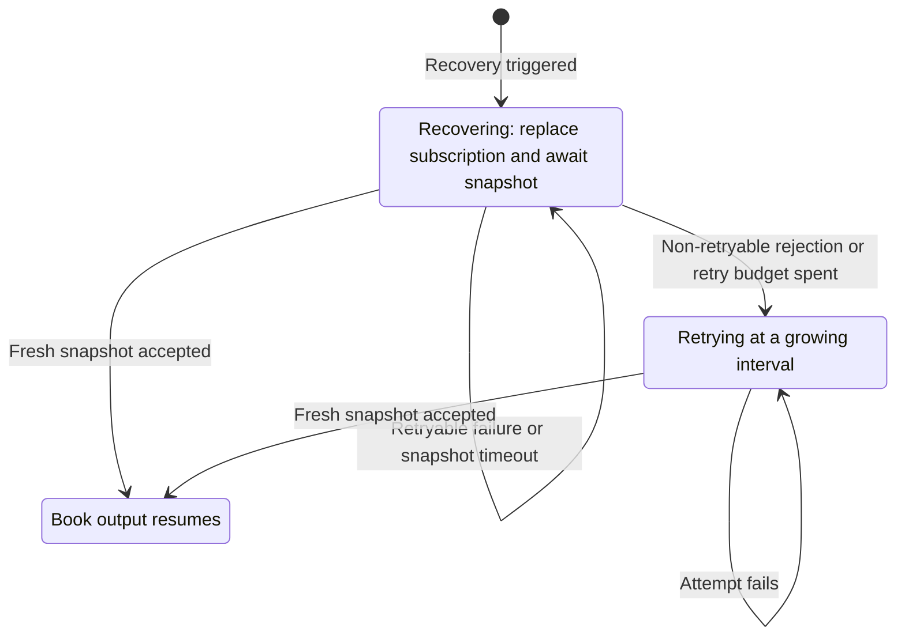

OKX ก่อตั้งในปี 2017 เป็น cryptocurrency exchange ที่ให้บริการเทรด spot, margin, perpetual swap, futures, option,
spread และ event contract integration นี้รองรับการรับ market data แบบ live และการ execute order บน OKX

## ภาพรวม [#overview]

Adapter นี้ implement ด้วย Rust และไม่ต้องใช้ OKX client library ภายนอก

OKX adapter ประกอบด้วยหลาย component ซึ่งใช้แยกกันหรือร่วมกันก็ได้:

- `OKXHttpClient`: การเชื่อมต่อ HTTP API ระดับล่าง
- `OKXWebSocketClient`: การเชื่อมต่อ WebSocket API ระดับล่างสำหรับผู้เรียกฝั่ง Rust
- `OKXDataClient`: ตัวจัดการ market data feed
- `OKXExecutionClient`: gateway สำหรับจัดการ account และ execute trade
- `OKXDataClientFactory`: factory สำหรับ OKX data client
- `OKXExecutionClientFactory`: factory สำหรับ OKX execution client

:::note
ผู้ใช้ส่วนใหญ่จะตั้งค่า live trading node ตามที่แสดงด้านล่าง โดยไม่จำเป็นต้องใช้ component ระดับล่างเหล่านี้โดยตรง
:::

## ตัวอย่าง [#examples]

- [ตัวอย่าง Rust](https://github.com/nautechsystems/nautilus_trader/tree/develop/crates/adapters/okx/examples/)

## ผลิตภัณฑ์ที่รองรับ [#product-support]

| ผลิตภัณฑ์         | แหล่งของ instrument            | Data | Exec | หมายเหตุ                                         |
| --------------- | ---------------------------- | ---- | ---- | -------------------------------------------- |
| Spot            | `public/instruments`         | Yes  | Yes  | คู่เทรด spot                                   |
| Margin          | `public/instruments`         | Yes  | Yes  | Spot instrument ที่ใช้ margin หรือ leverage      |
| Perpetual swaps | `public/instruments`         | Yes  | Yes  | สัญญาแบบ linear และ inverse                     |
| Futures         | `public/instruments`         | Yes  | Yes  | สัญญา futures แบบมีวันหมดอายุ                     |
| Options         | `public/instruments`         | Yes  | Yes  | Order แบบ limit-style ต้องใช้ family filter      |
| Spreads         | `sprd/spreads`               | Yes  | Yes  | Snapshot, quote, trade บน business WS          |
| Event contracts | `event-contract/*` endpoints | Yes  | Yes  | Parse เป็น `BinaryOption` ของ Nautilus         |

เอกสาร OKX ที่เกี่ยวข้อง:

- [Get instruments](https://www.okx.com/docs-v5/en/#public-data-rest-api-get-instruments).
- [Get limit price](https://www.okx.com/docs-v5/en/#public-data-rest-api-get-limit-price).
- [Get Spreads (Public)](https://www.okx.com/docs-v5/en/#spread-trading-rest-api-get-spreads-public).
- [Spread trading place order](https://www.okx.com/docs-v5/en/#spread-trading-rest-api-place-order).
- [Event contract series](https://www.okx.com/docs-v5/en/#public-data-rest-api-get-series).

:::note
**การรองรับ option**: adapter รองรับ market data ของ option, Greeks ที่ venue ส่งมาให้ (`subscribe_option_greeks`) และ
การ execute order สำหรับ option instrument ดูรายละเอียดในหัวข้อ [การเทรด option](#options-trading) ด้านล่าง และดู pattern
การ subscribe ในคู่มือ [Options](../concepts/options.md)
:::

:::info
**Instrument multiplier**: สำหรับ derivatives (`SWAP`, `FUTURES`, `OPTION`) instrument multiplier คำนวณจากผลคูณของ
field `ctMult` และ `ctVal` ของ OKX เพื่อให้การคำนวณขนาด position สอดคล้องกับขนาดและมูลค่าของสัญญาบน OKX
:::

:::info
**Price limit**: OKX เปิดเผย `initPxLmtPct`, `floatPxLmtPct` และ `maxPxLmtPct` บน `public/instruments` สำหรับ
instrument ประเภท spot, margin, swap และ futures adapter จะเก็บค่าที่ไม่ว่างไว้ใน field `info` ของ instrument เป็น
`okx_init_px_lmt_pct`, `okx_float_px_lmt_pct` และ `okx_max_px_lmt_pct` field เหล่านี้อธิบายเปอร์เซ็นต์ของช่วงราคาที่
exchange กำหนด จึงไม่ถูก parse เป็นค่า `min_price` หรือ `max_price` แบบคงที่ของ Nautilus

ใช้ `OKXHttpClient.request_price_limit(instrument_id)` เมื่อต้องการ limit ฝั่งซื้อและขายที่คำนวณ ณ ปัจจุบันจาก endpoint
`GET /api/v5/public/price-limit` ของ OKX ตามเอกสารของ OKX field เปอร์เซ็นต์เหล่านี้จะว่างสำหรับ option และ event contract
adapter จึงไม่แก้ไข `info` ของ instrument เหล่านั้น
:::

:::note
Endpoint ด้านผลิตภัณฑ์การเงินของ OKX เช่น `/api/v5/finance/okusd/*` อยู่นอกขอบเขตของ OKX trading adapter
:::

## การอัปเดต instrument [#instrument-updates]

Data client โหลด instrument cache ผ่าน REST ตอน connect และ subscribe WebSocket channel instruments ของ OKX สำหรับ
instrument type แต่ละประเภทที่กำหนดไว้ ทุกเส้นทางการอัปเดตจะเคารพ instrument type, family และ contract type ที่ตั้งค่าไว้
และ definition ที่ไม่เปลี่ยนแปลงจะไม่ถูก publish ซ้ำ

| แหล่ง                | Trigger                                         | สิ่งที่ publish ต่อ                                        |
| ------------------- | ----------------------------------------------- | ------------------------------------------------------ |
| โหลดตอน connect      | REST ตอน connect                                 | Cache ทั้งหมด ครั้งเดียว                                  |
| Instruments channel | Venue push (แบบ incremental)                    | Definition ใหม่หรือที่เปลี่ยน พร้อม `InstrumentStatus` ทุกครั้ง |
| REST reconciliation | `update_instruments_interval_mins` (ค่าเริ่มต้น 60) | เฉพาะ definition ใหม่หรือที่เปลี่ยนแปลง                     |

การอัปเดตแต่ละครั้งจะเขียน cache ของ data client, HTTP และ WebSocket ก่อน แล้วจึง publish definition ใหม่หรือที่เปลี่ยนแปลง
เป็น `DataEvent::Instrument` ผู้ใช้ข้อมูลจึงไม่มีทางเห็น definition ที่ไม่มีอยู่ใน cache การเปลี่ยนแปลงที่มีนัยสำคัญคือ field
ที่ serialize ใด ๆ นอกเหนือจาก `ts_event` และ `ts_init`

- Instruments channel เป็นแบบ incremental ไม่ใช่ snapshot feed การ subscribe หรือ reconnect อาจเริ่มโดยไม่มี payload แรก
  การ replay ตอน reconnect เพียงอย่างเดียวจึงไม่ได้ reconcile instrument cache
- ตั้ง interval เป็น `0` เพื่อปิด reconciliation แบบเป็นระยะ ส่วนการอัปเดตจาก instruments channel จะถูกนำไปใช้เสมอ refresh task
  หนึ่งตัวจะรันต่อหนึ่งวงจรชีวิตของการเชื่อมต่อ และถูกยกเลิกเมื่อ disconnect, teardown หลัง connect ล้มเหลว, stop และ dispose
  spread instrument จะถูกรวมด้วยเมื่อตั้ง `load_spreads`
- Instrument ที่หายไปจาก REST response จะยังคงอยู่ใน cache เพราะอาจยังมี subscription ที่เปิดอยู่ใช้งาน การระงับ, การหมดอายุ
  และการ delist จะมาเป็น event `InstrumentStatus` ผ่าน instruments channel

## การ subscribe order book [#order-book-subscriptions]

รองรับ subscription ต่อไปนี้สำหรับ book แบบ L2 market-by-price (`L2_MBP`):

| Subscription                 | การส่งข้อมูล                            | ความลึก                                          |
| ---------------------------- | ----------------------------------- | ---------------------------------------------- |
| `subscribe_book_deltas`      | `OrderBookDeltas` เมื่อ venue อัปเดต   | 50 หรือ 400 ระดับต่อฝั่ง และห้าระดับสำหรับ spread    |
| `subscribe_book_depth`       | Snapshot `OrderBookDepth` แบบ native | สูงสุดห้าระดับต่อฝั่ง                              |
| `subscribe_book_at_interval` | `OrderBook` ที่ cache ไว้ตาม interval  | ทุกระดับที่เก็บไว้จาก channel ที่เลือก                 |

`subscribe_book_depth` ใช้ snapshot `books5` แบบ native ของ OKX ซึ่ง publish เมื่อมีการเปลี่ยนแปลงทุก 100 ms
`depth=None` จะใช้ค่าเริ่มต้นห้าระดับ request ในช่วง `[1, 5]` จะเลือกระดับที่ดีที่สุดที่มีจากแต่ละ snapshot ส่วน request
ที่มากกว่านั้นและ `rpi=True` จะถูกปฏิเสธ ราคา, ขนาด และจำนวน order ของ venue มาจากแต่ละ snapshot โดยตรง adapter
ไม่ได้สร้าง depth snapshot ขึ้นใหม่จากข้อมูลแบบ incremental

Subscription แบบ delta และแบบ interval ยังคงใช้การเลือก channel แบบเดิม: request ในช่วง `[1, 50]` จะเลือก channel
50 ระดับเมื่อระดับ VIP ที่ตั้งไว้อนุญาต มิฉะนั้นจะใช้ channel `books` แบบ public 400 ระดับ ความลึกอื่น ๆ จะเลือก channel
400 ระดับ พารามิเตอร์ `rpi` จะเลือก `books-rpi` เมื่อเป็น true สิทธิ์เข้าถึง channel ยังขึ้นกับสิทธิ์ของ account บน OKX

ภายใน client แต่ละตัว ผู้ใช้ depth แบบ native จะใช้ limit ที่ขอร่วมกันหนึ่งค่าต่อ instrument รวมถึง subscription แบบ
unmanaged ความลึกที่ขอซึ่งขัดแย้งกันจะถูกปฏิเสธ

Native depth ใช้ feed แยกจาก delta และ interval book การ unsubscribe feed ใด feed หนึ่งจะไม่กระทบอีก feed spread instrument
ใช้ feed snapshot `sprd-books5` ห้าระดับที่ใช้ร่วมกันอยู่เดิม ซึ่งจะยังทำงานจนกว่าผู้ใช้ทั้ง delta และ depth จะ unsubscribe

Managed book มีแหล่งอัปเดตเดียว: delta หรือ depth subscription แบบ managed ที่เข้ากันได้จะใช้แหล่งนั้นร่วมกัน แต่ managed
depth ไม่สามารถอยู่ร่วมกับ managed delta หรือ interval subscription ของ instrument เดียวกันได้ data engine จะปฏิเสธ request
ที่ขัดแย้งกันก่อนเปลี่ยน managed book ผู้ใช้แหล่งเดียวกันต้องตรงกันในเรื่อง client, book type, ความลึก และพารามิเตอร์ของ
subscription client ต่างกันอาจใช้ configuration ต่างกันได้ก็ต่อเมื่อผู้ใช้แหล่งนั้นทั้งหมดเป็นแบบ unmanaged

หากต้องการรับทั้ง delta และ depth ให้ตั้ง `managed=True` บน delta subscription และ `managed=False` บน depth subscription
callback ของ depth แบบ unmanaged จะไม่แตะ book ที่ delta เป็นผู้จัดการ DataTester จะเลือกการจัดแบบนี้เมื่อเปิดทั้งสอง subscription

การส่งแบบ interval ใช้ delta subscription และ timer ที่มีอยู่ของ data engine โดย publish ทุกระดับที่เก็บไว้ ไม่ขึ้นกับ limit ที่
ผู้ใช้ depth แบบ unmanaged ขอไว้ ระหว่างที่การเชื่อมต่อขัดข้องหรือ book กำลังกู้คืน timer อาจยัง publish book ล่าสุดที่ cache ไว้
ต่อไป การส่ง native depth จะกลับมาพร้อม snapshot เต็มชุดใหม่หลัง reconnect โดยไม่ขึ้นกับการกู้คืนของ delta ดูข้อจำกัดของการ
กู้คืนได้ที่ [การกู้คืน order book](#order-book-recovery)

## การกู้คืน order book [#order-book-recovery]

Data client กู้คืน delta book แต่ละตัวอย่างอิสระ ระหว่างการกู้คืนจะระงับการอัปเดตแบบ incremental และแทนที่ subscription
เพื่อขอ snapshot ใหม่ output จะกลับมาก็ต่อเมื่อ client ยอมรับ snapshot แล้ว ซึ่งต้องส่ง request unsubscribe และ subscribe
สำหรับการแทนที่ไปแล้ว snapshot ที่ยอมรับจะแทนที่ระดับราคาที่มีอยู่ทั้งหมด snapshot ที่ว่างเปล่าจะล้าง book

### Trigger ของการกู้คืน [#recovery-triggers]

การกู้คืนเริ่มต้นเมื่อ:

- เกิด sequence gap
- การส่ง subscription ครั้งแรกล้มเหลว
- Snapshot ครั้งแรกหรือหลัง reconnect หมดเวลา
- Venue ปฏิเสธ book subscription

เมื่อเกิด sequence gap client จะทิ้ง batch ที่ไม่ตรงกันและระงับการอัปเดตแบบ incremental ต่อจากนั้น `book_snapshot_timeout_secs`
กำหนด deadline ของ snapshot สำหรับ subscription ครั้งแรก deadline จะเริ่มนับหลังจากส่ง subscription แล้ว ไม่รวมเวลาที่รอส่ง

การ reconnect จะ reset การ synchronize ของ book บน socket ที่ได้รับผลกระทบ spread book ได้รับ snapshot เต็มบน business socket
การกู้คืนของมันจึงเริ่มจากการส่งครั้งแรกล้มเหลว, ไม่มี snapshot ครั้งแรกหรือหลัง reconnect หรือการปฏิเสธ subscription

การตรวจ feed ที่นิ่งผิดปกติ (stale-feed) จะแค่ log warning และข้าม book ที่การกู้คืนที่กำลังทำงานเป็นเจ้าของอยู่ โดยไม่เริ่มการ
กู้คืน เพราะตลาดที่เงียบอาจไม่มีการเปลี่ยนแปลงของ book จริง ๆ

### Retry loop และขีดจำกัด [#retry-loop-and-limits]

Adapter ใช้ [กลไกการกู้คืน book ที่ใช้ร่วมกัน](../developer_guide/adapters.md#order-book-recovery-ownership) instrument
แต่ละตัวมี recovery loop หนึ่งตัว ซึ่งจะทำงานจนกว่าจะยอมรับ snapshot ใหม่ได้ หรือจนกว่าการ unsubscribe หรือ shutdown จะ
ยกเลิกมัน การกู้คืนจะไม่จบลงในสถานะล้มเหลว



การส่ง subscription request จะทำให้ book อยู่ในสถานะกู้คืนจนกว่าจะยอมรับ snapshot ใหม่ได้

- **จำนวนครั้ง**: สูงสุดแปดครั้งภายใน budget แรก
- **Budget แรก**: 180 วินาที รวมการส่ง, การรอ snapshot และ delay ระหว่าง retry
- **Delay**: retry ครั้งแรกทำทันที retry ต่อ ๆ มาใช้ exponential backoff เริ่มที่หนึ่งวินาที มี jitter ไม่เกินหนึ่งวินาที
  และเพดานสิบวินาที
- **หลังหมด budget**: พยายามต่อไปที่ interval ที่เพิ่มเป็นสองเท่าจากหนึ่งนาทีถึงสิบห้านาที มี jitter ไม่เกินห้าวินาที
  แต่ละครั้งถูกจำกัดที่หนึ่งนาที หรือที่ snapshot timeout หากนานกว่า การปฏิเสธแบบ retry ไม่ได้จะข้ามมาใช้ interval นี้ทันที

การกู้คืนที่กำลังทำงานจะดำเนินต่อข้ามการ reconnect ด้วย budget เดิม เพื่อป้องกันการยกเลิกระหว่าง request unsubscribe และ
subscribe สำหรับการแทนที่ การกู้คืนที่รออยู่ระหว่างความพยายามหลังหมด budget จะ retry บนการเชื่อมต่อใหม่ทันที การแทนที่
subscription จะคงความตั้งใจในการ reconnect ไว้ ส่วนการ unsubscribe และ shutdown จะยกเลิกการกู้คืน

### ความล้มเหลวต่อเนื่อง [#persistent-failures]

เมื่อ retry budget หมด client จะ log error หนึ่งครั้ง แล้ว log warning สำหรับแต่ละความพยายามที่ล้มเหลว ที่ interval
สิบห้านาที book ที่ล้มเหลวต่อเนื่องจะส่ง subscription request ประมาณแปดครั้งต่อชั่วโมง ซึ่งอาจเกิดกับ instrument ที่ venue
ไม่ให้บริการแล้ว อัตรานี้ยังต่ำกว่าขีดจำกัดของ OKX ที่ 480 ครั้งต่อชั่วโมงต่อการเชื่อมต่ออยู่มาก snapshot ที่มาช้าจะทำให้การ
กู้คืนเสร็จสิ้นได้ทุกเมื่อ ให้ unsubscribe เพื่อหยุดการกู้คืน

### ข้อจำกัดด้านการจับคู่ snapshot [#snapshot-correlation-limitation]

Book channel แบบ incremental จะยอมรับ snapshot เฉพาะขณะกำลังสร้างหรือกู้คืนการ synchronize เท่านั้น เมื่อ synchronize
แล้ว client จะทิ้ง snapshot ที่ไม่ได้ร้องขอโดยไม่แทนที่ book หรือ reset sequence ส่วน channel ที่ publish snapshot เต็มชุด
เป็นประจำจะยังยอมรับต่อไป

การส่ง book subscription จะรอให้การเขียน transport บนการเชื่อมต่อที่ตั้งใจไว้เสร็จสิ้น การส่งทั้งสองครั้งในการแทนที่ใช้การเชื่อมต่อ
เดียวกัน หากการเชื่อมต่อเปลี่ยน ความพยายามครั้งนั้นจะล้มเหลว

การยอมรับ snapshot ไม่ได้จับคู่ acknowledgement ของ subscription กับความพยายามในการกู้คืน snapshot ที่ล่าช้าจาก subscription
ก่อนหน้าอาจค้างอยู่ในคิวขณะที่ส่งการแทนที่ และทำให้การกู้คืนปัจจุบันเสร็จสิ้นเมื่อ gate เปิด การยืนยันการเขียนไม่ได้ขจัดความกำกวม
นี้ การกู้คืนยังไม่สามารถแยกแยะ error ของการ unsubscribe กับ error ของการ subscribe ได้อย่างน่าเชื่อถือ เมื่อ response ของ venue
ระบุเพียง book channel และ instrument

### การปิด deadline ของ snapshot [#disabling-snapshot-deadlines]

การตั้ง `book_snapshot_timeout_secs` เป็น `0` จะปิด deadline ของ snapshot รวมถึงการตรวจสอบครั้งแรกและหลัง reconnect
sequence gap และการปฏิเสธ subscription ยังคงเริ่มการกู้คืนได้

ภายใน retry budget การไม่มี snapshot จะทำให้ความพยายามปัจจุบันรอจนกว่าจะเกิดเหตุการณ์ใดเหตุการณ์หนึ่งต่อไปนี้:

- Client ยอมรับ snapshot
- มีการปฏิเสธเข้ามา
- การกู้คืนถูกยกเลิก
- Budget แรก 180 วินาทีหมดลง

ความพยายามหลังหมด budget ยังคงมีขอบเขตตามที่อธิบายไว้ด้านบน

### การตรวจสอบการกู้คืนแบบ live [#live-recovery-validation]

Harness `okx-book-stress` เป็นเครื่องมือสำหรับการพัฒนาเมื่อแก้ไขการ synchronize และการกู้คืน book โดยเชื่อมต่อกับ market
data แบบ public บน OKX mainnet และไม่ส่ง order ใดเลย จะตรวจสอบ book ของ spot, RPI swap และ spread ที่ส่งออกมาเทียบกับ
ข้อกำหนดของ book stream และเปรียบเทียบกับการสร้าง best 20 ระดับของ feed จาก venue ขึ้นใหม่อย่างอิสระ

Harness ตรวจสอบการกู้คืนโดยไม่มีการ reconnect รวมถึง snapshot แทนที่ที่ถูกทิ้งเมื่อเปิด deadline ไว้ จากนั้นจะ inject sequence
gap, ทิ้งและหน่วง snapshot, บังคับ reconnect และทดสอบการ unsubscribe และ shutdown ระหว่างการกู้คืน

จาก root ของ repository ให้รัน:

```bash
CARGO_BUILD_JOBS=16 bash scripts/strip-adapter-env.bash \
  cargo test -p nautilus-okx --features examples --test okx-book-stress -- --timeout 10 --rounds 18
```

`--scenario` ใช้เลือกการรัน:

- `churn` (ค่าเริ่มต้น): รอบของ fault ที่อธิบายไว้ด้านบน
- `initial`: ทิ้ง snapshot แรกของแต่ละ book หนึ่งครั้งต่อรอบใน session ใหม่
- `turnover`: unsubscribe และ subscribe book ใหม่ระหว่างการกู้คืน
- `boundaries`: ทดสอบจุดตัดของการแทนที่, การใช้ retry จนหมดแล้วเข้าสู่เพดานของ retry และการ shutdown ระหว่าง reconnect

`--timeout` กำหนด snapshot timeout เป็นวินาที โดย `0` จะปิด deadline ของ snapshot และ `--rounds` กำหนดจำนวนรอบ
(ค่าเริ่มต้น 18)

Harness ต้องเข้าถึง WebSocket endpoint แบบ public และ business รวมถึง API ของ instrument และ spread แบบ public ได้ ส่วน test
วงจรชีวิตของ book แบบอัตโนมัติใช้ mock server แบบ local ดู [Stress harnesses](../developer_guide/spec_data_testing.md#stress-harnesses)
สำหรับ flag ที่ใช้ร่วมกันและรูปแบบ output

## Symbology [#symbology]

OKX ใช้ข้อตกลงด้าน symbol เฉพาะสำหรับ instrument แต่ละประเภท ให้เติม suffix `.OKX` เมื่ออ้างถึง instrument ใน Nautilus
เช่น `BTC-USDT.OKX`

### รูปแบบ symbol ตามประเภท instrument [#symbol-format-by-instrument-type]

#### SPOT [#spot]

รูปแบบ: `{BaseCurrency}-{QuoteCurrency}`

ตัวอย่าง:

- `BTC-USDT` - Bitcoin เทียบกับ USDT (Tether)
- `BTC-USDC` - Bitcoin เทียบกับ USDC
- `ETH-USDT` - Ethereum เทียบกับ USDT
- `SOL-USDT` - Solana เทียบกับ USDT

ใน strategy ให้ใช้ instrument ID `BTC-USDT.OKX` สำหรับ spot ที่ quote เป็น USDT และ `BTC-USDC.OKX` สำหรับ spot ที่
quote เป็น USDC

#### SWAP (perpetual swap) [#swap-perpetual-swaps]

รูปแบบ: `{BaseCurrency}-{QuoteCurrency}-SWAP`

ตัวอย่าง:

- `BTC-USDT-SWAP` - Bitcoin perpetual swap (linear, USDT-margined)
- `BTC-USD-SWAP` - Bitcoin perpetual swap (inverse, coin-margined)
- `ETH-USDT-SWAP` - Ethereum perpetual swap (linear)
- `ETH-USD-SWAP` - Ethereum perpetual swap (inverse)

สัญญา linear เทียบกับ inverse:

- **Linear** (USDT-margined): ใช้ stablecoin เช่น USDT เป็น margin
- **Inverse** (coin-margined): ใช้ cryptocurrency ที่เป็น base เป็น margin

#### FUTURES (futures แบบมีวันหมดอายุ) [#futures-dated-futures]

รูปแบบ: `{BaseCurrency}-{QuoteCurrency}-{YYMMDD}`

ตัวอย่าง:

- `BTC-USD-261225` - Bitcoin futures หมดอายุ 25 ธันวาคม 2026
- `ETH-USD-261225` - Ethereum futures หมดอายุ 25 ธันวาคม 2026
- `BTC-USD-270326` - Bitcoin futures หมดอายุ 26 มีนาคม 2027

Futures อาจเป็น linear หรือ inverse ก็ได้ adapter จะดูจาก field `ctType` ของ OKX

#### SPREADS [#spreads]

รูปแบบ: `{Leg1InstrumentId}_{Leg2InstrumentId}`

ตัวอย่าง:

- `BTC-USDT_BTC-USDT-SWAP` - Spread ระหว่าง BTC-USDT spot กับ BTC-USDT perpetual swap
- `ETH-USD-SWAP_ETH-USD-261225` - Spread ระหว่าง ETH-USD perpetual swap กับ futures แบบมีวันหมดอายุ

ตั้ง `load_spreads=True` บน data client เพื่อโหลด spread instrument ของ OKX แบบ live จาก endpoint
[Get Spreads (Public)](https://www.okx.com/docs-v5/en/#spread-trading-rest-api-get-spreads-public) ของ OKX adapter จะ map
`sprdId` ของ OKX แต่ละตัวไปเป็น spread instrument ID ของ Nautilus ที่มี suffix venue `.OKX`

หมายเหตุเกี่ยวกับ spread instrument:

- Market data ของ spread stream บน business WebSocket ของ OKX: quote (`sprd-bbo-tbt`), trade (`sprd-public-trades`) และ
  book snapshot ห้าระดับ (`sprd-books5`) spread ไม่มี book channel แบบ incremental การอัปเดต `sprd-books5` แต่ละครั้งจะ
  ส่งเป็น `OrderBookDepth` ให้ผู้ subscribe depth และเป็น `OrderBookDeltas` ที่มี flag snapshot ให้ผู้ subscribe delta
- Parser รองรับการผสมขาแบบ spot, swap และ futures และรองรับ definition ของ spread ที่มีขาเป็น option เมื่อ OKX ส่งกลับมา
  ผ่าน spread endpoint เดียวกัน
- Workflow ด้าน option RFQ และ block trading ของ OKX แยกออกจาก Nitro spread order book API และไม่ได้ถูก route ผ่าน
  เส้นทาง spread นี้

#### OPTIONS [#options]

รูปแบบ: `{BaseCurrency}-{QuoteCurrency}-{YYMMDD}-{Strike}-{Type}`

ตัวอย่าง:

- `BTC-USD-261225-100000-C` - Bitcoin call option, strike $100,000, หมดอายุ 25 ธันวาคม 2026
- `BTC-USD-261225-100000-P` - Bitcoin put option, strike $100,000, หมดอายุ 25 ธันวาคม 2026
- `ETH-USD-261225-4000-C` - Ethereum call option, strike $4,000, หมดอายุ 25 ธันวาคม 2026

โดยที่:

- `C` = Call option
- `P` = Put option

#### EVENTS [#events]

Instrument ID ของ event contract บน OKX ใช้ market ID ที่ instruments API ของ OKX ส่งกลับมา adapter แทน market เหล่านี้ด้วย
instrument ประเภท `BinaryOption` ของ Nautilus

ตัวอย่าง:

- `BTC-ABOVE-DAILY-261224-1600-65000` - Event contract market ใน series `BTC-ABOVE-DAILY`

### คำถามที่พบบ่อย [#common-questions]

**ถาม: จะรู้ได้อย่างไรว่าควรใช้ contract type แบบไหน?**
ตอบ: Instrument แบบ linear และ inverse มี symbol ที่แตกต่างกัน

**ถาม: จะโหลด event contract ได้อย่างไร?**
ตอบ: ใช้ `OKXInstrumentType.EVENTS`

## Retail price improvement (RPI) [#retail-price-improvement-rpi]

ใช้ Retail Price Improvement (RPI) สำหรับงานเหล่านี้:

- ใช้ข้อมูล depth รวมทั้งแบบ organic และ RPI ของ OKX
- วาง RPI maker order
- ให้ order มาตรฐานใช้ liquidity ของ RPI ได้

Adapter map ความสามารถเหล่านี้ไปยัง type ของ order book, order และวงจรชีวิตที่มีอยู่แล้วของ Nautilus การ route แบบ RPI
เป็นแบบ opt-in ดังนั้น subscription และ order มาตรฐานจะไม่เปลี่ยนแปลง

### Market data ของ RPI [#rpi-market-data]

ส่ง `params={"rpi": True}` ให้ `subscribe_book_deltas` หรือ `request_book_snapshot` เพื่อใช้ channel `books-rpi` แบบ public
หรือ `GET /api/v5/market/books-rpi` feed นี้รวมปริมาณแบบ organic เข้ากับปริมาณ RPI ที่พร้อมให้ execute

ระดับ depth แบบดิบแต่ละระดับมีรูปแบบบน wire เป็น `[price, totalQty, nonRpiQty, count]`:

| Wire field  | Rust type | ความหมาย                                      |
| ----------- | --------- | -------------------------------------------- |
| `price`     | `Decimal` | ระดับราคา                                     |
| `totalQty`  | `Decimal` | ปริมาณแบบ organic และ RPI ที่พร้อมใช้            |
| `nonRpiQty` | `Decimal` | ปริมาณที่ใช้ได้โดยไม่ต้องมีสิทธิ์ RPI taker          |
| `count`     | `u64`     | จำนวน order รวมที่ระดับราคานั้น                 |

`OrderBookDeltas` และ `OrderBook` ของ Nautilus ใช้ `totalQty` เป็นปริมาณของระดับ ส่วน typed raw model ยังเก็บ `nonRpiQty`
ไว้ ส่วนต่างระหว่างสองปริมาณคือ liquidity ของ RPI ที่พร้อมใช้

Snapshot และการอัปเดตทาง WebSocket จะเก็บ `seqId` และ `prevSeqId` ไว้ delta ที่ส่งออกมาจะใช้ `seqId` เป็น sequence
data client จะตรวจ `prevSeqId` ของแต่ละการอัปเดตเทียบกับ `seqId` ล่าสุดที่ยอมรับ ค่าเหล่านี้ไม่จำเป็นต้องเพิ่มทีละหนึ่ง หาก
ไม่ตรงกันจะเริ่ม [การกู้คืน order book](#order-book-recovery) และการส่งข้อมูลจะกลับมาหลังจากยอมรับ snapshot ที่มี
`prevSeqId: -1`

Adapter ใช้กฎการเชื่อมโยงเดียวกันกับ book channel แบบ incremental มาตรฐานของ OKX เมื่อมี `prevSeqId` ส่วน `books-rpi`
ไม่มี checksum

สำหรับ WebSocket subscription `rpi=True` จะเลือก `books-rpi` แทนการเลือก channel ตาม depth หรือระดับ VIP สำหรับ REST
snapshot ความลึกที่ขอจะกลายเป็น `sz` โดย OKX ใช้ค่าเริ่มต้นหนึ่งระดับต่อฝั่งและรับได้สูงสุด 400

Rust client ระดับล่างเปิดให้ใช้:

- WebSocket: `OKXWebSocketClient.subscribe_book_rpi` และ `unsubscribe_book_rpi`
- REST: `OKXRawHttpClient.get_rpi_order_book` และ `OKXHttpClient.request_rpi_book_snapshot`

Response ของ instrument แบบ public เปิดเผยเกณฑ์ระยะห่างของ RPI ของ venue:

| Wire field     | Rust type         | Key ใน `info` ของ instrument |
| -------------- | ----------------- | --------------------- |
| `rpiMinLevel`  | `Option<u64>`     | `okx_rpi_min_level`   |
| `rpiMinPxBand` | `Option<Decimal>` | `okx_rpi_min_px_band` |

`rpiMinLevel` นับจำนวนระดับราคาแบบ organic ส่วน `rpiMinPxBand` วัดเป็น basis point จาก best price แบบ organic ของฝั่ง
ตรงข้าม map `info` จะเก็บ price band เป็น string ทศนิยมแบบตรงตัว adapter ไม่ปฏิเสธหรือปัดราคา order จากค่าเหล่านี้ เพราะ
OKX เป็นผู้ใช้กฎของ instrument และ account ที่เป็นทางการ ให้ใช้ `rpi_px_round` หรือจัดการการปฏิเสธจาก venue เอง

### Execution ของ RPI [#rpi-execution]

ส่งตัวควบคุม RPI ผ่าน `params` ของ command `submit_order`, `submit_order_list` หรือ `modify_order` ตัวควบคุมเหล่านี้ใช้ได้กับ
execution ทั้งแบบ HTTP และ private WebSocket:

| พารามิเตอร์          | Type   | Operation                     | พฤติกรรม                                                          |
| ------------------ | ------ | ----------------------------- | --------------------------------------------------------------- |
| `rpi`              | `bool` | Place และ batch place          | ส่ง `ordType: rpi` โดย order ของ Nautilus ต้องเป็น `LIMIT`         |
| `rpi_taker_access` | `bool` | Place และ amend, single/batch  | ให้ order มาตรฐานใช้ liquidity ของ RPI ได้                          |
| `rpi_px_round`     | `bool` | Place และ amend, single/batch  | ให้ OKX ปัดราคาของ RPI maker ออกไปยังระดับที่มีสิทธิ์                 |

> หมายเหตุ: ต้นฉบับมีเฉพาะตัวอย่าง Python จึงตัดออก

ใช้ `rpi_taker_access` กับ limit, market, FOK หรือ IOC order ปกติเท่านั้น เมื่อเปิดใช้ OKX จะใช้ taker speed bump กับ order
ที่มีสิทธิ์ รวมถึง post-only order ใช้ `rpi_px_round` กับ RPI maker order เท่านั้น ให้ละตัวควบคุมที่ไม่เกี่ยวข้องออกแทนการส่ง
`False` เพราะ OKX อาจปฏิเสธการผสมที่ไม่รองรับ ตัวควบคุมทั้งสองมีค่าเริ่มต้นเป็น `false` และ `rpi_taker_access` จะไม่ถูกสืบทอด
ระหว่าง amendment ให้ส่ง `rpi_taker_access=True` ซ้ำในทุก amendment ที่ต้องการคงสิทธิ์ไว้

Rust client ระดับล่างเปิดให้ใช้ matrix แบบ single และ batch เดียวกัน:

| Operation   | REST method    | WebSocket method      |
| ----------- | -------------- | --------------------- |
| Place       | `place_order`  | `submit_order`        |
| Batch place | `place_orders` | `batch_submit_orders` |
| Amend       | `amend_order`  | `modify_order`        |
| Batch amend | `amend_orders` | `batch_modify_orders` |

Tuple สำหรับ batch amend ทาง WebSocket รับ request ID แบบ optional และ serialize เป็น `reqId` ซึ่งไม่ได้แทนที่ client ID
ของ order

### Notional ขั้นต่ำของ RPI [#rpi-minimum-notional]

RPI maker order ต้องผ่านทั้ง `minSz` ของ instrument และ
[RPI minimum notional](https://www.okx.com/docs-v5/log_en/#2026-08-18-rpi-maker-minimum-notional-amount):

- `SWAP` และ `FUTURES`: 10,000 USD
- `SPOT`: 1,000 USD
- `EVENTS`: ได้รับการยกเว้นจาก RPI minimum notional

OKX ปฏิเสธ order ที่ต่ำกว่าเกณฑ์ notional ที่ใช้บังคับด้วย `54051` execution client จะส่ง `OrderRejected` สำหรับการวาง order
ที่ถูกปฏิเสธ

OKX จะตรวจ amend ที่มี `newSz` อีกครั้ง ไม่ว่าจะมี `newPx` หรือไม่ amend ที่ถูกปฏิเสธจะคง order เดิมไว้ adapter จะส่ง
`OrderModifyRejected` และหยุดติดตาม amend นั้นว่าค้างอยู่ amend ที่แก้แค่ราคาจะไม่ trigger การตรวจนี้ sub-order แต่ละตัวใน
request แบบ batch place หรือ batch amend จะถูกตรวจแยกกันอย่างอิสระ

Order ที่อยู่ใน book แล้วตอนที่กฎนี้มีผลใน production เมื่อวันที่ 18 สิงหาคม 2026 จะได้รับการยกเว้น (grandfathered) order ที่
ไม่ใช่ RPI รวมถึง order ที่มี `rpiTakerAccess: true` ได้รับการยกเว้นจากกฎ notional นี้ order ที่ผ่าน `minSz` ก็ยังอาจไม่ผ่าน
การตรวจ RPI minimum notional ได้

### Response และวงจรชีวิตของ RPI [#rpi-responses-and-lifecycle]

Private order message จะ parse ทั้ง `ordType: rpi` และ alias สำหรับการ migrate `ordType: elp` การวาง RPI ที่ยังไม่ fill อาจ
ปรากฏบน private order channel ครั้งแรกเป็น `state: canceled` โดยที่ `accFillSz` เป็นศูนย์หรือว่าง ในกรณีนั้น adapter จะส่ง
การปฏิเสธ post-only order โดยไม่ส่ง acceptance ก่อน เหตุผลสำรองคือ `RPI order canceled before acceptance` OKX อาจใช้เส้นทางนี้
เมื่อราคา RPI ไม่ผ่านกฎระยะห่างและ `rpiPxRound` เป็น false order report จะแทน RPI order ด้วย `LIMIT` order ของ Nautilus
ที่มี `post_only=True`

ใช้ `get_account_instruments` เพื่ออ่านค่า `OKXRpiPermission` แบบ typed:

- `Disabled` map กับ `rpi: "0"`
- `Enabled` map กับ `rpi: "1"` และไม่ได้ให้สิทธิ์วาง RPI order
- `Permitted` map กับ `rpi: "2"` และให้สิทธิ์วาง RPI order

Instrument endpoint แบบ public ไม่ได้ส่งสิทธิ์ของ account กลับมา response ค่าธรรมเนียมแบบดิบเปิดเผย `rpiMaker` เป็น
`Decimal` แบบ optional ค่าว่างหมายความว่า RPI ไม่เกี่ยวข้อง

Response อาจมีชื่อ field ทั้งแบบ RPI และ ELP ในช่วงเปลี่ยนผ่าน adapter จะเลือกใช้ `rpi` และ `rpiMaker` ก่อน อ่าน `elp` และ
`elpMaker` เป็น alias ของ response และส่งเฉพาะชื่อแบบ RPI เท่านั้น raw trade message อธิบาย `source: "1"` ว่าเป็น RPI order

### สิ่งที่ไม่รวมสำหรับ RPI [#rpi-exclusions]

Adapter ตั้งใจไม่รวมสิ่งต่อไปนี้:

- ไม่เปิดให้ใช้ subscription `books-elp` ที่เลิกใช้แล้ว และไม่ส่ง `ordType: elp`
- ไม่ถือว่าเกณฑ์ระยะห่างของ RPI ที่ publish ไว้เป็นการตรวจสอบฝั่ง client ที่เป็นทางการ
- ไม่ใช้ตัวควบคุม RPI กับ algo order เส้นทาง HTTP order ปกติจะปฏิเสธตัวควบคุม RPI สำหรับ spread order
- ไม่ได้เพิ่มการ deduplicate การ replay ของ post-only แบบทั่วไปเป็นส่วนหนึ่งของการรองรับ RPI

OKX จะไม่สนใจ `rpiPxRound` สำหรับ option และ event contract

ดู [OKX RPI migration changelog](https://www.okx.com/docs-v5/log_en/#2026-07-28)
และ [RPI program guide](https://www.okx.com/help/okx-retail-price-improvement-program-rpi)

## ความสามารถด้าน order [#orders-capability]

ด้านล่างคือประเภท order, execution instruction และตัวเลือก time-in-force ที่รองรับสำหรับผลิตภัณฑ์ linear perpetual swap บน OKX

### การระบุ order ทาง WebSocket [#websocket-order-identification]

Operation ของ order ทาง WebSocket บน OKX ใช้ `instIdCode` (identifier ของ instrument แบบตัวเลข) แทนพารามิเตอร์ `instId`
แบบ string adapter จะ resolve ค่า `instIdCode` จาก instrument definition ที่ดึงมาตอน startup และ cache ไว้ตลอดอายุของ session
การส่ง order จะล้มเหลวพร้อม error ที่ชัดเจนหาก `instIdCode` ที่ต้องใช้ไม่มีอยู่ใน cache

การเชื่อมต่อ execution ครั้งแรกต้องมี instrument ที่ใช้งานได้จากทุก instrument type หรือ family ที่ขอไว้ request ที่ล้มเหลวหรือ
scope ที่ไม่มี instrument ที่ใช้งานได้จะยกเลิกการเชื่อมต่อก่อนเปิด WebSocket แม้ scope อื่นจะสำเร็จก็ตาม instrument ที่ยังไม่
เปิดเทรด (pre-open) และรายการที่ parse ไม่ได้ไม่นับว่าผ่านข้อกำหนดนี้ option ที่ไม่ได้กำหนด instrument family ไว้จะยังคงถูกข้าม

### การย้าย spot จาก USD ไป USDC [#usd-to-usdc-spot-migration]

OKX กำลังรวม spot book ของ USD และ USDC เข้าด้วยกัน นี่เป็นการเปลี่ยนแปลงฝั่ง venue แบบ breaking instrument `Crypto-USD`
ที่ได้รับผลกระทบจะถูกแทนที่ด้วย instrument `Crypto-USDC` ดู
[OKX changelog](https://www.okx.com/docs-v5/log_en/#upcoming-changes-okx-to-migrate-usd-spot-trading-pairs)

| เหตุการณ์                 | เวลา                             |
| ---------------------- | ------------------------------- |
| เปิดเทรดคู่ขนาน            | 08:00 UTC วันที่ 23 กันยายน 2026   |
| Delist คู่ USD           | 08:00 UTC วันที่ 30 กันยายน 2026   |

#### Instrument ID [#instrument-ids]

Subscribe และเทรดด้วย instrument ID ตัวใหม่ที่มาแทน:

| ก่อน           | หลัง            |
| ------------- | -------------- |
| `BTC-USD.OKX` | `BTC-USDC.OKX` |

OKX ไม่ได้ map ค่า `instId` หรือ `instIdCode` ของ USD เดิมไปยัง instrument USDC ใหม่ adapter ไม่ได้เขียน key ของ USD ใน
cache ของ instrument หรือ `instIdCode` ใหม่ หลังจาก delist แล้ว request และ subscription ที่ยังใช้ ID ของ USD อาจล้มเหลว
หรือไม่ได้ข้อมูลกลับมา

#### Quote currency สำหรับการเทรด [#trading-quote-currency]

ค่าเริ่มต้นของ `tradeQuoteCcy` คือ quote currency ใน `instId` การเปลี่ยนแค่ instrument ID จาก `Crypto-USD` เป็น
`Crypto-USDC` จะเปลี่ยน quote สำหรับการเทรดโดยปริยายจาก USD เป็น USDC

ตั้ง `spot_trade_quote_ccy` บน `OKXExecutionClientConfig`:

| `spot_trade_quote_ccy` | ผล                                                                                |
| ---------------------- | --------------------------------------------------------------------------------- |
| ไม่ได้ตั้ง (`None`)        | ละ field นี้ไว้ OKX จะใช้ quote currency ใน `instId` (USDC บน `Crypto-USDC`)         |
| `"USD"`                | คงการเทรดด้วย USD บน instrument `Crypto-USDC`                                     |

Adapter จะส่ง `tradeQuoteCcy` กับ spot order ปกติทั้งทาง REST และ WebSocket แต่ไม่ส่ง field นี้กับ algo order หรือ
conditional order

Adapter จะปฏิเสธ order แบบ local เมื่อ:

- ค่าที่ตั้งไว้ไม่อยู่ใน `tradeQuoteCcyList` ของ instrument นั้น
- ไม่ทราบรายการดังกล่าว

รายการนี้เก็บมาจาก instrument definition รวมถึง `GET /api/v5/account/instruments` และจัดเก็บใน map `info` ของ instrument
เป็น `okx_trade_quote_ccy_list`

#### การเปิดใช้งาน account [#account-activation]

:::warning
เรียก `OKXHttpClient.activate_feature("1")` เพื่อเปิดการเทรดบน order book ของ USDC เฉพาะหลังจาก OKX ปฏิเสธ order
`Crypto-USDC` ด้วย error code `54109` แล้วเท่านั้น จากนั้นจึงส่ง order อีกครั้ง การเปิดใช้งานจะใช้ร่วมกันระหว่าง master account
และ sub-account ของมัน การเรียกที่สำเร็จหนึ่งครั้งจาก account ใดก็ได้จึงครอบคลุมทั้งหมด adapter จะไม่เปิดใช้งาน account ให้เอง
โดยปริยาย

Error code `51773` จาก `activate_feature` หมายความว่า OKX ไม่รองรับการเปิดใช้งานสำหรับ account นั้น ไม่ได้หมายความว่าการเทรด
USDC ใช้ไม่ได้ order ที่สำเร็จเป็นการยืนยันว่า account เทรด instrument นั้นได้
:::

### ข้อกำหนดของ client order ID [#client-order-id-requirements]

OKX กำหนดให้ client order ID เป็นตัวอักษรและตัวเลขเท่านั้น (alphanumeric) และยาวไม่เกิน 32 ตัวอักษร เครื่องหมาย hyphen (`-`)
จะถูกปฏิเสธ จึงต้องตั้ง `use_hyphens_in_client_order_ids` เป็น false ใน strategy config

Client order ID ของ Nautilus ที่ยาวเกิน 32 ตัวอักษรก็จะถูกปฏิเสธเช่นกัน เมื่อต้องการ identifier แบบ UUID ให้ใช้
`use_uuid_client_order_ids=True` ร่วมกับ `use_hyphens_in_client_order_ids=False` เพื่อให้ค่าที่ generate ขึ้นอยู่ในขีดจำกัดของ OKX

### ประเภท order [#order-types]

| ประเภท order             | Linear perpetual swap | หมายเหตุ                                                       |
| ---------------------- | --------------------- | ----------------------------------------------------------- |
| `MARKET`               | ✓                     | Execute ทันทีที่ราคาตลาด                                      |
| `MARKET_TO_LIMIT`      | ✓                     | Market order ที่ถูกแปลงเป็น IOC limit                          |
| `LIMIT`                | ✓                     | Execute ที่ราคาที่กำหนดหรือดีกว่า                                |
| `STOP_MARKET`          | ✓                     | Conditional market order ผ่าน algo order ของ OKX             |
| `STOP_LIMIT`           | ✓                     | Conditional limit order ผ่าน algo order ของ OKX              |
| `MARKET_IF_TOUCHED`    | ✓                     | Conditional market order ผ่าน algo order ของ OKX             |
| `LIMIT_IF_TOUCHED`     | ✓                     | Conditional limit order ผ่าน algo order ของ OKX              |
| `TRAILING_STOP_MARKET` | ✓                     | Trailing stop market order ผ่าน advance algo order ของ OKX   |

:::info
**Conditional order**: `STOP_MARKET`, `STOP_LIMIT`, `MARKET_IF_TOUCHED`, `LIMIT_IF_TOUCHED` และ `TRAILING_STOP_MARKET`
ใช้ algo order ของ OKX เส้นทาง `TRAILING_STOP_MARKET` ใช้ advance algo order API ของ OKX (`move_order_stop`) และต้องใช้
endpoint `cancel-advance-algos` ในการยกเลิก
:::

### Spread order [#spread-orders]

Spread instrument ของ OKX ใช้ spread trading order book และกลุ่ม API แยกต่างหาก execution client จะ route spread order
ตาม spread instrument ID เช่น `ETH-USD-SWAP_ETH-USD-261225.OKX` ผ่าน endpoint HTTP `/api/v5/sprd/*`

Adapter ใช้ spread REST endpoint ของ OKX สำหรับการ submit, cancel, mass cancel, สถานะ order และ trade report และ subscribe
[channel `sprd-orders`](https://www.okx.com/docs-v5/en/#spread-trading-websocket-private-channel-order-channel) บน business
WebSocket ของ OKX สำหรับการอัปเดต spread order แบบ live

การอัปเดตทาง WebSocket `sprd-orders` ของ OKX ไม่มี field ค่าธรรมเนียม adapter จึงเลือกปิดอย่างปลอดภัย (fail closed) และทิ้ง
การอัปเดตทั้งหมด โดยไม่ส่งทั้ง fill event และการอัปเดตสถานะ order reconciliation ตอน startup จะกู้คืน order จาก REST ตั้ง
`open_check_interval_secs` เพื่อ poll order ที่เปิดอยู่อย่างต่อเนื่อง fill report ย้อนหลังและสำหรับ reconciliation จาก
[endpoint `sprd/trades`](https://www.okx.com/docs-v5/en/#spread-trading-rest-api-get-trades) ทาง REST มีข้อมูลค่าธรรมเนียม
ของ OKX

Instruction ของ spread order ที่รองรับ:

- `LIMIT` กับ time-in-force แบบ GTC
- `LIMIT` กับ time-in-force แบบ IOC
- `LIMIT` กับการ execute แบบ post-only

Spread order list, conditional order, time-in-force แบบ FOK และ modify request ไม่รองรับในเส้นทาง spread trading API ของ OKX

เอกสาร OKX ที่เกี่ยวข้อง:

- [Spread order placement](https://www.okx.com/docs-v5/en/#spread-trading-rest-api-place-order).
- [Spread order details](https://www.okx.com/docs-v5/en/#spread-trading-rest-api-get-order-details).
- [Spread order channel](https://www.okx.com/docs-v5/en/#spread-trading-websocket-private-channel-order-channel).

### Execution instruction [#execution-instructions]

| Instruction   | Linear perpetual swap | หมายเหตุ                                                  |
| ------------- | --------------------- | ----------------------------------------------------- |
| `post_only`   | ✓                     | ใช้กับ limit order เท่านั้น                              |
| `reduce_only` | ✓                     | ดูข้อจำกัดตามผลิตภัณฑ์และ position mode ด้านล่าง              |

Adapter ส่ง field `reduceOnly` ตามตัวอักษรของ OKX สำหรับ margin order ใน trade mode แบบ `isolated` หรือ `cross` และสำหรับ
futures หรือ swap order ใน position mode แบบ `net` ใน position mode แบบ `long/short` OKX ไม่รับ field นั้น adapter จึงใช้
การผสม `side` และ `posSide` ฝั่งปิดเป็น instruction ที่ venue บังคับใช้แทน adapter จะปฏิเสธ reduce-only order สำหรับผลิตภัณฑ์
แบบ cash, option และ event และปฏิเสธการผสมในโหมด long/short ที่จะเพิ่มฝั่งที่เลือก ดู
[เอกสาร place order ของ OKX](https://www.okx.com/docs-v5/en/#order-book-trading-trade-post-place-order)

### Time in force [#time-in-force]

| Time in force | Linear perpetual swap | หมายเหตุ                                 |
| ------------- | --------------------- | ------------------------------------ |
| `GTC`         | ✓                     | Good Till Canceled                   |
| `FOK`         | ✓                     | Fill or Kill                         |
| `IOC`         | ✓                     | Immediate or Cancel                  |
| `GTD`         | -                     | *OKX ไม่มี time-in-force นี้แบบ native* |

:::note
**Time in force แบบ GTD (Good Till Date)**: OKX รองรับการหมดอายุของ request ผ่าน `expTime` แต่นั่นเป็น timeout ของ request
ไม่ใช่ instruction การหมดอายุของ order แบบ native

หากต้องการความสามารถแบบ GTD ให้ใช้ฟีเจอร์ GTD ที่ strategy ของ Nautilus จัดการเอง ซึ่งจะจัดการการหมดอายุของ order ด้วยการ
ยกเลิก order ณ เวลาหมดอายุที่ระบุ
:::

### Batch operation [#batch-operations]

| Operation    | Linear perpetual swap | หมายเหตุ                                     |
| ------------ | --------------------- | ----------------------------------------- |
| Batch Submit | ✓                     | ส่งหลาย order ใน request เดียว              |
| Batch Modify | ✓                     | แก้ไขหลาย order ใน request เดียว            |
| Batch Cancel | ✓                     | ยกเลิกหลาย order ใน request เดียว           |

### การยกเลิก order ทั้งหมด [#cancel-all-orders]

`Strategy.cancel_all_orders` รองรับ `order_side` ทั้งในโหมดเฉพาะ strategy และโหมดข้าม strategy ดูขอบเขตของ strategy ได้ที่
[Cancel-all routing](../concepts/execution/index.md#cancel-all-routing)

เมื่อใช้ `strategy_only=False` ร่วมกับ `order_side` adapter จะเลือก order ที่เปิดอยู่และตรงเงื่อนไขจาก cache ข้ามทุก strategy
โดยส่ง order ปกติผ่านการยกเลิกแบบ batch และส่ง conditional order กับ spread order ผ่าน API ยกเลิกราย order ของมัน วิธีนี้จะข้าม
mass cancellation ของ venue รวมถึงกรณีที่ option `use_mm_mass_cancel` ของ configuration ฝั่ง Rust เป็น `true`

การยกเลิกแบบกรองตามฝั่งจะไม่รวม order ที่ไม่อยู่ใน cache และ order ที่ยังอยู่ในสถานะ `SUBMITTED` หากไม่กรองตามฝั่ง การยกเลิก
ที่ไม่ใช่ spread ทั่วไปจะใช้ order ที่เปิดอยู่ใน cache เป็นค่าเริ่มต้นเช่นกัน ส่วน spread instrument และ option mass-cancel ฝั่ง Rust
จะใช้ bulk endpoint ของ venue

### เหตุผลของการปฏิเสธ [#rejection-reasons]

เมื่อ OKX ปฏิเสธ request แบบ order, modify หรือ cancel ด้วย error code ค่า `reason` ใน `OrderRejected`,
`OrderModifyRejected` หรือ `OrderCancelRejected` จะอยู่ในรูป `OKX error <code>: <message>` เช่น
`OKX error 51000: Parameter instId error` response ทาง WebSocket ที่ไม่มี message จะให้ผลเป็น `OKX error <code>` อย่างเดียว
และถ้ามี `subCode` ด้วยจะต่อท้ายเป็น `(subCode=<code>)` conditional order ที่ล้มเหลวหลังถูกยอมรับแล้วจะรายงานเฉพาะ code
เช่น `OKX error 51008` เพราะ OKX ส่งมาเพียง `failCode`

การปฏิเสธที่ adapter สร้างขึ้นก่อนติดต่อ OKX เช่น การตรวจสอบแบบ local ที่ไม่ผ่าน จะใช้ message ของ adapter เองและไม่มี
error code ของ OKX

### การจัดการ position [#position-management]

| ความสามารถ          | Linear perpetual swap | หมายเหตุ                                  |
| ---------------- | --------------------- | ------------------------------------ |
| Query positions  | ✓                     | อัปเดต position แบบ real-time          |
| Position mode    | ✓                     | โหมด Net หรือ Long/Short (ดูด้านล่าง)    |
| Leverage control | -                     | Execution client ไม่ได้เปิดให้ใช้         |
| Margin mode      | ✓                     | รองรับโหมด isolated และ cross          |

#### Position mode [#position-modes]

OKX รองรับ position mode สองแบบสำหรับการเทรด derivatives:

- **Net mode** (netting): หนึ่ง position ต่อ instrument buy order และ sell order จะหักล้างกัน เป็นโหมดเริ่มต้นและแนะนำสำหรับ
  trader ส่วนใหญ่
- **Long/Short mode** (hedging): แยก position long และ short สำหรับ instrument เดียวกัน โหมดนี้รองรับการถือ exposure ทั้ง
  long และ short พร้อมกัน

:::note
Position mode มีผลทั้ง account ตั้งค่าได้ผ่านหน้าเว็บหรือแอปของ OKX หรือด้วย `OKXHttpClient.set_position_mode` client config
ไม่ได้เป็นตัวตั้งค่านี้ adapter รายงาน position ได้ทั้งสองโหมด ในโหมด net จะคำนวณฝั่งของ position จากปริมาณแบบมีเครื่องหมาย
ในโหมด long/short จะใช้ `posSide` ที่ OKX รายงานมา
:::

เมื่อตั้งค่าสำหรับ `SWAP` หรือ `FUTURES` execution client จะอ่าน position mode ของ account ทุกครั้งที่เชื่อมต่อ สำหรับ account
แบบ long/short ให้ตั้ง `oms_type=OmsType.HEDGING` บน `OKXExecutionClientConfig` และใช้ hedging OMS ใน strategy adapter จะ
log warning เมื่อ OMS ของ client ต่างจาก position mode ของ account หากไม่ override client จะใช้ netting เมื่อมีการกำหนด
derivative instrument type ใด ๆ ไว้ มิฉะนั้นจะใช้ hedging การ override มีผลกับทุกผลิตภัณฑ์ที่ client จัดการ ให้ใช้ client แยกกัน
เมื่อ option ต้องใช้ netting ควบคู่กับ futures หรือ swap ในโหมด long/short

สำหรับ futures และ swap ในโหมด long/short ฝั่งของ order และ flag `reduce_only` จะเป็นตัวเลือกขา (leg):

| ฝั่งของ order | `reduce_only` | OKX `posSide` | ผล                      |
| ---------- | ------------- | ------------- | ----------------------- |
| `BUY`      | `False`       | `long`        | เปิดหรือเพิ่ม long        |
| `SELL`     | `False`       | `short`       | เปิดหรือเพิ่ม short       |
| `SELL`     | `True`        | `long`        | ปิดหรือลด long          |
| `BUY`      | `True`        | `short`       | ปิดหรือลด short         |

การ map นี้ใช้กับการส่งทาง WebSocket ทั้งแบบเดี่ยวและแบบ batch และการส่ง conditional (algo) order ส่วน `close_fraction`
ก็เป็นตัวเลือกขาที่จะปิดเช่นกัน

Order, fill และ position report ของ futures และ swap ในโหมด long/short ใช้ `{instrument_id}-LONG` หรือ
`{instrument_id}-SHORT` เป็น venue position ID ให้ละ `position_id` ตอนส่ง order หรือใช้ ID ของขาที่เลือก ID ที่ขัดแย้งกันจะ
ทำให้ถูกปฏิเสธ (denial) ผลิตภัณฑ์อื่นและ report ในโหมด net ไม่มี venue position ID ให้ใช้ node แยกกันเมื่อมีหลาย OKX account
เทรด instrument เดียวกัน เพราะ ID เหล่านี้ไม่ได้รวม account ไว้ด้วย

:::warning
ในโหมด long/short derivative order และ position ต้องใช้ `margin_mode` ที่ตั้งไว้ใน client adapter จะปฏิเสธการ override
`td_mode` ที่ขัดแย้งและ position snapshot ที่ไม่เข้ากัน อย่าผสม position แบบ cross และ isolated สำหรับ instrument และฝั่ง
เดียวกัน เพราะ venue position ID ไม่ได้แยกแยะ margin mode

ก่อนเปลี่ยน position mode หรือ margin mode ให้ปิด position, ยกเลิก order ที่ค้างอยู่ และหยุด node ล้าง order และ position
ใน cache จากโหมดเดิมออก รวมถึง record ที่ persist ไว้ ตั้ง `LiveExecutionEngineConfig.reconciliation_lookback_mins` ให้สั้นกว่า
ระยะเวลาตั้งแต่เปลี่ยนโหมด เพื่อไม่ให้ reconciliation replay ประวัติของโหมดเดิม หากเปิดการตรวจ position ตอน runtime ผ่าน
`position_check_interval_secs` ให้ใช้ขอบเขตเดียวกันกับ `position_check_lookback_mins` lookback ที่สั้นลงไม่ได้ล้างสถานะใน cache
หรือตัด position และ order ที่ค้างอยู่ในปัจจุบันออก ใช้การล้างแบบเดียวกันเมื่ออัปเกรด hedge position ใน cache จาก venue position
ID แบบตัวเลขเป็น ID ที่อิงตาม instrument ดู [Cache purging](../concepts/cache.md#bulk-purges) และ
[Reconciliation](#reconciliation)
:::

### Trade mode และการตั้งค่า margin [#trade-modes-and-margin-configuration]

Spot order ที่ใช้เงินสดใช้ trade mode (`tdMode`) ดังนี้:

| Account mode          | `acctLv` | Spot `tdMode` |
| --------------------- | -------- | ------------- |
| Spot                  | `1`      | `cash`        |
| Futures               | `2`      | `cash`        |
| Multi-currency margin | `3`      | `cross`       |
| Portfolio margin      | `4`      | `cross`       |

ปิด auto-borrow ไว้ในโหมด 3 และ 4 เพื่อป้องกันการกู้ยืมเกินกว่า cash balance

เปิดใช้ account mode แต่ละแบบบนเว็บไซต์หรือแอปของ OKX ก่อน การสลับในภายหลังใช้
[OKX account-mode API](https://www.okx.com/docs-v5/en/#trading-account-rest-api-set-account-mode) ได้ HTTP client ของ
Nautilus ไม่ได้เปิดให้สลับ account mode, เปลี่ยน auto-borrow หรือชำระหนี้

[Auto-borrow (`autoLoan`)](https://www.okx.com/docs-v5/en/#trading-account-rest-api-set-auto-loan) ใช้ได้เฉพาะโหมด
Multi-currency และ Portfolio margin หนี้สินที่ค้างอยู่อาจบล็อกการเปลี่ยนโหมด
[One-click repayment](https://www.okx.com/docs-v5/en/#order-book-trading-trade-post-trade-one-click-repay-new) ต้องใช้
auto-borrow (`51625`) ดูทางเลือกอื่นได้ที่
[วิธีการชำระหนี้](https://www.okx.com/help/borrowing-and-repaying-in-multi-currency-and-portfolio-margin-account-modes) ของ OKX

#### ภาพรวมของ trade mode [#trade-modes-overview]

Execution config เลือก trade mode ดังนี้:

| Instrument | Trade mode | Configuration                                     |
| ---------- | ---------- | ------------------------------------------------- |
| Spot       | `cash`     | อัตโนมัติ                                           |
| Derivative | `isolated` | ค่าเริ่มต้น หรือ `OKXMarginMode::Isolated`            |
| Derivative | `cross`    | `OKXMarginMode::Cross`                            |

โดยค่าเริ่มต้น spot จะใช้ `cash` ซึ่งต้องใช้ account mode แบบ Spot หรือ Futures สำหรับ Multi-currency หรือ Portfolio margin
ให้ส่ง spot order ด้วย `params={"td_mode": "cross"}` ใน client ที่มีหลายผลิตภัณฑ์ `margin_mode` จะมีผลกับ derivatives เท่านั้น
factory จะกำหนด account type ของ Nautilus สำหรับใช้ในการบัญชี โดยไม่ได้เปลี่ยน `acctLv` ของ OKX

ใน Rust `use_spot_margin=true` จะทำให้ `margin_mode` มีผลกับ spot ด้วย ให้ตั้ง `OKXMarginMode::Cross` สำหรับ Multi-currency
หรือ Portfolio margin เพราะ `None` จะใช้ค่าเริ่มต้นเป็น `Isolated` ซึ่งโหมดเหล่านี้ไม่รองรับ

:::warning
**การ override trade mode ด้วยมือ**: สามารถ override trade mode ราย order ด้วย `params={"td_mode": "..."}` ได้ การทำแบบนี้
จะข้ามการเลือกของ adapter และอาจทำให้ order ถูกปฏิเสธเมื่อค่าไม่ตรงกับ account หรือ instrument เช่น `isolated` ในโหมด
Multi-currency หรือ Portfolio margin

ใช้การ override ด้วยมือเฉพาะกับข้อกำหนดที่ทำผ่าน configuration ไม่ได้เท่านั้น สำหรับ derivative order ในโหมด long/short ค่าที่
override ต้องตรงกับ margin mode ที่ตั้งไว้
:::

### การ query order [#order-querying]

| ความสามารถ              | Linear perpetual swap | หมายเหตุ                            |
| -------------------- | --------------------- | ------------------------------ |
| Query open orders    | ✓                     | แสดงรายการ order ที่ active ทั้งหมด |
| Query order history  | ✓                     | ข้อมูล order ย้อนหลัง              |
| Order status updates | ✓                     | การเปลี่ยนสถานะ order แบบ real-time |
| Trade history        | ✓                     | Execution report และ fill report |

### Contingent order [#contingent-orders]

| ความสามารถ            | Linear perpetual swap | หมายเหตุ                                    |
| ------------------ | --------------------- | -------------------------------------- |
| Order lists        | ✓                     | Batch ผ่าน WS เฉพาะ order ปกติ            |
| OCO orders         | -                     | `OKXExecutionClient` ไม่ได้ส่ง            |
| Bracket orders     | -                     | `OKXExecutionClient` ไม่ได้ส่ง            |
| Conditional orders | ✓                     | Stop order และ limit-if-touched order    |

HTTP client ระดับล่างมี model สำหรับ payload แบบ attached TP/SL และ OCO ของ OKX แต่ `OKXExecutionClient` ไม่ได้แปลง order
list แบบ OCO หรือ bracket ของ Nautilus ไปเป็น payload เหล่านั้น

#### สถาปัตยกรรมของ conditional order [#conditional-order-architecture]

Conditional order (algo order ของ OKX) ใช้ HTTP สำหรับ command และ WebSocket สำหรับการอัปเดตสถานะ:

- **การส่ง**: HTTP `/api/v5/trade/order-algo` คืน acknowledgment ทันที
- **การอัปเดตสถานะ**: business endpoint ทาง WebSocket (`/ws/v5/business`) stop order และ touched order ใช้ `orders-algo`
  ส่วน trailing stop ใช้ `algo-advance` ทั้งสองส่งการอัปเดตแบบ real-time
- **การยกเลิก**: ใช้ HTTP ขณะที่ algo parent ยัง active อยู่

เมื่อ child ที่ถูก trigger กลายเป็นตัวหลักแล้ว การยกเลิกและแก้ไขจะใช้ order ID ของมันและเส้นทาง WebSocket ปกติ ส่วน identity
ของ order ใน Nautilus จะไม่เปลี่ยน

Channel `orders-algo` ส่งเฉพาะการอัปเดต ขณะที่ `algo-advance` ส่ง snapshot ตอน subscribe ด้วย adapter จะคง context ของ order
ที่ติดตามไว้ข้ามการ reconnect ของ transport และ deduplicate snapshot ของ advance-algo ที่ถูก replay ส่วน REST reconciliation
ยังคงรับผิดชอบการกู้คืนตอน cold-start และกรณีพลาดการอัปเดต

#### ประเภท conditional order ที่รองรับ [#supported-conditional-order-types]

| ประเภท order             | Trigger type      | หมายเหตุ                                                  |
| ---------------------- | ----------------- | ---------------------------------------------------- |
| `STOP_MARKET`          | Last, Mark, Index | Execute แบบ market เมื่อถูก trigger                      |
| `STOP_LIMIT`           | Last, Mark, Index | วาง limit order เมื่อถูก trigger                        |
| `MARKET_IF_TOUCHED`    | Last, Mark, Index | Execute แบบ market เมื่อราคาแตะ                          |
| `LIMIT_IF_TOUCHED`     | Last, Mark, Index | วาง limit order เมื่อราคาแตะ                            |
| `TRAILING_STOP_MARKET` | -                 | Callback ratio หรือ spread มี activation price แบบ optional |

ดูข้อจำกัดตาม account และประเภท order ได้ที่ [trigger price type](#trigger-price-types)

:::warning
พารามิเตอร์ `close_fraction` ของ conditional order บน OKX ไม่ได้ถูก normalize ให้ตรงกับข้อกำหนดด้าน risk ของ `close_position`
แบบทั่วไป อย่าเพิ่ม `OKX` ลงใน `full_position_exit_venues` โดยอิงจาก `close_fraction` ให้คง venue นี้ไว้นอกรายการ เพื่อให้การ
ตรวจสอบปริมาณและ notional ตามปกติยังมีผล
:::

#### ขนาดของ algo order [#algo-sizing]

Spot buy แบบ `STOP_MARKET` และ `MARKET_IF_TOUCHED` ใช้ `conditional` order ของ OKX โดยระบุ `tgtCcy` อย่างชัดเจนสำหรับ
`cash`, `cross` และ `isolated` stop buy ใช้ขา stop-loss ส่วน touched buy ใช้ขา take-profit

| Spot algo order                              | ปริมาณเป็น base                    | ปริมาณเป็น quote                     |
| -------------------------------------------- | -------------------------------- | ---------------------------------- |
| Stop-market หรือ market-if-touched buy       | ขอ `tgtCcy=base_ccy`             | ขอ `tgtCcy=quote_ccy`              |
| Trailing-stop-market buy                     | ถูกปฏิเสธแบบ local                 | ใช้การกำหนดขนาดแบบ quote ของ OKX      |
| Stop, touched หรือ trailing market sell      | ใช้การกำหนดขนาดแบบ base ของ OKX     | ถูกปฏิเสธแบบ local                   |
| Stop-limit หรือ limit-if-touched ทุกฝั่ง        | ใช้การกำหนดขนาดแบบ base ของ OKX     | ถูกปฏิเสธแบบ local                   |

Derivative algo order ต้องใช้ปริมาณเป็นจำนวนสัญญา ปริมาณแบบ quote จะถูกปฏิเสธแบบ local กฎของ algo order เหล่านี้ไม่ได้จำกัด
market order ทั่วไป spot market order ใน `tdMode=cash` รองรับ sell ที่ระบุขนาดเป็น quote ด้วย ไม่ว่าหน่วยขนาดแบบใดก็ไม่รับประกัน
การ fill เต็มจำนวน OKX ระบุในเอกสารว่ามีการลดขนาดตาม balance สำหรับ `trigger` order สำหรับ spot-margin buy แบบ `STOP_MARKET`
และ `MARKET_IF_TOUCHED` ในโหมด Futures ให้ใช้ปริมาณแบบ quote เพราะ OKX จะปฏิเสธ `base_ccy` ด้วย `59110` ให้ใช้ `tdMode=cash`
ในโหมด Futures สำหรับ buy ที่ระบุขนาดเป็น base

Order ที่ส่งผ่าน execution client ใช้ `quote_quantity` และส่ง `OrderDenied` เมื่อการตรวจสอบแบบ local ไม่ผ่าน
`OKXHttpClient::place_algo_order_with_domain_types` ฝั่ง Rust ต้องระบุ flag นี้ ให้ส่ง true สำหรับ quote budget รวมถึง spot
trailing buy algo request ทาง HTTP จะใส่ quote currency เป็น margin `ccy` สำหรับ spot order ใน `cross` หรือ `isolated` ให้ใช้ HTTP
ในการวาง algo order เพราะ `OKXWebSocketClient::submit_algo_order` ฝั่ง Rust จะคืน error แบบ local ดู
[algo order parameters](https://www.okx.com/docs-v5/en/#order-book-trading-algo-trading-post-place-algo-order) ของ OKX

สำหรับ trigger แบบ last price OKX กำหนดให้ trigger ของ stop-buy ต้องอยู่ที่หรือสูงกว่า last price และ trigger ของ touched-buy
ต้องอยู่ที่หรือต่ำกว่า last price trigger ที่อยู่ผิดฝั่งจะถูกปฏิเสธ

:::warning
เวอร์ชันเก่าจะส่ง spot market buy แบบ stop, touched และ trailing เป็นหน่วย quote แม้จะขอปริมาณเป็น base ก็ตาม ให้ยกเลิกและส่ง
stop/touched buy ที่ค้างอยู่ใหม่เพื่อเลือกหน่วยที่ต้องการ สำหรับ trailing buy ให้ส่งใหม่พร้อมระบุ quote budget อย่างชัดเจน

ยกเลิก algo order ที่ระบุขนาดเป็น quote ที่ค้างอยู่ก่อนรีสตาร์ท process ทุกครั้ง cache ที่ persist ไว้จะเก็บ order ไว้แต่ไม่เก็บ
session context ของมัน การอัปเดตภายหลังจึงเข้ามาเป็น report ที่ไม่ได้ติดตาม หากไม่มี cache ที่ persist ไว้ และสำหรับ HTTP algo
order แบบ standalone ในทุกกรณี [reconciliation](#reconciliation) อาจนำเข้าจำนวน quote เป็นปริมาณแบบ base
[ข้อจำกัดของการแก้ไขหลังรีสตาร์ท](#modifying-conditional-orders) ก็มีผลเช่นกัน
:::

#### การแก้ไข conditional order [#modifying-conditional-orders]

`modify_order` แก้ไข stop order และ touched order ที่ค้างอยู่ผ่าน HTTP `amend-algos`

- **เงื่อนไขที่คงไว้**: ราคาที่ละไว้และแหล่งของ trigger จะไม่เปลี่ยน
- **การออกจาก position ทั้งหมด**: เมื่อใช้ `close_fraction` stop order จะแก้ไขเงื่อนไข stop-loss ส่วน touched order จะแก้ไข
  เงื่อนไข take-profit
- **การยืนยัน**: algo stream ต้องยืนยันเงื่อนไขที่เปลี่ยนก่อนจึงจะส่ง `OrderUpdated` acknowledgment เพียงอย่างเดียวจะไม่ส่งการอัปเดต

:::warning
การแก้ไขที่ค้างอยู่ต้องมี session context ที่ติดตามไว้ order ที่กู้คืนมาหลังรีสตาร์ทหรือไม่มี context นั้นจะส่ง
`OrderModifyRejected` แบบ local การแก้ไข trailing-stop algo ก็จะส่ง `OrderModifyRejected` แบบ local เช่นกัน
:::

#### Trigger price type [#trigger-price-types]

Adapter จะปฏิเสธ feed อื่นนอกเหนือจาก default, last, mark และ index ก่อนส่ง และปฏิเสธ mark/index บน cash-spot และ trailing
order สำหรับ spot order อื่นใน `cross` หรือ `isolated` จะส่ง mark/index ต่อไปยัง OKX spot-margin buy แบบ
`STOP_MARKET`/`MARKET_IF_TOUCHED` ในโหมด Futures และ stop/touched order ของ derivative รองรับ trigger เหล่านี้ OKX ปฏิเสธ
สำหรับ spot buy ในโหมด Multi-currency และระบุในเอกสารว่า `trigger` order ของ `SPOT` รองรับเฉพาะ Last

Stop order และ touched order ใช้แหล่งเหล่านี้ในกรณีที่ account, instrument และประเภท order รองรับ:

- **Last price** (`TriggerType.LAST_PRICE`): ใช้ราคาที่เทรดล่าสุด (ค่าเริ่มต้น)
- **Mark price** (`TriggerType.MARK_PRICE`): ใช้ mark price
- **Index price** (`TriggerType.INDEX_PRICE`): ใช้ราคา index ของ underlying

## การจัดการความเสี่ยง [#risk-management]

### การจัดการ event ของ liquidation และ ADL [#liquidation-and-adl-event-handling]

OKX adapter ตรวจจับ event ด้านการจัดการความเสี่ยงที่ exchange เป็นผู้เริ่ม:

- **คำเตือน liquidation**: เมื่อ `instrument_types` มี `MARGIN`, `SWAP`, `FUTURES` หรือ `OPTION` execution client จะ subscribe
  `liquidation-warning` ด้วย `instType=ANY` และ log warning เมื่อ OKX รายงานว่า position ใกล้ถูก liquidate นี่เป็นเพียงคำเตือน
  ล่วงหน้า: position อาจถูก liquidate ไปแล้วเมื่อ message มาถึง และ adapter แสดงผลเป็น log message ไม่ใช่ event ที่ส่งถึง strategy
- **Liquidation order**: เมื่อ exchange liquidate position adapter จะตรวจจับ category ของ liquidation และ log warning พร้อม
  รายละเอียดของ order order เหล่านี้ยังผ่าน pipeline ของ order และ fill ตามปกติ
- **Auto-deleveraging (ADL)**: เมื่อ OKX ปิด position ของคุณเพื่อหักล้าง liquidation ของคู่สัญญา adapter จะตรวจจับและ log event
  ADL พร้อมรายละเอียดของ position

การตรวจจับ liquidation order และ ADL ขับเคลื่อนด้วย field `category` บน record ของ order ค่าที่รู้จักได้แก่:

| `category`              | ความหมาย                        |
| ----------------------- | ----------------------------- |
| `full_liquidation`      | Liquidate position ทั้งหมด      |
| `partial_liquidation`   | Liquidate position บางส่วน      |
| `adl`                   | ปิดจาก auto-deleveraging        |
| `delivery`              | ส่งมอบสัญญาเมื่อหมดอายุ            |
| `normal` / ค่าอื่น ๆ      | Order flow ปกติ                 |

การตรวจจับ category ทำงานบนทั้งสองเส้นทาง:

- Channel `orders` ทาง WebSocket (การอัปเดต order และ fill แบบ live)
- HTTP `GET /api/v5/trade/orders-history` (ใช้ระหว่าง reconciliation และ mass status ตอน cold-start)

:::info
**Event ของ liquidation และ ADL จะถูก log ที่ระดับ WARNING** พร้อมรายละเอียด เช่น order ID, instrument และสถานะ ส่วนคำเตือน
liquidation จะ log ฝั่งของ position, ขนาด, margin ratio, mark price และ margin mode แทน ให้ monitor log เหล่านี้เป็นส่วนหนึ่ง
ของกระบวนการจัดการความเสี่ยง

Adapter ส่งต่อ order ที่ exchange สร้างขึ้นเหล่านี้เป็น message `OrderStatusReport` และ `FillReport` และส่งการอัปเดต position
เป็น message `PositionStatusReport` เนื่องจาก order เหล่านี้ไม่ได้ถูกติดตามในขณะ dispatch เส้นทางนี้จึงไม่ส่ง order event
ที่ strategy เป็นเจ้าของโดยตรง
:::

แหล่งอ้างอิงจาก upstream:

- [Order channel and `category` field](https://www.okx.com/docs-v5/en/#order-book-trading-trade-ws-order-channel)
- [Liquidation warning channel](https://www.okx.com/docs-v5/en/#trading-account-websocket-liquidation-warning-channel)
- [Auto-Deleveraging mechanism](https://www.okx.com/help/okx-contract-auto-deleveraging-adl)
- [Liquidation mechanism](https://www.okx.com/help/introduction-to-liquidation)

## การเทรด option [#options-trading]

OKX adapter รองรับการเทรด option (instrument type `OPTION`) โดยมีความแตกต่างบางประการจาก derivatives อื่น option ของ OKX
เป็นสัญญาแบบ inverse ที่ settle ด้วย cryptocurrency ที่เป็น underlying ดูรายละเอียด API ทั้งหมดได้ที่
[เอกสาร OKX Options Trading](https://www.okx.com/docs-v5/en/#order-book-trading-trade-post-place-order)

### ประเภท order ที่รองรับ [#supported-order-types]

รองรับเฉพาะ order แบบ limit-style เท่านั้น OKX ไม่อนุญาต market order สำหรับ option

| ประเภท order        | รองรับ | หมายเหตุ                                            |
| ----------------- | ----- | ------------------------------------------------ |
| `LIMIT`           | ✓     | Limit order มาตรฐาน                               |
| `MARKET`          | -     | Adapter ปฏิเสธก่อนถึง API                          |
| `MARKET_TO_LIMIT` | -     | Adapter ปฏิเสธก่อนถึง API                          |

Option รองรับ time-in-force แบบ FOK และ IOC OKX ใช้ order type เฉพาะ `op_fok` สำหรับ FOK order ของ option ซึ่ง adapter
จัดการการ map ให้อัตโนมัติ

Conditional/algo order (`STOP_MARKET`, `STOP_LIMIT`, `MARKET_IF_TOUCHED`, `LIMIT_IF_TOUCHED`, `TRAILING_STOP_MARKET`)
ไม่รองรับสำหรับ option และจะถูกปฏิเสธ

### โหมดการกำหนดราคา [#pricing-modes]

Order ของ option กำหนดราคาได้สามแบบที่ใช้ร่วมกันไม่ได้ ส่งโหมดการกำหนดราคาผ่าน `params` ของ order:

| โหมด  | พารามิเตอร์ | คำอธิบาย                                          |
| ----- | --------- | ------------------------------------------------ |
| Price | (ค่าเริ่มต้น) | Limit price มาตรฐานในสกุลเงินของสัญญา               |
| USD   | `px_usd`  | ราคาในรูป USD                                     |
| IV    | `px_vol`  | ราคาในรูป implied volatility (1.0 = 100%)         |

เมื่อใช้ `px_usd` หรือ `px_vol` ค่าในพารามิเตอร์นั้นจะมีลำดับความสำคัญเหนือ limit price ของ order (ซึ่งใช้เป็นเพียง placeholder)

> หมายเหตุ: ต้นฉบับมีเฉพาะตัวอย่าง Python จึงตัดออก

เมื่อแก้ไข order สามารถส่ง params `px_usd` หรือ `px_vol` ตัวเดิมให้ command modify เพื่อแก้ราคาในโหมดการกำหนดราคาเดิมได้

### Option Greeks [#option-greeks]

OKX publish ชุด greek สองชุดคู่ขนานกันบน channel `opt-summary`:

- **Black-Scholes (`BLACK_SCHOLES`)**: Greeks ที่คิดเป็น USD ตรงกับข้อตกลงที่ adapter ของ Deribit และ Bybit ใช้
- **Price-adjusted (`PRICE_ADJUSTED`)**: Greeks ที่คิดเป็นหน่วยของเหรียญ underlying ตรงกับข้อตกลงของสัญญาแบบ native ของ OKX

โดยค่าเริ่มต้น adapter จะส่งทั้งสองชุดในทุก tick ของ `opt-summary` `OptionGreeks` แต่ละตัวที่ส่งออกมามี field `convention`
ที่ตั้งเป็น `GreeksConvention.BLACK_SCHOLES` หรือ `GreeksConvention.PRICE_ADJUSTED` ฝั่งผู้รับจึงแยกการทำงานราย message ได้

หากต้องการจำกัด stream ให้ส่ง `params["greeks_convention"]` ตอน subscribe:

- String เดียว: `"BLACK_SCHOLES"` หรือ `"PRICE_ADJUSTED"` (ไม่สนตัวพิมพ์เล็กใหญ่)
- รายการของ string: `["BLACK_SCHOLES", "PRICE_ADJUSTED"]` (เทียบเท่าค่าเริ่มต้นเมื่อระบุทั้งสอง)
- ไม่ระบุ: adapter ส่งทั้งสองชุด

รายการที่ไม่รู้จักจะ log warning และถูกข้าม หากทุกรายการที่ขอเป็นค่าที่ไม่รู้จัก adapter จะ fallback ไปส่งทั้งสองชุด

:::note
Data engine จะ deduplicate subscription ของ option greeks ตาม `instrument_id` หาก actor สองตัวบน node เดียวกัน subscribe
instrument เดียวกันด้วย convention เดี่ยวที่ต่างกัน จะมีเพียง subscription แรกเท่านั้นที่ไปถึง adapter actor ตัวที่สองจะได้ชุด
convention ของ actor ตัวแรก วิธีแก้: actor ตัวใดตัวหนึ่ง subscribe โดยไม่ใส่ `params` (หรือใส่รายการเต็ม) เพื่อรับทั้งสอง stream
แล้วกรองแบบ local ด้วย `greeks.convention`
:::

### Position Greeks [#position-greeks]

Payload ของ position บน OKX มี Black-Scholes Greeks ระดับ position (`delta_bs`, `gamma_bs`, `theta_bs` และ `vega_bs`)
`PositionStatusReport` มาตรฐานของ adapter ไม่ได้เปิดเผย field เหล่านี้ stream `opt-summary` ที่อธิบายไว้ด้านบนเป็นแหล่ง Greeks
ราย instrument ที่ adapter เปิดเผย

### ข้อจำกัด [#restrictions]

- Adapter ปฏิเสธ reduce-only order ของ option เพราะ OKX ไม่รองรับ instruction นี้สำหรับ option
- ฝั่งของ position มีค่าเริ่มต้นเป็น `Net`

### Configuration [#configuration]

:::warning
การค้นหา option ต้องมีค่า `instrument_families` อย่างน้อยหนึ่งค่า เช่น `BTC-USD`
:::

## Event contract [#event-contracts]

OKX เปิดให้ใช้สัญญาแบบ prediction market ผ่าน `instType=EVENTS` adapter โหลด instrument เหล่านี้เป็น instrument
`BinaryOption` ของ Nautilus และเก็บ metadata ของ OKX ไว้ใน field `info` ของ instrument ภายใต้ key `series_id`,
`inst_category`, `inst_id_code`, `state` และ `rule_type`

### การโหลด instrument ของ event contract [#loading-event-contract-instruments]

ใช้ `OKXInstrumentType.EVENTS` ใน config ของ data client หรือ execution client adapter จะขอรายการ series ของ event contract
แล้วจึงขอ instrument ของแต่ละ series

### Market data ของ event contract [#event-contract-market-data]

HTTP client ระดับล่างเปิดให้ใช้ endpoint สำหรับค้นหา event contract แบบ public ของ OKX:

- `request_event_contract_series`.
- `request_event_contract_events`.
- `request_event_contract_markets`.

WebSocket client ระดับล่างรองรับ channel `event-contract-markets` ผ่าน `subscribe_event_contract_markets` และ
`unsubscribe_event_contract_markets` channel นี้ publish การอัปเดตสถานะของ market และการสร้าง floor-strike ไม่มี snapshot แรก
และไม่มี `instId` adapter จึงส่งต่อเป็น JSON ดิบจาก venue

:::note
Endpoint market data มาตรฐานของ OKX คืนข้อมูลฝั่ง YES สำหรับ `EVENTS` ให้คำนวณราคาฝั่ง NO จากราคาฝั่ง YES เมื่อ strategy
ต้องการทั้งสองผลลัพธ์
:::

### การเทรด event contract [#event-contract-trading]

ส่งผลลัพธ์ของ event (outcome) บน OKX ผ่าน `params` ของ order เมื่อส่ง order ของ event contract เช่น `params={"outcome": "yes"}`

OKX กำหนดให้ order ของ `EVENTS` ต้องมี `outcome` ซึ่ง adapter จะตรวจสอบก่อนส่ง OKX ไม่สนใจพารามิเตอร์ request `speedBump`
ที่เลิกใช้แล้ว adapter จึงละไว้ ให้ลบ `speed_bump` ออกจากการเรียก client และ `params` ของ order ที่มีอยู่

Fill จากการ settle จะมาพร้อม order category ของ OKX เป็น `delivery` adapter จะ parse category นี้ระหว่างการอัปเดต order แบบ
live และระหว่าง reconciliation

แหล่งอ้างอิงจาก upstream:

- [Event contract REST endpoints](https://www.okx.com/docs-v5/en/#public-data-rest-api-get-series).
- [WS channel](https://www.okx.com/docs-v5/en/#public-data-websocket-event-contract-markets-channel).
- [Place order request fields](https://www.okx.com/docs-v5/en/#order-book-trading-trade-post-place-order).
- [Removal of `speedBump`](https://www.okx.com/docs-v5/log_en/#2026-07-24).

## Authentication [#authentication]

ในการใช้ OKX adapter ให้สร้าง API credential ใน account OKX ของคุณ:

1. Log in เข้า account OKX แล้วไปที่หน้าจัดการ API
2. สร้าง API key ใหม่พร้อมสิทธิ์ที่จำเป็นสำหรับการเทรดและการเข้าถึงข้อมูล
3. บันทึก API key, secret key และ passphrase ไว้

สามารถส่ง credential เหล่านี้ผ่าน environment variable ได้:

```bash
export OKX_API_KEY="your_api_key"
export OKX_API_SECRET="your_api_secret"
export OKX_API_PASSPHRASE="your_passphrase"
```

หรือส่งโดยตรงใน configuration (ไม่แนะนำสำหรับ production)

## Demo trading [#demo-trading]

OKX มีสภาพแวดล้อม demo trading สำหรับทดสอบ strategy โดยไม่ใช้เงินจริง

### การตั้งค่า demo account [#setting-up-a-demo-account]

1. Log in เข้า account OKX ที่ [okx.com](https://www.okx.com)
2. ไปที่ **Trade** > **Demo Trading**
3. ไปที่ **Personal Center** ภายใน Demo Trading
4. เลือก **Demo Trading API** แล้วสร้าง API key ใหม่
5. บันทึก demo API key, secret key และ passphrase ไว้

สามารถส่ง demo credential ผ่าน environment variable ได้:

```bash
export OKX_API_KEY="your_demo_api_key"
export OKX_API_SECRET="your_demo_api_secret"
export OKX_API_PASSPHRASE="your_demo_passphrase"
```

### Configuration [#configuration-1]

ตั้งค่า `environment` ใน client configuration เป็นโหมด demo (`DEMO`)

เมื่อเปิดโหมด demo:

- REST API request จะใช้ host แบบ live ของ region นั้นพร้อม header `x-simulated-trading: 1`
- การเชื่อมต่อ WebSocket จะใช้ demo endpoint (`wspap.okx.com` สำหรับ region global)

:::note
Demo API key แยกจาก production key ให้สร้าง API key สำหรับ demo trading ผ่านหน้า Demo Trading production API key ใช้ใน
โหมด demo ไม่ได้
:::

## Endpoint ตาม region [#regional-endpoints]

OKX ให้บริการ endpoint แยกตาม region และ API key จะใช้ได้เฉพาะกับ region ที่ลงทะเบียนไว้เท่านั้น (การใช้ key กับ endpoint ของ
region อื่นจะได้ `API key doesn't exist`) ตั้ง `region` เพื่อเลือกชุด endpoint ที่ถูกต้อง:

| Region   | ลงทะเบียนที่    | REST          | WebSocket host  |
| -------- | ------------- | ------------- | --------------- |
| `GLOBAL` | `www.okx.com` | `www.okx.com` | `ws.okx.com`    |
| `EEA`    | `my.okx.com`  | `eea.okx.com` | `wseea.okx.com` |
| `US`     | `app.okx.com` | `us.okx.com`  | `wsus.okx.com`  |

แม้ชื่อ enum จะเป็น `US` แต่ค่านี้ยังเลือก endpoint สำหรับ account ในออสเตรเลียที่ลงทะเบียนบน `app.okx.com` ด้วย

`region` มีค่าเริ่มต้นเป็น `GLOBAL` เช่น account ของ EEA ให้ตั้ง `region` เป็น `EEA`

`region` เลือกค่าเริ่มต้นตาม region และใช้ร่วมกับ `environment` เพื่อเลือก host ของ demo (เช่น `wseeapap.okx.com` สำหรับ demo
ของ EEA) การ override ด้วย `base_url_http` และ `base_url_ws` อย่างชัดเจนจะมีลำดับความสำคัญเหนือค่าเริ่มต้นของ region เสมอ

## Funding rate [#funding-rates]

Adapter รับข้อมูล funding rate จาก WebSocket stream
[Funding Rate Channel](https://www.okx.com/docs-v5/en/#public-data-websocket-funding-rate-channel) OKX ให้ทั้ง `fundingTime`
และ `nextFundingTime` ในแต่ละ message และ adapter คำนวณ `interval` จากผลต่างของสองค่านี้

สำหรับ request funding rate ย้อนหลัง adapter คำนวณ interval จาก funding timestamp ที่ต่อเนื่องกันซึ่งได้จาก endpoint
[Get Funding Rate History](https://www.okx.com/docs-v5/en/#public-data-rest-api-get-funding-rate-history)

## Rate limiting [#rate-limiting]

Adapter บังคับใช้ quota ราย endpoint ของ OKX พร้อมคงค่าเริ่มต้นที่เหมาะสมสำหรับการเรียกทาง REST และ WebSocket

:::warning
OKX บังคับใช้ quota ราย endpoint และราย account request ที่ถูกจำกัดอัตราจะได้ OKX error code `50011` ให้ลดอัตรา request บน
key ที่ได้รับผลกระทบก่อน retry
:::

### ขีดจำกัดของ REST [#rest-limits]

ทุก request จะผ่าน global bucket ภายในขนาด 250 request ต่อวินาที บวกกับ bucket เฉพาะ endpoint ด้านล่าง quota ของ endpoint
สะท้อนขีดจำกัดที่ OKX publish ไว้เมื่อมี

| Key / endpoint                          | Limit (req/sec) | หมายเหตุ                                     |
| --------------------------------------- | --------------- | ----------------------------------------- |
| `okx:global`                            | 250             | Bucket ร่วมระดับ adapter                    |
| `/api/v5/account/set-position-mode`     | 2               | OKX 5 request / 2 วินาที ปัดลง               |
| `/api/v5/account/activate-feature`      | 2               | OKX 5 request / 2 วินาที ปัดลง               |
| `/api/v5/account/balance`               | 5               | OKX 10 request / 2 วินาที                    |
| `/api/v5/account/bills`                 | 5               | OKX 5 request / วินาที                       |
| `/api/v5/account/bills-archive`         | 2.5             | OKX 5 request / 2 วินาที                     |
| `/api/v5/account/trade-fee`             | 2               | OKX 5 request / 2 วินาที ปัดลง               |
| `/api/v5/account/instruments`           | 10              | OKX 20 request / 2 วินาที                    |
| `/api/v5/account/positions`             | 5               | OKX 10 request / 2 วินาที                    |
| `/api/v5/account/positions-history`     | 5               | OKX 10 request / 2 วินาที                    |
| `/api/v5/public/instruments`            | 10              | OKX 20 request / 2 วินาที                    |
| `/api/v5/public/position-tiers`         | 5               | OKX 10 request / 2 วินาที                    |
| `/api/v5/public/event-contract/series`  | 5               | OKX 10 request / 2 วินาที                    |
| `/api/v5/public/event-contract/events`  | 5               | OKX 10 request / 2 วินาที                    |
| `/api/v5/public/event-contract/markets` | 5               | OKX 10 request / 2 วินาที                    |
| `/api/v5/public/opt-summary`            | 10              | OKX 20 request / 2 วินาที                    |
| `/api/v5/public/price-limit`            | 10              | OKX 20 request / 2 วินาที                    |
| `/api/v5/public/time`                   | 5               | OKX 10 request / 2 วินาที                    |
| `/api/v5/public/mark-price`             | 5               | OKX 10 request / 2 วินาที                    |
| `/api/v5/public/funding-rate-history`   | 5               | OKX 10 request / 2 วินาที                    |
| `/api/v5/market/index-tickers`          | 10              | OKX 20 request / 2 วินาที                    |
| `/api/v5/market/books`                  | 20              | OKX 40 request / 2 วินาที                    |
| `/api/v5/market/books-rpi`              | 20              | Bucket ของ adapter ส่วน OKX publish 20 / 2 วินาที |
| `/api/v5/market/candles`                | 20              | OKX 40 request / 2 วินาที                    |
| `/api/v5/market/history-candles`        | 10              | OKX 20 request / 2 วินาที                    |
| `/api/v5/market/history-trades`         | 10              | OKX 20 request / 2 วินาที                    |
| `/api/v5/sprd/spreads`                  | 10              | OKX 20 request / 2 วินาที                    |
| `/api/v5/sprd/order`                    | 10              | OKX 20 request / 2 วินาที                    |
| `/api/v5/sprd/cancel-order`             | 10              | OKX 20 request / 2 วินาที                    |
| `/api/v5/sprd/mass-cancel`              | 5               | OKX 10 request / 2 วินาที                    |
| `/api/v5/sprd/orders-pending`           | 5               | OKX 10 request / 2 วินาที                    |
| `/api/v5/sprd/orders-history`           | 10              | OKX 20 request / 2 วินาที                    |
| `/api/v5/sprd/trades`                   | 10              | OKX 20 request / 2 วินาที                    |
| `/api/v5/trade/order`                   | 30              | OKX 60 request / 2 วินาที                    |
| `/api/v5/trade/batch-orders`            | 7               | OKX 300 order / 2 วินาที ปัดลง               |
| `/api/v5/trade/amend-order`             | 30              | OKX 60 request / 2 วินาที                    |
| `/api/v5/trade/amend-batch-orders`      | 7               | OKX 300 order / 2 วินาที ปัดลง               |
| `/api/v5/trade/cancel-batch-orders`     | 7               | OKX 300 order / 2 วินาที ปัดลง               |
| `/api/v5/trade/orders-pending`          | 30              | OKX 60 request / 2 วินาที                    |
| `/api/v5/trade/orders-history`          | 20              | OKX 40 request / 2 วินาที                    |
| `/api/v5/trade/fills`                   | 30              | OKX 60 request / 2 วินาที                    |
| `/api/v5/trade/order-algo`              | 10              | OKX 20 request / 2 วินาที                    |
| `/api/v5/trade/cancel-algos`            | 1               | OKX 20 order / 2 วินาที                      |
| `/api/v5/trade/cancel-advance-algos`    | 1               | Bucket แบบระมัดระวัง ดูด้านล่าง                |
| `/api/v5/trade/amend-algos`             | 10              | OKX 20 request / 2 วินาที                    |
| `/api/v5/trade/orders-algo-pending`     | 10              | OKX 20 request / 2 วินาที                    |
| `/api/v5/trade/orders-algo-history`     | 10              | OKX 20 request / 2 วินาที                    |

ทุก key รวม bucket `okx:global` ไว้ด้วย URL จะถูก normalize โดยตัด query string ออกก่อนจำกัดอัตรา request ที่ใช้ filter ต่างกัน
จึงใช้ quota เดียวกัน

Bucket `/api/v5/market/books-rpi` ของ adapter คือ 20 request ต่อวินาที ขณะที่ OKX publish ไว้ที่ 20 request ต่อ 2 วินาที ขีดจำกัด
ของ venue เป็นตัวตัดสินจริง ผู้เรียกจึงควรรักษา traffic ของ RPI book snapshot ให้อยู่ใน quota ที่ publish ไว้

สำหรับ quota แบบ batch ที่นับตาม order adapter ใช้ bucket ระดับ request ที่สมมติว่าเป็น batch เต็ม โดยสมมติ 20 order ต่อ batch
request ปกติ และ 10 ต่อ request algo-cancel เอกสาร public ของ OKX ไม่ได้ระบุ rate limit ของ `/api/v5/trade/cancel-advance-algos`
adapter จึงใช้ bucket แบบระมัดระวัง HTTP client เรียก endpoint นั้นเพื่อยกเลิก advance algo order เช่น trailing stop

### ขีดจำกัดของ WebSocket [#websocket-limits]

- การสร้างการเชื่อมต่อ: 3 request ต่อวินาที (ต่อ IP)
- Operation ด้าน subscription (subscribe/unsubscribe/login): 480 request ต่อชั่วโมงต่อการเชื่อมต่อ

Bucket ของ order operation สะท้อนขีดจำกัดที่ OKX publish ไว้เมื่อมี

| Operation key  | Limit (req/sec) | หมายเหตุ                                                      |
| -------------- | --------------- | ---------------------------------------------------------- |
| `order`        | 30              | OKX 60 request / 2 วินาที                                    |
| `cancel`       | 30              | OKX 60 request / 2 วินาที                                    |
| `amend`        | 30              | OKX 60 request / 2 วินาที                                    |
| `batch-order`  | 7               | OKX 300 order / 2 วินาที ปัดลงสำหรับ batch เต็ม                 |
| `batch-cancel` | 7               | OKX 300 order / 2 วินาที ปัดลงสำหรับ batch เต็ม                 |
| `batch-amend`  | 7               | OKX 300 order / 2 วินาที ปัดลงสำหรับ batch เต็ม                 |
| `mass-cancel`  | 2               | OKX 5 request / 2 วินาที ปัดลง                                |
| `algo-cancel`  | 1               | OKX 20 order / 2 วินาที ปัดลงสำหรับ batch เต็ม                  |

:::info
ดู [เอกสาร rate limit ของ OKX](https://www.okx.com/docs-v5/en/#rest-api-rate-limit)
:::

## Reconciliation [#reconciliation]

OKX adapter ใช้นโยบาย reconciliation แยกกันสำหรับสถานะปัจจุบันของ venue และประวัติที่จบแล้ว (terminal):

| ข้อมูล                      | ไม่ได้ตั้ง lookback        | ตั้ง lookback ไว้          | แหล่งบน OKX                    |
| ------------------------- | --------------------- | --------------------- | ----------------------------- |
| Order ปกติที่ค้างอยู่          | Order ปัจจุบันทั้งหมด       | Order ปัจจุบันทั้งหมด       | Pending order ปกติ             |
| Algo order ที่ยัง live       | Order ปัจจุบันทั้งหมด       | Order ปัจจุบันทั้งหมด       | Pending algo order            |
| Position ปัจจุบัน            | Position ปัจจุบันทั้งหมด    | Position ปัจจุบันทั้งหมด    | Account position              |
| Order และ fill ที่จบแล้ว      | 3 วัน                  | สูงสุด 7 วัน             | ประวัติ order และ trade         |
| Fill lookback <= 3 วัน     | Fill ล่าสุด             | Fill ล่าสุด             | `/api/v5/trade/fills`         |
| Fill lookback > 3 วัน      | ไม่ได้ขอ                | Fill แบบขยาย           | `/api/v5/trade/fills-history` |

ค่าที่เกิน 7 วันจะถูก clamp ให้เป็นช่วงเวลาที่สมบูรณ์ยาวที่สุดที่ครอบคลุมได้ทั้ง endpoint ประวัติ order ปกติและประวัติ spread trade
ที่ใช้ใน reconciliation นี่ไม่ใช่ขีดจำกัดของข้อมูลที่เก็บถาวรทั้งหมดบน OKX

OKX ไม่ได้รายงานขนาดของ algo order ที่ยัง live ซึ่งวางด้วย `close_fraction` เพราะ order นี้จะปิด position ทั้งหมดเมื่อถูก trigger
order status report ทาง REST จะใช้ขนาดของ position ที่ OKX เชื่อมกับ order ผ่าน `closeOrderAlgo` หากไม่มี position ที่เชื่อมไว้
report จะคงปริมาณเป็นศูนย์และ adapter จะ log warning reconciliation จะไม่โหลด external order ที่มีปริมาณเป็นศูนย์

### ขีดจำกัดของ history request [#history-request-limits]

ตั้ง `OKXExecutionClientConfig.max_reconciliation_history_pages` เพื่อจำกัด history request ตอน startup:

- `None` (ค่าเริ่มต้น) ใช้เพดานความปลอดภัย 50 หน้า
- ค่าบวกจะจำกัด history query แต่ละตัวไว้ที่จำนวนหน้านั้น สูงสุด 50
- `0` จะข้าม history request ทั้งหมดระหว่าง mass status

ขีดจำกัดนี้ใช้แยกกันกับ:

- ประวัติ order และ fill ปกติราย instrument type ที่ query
- ประวัติ algo รายการผสมของ instrument type, algo order type และสถานะที่จบแล้ว
- ประวัติ spread order และประวัติ spread trade

แต่ละหน้ามีได้สูงสุด 100 record order ปกติและ spread order ที่ค้างอยู่, algo order ที่ยัง live และ position ปัจจุบันยังคงครอบคลุม
เหมือนเดิมไม่ว่าจะเก่าแค่ไหน query แบบเจาะจงและการสร้าง report แบบ standalone จะไม่ใช้ขีดจำกัดนี้

:::warning
ประวัติที่ถูกข้ามหรือถูกตัดจะตั้ง `reports_complete = false` execution manager จะเตือนและดำเนิน reconciliation ต่อ fill และ terminal
order event จากหน้าที่ถูกละไว้อาจไม่ถูกกู้คืน การทำเครื่องหมายว่า report ไม่สมบูรณ์ไม่ได้ทำให้การกู้คืนส่วนนั้นกลับมา
:::

### Submission ที่ยังไม่ได้รับการยืนยัน [#unacknowledged-submissions]

OKX กำหนดให้ `50004` และ `51149` เป็น [ผลลัพธ์ของ request ที่ไม่ทราบ](https://my.okx.com/docs-v5/en/#error-code) adapter
จะปล่อย submission เหล่านี้ไว้โดยยังไม่ resolve แต่ execution policy เริ่มต้นยังอาจ resolve แบบ local ได้เมื่อการตรวจของ
reconciliation หมดลง OKX ไม่ได้เปิดการเก็บ submission ไว้ให้อัตโนมัติ

หากต้องการเก็บ submission ที่ยังไม่ได้รับการยืนยันไว้ รวมถึงที่ไม่มี response เลย ให้เลือก engine policy ที่มีอยู่ตอนสร้าง node:

```rust
use nautilus_live::{
    config::LiveExecutionEngineConfig,
    execution::submission::SubmissionRecoveryPolicy,
};

let exec_engine = LiveExecutionEngineConfig {
    submission_recovery_policy: SubmissionRecoveryPolicy::RetainUnresolved,
    ..Default::default()
};
```

นี่เป็น policy ของ execution engine ระดับ node ไม่ใช่ค่าตั้งของ OKX client query สำหรับการกู้คืนยังมีขอบเขต เมื่อใช้จนหมดจะ publish
`SubmissionRecoveryExhausted` หนึ่งครั้งและคง identity ของ submission ไว้รอหลักฐานที่เป็นทางการในภายหลัง โดยไม่ส่ง order ซ้ำ
ดู [submission recovery](../concepts/execution/reconciliation.md#submission-recovery) สำหรับกฎการยืนยันและ budget ของ query
submission ที่เก็บไว้และยังไม่ resolve เมื่อถึงขอบเขต `delay_post_stop` ของ node จะทำให้เกิด
[incomplete-recovery shutdown error](../concepts/live.md#submission-recovery-at-shutdown) หลัง teardown policy นี้ไม่ได้เปลี่ยน
การ resolve timeout สำหรับ command บน order ที่ถูกยอมรับแล้ว, ไม่ได้ให้การกู้คืนที่ทนต่อ crash และไม่ได้พิสูจน์ว่า position เป็นศูนย์

## Configuration [#configuration-2]

### Data client [#data-client]

OKX data client มี configuration option ดังต่อไปนี้

| Option                             | ค่าเริ่มต้น                    | คำอธิบาย                                                                          |
| ---------------------------------- | -------------------------- | ------------------------------------------------------------------------------ |
| `instrument_types`                 | `[OKXInstrumentType.SPOT]` | Instrument type ของ OKX ที่จะโหลด                                                |
| `instrument_families`              | `None`                     | จำเป็นสำหรับ option (`BTC-USD`) และใช้กรอง futures, swap และ event เมื่อตั้งค่า        |
| `load_spreads`                     | `False`                    | โหลด spread instrument แบบ live                                                 |
| `base_url_http`                    | `None`                     | Override endpoint REST ของ OKX                                                  |
| `base_url_ws_public`               | `None`                     | Override URL ของ WebSocket แบบ public                                            |
| `base_url_ws_business`             | `None`                     | Override URL ของ WebSocket แบบ business                                          |
| `api_key`                          | `None`                     | Fallback ไปใช้ `OKX_API_KEY` เมื่อไม่ได้ตั้ง                                         |
| `api_secret`                       | `None`                     | Fallback ไปใช้ `OKX_API_SECRET` เมื่อไม่ได้ตั้ง                                      |
| `api_passphrase`                   | `None`                     | Fallback ไปใช้ `OKX_API_PASSPHRASE`                                             |
| `environment`                      | `LIVE`                     | Enum ของ environment (`LIVE` หรือ `DEMO`)                                        |
| `region`                           | `GLOBAL`                   | Enum ของ region (`GLOBAL`, `EEA` หรือ `US`)                                      |
| `http_timeout_secs`                | `60`                       | Timeout ของ REST request สำหรับ market data                                     |
| `max_retries`                      | `3`                        | จำนวนครั้งที่ retry สำหรับ REST error ที่กู้คืนได้                                     |
| `retry_delay_initial_ms`           | `1,000`                    | Delay เริ่มต้นก่อน retry                                                        |
| `retry_delay_max_ms`               | `10,000`                   | Delay สูงสุดของ exponential backoff                                             |
| `update_instruments_interval_mins` | `60`                       | Interval ของ reconciliation instrument cache ผ่าน REST เป็นนาที `0` คือปิด         |
| `book_stale_check_interval_secs`   | `5`                        | Interval ของการตรวจ book ที่นิ่งผิดปกติ                                            |
| `book_stale_threshold_secs`        | `30`                       | ระยะเวลาที่ไม่มีความเคลื่อนไหวก่อนแจ้ง warning ว่า book นิ่งผิดปกติ                      |
| `book_snapshot_timeout_secs`       | `10`                       | เวลารอ snapshot ครั้งแรก, หลัง reconnect และระหว่างการกู้คืน                          |
| `vip_level`                        | `None`                     | เปิด book ที่ลึกขึ้นตามระดับ VIP                                                   |
| `proxy_url`                        | `None`                     | URL ของ proxy สำหรับ HTTP และ WebSocket (optional)                                 |
| `transport_backend`                | `Sockudo`                  | Transport backend ของ WebSocket                                                  |

ตั้ง `book_stale_check_interval_secs` หรือ `book_stale_threshold_secs` เป็น `0` เพื่อปิด warning ของ feed ที่นิ่งผิดปกติ ตั้ง
`book_snapshot_timeout_secs` เป็น `0` เพื่อปิด deadline ของ snapshot ตามที่อธิบายไว้ใน [การกู้คืน order book](#order-book-recovery)
ตลาดที่เงียบอาจไม่มีการอัปเดต book เลย ให้เพิ่ม `book_stale_threshold_secs` สำหรับ instrument ที่มีการเคลื่อนไหวน้อย

ค่า `instrument_types` ที่ data client รองรับคือ `SPOT`, `MARGIN`, `SWAP`, `FUTURES`, `OPTION` และ `EVENTS` ดู
[การเทรด option](#options-trading) ก่อนเลือก `OPTION`

Spread instrument ใช้ `load_spreads` แทน `instrument_types` เพราะ OKX ให้บริการจาก `/api/v5/sprd/spreads`

### Execution client [#execution-client]

OKX execution client มี configuration option ดังต่อไปนี้

| Option                             | ค่าเริ่มต้น                    | คำอธิบาย                                                                                    |
| ---------------------------------- | -------------------------- | ---------------------------------------------------------------------------------------- |
| `instrument_types`                 | `[OKXInstrumentType.SPOT]` | Instrument type ของ OKX ที่เทรดได้                                                         |
| `load_spreads`                     | `False`                    | โหลด spread instrument แบบ live                                                           |
| `account_id`                       | Required                   | Account ID ของ Nautilus สำหรับ client                                                      |
| `oms_type`                         | `None`                     | Override OMS ของ client (optional)                                                         |
| `base_url_http`                    | `None`                     | Override endpoint REST สำหรับเทรดของ OKX                                                   |
| `base_url_ws_private`              | `None`                     | Override URL ของ WebSocket แบบ private                                                     |
| `base_url_ws_business`             | `None`                     | Override URL ของ WebSocket แบบ business                                                    |
| `api_key`                          | `None`                     | Fallback ไปใช้ `OKX_API_KEY` เมื่อไม่ได้ตั้ง                                                   |
| `api_secret`                       | `None`                     | Fallback ไปใช้ `OKX_API_SECRET` เมื่อไม่ได้ตั้ง                                                |
| `api_passphrase`                   | `None`                     | Fallback ไปใช้ `OKX_API_PASSPHRASE`                                                       |
| `environment`                      | `LIVE`                     | Enum ของ environment (`LIVE` หรือ `DEMO`)                                                  |
| `region`                           | `GLOBAL`                   | Enum ของ region (`GLOBAL`, `EEA` หรือ `US`)                                                |
| `margin_mode`                      | `None`                     | Margin mode (`ISOLATED` หรือ `CROSS`)                                                      |
| `spot_trade_quote_ccy`             | `None`                     | Override `tradeQuoteCcy` ของ SPOT ตั้ง `"USD"` เพื่อคง USD ไว้หลัง migrate ไป `Crypto-USDC`   |
| `http_timeout_secs`                | `60`                       | Timeout ของ REST request สำหรับเทรด                                                       |
| `max_retries`                      | `3`                        | Retry สำหรับ REST ที่กู้คืนได้ การส่ง order และการแก้ไข algo จะส่งเพียงครั้งเดียว                  |
| `retry_delay_initial_ms`           | `1,000`                    | Delay เริ่มต้นก่อน retry                                                                  |
| `retry_delay_max_ms`               | `10,000`                   | Delay สูงสุดของ exponential backoff                                                       |
| `auth_timeout_secs`                | `None`                     | Override timeout ของการ authenticate ทาง WebSocket                                         |
| `proxy_url`                        | `None`                     | URL ของ proxy สำหรับ HTTP และ WebSocket (optional)                                           |
| `transport_backend`                | `Sockudo`                  | Transport backend ของ WebSocket                                                            |
| `max_reconciliation_history_pages` | `None`                     | จำนวนหน้าต่อ history query ตอน startup เพดาน 50 `0` คือข้ามประวัติ                           |

ค่า `instrument_types` ที่ execution client รองรับคือ `SPOT`, `MARGIN`, `SWAP`, `FUTURES`, `OPTION` และ `EVENTS` ดู
[การเทรด option](#options-trading) ก่อนเลือก `OPTION`

Spread instrument ใช้ spread ID ของ OKX แทน `instrument_types` ให้โหลดด้วย `load_spreads=True` บนทั้ง data client และ execution
client ก่อนเทรด

ดู [การย้าย spot จาก USD ไป USDC](#usd-to-usdc-spot-migration) สำหรับ `spot_trade_quote_ccy`

### การ override endpoint ด้วยมือ [#manual-endpoint-overrides]

การตั้ง `region` (ดู [Endpoint ตาม region](#regional-endpoints)) จะเลือก endpoint ของ EEA หรือ US ที่ถูกต้องให้อัตโนมัติ ซึ่งเป็นวิธี
ที่แนะนำ การ override `base_url_*` อย่างชัดเจนด้านล่างยังใช้ได้สำหรับ proxy, การ route แบบกำหนดเอง หรือ endpoint ที่ region
ไม่ได้ครอบคลุม โดยจะมีลำดับความสำคัญเหนือค่าเริ่มต้นของ `region` ตารางแสดง base ของ EEA เป็นตัวอย่าง

| Config field           | Live base             | Demo base                | WebSocket path    |
| ---------------------- | --------------------- | ------------------------ | ----------------- |
| `base_url_http`        | `https://eea.okx.com` | `https://eea.okx.com`    |                   |
| `base_url_ws_public`   | `wss://wseea.okx.com` | `wss://wseeapap.okx.com` | `/ws/v5/public`   |
| `base_url_ws_private`  | `wss://wseea.okx.com` | `wss://wseeapap.okx.com` | `/ws/v5/private`  |
| `base_url_ws_business` | `wss://wseea.okx.com` | `wss://wseeapap.okx.com` | `/ws/v5/business` |

สำหรับ field ของ WebSocket ให้ต่อ base กับ path ในแถวเดียวกัน

ใช้ `base_url_ws_public` กับ config ของ data client และ `base_url_ws_private` กับ config ของ execution client เมื่อ override
WebSocket URL ตัวใดตัวหนึ่ง ให้ตั้ง `base_url_ws_business` ด้วย เพราะ adapter ไม่ได้คำนวณ business WebSocket URL แบบกำหนดเอง
จาก override ตัวอื่น

ดูรายการ endpoint อย่างเป็นทางการล่าสุดได้ที่ [เอกสาร OKX EEA API](https://my.okx.com/docs-v5/en/)

ใช้ `OKXDataClientConfig` กับ `OKXDataClientFactory` และใช้ `OKXExecutionClientConfig` กับ `OKXExecutionClientFactory`

## Deterministic simulation testing [#deterministic-simulation-testing]

OKX เป็น implementation อ้างอิงของ [ข้อกำหนด DST สำหรับ adapter](../concepts/dst.md#adapter-dst-contract) ซึ่ง
[คู่มือนักพัฒนา adapter](../developer_guide/adapters.md#deterministic-simulation) กำหนดให้ adapter ที่ได้รับการดูแลต้องปฏิบัติตาม
ส่วนนี้บันทึก audited slice ของ OKX ได้แก่ ไฟล์ที่ static gate ครอบคลุม, เหตุผลการยกเว้นของไฟล์ที่เหลือ และ runtime slice ที่ test
`dst` พิสูจน์ได้

### ไฟล์ที่ตรวจสอบแล้ว [#audited-files]

ไฟล์ production ของ OKX บนเส้นทาง DST ที่ตรวจสอบแล้วจะส่งการอ่าน clock และ timer ที่มีผลต่อสถานะผ่าน DST seam และ sort command
ของ subscription สำหรับ reconnect และ bulk-unsubscribe static gate ครอบคลุมไฟล์เหล่านี้ใน `crates/adapters/okx/src`:

- **book**: `mod.rs`, `recovery.rs`, `sync.rs`
- **common**: `parse.rs`, `task.rs`
- **ระดับบนสุด**: `config.rs`, `data.rs`, `execution.rs`
- **http**: `client.rs`, `models.rs`, `query.rs`
- **websocket**: `client.rs`, `dispatch.rs`, `handler.rs`, `messages.rs`, `parse.rs`, `subscription.rs`

:::warning
การครอบคลุมแบบ static เพียงอย่างเดียวไม่ได้ยืนยันว่ามีสิทธิ์ใช้งานที่ runtime: ไฟล์เหล่านี้ยังให้บริการเส้นทางที่อยู่นอก runtime slice
ที่พิสูจน์แล้วด้วย
:::

### ไฟล์ที่ไม่รวม [#excluded-files]

ไฟล์ production อื่น ๆ ของ OKX ที่เหลือ (ไม่นับไฟล์ binding) ไม่ถูกรวม เพราะไม่มีสถานะ, clock, RNG, task หรือ transport บนเส้นทาง DST:

- **การประกาศ module**: `lib.rs`, `common/mod.rs`, `http/mod.rs`, `websocket/mod.rs`
- **Type ของ venue ล้วน ๆ**: `common/enums.rs`, `websocket/enums.rs`, `http/error.rs`, `websocket/error.rs`, `common/models.rs`
- **ตารางและการ map แบบ deterministic ล้วน ๆ**: `common/urls.rs` (ตาราง endpoint) และ `common/consts.rs` (predicate, validator และ
  ตัว resolve ค่าบน wire และ channel แบบ pure โดย `AHashSet` ในไฟล์นี้ใช้แค่ตรวจว่ามีอยู่สำหรับ lookup การ retry และไม่เคยถูก iterate)
- **Helper แบบ deterministic**: `common/credential.rs` ซึ่ง HMAC จะ sign timestamp ที่ผู้เรียกส่งมา และการ resolve credential จะอ่านเฉพาะ
  config หรือ environment ที่ประกาศไว้ตอนสร้าง และ `common/failure.rs` ซึ่งเป็นการจำแนก error แบบ pure
- **เชื่อมต่อการสร้างเท่านั้น**: `factories.rs`
- **ใช้เฉพาะ test หรือเป็น placeholder**: `common/testing.rs`, `http/parse.rs`

`check-dst-conventions` บันทึกเหตุผลนี้ไว้ข้าง `ADAPTER_PATHS` ให้ตรวจสอบไฟล์ใหม่หากไฟล์นั้นได้รับ logic ตอน runtime บนเส้นทาง DST
ไฟล์เจ็ดไฟล์ใต้ `src/python/` ไม่ถูกรวมตามนโยบาย binding/FFI ระดับทั้ง repo ไม่ใช่ตามการตรวจสอบนี้ (ดู
[Python และ FFI ไม่อยู่ในขอบเขตของ DST](../concepts/dst.md#python-and-ffi-are-not-in-dst-scope))

### Slice ที่พิสูจน์แล้วและยังไม่ได้พิสูจน์ [#proven-and-unproven-slices]

Madsim test เฉพาะจุดใน `crates/adapters/okx/tests/integration/dst.rs` พิสูจน์ slice นี้:

- **Subscribe byte**: quote, trade และ book ทาง WebSocket แบบ public และ bar ทาง WebSocket แบบ business
- **ลำดับการ reconnect**: การ reconnect quote หลาย instrument ตามลำดับ topic การ reconnect ยังล้าง cache ของ quote และ funding ใน
  `data.rs` เพื่อไม่ให้ generation ใหม่นำค่าเดิมกลับมาใช้
- **Login frame**: key, passphrase และ signature ที่คำนวณจาก wall clock แบบจำลอง
- **Wire field**: order-submit, amend และ cancel แบบเดี่ยว, algo cancel และ batch order-submit ตามลำดับ input
- **การวาง algo order**: การ submit ทาง WebSocket คืน error แบบ local ที่บอกว่าต้องใช้ HTTP โดยไม่เชื่อมต่อ

การเปรียบเทียบแบบเต็มตั้งแต่ request ถึง wire ถึง domain ข้าม process ใหม่ยังอยู่ใน DST harness ฝั่ง downstream สิ่งต่อไปนี้ใช้ DST
facade และ convention gate ร่วมกันแต่ยังไม่ได้พิสูจน์:

- Public channel อื่น ๆ: ticker, funding rate, index ticker, option summary, book ที่ความลึกอื่น และ candle granularity อื่น ๆ
- Private data stream
- Mass cancel, batch amend และ cancel และ spread order
- เส้นทาง HTTP report และ reconciliation

### ขา simulation test [#simulation-test-leg]

ขาแบบ standard precision รัน integration test `dst` ภายใต้ `simulation` โดยไม่มี feature `high-precision` ที่เป็นค่าเริ่มต้นของ crate

## การมีส่วนร่วม [#contributing]

:::info
หากต้องการฟีเจอร์เพิ่มเติมหรือต้องการมีส่วนร่วมพัฒนา OKX adapter โปรดดู
[contributing guide](https://github.com/nautechsystems/nautilus_trader/blob/develop/CONTRIBUTING.md)
:::
