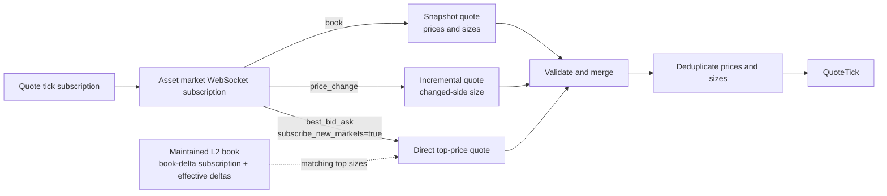

# Polymarket

Polymarket ก่อตั้งในปี 2020 เป็นแพลตฟอร์ม prediction market แบบกระจายศูนย์ (decentralized) ที่ trader คาดการณ์ผลลัพธ์
ของเหตุการณ์ต่าง ๆ ด้วยการซื้อขาย outcome token

NautilusTrader มี venue integration สำหรับ data และ execution ผ่าน Central Limit Order Book (CLOB) API ของ
Polymarket

adapter นี้ implement ด้วย Rust ทั้งการทำงานด้าน data, execution, signing และ WebSocket

adapter จัดการการเตรียมและ sign order สำหรับ wallet หลายรูปแบบ คู่มือนี้ครอบคลุม market data, trade execution,
การบริหาร session key และ position operation ของ Deposit Wallet

adapter รองรับตลาด Conditional Tokens Framework (CTF) ที่ใช้ market protocol `v1` ซึ่งแยกจาก CLOB service version `2`
และรูปแบบ order `CTFExchangeV2` ตลาดที่ใช้ protocol `v2`, ไม่มี version หรือมี version ที่ไม่รู้จัก จะไม่รองรับ แม้จะมี
`clobTokenIds` อยู่ก็ตาม instrument provider จะข้ามตลาดเหล่านี้ และ historical data loader จะปฏิเสธ ตลาดที่ไม่รองรับจะ
ไม่ถูก retry ระหว่าง[การรอ CLOB metadata](#markets-awaiting-clob-metadata) ดู
[Protocol V2 migration guide](https://docs.polymarket.com/migrate/polymarket-v2/api-integrations)

## การติดตั้ง {#installation}

Polymarket adapter อยู่ใน crate `nautilus-polymarket` (`crates/adapters/polymarket`) ไม่ต้องติดตั้งส่วนเสริมเฉพาะ
adapter เพิ่มเติม

สำหรับข้อกำหนดเบื้องต้นในการ build จาก source ดู[คู่มือการติดตั้ง](../getting_started/installation.md)

## ตัวอย่าง {#examples}

ตัวอย่างที่ได้รับการดูแลสำหรับ Rust อยู่ใน
[`crates/adapters/polymarket/examples`](https://github.com/nautechsystems/nautilus_trader/tree/develop/crates/adapters/polymarket/examples)
config ของ exec tester ใช้[close precision](#exec-tester-close-residuals) ที่จำเป็นสำหรับ market SELL order บน
Polymarket

## Binary option {#binary-options}

[binary option](https://en.wikipedia.org/wiki/Binary_option) คือสัญญา exotic option ทางการเงินประเภทหนึ่ง ที่ trader
เดิมพันผลลัพธ์ของข้อเสนอแบบใช่หรือไม่ใช่ (yes-or-no) หากคาดการณ์ถูก trader จะได้รับเงินจ่ายคงที่ หากผิดจะไม่ได้รับอะไรเลย
NautilusTrader แทน outcome token ของ Polymarket ด้วย instrument แบบ `BinaryOption`

Polymarket ใช้ [pUSD](#pusd) เป็น collateral token สำหรับการเทรด

## เอกสารของ Polymarket {#polymarket-documentation}

ใช้แหล่งข้อมูลของ Polymarket เหล่านี้:

- [Polymarket Learn](https://learn.polymarket.com/): คู่มือการใช้งานแพลตฟอร์มสำหรับผู้ใช้
- [Polymarket CLOB API](https://docs.polymarket.com/getting-started/api): เอกสารทางเทคนิคสำหรับนักพัฒนาที่ทำงานกับ
  Polymarket CLOB API

## ภาพรวม {#overview}

ใช้ component ของ Rust เหล่านี้ร่วมกันหรือแยกกันสำหรับ live market data และ trade execution:

- `PolymarketWebSocketClient`: การเชื่อมต่อ WebSocket API ระดับล่าง สร้างบน `WebSocketClient` ของ Nautilus Rust
- `PolymarketInstrumentProvider`: การ parse และโหลด instrument แบบ `BinaryOption`
- `PolymarketDataClient`: ตัวจัดการ market data feed
- `PolymarketExecutionClient`: gateway สำหรับ trade execution
- `PolymarketDataClientFactory`: factory สำหรับ Polymarket data client (ใช้โดย live node builder)
- `PolymarketExecutionClientFactory`: factory สำหรับ Polymarket execution client (ใช้โดย live node builder)
- `PolymarketPositionClient`: operation split, merge และ redeem ของ Deposit Wallet
- `PolymarketSessionKeyClient`: การอนุญาต, การแสดงรายการ และการเพิกถอน session ที่ดำเนินการโดยเจ้าของ

## pUSD {#pusd}

**pUSD** คือ collateral token ที่ใช้เทรดบน Polymarket เป็น ERC-20 token มาตรฐานบน Polygon ที่มี USDC หนุนหลัง

ที่อยู่ของ proxy contract คือ
[0xC011a7E12a19f7B1f670d46F03B03f3342E82DFB](https://polygonscan.com/address/0xC011a7E12a19f7B1f670d46F03B03f3342E82DFB)
บน Polygon การเติมเงินโดยตรงแบบ on-chain จะ wrap Polygon USDC.e (USDC ที่ bridge มา) เป็น pUSD
ผ่าน [CollateralOnramp](https://docs.polymarket.com/resources/contracts)
Bridge API ยังสามารถฝาก asset ที่รองรับจาก chain อื่นและเครดิตเป็น pUSD หลังการแปลงได้ด้วย

## Wallet และ account {#wallets-and-accounts}

หากต้องการเทรดบน Polymarket ผ่าน NautilusTrader ให้ใช้ wallet ที่รองรับ Polygon เช่น MetaMask

### Signature type {#signature-types}

Polymarket รองรับ signature type หลายแบบสำหรับการ sign และตรวจสอบ order:

| Signature type | ประเภท wallet                   | คำอธิบาย                                                                   | กรณีการใช้งาน                                                                                    |
| -------------- | ------------------------------ | ------------------------------------------------------------------------- | ---------------------------------------------------------------------------------------------- |
| `0`            | EOA (externally owned account) | signature มาตรฐาน EIP-712 จาก wallet ที่ควบคุม private key โดยตรง             | **ค่าเริ่มต้นของ adapter** การเทรดด้วย EOA ที่อยู่ใน allowlist โดย funder และ signer เป็น address เดียวกัน |
| `1`            | Proxy Wallet                   | smart contract wallet แบบเดิมที่สร้างผ่านการ login ด้วย email หรือ social           | ต้องใช้ address `funder` ของ Proxy Wallet                                                       |
| `2`            | Safe Wallet                    | Gnosis Safe wallet แบบเดิมที่สร้างด้วย browser wallet ภายนอก                   | ต้องใช้ address `funder` ของ Safe Wallet                                                        |
| `3`            | Deposit Wallet                 | ERC-1271 smart wallet ที่ใช้สำหรับ account wallet ใหม่ของ Polymarket            | ต้องใช้ `funder` ของ Deposit Wallet โดย API credential ยังผูกกับ signer                           |

:::info
Polymarket ใช้ Deposit Wallet สำหรับ account wallet ที่ deploy ตั้งแต่วันที่ 4 พฤษภาคม 2026 เป็นต้นไป การเทรดด้วย EOA
โดยตรงต้องใช้ EOA ที่อยู่ใน allowlist ดูประเภท account และขั้นตอนการตั้งค่าได้ใน
[wallet and authentication guide](https://docs.polymarket.com/trading/wallets-auth) ของ Polymarket
:::

NautilusTrader ใช้ signature type 0 (EOA) เป็นค่าเริ่มต้น ตั้งค่า `signature_type` เพื่อใช้ wallet ประเภทอื่นที่รองรับ
client ที่ใช้ proxy signature จะล้มเหลวตั้งแต่ตอนสร้าง เว้นแต่จะมี `funder` และ `funder` ต้องต่างจาก signing address

environment variable ให้ wallet address ได้เพียงหนึ่ง address ต่อ trader instance หากต้องการใช้หลาย wallet ให้ตั้งค่า
execution client instance แยกกัน

เติม pUSD เข้า wallet ก่อนส่ง order wallet ที่ไม่มีเงินจะได้รับ API error "not enough balance or allowance"

### การตั้ง allowance สำหรับ EOA {#setting-eoa-allowances}

adapter มีคำสั่งสำหรับตั้ง allowance แบบ on-chain โดยตรงสำหรับ account แบบ EOA ใช้เฉพาะเมื่อ funding wallet คือ signer
(`PolymarketSignatureType::Eoa`) เติม POL เข้า EOA สำหรับค่า gas ตั้งค่า `POLYMARKET_PK` แล้วรัน:

```bash
cargo run -p nautilus-polymarket --bin polymarket-set-allowances
```

คำสั่งนี้ให้ approval สูงสุดสำหรับ pUSD และ CTF แก่ CTF Exchange, Neg Risk CTF Exchange และ
`NegRiskCtfCollateralAdapter` โดยใช้ `https://polygon.drpc.org` เป็นค่าเริ่มต้น ตั้งค่า `POLYGON_RPC_URL` เพื่อใช้
Polygon RPC endpoint อื่น ให้รันอีกครั้งหาก Polymarket เปลี่ยน contract ที่จำเป็น

คำสั่งนี้ให้ approval เท่านั้น ไม่ได้เพิกถอน approval ของ contract ที่ไม่ได้เป็นเป้าหมายแล้ว ให้ถือว่าการเพิกถอนเป็น
operation on-chain แยกต่างหาก ก่อนส่ง ให้ยืนยันว่าไม่มี flow ด้าน redemption หรือ settlement ที่เหลืออยู่ซึ่งยังต้องใช้
approval เดิม

### การตั้ง allowance สำหรับ smart wallet {#setting-smart-wallet-allowances}

อย่ารันคำสั่งสำหรับ EOA กับ funder ที่เป็น proxy, Safe หรือ Deposit Wallet เพราะคำสั่งนี้ sign transaction ด้วย key
ของ EOA และไม่สามารถให้ approval จาก smart contract wallet ได้

ใช้ [wallet and authentication flow](https://docs.polymarket.com/trading/wallets-auth) ของ Polymarket เพื่อส่ง
approval จาก account wallet approval ของ Deposit Wallet ใช้ batch `WALLET` แบบเรียงลำดับที่ signer อนุญาตและส่งผ่าน
Relayer ส่วน approval ของ Safe และ Proxy Wallet ต้องใช้ SDK payload เฉพาะของ wallet นั้น

### การ refresh และตรวจสอบ allowance {#refreshing-and-verifying-allowances}

หลังจาก approval transaction ได้รับการยืนยันแล้ว ให้ refresh CLOB cache ผู้เรียกจาก Rust ใช้
`PolymarketClobHttpClient::update_balance_allowance` กับ `AssetType::Collateral` สำหรับ pUSD ได้ ใช้
`AssetType::Conditional` พร้อม conditional token ID สำหรับ allowance ของ conditional token ทั้งสองแบบต้องระบุ
signature type ของ account ด้วย request ที่ผ่านการยืนยันตัวตนนี้จะ map ไปยัง `GET /balance-allowance/update`
ใช้ `PolymarketSignatureType::Poly1271` สำหรับ Deposit Wallet

endpoint balance-allowance มี decoding path สองแบบ:

| Path                                              | ใช้สำหรับ                                              | การจัดการ allowance                                                                                                                                                            | ความหมายเมื่อสำเร็จ                                                                     |
| ------------------------------------------------- | ---------------------------------------------------- | ------------------------------------------------------------------------------------------------------------------------------------------------------------------------------ | ---------------------------------------------------------------------------------- |
| `PolymarketClobHttpClient::get_balance_allowance` | อ่านหลักฐาน allowance ของ spender                      | ต้องมี map `allowances` แบบพหูพจน์ และปฏิเสธเมื่อไม่มี map, มีค่าเอกพจน์แบบเดิมที่ไม่เป็น null, key ผิดรูปแบบหรือไม่ canonical และรายการซ้ำเชิงความหมาย เช่น ต่างกันแค่ตัวพิมพ์เล็กใหญ่ | balance พร้อม map ที่ไม่กำกวม แต่ยังต้องตรวจสอบเป้าหมายและจำนวนที่จำเป็น                         |
| projection ภายในแบบ balance-only                  | refresh account state และปรับค่า fee ของ market-buy   | ไม่สนใจฟิลด์ allowance และ return type ไม่สามารถเปิดเผยหรือให้อำนาจ approval ได้                                                                                                   | balance เท่านั้น approval ของ CLOB spender ที่จำเป็นยังไม่ได้รับการพิสูจน์                          |

ให้ใช้ path แบบเข้มงวดทุกครั้งที่การตัดสินใจขึ้นกับหลักฐาน allowance เพื่อไม่ให้ข้อมูลที่กำกวมจาก wire กลายเป็นอำนาจ
approval

### Account balance {#account-balances}

#### การคำนวณ balance {#balance-calculation}

การ refresh balance ใช้ยอดรวม pUSD ที่ venue รายงาน และคำนวณ locked collateral จาก local state ของ execution client:

- การสำรองของ BUY order ที่เปิดอยู่ของ account นั้น โดยใช้ limit price ที่ cache ไว้และ quantity ที่เหลือ
- notional และ commission ของ BUY fill ของ account นั้น ที่ยอดรวมของ venue อาจยังรวมอยู่

การสำรองไม่รวม order ที่ส่งแล้วแต่ยังรอการ accept และ order ที่ไม่มีใน execution cache SELL order สำรอง outcome token
แทน pUSD จึงไม่นับรวมใน locked collateral

**BUY spend ที่ยังไม่ settle**: การ refresh ครั้งถัดไปหลังจากทราบ BUY fill จะหัก notional บวก commission ของ fill นั้น
ออกจาก free balance และยังหัก BUY spend อื่นที่ยังไม่ settle ซึ่งวัดเทียบกับ snapshot เดียวกันออกด้วย

ยอดเหล่านี้จะถูกปลดล็อกพร้อมกันเมื่อยอดรวมของ venue ลดลงอย่างน้อยเท่ากับยอดรวมทั้งหมดนั้นนับจาก snapshot ดังกล่าว
ดังนั้นยอดรวมที่ถูกหักไปแล้วจะไม่ถูกหักซ้ำ จนกว่าจะถึงตอนนั้น spend ที่ยังไม่ settle ที่ถูกล็อกจะเป็นเพียงส่วนของ open
spend ที่การลดลงยังไม่ครอบคลุม การ refresh ที่ยอดรวมของ venue ไม่เปลี่ยนจะคงการล็อก open spend ไว้

**Void**: void จะลบ spend ของ fill นั้นออกจาก locked collateral ทันที revision ของ void ครั้งหลังเป็นแบบสะสม จึงลบเฉพาะ
ส่วนที่เพิ่มขึ้น ยอดที่ถูก void ยังนับรวมในการลดลงที่จำเป็นต่อการปลดล็อก open spend อื่น void ของ fill ที่ไม่เคยถูกล็อก
จะไม่เพิ่มเกณฑ์นั้น เมื่อไม่เหลือ open spend แล้ว การ refresh ครั้งถัดไปจะปลดยอดที่ถูก void และขยับ snapshot

adapter จะไม่ล็อก BUY fill เหล่านี้:

- fill ที่ถูกนำไปใช้ครั้งแรกจากหลักฐาน REST แบบ terminal รวมถึง fill report ที่ยืนยันแล้ว เพราะหลักฐานนั้นจะถูกรับเข้ามา
  หลังจาก trade ได้รับการยืนยันแล้วเท่านั้น
- fill ที่ reconcile แล้วซึ่งเก่ากว่า snapshot เกิน 15 วินาที หรือได้รับมาก่อนจะมี snapshot ใด ๆ

locked collateral ถูกจำกัดไว้ไม่เกินยอดรวมที่รายงาน โดย free balance เท่ากับยอดรวมลบ locked ตาม
[balance model](../concepts/accounting.md#balance-model)

#### จังหวะการ refresh {#refresh-timing}

adapter ตั้งค่าเริ่มต้นของการสำรองจาก execution cache ตอน connect และอัปเดตการสำรองกับ BUY spend ที่ยังไม่ settle
ขณะที่ core ประมวลผล order event รวมถึง event ที่ reconcile แล้ว การ reconnect ของ transport จะคง BUY spend ที่ยังไม่
settle ไว้ ส่วนการ reset จะล้างทิ้ง การ refresh balance ครั้งแรกเกิดก่อน startup reconciliation order ที่พบระหว่าง
reconciliation จะมีผลต่อ balance ในการ refresh ครั้งถัดไป

การ refresh เกิดขึ้นตอน connect, เมื่อมีการ query account, หลัง trade update ที่ finalize แล้ว และเมื่อ user WebSocket
reconnect balance response ที่มาถึงหลังจากมีการ refresh ที่ใหม่กว่า, หลัง execution client reconnect หรือหลัง client
reset จะไม่ถูกนำไปใช้ การ reconnect ของ user WebSocket ไม่ได้ทิ้งการ refresh ที่กำลังดำเนินอยู่ แต่การ refresh ที่ใหม่กว่า
ยังคงชนะ account balance ไม่เปลี่ยนในทุก order event และการ refresh balance ไม่ได้ request open order

:::warning
**balance เหล่านี้เป็นค่าประมาณ** HTTP balance response และ order event อาจสะท้อนจุดเวลาที่ต่างกัน และไม่ได้รับประกันว่า
เงินจะถูกสำรองไว้ก่อนการส่ง order

ผลกระทบด้านจังหวะเวลารวมถึง:

- เครดิต collateral ซึ่งรวมถึง settlement ของ SELL ของตัวเอง อาจทำให้ BUY spend ที่ยังไม่ settle ถูกล็อกค้างไว้ หลังจาก
  ยอดรวมของ venue สะท้อนการหักไปแล้ว การล็อกนั้นจำกัดไว้ที่ยอดที่การลดลงยังไม่ครอบคลุม
- การหักเงินที่ไม่เกี่ยวข้องอาจปลดล็อก spend นั้นก่อนที่ fill จะถูกหักจริง
- void ที่ยอดไม่เคยออกจากยอดรวมของ venue อาจทำให้ส่วนขาดที่ยังไม่ครอบคลุมนั้นถูกล็อกค้างไว้ ขณะที่ spend อื่นที่ยังไม่
  settle ยังเปิดอยู่
- การยืนยันที่ยังอยู่ใน drain window อาจรายงาน BUY spend จาก REST แบบ terminal ว่าเป็นเงินว่างจนกว่าจะมีการ refresh
  ครั้งถัดไป
- การ refresh ที่ถูกนำไปใช้ก่อนที่ fill ที่อยู่ในคิวจะถูกประมวลผล อาจทำให้ fill นั้นถูกล็อกค้างไว้หลังจากยอดรวมถูกหักไปแล้ว

adapter ไม่ได้ล็อก matched spend จาก client อื่นที่ใช้ funder เดียวกัน หรือจาก fill ที่ยังไม่ได้รับ
:::

## API key {#api-keys}

### CLOB credential {#clob-credentials}

execution client ต้องใช้ CLOB L2 credential สร้างหรือ derive ได้ด้วย
[API authentication flow](https://docs.polymarket.com/getting-started/api#authentication) ของ Polymarket
adapter มีคำสั่งที่อ่าน `POLYMARKET_PK` และพิมพ์ credential ที่สร้างหรือ derive ได้ออกมา:

```bash
cargo run -p nautilus-polymarket --bin polymarket-create-api-key
```

ตั้งค่าที่ได้เป็น:

- `POLYMARKET_API_KEY`
- `POLYMARKET_API_SECRET`
- `POLYMARKET_PASSPHRASE`

credential เหล่านี้ยืนยันตัวตนของ signer ที่ถือ private key ไม่ใช่ funder ที่เป็น proxy หรือ Deposit Wallet data client
ต้องใช้ credential เหล่านี้เฉพาะสำหรับ [PolyBolt reference-price subscription](#polybolt-reference-prices)

### Relayer credential {#relayer-credentials}

operation split, merge และ redeem ของ Deposit Wallet ต้องใช้ Relayer API key ด้วย สร้างได้ที่
Settings > API Keys > Relayer API Keys ตามที่อธิบายไว้ใน
[Connect your account](https://docs.polymarket.com/trading/wallets-auth#connect-your-account) แล้วตั้งค่า:

- `POLYMARKET_RELAYER_API_KEY`
- `POLYMARKET_RELAYER_SIGNER_ADDRESS`

`POLYMARKET_RELAYER_SIGNER_ADDRESS` คือ signer address ที่แสดงตอนสร้าง Relayer key
position client ยังอ่าน `POLYMARKET_PK` และ `POLYMARKET_FUNDER` ด้วย

### Builder credential {#builder-credentials}

การอนุญาตและเพิกถอน session ต้องใช้ Builder credential ที่ได้รับอนุมัติสำหรับ session-key API ซึ่งแยกจาก Relayer API key
ที่ใช้กับ position operation ทำตาม [session-key requirements](https://docs.polymarket.com/trading/session-keys)
ของ Polymarket และเก็บค่าเหล่านี้ไว้ใน administration environment ของเจ้าของ:

- `POLYMARKET_BUILDER_API_KEY`
- `POLYMARKET_BUILDER_API_SECRET`
- `POLYMARKET_BUILDER_PASSPHRASE`

### การตรวจสอบ Deposit Wallet {#deposit-wallet-verification}

การสร้าง client จะล้มเหลวเมื่อ funder เท่ากับ signing address ก่อนการ sign position client จะ:

- ตรวจสอบ Deposit Wallet address ทั้งแบบปัจจุบันและแบบเดิมที่ทำนายได้จาก canonical Polygon factory
- กำหนดให้ต้องมี wallet code ที่ deploy แล้ว และตรวจสอบว่า signer เป็นเจ้าของ wallet
- อ่าน signed nonce จาก counter on-chain ของ wallet

Polygon RPC มีค่าเริ่มต้นเป็น `https://polygon.drpc.org` ส่ง `base_url_rpc` ให้ constructor ของ
`PolymarketPositionClient` เพื่อใช้ Polygon endpoint อื่นที่เชื่อถือได้

## Session key {#session-keys}

session key ช่วยให้ signer อีกตัวเทรดแทน Deposit Wallet ได้ โดยไม่ต้องให้ private key ของเจ้าของแก่ trading runtime
adapter รองรับการอนุญาตในขอบเขต CLOB ดูคุณสมบัติที่ venue กำหนดและข้อกำหนดการอนุมัติของ Builder ได้ใน
[session-key documentation](https://docs.polymarket.com/trading/session-keys) ของ Polymarket

### การบริหารสิทธิ์การเข้าถึง {#administer-access}

รัน `PolymarketSessionKeyClient` ใน **administration environment ของเจ้าของ** โดยใช้ administration process เพียง
process เดียวต่อหนึ่ง wallet ก่อนอนุญาต session:

- ระบุ private key ของเจ้าของ, CLOB credential ของเจ้าของ, Builder credential และ Deposit Wallet address อย่างชัดเจน
  client ไม่อ่าน environment variable เอง
- สร้างและเก็บ session keypair แยกไว้อย่างปลอดภัย ส่งเฉพาะ public address ของมันให้ method สำหรับการอนุญาต

config เสริม:

- `base_url_http` override CLOB endpoint ของ production
- `base_url_relayer` override Relayer endpoint ของ production
- `proxy_url` ตั้งค่า HTTP หรือ HTTPS proxy สำหรับ client ทั้งสอง

ตัวอย่าง Rust มี operation สำหรับการอนุญาตและการแสดงรายการ:

```bash
cargo run -p nautilus-polymarket --example polymarket-session-keys -- authorize "$SESSION_ADDRESS"
cargo run -p nautilus-polymarket --example polymarket-session-keys -- list
```

แต่ละ administration method มีเงื่อนไขการเสร็จสิ้นเฉพาะ:

| Method                  | การคืนค่าสำเร็จต้องอาศัย                                                             |
| ----------------------- | ------------------------------------------------------------------------------- |
| `authorize_session_key` | การยืนยันแบบ on-chain และ registry ตรงกับ address, CLOB scope และวันหมดอายุ             |
| `list_session_keys`     | รายการใน registry ที่ active, ยังไม่หมดอายุ และผ่านการตรวจสอบแล้ว                        |
| `revoke_session_key`    | การยืนยันแบบ on-chain และ key ไม่อยู่ใน registry ที่ active แล้ว                         |

#### การหมดอายุ {#expiration}

การอนุญาตจะหมดอายุหลังจาก 4,315 ชั่วโมง ตรงกับค่าบน wire ของ SDK ทางการ Polymarket อธิบายช่วงเวลานี้ว่า 180 วัน
แต่ตัวอย่างดิบและ SDK ของ Polymarket ใช้ค่าที่สั้นกว่าห้าชั่วโมง ค่า `valid_until` ที่คืนมาคือเวลาหมดอายุที่แน่นอน
ในหน่วย Unix seconds

#### การกู้คืน operation ที่ถูกขัดจังหวะ {#recover-an-interrupted-operation}

หลังจากการอนุญาตหรือการเพิกถอน timeout, เจอ transport failure หรือถูกยกเลิก ให้ retry ด้วย **operation เดียวกัน,
address เดียวกัน และ client เดียวกัน** client จะเก็บ signed request และ idempotency key ไว้ และปฏิเสธ mutation อื่น
จนกว่า operation ที่ค้างอยู่จะได้ข้อยุติ

ให้ client ทำงานอยู่จนกว่า operation จะได้ข้อยุติ เพราะ request ที่ค้างอยู่ถูกเก็บไว้ในหน่วยความจำ error แบบ
unresolved-outcome จะมี idempotency key และ transaction ID ที่ทราบ (ถ้ามี) สำหรับการวินิจฉัย

:::warning
signed batch มี **deadline 600 วินาที** หาก request ที่ยังไม่ถูก accept หมดอายุ การ retry จะไม่สามารถสร้าง batch
ใหม่ได้และ client จะยังถูก block อยู่ ให้ reconcile registry และผลลัพธ์จาก Relayer ก่อนสร้าง client ใหม่ หลังจาก
process restart ก็ต้อง reconcile แบบเดียวกัน
:::

### การตั้งค่าการเทรดแบบ session {#configure-session-trading}

สร้างหรือ derive CLOB credential ด้วย **session private key** โดยใช้
[CLOB credential workflow](#clob-credentials) ที่มีอยู่ session mode ต้องการ:

- session credential และ `funder` ที่ระบุอย่างชัดเจน โดยจะไม่ fallback ไปใช้ owner credential จาก environment
- `PolymarketSignatureType.Poly1271` signature type ของ wallet แบบอื่นจะถูกปฏิเสธ

:::info
เก็บ owner credential และ Builder credential ไว้นอก trading runtime
:::

> หมายเหตุ: ต้นฉบับมีเฉพาะตัวอย่าง Python จึงตัดออก

config ที่มีอยู่เดิมมีค่าเริ่มต้นเป็น `PolymarketSignerType.Owner`

#### Reconciliation และการ restart {#reconciliation-and-restarts}

order, trade และ notification ถูกจำกัดขอบเขตไว้ที่กิจกรรมของ session นั้น reconciliation ต้องให้ session API key ตรงกับ
ความเป็นเจ้าของ order การใช้ wallet address ร่วมกันเพียงอย่างเดียวไม่ได้ยืนยันความเป็นเจ้าของ

cancel-all ของ session จะยกเลิกตาม order ID ที่รู้จัก แทนที่จะใช้การยกเลิกตลาดทั้ง wallet mass status มี order และ
fill ของ session แต่ไม่มี position ทั้ง wallet การ query position โดยตรงจะคืน error เพราะสินทรัพย์ที่ wallet ถืออยู่ไม่
สามารถบอก position ของ session ได้

ตั้งค่า node ให้สอดคล้อง:

- **Position check**: ตั้ง `LiveExecutionEngineConfig.position_check_interval_secs=None` เพื่อปิด position check
  แบบเป็นรอบของ node
- **ประวัติข้าม restart**: ตั้งค่า [cache database persistence](../concepts/cache.md#database-configuration)
  และคง `load_cache=True` ไว้เพื่อเก็บประวัติ order และ fill

### การเพิกถอนหรือหมุนเวียนสิทธิ์ {#revoke-or-rotate-access}

หมุนเวียน key จาก administration environment ประสานงานเรื่อง order ที่ค้างอยู่และ reconciliation ก่อนเปลี่ยน
credential: **session ใหม่จะไม่ได้รับการมองเห็น order ของ session เก่า**

หากต้องการเพิกถอน key ให้รันตัวอย่าง Rust:

```bash
cargo run -p nautilus-polymarket --example polymarket-session-keys -- revoke "$SESSION_ADDRESS"
```

:::warning
สิทธิ์ที่หมดอายุหรือถูกเพิกถอนจะทำให้ venue ปฏิเสธ การมี transport connection ที่ยังทำงานอยู่ไม่ได้พิสูจน์ว่าการอนุญาต
ยัง active อยู่
:::

## Position operation {#position-operations}

`PolymarketPositionClient` split pUSD เป็นชุด outcome token ที่ครบชุด, merge ชุดที่ครบกลับเป็น pUSD และ redeem position
ที่ได้ผลลัพธ์แล้ว client รองรับเฉพาะ Deposit Wallet (`PolymarketSignatureType::Poly1271`) ไม่มี path สำหรับ Safe,
Proxy และ EOA client ไม่ deploy wallet, ไม่รวม call ที่ไม่เกี่ยวข้องเป็น batch, ไม่กำหนดขนาด merge เป็น `"max"` และไม่
redeem position อัตโนมัติ

### Input และ approval {#inputs-and-approvals}

แต่ละ operation จะค้นหาตลาดบน public CLOB ด้วย condition ID และกำหนดให้ต้องเป็น market protocol `v1` และมีค่า
`neg_risk` ก่อนจะ encode calldata จากนั้นจึงเลือก pUSD token แบบ canonical และ collateral adapter แบบมาตรฐานหรือ
negative-risk ผู้เรียกส่ง condition ID ขนาด 32 byte ที่ขึ้นต้นด้วย 0x และไม่ต้องระบุ contract address

- **จำนวนสำหรับ split และ merge**: ทศนิยม pUSD ที่เป็นบวกและแสดงได้พอดีที่ทศนิยมหกตำแหน่ง โดยไม่มีการปัดเศษ
  จำนวนใช้หน่วย pUSD ไม่ใช่ base unit และไม่รับ `"max"`
- **Redemption**: ไม่มี argument จำนวน redeem binary index set ทั้ง `[1, 2]`

**approval จะไม่ถูกส่งอัตโนมัติ** ให้ grant จาก Deposit Wallet ก่อนส่ง:

| Operation       | approval ที่จำเป็นสำหรับ collateral adapter ของตลาด      |
| --------------- | ----------------------------------------------------- |
| Split           | ใช้จ่าย pUSD ของ wallet                                |
| Merge หรือ redeem | ทำหน้าที่เป็น Conditional Tokens operator               |

collateral adapter แบบมาตรฐานไม่อยู่ใน approval plan ของ `polymarket-set-allowances` แต่ negative-risk adapter อยู่
คำสั่งนั้น sign approval จาก EOA จึงไม่สามารถ grant approval ใดได้สำหรับ Deposit Wallet ใช้
[wallet and authentication flow](https://docs.polymarket.com/trading/wallets-auth) ของ Polymarket เพื่อ grant
approval สำหรับ position operation จาก Deposit Wallet

### Submit และรอผล {#submit-and-wait}

> หมายเหตุ: ต้นฉบับมีเฉพาะตัวอย่าง Python จึงตัดออก

`split_position` และ `merge_positions` รับ condition ID และ `Decimal` ของ pUSD ที่เป็นบวก ส่วน `redeem_positions` รับ
เฉพาะ condition ID แต่ละ method คืน `PolymarketPositionTransaction` หลังจากส่งไปยัง Relayer แล้ว เรียก `wait()` หนึ่งครั้ง
เพื่อ poll จนกว่าจะได้ `PolymarketPositionOutcome` handle จะเก็บ `transaction_id` ไว้หลังเริ่มรอ รวมถึงหลังการยกเลิก
หรือเกิด error

### Outcome และ error {#outcomes-and-errors}

| `PolymarketPositionOutcome.status` | ความหมาย                             |
| ---------------------------------- | ----------------------------------- |
| `confirmed`                        | Relayer รายงาน `STATE_CONFIRMED`     |
| `failed`                           | Relayer รายงาน `STATE_FAILED`        |
| `invalid`                          | Relayer รายงาน `STATE_INVALID`       |

ทุก outcome มี `transaction_id` outcome แบบ confirmed และ failed มี `transaction_hash` เมื่อ Relayer ส่งมา outcome แบบ
invalid จะคืน `None` เสมอ outcome แบบ failed และ invalid ยังมี `error_msg` เมื่อ Relayer ส่งมาด้วย

#### Submit error {#submit-errors}

HTTP rejection จะเกิด error ก่อนที่จะมี transaction handle submit ที่ timeout หรือ response สำเร็จที่ไม่มี
`transaction_id` ก็จะเกิด error เช่นกัน และผลลัพธ์ on-chain จะไม่ทราบ

client **ไม่ retry การ submit**

#### Wait timeout {#wait-timeout}

ค่าเริ่มต้นคือ 120 วินาที ตรวจสอบระหว่าง polling request แต่ละครั้ง request ที่กำลังดำเนินอยู่หรือ polling delay อาจทำให้
เวลาที่ผ่านไปยาวกว่านั้น timeout จะเกิด error ที่ระบุ Relayer transaction ID และสถานะ terminal จะยังไม่ทราบ ใน Rust
สามารถปรับ wait timeout และ poll interval ได้ผ่าน setter

#### การตรวจสอบ response {#response-validation}

Relayer redirect จะถูกปฏิเสธ และการ poll จะปฏิเสธ response ที่มี transaction ID ต่างจาก ID ที่ส่งไป

### การประสานงานการ submit {#submission-coordination}

client ใน process เดียวกันใช้ submission state ร่วมกันสำหรับแต่ละ wallet operation ถัดไปต้องอาศัยผลลัพธ์ terminal จาก
Relayer ที่ตรงกันและ wallet nonce ที่เลื่อนไปแล้ว operation ที่ failed หรือ invalid ซึ่งไม่ได้เลื่อน nonce จะยังถูก block

หลังจาก sign แล้ว client จะบันทึก reservation ก่อนส่ง batch จากนั้น HTTP rejection, timeout, การยกเลิก หรือ response
ที่ไม่มี transaction ID จะ block operation ต่อไปของ wallet นั้น แม้จะสร้าง client ใหม่ก็ตาม ความล้มเหลวก่อนจะมี
reservation เช่น จำนวนไม่ถูกต้องหรือการตรวจสอบ wallet ล้มเหลว จะไม่สร้าง block ใหม่ HTTP status เพียงอย่างเดียวไม่ได้
พิสูจน์ว่า signed batch จะ execute ไม่ได้

:::warning
อย่า restart แล้ว retry การ submit ที่ไม่ทราบผลแบบไม่ไตร่ตรอง process restart จะล้าง submission state ภายในเครื่อง แต่ไม่ได้
ยกเลิก signed transaction ให้ใช้ process ที่ submit เพียง process เดียวต่อ wallet การประสานงานนี้ไม่ครอบคลุมข้าม process
หรือเครื่องมือ wallet ภายนอก
:::

### การกู้คืน submission ที่ไม่ทราบผล {#recover-an-unknown-submission}

#### เก็บ submission record {#retain-the-submission-record}

เปิดและเก็บ INFO log ไว้ก่อน submit position operation ก่อนทุก submit request client จะ emit record
`Deposit Wallet submission` ที่มี:

- wallet address, nonce ที่สำรองไว้ และ signed deadline (Unix seconds)
- operation, contract เป้าหมาย และ value
- unsigned calldata ที่ระบุ condition และจำนวน (สำหรับ split หรือ merge)

record ไม่มี signature และ credential แต่มีเจตนาในการเทรด ให้จำกัดการเข้าถึง log ที่เก็บไว้ และเก็บ transaction ID จาก
handle ที่คืนมาไว้เมื่อมี

:::warning
logging ไม่ใช่ transaction journal ที่ทนทาน การปิด logging หรือ process crash อาจทำให้ไม่มี record เหลืออยู่ ทำให้ไม่
สามารถกู้คืนได้อย่างปลอดภัยหากไม่มีหลักฐานอื่น
:::

#### Reconcile ก่อน retry {#reconcile-before-retrying}

1. **หยุดการ submit** รวมถึง process อื่นและเครื่องมือ wallet ภายนอกที่ใช้ wallet นั้น
1. **ยืนยันว่า operation execute แล้วหรือไม่** หา submission record และ Relayer transaction ID (ถ้ามี) จับคู่ wallet,
   เป้าหมาย และ calldata ที่ตั้งใจไว้กับ transaction receipt และผลลัพธ์ on-chain ที่ finalize แล้ว HTTP response ที่สำเร็จ,
   Relayer failure หรือ nonce ที่เลื่อนไปเพียงอย่างเดียว ไม่ได้ยืนยันว่า operation ที่ตั้งใจ execute หรือไม่ หาก execute
   แล้ว อย่าทำซ้ำ
1. **block wallet ไว้ตราบที่ยังไม่ทราบผลการ execute** หากต้องการ reconcile ด้วยการหมดอายุ ให้ทำ
   [expiry check](#expiry-checks) ทั้งหมดด้านล่าง หาก nonce เลื่อนไปแล้ว ให้ตรวจสอบ transaction ที่ใช้ nonce นั้นแทนการ
   สันนิษฐานว่าล้มเหลว
1. **พิสูจน์ว่าการ retry ปลอดภัยก่อน restart** ยืนยันว่า operation ที่ตั้งใจไม่ได้ execute และยืนยันว่า signed batch
   เดิมไม่สามารถ execute ได้อีกแล้ว หาก record หายไป, RPC ไม่สามารถให้ state ที่ finalize แล้วอย่างสม่ำเสมอ หรือยังไม่ได้
   ตรวจสอบพฤติกรรมของ contract ให้แก้ความไม่แน่นอนนั้นกับ Polymarket ก่อน retry

#### Expiry check {#expiry-checks}

signed deadline มีค่าเริ่มต้นเป็น 1,800 วินาทีหลังการ sign ผู้เรียกจาก Rust เปลี่ยนค่านี้ได้ด้วย `with_deadline_secs`
deadline ที่ยาวขึ้นจะทำให้การกู้คืนด้วยการหมดอายุช้าลง timeout ของ `wait()` ไม่ได้ทำให้ signed deadline สั้นลงหรือยกเลิก
batch

ขั้นแรกให้ตรวจสอบว่า wallet contract ที่ deploy แล้วบังคับใช้ signed deadline และใช้ nonce เมื่อ batch execute จากนั้นอ่าน
`nonce()` ของ wallet ด้วย `eth_call` ณ Polygon block ที่ finalize แล้ว และดึง timestamp ของ block เดียวกันนั้น ต้องเป็น
จริงทั้งสองข้อ:

- nonce ไม่เปลี่ยนจาก nonce ที่สำรองไว้
- block timestamp อยู่หลัง signed deadline อย่างเคร่งครัด

เวลาที่ผ่านไปในเครื่องไม่เพียงพอ nonce ที่เลื่อนไปแล้วต้องตรวจสอบ transaction ที่ใช้ nonce นั้น และไม่ได้ยืนยันว่าล้มเหลว

client ไม่ได้ทำ recovery check เหล่านี้หรือปลด reservation ให้อัตโนมัติ ดู
[Polymarket contract registry](https://docs.polymarket.com/resources/contracts) เมื่อต้องการระบุ contract ที่ deploy
แล้ว และ [JSON-RPC reference](https://ethereum.org/en/developers/docs/apis/json-rpc/) สำหรับ call ที่ระบุ block

## Configuration {#configuration}

ตั้งค่าการ sign และการยืนยันตัวตนผ่าน parameter เหล่านี้ หรือ environment variable ที่ใช้เป็น fallback:

| Parameter     | Environment variable    | วัตถุประสงค์                                                    |
| ------------- | ----------------------- | ------------------------------------------------------------ |
| `private_key` | `POLYMARKET_PK`         | wallet key ที่ใช้ sign order ตาม `signature_type`              |
| `funder`      | `POLYMARKET_FUNDER`     | address ของ wallet ที่ใช้เติม pUSD                               |
| `api_key`     | `POLYMARKET_API_KEY`    | CLOB L2 API key                                              |
| `api_secret`  | `POLYMARKET_API_SECRET` | CLOB L2 API secret                                           |
| `passphrase`  | `POLYMARKET_PASSPHRASE` | CLOB L2 API passphrase                                       |

ใน owner mode เมื่อไม่ได้ระบุ parameter อย่างชัดเจน client จะอ่านจาก environment variable ที่เกี่ยวข้อง session mode ต้องใช้
credential และ funder ที่ระบุอย่างชัดเจน CLOB L2 credential ยืนยันตัวตนของ signer ที่ถือ private key สำหรับ `POLY_1271`
Deposit Wallet ยังคงเป็น `funder` และไม่ใช่ address ที่ใช้ยืนยันตัวตน L2

:::tip
ใช้ environment variable เพื่อส่ง credential โดยไม่ต้องฝังไว้ใน code ที่ตั้งค่า client
:::

การโหลด instrument ยังมีตัวควบคุมที่ใช้บ่อยอีกสองตัว:

- `auto_load_missing_instruments` (ค่าเริ่มต้น `True`): command สำหรับ subscribe และ request ของ instrument ที่ไม่อยู่ใน
  cache จะกระตุ้นการโหลด Gamma API แบบ ad-hoc เมื่อปิดไว้ การ subscribe instrument ที่ไม่อยู่ใน cache จะคืน error ดู
  [Runtime instrument loading](#runtime-instrument-loading)
- `auto_load_debounce_ms` (ค่าเริ่มต้น `100`): window เป็นมิลลิวินาทีสำหรับรวม auto-load request ที่เกิดพร้อมกันเป็น
  Gamma call แบบ batch ครั้งเดียว

## ความสามารถด้าน data {#data-capability}

Polymarket รองรับ live order book delta แบบ `L2_MBP`, quote, trade และ event `InstrumentStatus`/`InstrumentClose` ที่
เกี่ยวกับการ resolve ตลาด instrument definition จะถูก publish จาก bootstrap, การ refresh ที่ตั้งค่าไว้, การโหลดตามต้องการ,
request ของ instrument เดี่ยว, การค้นพบตลาดใหม่ และการเปลี่ยน tick size

data hook ที่ implement แล้วรับรายการ instrument ที่เข้ากันได้สำหรับ subscribe และ unsubscribe:

- operation ด้าน intent และ reconcile ทำงานทีละ member
- ID ที่ไม่อยู่ใน cache จะเข้าสู่ Gamma loader แบบ debounce
- WebSocket pool ส่งทีละ token การส่งเป็นรายการไม่ได้ลดจำนวน message ไปยัง venue

## ความสามารถด้าน order {#orders-capability}

Polymarket รองรับ order type และ instruction ด้านล่าง

:::tip
สำหรับ live execution บน Polymarket ให้ตั้งทั้ง disconnection timeout และ post-stop delay เป็น 30 วินาที ด้วย
`with_timeout_disconnection_secs(30)` และ `with_delay_post_stop_secs(30)` delay นี้ทำให้ order event และ cancellation
event ที่ค้างอยู่มาถึงก่อนการ disconnect การ disconnect ของ execution จะเสร็จภายใน timeout นั้น และไม่รอ HTTP timeout
ของ command ที่กำลังดำเนินอยู่
:::

cancel ที่ยังดำเนินอยู่ตอน disconnect เสร็จสิ้น จะทิ้ง order ไว้ในสถานะ `PENDING_CANCEL` adapter จะไม่ emit ทั้ง
`OrderCanceled` และ `OrderCancelRejected` venue อาจนำ cancel ไปใช้แล้วหรือไม่ก็ได้ startup reconciliation ในรอบการรัน
ถัดไปจะแก้ไขสถานะนี้ แต่ cancel จาก strategy จะแก้ไม่ได้ เพราะ order อยู่ในสถานะ pending cancel อยู่แล้ว command
submit และ modify อื่นที่กำลังดำเนินอยู่จะหยุดที่ขอบเขตเดียวกัน และ command ที่ยังไม่ได้รับการยืนยันจะยังไม่ได้ข้อยุติ

### Order type {#order-types}

| Order type             | Binary options | หมายเหตุ                                                                    |
| ---------------------- | -------------- | ------------------------------------------------------------------------- |
| `MARKET`               | ✓              | **BUY order ต้องใช้ quote quantity** ส่วน SELL order ต้องใช้ base quantity     |
| `LIMIT`                | ✓              | BUY order รับได้ทั้ง base และ quote quantity ส่วน SELL order ต้องใช้ base       |
| `STOP_MARKET`          | -              | *Polymarket ไม่รองรับ*                                                     |
| `STOP_LIMIT`           | -              | *Polymarket ไม่รองรับ*                                                     |
| `MARKET_IF_TOUCHED`    | -              | *Polymarket ไม่รองรับ*                                                     |
| `LIMIT_IF_TOUCHED`     | -              | *Polymarket ไม่รองรับ*                                                     |
| `TRAILING_STOP_MARKET` | -              | *Polymarket ไม่รองรับ*                                                     |

### ความหมายของ quantity {#quantity-semantics}

Polymarket ตีความ quantity ของ order ต่างกันตาม order type, ฝั่ง และค่า `quote_quantity`:

- **Limit order ที่ `quote_quantity=False`** ตีความ `quantity` เป็นจำนวน conditional token (base unit)
- **Limit BUY order ที่ `quote_quantity=True`** ตีความ `quantity` เป็น collateral แบบ pUSD
- **Market BUY** order ตีความ `quantity` เป็น quote notional ในหน่วย **pUSD**
- **Market SELL** order ใช้ quantity แบบ base unit

ไม่รองรับ limit SELL order ที่กำหนดขนาดด้วย quote adapter จะปฏิเสธก่อนการส่ง และยังปฏิเสธ limit order ใด ๆ ที่ base หรือ
quote quantity ถูกตัดเหลือศูนย์ที่ขอบเขตการ sign แบบทศนิยมสองตำแหน่ง

#### ตัวอย่าง Limit BUY {#limit-buy-example}

สำหรับ limit BUY order ที่ `quote_quantity=True`:

- adapter ตัด collateral ให้เหลือหน่วยเซนต์ sign เป็น maker amount และคำนวณจำนวน share ตาม amount precision ของตลาด
- adapter อัปเดต local order เป็น share quantity ที่ sign แล้ว ก่อนประมวลผล response จาก venue
- amount ที่ sign แล้วต้องรักษา limit price ไว้ได้พอดี มิฉะนั้น adapter จะปฏิเสธ order ก่อนส่ง HTTP เช่น 10.00 pUSD ที่
  0.33 ไม่สามารถแสดงได้ ขณะที่ 9.90 pUSD ที่ 0.33 ได้ 30 share พอดี

หากต้องการจำกัด limit BUY ด้วย collateral ให้ตั้ง `quote_quantity=True`

> หมายเหตุ: ต้นฉบับมีเฉพาะตัวอย่าง Python จึงตัดออก

#### ตัวอย่าง Market BUY {#market-buy-example}

สำหรับ market BUY order **ต้องใช้ quote quantity** โดยตั้ง `quote_quantity=True` adapter จะแปลง quote amount (pUSD) เป็น
จำนวน share แบบ base unit ที่ sign แล้วก่อน post ไปยัง CLOB Polymarket execution client จะปฏิเสธ market buy ที่กำหนดเป็น
base เพื่อป้องกัน fill ที่ไม่ตั้งใจ market BUY ที่ส่งด้วย quantity แบบ base อาจ execute ได้ขนาดมากกว่าที่ตั้งใจไว้มาก

### Execution instruction {#execution-instructions}

| Instruction   | Binary options | หมายเหตุ                                               |
| ------------- | -------------- | ---------------------------------------------------- |
| `post_only`   | ✓              | รองรับเฉพาะ limit order ที่ใช้ `GTC` หรือ `GTD`          |
| `reduce_only` | -              | *Polymarket ไม่รองรับ*                                |

### ตัวเลือก time-in-force {#time-in-force-options}

Polymarket เรียกฟิลด์ใน `POST /order` ว่า `orderType` ซึ่งใน NautilusTrader จะ map ไปยัง `TimeInForce` ชุดค่าที่ใช้ได้
ขึ้นอยู่กับ order type ของ Nautilus:

| Nautilus TIF | Polymarket `orderType` | ขอบเขต order ของ Nautilus | หมายเหตุ                                                    |
| ------------ | ---------------------- | ----------------------- | --------------------------------------------------------- |
| `GTC`        | `GTC`                  | `LIMIT` เท่านั้น           | Good-Til-Cancelled วางค้างใน book                          |
| `GTD`        | `GTD`                  | `LIMIT` เท่านั้น           | Good-Til-Date วางค้างจนกว่าจะหมดอายุ, fill หรือถูก cancel       |
| `FOK`        | `FOK`                  | `LIMIT` หรือ `MARKET`     | fill เต็มขนาดทันที มิฉะนั้นยกเลิกทั้ง order                       |
| `IOC`        | `FAK`                  | `LIMIT` หรือ `MARKET`     | fill ขนาดที่มีทันทีและยกเลิกส่วนที่เหลือ                          |

Polymarket ใช้ `FAK` (Fill-And-Kill) สำหรับความหมายที่ NautilusTrader เรียกว่า `IOC` (Immediate or Cancel) เอกสาร
ของ Polymarket จัด `FOK` และ `FAK` เป็น market order type ส่วน `GTC` และ `GTD` เป็น limit order type สำหรับ `MARKET`
order ของ Nautilus adapter รับเฉพาะ `IOC` และ `FOK` ส่วน `GTC` และ `GTD` ใช้ได้เฉพาะกับ `LIMIT` order ที่วางค้างไว้

#### การหมดอายุของ GTD {#gtd-expiry}

ตั้งเวลาหมดอายุของ `GTD` ให้ห่างจากเวลาส่งอย่างน้อยสามนาที adapter จะปฏิเสธเวลาหมดอายุที่สั้นกว่านั้นก่อนการ sign โดย
ใช้หน่วย Unix seconds แบบเต็มวินาที และยอมรับขอบเขตสามนาทีพอดี

Polymarket รายงานทั้ง cancel จากผู้ใช้และการหมดอายุของ GTD เป็น `CANCELED` และจะทำให้ order หมดอายุก่อนเวลาที่ระบุหนึ่ง
นาที ดังนั้นอายุที่มีผลจริงขั้นต่ำจึงประมาณสองนาที หากต้องการอายุที่มีผลจริง N วินาที ให้ระบุ `now + 60 + N` ซึ่งยังต้อง
เป็นไปตามขั้นต่ำสามนาที

บน user channel event `CANCELED` ที่เกิด ณ หรือหลังจุดหนึ่งนาทีนั้นจะกลายเป็น `OrderExpired` cancel ที่เกิดก่อนหน้านั้น
ยังคงเป็น `OrderCanceled` cancel ที่กู้คืนจาก REST ก็ยังเป็น `OrderCanceled` เช่นกัน payload ของ open order มีเวลาหมดอายุ
แต่ไม่มีเวลาที่ cancel

ให้ `manage_gtd_expiry` เป็น false ไว้ timer ของ strategy จะทำงานตามเวลาหมดอายุที่ระบุและส่ง cancel แต่ไม่ได้ emit
`OrderExpired` การหมดอายุจาก user channel จะล้าง timer นั้นอยู่แล้ว

หาก message การหมดอายุหายไป cancel ที่มาช้าจะไม่ปิด order ยังต้องอาศัย reconciliation ดู
[GTD orders](https://docs.polymarket.com/trading/place-orders#limit-orders)

### ขนาด order ขั้นต่ำ {#minimum-order-size}

อ่าน `min_order_size` ของแต่ละตลาดจาก order book ของตลาดนั้น ตลาดที่ active มักรายงานห้า share order ที่ match ได้ทันที
(marketable) อาจถูกปฏิเสธเมื่อมูลค่า notional ต่ำกว่า **1 pUSD** ด้วยข้อความ
`invalid amount for a marketable BUY order … min size: $1`

adapter ไม่ได้ตั้งค่า `min_quantity` ของ instrument เพราะ BUY quantity ที่กำหนดด้วย quote ใช้หน่วย pUSD ขณะที่ order ที่
กำหนดด้วย base ใช้หน่วย share การ submit ยังคงส่ง order ที่เล็กเกินไปเพื่อให้ venue ปฏิเสธ ส่วน modify จะตรวจขั้นต่ำของ
share ที่ cache ไว้ทั้งก่อนและหลังการ cancel ดู [Order modification](#order-modification)

### ฟีเจอร์ order ขั้นสูง {#advanced-order-features}

| Feature            | Binary options | หมายเหตุ                                                  |
| ------------------ | -------------- | ------------------------------------------------------- |
| Order modification | ✓              | cancel-replace ที่ adapter จัดการให้สำหรับ `LIMIT` order ที่เปิดอยู่ |
| Bracket/OCO orders | -              | *Polymarket ไม่รองรับ*                                   |
| Iceberg orders     | -              | *Polymarket ไม่รองรับ*                                   |

#### Order modification {#order-modification}

Polymarket ไม่มี endpoint สำหรับ modify ในที่เดิม execution client จะ cancel venue order ปัจจุบัน reconcile fill สุดท้ายที่
ยืนยันแล้ว และ sign order ทดแทนสำหรับ quantity ที่เหลือ

##### Quantity และ identity ของ order ทดแทน {#replacement-quantity-and-identity}

`ModifyOrder.quantity` กำหนดเป้าหมายแบบ absolute ของ logical order ไม่ใช่ของขาทดแทน order ทดแทนคง `ClientOrderId`
เดิมไว้และได้รับ `VenueOrderId` ใหม่

logical quantity ใช้ base quantity ที่ sign แล้วพอดีหลังการ normalize ตาม precision ของ venue จึงอาจต่ำกว่าเป้าหมายที่
ร้องขอเล็กน้อย

##### การตรวจขนาด {#size-checks}

ก่อน cancel adapter จะหัก quantity ที่ fill แล้วและ quantity ที่ถูก void โดยไม่ได้เปิดใหม่ออกจากเป้าหมาย และปฏิเสธ order
ทดแทนที่ต่ำกว่า 0.01 share

เมื่อมี `info["min_order_size"]` ของ instrument ใน cache adapter จะปฏิเสธ modify ด้วยหาก:

- ค่านั้นไม่ใช่ decimal string ที่เป็นบวก
- share quantity ของ order ทดแทนที่ sign แล้วต่ำกว่าขั้นต่ำนั้น
- ไม่สามารถคำนวณ signed amount ที่จำเป็นสำหรับการตรวจขั้นต่ำได้

หากไม่มี key นี้จะข้ามการตรวจขั้นต่ำของตลาด สำหรับ BUY แบบ `FAK` หรือ `FOK` การตรวจจะใช้ share ที่คำนวณจาก budget
pUSD ที่ตัดเหลือหน่วยเซนต์

หลังการ cancel adapter จะตรวจขนาดซ้ำกับ quantity ที่เหลือ โดยใช้ขั้นต่ำของตลาดที่เก็บไว้ตอนเริ่ม modify โดยไม่อ่าน order
book ใหม่

fill ที่เกิดระหว่างการ cancel อาจทำให้ส่วนที่เหลือเล็กเกินไป adapter จะไม่ post ส่วนนั้น modify จะถูกปฏิเสธและ order จะปิด
ในสถานะ canceled order ทดแทนแบบ marketable ยังอาจถูกปฏิเสธได้หากต่ำกว่า 1 pUSD หลังการ cancel

##### ผลลัพธ์ที่กำกวม {#ambiguous-outcomes}

adapter จะไม่ส่ง order ทดแทน เว้นแต่ cancel response, สถานะ order ที่ถูก cancel และยอดรวม trade ที่ยืนยันแล้วจะสอดคล้องกัน

- **Cancel ที่กำกวม**: emit `OrderModifyRejected`
- **Order ทดแทนที่กำกวม**: คงสถานะกำลังดำเนินอยู่ภายใต้ signed order hash ที่เป็น deterministic order update, fill หรือ
  reconciliation ที่เกิดภายหลังสามารถยืนยัน order นั้นได้โดยไม่ต้องมี `OrderAccepted` ครั้งที่สอง command modify และ
  cancel ที่ตามมาจะถูก block จนกว่าจะถึงตอนนั้น

state สำหรับการกู้คืน order ทดแทนจะไม่คงอยู่ข้ามการ restart process ของ execution client

### Batch operation {#batch-operations}

| Operation    | Binary options | หมายเหตุ                                                                                                                              |
| ------------ | -------------- | ----------------------------------------------------------------------------------------------------------------------------------- |
| Batch submit | ✓              | adapter ใช้ `POST /orders` สำหรับ batch ของ limit order ที่เป็นอิสระต่อกัน (สูงสุด 15 order ต่อ request) ดู [Batch submit](#batch-submit) |
| Batch modify | -              | *Polymarket ไม่รองรับ*                                                                                                               |
| Batch cancel | ✓              | adapter ใช้ `DELETE /orders` ดู [Batch cancel](#batch-cancel)                                                                        |

#### Batch submit {#batch-submit}

command `SubmitOrderList` จะถูกส่งไปยัง endpoint `POST /orders` ของ Polymarket ซึ่งรับได้สูงสุด 15 order ต่อ request
(`BATCH_ORDER_LIMIT`) รายการที่ยาวกว่านั้นจะถูกแบ่งเป็น chunk ละ 15 order ตามลำดับ

- เฉพาะ `LIMIT` order เท่านั้นที่ถูกรวม batch `MARKET` order ในรายการจะถูกส่งไปทาง path แบบ order เดี่ยว ซึ่ง sign เป็น
  marketable order และส่งด้วย `FAK` หรือ `FOK` ตาม `time_in_force` ของ Nautilus
- order ที่เป็น `reduce_only`, SELL order ที่กำหนดขนาดด้วย quote และ `post_only` ที่ใช้ market TIF (`IOC` หรือ `FOK`)
  จะถูกปฏิเสธก่อนการส่ง
- order ที่ผ่านเกณฑ์เพียงตัวเดียวจะถูกส่งไปที่ `POST /order` เพื่อคงความหมายของการ retry แบบ order เดี่ยว path แบบ batch
  ปิดการ retry โดยเจตนา เพราะ venue ไม่มี idempotency key
- หาก batch response ไม่มีขาใดขาหนึ่ง order นั้นจะคงสถานะ submitted ไว้เพื่อรอ reconciliation adapter จะ register hash
  ที่คาดไว้ของ signed order เพื่อให้ WebSocket event และ cancel ที่ตามมายังจับคู่กับ local order ได้ response ที่ขาดหายไป
  ไม่สามารถพิสูจน์ได้ว่า venue ปฏิเสธ order นั้น

#### Batch cancel {#batch-cancel}

command `BatchCancelOrders` ที่มี venue order ID ที่ resolve แล้วจะใช้ endpoint
[`DELETE /orders`](https://docs.polymarket.com/api-reference/trade/cancel-multiple-orders) ของ Polymarket adapter
ส่งเป็น chunk ตามลำดับ และเลือกขนาดของ chunk ใหม่แต่ละ chunk จากค่าที่น้อยกว่าระหว่างขีดจำกัด 1,000 ID ของ endpoint กับ
cancellation burst ปัจจุบันของ signer signer เริ่มต้นด้วย burst แบบ Standard ขนาด 120 token และ tier ที่รายงานมาจาก
response หนึ่งจะมีผลกับ chunk ใหม่ถัดไป

แต่ละ chunk retry แยกกันด้วย order ID ชุดเดิม เว้นแต่ tier ที่รายงานมาต่ำกว่าจะต้องใช้ chunk ที่เล็กลง cancellation ที่
ยืนยันแล้วจะมีผลเหนือเหตุผลการปฏิเสธที่ขัดแย้งกันสำหรับ ID เดียวกัน

หาก chunk หนึ่งล้มเหลว ผลจาก chunk ก่อนหน้าที่เสร็จแล้วยังมีผล สำหรับ order ที่เหลือ:

- **chunk ที่ล้มเหลว**: ความล้มเหลวที่ชัดเจนจะ emit `OrderCancelRejected` ส่วนความล้มเหลวที่กำกวมจะทิ้ง cancel ไว้ใน
  สถานะกำลังดำเนินอยู่
- **ถัดจาก chunk ที่ล้มเหลว**: cancel จะคงสถานะกำลังดำเนินอยู่ หากความพยายามก่อนหน้าที่ใหญ่กว่ารวม order เหล่านั้นไว้
- **ไม่เคยถูกส่ง**: order จะได้รับ `OrderCancelRejected` พร้อมเหตุผลภายในว่าไม่ได้ส่ง

cancel ที่กำลังดำเนินอยู่จะรอ reconciliation ดู [Retry classification](#retry-classification)

order ที่มี adapter order context จะปิดจาก event ของ user channel ส่วน order ที่ไม่มี เช่น external order จะได้รับ
`OrderCanceled` จาก HTTP response

`CancelAllOrders` เลือกขอบเขตการยกเลิกดังนี้:

| Mode    | ตัวกรองฝั่ง        | ขอบเขต                                                            | Endpoint                       |
| ------- | --------------- | ---------------------------------------------------------------- | ------------------------------ |
| Owner   | ไม่มี             | outcome token ที่เลือก ครอบคลุมทุก strategy ของ execution account     | `DELETE /cancel-market-orders` |
| Owner   | `Buy` หรือ `Sell` | open order ที่ตรงกันใน local cache                                  | `DELETE /orders` แบบแบ่ง chunk  |
| Session | ใดก็ได้            | open order ที่ตรงกันใน local cache                                  | `DELETE /orders` แบบแบ่ง chunk  |

path ของ owner ที่ไม่มีตัวกรองฝั่งจะส่ง raw token ID ของ instrument เป็น `asset_id` ไปยัง
[`DELETE /cancel-market-orders`](https://docs.polymarket.com/api-reference/trade/cancel-orders-for-a-market)
แม้ cache จะไม่มีรายการที่ตรงกัน ส่วน path ที่อิง ID จะไม่ส่ง request หากไม่มี order ใน cache ที่ตรงกัน order ที่ตรงกันซึ่งยัง
รอ venue order ID จะคง cancellation ที่ค้างไว้ และ adapter จะส่งหลังจากการ submit ได้ข้อยุติ

### การจัดการ submit response {#submit-response-handling}

เอกสารสาธารณะของ Polymarket อธิบาย response ที่สำเร็จของ
[`POST /order`](https://docs.polymarket.com/api-reference/trade/post-a-new-order) ว่ามี `success`, `orderID`,
`status` และ `errorMsg` และบันทึก [API errors](https://docs.polymarket.com/resources/error-codes) ไว้เป็น error
response แบบมีโครงสร้าง เอกสารไม่ได้ระบุว่า client exception ที่ไม่มี status หรือ transport failure เป็นการปฏิเสธจาก venue

#### Response ที่สำเร็จ {#successful-responses}

สำหรับ response ที่สำเร็จและมี `orderID` ไม่ว่าง adapter ใช้ `status` เพื่อเลือกสถานะเริ่มต้นของ Nautilus สำหรับ order
ที่ใช้ time-in-force แบบ `FOK` ยังใช้ `status` เพื่อตัดสินว่าจำเป็นต้องตรวจ REST ห้าวินาทีหรือไม่ ความหมายฝั่ง venue เป็นไป
ตาม [order lifecycle](https://docs.polymarket.com/concepts/order-lifecycle) ของ Polymarket

| Submit `status` | ความหมายฝั่ง venue                             | สถานะเริ่มต้นของ Nautilus                                          | การตรวจ REST ของ `FOK` |
| --------------- | -------------------------------------------- | -------------------------------------------------------------- | -------------------- |
| `live`          | วางค้างอยู่ใน book                              | `Accepted`                                                     | คงไว้                 |
| `matched`       | match ทันที                                   | `Accepted`                                                     | ข้าม                  |
| `delayed`       | อยู่ระหว่าง matching delay                      | `Submitted` จนกว่ากิจกรรมจาก WebSocket หรือ REST จะพิสูจน์การ accept | คงไว้                 |
| `unmatched`     | delay เสร็จโดยไม่มี match และตอนนี้วางค้างอยู่        | `Accepted`                                                     | คงไว้                 |
| ไม่มีหรือว่าง      | ไม่ได้ส่ง status มา                              | `Accepted` เว้นแต่ error ของ FOK/FAK ที่พิสูจน์แล้วจะปฏิเสธ           | คงไว้ เว้นแต่ถูกปฏิเสธ     |

submit `status` อธิบายผลลัพธ์ของการส่ง `delayed` ไม่ใช่สัญญาณของการตั้งค่าตลาด การ match ทันทีที่ยืนยันด้วย `matched`
ทำให้ไม่จำเป็นต้องตรวจ REST

status ที่ไม่มีหรือว่างจะ emit `OrderAccepted` เพื่อความเข้ากันได้ และคงการตรวจ REST ไว้ เว้นแต่ response ของ `FOK` ที่
พิสูจน์แล้วว่าไม่ถูก fill หรือ `FAK` ที่ไม่มี match จะทำให้ถูกปฏิเสธทันที สำหรับ response ที่สำเร็จและมี `orderID` ไม่ว่าง
`status` ที่ระบุชัดเจนจะมีผลเหนือ error string ทั้งสองแบบ

#### Response แบบ delayed {#delayed-responses}

response แบบ `delayed` จะ:

- register identity ของ venue order และการติดตาม fill ทันที และเก็บไว้แยกจาก replay cache ที่มีขอบเขต ทำให้การ query
  order, WebSocket event และ reconciliation report ที่ตามมาสามารถจับคู่กับ `ClientOrderId` ในเครื่องได้
- คง order ไว้ในสถานะ `Submitted` จนกว่า fill, order update หรือผลลัพธ์จาก REST จะพิสูจน์การ accept
- emit `OrderAccepted` ก่อน fill, cancellation, การหมดอายุ หรือสถานะ filled ใด ๆ ที่พิสูจน์การ accept
- resolve `FOK` ที่ไม่ถูก fill เป็น `OrderRejected` โดยตรงเมื่อ REST คืนค่า `UNMATCHED`

#### ผลลัพธ์ที่ชัดเจนและที่กำกวม {#definitive-and-ambiguous-outcomes}

Polymarket ใช้ [command outcome policy](../concepts/execution/policies.md#command-outcomes) ที่ใช้ร่วมกัน และ
[ขอบเขตระหว่าง diagnostic กับเหตุผลที่ส่งให้ strategy](../developer_guide/adapters.md#separate-diagnostics-from-strategy-facing-reasons)
จากคู่มือ adapter ที่ขอบเขต execution ของตัวเอง

ความล้มเหลวที่กำกวมได้แก่:

- transport failure และ timeout
- retry หมดหลังจากความพยายามที่ไม่ทราบผล
- การ serialize หรือ decode response ล้มเหลว
- I/O failure ภายในเครื่อง
- ความล้มเหลวฝั่ง server
- HTTP 425 response
- HTTP 429 response ที่ไม่มี header ของ CLOB signer-limiter

| ผลลัพธ์                                                                                      | ผลใน Nautilus                | เหตุผล                                     |
| ----------------------------------------------------------------------------------------- | --------------------------- | ----------------------------------------- |
| `success=false`, processing error ที่มีในเอกสาร หรือ client/API error อื่นที่ retry ไม่ได้          | `OrderRejected`             | response พิสูจน์การปฏิเสธ                     |
| `FOK` เดี่ยวหรือ batch: `success=true`, ไม่มี status และมี error แบบ unfilled                   | `OrderRejected` ทันที        | venue พิสูจน์ว่า kill order แล้ว                |
| `IOC`/`FAK` เดี่ยวหรือ batch: `success=true`, ไม่มี status และมี error แบบ no-match ตรงตัว      | `OrderRejected` ทันที        | venue พิสูจน์ว่าไม่มี quantity ที่ match           |
| ขาของ batch: `success=true`, `orderID` ว่าง และมี `errorMsg`                                 | `OrderRejected` พร้อมเหตุผล   | venue พิสูจน์ว่าปฏิเสธขานั้น                     |
| ไม่มี `orderID` และไม่มีเหตุผล                                                                | คงสถานะ `Submitted`          | response ไม่ได้พิสูจน์การปฏิเสธ                  |
| ความล้มเหลวที่กำกวมใด ๆ                                                                       | คงสถานะ `Submitted`          | adapter ไม่สามารถระบุผลลัพธ์ได้                  |
| retry error ที่ชัดเจนหลังจากความพยายามก่อนหน้าที่กำกวม                                              | คงสถานะ `Submitted`          | ความพยายามก่อนหน้าอาจสำเร็จแล้ว                  |
| ความล้มเหลวภายในเครื่องก่อน `OrderSubmitted` รวมถึงการเตรียม market order                          | `OrderDenied`               | adapter ยังไม่ได้เข้าสู่การ submit               |
| ความล้มเหลวภายในเครื่องหลัง `OrderSubmitted` ที่พิสูจน์ว่าไม่ได้ส่ง POST                               | `OrderRejected`             | adapter เข้าสู่การ submit แล้ว                 |

การเตรียม market order รวมถึงการ lookup balance และ book, การตรวจราคาและ fee, การ sign และการคำนวณ order ID
ความล้มเหลวในการเตรียมจะ emit `OrderDenied` โดยไม่มี `OrderSubmitted` หรือ `POST /order` หลังจากเตรียมสำเร็จแล้ว
adapter จะ emit `OrderSubmitted` ก่อนพยายาม POST

การปฏิเสธภายในเครื่องจะจัดรูปแบบเหตุผลที่ส่งให้ strategy จาก `OrderDeniedReason` token แรกคือ code ที่คงที่ เช่น
`VALIDATION_FAILED` หรือ `UNSUPPORTED_ORDER_TYPE`

response ของ `FOK` ที่พิสูจน์แล้วว่าไม่ถูก fill และ `FAK` ที่ไม่มี match จะถูก resolve เป็นการปฏิเสธทันที response ของ
`FOK` จะข้ามการตรวจ REST หลังจากความพยายามส่ง order เดี่ยวที่กำกวม HTTP error หรือการปฏิเสธที่ decode ได้ในภายหลังไม่ได้
พิสูจน์ว่าความพยายามแรกล้มเหลว response ที่ accept และมี order ID ที่ถูกต้องตรงกัน จะยืนยัน signed order ที่เป็น
deterministic ได้ แต่การปฏิเสธยืนยันไม่ได้ แม้จะมี ID ตรงกันก็ตาม

#### เหตุผลของ error {#error-reasons}

diagnostic error จะเก็บ HTTP status และบริบทด้าน transport หรือ rate-limit ไว้ การปฏิเสธที่ส่งให้ strategy ใช้เหตุผลจาก
venue สำหรับ HTTP status, rate-limit และ exchange error ความล้มเหลวอื่นใช้คำอธิบาย error ที่จำกัดความยาว

adapter normalize เหตุผลใน response ดังนี้:

- อ่าน string แรกที่ไม่ว่างจาก `error` แล้วจึง `errorMsg`
- ยุบ whitespace และ control character โดย decode UTF-8 ที่ไม่ถูกต้องแบบ lossy ก่อน
- ใช้ `empty response body` สำหรับ body ว่าง และใช้ fallback ที่จำกัดความยาวสำหรับ response แบบ plain-text หรือผิดรูปแบบ
- ใช้ title ของ HTML เมื่อมี หรือใช้ข้อความที่มองเห็นได้ในกรณีอื่น

เหตุผลจำกัดไว้ที่ 512 ตัวอักษร รวม marker `... [truncated]` และช่องว่างที่นำหน้า

ใน submit response ทั้งแบบเดี่ยวและ batch เหตุผลที่ normalize แล้วซึ่งเป็น `order_version_mismatch` ตรงตัว จะกลายเป็น
`Polymarket CLOB order format mismatch; expected CTFExchangeV2 orders` เหตุผลอื่นใน submit response จะคงเดิมหลังการ
normalize

venue รายงาน post-only ที่ข้าม book เป็น `invalid post-only order: order crosses book` เฉพาะเหตุผลที่ normalize แล้วตรงตัว
นี้เท่านั้นที่จะตั้ง `OrderRejected.due_post_only=true` error อื่นของ post-only ยังคงเป็นการปฏิเสธทั่วไป

#### การจำแนกการ retry {#retry-classification}

request สำหรับ submit และ cancel order เดี่ยวที่มีการจัดการ retry จะ retry HTTP 425, 429 และ 5xx ด้วย backoff ที่ตั้งค่าไว้
หลังจาก retry หมดแล้ว การจำแนกผลของ submit เป็นดังนี้:

| HTTP status                          | Retry   | ผลของ submit        | หมายเหตุ                                                                                                                               |
| ------------------------------------ | ------- | ------------------- | ------------------------------------------------------------------------------------------------------------------------------------ |
| 425                                  | ใช่      | คงสถานะ `Submitted` | Too Early ไม่ได้พิสูจน์การปฏิเสธ                                                                                                         |
| 429 ที่มี header ของ CLOB signer-limiter | ใช่      | `OrderRejected`     | ต้องมี `Poly-RateLimit-Remaining`, `Poly-RateLimit-Reset` หรือ `Poly-RateLimit-Tier` ความพยายามก่อนหน้าที่ไม่ทราบผลจะคงสถานะ `Submitted` |
| 429 ที่ไม่มี header เหล่านั้น              | ใช่      | คงสถานะ `Submitted` | Cloudflare หรือ hop อื่นอาจเห็น request แล้ว                                                                                             |
| 5xx                                  | ใช่      | คงสถานะ `Submitted` | command อาจถูกนำไปใช้แล้ว                                                                                                               |
| 400, 401, 403, 404                   | ไม่      | `OrderRejected`     | client หรือ API error ที่ retry ไม่ได้                                                                                                   |

submit response ที่สำเร็จแต่ผิดรูปแบบก็ยังถือว่าไม่ทราบผล และเข้าสู่ reconciliation แทนการกลายเป็นการปฏิเสธแบบ terminal

การจำแนกผลของ cancel ใช้ประเภทหลักฐานเดียวกัน client หรือ API error ที่ retry ไม่ได้หลังจากส่ง cancel แล้ว หรือความล้มเหลว
ภายในเครื่องที่พิสูจน์ว่า cancel ไม่เคยถูกส่ง จะ emit `OrderCancelRejected` ส่วน HTTP 425, 429 ที่ไม่มี header และ 5xx
จะทิ้ง cancel ไว้ในสถานะกำลังดำเนินอยู่

#### Reconciliation ของผลลัพธ์ที่ไม่ทราบ {#unknown-outcome-reconciliation}

สำหรับผลลัพธ์ที่ไม่ทราบ adapter จะ:

- คำนวณ Polymarket order hash ที่คาดไว้จาก signed EIP-712 order เมื่อทำได้ และ cache ไว้เป็น `VenueOrderId` ทำให้
  WebSocket event และ reconciliation report ที่ตามมาผูกกับ `ClientOrderId` ในเครื่อง แทนการกลายเป็น external order
- นำการอัปเดต quantity จาก quote เป็น base ที่ sign แล้วไปใช้กับ market BUY แบบ quote-quantity
- เลื่อน cancel ที่ค้างอยู่ไว้จนกว่าจะทราบ venue order ID ที่คาดไว้
- register การติดตาม fill ภายใต้ venue order ID นั้น

##### การอ่าน order และ trade {#order-and-trade-reads}

adapter อ่าน order และ trade ของ order นั้นจาก REST โดย retry ด้วย backoff ที่สูงสุด 30 วินาที จนกว่าจะทราบ state ของ venue
trade แบบ terminal จะถูกนำไปใช้ผ่าน settlement record ก่อน จากนั้นสถานะ order จึง accept order และปล่อย fill ของมัน
สถานะจะรอตราบที่ยังมี trade ที่เป็น provisional อยู่ หรือ trade ที่ยืนยันแล้วยังไม่ครอบคลุม matched quantity ของ venue

command `QueryOrder` ที่เกิดขึ้นขณะที่ signed submission ยังรอ acknowledgement จะใช้ settlement path เดียวกัน โดยนำ venue
trade ID ไปใช้โดยตรง ดังนั้น WebSocket trade ที่ buffer ไว้และ submit response ที่มาทีหลังจะไม่ทำให้ accept ซ้ำหรือนับ fill
เดียวกันสองครั้ง

##### การกั้น report {#report-gating}

report ที่ครอบคลุม order หรือ instrument ของ order นั้นจะล้มเหลวจนกว่าการอ่านนั้นจะถูกนำไปใช้หรือการอ่านหยุดลง เพื่อไม่ให้
reconciliation อนุมาน fill จาก state ของ venue ที่ไม่ครบ

##### Read timeout {#read-timeout}

การอ่านจะหยุดหลังจาก 10 นาทีโดยไม่ได้นำ state ของ venue ไปใช้ adapter จะ log คำเตือน ยกเลิกการกั้น report และทิ้ง order
ไว้ในสถานะ `Submitted`

หาก local order ปิดก่อนการกู้คืนจะเสร็จ adapter จะ cancel venue order ใด ๆ ที่ยังรายงานเป็น live หรือ delayed จากนั้นการ
กู้คืนต้องอาศัยการอ่าน order แบบ terminal และหลักฐาน trade ที่ครอบคลุม matched quantity ของ order นั้น การ cancel เพียง
อย่างเดียวไม่ได้ยืนยันว่าไม่มี fill เกิดขึ้น การอ่านที่ล้มเหลวหรือว่างเปล่าและ timeout 10 นาทีจะไม่ทำให้การกู้คืนนี้สิ้นสุด
แม้ fill ที่มาช้าจะเปิด local order ขึ้นมาใหม่ก็ตาม

:::warning
หาก local order ปิดก่อนการกู้คืน submission จะเสร็จ การ lookup venue order ที่ว่างเปล่าจะทำให้การกั้น report ของ order นั้น
ปิดอยู่ไม่มีกำหนด ซึ่งจะ block report ของ order นั้น, instrument ของมัน และทั้ง account ตราบที่ venue ยังคืนผล lookup
ว่างเปล่า fill ที่ engine นำไปใช้ไม่ได้ยังคงมองเห็นได้ผ่านการกั้น settlement report
:::

### การจัดการ position {#position-management}

| Feature              | Binary options | หมายเหตุ                                                                      |
| -------------------- | -------------- | --------------------------------------------------------------------------- |
| Query positions      | ✓              | position ของผู้ใช้จาก Data API ไม่รวม balance ที่ resolve แล้ว                    |
| Split, merge, redeem | ✓              | operation ของ Deposit Wallet ดู [Position operation](#position-operations)    |
| Position mode        | -              | มีเฉพาะ position ของ binary outcome                                           |
| Leverage control     | -              | ไม่มี leverage                                                               |
| Margin mode          | -              | ไม่มีการเทรดแบบ margin                                                         |

### การ query order {#order-querying}

| Feature              | Binary options | หมายเหตุ                         |
| -------------------- | -------------- | ------------------------------ |
| Query open orders    | ✓              | เฉพาะ order ที่ active           |
| Query order history  | ✓              | ข้อมูลย้อนหลังมีจำกัด               |
| Order status updates | ✓              | การเปลี่ยนสถานะ order แบบ real-time |
| Trade history        | ✓              | execution report และ fill report |

### Contingent order {#contingent-orders}

| Feature            | Binary options | หมายเหตุ                                                                    |
| ------------------ | -------------- | ------------------------------------------------------------------------- |
| Order lists        | -              | มี batch ของ order ที่เป็นอิสระต่อกัน แต่ไม่มีความหมายแบบ contingency ที่ผูกกัน        |
| OCO orders         | -              | *Polymarket ไม่รองรับ*                                                     |
| Bracket orders     | -              | *Polymarket ไม่รองรับ*                                                     |
| Conditional orders | -              | *Polymarket ไม่รองรับ*                                                     |

### ขีดจำกัดของ precision {#precision-limits}

Polymarket บังคับใช้ข้อจำกัดด้าน precision ต่างกันตาม tick size และ `orderType` `BinaryOption` ทุกตัวของ Polymarket ใช้
`price_precision` แบบ canonical เท่ากับ 4 ไม่ว่า tick size ที่ใช้อยู่จะเป็นเท่าใด `price_increment` ของ instrument เก็บ
tick ที่ใช้อยู่ และการ sign order จะคำนวณจำนวนทศนิยมของ tick ฝั่ง venue จาก increment นั้น

instrument แบบ binary option มักรองรับทศนิยมสูงสุดหกตำแหน่งสำหรับ amount เมื่อ tick size เป็น 0.0001 กฎการ sign ยังขึ้น
อยู่กับ order type ฝั่ง venue ด้วย

#### Market order type: FAK และ FOK {#market-order-types-fak-and-fok}

maker amount โดยตรงจำกัดไว้ที่ **ทศนิยมสองตำแหน่ง** taker amount ที่คำนวณได้ใช้จำนวนทศนิยมของ tick ของตลาดบวกทศนิยม
ของขนาดอีกสองตำแหน่ง limit order ที่ส่งด้วย `FAK` หรือ `FOK` ต้องผ่านการตรวจ amount แบบ market order ที่เข้มงวดกว่านี้ด้วย
venue จะปฏิเสธค่าที่ใช้ได้สำหรับ order ที่วางค้าง แต่ใช้ไม่ได้สำหรับ market order type นั้น

##### Limit BUY order ที่กำหนดขนาดด้วย base {#base-sized-limit-buy-orders}

`quantity` คือจำนวน share ตามชื่อที่ limit price เมื่อใช้ `FAK` หรือ `FOK` Polymarket จะใช้ maker budget เป็น pUSD ดังนั้น
การได้ราคาที่ดีกว่าอาจทำให้ได้ share มากขึ้น

เมื่อ `quantity * price` ไม่ใช่จำนวนเซนต์พอดี adapter จะตัด budget นั้นเหลือทศนิยมสองตำแหน่ง แล้ว sign share quantity
ที่คำนวณจาก budget นั้น โดยปัดขึ้นตาม amount precision ของตลาด เพื่อให้อัตราส่วนที่ sign แล้วไม่เกิน limit price และอัปเดต
local order เป็น quantity ที่ sign แล้วก่อน post ทั้งนี้ใช้กับทั้งการส่งแบบเดี่ยวและแบบ batch

fill ที่ตามมายังอาจเพิ่ม quantity เป็นขนาดที่ match จริงได้ budget ที่ถูกตัดเหลือศูนย์จะถูกปฏิเสธก่อนการ sign

##### Limit BUY order ที่กำหนดขนาดด้วย collateral {#collateral-sized-limit-buy-orders}

adapter ตัด maker amount โดยตรงเหลือหน่วยเซนต์ share amount ที่คำนวณได้ใช้จำนวนทศนิยมของ tick ของตลาดบวกทศนิยมของ
ขนาดอีกสองตำแหน่ง integer amount ที่ sign แล้วต้องรักษา limit price ที่ร้องขอไว้ได้พอดีหลังการ quantize นี้

#### Resting limit order type: GTC และ GTD {#resting-limit-order-types-gtc-and-gtd}

order ที่วางค้างอนุญาต precision ที่ยืดหยุ่นกว่าตาม tick size ของตลาด

### ลำดับชั้นของ precision ตาม tick size {#tick-size-precision-hierarchy}

| Tick size | Tick decimals | Size decimals | Amount decimals |
| --------- | ------------- | ------------- | --------------- |
| 0.1       | 1             | 2             | 3               |
| 0.01      | 2             | 2             | 4               |
| 0.005     | 3             | 2             | 5               |
| 0.0025    | 4             | 2             | 6               |
| 0.001     | 3             | 2             | 5               |
| 0.0001    | 4             | 2             | 6               |

#### การตรวจ tick {#tick-validation}

- adapter ตรวจ tick size ก่อนการ sign limit BUY แบบ `FAK` หรือ `FOK` ที่กำหนดขนาดด้วย base ซึ่ง budget เป็นเซนต์ถูกตัด
  เหลือศูนย์จะถูกปฏิเสธก่อนการ sign ดู [Limit BUY order ที่กำหนดขนาดด้วย base](#base-sized-limit-buy-orders)
- adapter กำหนดให้ tick size ของ instrument ต้องแสดงได้พอดีที่ทศนิยมสี่ตำแหน่ง และปฏิเสธ instrument definition และ
  tick-size event ที่ไม่ตรงตามข้อกำหนดนี้ event ที่ถูกปฏิเสธจะทิ้ง tick ปัจจุบันไว้ใช้ต่อ
- จำนวนทศนิยมของ tick ควบคุมการ sign และ amount precision แต่ไม่เปลี่ยน price precision แบบ canonical สี่ตำแหน่งของ
  instrument
- limit order แบบ `GTC` และ `GTD` ที่วางค้างและกำหนดขนาดด้วย base รวมถึง SELL order ทั้งหมด จะคง amount precision ที่
  คำนวณจาก tick ไว้ limit BUY ที่กำหนดขนาดด้วย collateral ใช้หน่วยเซนต์สำหรับ maker amount โดยตรง และใช้ precision ที่
  คำนวณจาก tick สำหรับ share amount ที่คำนวณได้
- adapter ปฏิเสธ limit price ที่อยู่นอกช่วง `[tick_size, 1 - tick_size]` ของตลาดปัจจุบันก่อนการ sign
- `BinaryOption` ที่ publish ออกไปประกาศ `min_price` และ `max_price` เท่ากับ `tick_size` และ `1 - tick_size` ดังนั้น
  consumer ที่ clamp ตามขอบเขตของ instrument จะอยู่ในช่วงที่ยอมรับได้นั้น
- ขีดจำกัด precision ของ market order รวมถึงทศนิยมสองตำแหน่งสำหรับขนาดการขาย บวกขอบเขตที่คำนวณจาก tick สำหรับ
  amount ที่คำนวณได้
- tick size อาจเปลี่ยนแบบ dynamic ตามสภาวะตลาด โดยเฉพาะเมื่อตลาดกลายเป็นฝั่งเดียว (one-sided)

### การจัดการเมื่อ tick size เปลี่ยน {#tick-size-change-handling}

เมื่อ tick size ของตลาดเปลี่ยน (WebSocket event `tick_size_change`) level เดิมใน book อาจไม่ถูกต้องบน grid ใหม่
(เช่น `0.505` ใช้ได้กับ tick `0.001` แต่ใช้ไม่ได้กับ tick `0.01`) เพื่อไม่ให้ราคาจาก grid เดิมหลุดเข้าไปใน epoch ใหม่
adapter จะถือว่าการเปลี่ยนนี้เป็นการเปลี่ยน epoch ของ book:

1. publish `BinaryOption` ที่อัปเดตแล้ว พร้อม `price_increment` ใหม่, `price_precision` แบบ canonical สี่ตำแหน่ง และ
   ขอบเขต `min_price`/`max_price` ที่สัมพันธ์กับ tick
1. ทิ้ง local order book ของ instrument นั้น
1. กั้น book delta แบบ incremental ของ `price_change` ไว้จนกว่าจะได้ snapshot ใหม่ และ request การกู้คืน
1. subscribe ตลาดใหม่จนกว่า venue จะ replay snapshot
1. ตั้งค่า book ใหม่จาก snapshot แล้วกลับสู่การประมวลผลตามปกติ

trade tick และการอัปเดต instrument ผ่านไปตามปกติ การจัดการ quote เป็นไปตาม `drop_quotes_missing_side`: เมื่อเปิดใช้
quote tick ต้องมีทั้งราคา bid และ ask เมื่อปิด ฝั่งที่ขาดไปจะใช้ราคาขอบเขตของ Polymarket พร้อมขนาดศูนย์ adapter สามารถ
ให้ quote ไหลต่อได้ในช่วงที่ขาดหายด้วยการอ่าน `best_bid` และ `best_ask` จากแต่ละ `price_change`

ข้อมูล instrument จาก Gamma จะให้ tick ที่ใช้อยู่จนกว่าจะมี `tick_size_change` ครั้งแรกของ token นั้น จากนั้น tick จาก
WebSocket จะเป็นแหล่งอ้างอิงหลักข้ามการ refresh ของ Gamma และ instrument request ที่ตามมา adapter ไม่สนใจ tick-size
event ที่เก่ากว่าตาม venue timestamp การ reset data client จะเริ่ม generation ใหม่และอนุญาตให้ Gamma กำหนด tick ของ
แต่ละ token ได้อีกครั้ง

## Trade {#trades}

trade บน Polymarket มีสถานะต่อไปนี้ได้:

- `MATCHED_NOT_BROADCASTED`: order match กันแล้วก่อนที่ transaction on-chain จะถูก broadcast
- `MATCHED`: trade ถูก match และส่งไปยัง executor service แล้ว executor จะส่งเป็น transaction ไปยัง Exchange contract
- `MINED`: พบว่า trade ถูก mine เข้า chain แล้ว แต่ยังไม่ถึงเกณฑ์ finality
- `CONFIRMED`: trade บรรลุ probabilistic finality ที่แข็งแรงและสำเร็จ
- `RETRYING`: transaction ของ trade ล้มเหลว (revert หรือ reorg) และ operator กำลัง retry/ส่งใหม่
- `FAILED`: trade ล้มเหลวและไม่มีการ retry

`CONFIRMED` และ `FAILED` เป็นสถานะ terminal สถานะอื่นเป็น provisional คือ trade ยังอาจสำเร็จหรือล้มเหลวได้

### ราคา fill ของ taker {#taker-fill-prices}

เมื่อ taker trade มี collection `maker_orders` ที่ครบถ้วน adapter จะรวม execution ทั้งหมดเป็น taker fill เดียวด้วย trade ID
เดิม และคำนวณราคา fill จากค่าเฉลี่ยถ่วงน้ำหนักด้วย quantity ของ execution แทนการใช้ราคา trade ระดับบนสุดกับ quantity
ทั้งหมด การคำนวณเดียวกันนี้ใช้กับ REST fill report และ fill จาก user WebSocket

การ match ใน token เดียวกันใช้ราคาของ maker โดยตรง สำหรับ outcome ที่เป็นคู่ตรงข้ามกันในตลาด binary เดียวกัน ราคา maker `p`
จะสอดคล้องกับราคา taker `1 - p`: BUY No สามารถ match กับ BUY Yes ได้ผ่านการ mint และ SELL No สามารถ match กับ SELL Yes
ได้ผ่านการ merge

ตัวอย่างเช่น การซื้อ 40 No share เทียบกับ 35 Yes share ที่ `0.008` และ 5 Yes share ที่ `0.006` จะได้ราคา No ที่มีผลจริง
เป็น `0.992` และ `0.994`:

```text
notional = 35 * 0.992 + 5 * 0.994 = 39.690
average fill price = 39.690 / 40 = 0.99225
```

ราคาที่รายงานจึงอาจมีทศนิยมมากกว่า price precision ของ order ของ instrument ซึ่งเป็นตัวแทนของ execution ในอดีต และไม่ได้
เปลี่ยน tick size สำหรับ order ใหม่ ดูการตรวจ settlement amount ได้ที่ [Numeric precision](#numeric-precision)

หาก `maker_orders` ว่าง adapter จะใช้การคำนวณขนาดและราคาระดับบนสุดแบบเดิม collection ที่ไม่ว่างต้องครอบคลุม taker
quantity ทั้งหมดและมีหลักฐานของ counterparty ที่สอดคล้องกัน หลักฐานที่ไม่ถูกต้องจะไม่ fallback ไปใช้ราคาระดับบนสุด

### การอัปเดต settlement {#settlement-updates}

เมื่อ trade ถูก match ในครั้งแรกแล้ว การอัปเดตสถานะที่ตามมาจะมาทาง user WebSocket execution adapter ติดตาม settlement
ฝั่ง venue ของแต่ละ trade แยกจากการที่ engine นำแต่ละ fill ของ account ไปใช้แล้วหรือไม่ และ emit แต่ละ fill และแต่ละการ
แก้ไขอย่างมากหนึ่งครั้ง

สำหรับ order ที่ client นี้ส่งใน WebSocket session ปัจจุบัน adapter จะ emit `OrderFilled` หนึ่งครั้งเมื่อได้รับสถานะ
provisional ครั้งแรก ซึ่งมักเป็น `MATCHED` และถือว่าสถานะ provisional ที่ตามมาเป็นการอัปเดต settlement โดยไม่ emit fill
เพิ่ม `CONFIRMED` บันทึก finality และ refresh account fill ที่ match จาก WebSocket จะเก็บฟิลด์ trade ดิบไว้ในฟิลด์ `info`
ของ event `OrderFilled`

#### Trade ที่ล้มเหลวและการ resolve ผ่าน REST {#failed-trades-and-rest-resolution}

การอัปเดต `FAILED` จาก WebSocket จะไม่ void fill ด้วยตัวเองเลย adapter จะกักกัน (quarantine) trade และอ่าน trade นั้น
ด้วย ID จาก authenticated REST trades endpoint (`GET /data/trades`) เมื่อ:

- WebSocket รายงาน `FAILED`
- หลักฐานจาก WebSocket ขัดแย้งกับ fill ที่ engine ยังไม่ได้นำไปใช้ เช่น ค่าของ fill เปลี่ยนไป หรือไม่มี order ที่เป็นของ
  account
- trade message ไม่ผ่านการตรวจสอบ

การอ่านครั้งแรกเริ่มทันที จนกว่า REST จะคืนสถานะ terminal adapter จะ retry หลัง 500 ms และเพิ่ม delay เป็นสองเท่า
จนถึง 30 วินาที ดังนั้นช่วง `RETRYING` ที่ยาวนานจะทำให้ trade ถูกกักกันไว้

ผลลัพธ์ terminal แรกจาก REST ถือเป็นที่สิ้นสุด การอ่าน REST ครั้งใหม่จะเริ่มเมื่อมีสถานะจาก WebSocket ที่ขัดแย้ง หรือมี
หลักฐานใหม่หรือที่เปลี่ยนไปสำหรับ fill ที่ engine ยังไม่ได้นำไปใช้ แต่จะไม่กลับผลลัพธ์แรกเลย

##### ผลลัพธ์ REST `FAILED` {#rest-failed-result}

adapter จะ emit `OrderFillVoided` หนึ่งครั้งสำหรับแต่ละ fill ที่ engine นำไปใช้แล้ว รวมถึง fill ที่ engine นำไปใช้หลังจาก
ผลลัพธ์มาถึง และ refresh account fill ที่ adapter ยังไม่ได้ emit จะไม่ถูก emit เลย การแก้ไขนี้ไม่ได้นำ quantity ที่ล้มเหลว
กลับไปวางใหม่ แต่จะรักษาส่วนที่เหลือของ maker order ที่ทำงานอยู่แล้วไว้ order ที่ execute ครบแล้วจะกลายเป็น `VOIDED`

##### ผลลัพธ์ REST `CONFIRMED` {#rest-confirmed-result}

adapter จะ emit fill ของ account ที่ engine ยังไม่ได้นำไปใช้ โดยใช้ค่าของ trade จาก REST และ refresh account

#### Reconnect และ restart {#reconnects-and-restarts}

สถานะ provisional จะนำ fill ไปใช้เฉพาะเมื่อ trade และทุก order ของ account ใน trade นั้นอยู่ใน WebSocket session
ปัจจุบันที่ไม่ถูกขัดจังหวะ stream ไม่ replay การอัปเดตที่พลาดไประหว่าง disconnect ดังนั้นหลัง reconnect adapter จะอ่าน
จาก REST:

- **trade ใหม่บน order ที่มีอยู่**: adapter กักกันไว้จนกว่า REST จะรายงาน `CONFIRMED` หรือ `FAILED` ซึ่งใช้กับ order ที่
  กู้คืนจาก cache หลัง restart ด้วย ดังนั้น fill บน order ที่วางค้างอาจช้ากว่า venue จนกว่าจะได้รับการยืนยัน on-chain
- **trade ที่นำไปใช้แบบ provisional แล้ว**: adapter อ่านแต่ละรายการด้วย ID `CONFIRMED` จะคง fill ไว้ และ `FAILED` จะ void
  fill นั้น report ที่เกี่ยวข้องกับ trade เหล่านี้จะล้มเหลวจนกว่าการอ่านจะคืนผล
- **trade ที่ match ระหว่าง disconnect**: adapter อ่านแต่ละ open order ที่ตัวเองส่งหรือกู้คืนจาก cache และแต่ละ order ที่
  การ submit กำลังดำเนินอยู่และสำเร็จหลัง reconnect โดยอ่าน order และ trade ของ account ในตลาดของ order นั้น แล้วนำแต่ละ
  trade ที่ยังไม่เคยเห็นไปใช้ครั้งเดียวด้วยค่าจาก REST สถานะของ order ปล่อยให้ WebSocket และ reconciliation จัดการ order
  ที่รับมาจาก venue จะไม่ถูกอ่าน fill ของ order เหล่านั้นจะมาทาง reconciliation

adapter อ่านได้สูงสุด 10 order ต่อรอบการ resolve โดย retry แต่ละรายการด้วย backoff สูงสุด 30 วินาที report ที่เกี่ยวข้อง
กับ order จะล้มเหลวจนกว่าจะไม่มี trade ใดของ order นั้นเป็น provisional และ trade ที่ยืนยันแล้วครอบคลุม matched quantity
ของ venue การอ่านจะหยุดหลังจาก 10 นาทีโดยไม่มีหลักฐานนั้น ซึ่งจะยกเลิกการกั้น report ด้วย

ตอน connect adapter จะสร้าง fill และ void ที่นำไปใช้แล้วขึ้นใหม่จาก order event ใน cache ดังนั้น trade ที่ถูก replay จะไม่
สร้าง fill ครั้งที่สอง fill ที่สร้างขึ้นใหม่เหล่านั้นจะไม่ถูกอ่านซ้ำ

#### Settlement fault {#settlement-faults}

trade จะเข้าสู่ hard fault เมื่อผลลัพธ์ฝั่ง venue กับ state ของ engine ไม่สามารถ reconcile กันได้:

- ผลลัพธ์ terminal จาก REST ที่มาทีหลังต่างจากครั้งแรก
- engine ปฏิเสธ fill ที่ adapter emit ออกไป เว้นแต่ REST จะรายงาน `FAILED` แล้ว
- engine ปฏิเสธ correction void ทำให้ไม่สามารถกลับ fill ที่นำไปใช้แล้วได้
- ค่า `CONFIRMED` จาก REST ขัดแย้งกับ fill ที่นำไปใช้แล้ว หรือผลลัพธ์ terminal จาก REST ไม่มี fill ของ account ที่ engine
  นำไปใช้แล้ว

##### Fill และ reconciliation {#fills-and-reconciliation}

trade ที่เกิด hard fault จะไม่รับ fill หรือ void เพิ่มอีก ยกเว้น void หนึ่งครั้งที่ค้างอยู่สำหรับ fill ที่นำไปใช้หลังจาก REST
รายงาน `FAILED` adapter จะ log fault ที่ระดับ error, refresh account และ block reconciliation ของ trade นั้น (ดู
[settlement precedence](#settlement-precedence)) จนกว่า node จะ restart

##### Quantity และการ cancel {#quantity-and-cancellation}

hard fault จะระงับการ normalize quantity และการ cancel ส่วนที่เหลือของ FAK ที่การยืนยันจะอนุญาต รวมถึงการอัปเดต
`associate_trades` แบบ match ครบ ผลลัพธ์ฝั่ง venue ที่ยืนยันแล้วยังคงอยู่ และ fill ที่นำไปใช้แล้วจะคง quantity, ราคา และ
commission ไว้ นอกเหนือจาก void ที่ค้างอยู่นั้น cancellation, การหมดอายุ หรือการปฏิเสธที่ venue รายงานยังคงมีผล แต่ที่
อนุมานจาก underfill ของ `MATCHED` จะไม่มีผล

##### Settlement record {#settlement-records}

adapter เก็บ settlement record ไว้ตลอดอายุของ execution client หากมี record สะสมมากกว่า 100,000 รายการหลัง connect
client จะ fault แบบปิด คือรายงานว่า disconnected และปฏิเสธ command ใหม่จนกว่าจะ restart record ที่สร้างขึ้นใหม่จาก cache
ตอน connect ไม่นับรวมในขีดจำกัดนี้

### การคำนวณ trade ID {#trade-id-derivation}

Polymarket ไม่ได้ publish trade ID ใน market-data event `last_trade_price` adapter จะคำนวณ `TradeId` แบบ deterministic
จาก asset ID, ฝั่ง, ราคา, ขนาด และ timestamp ผ่าน function `determine_trade_id` ของ Rust ที่ใช้ FNV-1a

execution fill ใช้ ID เดียวกันทั้งใน REST reconciliation และ user WebSocket ดังนั้น fill จึง deduplicate ข้ามแหล่งที่มาและ
การ replay ได้:

- **Taker fill**: ใช้ trade `id` ของ venue
- **Maker fill**: รวม venue trade ID เข้ากับ venue order ID ของ maker เพราะ trade หนึ่งรายการอาจ fill order ที่วางค้างของ
  ผู้ใช้หลายรายการ

สำหรับ trade ย้อนหลังจาก Data API loader จะใช้ `{transaction_hash[-24:]}-{token_id[-4:]}-{seq:06d}` เพื่อแยก fill
ภายใน transaction เดียวกัน

## Instrument metadata {#instrument-metadata}

`BinaryOption.event_id` เก็บ ID ของ parent event ใน Gamma [event-based discovery](#instrument-provider-options) ของ
provider และ `PolymarketDataLoader.from_event_slug` ใช้ event ที่ครอบอยู่ การโหลดตลาดโดยตรงใช้ ID ที่ไม่ซ้ำใน array
`events` ของตลาด ความสัมพันธ์ที่ขาดหายหรือกำกวมจะทำให้ `event_id` ไม่ถูกตั้งค่า instrument ของ outcome ทั้งสองใช้ event
ID เดียวกัน

### Live metadata {#live-metadata}

live instrument เก็บ JSON string ของ Gamma market ที่ได้รับมาทั้งหมดไว้ใน `info["gamma_market"]` รวมถึงฟิลด์ที่ไม่รู้จัก และ
event, tag และ series ที่ซ้อนอยู่เมื่อ Gamma ส่งมา event-based discovery ยังเก็บ response ที่ครอบอยู่ไว้ใน
`info["gamma_event"]` รวมถึง array `markets` ทั้งหมด

instrument ของ outcome ที่ค้นพบจาก event snapshot เดียวกันจะใช้ JSON allocation ร่วมกัน รวมถึงข้าม cache clone ด้วย
ผู้เรียกจาก Rust สามารถ borrow string ด้วย `info.get_str("gamma_event")` และ iterate ด้วย `info.borrowed_entries()`
การ index, การ iterate ผ่าน `&Params` และ interface `IndexMap` แบบอ่านอย่างเดียวจะ materialize และ cache ค่าแบบ owned
เนื้อหาที่ serialize ยังคงเหมือนเดิม แต่ deserialization จะไม่คงการแชร์ allocation ไว้ metadata ที่ normalize แล้วรวม
`market_version`, `token_id`, `condition_id`, `market_id` และ `event_id` เมื่อทราบ `market_version` บันทึก market
protocol ที่ยอมรับ คือ `v1`

string เหล่านี้เก็บ JSON object ที่ได้รับมาก่อนการ enrich การอัปเดต tick size จะคงไว้ตามเดิม ให้ใช้ price increment แบบมี
type ของ instrument สำหรับ tick size ปัจจุบัน adapter จะไม่ดึง resource ที่เกี่ยวข้องเพิ่มเติมเพียงเพื่อเติม metadata การเก็บ
JSON string ดั้งเดิมไว้ช่วยรักษาฟิลด์ที่ไม่รู้จักและ numeric precision ข้ามรูปแบบการ serialize ได้ ให้ decode เมื่อจำเป็น

> หมายเหตุ: ต้นฉบับมีเฉพาะตัวอย่าง Python จึงตัดออก

### Historical metadata {#historical-metadata}

`PolymarketDataLoader` สำหรับข้อมูลย้อนหลังเก็บ JSON string เหล่านี้ไว้ใน `resolution_metadata["gamma_market"]` แทน
`instrument.info` สำหรับการโหลด event ยังเก็บ `resolution_metadata["gamma_event"]` ด้วย response ที่ดึงมาอาจมีผลลัพธ์
terminal ที่ยังไม่ทราบในช่วงเวลาย้อนหลังนั้น loader จึงเก็บไว้ใน resolution metadata ให้ decode string เหล่านี้เมื่อจำเป็น
string เหล่านี้มาก่อนการ enrich จาก CLOB ดังนั้น raw token ID และป้ายชื่อ outcome อาจต่างจาก instrument ที่สร้างขึ้น

## Numeric precision {#numeric-precision}

ค่าทางการเงินบน wire จะถูก decode เป็นทศนิยมโดยตรง ค่าที่อยู่นอกช่วงของทศนิยมหรือ domain type ที่รองรับจะทำให้การ
decode HTTP หรือการสร้าง report ล้มเหลว handler ของ WebSocket และ PolyBolt จะ log และข้ามการอัปเดตที่ไม่ถูกต้อง การ
สร้าง report จะไม่ใช้ศูนย์แทนราคาหรือ quantity ที่ไม่ถูกต้อง

สำหรับ taker fill ที่รวมกัน ราคาที่รายงานคูณด้วย fill quantity ต้องรักษาผลรวมของ notional ของ execution ไว้ได้ หลังจาก
ปัดทั้งสองจำนวนเป็นทศนิยมหกตำแหน่ง adapter จะตรวจราคาเฉลี่ยข้างเคียงที่แสดงได้ เมื่อการปัดค่าเฉลี่ยจะเปลี่ยน settlement
amount นั้น execution ที่ราคาเท่ากันก็ผ่านการตรวจนี้เช่นกัน ก่อนที่ adapter จะยอมรับราคาที่ปัดให้ตรงกับ precision ของ
instrument

build แบบ standard-precision รองรับทศนิยมสูงสุดเก้าตำแหน่งสำหรับราคา ส่วน build แบบ high-precision รองรับสูงสุดสิบหก
ตำแหน่ง ใน standard precision execution บางชุดไม่สามารถแสดงด้วยราคาเฉลี่ยเดียวที่รักษา settlement cash ไว้ได้ โดยเฉพาะ
เมื่อ quantity มีขนาดใหญ่ adapter จะปฏิเสธ fill เหล่านั้นด้วย `taker matched average cannot preserve the settlement notional`
แทนการรายงานจำนวนที่ไม่ถูกต้อง การตรวจเดียวกันนี้ใช้ใน high precision ด้วย

นี่คือ error ในการรับ fill ภายในเครื่อง ไม่ใช่การปฏิเสธหรือยกเลิก order จาก venue: trade อาจ execute ไปแล้ว adapter จะ log
หลักฐานจาก WebSocket ที่ไม่ถูกต้อง ไม่นำไปใช้เป็น fill และกักกัน trade ไว้เพื่อ resolve ผ่าน REST การสร้าง REST fill report
จะคืน error อย่าตีความการไม่มี fill ที่นำไปใช้ว่าเป็นหลักฐานว่า order ไม่ได้เทรด

## Fee {#fees}

instrument provider และ historical data loader ใช้ `feeSchedule.rate` ของ Gamma เป็น taker rate ระหว่างการโหลดของ
provider หรือการโหลดข้อมูลย้อนหลัง ตลาดที่เปิดใช้ fee แต่ไม่มี rate หรือ rate เป็นศูนย์จะใช้ศูนย์และ log คำเตือน การโหลด
instrument อัตโนมัติขณะ runtime ก็ใช้ศูนย์สำหรับ rate ที่ไม่มีหรือเป็นศูนย์เช่นกัน แต่ไม่ log คำเตือนนี้ `base_fee` ใน response
ของ CLOB `/fee-rate` เป็น base fee แบบเดิมและไม่ได้ให้ taker rate ที่มีผลจริง

adapter อ่าน `fee_schedule` ของแต่ละ instrument และใช้ `rate` กับ `exponent` ดังนี้:

```text
platform fee = shares * rate * (price * (1 - price)) ^ exponent
```

schedule สาธารณะปัจจุบันใช้ exponent `1` ซึ่งตรงกับสูตร `C * feeRate * p * (1 - p)` ที่ Polymarket เผยแพร่ platform fee
สูงสุดที่ `p = 0.50` ลดลงแบบสมมาตรไปทางค่าสุดขั้ว และใช้กับ taker fill เท่านั้น

| หมวดหมู่          | Taker `feeRate` | Maker `feeRate` | Maker rebate |
| --------------- | --------------- | --------------- | ------------ |
| Crypto          | 0.07            | 0               | 20%          |
| Sports          | 0.05            | 0               | 15%          |
| Finance         | 0.04            | 0               | 25%          |
| Politics        | 0.04            | 0               | 25%          |
| Economics       | 0.05            | 0               | 25%          |
| Culture         | 0.05            | 0               | 25%          |
| Weather         | 0.05            | 0               | 25%          |
| Other / General | 0.05            | 0               | 25%          |
| Mentions        | 0.04            | 0               | 25%          |
| Tech            | 0.04            | 0               | 25%          |
| Geopolitics     | 0               | 0               | -            |

ทุก order ที่ adapter sign จะมี Nautilus builder code ที่ hard-code ไว้ builder fee rate ของ code นี้กำหนดไว้ที่ศูนย์และ
ตั้งค่าไม่ได้

### การจัดการ commission ของ fill {#fill-commission-handling}

metadata `fee_schedule` ของ instrument เก็บ parameter ทศนิยมเป็น string ตัวอ่านยังรับ metadata แบบตัวเลขรูปแบบเดิมได้ด้วย

ดู schedule สาธารณะล่าสุดได้ในเอกสาร [Fees](https://docs.polymarket.com/trading/fees) ของ Polymarket

fee curve ของ live ใช้การคำนวณทศนิยมแบบแม่นยำ exponent จึงต้องเป็นจำนวนเต็ม rate ติดลบ, exponent ที่เป็นเศษส่วนหรือ
ติดลบ และ arithmetic overflow จะคืน error

`FillReport.commission` มีหน่วยเป็น pUSD สำหรับ taker trade ที่มีหลักฐาน execution ของ maker adapter จะคำนวณ fee curve
สำหรับ matched quantity และราคา taker ที่มีผลจริงของแต่ละ execution รวม fee ที่ยังไม่ปัด แล้วปัดลงยอดรวมเป็นทศนิยมห้า
ตำแหน่งครั้งเดียวต่อ trade adapter ไม่ได้คำนวณ fee curve ที่ไม่เป็นเชิงเส้นที่ราคา fill เฉลี่ย หรือปัดลง fee ของแต่ละ
execution แยกกัน หากไม่มีหลักฐาน execution ของ maker จะใช้ขนาดและราคาระดับบนสุดจาก wire ทั้งสอง path ไม่ใช้ราคาที่ปัด
ให้ตรงกับ precision ของ instrument ในการคำนวณ fee

commission เป็นค่าประมาณจาก fee metadata ของ instrument ไม่ใช่ค่าธรรมเนียมที่ venue รายงาน venue บวก taker fee ของ BUY
เข้ากับ pUSD ที่จ่าย และหัก taker fee ของ SELL ออกจาก pUSD ที่ได้รับ ดังนั้น position quantity จึงเท่ากับจำนวน share ที่
fill ได้ maker commission ยังคงเป็นศูนย์

หากผลลัพธ์ที่แม่นยำไม่สามารถแสดงเป็น `Money` ได้ adapter จะคืน error แทนการใช้ศูนย์หรือ commission ทั่วไป ดู
[commission failure contract](../developer_guide/adapters.md#commission-failure-handling)

#### Fee basis ข้ามการอัปเดต instrument {#fee-basis-across-instrument-updates}

taker fill ที่ได้รับครั้งแรกจาก user WebSocket หรือจากการอ่าน REST แบบเจาะจง จะเก็บ fee rate และ exponent ไว้ตลอดอายุของ
execution client การ reset client จะล้าง record เหล่านั้น trade ที่ได้รับครั้งแรกหลังการ refresh schedule จะใช้ schedule ที่
refresh แล้ว

การยืนยันและ fill report ที่ตามมาสำหรับ trade ที่เก็บไว้จะคำนวณ commission ใหม่จาก basis นั้นและหลักฐาน execution ที่
เข้ามา โดยใช้ maker match แต่ละรายการเมื่อมี และจะไม่ใช้ fee schedule ที่โหลดหลังจากการรับ fill

เมื่อหลักฐานจาก venue ไม่เปลี่ยนแปลงในด้านอื่น fill ที่นำไปใช้แล้วจะคง quantity, ราคา และ commission เดิมไว้ trade จะไม่ถูก
กักกันและไม่เกิด hard fault

basis ที่เก็บไว้เป็น metadata ของ instrument ภายในเครื่อง ไม่ใช่ fee ที่ venue รายงาน จึงไม่ได้พิสูจน์ว่า venue เรียกเก็บจำนวน
นั้นจริง schedule ที่ขาดหายหรือผิดตอนรับ fill ครั้งแรกจะติดอยู่กับ fill นั้น

:::warning
fill ที่นำไปใช้จาก reconciliation report และ fill ที่สร้างขึ้นใหม่จาก cache ไม่มี basis ที่เก็บไว้ การเปลี่ยน fee schedule ใน
ภายหลังยังอาจขัดแย้งกับ commission ที่นำไปใช้แล้วได้ adapter ไม่ได้เก็บ basis ไว้ใน cache
:::

#### Commission error {#commission-errors}

error ในการสร้าง commission จะทำให้ request fill report โดยตรง, การกู้คืนประวัติ trade แบบ terminal หรือ mass status
แบบสมบูรณ์ล้มเหลว startup จะคืน mass-status error โดยไม่นำ report ของ client นั้นไปใช้

เมื่อ request ประวัติ trade ของ active order ล้มเหลว adapter จะ log error และจำกัด matched quantity ไว้ที่ fill ที่ core นำไปใช้
แล้ว จากนั้น reconciliation จะเลื่อน quantity ส่วนที่เหลือที่ไม่มีหลักฐานรองรับออกไป ส่วน error ในการสร้าง commission และการ
ตรวจ settlement จะทำให้ report request ล้มเหลวแทน

adapter จะไม่ทิ้ง fill ที่ล้มเหลวขณะคืน order report หรือ position report ที่อาจสร้าง quantity ของ fill นั้นขึ้นใหม่โดยไม่มี
commission ของ Polymarket

### Fee model สำหรับ backtest {#backtest-fee-model}

ใช้ `PolymarketFeeModel` สำหรับ backtest ที่รวม taker fee และ maker rebate model จะอ่าน `rate`, `rebateRate`, `exponent`
และ `takerOnly` จาก `fee_schedule` ของ instrument แบบ binary option แต่ละตัว โดยต้องมี liquidity side เป็น maker หรือ
taker, ราคา fill อยู่ใน `[0, 1]` และ schedule แบบ taker-only ที่มี exponent `1` instrument ที่ไม่รองรับและ input ที่ไม่ถูกต้อง
จะคืน error instrument ที่ไม่มี fee schedule จะได้ commission เป็นศูนย์

```rust tab="Rust"
use nautilus_execution::models::fee::FeeModelHandle;
use nautilus_polymarket::models::PolymarketFeeModel;

let fee_model = FeeModelHandle::new(PolymarketFeeModel);
```

ส่ง handle ของ Rust ผ่าน `nautilus_backtest::config::SimulatedVenueConfig::builder().fee_model(...)`

#### การประมาณ maker rebate {#maker-rebate-approximation}

สำหรับ maker fill `fee_equivalent` คือสูตร platform fee ด้านบนที่ใช้ taker `rate` ของ schedule model จะเครดิต
`fee_equivalent * rebateRate` เป็น commission ติดลบ ซึ่งเป็นการประมาณการจัดสรร pool รายวันของ Polymarket เพราะ backtest
ไม่ทราบ fee equivalent รวมจาก maker รายอื่นในตลาดนั้น

maker fill ใน live มี commission เป็นศูนย์ Polymarket จ่าย rebate จริงเป็น pUSD แยกต่างหากทุกวัน model ไม่ได้แทนการจ่ายนั้น
เป็น event แยก และไม่ได้จำลองการแข่งขันระหว่าง maker, การรวมรายวัน หรือเกณฑ์การจ่ายขั้นต่ำ ดูสูตรของ venue ได้ที่
[Maker Rebates Program](https://docs.polymarket.com/programs/maker-rebates) ของ Polymarket

## Reconciliation {#reconciliation}

Polymarket API คืนค่า order ที่ active (เปิดอยู่) ทั้งหมด หรือ order ที่ระบุเมื่อ query ด้วย Polymarket order ID
(`venue_order_id`) ขั้นตอน execution reconciliation สำหรับ Polymarket เป็นดังนี้:

- สร้าง order report สำหรับทุก instrument ที่มี order ที่ active (เปิดอยู่) ตามที่ Polymarket รายงาน
- สร้าง filled order report จาก trade ที่ยืนยันแล้ว สำหรับ order ที่ปิดไปก่อน startup และไม่อยู่ใน cache เพื่อให้ fill
  ของ order เหล่านั้นถูกนำไปใช้ด้วย quantity และ commission ของ venue สำหรับ instrument ที่มี position report fill ต้อง
  อธิบาย position นั้นได้ ดู [report precision](#report-precision) หากไม่มี lookback window จะมีเฉพาะ instrument
  เหล่านั้นที่ผ่านเกณฑ์ เพราะ fill ไม่ครอบคลุมการเปลี่ยนแปลง balance เช่น redemption ดู [missing reports](#missing-reports)
- ใน owner mode สร้าง position report จาก position ปัจจุบันของผู้ใช้ที่ Data API ของ Polymarket รายงาน session mode
  จะไม่มี position ระดับ wallet เหล่านี้ ดู [session key](#session-keys)
- เปรียบเทียบ report เหล่านี้กับ execution state ของ Nautilus
- สร้าง order ที่ขาดหายไปเพื่อให้ execution state ของ Nautilus สอดคล้องกับ position ที่ Polymarket รายงาน

### Position report {#position-reports}

#### Report precision {#report-precision}

Data API รายงานขนาด position และราคาเฉลี่ยเป็นทศนิยมสี่ตำแหน่ง position report จะใช้ quantity และ average entry price
จาก fill ของ mass status ที่ยืนยันแล้วแทน เมื่อ:

- fill เหล่านั้นสร้าง long position หนึ่งรายการจากศูนย์โดยไม่กลับไปเป็น flat
- quantity ของ fill ต่างจากขนาดที่รายงานน้อยกว่า `0.0001`
- ไม่มี buy และ sell ที่มีเวลา match เดียวกัน ซึ่งจะทำให้ลำดับกำกวม

startup จะนำ fill ที่ผ่านเกณฑ์ไปใช้โดยไม่มี synthetic rounding adjustment

ในกรณีอื่น รวมถึงเมื่อ cache เก็บ open position ที่ trade อื่นสร้างไว้ report จะคงค่าจาก Data API และ fill ของ order ที่ปิดแล้ว
ใน instrument นั้นจะไม่ถูกรายงาน report เหล่านี้ตั้ง `avg_px_open_precision` เป็น 4 ดังนั้น position ที่เก็บไว้ซึ่ง fill
อยู่นอก lookback ที่มีขอบเขตยังผ่านการตรวจ entry price ตอน startup เทียบกับค่าเฉลี่ยที่ถูกตัดได้ ดู
[reported entry averages](../concepts/execution/reconciliation.md#reported-entry-averages)

#### Balance ที่ resolve แล้ว {#resolved-balances}

position report จะไม่รวม balance ที่ resolve แล้ว:

- balance ใน instrument ที่ Nautilus settle จาก `InstrumentClose` แล้วจะไม่ถูกรวมเสมอ เพื่อไม่ให้ reconciliation เปิด
  exposure ที่ settle แล้วขึ้นมาใหม่
- balance ที่ Data API ทำเครื่องหมาย `redeemable` จะไม่ถูกรวมเมื่อ account ไม่มี open position ของ Nautilus ใน
  instrument นั้น ขณะที่ open position ยังถืออยู่ balance จะยังถูกรายงานจนกว่า settlement จะปิด position

adapter ทิ้ง balance เหล่านี้ก่อนการ map instrument ดังนั้น instrument ที่หมดอายุและไม่ได้โหลดแล้วจะไม่ทำให้
reconciliation ล้มเหลว outcome token จะยังอยู่ใน wallet จนกว่าจะถูก redeem

#### Report ที่ขาดหาย {#missing-reports}

position report ที่ขาดหายไม่ใช่หลักฐานว่า position เป็น flat redemption ลบ balance ออกจาก Data API โดยไม่มี trade และ
Polymarket อาจ redeem token ที่ชนะให้อัตโนมัติไม่นานหลังการ resolve ดังนั้น position check แบบต่อเนื่องจะไม่ปิด position
ที่ Data API ไม่รายงานแล้วเลย open position จะปิดผ่าน fill หรือ settlement

### ลำดับความสำคัญของ settlement {#settlement-precedence}

report ของ order status, fill, position status และ mass status จะล้มเหลวแทนการคืน coverage ที่ reconciliation อาจใช้
อนุมาน fill ในขณะที่:

- trade ถูกกักกัน, เกิด hard fault, รอการอ่าน REST หลัง reconnect หรือรอให้ engine นำ fill หรือ void ไปใช้
- adapter กำลังอ่าน order ที่ส่งแล้วแต่ไม่ทราบผล หรือ trade ของ order ที่ live อยู่ระหว่าง WebSocket disconnect
- adapter กำลังสร้าง settlement record ขึ้นใหม่ตอน connect

mass status ตรวจทั้ง account ส่วน report อื่นตรวจ instrument หรือ order ที่ร้องขอ หาก trade ที่ถูกกักกันเพราะ message
ไม่ผ่านการตรวจสอบไม่มีขาที่ถูกรับเข้ามาก่อนหน้า trade นั้นจะ block ทุก report มิฉะนั้นจะใช้ขอบเขตของ order และ
instrument ของขาเหล่านั้น ดูวิธี resolve trade ได้ที่ [settlement updates](#settlement-updates)

`QueryOrder` ตรวจ settlement ทั้งก่อนและหลังการอ่านจาก venue หากหลักฐาน settlement ของ order ยังไม่ได้ข้อยุติ query จะไม่
emit status report และคง local order ไว้ตามเดิม query สำหรับ submission ที่ยังไม่ได้รับ acknowledgement ยังใช้
[unknown-outcome reconciliation](#unknown-outcome-reconciliation)

การสร้าง fill report จะตรวจผลลัพธ์ settlement ที่เก็บไว้ และปฏิเสธแถว trade แบบ `CONFIRMED` ที่:

- เป็นของ trade ที่ settle เป็น `FAILED` แล้ว
- ขัดแย้งกับขา terminal ที่เก็บไว้
- เพิ่มขาให้ trade แบบ terminal ที่เก็บไว้

การปฏิเสธจะทำให้ report request ล้มเหลวโดยไม่สร้าง fill หรือเปลี่ยนผลลัพธ์ที่เก็บไว้ หลักฐานจาก report ที่มีขอบเขตไม่สามารถ
ยืนยันผลลัพธ์ terminal ของ trade ทั้งหมดได้ มีเพียง [การอ่าน REST แบบ terminal ที่เจาะจง](#failed-trades-and-rest-resolution)
เท่านั้นที่ทำได้ ค่าของ fill ที่นำไปใช้แล้วมีความสำคัญเหนือสำเนาจาก REST ที่ยังไม่ terminal

order report จำกัด `filled_qty` ด้วย fill ที่ core นำไปใช้แล้วและ fill report ที่ผ่านการตรวจ settlement โดยนับแต่ละ fill
ครั้งเดียว ขีดจำกัดนี้ใช้ทั้งเมื่อมีและไม่มี lookback window

### Order ที่ขาดหายและความล่าช้าของ API {#missing-orders-and-api-lag}

#### การตรวจ open order {#open-order-checks}

การตรวจ open order แบบเป็นรอบถูกปิดไว้โดยค่าเริ่มต้น (`open_check_interval_secs=None`) ตั้งค่าการตรวจเหล่านี้ที่
`LiveExecutionEngineConfig` ของ node แยกจาก Polymarket client startup reconciliation และการประมวลผล WebSocket ไม่ได้
ขึ้นกับการเปิด timer นี้

เมื่อใช้ค่าเริ่มต้น `open_check_open_only=True` การไม่ปรากฏใน open-order response จะ **ไม่** เพิ่มตัวนับการ retry ของ
order ที่ขาดหาย หรือปิด order ใน cache response แบบ open-only อาจไม่มี order ที่เพิ่ง fill หรือเพิ่งถูก cancel ดังนั้นการ
เปิด interval เพียงอย่างเดียวจึงไม่ได้แก้ทุก cancellation ฝั่ง venue ที่ WebSocket พลาดไป

เมื่อใช้ `open_check_open_only=False` path ของ order ที่ขาดหายจะทำงานดังนี้:

1. เลื่อนการดำเนินการระหว่างที่มีกิจกรรมของ local order เมื่อเร็ว ๆ นี้ `open_check_threshold_ms=5000` เป็น settling
   window นับจากกิจกรรมภายในเครื่อง ไม่ใช่แค่อายุขั้นต่ำนับจากการส่ง
1. นับจำนวนครั้งที่ขาดหายติดต่อกันที่ผ่านเกณฑ์ จาก report ที่สำเร็จซึ่งครอบคลุม client ที่รับผิดชอบ order report ที่พบ
   order จะ reset ตัวนับ order ที่อยู่นอก lookback ที่ตั้งค่าไว้และ coverage ของ client ที่ไม่ครบ ไม่ได้ยืนยันว่า order
   ขาดหาย
1. เมื่อถึง `open_check_missing_retries=5` จะตั้งเวลา query สถานะ order แบบเจาะจง โดยขึ้นกับขีดจำกัดการ query ต่อรอบและ
   throttling นี่คือการขาดหายที่ผ่านเกณฑ์ครั้งที่ห้า ไม่ใช่ query เพิ่มอีกห้าครั้ง
1. reconcile report ที่คืนมาพร้อม fill ของมัน query แบบเจาะจงที่ล้มเหลวหรือไม่ครบจะเลื่อนการ resolve ออกไป หาก coverage
   แบบเจาะจงที่ครบถ้วนไม่คืน report ใดเลย engine จะคง submission ของ Polymarket ที่ยังไม่ได้รับ acknowledgement ไว้
   และ resolve `ACCEPTED` เป็น `REJECTED` และ `PARTIALLY_FILLED` เป็น `CANCELED` สถานะ pending update หรือ cancel
   ยังคงกำลังดำเนินอยู่

Polymarket จะลอง [single-order recovery from trades](#single-order-recovery-from-trades) ก่อนเมื่อการ lookup order
ว่างเปล่า สำหรับ order ใน cache ที่เคยถูก accept แล้ว ประวัติ trade ที่ว่างเปล่าจะได้ report `CANCELED` พร้อม
`ORDER_NOT_FOUND_AT_VENUE` order ที่ไม่เคยถูก accept จะยังไม่ได้ข้อยุติ trade ที่ยัง pending จะคงสถานะที่ไม่ใช่ terminal
ไว้แทน

:::warning
การ lookup order ที่สำเร็จแต่ว่างเปล่า บวกกับประวัติ trade ที่ว่างเปล่า ไม่สามารถแยกการ cancel ฝั่ง venue ออกจากความล่าช้า
ของ replica ได้ fallback จึงอาจปิด local order ที่เคยถูก accept แล้วในช่วงที่ล่าช้าต่อเนื่อง settling window และจำนวน
retry ช่วยลดความเสี่ยงนี้ แต่ไม่ได้พิสูจน์ว่า order ไม่มีอยู่แล้ว
:::

#### การตรวจ position {#position-checks}

การตรวจ position มี `position_check_interval_secs` ของตัวเอง ซึ่งปิดไว้โดยค่าเริ่มต้นเช่นกัน การตรวจ open order ไม่ได้
poll position ของ wallet position report ใน owner mode มาจาก Data API และอาจสะท้อนจุดเวลาที่ต่างจาก order และ trade
ของ CLOB session mode ไม่มี position report ระดับ wallet

ให้ถือว่า position ที่ดูเหมือนไม่ตรงกันเป็นสิ่งที่ต้อง reconcile ไม่ใช่หลักฐานว่า fill ใด fill หนึ่งเป็นเท็จ position ที่
Data API ไม่รายงานแล้วจะเปิดอยู่จนกว่า fill หรือ settlement จะปิด ดู [missing reports](#missing-reports)

### Mass-status reconciliation {#mass-status-reconciliation}

mass-status reconciliation จับคู่ order report แต่ละรายการกับ venue fill report ของมัน โดยนำ fill จริงไปใช้ก่อนเพื่อรักษา
trade ID และ commission แล้วจึงอนุมานเฉพาะ quantity ส่วนที่เหลือที่จำเป็นเพื่อให้ถึงสถานะที่ venue รายงาน

mass status จำกัด matched quantity จาก REST ด้วย fill ที่ core นำไปใช้แล้วและ fill report แบบ `CONFIRMED` ที่ผ่านการ
ยืนยันตัวตนและการตรวจ settlement โดยนับแต่ละ fill ครั้งเดียว วิธีนี้ป้องกันไม่ให้ settlement ที่ยัง pending สร้าง inferred
fill ทั้งเมื่อมีและไม่มี lookback window fill ที่นำไปใช้แล้วซึ่งอยู่นอก lookback window ยังนับรวมในขีดจำกัดนี้

#### การกู้คืน fill ที่อยู่นอก lookback {#recovering-fills-outside-the-lookback}

สำหรับ lookback ที่มีขอบเขต adapter จะกู้คืน trade ที่ยังไม่ได้นำไปใช้ซึ่งถูกอ้างถึงใน `associate_trades` ของแต่ละ open
order ที่อยู่ในขอบเขต:

- ใช้ trade ที่คืนมาภายใน window ซ้ำ และดึง reference ที่ขาดหายด้วย trade ID โดยไม่มีตัวกรองเวลา
- ตรวจสอบ trade ID, ขาของ order, ความเป็นเจ้าของ, instrument และฝั่ง ก่อนรับ fill ที่ยืนยันแล้ว reference ที่ซ้ำกันและ
  ประวัติที่ทับซ้อนกันจะได้ fill หนึ่งรายการต่อขาของ order และ trade ID
- ข้ามการ lookup reference ที่นำไปใช้กับ venue order ใน cache แล้ว quantity, trade ID และ commission ของ reference
  เหล่านั้นยังอยู่ในประวัติและจะไม่ถูกเพิ่มซ้ำ fill ที่นำไปใช้แล้วซึ่งคืนมาภายใน window ยังผ่าน position reconciliation

reference ที่ขาดหายและไม่อยู่ใน cache ต้องใช้ request แบบเรียงลำดับ และอาจเกิน `timeout_reconciliation` ของ node
(ค่าเริ่มต้น 30 วินาที) จนทำให้ startup ล้มเหลว ให้เพิ่ม timeout เมื่อกู้คืน order ที่มี reference เก่าจำนวนมาก

reference ที่ยังไม่ได้นำไปใช้แต่ขาดหาย, หลักฐานที่ขัดแย้งกัน และ request ที่ล้มเหลว จะทำให้ mass status ล้มเหลวแทนการ
publish การกู้คืนที่ไม่ครบ

reference ต้องผ่านการตรวจสอบโดยไม่ขึ้นกับตัวนับ matched ก่อนจำกัด open-order report ที่มีขอบเขต adapter จะปฏิเสธ
matched quantity ที่ต่ำกว่าหลักฐาน fill ที่ยืนยันแล้วและที่อยู่ใน cache รวมกัน โดยนับแต่ละ fill ครั้งเดียว

การกู้คืนจะคืน partial fill ที่เก่ากว่าของ BUY หรือ SELL order ที่วางค้าง ด้วย [trade ID แบบเดียวกับ live
fill](#trade-id-derivation), ราคา execution และ commission ที่สร้างขึ้นใหม่ ก่อนที่การ complete ในภายหลังจะเพิ่ม
quantity ที่เหลือ สินทรัพย์ที่ wallet ถืออยู่ไม่ได้ยืนยันว่า order ใดถูก fill หาก venue ไม่ส่ง trade reference มา matched
quantity จะยังถูกจำกัดไว้ที่หลักฐานที่ยืนยันแล้วและ fill ที่ core นำไปใช้

session mode ใช้การกู้คืนแบบเดียวกันแต่ไม่มี position ระดับ wallet เมื่อ cache ว่าง startup จะคืน fill ของ order ในอดีต
โดยไม่เปิด session position

taker fill ที่กู้คืนมาจะใช้ fee schedule ของ instrument ที่โหลดไว้ เว้นแต่ execution client จะเก็บ basis จากการรับครั้งแรก
บน user WebSocket หรือการอ่าน REST แบบเจาะจง schedule ที่โหลดไว้ไม่ได้พิสูจน์ว่า fee ไม่เปลี่ยนนับจาก execution ที่เก่ากว่า
maker commission ยังคงเป็นศูนย์ ดู [การจัดการ commission ของ fill](#fill-commission-handling)

#### การจัดแนว position และประวัติใน cache {#position-alignment-and-cache-history}

การจัดแนว position ใช้ fill จาก window และ fill ที่กู้คืนมารวมกันก่อน หาก fill เหล่านั้นไม่สอดคล้องกับ position ของ
wallet adapter จะลองใช้ fill จาก window เดิมสำหรับ position นั้น วิธีนี้รักษา closed order report, trade ID จริง และ
commission ที่ window ที่มีขอบเขตรองรับไว้ หากประวัติ position ที่ไม่ครบต้องใช้ synthetic opening fill realized PnL
ของ lifecycle ที่ปิดแล้วซึ่งสร้างขึ้นใหม่จะเป็นค่าประมาณ

สำหรับ instrument ที่ไม่มี open position ที่เก็บไว้ mass status ที่มีขอบเขตจะตรวจว่า position reconciliation ตามค่าเริ่มต้น
รักษา fill ของ open order ที่ยังไม่ได้นำไปใช้ทุกรายการไว้ รวมถึง fill ภายใน window และจะล้มเหลวหากการปรับทิ้งประวัติไป
เช่น เมื่อ order อื่นปิด position หนึ่งและเปิดอีก position หนึ่ง

ก่อน retry การ restart ลักษณะนี้ ให้กู้คืน cache ที่สอดคล้องกันซึ่งมี fill ของ order จริงและประวัติ position ของ fill
เหล่านั้น การล้าง cache เพียงอย่างเดียวไม่ได้แก้ปัญหาประวัติที่ถูกทิ้ง การตรวจนี้สันนิษฐานว่าใช้ position reconciliation ตาม
ค่าเริ่มต้น แม้ node จะกรอง position report หรือยกเว้น instrument ออกจาก position reconciliation ก็ตาม

:::warning
การกู้คืนนี้ไม่ได้ย้าย inferred fill ใน cache ไปเป็น venue fill ก่อนนำ order และ position ที่มี fill ดังกล่าวกลับมาใช้ ให้
เริ่มด้วย cache ที่สะอาด หรือย้ายด้วย script ที่เขียนเองซึ่งรักษาประวัติไว้ method สำหรับ purge ภายใน session ของ cache
จะข้าม open order และ position [Cache database configuration](../concepts/cache.md#database-configuration) อธิบายการ
ตั้งค่าสำหรับ restart: `CacheConfig.flush_on_start = true` จะล้าง state ใน cache ทั้งหมดของ trader รวมถึงข้อมูลของ
adapter อื่นด้วย
:::

#### การตรวจความครบถ้วน {#completeness-checks}

mass status ที่มีขอบเขตจะถือว่าครบถ้วนเฉพาะเมื่อ:

- historical fill ทุกรายการในขอบเขต map ไปยัง instrument ได้
- maker trade ที่ยืนยันแล้วทุกรายการภายใน window มี maker order ที่เป็นของ account
- trade ที่ยืนยันแล้วทุกรายการในขอบเขตมีเวลาของ event
- fill ทุกรายการมี order report หรือ order ใน cache ที่ผ่านเกณฑ์รองรับ

order ใน cache ที่ผ่านเกณฑ์ต้องตรงกับ account และ instrument ของ fill และมี venue order ID ของ fill นั้น ID ก่อนหน้าจาก
[order modification](#order-modification) จะนับเฉพาะเมื่อ fill อยู่บน order นั้นแล้ว เมื่อ `instrument_config.load_ids`
ไม่ว่าง instrument ต้องอยู่ในรายการด้วย order ใน cache ไม่สามารถชดเชย trade ที่ map ไม่ได้, maker ที่ไม่ใช่ของ account หรือ
trade ที่ไม่มี timestamp

open order และสินทรัพย์ที่ถือในตลาดที่ไม่รองรับจะถูกข้าม แต่ trade ที่ยืนยันแล้วยังเข้าร่วมการตรวจความครบถ้วนเหล่านี้ หาก
ไม่มีขอบเขต `load_ids` trade ที่ map ไม่ได้ในตลาดที่ไม่รองรับจะทำให้ window ที่มีขอบเขตไม่ครบถ้วน

สำหรับ window ที่ไม่ครบถ้วน adapter จะ log คำเตือนที่แสดงทุกเงื่อนไขที่ไม่ผ่าน ก่อนที่ engine จะ log คำเตือนเรื่อง report ที่
ไม่ครบ และจะไม่ emit report เพิ่มสำหรับ closed order ใน cache เพื่อไม่ให้ reconciliation นำ quantity หรือ commission ของ
order นั้นไปใช้ซ้ำ

#### การตรวจขณะ runtime และ report ที่ล้มเหลว {#runtime-checks-and-report-failures}

การตรวจ order ขณะ runtime จะดึงประวัติ trade ที่ยืนยันแล้วเมื่อ matched quantity ของ venue เกิน fill quantity ที่นำไปใช้แล้ว
ของ local order fill report ที่ไม่มีคู่ยังคงใช้ path แบบ fill-only ตามปกติ

error ในการสร้าง commission จะทำให้ REST report request ทั้งหมดล้มเหลว startup จะคืน error โดยไม่นำ mass status ไปใช้
reconciliation แบบเป็นรอบและแบบเจาะจงจะเลื่อนงานที่ได้รับผลกระทบออกไป adapter ไม่ทิ้ง fill ที่ล้มเหลว เพราะ order report
หรือ position report อาจสร้าง quantity ของ fill นั้นขึ้นใหม่โดยไม่มี commission ของ Polymarket

### Single-order recovery จาก trade {#single-order-recovery-from-trades}

`/data/order/{id}` อาจคืน order ที่ live หรือ terminal เมื่อไม่คืน order ใดสำหรับ ID ที่รู้จัก
`generate_order_status_report` จะ fallback ไปใช้ `/data/trades` และกรอง trade ที่คืนมาด้วย venue order ID วิธีนี้กู้คืน
order ใน cache ที่พลาดการอัปเดต terminal จาก WebSocket ไป และป้องกันไม่ให้ engine resolve local order ที่เป็น `ACCEPTED`
เป็น `REJECTED` การปฏิเสธที่ผิดพลาดนั้นจะทิ้ง fill ที่เกิดขึ้นแล้วบน venue

มีเพียง trade ที่ `CONFIRMED` เท่านั้นที่นับรวมใน fill ที่กู้คืน สถานะ settlement ที่ pending และ failed จะไม่นับ

order ใน cache จะถูก resolve ผ่าน `client_order_id` และ fallback ไปใช้ index `venue_order_id` ของ cache เมื่อทราบเพียง
venue ID เมื่อ request ระบุหรือ resolve ได้เป็น `client_order_id` order ใน cache ต้องเป็น `LIMIT` order ที่กำหนดเป็น
base มิฉะนั้น request จะคืน error request ด้วย venue order ที่ไม่มีความเชื่อมโยงและไม่มี order ใน cache จะส่งต่อให้ engine
แทนการสังเคราะห์ external order จากประวัติ trade เพียงอย่างเดียว:

- order ใน cache + fill ที่กู้คืนครอบคลุม quantity ใน cache: คืน `Filled` order ที่ไม่ใช่ IOC ก็คืน `Filled` เช่นกันเมื่อ
  ส่วนที่เหลือที่เป็นบวกน้อยกว่า 0.01 share
- order แบบ IOC/FAK ใน cache + ส่วนที่เหลือที่เป็นบวกใด ๆ หรือ order อื่นที่มีส่วนที่เหลืออย่างน้อย 0.01 share:
  คืน `Canceled` พร้อม `filled_qty` ที่กู้คืนได้ targeted reconciliation จะนำ fill report ที่เกี่ยวข้องไปใช้ก่อนปิดส่วน
  ที่เหลือ หากยังมี quantity แบบ terminal ที่ไม่มีหลักฐาน engine จะเลื่อนการเปลี่ยนเป็น terminal ออกไปแทนการทิ้ง fill ที่
  ขาดหาย
- order ใน cache ที่เคยถูก accept แล้ว และไม่มี trade: คืน `Canceled` พร้อม
  `cancel_reason="ORDER_NOT_FOUND_AT_VENUE"`
- order ใน cache ที่ไม่เคยถูก accept และไม่มี trade: คืน `None` เพื่อคงสถานะที่ยังไม่ได้ข้อยุติไว้
- order ใน cache ที่มี trade แบบ `MATCHED`, `MINED` หรือ `RETRYING`: query order เดี่ยวจะคง matched quantity ที่นำไป
  ใช้ภายในเครื่องไว้ ขณะที่การกู้คืนผ่าน REST แบบ terminal รอ `CONFIRMED` หรือ `FAILED`
- ไม่มี order ใน cache และไม่ทราบความเชื่อมโยงกับ client (ไม่ว่าจะมี trade หรือไม่): คืน `None` path not-found-at-venue
  ของ engine จะ resolve รายการในเครื่อง

open-order response แบบ bulk ไม่ได้ทำการกู้คืนราย order นี้เอง เมื่อใช้ `open_check_open_only=False` engine จะ request
หลังจากถึงเกณฑ์การ retry ของ order ที่ขาดหาย เมื่อใช้ค่าเริ่มต้น `True` order ที่ไม่ปรากฏจะยังเปิดอยู่เพื่อรอ reconciliation
ในภายหลัง ดู [missing orders and API lag](#missing-orders-and-api-lag)

### Ghost fill และ quantity แบบสะสม {#ghost-fills-and-cumulative-quantities}

การส่งซ้ำ, settlement ที่ล้มเหลว และ REST snapshot ที่ล่าช้า ต้องจัดการต่างกัน

#### Fill ซ้ำ {#duplicate-fills}

adapter ติดตาม venue trade ID แต่ละรายการและ emit fill ของ account แต่ละรายการอย่างมากหนึ่งครั้ง ดังนั้น trade message ที่
ถูก replay จะไม่ emit ซ้ำ execution fill แต่ละรายการใช้ venue trade ID สำหรับ taker และใช้ค่าผสมของ trade ID กับ maker
order ID สำหรับ maker REST และ WebSocket ใช้ fill identifier เดียวกัน ดังนั้นการ replay fill เดิมจะไม่เพิ่ม quantity ซ้ำ
ดู [trade ID derivation](#trade-id-derivation) และ [fill recovery and deduplication](#fill-recovery-and-deduplication)

#### Settlement ที่ล้มเหลว {#failed-settlement}

สำหรับ order ที่ส่งใน WebSocket session ปัจจุบัน `MATCHED` จะ emit fill ก่อน settlement สุดท้าย `MINED` และ `RETRYING`
จะไม่ emit fill เพิ่ม `CONFIRMED` สามารถกู้คืน fill ที่พลาดการอัปเดตก่อนหน้าไปได้ `FAILED` จาก WebSocket จะกักกัน trade
มีเพียงผลลัพธ์ `FAILED` จาก REST แบบเจาะจงเท่านั้นที่จะ void fill ที่นำไปใช้ภายในเครื่องและระงับ fill ที่ buffer ไว้ของ trade
นั้น

exposure จึงอาจเปลี่ยนก่อนถึง finality: สำหรับ order ใน session ปัจจุบัน adapter ไม่รอการยืนยัน หลัง reconnect หรือ
restart fill บน order ที่มีอยู่จะรอผลลัพธ์ terminal จาก REST ดู [settlement updates](#settlement-updates)

#### Report แบบสะสม {#cumulative-reports}

`filled_qty` คือยอดรวมของ order ไม่ใช่ position delta reconciliation จะนำ fill ที่ยังไม่เคยเห็นไปใช้ และอนุมานเฉพาะ
ส่วนต่างที่เป็นบวกที่เหลือเมื่อได้รับอนุญาต เช่น ยอดรวม 7 เทียบกับ 5 ที่นำไปใช้แล้ว จะเพิ่มได้อย่างมากเพียง 2 ที่ขาดไป
ไม่ใช่ 7

order report แบบต่อเนื่องที่ต่ำกว่าไม่ได้กลับ fill ที่นำไปใช้แล้วด้วยตัวเอง event fill void และ startup snapshot
reconciliation เป็นช่องทางการแก้ไข ดังนั้นยอดรวมภายในเครื่องจึงไม่ใช่ขั้นต่ำที่ย้อนกลับไม่ได้

#### หลักฐานจาก REST และ state ใน cache {#rest-evidence-and-cache-state}

สำหรับการตรวจ order ขณะ runtime adapter จะจำกัด matched quantity จาก REST ไว้ที่
`min(venue_matched, max(local_applied, settlement_validated_quantity))`

validated quantity รวม effective fill ในประวัติ order ใน cache เข้ากับ fill report ที่ผ่านการตรวจ settlement:

- venue fill ID แต่ละรายการนับครั้งเดียวทั้งใน fill ที่นำไปใช้แล้วและแถวของ report
- inferred fill ใน core เป็นขั้นต่ำ ไม่ใช่หลักฐานจาก venue เพิ่มเติม venue report ที่มาทีหลังสำหรับ quantity เดียวกันไม่
  สามารถทำให้ยอดรวมสูงขึ้นได้
- fill void แบบสะสมจะลบเฉพาะ quantity ที่ถูกแก้ไข report ที่เก่ากว่าไม่สามารถคืน quantity นั้นผ่านขีดจำกัดได้

หาก core ยังคง quantity ไว้สำหรับขาที่ REST settlement แบบเจาะจงเป็น `FAILED` การสร้าง report จะล้มเหลวแบบปิด แทนการ
รักษา exposure ที่ล้มเหลวนั้นไว้ผ่านขีดจำกัด

WebSocket fill ที่ยังรอ core ประมวลผลไม่ได้ยกขั้นต่ำของ fill ที่นำไปใช้ภายในเครื่อง ซึ่งป้องกันไม่ให้ `size_matched` จาก
REST ที่เพิ่มขึ้นโดยไม่มีหลักฐานกลายเป็น inferred fill ขณะที่ยังรักษา fill ที่นำไปใช้แล้วไว้ mass status ใช้ validated
quantity เดียวกันทั้งเมื่อมีและไม่มี lookback window ดู [mass-status reconciliation](#mass-status-reconciliation)

cache เก็บ identity ของ order, fill ที่นำไปใช้แล้ว และประวัติการแก้ไขที่ใช้ในการจัดการ replay แต่ไม่ได้มีผลเหนือ state ของ
venue โดยไม่มีเงื่อนไข และหลักฐานจาก venue ที่ขาดหายหรือล่าช้าไม่สามารถยืนยัน settlement finality ได้

## การ normalize fill quantity {#fill-quantity-normalization}

amount บน wire ของ Polymarket ใช้ mantissa แบบ fixed-point ทศนิยมหกตำแหน่ง การ sign market SELL จะตัด `makerAmount`
ที่มีหน่วยเป็น share ให้เหลือทศนิยมสองตำแหน่ง ขณะที่การแปลง quote ของ market BUY อาจทิ้งความคลาดเคลื่อนไม่กี่ microshare
ระหว่าง quantity ที่ register ไว้กับที่ fill จริง ทุก fill คง quantity ของ venue ไว้ การตัดมีขนาดคงที่ในหน่วย share แบบ
absolute ดังนั้นสำหรับ underfill adapter จะใช้ `DUST_SNAP_THRESHOLD_DEC = 0.01` share ส่วนที่ขาดซึ่งเท่ากับหรือมากกว่า
เกณฑ์นั้นยังถือเป็น partial fill จริง

| ทิศทาง     | ที่มา                                            | พฤติกรรมของ adapter                              |
| --------- | ---------------------------------------------- | -------------------------------------------- |
| Overfill  | BUY ที่ fill ต่ำกว่า limit หรือ quote drift          | ยก quantity ของ BUY order ขึ้นให้เท่ากับ fill        |
| Underfill | การตัด quantity ที่ sign แล้วหรือของ venue (`< 0.01`) | normalize FOK แบบ atomic และ cancel ส่วนที่เหลือของ FAK |

trade ที่เกิด hard fault และเกี่ยวข้องกับ order นั้นจะระงับการ normalize และการ cancel ส่วนที่เหลือของ FAK ดู
[Settlement fault](#settlement-faults)

ดู [BUY overfill](#buy-overfills) สำหรับวิธีที่ BUY อาจได้รับ share มากกว่าที่ sign ไว้

### BUY overfill {#buy-overfills}

BUY ของ Polymarket กำหนดขนาดด้วย pUSD ที่ใช้จ่าย จึงอาจได้รับ share มากกว่าที่ sign ไว้ limit BUY จะถูกแปลงเป็น share
ที่ sign แล้วก่อน post ส่วน market BUY จะ post เป็น pUSD และอัปเดตเป็น share ที่ sign แล้วเมื่อ submit สำเร็จหรือไม่ทราบผล
จากนั้น adapter จะคง fill quantity ของ venue ไว้และยก order ขึ้นให้ตรงกัน SELL กำหนดขนาดเป็น share และ venue จะไม่เครดิต
มากกว่าที่ sign ไว้

:::info
quantity ของ BUY order อาจเพิ่มขึ้นหลังการส่งผ่าน event `OrderUpdated` ให้ถือว่า filled quantity หรือ position quantity
คือจำนวน share ที่ถืออยู่
:::

#### ทำไม BUY จึงได้รับ share เพิ่ม {#why-a-buy-receives-extra-shares}

signed order กำหนด `makerAmount` (pUSD ที่จะจ่าย) และ `takerAmount` (share ที่จะได้รับ) exchange รับประกันอัตราส่วน
share ต่อ pUSD อย่างน้อยเท่านั้นสำหรับส่วนที่ execute แล้วเครดิต share ที่ส่งมอบจริง การ execute บางส่วนจะใช้จ่ายน้อยลงและ
ได้ share น้อยลงตามสัดส่วน การ execute เต็มจำนวนจะได้มากกว่า `takerAmount` ในสองกรณี:

- การได้ราคาที่ดีกว่า: limit BUY 9 share ที่ 0.58 จะผูก 5.22 pUSD หาก fill ทั้งหมดที่ 0.56 จะได้ 9.321429 share
- precision ของการ sign: market BUY จะ sign share ที่ตัดเหลือจำนวนทศนิยมของ tick บวกสอง ขณะที่ settlement ใช้หก
  ตำแหน่ง market BUY 5 pUSD ที่ 0.66 จะ sign 7.5757 share และได้รับ 7.575758

#### วิธีที่ adapter ยก quantity ของ order {#how-the-adapter-raises-the-order-quantity}

execution engine ปฏิเสธ fill ที่เกิน order quantity โดยค่าเริ่มต้น ดังนั้น quantity จะถูกยกขึ้นก่อนผ่าน event
`OrderUpdated`:

| Path                                                         | ยกขึ้นเมื่อ                                                                                 | Quantity                                                                |
| ------------------------------------------------------------ | ---------------------------------------------------------------------------------------- | ----------------------------------------------------------------------- |
| WebSocket fill                                               | adapter ถือ order นั้นอยู่ รวมถึง trade ที่พบหลังช่องว่างของ user stream                        | filled quantity สะสม                                                     |
| REST report ที่มี fill หรือ status report ของ execution engine     | filled quantity เกิน local order รวมถึงระหว่าง pending cancel หรือ modify                    | filled quantity ที่จำกัดด้วยหลักฐาน บวก quantity ที่ถูก void โดยไม่ได้เปิดใหม่       |
| Fill report แบบเดี่ยว                                          | order ยังไม่ถูก fill ครบ                                                                     | filled quantity บวก fill นั้น                                              |

fill แบบเดี่ยวคง trade ID และ commission ไว้ และการ replay จะไม่นำไปใช้ซ้ำ ครอบคลุม fill จาก position check และ fill ที่
รายงานโดยไม่มี order context ที่เก็บไว้ status report ของ order ที่ถูก modify ยังรวม quantity ที่ถูก void โดยไม่ได้เปิดใหม่บน
venue order ก่อนหน้า แต่ report แบบเดี่ยวไม่รวม

commission ใช้ fill quantity ของ venue ให้ปิด `LiveExecutionEngineConfig.allow_overfills` ไว้ การเปิดจะข้ามการยกแบบ
เดี่ยวและนำ fill นั้นไปใช้เกิน order quantity

#### ข้อจำกัดของการกู้คืน {#recovery-limitations}

engine ปฏิเสธ:

- SELL fill ที่เกิน quantity ที่ sign ไว้
- BUY ที่กำหนดขนาดด้วย quote ภายในเครื่อง
- fill ที่ venue order ID ไม่ใช่ของ order นั้น
- fill ที่ตามมาบน order ที่ fill ครบแล้ว

fill เหล่านี้ถูกปฏิเสธโดยไม่มีการยก quantity:

- fill ตอน startup ของ order ใน cache ที่ไม่มี order report ที่ตรงกัน live manager จะนำไปใช้เป็น order fill
- fill จาก position check สำหรับ venue order ID ก่อนหน้าของ order ที่ถูก modify manager จะกันไว้เพราะไม่ตรงกับ venue
  order ID ปัจจุบันของ order
- report ที่มีเฉพาะสถานะจาก live manager
- report `Filled` ที่ยัง pending ซึ่ง filled quantity ไม่เกิน local order fill จะถูกนำไปใช้กับ quantity ที่ไม่เปลี่ยน

fill ที่ไม่มีคู่ใน runtime mass-status report ที่ส่งไปยัง execution engine จะใช้การยกแบบเดี่ยว

หาก position check นำ fill ไปใช้ไม่ได้ จะกัน position reconciliation ไว้จนกว่า `position_check_threshold_ms` จะผ่านไป จาก
นั้นการตรวจครั้งถัดไปจะสังเคราะห์ fill เพื่อแก้ไขโดยไม่มี commission ของ venue เมื่อเปิด `generate_missing_orders`

### การจัดการ order แบบ terminal {#terminal-order-handling}

การ normalize quantity แบบ terminal จะเริ่มจาก order update `MATCHED` สำหรับ maker order ที่วางค้าง หรือเริ่มโดยตรงที่
taker trade ที่ยืนยันสำหรับ FOK order แบบ atomic โดยจะ emit `OrderUpdated` แบบ reconciliation ที่ลด order quantity ลง
เท่ากับ fill สะสมของ venue ไม่ได้ emit fill และไม่เปลี่ยน position, balance หรือ commission

IOC map ไปยัง FAK ของ venue เมื่อ taker trade ยืนยันแล้ว ส่วนต่างที่เป็นบวกทุกจำนวนระหว่าง `original_size` กับ
`size_matched` คือส่วนที่เหลือที่ไม่ถูก fill ซึ่ง venue kill ไปแล้ว adapter จึง emit `OrderCanceled` หลัง fill จริง แทนการ
normalize quantity หรือทิ้ง order ไว้ในสถานะ partially filled REST report ใช้กฎเดียวกันเมื่อ FAK ที่ `MATCHED` มี
`size_matched < original_size`

เมื่อ trade ที่ยืนยันแล้วมาถึงก่อน submit response การจัดการเดียวกันจะทำงานหลังจาก fill ที่ buffer ไว้ถูก drain report
`Canceled`, `Expired` หรือ `Rejected` ที่ buffer ไว้จะมีความสำคัญกว่า

trade ที่เกิด hard fault และเกี่ยวข้องกับ order จะระงับการจัดการนี้ รวมถึงหลังจาก fill ที่ buffer ไว้ถูก drain การยืนยันที่
ปกติจะ emit การอัปเดตหรือการ cancel ครั้งเดียว การ drain ภายหลังหรือหลักฐานเดิมจะไม่ emit ซ้ำ ดู
[Settlement fault](#settlement-faults)

### Commission และขอบเขตการติดตาม {#commissions-and-tracking-scope}

`FillReport.commission` คำนวณจากขนาด fill ที่ venue รายงาน ซึ่งเป็น quantity เดียวกับที่ fill มี

fill tracker ใช้ `venue_order_id` เป็น key โดย register order ตอน accept และกู้คืน open order ใน cache ตอน startup ดังนั้น
การยก overfill จาก WebSocket จึงใช้กับ order ที่ tracker ติดตามอยู่เท่านั้น `DUST_SNAP_THRESHOLD_DEC` ตั้งค่าราย strategy
ไม่ได้ โดยอยู่ใน `nautilus_polymarket::common::consts`

### หน่วยของขนาดใน order message {#order-message-size-denomination}

user channel รายงาน `original_size` ใน message `order` เป็น `makerAmount` ที่ sign แล้ว สำหรับ BUY ที่เป็น market order
type (`FAK` หรือ `FOK`) amount นั้นคือ budget pUSD ไม่ใช่จำนวน share ดังนั้น BUY 100 share ที่ 0.01 จะรายงานเป็น `1`
adapter จะหารด้วยราคาของ order เมื่อต้องแสดง amount ของ venue นั้นเป็น share ใน order status report limit BUY ที่กำหนด
ขนาดด้วย quote และส่งจากภายในเครื่องจะใช้ share quantity ที่คำนวณระหว่างการ sign เป็น quantity หลักของ fill tracker

SELL sign share เป็น maker amount จึงไม่ต้องแปลง type ที่วางค้าง (`GTC` และ `GTD`) จะผ่านไปโดยไม่เปลี่ยน เพราะยังไม่ยืนยัน
หน่วย และการแปลงขนาดที่เป็นหน่วย share จะทำให้รายงาน resting order ที่จัดการจากภายนอกทุกรายการผิด

### ส่วนที่เหลือจากการปิดของ exec tester {#exec-tester-close-residuals}

`close_positions_qty_precision` เป็นตัวเลือกของ `ExecTesterConfig` ค่าเริ่มต้นคือ `None` ซึ่งจะส่ง position quantity
ทั้งหมด ตัวอย่างของ Polymarket ตั้งค่าเป็น `2` เพราะ [maker amount ของ market order รองรับทศนิยมสองตำแหน่ง](#precision-limits)
ตัวอย่างยังตั้ง `close_positions_time_in_force=IOC` ด้วย config ที่กำหนดเองต้องใช้ `IOC` หรือ `FOK` เพราะ Polymarket
ปฏิเสธ market order แบบ `GTC`

เมื่อหยุดทำงาน tester จะตัดเฉพาะ quantity ของ market SELL ที่ส่งให้เหลือ precision ทศนิยมที่ตั้งค่าไว้ และ log ส่วนต่างที่แน่นอน
ที่ระดับ WARN โดยไม่ปัด position state หรือสร้าง synthetic fill

BUY 5 pUSD ที่ fill ได้ 5.1975 share จึงส่งการปิด 5.19 share หลังจาก venue fill order นั้นแล้ว position จะยังเปิดอยู่ที่ 0.0075
share พอดี

- หาก position ทั้งหมดต่ำกว่า 0.01 share tester จะเตือนและไม่ส่ง order ที่มี quantity เป็นศูนย์
- การปิดที่ไม่เป็นศูนย์ต้องเป็นไปตามข้อจำกัด order ของ venue การปฏิเสธจะทิ้ง position ทั้งหมดไว้เปิดอยู่

ให้ถือว่า close-on-stop เป็นแบบ best-effort ตรวจ position และคำเตือนก่อนจะสันนิษฐานว่า account เป็น flat ดู
[ข้อจำกัดด้านการรายงาน position](#limitations-and-considerations) สำหรับ venue report ที่ต่ำกว่า 0.01 share

## WebSocket {#websockets}

`PolymarketWebSocketClient` ใช้ `WebSocketClient` ของ Nautilus Rust

### Data {#data}

data adapter เปิด subscription `market` แบบ dynamic เมื่อมีการ request instrument โดยกระจาย subscription เหล่านั้นไปยัง
pool ของ market WebSocket connection เพื่อไม่ให้ connection ใดรับ asset เกิน `ws_max_subscriptions` pool จะขยายแบบ
lazy (universe ที่ต่ำกว่าเพดานจะอยู่บน connection เดียว) และปิด connection รองเมื่อไม่มี asset แล้ว

pool จะไม่เปิด connection ตอน data client connect เว้นแต่จะตั้ง `subscribe_new_markets` ค่านั้นจะเปิด primary
connection สำหรับการค้นพบตลาดใหม่ มิฉะนั้น asset subscription แรกจะเป็นตัวเปิด connection

แต่ละ connection replay เฉพาะ asset ของตัวเองเมื่อ reconnect การ reconnect ของ shard จะล้าง local book และกั้น book delta
และ top แบบ `best_bid_ask` ที่คำนวณจาก book ไว้จนกว่า snapshot ใหม่จะมาถึง

book subscription ใหม่และการ reconnect จะตั้ง monitor `book_snapshot_timeout_secs` แบบครั้งเดียว หาก snapshot แรกหาย
deadline นี้จะเริ่มการกู้คืนแม้ไม่มีการอัปเดตจาก venue ระหว่างที่ตั้งไว้ การอัปเดตที่มาก่อนและ snapshot ที่ถูกปฏิเสธจะทำให้
book ยังถูกกั้นไว้จนกว่าจะมี snapshot ที่ถูกต้องหรือเริ่มการกู้คืน

timeout ที่เป็นศูนย์จะปิด deadline ทั้งตอนเริ่มต้นและตอน reconnect รวมถึง snapshot deadline รายครั้งภายใน retry budget
180 วินาที budget ยังคงจบความพยายามที่ค้างอยู่ ความพยายามครั้งถัดไปจะ timeout หลังจากหนึ่งนาที

venue ส่ง snapshot `book` ในการ subscribe ครั้งแรกและไม่สนใจการ subscribe ซ้ำ book-delta subscription สามารถเข้าร่วม
asset ที่ถูกถือโดย quote, trade หรือ resolution watch ได้ หากไม่มี snapshot ที่ยอมรับ จะเริ่มการกู้คืน เว้นแต่ deadline ที่ตั้ง
ไว้หรือการกู้คืนที่ทำงานอยู่ครอบคลุม book แล้ว การกู้คืนจะวน subscription ของ asset จนกว่าจะมี snapshot ที่ถูกต้อง

payload `price_change` เดียวอาจมีการอัปเดตของหลาย asset สลับกันอยู่ adapter จะจัดกลุ่ม book update ตาม instrument แล้ว
แบ่งการอัปเดตที่ต่อเนื่องกันตาม hash การประมวลผล quote ยังคงเป็นไปตามลำดับใน payload ของ venue แต่ละกลุ่ม hash จะ
emit [batch ของ book delta ที่ normalize แล้ว](#price-change-bursts) ของตัวเอง

output ของ book ทั้งสองโหมดจะปฏิเสธ input ที่เก่ากว่า timestamp mark ที่เก็บไว้ input แบบ incremental จะเลื่อน mark ไป
แม้ระหว่างถูกกั้น ส่วน snapshot จะเลื่อนเฉพาะหลังผ่านการตรวจสอบและได้รับการยอมรับ

- การ unsubscribe book delta, การ reconnect ของ shard และการเปลี่ยน tick size จะ reset mark
- การวน subscription เพื่อกู้คืนจะคง mark ไว้
- การ disconnect จะล้าง mark book ที่ publish ไว้แล้วยังอาจปฏิเสธ snapshot ที่เก่ากว่าได้

timestamp ที่เท่ากันในระดับมิลลิวินาทีไม่ได้ยืนยันลำดับจากต้นทาง

#### Quote tick {#quote-ticks}

adapter มี subscription type สำหรับ quote tick เพียงแบบเดียว ไม่ได้แยก subscription สำหรับ quote ที่ได้จาก snapshot, จาก
price change และจาก `best_bid_ask` subscription ของ quote, book delta และ trade สำหรับ instrument เดียวกันใช้ WebSocket
subscription `market` ระดับ asset ร่วมกัน book delta subscription เพียงอย่างเดียวจะไม่ emit quote tick output ของ quote
ยังถูกกั้นด้วย quote subscription ที่ active

| Venue message  | ตัวกระตุ้น                                      | แหล่งราคา                          | แหล่งขนาด                                                              |
| -------------- | -------------------------------------------- | --------------------------------- | --------------------------------------------------------------------- |
| `book`         | Book snapshot                                | best bid และ ask ของ snapshot       | ขนาดของ best level ใน snapshot                                         |
| `price_change` | การอัปเดต level ที่ subscribe ไว้                  | `best_bid` และ `best_ask` ใน message | ขนาด best level ที่เปลี่ยน ใช้ขนาดก่อนหน้าเฉพาะเมื่อราคาตรงกัน มิฉะนั้นเป็นศูนย์       |
| `best_bid_ask` | top ขยับเมื่อ `subscribe_new_markets = true`    | best bid และ ask จาก message โดยตรง   | top ของ book ที่ดูแลไว้หรือ quote ก่อนหน้า ขึ้นอยู่กับสถานะของ book              |



path ของ venue message ทั้งสามรวมกันเป็น quote tick stream เดียวกัน การ deduplicate จะเปรียบเทียบราคาและขนาดกับ
quote ใน cache ไม่ว่า message type ใดเป็นผู้สร้าง quote จาก `book` หรือ `price_change` ที่ไม่เปลี่ยนจะอัปเดต timestamp
ใน cache โดยไม่ publish ดังนั้น quote ที่เก่ากว่าจะถูกปฏิเสธ รวมถึงสำหรับ subscription แบบ quote-only

##### การจัดการ `best_bid_ask` {#best_bid_ask-handling}

เมื่อเปิด `subscribe_new_markets` venue จะส่ง event `best_bid_ask` เมื่อ top of book ของ asset ขยับด้วย ทุก market
connection request event ระดับ asset เหล่านี้ มีเพียง primary connection เท่านั้นที่ส่งต่อ event ระดับ global ของตลาดใหม่
และการ resolve payload มีเฉพาะราคา adapter จึงเลือกขนาดของแต่ละฝั่งดังนี้:

- เมื่อมี [effective deltas](#effective-deltas), มี book delta subscription ที่ active และ book update ไม่ได้ถูกกั้นเพื่อรอ
  snapshot ที่ถูกต้อง ฝั่งนั้นจะใช้ขนาดจาก local book ที่ดูแลไว้เมื่อราคา top ตรงกัน ก่อน snapshot แรก หรือเมื่อ top ไม่
  ตรงกัน ขนาดจะเป็นศูนย์
- เมื่อไม่มี effective deltas หรือขณะที่ book update ถูกกั้นเพื่อรอ snapshot ที่ถูกต้อง ฝั่งนั้นจะคงขนาด quote ก่อนหน้าไว้
  เมื่อราคา top ตรงกัน ฝั่งที่ขยับหรือไม่ทราบจะมีขนาดเป็นศูนย์

quote จาก `best_bid_ask` ที่ไม่เปลี่ยนจะไม่เลื่อน timestamp ใน cache ขนาดของ quote มาจาก message ที่เก่ากว่า ดังนั้นการ
อัปเดตขนาดที่มี venue timestamp เร็วกว่าเล็กน้อยยังได้รับการยอมรับ

adapter ไม่สนใจ event ที่เก่ากว่า quote ใน cache หรือ local book (เมื่อมี effective deltas) และปฏิเสธ event ที่ locked,
crossed, อยู่นอกช่วง และไม่ตรง grid

เมื่อมี book delta subscription ทั้งสองโหมดจะทิ้ง snapshot ที่เก่ากว่า timestamp mark ของ book ก่อนการประมวลผล quote
ด้วย snapshot ที่ถูกปฏิเสธจากการตรวจ book hash จะไม่ emit quote

ราคาว่าง, bid ที่ต่ำกว่าหรือเท่ากับศูนย์ หรือ ask ที่สูงกว่าหรือเท่ากับหนึ่ง ถือเป็นฝั่งที่ขาดหาย โดยค่าเริ่มต้น
`drop_quotes_missing_side` จะทิ้ง event เมื่ออนุญาตให้มีฝั่งที่ขาดหาย ราคาที่ขาดจะใช้ขอบเขตของ venue ที่สัมพันธ์กับ tick
ปัจจุบัน และขนาดเป็นศูนย์

#### การตรวจ book snapshot {#book-snapshot-validation}

เมื่อ snapshot `book` มี hash และ preimage ครบ adapter จะสร้าง hash ขึ้นใหม่จากค่าบน wire และลำดับ level ที่ตรงตัว และจะ
log และปฏิเสธเมื่อไม่ตรงกัน ก่อนที่ snapshot จะ:

- ติดตั้ง level ของ snapshot เป็น baseline ใหม่
- emit delta หรือ quote ที่ได้จาก snapshot
- ให้ book delta ที่ถูกกั้นกลับมาทำงาน

สำหรับผู้ subscribe book-delta การปฏิเสธจาก hash จะทิ้ง book ที่ใช้เปรียบเทียบและกั้น delta ของ `price_change`:

- deadline ตอนเริ่มต้นหรือตอน reconnect ที่ตั้งไว้จะเริ่มการกู้คืนเมื่อหมดเวลา
- ระหว่างการกู้คืน การไม่ตรงกันจะทำให้ความพยายามนั้นล้มเหลวและ resubscribe ทันที โดยไม่รอ snapshot deadline
- ในกรณีอื่น การกู้คืนจะเริ่มทันที

snapshot ถัดไปที่ได้รับการยอมรับจะ emit การ reseed แบบ `CLEAR` เต็มรูปแบบ รวมถึงเมื่อมี effective deltas

หลังจาก retry budget หมด การกู้คืนจะ retry ตามช่วงเวลาที่เพิ่มเป็นสองเท่าจากหนึ่งถึงสิบห้านาที

[Polymarket book messages](https://docs.polymarket.com/market-data/realtime-data) อาจไม่มี input ของ hash เช่น
`tick_size` และ `last_trade_price` instrument metadata จะเติม `min_order_size` และ `neg_risk` ที่ขาดไป หาก hash หรือ
input ที่จำเป็นใดยังไม่มี adapter จะยอมรับ snapshot โดยไม่ตรวจสอบ รวมถึงหลังจากมี baseline ที่ตรวจสอบแล้ว adapter ไม่
เติม input ที่เปลี่ยนแปลงได้ซึ่งขาดหายจาก snapshot ก่อนหน้า เพราะการไม่ตรงกันกับ metadata ที่ล้าสมัยไม่ได้พิสูจน์ว่า depth
เสียหาย

snapshot ที่ได้รับการยอมรับสามารถทำให้ output ของ book ที่ถูกกั้นกลับมาทำงานได้ แม้ hash จะตรวจสอบไม่ได้ hash ที่ไม่ตรงกัน
เมื่อ input ครบยังต้องกู้คืน ซึ่งจะหยุด output ของ book ชั่วคราว ส่วน quote จาก `price_change` ที่เป็นอิสระยังใช้งานได้

#### Price change burst {#price-change-bursts}

การ match หนึ่งครั้งอาจกินเวลาหลาย message `price_change` ที่มี timestamp เดียวกัน เมื่อ taker ทิ้งส่วนที่เหลือที่วางค้างไว้
ส่วนนั้นจะมาก่อน ตามด้วยการลบหนึ่งครั้งต่อหนึ่ง level ฝั่งตรงข้ามที่ถูกกิน event `book` จะปิด burst `best_bid` และ
`best_ask` ของแต่ละ message อธิบาย match ที่เสร็จสมบูรณ์ ดังนั้นการอัปเดตระหว่างทางอาจทำให้ book crossed จนกว่า level
ที่ถูกกินจะถูกลบ

book delta subscription จะเก็บ local book ตั้งแต่ snapshot แรกที่ได้รับการยอมรับ เมื่อ batch ของ `price_change` ทำให้ book
นั้น crossed คือมี bid สูงกว่า ask adapter จะเพิ่มการลบสำหรับ bid ที่สูงกว่า `best_bid` ของ asset นั้นและ ask ที่ต่ำกว่า
`best_ask` จากนั้น batch ที่ emit ออกไปจะทำให้ book ไม่ crossed และการลบ level เหล่านั้นของ venue ในภายหลังจะไม่ลบอะไร
batch ที่ทำให้ book ไม่ crossed รวมถึง book ที่ locked ที่ราคาเดียว จะผ่านไปโดยไม่เปลี่ยน

`best_bid` หรือ `best_ask` ที่ขาดหายจะทำให้ฝั่งนั้นไม่ถูกตัด และค่าที่ไม่ถูกต้องจะข้ามการตัด adapter จะ log คำเตือนทุกครั้ง
ที่การ normalize ทิ้ง local book ไว้ในสถานะ crossed

message แบบ incremental ไม่มี input ของ hash ที่เปลี่ยนแปลงได้ ทั้งสองโหมด output จึงประมวลผลโดยไม่ตรวจ hash หรือ buffer
แต่ละกลุ่ม hash ที่ต่อเนื่องกันจะ emit delta ที่ normalize แล้วโดยมี `F_LAST` ที่ record สุดท้าย การเปลี่ยน hash และ hash
แบบ incremental ที่ว่างเปล่าจะไม่กระตุ้นการกู้คืน

Polymarket ไม่มี sequence ที่เชื่อมการอัปเดตเหล่านี้ไว้ depth ที่ขาดหายจึงอาจไม่ถูกตรวจพบจนกว่า snapshot ใหม่จะมาแทนที่
การกรองด้วย timestamp และการ normalize book ที่ crossed ไม่ได้พิสูจน์ว่าการอัปเดตแบบ incremental ครบถ้วนสมบูรณ์

#### การตรวจสอบการกู้คืนแบบ live {#live-recovery-validation}

harness `polymarket-book-stress` เป็นเครื่องมือสำหรับนักพัฒนาที่ใช้กับการเปลี่ยนแปลงด้าน book synchronization และการกู้คืน
ใช้ public market data ของ Polymarket ไม่ส่ง order ใด ๆ และ subscribe outcome token หนึ่งตัวจากแต่ละตลาดหกตลาดที่เปิดอยู่
รับ order และมี volume 24 ชั่วโมงสูงสุด แต่ละ book มี connection ของตัวเอง (`ws_max_subscriptions` เป็น 1)

harness ตรวจแต่ละ batch เทียบกับ book stream contract โดยมี oracle สองตัวที่เปรียบเทียบ 20 level ที่ดีที่สุด:

- **Connection เดียวกัน**: สร้าง raw feed ขึ้นใหม่ Polymarket ไม่มี sequence ดังนั้น source event ที่เก็บไว้จะจัดแนว
  snapshot `book` และการอัปเดต `price_change` ตาม timestamp batch ที่จัดแนวไม่ได้จะถูกข้าม
- **Connection แยกกัน**: เปรียบเทียบ snapshot เต็มของ venue กับ state ที่ emit ออกมาที่ hash และ timestamp ที่ตรงกัน batch
  แบบ incremental ที่เปรียบเทียบได้ในภายหลังจะปิด burst ก่อนหน้า ส่วน snapshot และ batch ที่ถูกข้ามจะทิ้ง incremental state
  ที่ยังไม่เสร็จ batch ระหว่างทางอาจมี hash เดียวกับ hash สุดท้ายและจะไม่ถูกเปรียบเทียบกับ state สุดท้ายนั้น

oracle ทั้งสองข้าม raw state ที่ขัดแย้งกันซึ่งมีชนิด event และ timestamp เดียวกัน โดยถือว่ากำกวม ส่วนการ replay ที่เหมือนกัน
ทุกประการยังเปรียบเทียบได้

raw oracle บันทึก timestamp ที่ถอยหลังแม้กับ event ที่ถูกทิ้ง รวมถึงการอัปเดตที่ถูกกั้นก่อน snapshot แรกที่เก่ากว่า การ
เปรียบเทียบ incremental แบบอิสระจะกลับมาทำงานเฉพาะหลังจาก snapshot ปัจจุบันคืน baseline แล้ว `oracle_skipped` นับ
incremental state ที่ถูกข้าม

แต่ละ book ต้องมีการเปรียบเทียบแบบอิสระที่จัดแนวได้อย่างน้อยหนึ่งครั้งต่อ session ก่อน restart หรือ stop harness จะรอ
sample ที่ขาดอยู่ได้สูงสุด 120 วินาที แล้วจะล้มเหลวหากยังขาดอยู่ session จะล้มเหลวด้วยหาก book ไม่ emit การอัปเดตแบบ
incremental เลย ขณะที่ venue ส่ง event `price_change` อย่างน้อย 10 ครั้งที่ใหม่กว่า snapshot แรกที่ผ่านการตรวจแบบ
connection เดียวกัน

book ที่เงียบจะนับว่ากู้คืนแล้วเมื่อ snapshot ผ่านการตรวจแบบ connection เดียวกัน ซึ่งไม่ต้องการ event ที่สองจาก venue หรือ
การเปรียบเทียบแบบอิสระ ณ จุดนั้น

ให้รันจากตำแหน่ง network ที่ Polymarket ให้บริการ จาก root ของ repository ให้รัน:

```bash
CARGO_BUILD_JOBS=16 bash scripts/strip-adapter-env.bash \
  cargo test -p nautilus-polymarket --features examples --test polymarket-book-stress -- --timeout 10 --rounds 12
```

`--scenario` ใช้เลือกการรัน:

- `churn` (ค่าเริ่มต้น): หนึ่ง phase ต่อหนึ่งรอบ ได้แก่ snapshot hash ที่เสีย, snapshot แรกที่ถูกทิ้ง, การ reconnect ขณะที่
  ถือ book ที่กำลังกู้คืน, snapshot ที่ถูกทิ้งหลัง reconnect และการ restart ระหว่างการกู้คืน
- `boundaries`: ถือ book ที่กำลังกู้คืนไว้จนหมด retry budget แล้วตรวจเพดานการ retry, การ reconnect ที่เพดาน, การ
  unsubscribe ระหว่างการกู้คืน, การปล่อย frame ที่ถือไว้หลัง unsubscribe และการ shutdown ระหว่าง reconnect
- `disabled`: ต้องใช้ `--timeout 0` ทิ้ง resubscription snapshot ของแต่ละ book ตรวจว่า book ที่เงียบจะไม่ retry เมื่อถึง
  snapshot deadline แล้วกู้คืนด้วยการ resubscribe อย่างชัดเจน
- `auto-load`: เริ่มโดยไม่มี instrument bootstrap ทิ้ง snapshot แรกของแต่ละ book ที่โหลดอัตโนมัติ และตรวจว่าแต่ละ book
  กู้คืนได้ book ที่ไม่มีการอัปเดตจาก venue จะแยกการกู้คืนที่ขับเคลื่อนด้วย deadline ออกมา ใส่ book ที่เงียบด้วย `--tokens`
  ต้องใช้ `--timeout` ที่เป็นบวก

`--timeout` กำหนด snapshot deadline เป็นวินาที โดย `0` จะปิด `--rounds` มีค่าเริ่มต้นเป็น 12 ใช้ `--tokens` พร้อม outcome
ID ที่คั่นด้วย comma จากหกตลาดที่ต่างกัน เปิดอยู่ และรับ order แทนตลาดที่เทรดมากที่สุด ใส่ทั้ง book ที่เงียบแต่มีข้อมูลและ
book ที่ว่างเพื่อครอบคลุมการกู้คืนโดยไม่มี traffic ต่อเนื่อง

พฤติกรรมของ venue สองประการจำกัดสิ่งที่ harness บังคับได้:

- Polymarket ไม่เคยปฏิเสธ subscription event `book` ที่ตรวจสอบไม่ได้อาจทำให้การกู้คืนเสร็จก่อนที่ snapshot ทดแทนที่เสีย
  จะมาถึง harness จึงกัน snapshot ทดแทนไว้แทน
- การ replay ตอน reconnect จะ resubscribe book ที่กำลังกู้คืนด้วย ดังนั้นการตรวจ reconnect ที่เพดานจะแสดงการกู้คืนที่รวดเร็ว
  โดยไม่ได้แยกการปลุกที่เพดานออกมา

harness ต้องใช้ market WebSocket channel, Gamma markets API และ CLOB API ดู flag ที่ใช้ร่วมกันและรูปแบบ output ได้ที่
[Stress harnesses](../developer_guide/spec_data_testing.md#stress-harnesses)

#### Effective delta {#effective-deltas}

`compute_effective_deltas` มีค่าเริ่มต้นเป็น `false` เปิดใช้เพื่อแลกการประมวลผลเพิ่มกับ snapshot batch ที่เล็กลง (ดู
[Data client options](#data-client-options)):

- เมื่อมี comparison state ที่ publish แล้ว snapshot จะ emit เฉพาะการเปลี่ยนแปลงสุทธิ: `ADD` สำหรับ level ใหม่, `UPDATE`
  สำหรับ level ที่เปลี่ยนขนาด และ `DELETE` พร้อมขนาดล่าสุดที่ทราบสำหรับ level ที่ถูกลบ snapshot ที่ไม่มีการเปลี่ยนแปลงจะไม่
  emit อะไร record สุดท้ายมี `F_LAST`
- เมื่อไม่มี comparison baseline ที่ใช้ได้ adapter จะ emit snapshot เต็มพร้อม `CLEAR` และ `F_SNAPSHOT` ซึ่งรวมถึงการ
  subscribe ครั้งแรก, การ reconnect ของ shard, การ unsubscribe book-delta และ[การเปลี่ยน tick size](#tick-size-change-handling)
  snapshot hash ที่ไม่ตรงกันเมื่อ input ครบ หรือ error ในการ parse incremental ขณะที่ snapshot ล่าสุดที่ยอมรับได้รับการ
  ตรวจสอบแล้ว ก็จะลบ baseline เช่นกัน
- batch ของ `price_change` แบบ incremental เป็นไปตามการจัดการ [price change burst](#price-change-bursts) และอัปเดต
  comparison state ภายในเครื่อง
- เมื่อ subscribe book delta ไว้ comparison book ที่ดูแลไว้สามารถให้ขนาดที่ตรงกันแก่ quote tick ของ `best_bid_ask` ได้ ซึ่ง
  อาจเปลี่ยนขนาดของ quote เหล่านั้นและการระงับ quote ที่ไม่เปลี่ยน และขนาดที่ส่งต่อมาอาจส่งผลต่อ quote จาก
  `price_change` ในภายหลัง trade ไม่เปลี่ยน

#### PolyBolt reference price {#polybolt-reference-prices}

data client ยังรองรับ reference-price channel ของ PolyBolt จาก Polymarket ได้แก่ crypto spot (`price.crypto`), Chainlink
crypto TWAP 60 วินาที (`price.crypto.twap`) และราคาหุ้น, ETF, forex, โลหะ และสินค้าโภคภัณฑ์ (`price.equity`) PolyBolt
เข้ามาแทน RTDS price topic แบบเดิมในเดือนตุลาคม 2026

PolyBolt ต้องใช้ CLOB L2 API credential ตั้ง `api_key`, `api_secret` และ `passphrase` บน `PolymarketDataClientConfig`
หรือ export `POLYMARKET_API_KEY`, `POLYMARKET_API_SECRET` และ `POLYMARKET_PASSPHRASE` credential ไม่จำเป็นเมื่อไม่ได้ใช้
price subscription

credential ที่ระบุอย่างชัดเจนและชุด environment ที่ครบจะถูกตรวจสอบตอนสร้าง data client credential ที่ผิดรูปแบบจะทำให้การ
สร้างล้มเหลว ชุด environment ที่ไม่ครบจะถูกเพิกเฉยพร้อมคำเตือน price subscription ที่ไม่มี credential จะถูกปฏิเสธด้วย
configuration error

subscribe ผ่าน generic custom data โดยต้องมีค่า metadata `symbol` ที่ไม่ว่าง subscription แบบ TWAP ยังต้องมี
`window_seconds` เท่ากับ `60` ซึ่งเป็น window เดียวที่ PolyBolt ให้บริการ

> หมายเหตุ: ต้นฉบับมีเฉพาะตัวอย่าง Python จึงตัดออก

##### Symbol และค่า {#symbols-and-values}

symbol เป็นตัวพิมพ์เล็กและ quote เป็น USD เช่น `btcusd`, `ethusd`, `aapl`, `eurusd` หรือ `xauusd` การจับคู่ไม่สนใจตัวพิมพ์
เล็กใหญ่ และ symbol ที่ publish เป็นตัวพิมพ์เล็ก ตอน subscribe adapter จะปฏิเสธการสะกดแบบ RTDS เดิม `btcusdt` (Binance,
quote เป็น USDT) และ `btc/usd` พร้อมคำแนะนำ เพราะ PolyBolt จะไม่ส่งอะไรให้แบบเงียบ ๆ และ `usdt` จะเปลี่ยน quote currency
ตอนนี้ crypto spot ใช้ราคา Chainlink USD เป็นค่าเริ่มต้นแทน Binance USDT

reference price ใช้ `Decimal` ของ Rust เพราะ `full_accuracy_value` ที่แม่นยำของ venue อาจมีทศนิยมได้ถึง 18 หลัก ซึ่งเกิน
precision ของ `Price` channel แบบ spot จะใช้ `value` สำหรับแสดงผลเฉพาะเมื่อไม่มีฟิลด์ที่แม่นยำ ส่วน TWAP จะไม่ fallback เลย

แต่ละ sample ยังมี:

- `source`: provider ที่ให้บริการ คือ `chainlink` หรือ `pyth` สำหรับ crypto และ `pyth`, `massive` หรือ `chainlink` สำหรับหุ้น
- `message_timestamp_ms`: เวลาของ envelope ของ PolyBolt

จุดใน equity snapshot ไม่มี metadata เรื่องเวลาที่ venue ได้รับและการยกค่าต่อมา adapter จะตั้ง `received_at_ms=None`
และ `is_carried_forward=False` ค่าเริ่มต้นเหล่านี้ไม่ได้หมายความว่าเป็นค่าใหม่

##### Subscription, snapshot และ reconnect {#subscriptions-snapshots-and-reconnects}

feed ยืนยันตัวตนหนึ่งครั้งต่อ connection รอ acknowledgement `authed` จาก venue แล้วจึงส่ง subscription หนึ่งรายการต่อ
`(channel, symbol)` subscription ใหม่ทุกรายการจะได้รับ snapshot สองนาทีก่อน ซึ่ง emit ทีละจุดตามลำดับ แล้วจึงตามด้วย live
update PolyBolt อนุญาต 64 subscription ต่อ connection `(channel, symbol)` ที่ไม่ซ้ำลำดับที่ 65 จะถูกปฏิเสธพร้อม error

##### การ replay ตอน reconnect {#reconnect-replay}

หลัง reconnect feed จะยืนยันตัวตนใหม่และ replay subscription ที่เก็บไว้ snapshot ใหม่สามารถเติมช่วงที่ disconnect ได้ภายใน
ประวัติสองนาที consumer อาจได้รับ burst ที่มี event timestamp เดิม (`ts_event`) และ initialization timestamp ปัจจุบัน
(`ts_init`)

การกู้คืนถูกจำกัดด้วยประวัติของ snapshot และกฎการรับ replay ไม่ได้รับประกันประวัติแบบไม่สูญหาย จุดที่อยู่ ณ หรือก่อน
timestamp ที่ emit ล่าสุดจะถูกระงับ เพื่อป้องกันการ emit ซ้ำ

replay guard ของ TWAP คงอยู่ข้าม reconnect:

- ระงับ observation ที่ซ้ำและที่เก่ากว่า
- ปฏิเสธค่าที่ต่างกันที่ observation timestamp เดียวกัน และ log channel, symbol, timestamp, ค่าก่อนหน้า และค่าที่ได้รับ
  ที่ระดับ error
- ให้ observation ก่อนหน้าเป็นค่าหลัก และกลับมา emit ที่ observation ที่ใหม่กว่าใน frame ถัดไป

การประมวลผล TWAP snapshot จะหยุดที่จุดแรกที่ขัดแย้งหรือไม่ถูกต้อง และทิ้งส่วนที่เหลือของ frame นั้น

##### การยืนยันตัวตนล้มเหลว {#authentication-failures}

| Venue error                      | การตอบสนองของ adapter                                                |
| -------------------------------- | ------------------------------------------------------------------- |
| `auth_invalid` หรือ `auth_expired` | log error หยุดส่ง auth frame และปฏิเสธ handshake                      |
| `auth_unavailable`               | retry หลัง delay สั้น ๆ รวมถึงระหว่างการ connect ของ data client          |
| `auth_attempts`                  | ย้ายไปใช้ connection ใหม่                                              |

การปฏิเสธ credential ระหว่าง connect จะทำให้ connection ล้มเหลวและรื้อ session ที่สร้างไปบางส่วน รวมถึง market socket
ของ session นั้น credential ถูก resolve ครั้งเดียวตอนสร้าง: ให้สร้าง client ใหม่ด้วย credential ที่แก้ไขแล้ว เพราะการ reconnect
client เดิมจะ retry credential ที่ถูกปฏิเสธ

auth outage ชั่วคราวจะไม่ทำให้ market data socket ล่ม venue อนุญาต auth frame แปดครั้งต่อ connection ดังนั้น outage ที่
ยาวนานจะย้ายไปใช้ connection ใหม่ก่อน frame ที่เก้า

##### การกู้คืนเมื่อ sequence ขาด {#sequence-gap-recovery}

ทุก envelope มี `seq` แบบต่อเนื่องราย channel ที่ reset ทุก connection ช่องว่าง, การถอยหลัง หรือค่า `dropped` ที่เป็นบวก
จะกระตุ้นคำเตือนและ snapshot ใหม่: ทุก subscription บน channel นั้นจะถูก unsubscribe แล้ว subscribe ใหม่ ซึ่งใช้กับค่า
`dropped` ที่เป็นบวกใน envelope แรกด้วย ก่อนที่จะทราบ sequence ก่อนหน้า

adapter reset การติดตาม sequence ทุกครั้งที่ reconnect

replay guard ทำให้การ backfill ไม่มีรายการซ้ำ live envelope ที่เผยให้เห็นช่องว่างยังถูก emit ดังนั้นจุดที่ขาดหายซึ่งอยู่ ณ
หรือก่อน timestamp ที่เพิ่ง emit ของ symbol นั้นจะถูกระงับ snapshot ใหม่สามารถ backfill symbol อื่นที่ timestamp ยังไม่เลย
จุดที่ขาดหายไปได้

##### จังหวะ request และ close code {#request-pacing-and-close-codes}

request สำหรับ subscribe และ unsubscribe ใช้ quota ร่วมกันที่อนุญาตหนึ่ง frame ทุก 53 ms ซึ่งเหลือช่องว่างภายใต้ขีดจำกัด
รวม 20 frame ต่อวินาทีของ venue feed จะรวมการกู้คืนของทุก channel ที่ได้รับผลกระทบเป็น batch ช่องว่างที่ค้างอยู่หลายรายการ
บน channel เดียวจะรวมเป็นการ resubscribe ครั้งเดียว ช่องว่างที่ตรวจพบระหว่างการ resubscribe ที่กำลังดำเนินอยู่ รวมถึงระหว่าง
รอ quota จะเข้าคิวการ resubscribe ติดตามผลสำหรับ channel ที่ได้รับผลกระทบ

การ shutdown จะขัดจังหวะ reconnect delay จาก server-drain, delay ของการ retry เพื่อกู้คืน และการรอ quota

close code ของ venue เป็นไปตามนโยบายการกู้คืนที่บันทึกไว้:

- `4001` (authentication failed) หยุดการ reconnect อัตโนมัติ ให้สร้าง data client ใหม่ด้วย CLOB API credential ที่แก้ไขแล้ว
- `4002` (slow consumer) ใช้ reconnect policy ของ shared client: การ retry ครั้งแรกหลัง session ที่เสถียรจะทำทันที การ
  reconnect ที่ไม่เสถียรซ้ำ ๆ ใช้ exponential backoff และ jitter
- `4003` (server draining) หยุดการกู้คืนชั่วคราวและ reconnect หนึ่งครั้งหลัง delay แบบสุ่มสม่ำเสมอใน `[0, 10]` วินาที
- `4008` (policy violation) log error และหยุดการ reconnect อัตโนมัติ adapter บังคับใช้ขีดจำกัดด้าน auth และ subscription
  อยู่แล้ว ดังนั้น close นี้อาจบ่งชี้ถึง fault ของ adapter ให้สืบสวนและแก้ไข request ที่ถูกปฏิเสธหรือการละเมิดขีดจำกัดก่อน
  reconnect data client อย่างชัดเจน

close code อื่นจะ reconnect ด้วย backoff ของ shared client

##### การย้ายจาก RTDS {#migrating-from-rtds}

RTDS price transport และ public type ของมันถูกลบออกโดยไม่มี alias เพื่อความเข้ากันได้ ให้อัปเดต code และ config ที่
serialize ไว้เป็นชื่อใหม่:

| ชื่อเดิม                       | ชื่อใหม่                        |
| --------------------------- | ----------------------------- |
| `PolymarketRtdsCryptoPrice` | `PolymarketCryptoPrice`       |
| `PolymarketRtdsCryptoTwap`  | `PolymarketCryptoTwap`        |
| `PolymarketRtdsEquityPrice` | `PolymarketEquityPrice`       |
| `base_url_rtds`             | `base_url_reference_prices`   |
| `polymarket-rtds-streams`   | `polymarket-polybolt-streams` |

การเปลี่ยนแปลงด้านพฤติกรรมที่ต้องคำนึงถึง:

- reference-price subscription ต้องใช้ CLOB L2 credential แล้ว (`api_key`, `api_secret`, `passphrase` หรือ environment
  variable `POLYMARKET_*`) ฟิลด์ที่ระบุอย่างชัดเจนจะถูกตรวจสอบอย่างเข้มงวด environment variable จะมีผลเฉพาะเมื่อตั้ง
  ครบทั้งสามตัว ชุดที่ไม่ครบจะถูกเพิกเฉยพร้อมคำเตือน ดังนั้น client ที่ไม่เคย subscribe reference price ยังเริ่มทำงานได้
- crypto symbol เป็นคู่ USD ตัวพิมพ์เล็ก เช่น `btcusd` ส่วน `btcusdt` และ `btc/usd` จะถูกปฏิเสธ crypto spot ใช้ราคา
  Chainlink USD เป็นค่าเริ่มต้นแทน Binance USDT และทุก sample มี `source` ที่ให้บริการ
- TWAP window 30 วินาทีถูกลบออก `window_seconds` ต้องเป็น `60` ส่วน `30` จะถูกปฏิเสธแทนการ map
- `value` ใช้ `Decimal` ของ Rust แทน `Price` ใน sample ของ crypto และ equity equity ไม่มี `full_accuracy_value` แยกอีกต่อไป

### การโหลด instrument ขณะ runtime {#runtime-instrument-loading}

Polymarket มีตลาดที่ active หลายพันตลาด และมีตลาดใหม่เกิดขึ้นตลอดวัน การ preload ทั้ง universe ตอน startup จึงแทบไม่
เหมาะสม data adapter จะโหลด instrument ที่ขาดหายอัตโนมัติตามต้องการ เพื่อให้ strategy subscribe ตลาดที่ไม่อยู่ใน cache ได้:

- สำหรับ instrument ที่ไม่อยู่ใน cache การเรียกเหล่านี้จาก strategy จะ register request กับ adapter:

  - `subscribe_quotes`, `subscribe_trades` และ `subscribe_book_deltas`
  - `subscribe_instrument_status` และ `subscribe_instrument_close`
  - `request_instrument`

  adapter จะรอ `auto_load_debounce_ms` (ค่าเริ่มต้น 100 ms) เพื่อรวม request ที่เกิดพร้อมกัน
- จากนั้นจะเรียก Gamma API แบบ batch ครั้งเดียว batch ที่ใหญ่กว่าเพดาน query `condition_ids` ของ Gamma (ประมาณ 100)
  จะถูกแบ่งเป็นหลาย call แล้วรวมผล
- เมื่อโหลด instrument แล้ว จะ publish ไปยัง data engine (เติม cache) และ subscription ที่เลื่อนไว้จะเปิด WebSocket
  subscription แบบ atomic strategy ที่ unsubscribe ระหว่างที่ auto-load กำลังดำเนินอยู่จะไม่เห็น subscription ที่เปิดขึ้น
  โดยไม่ตั้งใจ

#### การตั้งค่าการโหลด {#loading-configuration}

ฟีเจอร์นี้เปิดอยู่โดยค่าเริ่มต้น ปิดได้ด้วยการตั้ง `auto_load_missing_instruments=False` บน `PolymarketDataClientConfig`
หากต้องการ preload ชุดตลาดที่ทราบไว้ตอน startup แทน ให้ระบุอย่างใดอย่างหนึ่งต่อไปนี้บน
`PolymarketInstrumentProviderConfig`:

- `load_ids`
- `filters`
- `event_slugs`
- `market_slugs`
- `event_slug_builder`
- `series_ids`

ขอบเขตเหล่านี้ประกอบเข้าด้วยกันแทนการ override กัน: query ที่ขับเคลื่อนด้วย filter จะรันควบคู่กับขอบเขต slug หรือ series
ที่ระบุอย่างชัดเจน และ `load_ids` จะโหลดเพิ่มเติมซ้อนด้านบน มีเพียงการดึงทั้ง universe แบบไม่กรองเท่านั้นที่ถูกระงับเมื่อมี
ขอบเขตที่ระบุอย่างชัดเจน

การประกอบแบบเดียวกันใช้กับการ refresh แบบเป็นรอบที่ขับเคลื่อนด้วย `update_instruments_interval_mins` ขอบเขตที่ตั้งค่าไว้
ตอน startup จะ refresh ต่อไปตลอดอายุของ client ดังนั้น universe ของ bootstrap และ refresh จะตรงกัน

#### ตลาดที่รอ CLOB metadata {#markets-awaiting-clob-metadata}

Gamma อาจรายงานตลาดที่เพิ่ง list ก่อนที่จะมี `clob_token_ids` ที่ใช้ได้ หรือไม่มีตลาดนั้นในผล lookup auto-load จะ retry ผล
จาก Gamma เหล่านี้และการดึงที่ล้มเหลวด้วย exponential backoff ที่มีขอบเขตบวก jitter และไม่ query CLOB
`GET /markets/{cid}` เพื่อจำแนกสถานะ hydration

มีเพียง market protocol `v1` ที่เข้าสู่ path การ retry นี้ได้ ตลาดที่ใช้ protocol `v2`, ไม่มี version หรือมี version ที่ไม่รู้จัก
จะถูกข้ามพร้อมคำเตือน เมื่อระบุว่าไม่รองรับแล้วจะไม่มีการ retry หรือ closed-market probe อีก closed-market probe ครั้งแรก
อาจพบตลาดที่ไม่รองรับซึ่ง Gamma lookup ตามค่าเริ่มต้นไม่ได้ส่งมา

ปรับจังหวะด้วย `auto_load_max_retries` (ค่าเริ่มต้น 12), `auto_load_retry_delay_initial_secs` (ค่าเริ่มต้น 5.0) และ
`auto_load_retry_delay_max_secs` (ค่าเริ่มต้น 15.0) retry delay ตามค่าเริ่มต้นรวมแล้วประมาณสามนาที HTTP request และการรอ
rate-limit จะเพิ่มเวลาที่ผ่านไป ตั้ง `auto_load_max_retries=0` เพื่อปิดการ retry

ตลาดห้านาที เช่น ตลาด crypto แบบ Up/Down อาจหมดอายุก่อนที่ venue จะให้ CLOB metadata ที่ใช้ได้ ให้คำนึงถึง delay นั้น
หรือเพิ่มเพดานการ retry หลังจาก retry budget หมด adapter จะ log condition ที่ยังไม่มีใน Gamma ว่าเป็น terminal miss ให้
resubscribe หลังจากตลาดพร้อมใช้งาน

หาก instrument filter ที่ตั้งค่าไว้ปฏิเสธ instrument ที่ไม่อยู่ใน cache auto-load จะทิ้ง subscription ที่ค้างอยู่ของ instrument
นั้นโดยไม่ retry อีกและไม่มี error แบบ terminal-miss และ log การปฏิเสธที่ระดับ DEBUG

### Market resolution event {#market-resolution-events}

data client ของ Rust ติดตาม exposure บน Polymarket ด้วย `condition_id` เพื่อให้ทั้งขา YES และ NO ปิดพร้อมกันเมื่อ venue
resolve ตลาด position event จะเพิ่ม instrument แบบ binary option ของ Polymarket ที่เปิดอยู่เข้าไปใน watchlist ภายใน data
client ยังสามารถเฝ้าดู instrument ที่ไม่มี position ได้ด้วยการ subscribe `InstrumentStatus`, `InstrumentClose` หรือทั้งคู่

subscription เหล่านี้เป็นอิสระต่อกัน: status subscription จะ emit เฉพาะการปิดสถานะ ส่วน close subscription จะ emit เฉพาะ
settlement price การ unsubscribe ตัวหนึ่งไม่ได้ลบอีกตัว

#### ความเป็นเจ้าของ subscription และ instrument ที่ยัง pending {#subscription-ownership-and-pending-instruments}

instrument ใน cache จะเริ่มการเฝ้าดูเมื่อ subscription ได้รับการยอมรับ instrument ที่ขาดหายจะผ่าน auto-loading และ
instrument filter ที่ตั้งค่าไว้ก่อน การ unsubscribe จะลบเฉพาะ data owner นั้น open position ยังคงความเป็นเจ้าของที่เป็นอิสระ
ของตัวเอง หากการโหลดไม่สามารถให้ metadata ที่ใช้ได้ จะไม่มีการสร้างการเฝ้าดูอัตโนมัติ intent ที่ได้รับการยอมรับแต่ยังไม่
resolve ยังตรวจได้ด้วย manual resolution selector ที่ระบุอย่างชัดเจน

หาก outcome มาถึงขณะที่ instrument ที่ subscribe ไว้ยังโหลดอยู่ client จะเก็บ outcome นั้นไว้จนกว่า metadata จะผ่าน filter ที่
ตั้งค่าไว้ data owner และ position owner ที่ถูกรับเข้ามาแล้วจะ settle ทันที sibling ที่ยัง pending ไม่ทำให้ล่าช้า การทำให้
subscription ที่ค้างอยู่เสร็จสิ้นจะ emit เฉพาะ event ที่ร้องขอ และไม่เปิด market-data stream ปกติขึ้นใหม่ การ unsubscribe event
type สุดท้ายหรือการถูก instrument filter ปฏิเสธจะทิ้ง outcome ที่เก็บไว้

#### Path การ resolve อัตโนมัติ {#automatic-resolution-paths}

เมื่อ condition ที่เฝ้าดูหมดอายุ data client จะรอ `resolve_poll_grace_secs` แล้ว poll Gamma ทุก
`resolve_poll_interval_secs` จนกว่า condition จะ resolve หรือ `resolve_poll_max_wait_secs` ผ่านไป

| Delivery path         | การตั้งค่าและคุณสมบัติ                                                     | การปล่อย                                                       |
| --------------------- | --------------------------------------------------------------------- | ------------------------------------------------------------ |
| Auto-load outcome     | outcome แบบ strict ใน Gamma payload ที่ดึงมา ไม่ว่าจะ poll หรือไม่            | นำไปใช้ทันที และ auto-load task เสร็จสิ้น                         |
| Gamma/CLOB polling    | `resolve_poll_enabled=true` ภายใน poll window ที่อิงเวลาหมดอายุ             | resolve, ลบ owner สุดท้าย, timeout หรือ shutdown                 |
| Resolution WebSocket  | `subscribe_new_markets=true` พร้อม data watch ที่ active และไม่ถูกหยุดชั่วคราว | resolve, ลบ data owner สุดท้าย, timeout หรือ shutdown            |
| Manual request        | config ใดก็ได้ โดยใช้ selector ที่ระบุอย่างชัดเจนหรือกฎของ watchlist            | request เสร็จสิ้น การ resolve สำเร็จจะลบการเฝ้าดู                    |

ค่าเริ่มต้นที่มากับระบบใช้ polling โดยไม่มี WebSocket subscription สำหรับ resolution อย่างเดียว การปิด polling ไม่ได้เปิด
WebSocket resolution เพราะ path นั้นต้องใช้ `subscribe_new_markets=true` เมื่อปิดทั้งสองอย่าง การกู้คืนในภายหลังต้องใช้
manual request

กฎความเป็นเจ้าของ WebSocket เหล่านี้ใช้กับ token ของ data subscription ไม่ใช่ discovery feed ระดับทั้ง venue ที่ตั้งค่าแยก
ต่างหาก การปล่อย token ไม่ได้ disconnect feed นั้น resolution ที่ถูกต้องซึ่งได้รับจาก feed นั้นยังใช้ apply path ร่วมสำหรับ
data owner และ position owner ที่มีอยู่

#### การอนุมานผู้ชนะและ settlement {#winner-inference-and-settlement}

การ resolve ใช้การอนุมานผู้ชนะแบบเข้มงวด:

- Gamma ต้องคืนตลาด binary ที่ปิดแล้ว ซึ่งมี token ID สองตัวพอดี, outcome สองตัว และ `outcomePrices` ในรูปแบบ binary
- หาก Gamma ไม่ให้ผลลัพธ์แบบ strict สำหรับ condition นั้น client จะ fallback ไปใช้ CLOB `GET /markets/{condition_id}`
  และใช้ `tokens[].winner`
- payload ที่ไม่ใช่ binary, กำกวม, ผิดรูปแบบ หรือยังไม่ resolve จะถูกข้าม และยังอยู่ใน watchlist จนกว่า poll window จะ
  timeout หรือ manual request จะ resolve

auto-loading นำ outcome แบบ strict จาก lookup ปกติหรือ closure probe ที่ให้ผลบวกไปใช้ทันที เวลาหมดอายุที่อยู่ในอนาคต,
ล้าสมัย หรือไม่มี จะไม่ทิ้ง outcome ที่ได้มาแล้ว หากไม่มี outcome แบบ strict deadline ตามเวลาหมดอายุที่มีอยู่ยังมีผล:
subscription ที่มาช้าจะไม่ได้ polling window ใหม่ และเวลาหมดอายุที่ไม่มีจะไม่ทำให้ poll ไปเรื่อย ๆ

การ resolve จะ emit event ตามความเป็นเจ้าของ:

- ขาที่ position เป็นเจ้าของจะ emit การปิด `InstrumentStatus` หนึ่งครั้งและ `InstrumentClose` หนึ่งครั้ง
- ขาที่มีเฉพาะ data จะ emit event type ที่มี subscription active อยู่

ผู้ชนะปิดที่ `1` ผู้แพ้ปิดที่ `0` ด้วย close type `InstrumentCloseType.CONTRACT_EXPIRED` ใน live node execution engine จะ
settle แต่ละ open position ในขานั้นที่ราคานั้น และ emit `PositionClosed` หนึ่งครั้งโดยไม่มี order หรือ fill การปิดครั้งแรกที่
นำไปใช้ถือเป็นค่าหลัก (ดู [Settlement at contract expiration](../concepts/positions.md#settlement-at-contract-expiration))

settlement ไม่ได้ redeem token หรือรับเงินแบบ on-chain balance pUSD จะรวมเงินจ่ายเฉพาะหลังการ redeem ดังนั้น account
balance จะไม่รวมเงินรางวัลที่ยังไม่ redeem จนกว่าจะถึงตอนนั้น ผู้ใช้ Deposit Wallet สามารถ redeem token ที่ชนะได้ด้วย
[Position operation](#position-operations)

#### การปิดตลาดและการปล่อย subscription {#closure-and-subscription-release}

หลักฐาน `closed=true` ที่เป็นบวกจาก Gamma จะหยุด stream ของ quote, trade และ book-delta ปกติสำหรับ outcome ทั้งสองฝั่ง
แม้ payload จะสร้าง instrument ที่ใช้ได้ไม่ได้ การปิดเพียงอย่างเดียวไม่ได้ระบุผู้ชนะหรือ emit settlement event resolution
owner ที่มีอยู่ยังพร้อมสำหรับ polling หรือการกู้คืนแบบ manual resolution WebSocket ที่เปิดใช้และไม่ถูกหยุดชั่วคราวอาจยังอยู่
จนกว่าจะ resolve หรือ timeout live subscription ที่ตามมาไม่สามารถเปิด condition ที่ปิดแล้วขึ้นใหม่ได้

apply path เดียวกันจัดการ outcome จาก auto-load, event `market_resolved` จาก WebSocket, polling อัตโนมัติ และ manual
request การ resolve ที่สำเร็จจะ emit event type ของแต่ละ owner ที่ถูกรับเข้ามาครั้งเดียว ลบ owner เหล่านั้นและการเฝ้าดู
condition และปล่อย WebSocket subscription ของ condition นั้น data intent ที่ค้างอยู่จะเก็บ outcome ไว้จนกว่าจะถูกรับเข้าหรือ
ยกเลิก subscription ใหม่ไม่สามารถลงทะเบียน condition ที่ resolve แล้วอีกได้ การส่งแบบอัตโนมัติไม่เคยข้ามการรับเข้าผ่าน
instrument filter

#### Timeout, reconnect และ reset {#timeout-reconnect-and-reset}

หลัง `resolve_poll_max_wait_secs` การเฝ้าดูจะหยุดชั่วคราวและปล่อยความเป็นเจ้าของ WebSocket สำหรับ resolution อย่างเดียว
รวมถึงเมื่อปิด polling subscription ของ quote, trade หรือ book ที่เป็นอิสระของตลาดที่เปิดอยู่จะไม่ได้รับผลกระทบจากการหยุดนี้
client เก็บ settlement metadata และความเป็นเจ้าของไว้สำหรับการกู้คืนแบบ manual manual request จะไม่เริ่ม deadline อัตโนมัติ
ใหม่

- **Disconnect**: หยุดงานด้าน network
- **Reconnect**: ทำการโหลดที่ยังไม่เสร็จต่อ และ replay resolution WebSocket subscription ที่ active ใน cache
- **Reset**: ทิ้งความเป็นเจ้าของและ outcome ที่เก็บไว้ ต้อง subscribe ใหม่

#### Manual resolution request {#manual-resolution-requests}

ใช้ `request_data()` กับ data type `PolymarketResolveRequest` เพื่อบังคับให้ตรวจ resolution request รับ param ใด ๆ ต่อไปนี้:

| Param            | Type                 | คำอธิบาย                                                      |
| ---------------- | -------------------- | ------------------------------------------------------------ |
| `condition_id`   | `str`                | resolve Polymarket condition หนึ่งรายการ                       |
| `condition_ids`  | `str` or `list[str]` | resolve Polymarket condition หนึ่งรายการหรือมากกว่า               |
| `instrument_ids` | `str` or `list[str]` | resolve Polymarket instrument ID โดย venue อื่นจะถูกเพิกเฉย       |

หาก request ไม่ระบุ selector ใดเลย client จะใช้ watchlist เมื่อเปิด polling อัตโนมัติ fallback จะเลือกรายการที่หยุดชั่วคราว
หรือ timeout แล้ว เมื่อปิด polling อัตโนมัติ จะเลือกรายการที่ผ่านเกณฑ์และหมดอายุแล้วทั้งหมด เพื่อให้ operator รัน flow การ
กู้คืนเองได้

payload ของ response เป็น custom data ที่มีรูปแบบ dictionary ดังนี้:

| Key                          | ความหมาย                                                                   |
| ---------------------------- | ------------------------------------------------------------------------- |
| `requested_condition_ids`    | condition ID ที่ request ตรวจ โดยตัดรายการซ้ำแล้ว                                |
| `fetched_markets`            | Gamma market ที่คืนมาจาก lookup แบบ batch                                    |
| `resolved_markets`           | condition ที่มีผลลัพธ์แบบ strict จาก Gamma หรือผลลัพธ์จาก CLOB fallback ที่สำเร็จ     |
| `skipped_non_binary_markets` | Gamma market ที่ถูกข้ามเพราะรูปแบบ resolution ไม่ใช่ binary หรือกำกวม               |
| `clob_fallback_successes`    | condition ที่ resolve ผ่าน path ของ CLOB fallback                              |
| `emitted_condition_ids`      | condition ที่ emit `InstrumentClose` อย่างน้อยหนึ่งครั้ง                           |
| `failed_condition_ids`       | condition ที่ lookup ทั้ง Gamma และ CLOB ล้มเหลว                                |
| `used_watchlist_fallback`    | request เลือก condition จาก watchlist หรือไม่                                 |
| `timed_out_watchlist`        | รายการใน watchlist ที่ timeout แล้วซึ่งพบระหว่างการเลือกแบบ fallback                 |
| `error`                      | error สรุปตัวแรก หากเกิดขึ้น                                                    |

redemption เป็น workflow ของ account หรือ execution แยกต่างหาก อย่าขยาย path การ resolve ของ data client เพื่อรับเงิน path
นี้เพียง publish event การปิดตามผลลัพธ์ของตลาดเข้าสู่ Nautilus เท่านั้น

### การ purge instrument ขณะ runtime {#purging-instruments-at-runtime}

Polymarket โหลด instrument อัตโนมัติตามต้องการ ดังนั้น session ที่รันนานจะทำให้ cache โตขึ้นเรื่อย ๆ เมื่อตลาด resolve, มี
ตลาดใหม่เกิดขึ้น และ strategy หมุนเวียนไปตาม event ใช้ `cache.purge_instrument` เพื่อทิ้งตลาดที่ strategy ไม่ได้ติดตามแล้ว
call นี้จะลบ record ของ instrument และ market data ใน cache (order book, quote, trade, bar) ประวัติ order และ position
ยังคงถูก index ไว้จนกว่าจะ purge แยกต่างหาก เพื่อรักษาการรายงาน realized PnL

> หมายเหตุ: ต้นฉบับมีเฉพาะตัวอย่าง Python จึงตัดออก

ตัวกระตุ้นที่พบบ่อยบน Polymarket:

- ตลาด resolve และไม่มี trade อีกต่อไป
- event สิ้นสุดและ strategy หมุนออกจากตลาดของ event นั้น
- strategy หมุนเวียน watchlist ขนาดคงที่และทิ้งรายการที่เก่าที่สุด

การ purge จะข้าม instrument ที่ยังมี order ที่ไม่ใช่ terminal (initialized, submitted, accepted, emulated, released หรือ
inflight) หรือ position ที่ยังไม่ปิด จึงเรียกได้อย่างปลอดภัยโดยไม่ต้องประสานกับ execution client WebSocket subscription ที่
active เป็นของ data engine ให้ unsubscribe ก่อน purge หากไม่ต้องการการอัปเดตแล้ว

cache ยังมี `purge_order`, `purge_position`, `purge_closed_orders`, `purge_closed_positions` และ
`purge_account_events` สำหรับตัด execution state ที่ปิดแล้ว สำหรับ Polymarket node ที่รันนาน ให้ตั้งเวลา bulk purge จาก
`LiveExecutionEngineConfig` (interval 15 นาที และ buffer 60 นาทีเป็นค่าเริ่มต้นที่สมเหตุสมผล) ดูทั้งหมดได้ที่
[Cache: purging cached data](../concepts/cache.md#purging-cached-data)

:::warning
ผู้เรียกเป็นผู้ตัดสินใจว่าเมื่อใดที่ไม่ต้องการ instrument แล้ว การ purge instrument ที่ actor, strategy หรือ engine อื่นยังพึ่งพา
อยู่จะทำให้การ lookup instrument หาไม่พบและสูญเสียประวัติ market data
:::

### Execution {#execution}

ก่อนเริ่ม WebSocket หรือ initialize account state execution client จะ query `GET /version` แบบไม่ยืนยันตัวตน startup จะ
ดำเนินต่อเฉพาะเมื่อ venue รายงาน version เป็นตัวเลข `2` version อื่นจะหยุด startup ด้วย error แบบ unsupported-version
response ที่ไม่มี, ผิดรูปแบบ หรือเป็น error จะหยุด startup ด้วยความล้มเหลวในการ query version

service version นี้แยกจาก market protocol ก่อนส่งหรือ modify order client กำหนดให้ instrument metadata
`info["market_version"]` ต้องเป็น `"v1"` มิฉะนั้นจะ emit `OrderDenied` สำหรับการส่ง หรือ `OrderModifyRejected` สำหรับการ
modify ให้โหลด instrument ใหม่จาก discovery หาก instrument ใน cache ไม่มี metadata นั้น

execution adapter subscribe channel `user` ระดับทั้ง account ครั้งเดียวสำหรับ order event และ trade event โดยไม่เปิด
market-channel subscription สำหรับ instrument ที่พบระหว่างการเทรด

shared WebSocket client จะ log close code และเหตุผลจากอีกฝั่งก่อน reconnect คำเตือนเรื่อง payload ที่ผิดรูปแบบและเหตุผลการ
ปฏิเสธจาก venue ใช้การจัดการข้อความแบบจำกัดความยาวเดียวกับ HTTP response order rejection ที่ได้รับผ่าน WebSocket หรือ
reconciliation ใช้การจำแนก post-only แบบตรงตัวเดียวกับ submit response

#### การกู้คืนและ deduplicate fill {#fill-recovery-and-deduplication}

WebSocket fill ที่ match แล้วและการแก้ไขของ fill เหล่านั้นจะถูกกู้คืนจากประวัติ order ใน cache และ deduplicate ข้าม
reconnect หาก trade มาถึงก่อนที่ instrument จะพร้อมใช้ adapter จะไม่ใส่ trade นั้นใน dedup state event ที่ถูกส่งซ้ำหรือ REST
reconciliation ในภายหลังสามารถนำไปใช้ได้หลังจากโหลด instrument เสร็จ

adapter ยังตรวจทุกขาของ trade ที่เป็นของ account รวมถึง commission ก่อน emit fill ใด ๆ ของ trade นั้น หากการตรวจล้มเหลว
จะไม่ emit fill ของ trade นั้นและกักกันไว้ แล้วการอ่าน REST แบบ terminal ที่เจาะจงจะ settle ตามที่อธิบายใน
[Trade ที่ล้มเหลวและการ resolve ผ่าน REST](#failed-trades-and-rest-resolution) การอัปเดตจาก WebSocket ที่ replay จะไม่ retry
trade ที่ถูกกักกัน

#### การ normalize quantity แบบ terminal {#terminal-quantity-normalization}

สำหรับ order ที่ match ครบ การ normalize quantity แบบ terminal จะรอให้ทุก trade ID ในรายการ `associate_trades` ของ order
ได้รับการยืนยันก่อนลด order quantity ลงเท่ากับ fill จริง trade ที่เกิด hard fault ในรายการนั้นจะไม่ปล่อยการ normalize ดู
[Settlement fault](#settlement-faults)

การกู้คืนผ่าน REST ของ trade ที่ยืนยันแล้วหลังช่องว่างของ WebSocket ใช้การ normalize เฉพาะ order แบบเดียวกัน หากการอัปเดต
`MATCHED` จาก WebSocket ไม่มี `associate_trades` adapter จะไม่อนุมาน finality REST reconciliation ครั้งถัดไปจะกู้คืน
ส่วนที่เหลือหลังจาก trade ถึง `CONFIRMED`

### ขีดจำกัดของ subscription {#subscription-limits}

Polymarket ไม่ได้เผยแพร่เพดาน WebSocket subscription ในเอกสาร rate-limit ปัจจุบัน `ws_max_subscriptions` (ค่าเริ่มต้น 200)
จึงเป็นขอบเขตด้าน reliability ต่อ connection ที่เลือกเองอย่างระมัดระวัง ไม่ใช่ขีดจำกัดที่ venue บังคับ: เคยพบว่าจำนวน
subscription ต่อ connection ที่สูงทำให้ connection ค้างแบบเงียบ ๆ

adapter บังคับใช้ขอบเขตนี้ด้วยการแบ่ง asset subscription (sharding) ไปยัง pool ของ market connection โดยเปิด connection ใหม่
เฉพาะเมื่อ connection ที่มีอยู่เต็มแล้ว และปิด connection รองเมื่อไม่มี asset แล้ว

## Rate limiting {#rate-limiting}

Polymarket ใช้ขีดจำกัด IP ของ Cloudflare กับ API ของตน และใช้ token bucket ราย signer แยกต่างหากกับ request สำหรับ order
และการยกเลิกบน CLOB adapter บังคับใช้ขีดจำกัดราย signer ภายใน process client ทั้งหมดของ signer เดียวกันใช้ limiter ตัว
เดียวกัน ซึ่งมี bucket สำหรับ order และสำหรับการยกเลิกแยกกัน

### ขีดจำกัดการเทรดบน CLOB ราย signer {#per-signer-clob-trading-limits}

adapter เริ่มให้แต่ละ signer อยู่ที่ tier Standard Polymarket กำหนดคุณสมบัติของ tier จาก volume การเทรดสะสม 30 วันของ
maker wallet แม้ maker จะต่างจาก signer และอัปเดตการกำหนดทุกสามชั่วโมง adapter ไม่ได้คำนวณคุณสมบัติเอง: header
`Poly-RateLimit-Tier` ที่รู้จักใน response จะเลือก profile หนึ่งที่ encode ไว้และอัปเดตทั้งสอง bucket ส่วน tier ที่ไม่รู้จักจะถูก
log และเพิกเฉย

| Tier     | 30-day maker volume | Order rate (tokens/s) | Order burst | Cancel rate (tokens/s) | Cancel burst | Negative cancel balance |
| -------- | ------------------- | --------------------: | ----------: | ---------------------: | -----------: | ----------------------- |
| Standard | -                   |                    40 |          60 |                     80 |          120 | Yes                     |
| Copper   | $30,000+            |                    60 |          90 |                    120 |          180 | Yes                     |
| Bronze   | $50,000+            |                    80 |         120 |                    160 |          240 | Yes                     |
| Silver   | $100,000+           |                   200 |         300 |                    400 |          600 | Yes                     |
| Gold     | $500,000+           |                   400 |         600 |                    800 |        1,200 | Yes                     |
| Platinum | $2.5M+              |                   450 |         675 |                    900 |        1,350 | No                      |
| Diamond  | $5M+                |                   525 |         787 |                  1,050 |        1,575 | No                      |
| Elite    | $10M+               |                   600 |         900 |                  1,200 |        1,800 | No                      |

#### Token cost ของ request {#request-token-costs}

request ที่ครอบคลุมจะใช้:

| Bucket       | Request                        | Token cost                               |
| ------------ | ------------------------------ | ---------------------------------------- |
| Order        | `POST /order`                  | 1                                        |
| Order        | `POST /orders`                 | จำนวน order                              |
| Cancellation | `DELETE /order`                | 1                                        |
| Cancellation | `DELETE /orders`               | จำนวน order ID ที่ส่ง                       |
| Cancellation | `DELETE /cancel-all`           | 1 บวกจำนวนการยกเลิกที่สำเร็จ                  |
| Cancellation | `DELETE /cancel-market-orders` | 1 บวกจำนวนการยกเลิกที่ตรงกันและสำเร็จ            |

request จะรอจนได้ token ครบตาม cost adapter จะปฏิเสธภายในเครื่องเฉพาะเมื่อ cost นั้นเกิน burst ของ tier ปัจจุบัน

- ก่อน chunk ใหม่ของ `DELETE /orders` แต่ละครั้ง adapter จะจำกัดขนาดไว้ที่ค่าที่น้อยกว่าระหว่าง 1,000 ID กับ burst ของ tier
  ปัจจุบัน
- request แบบ cancel-all และ cancel-market จะหักหนึ่ง token ก่อน request แล้วหักตามจำนวนการยกเลิกที่สำเร็จหลังได้รับ
  response tier Standard ถึง Gold อาจติดหนี้การยกเลิกได้ ส่วน tier Platinum ถึง Elite จะจำกัด balance ไว้ไม่ต่ำกว่าศูนย์

#### Response ด้าน rate-limit {#rate-limit-responses}

`Poly-RateLimit-Remaining` สามารถลด balance ภายในเครื่องได้ และ `Poly-RateLimit-Reset` จะยืดเวลารอของ bucket ที่ถูก
ปฏิเสธหรือติดหนี้ adapter จะ log response `Poly-RateLimit-Warning` พร้อม endpoint, token cost, tier, balance ที่เหลือ และ
เวลา reset

response `429 Too Many Requests` ที่มี `Retry-After` จะ block bucket ที่เกี่ยวข้องอย่างน้อยเท่ากับ delay นั้นก่อน retry หาก
ไม่มี `Retry-After` retry manager จะใช้ exponential backoff ที่ตั้งค่าไว้ การจำแนกผลของ submit สำหรับ 425 และ 429 อยู่ใน
[ผลลัพธ์ที่ชัดเจนและที่กำกวม](#definitive-and-ambiguous-outcomes)

### ขีดจำกัด REST ตาม IP ที่เลือกมา {#selected-ip-based-rest-limits}

Polymarket เปลี่ยน quota เหล่านี้ตามเวลา ณ วันที่ 2026-08-04 ขีดจำกัดอย่างเป็นทางการคือ:

| Endpoint                            | Burst (10s) | Sustained (10 min) | หมายเหตุ                                      |
| ----------------------------------- | ----------- | ------------------ | ------------------------------------------- |
| General rate limiting               | 15,000      | -                  | rate limit ระดับ global ที่บันทึกไว้              |
| Health check (`/ok`)                | 100         | -                  | health endpoint                             |
| CLOB general                        | 9,000       | -                  | รวมทุก CLOB endpoint                         |
| CLOB `POST /order`                  | 5,000       | 120,000            | submit order เดี่ยว                           |
| CLOB `POST /orders`                 | 2,000       | 21,000             | batch submit (สูงสุด 15 order ต่อ request)    |
| CLOB `DELETE /order`                | 5,000       | 120,000            | cancel order เดี่ยว                           |
| CLOB `DELETE /orders`               | 2,000       | 15,000             | batch cancel                                |
| CLOB `DELETE /cancel-all`           | 250         | 6,000              | cancel ทุก order                             |
| CLOB `DELETE /cancel-market-orders` | 1,500       | 21,000             | cancel order ของตลาดหนึ่ง                      |
| CLOB `GET /balance-allowance`       | 200         | -                  | query balance และ allowance                 |
| CLOB API key endpoints              | 100         | -                  | การจัดการ key                                |
| Gamma general                       | 4,000       | -                  | รวมทุก Gamma endpoint                        |
| Gamma `/markets`                    | 300         | -                  | market metadata                             |
| Gamma `/events`                     | 500         | -                  | event metadata                              |
| Data general                        | 1,000       | -                  | รวมทุก Data API endpoint                     |
| Data `/trades`                      | 200         | -                  | ประวัติ trade                                 |
| Data `/positions`                   | 150         | -                  | position ปัจจุบัน                              |

### ขีดจำกัดของ WebSocket {#websocket-limits}

quota ของ WebSocket ไม่ได้อยู่ในตาราง REST rate-limit ที่เผยแพร่ adapter บังคับใช้ `ws_max_subscriptions` (ค่าเริ่มต้น 200)
ด้วยการแบ่ง subscription ไปยัง pool ของ market connection adapter ยังกำหนดจังหวะ request สำหรับ subscribe และ
unsubscribe ของ PolyBolt ภายใต้ quota ร่วม ดู [Subscription, snapshot และ reconnect](#subscriptions-snapshots-and-reconnects)

:::warning
การใช้เกินขีดจำกัดตาม IP จะกระตุ้น throttling ของ Cloudflare request จะถูกเข้าคิวด้วย sliding window แทนการปฏิเสธทันที
แต่การใช้เกินอย่างต่อเนื่องอาจทำให้ได้ HTTP 429 หรือถูก block ชั่วคราว
:::

ดูขีดจำกัดล่าสุดได้ที่ [CLOB trading rate limits](https://docs.polymarket.com/api-reference/trading-rate-limits) และ
[general rate limits](https://docs.polymarket.com/api-reference/rate-limits) อย่างเป็นทางการของ Polymarket

## ข้อจำกัดและข้อควรพิจารณา {#limitations-and-considerations}

- ไม่รองรับ reduce-only order
- batch submit (`POST /orders`) รับได้สูงสุด 15 order ต่อ request adapter จะแบ่ง command `SubmitOrderList` ที่ใหญ่กว่า
  เป็น chunk ละ 15 order ตามลำดับ
- batch cancel (`DELETE /orders`) รับ order ID ได้สูงสุด 1,000 รายการต่อ request adapter ยังจำกัด chunk ใหม่แต่ละ chunk
  ไว้ที่ cancellation burst ปัจจุบันของ signer และคำนวณขีดจำกัดนั้นใหม่ก่อนทุก chunk
- position report ไม่รวม balance ที่ต่ำกว่า 0.01 share อย่าถือว่า report ที่ขาดหายเป็นหลักฐานว่า dust position เป็น flat
  ส่วนที่เหลือที่ต่ำกว่าขั้นต่ำไม่สามารถออกได้ผ่านขนาด order ขั้นต่ำของตลาด ตลาดที่ active มักรายงานขั้นต่ำห้า share
  position reconciliation จึงยอมรับส่วนต่างได้ถึง 0.009999 share และจะ reconcile ส่วนต่างตั้งแต่ 0.01 share ขึ้นไป

## Client configuration {#client-configuration}

client configuration อยู่ในรูปของ Rust struct โดย `PolymarketDataClientConfig` มีฟิลด์ `filters` และ
`new_market_filter` ที่เป็น trait object แบบ programmatic

### ตัวเลือกของ data client {#data-client-options}

Struct: `PolymarketDataClientConfig`

| Option                                | Default   | คำอธิบาย                                                                                        |
| ------------------------------------- | --------- | --------------------------------------------------------------------------------------------- |
| `instrument_config`                   | `None`    | ขอบเขตของ bootstrap ส่งเป็น `PolymarketInstrumentProviderConfig`                                 |
| `filters`                             | `[]`      | instrument filter ที่ใช้ระหว่างการโหลดและการค้นพบ                                                   |
| `base_url_http`, `base_url_ws`        | `None`    | override CLOB HTTP หรือ WebSocket endpoint                                                    |
| `base_url_gamma`, `base_url_data_api` | `None`    | override Gamma หรือ Data API endpoint                                                         |
| `base_url_reference_prices`           | `None`    | override PolyBolt reference-price endpoint                                                    |
| `api_key`, `api_secret`, `passphrase` | `None`    | CLOB L2 credential สำหรับ PolyBolt price channel โดย fallback ไปใช้ตัวแปร `POLYMARKET_*`           |
| `proxy_url`                           | `None`    | HTTP หรือ HTTPS proxy สำหรับทุก data transport                                                  |
| `http_timeout_secs`                   | `60`      | HTTP timeout เป็นวินาที                                                                         |
| `ws_timeout_secs`                     | `30`      | WebSocket timeout ที่เป็นบวก เป็นวินาทีต่อความพยายามเชื่อมต่อแต่ละครั้ง รวมถึงการ reconnect              |
| `ws_max_subscriptions`                | `200`     | เพดาน subscription ต่อ connection โดย market pool จะแบ่งไปยังหลาย connection ที่ขอบเขตนี้             |
| `update_instruments_interval_mins`    | `60`      | interval การ refresh instrument catalog เป็นนาที ส่ง `None` เพื่อปิด                                |
| `subscribe_new_markets`               | `false`   | subscribe event การค้นพบและการ resolve และยังเปิด quote tick จาก `best_bid_ask` ด้วย               |
| `new_market_filter`                   | `None`    | filter ที่ใช้กับตลาดที่เพิ่งค้นพบก่อน emit instrument                                                |
| `new_market_fetch_max_concurrency`    | `8`       | จำกัดจำนวนการดึงตลาดพร้อมกันจาก discovery event                                                   |
| `drop_quotes_missing_side`            | `true`    | ทิ้ง quote ที่ไม่มีทั้ง bid และ ask                                                                 |
| `compute_effective_deltas`            | `false`   | emit การเปลี่ยนแปลงสุทธิของ snapshot เมื่อมี book state ก่อนหน้า                                       |
| `auto_load_missing_instruments`       | `true`    | โหลด instrument ที่ไม่รู้จักสำหรับ request และ subscription ที่รองรับ                                  |
| `auto_load_debounce_ms`               | `100`     | window เป็นมิลลิวินาทีสำหรับรวม auto-load request ที่เกิดพร้อมกัน                                       |
| `auto_load_max_retries`               | `12`      | retry การโหลด Gamma ชั่วคราวที่ไม่มี CLOB metadata หรือการดึงล้มเหลว โดย `0` จะปิดการ retry            |
| `auto_load_retry_delay_initial_secs`  | `5.0`     | retry delay เริ่มต้นของ auto-load เป็นวินาที                                                       |
| `auto_load_retry_delay_max_secs`      | `15.0`    | retry delay สูงสุดของ auto-load เป็นวินาที                                                        |
| `resolve_poll_enabled`                | `true`    | poll condition ที่เฝ้าดูและหมดอายุแล้วเพื่อหา resolution                                              |
| `resolve_poll_interval_secs`          | `30`      | interval ของ resolution polling เป็นวินาที                                                       |
| `resolve_poll_grace_secs`             | `10`      | delay เป็นวินาทีหลังหมดอายุก่อนเริ่ม poll                                                           |
| `resolve_poll_max_wait_secs`          | `1,800`   | หยุด polling อัตโนมัติชั่วคราวหลังจากผ่านไปจำนวนวินาทีนี้นับจากเวลาหมดอายุ                                   |
| `transport_backend`                   | `Sockudo` | implementation ของ WebSocket transport                                                        |
| `book_snapshot_timeout_secs`          | `10`      | เวลารอ snapshot เป็นวินาที โดย `0` จะปิด deadline เหล่านี้                                          |
| `book_stale_check_interval_secs`      | `5`       | interval การตรวจว่า book feed ค้างหรือไม่ เป็นวินาที                                                 |
| `book_stale_threshold_secs`           | `0`       | ระยะเวลาเงียบสูงสุดของ book feed เป็นวินาทีก่อนรายงานว่าค้าง โดย `0` จะปิด monitor                        |

`ws_timeout_secs` ใช้กับ WebSocket ของ market และ PolyBolt และยังจำกัดการส่งที่รอการ reconnect ด้วย ให้ใช้ค่าที่สูงกว่า
reconnect backoff สูงสุด 5 วินาที ความพยายามเชื่อมต่อแต่ละครั้งเริ่ม timeout ใหม่ ดังนั้นเวลาเชื่อมต่อรวมอาจเกินค่านี้

### ตัวเลือกของ execution client {#execution-client-options}

Struct: `PolymarketExecutionClientConfig`

| Option                                              | Default               | คำอธิบาย                                                                                                                |
| --------------------------------------------------- | --------------------- | --------------------------------------------------------------------------------------------------------------------- |
| `account_id`                                        | `POLYMARKET-001`      | account identifier ของ execution client นี้                                                                            |
| `private_key`                                       | `POLYMARKET_PK`       | signing key แบบ EIP-712                                                                                               |
| `api_key`, `api_secret`, `passphrase`               | environment variables | CLOB L2 authentication credential                                                                                     |
| `funder`                                            | `POLYMARKET_FUNDER`   | funding wallet โดย signature แบบ proxy และ deposit-wallet กำหนดให้ต้องต่างจาก signing address                              |
| `signature_type`                                    | `Eoa`                 | `Eoa`, `PolyProxy`, `PolyGnosisSafe` หรือ `Poly1271`                                                                   |
| `signer_type`                                       | `Owner`               | `Owner` หรือ `Session` โดย session ต้องใช้ credential ที่ระบุอย่างชัดเจนและ `Poly1271`                                       |
| `base_url_http`, `base_url_ws`, `base_url_data_api` | `None`                | override production endpoint ที่เกี่ยวข้อง                                                                                |
| `proxy_url`                                         | `None`                | HTTP หรือ HTTPS proxy สำหรับทุก execution transport                                                                     |
| `http_timeout_secs`                                 | `60`                  | HTTP timeout เป็นวินาที                                                                                                 |
| `max_retries`                                       | `3`                   | จำนวน retry สำหรับ request submit/cancel order เดี่ยว และสำหรับแต่ละ chunk ของ batch-cancel                                  |
| `retry_delay_initial_ms`                            | `1,000`               | retry delay เริ่มต้นเป็นมิลลิวินาที                                                                                         |
| `retry_delay_max_ms`                                | `10,000`              | retry delay สูงสุดเป็นมิลลิวินาที                                                                                          |
| `heartbeat_enabled`                                 | `false`               | ส่ง order-safety heartbeat แบบยืนยันตัวตนทันทีหลัง execution พร้อม และทุกห้าวินาทีหลังจากนั้น                                       |
| `transport_backend`                                 | `Sockudo`             | implementation ของ WebSocket transport                                                                                |
| `instrument_config`                                 | `None`                | `PolymarketInstrumentProviderConfig` เดียวกับของ data client record ที่ map ไม่ได้จะใช้ `load_ids` ของ config นี้             |

#### Order-safety heartbeat {#order-safety-heartbeats}

ใช้ `heartbeat_enabled` เฉพาะกับ execution process แบบอัตโนมัติที่แยกไว้โดยเฉพาะ ให้ process ที่เป็นเจ้าของ heartbeat แต่ละ
ตัวมี CLOB API credential ของตัวเอง เปิดใช้เฉพาะเมื่อต้องการให้ทุก order ภายใต้ credential เหล่านั้นถูก cancel เมื่อ process นั้น
หยุดตอบสนอง

:::warning
การ disconnect ตามปกติจะหยุด heartbeat และทำให้เกิดการ cancel หลังจาก timeout ของ venue ให้ปิด `heartbeat_enabled` ไว้
เมื่อ order ต้องคงอยู่หลัง client shutdown หรือเมื่อมี process อื่นใช้ CLOB API credential เดียวกัน
:::

การเปิดตัวเลือกนี้จะเริ่ม order-safety heartbeat contract ของ Polymarket สำหรับ credential เหล่านั้น Polymarket จะ cancel
open order ของ credential นั้นเมื่อไม่ได้รับ heartbeat ภายใน 10 วินาที บวก buffer อีก 5 วินาที

adapter ส่ง heartbeat ID แรกเป็นค่าว่าง ต่อ ID ที่คืนมาแต่ละครั้งเป็นลูกโซ่ และใช้ ID ทดแทนจาก response HTTP 400 เพื่อ
resynchronize execution client จะรายงานว่า disconnected จนกว่า heartbeat แรกจะได้รับ acknowledgement และจะรายงานว่า
disconnected หลังความล้มเหลวใด ๆ ต่อไปนี้ด้วย:

- การยืนยันตัวตนล้มเหลวหรือ venue ปฏิเสธ
- request ที่ retry ได้ล้มเหลวติดต่อกันสองครั้ง
- request หรือ retry delay ที่ไม่สามารถเสร็จได้โดยมีระยะเผื่อหนึ่งวินาทีก่อน safety deadline 10 วินาที

หลังความล้มเหลวดังกล่าว ให้ disconnect และ reconnect client อย่างชัดเจนเพื่อกู้คืน heartbeat

### Proxy routing {#proxy-routing}

ตั้ง `proxy_url` เพื่อใช้ HTTP หรือ HTTPS proxy ตัวเดียวกับทุก transport ที่ client นั้นเป็นเจ้าของ data client จะส่ง CLOB
HTTP, Gamma HTTP, Data API HTTP, market WebSocket pool และ PolyBolt ผ่าน proxy ส่วน execution client จะส่ง authenticated
CLOB HTTP, Data API HTTP และ authenticated user WebSocket ผ่าน proxy ให้ตั้งค่าเดียวกันบน client ทั้งสองเมื่อรัน data และ
execution ร่วมกัน

SOCKS URL และ URL ที่ผิดรูปแบบจะไม่ผ่านการตรวจ config เมื่อ `proxy_url` เป็น `None` adapter จะไม่ตั้งค่า proxy อย่างชัดเจน:
HTTP จะใช้การตั้งค่า proxy จาก environment และ WebSocket จะเชื่อมต่อโดยตรง ให้ถือว่า proxy URL ที่มี credential เป็นความลับ
เพราะ config ที่ serialize แล้วมี URL ที่ระบุไว้ output ของ `Debug` ของ config และ diagnostic ของ transport จะปิดบัง credential
ของ proxy

### ตัวเลือกของ instrument provider {#instrument-provider-options}

ส่ง `PolymarketInstrumentProviderConfig` ตัวเดียวกันเป็น `instrument_config` บน config ของ data client และ execution client

`load_ids` เป็นขอบเขตเดียวของ reconciliation เมื่อชุดนั้นไม่ว่าง record ที่ map ไม่ได้ซึ่งอยู่นอกชุดถือเป็นการขาดหายที่คาดไว้
เมื่อ `load_ids` ไม่ได้ตั้งหรือว่าง ทุก open order และ position จะอยู่ในขอบเขต

สำหรับ open order และ position ที่ map ไม่ได้ซึ่งอยู่ในขอบเขตใดขอบเขตหนึ่ง adapter จะตรวจ market protocol บน CLOB หลังจาก
ใช้ความเป็นเจ้าของ account, instrument filter และการยกเว้น dust ของ position และ balance ที่ resolve แล้ว และจะข้ามแถวของ
ตลาดที่ไม่รองรับพร้อมคำเตือน แถวของ market protocol `v1` ที่ map ไม่ได้ หรือการ lookup version ที่ล้มเหลว ยังทำให้ report
request ล้มเหลว

`event_slugs`, `market_slugs`, `series_ids`, `filters` และ `event_slug_builder` ใช้ค้นพบ instrument แต่ไม่ได้จำแนก record ที่
map ไม่ได้ node ที่จำกัดขอบเขตการค้นพบด้วยฟิลด์เหล่านั้นและยังต้องการ reconciliation แบบมีขอบเขต ต้องตั้ง `load_ids` ด้วย

| Option               | Default | คำอธิบาย                                                 |
| -------------------- | ------- | ------------------------------------------------------- |
| `load_all`           | `false` | โหลด catalog ทั้งหมดของ venue ตอน startup                  |
| `load_ids`           | `None`  | โหลด Nautilus instrument ID ที่ระบุตรงตัว                    |
| `filters`            | `None`  | Gamma market keyset filter ที่ผ่านการตรวจสอบแล้ว             |
| `event_slugs`        | `None`  | resolve ทุกตลาดของ event ที่ระบุตอน bootstrap               |
| `market_slugs`       | `None`  | โหลด Gamma market slug ที่ระบุตอน bootstrap                |
| `event_slug_builder` | `None`  | ตัวสร้าง event slug แบบ Up/Down ที่ implement ด้วย Rust      |
| `series_ids`         | `None`  | โหลดตลาดของ Gamma series ที่ระบุตอน bootstrap              |
| `log_warnings`       | `true`  | emit คำเตือนของ provider                                  |
| `use_gamma_markets`  | `false` | ฟิลด์สำรองเพื่อความเข้ากันได้ ไม่มีผลเพิ่มเติม                    |

#### Gamma query filter {#gamma-query-filters}

adapter ใช้ keyset endpoint ของ Gamma สำหรับ market และ event โดยตรวจ filter ก่อน HTTP request แรก ตาม `next_cursor` และใช้
เพดานต่อหน้าของ endpoint คือ 100 market และ 500 event

##### ฟิลด์ keyset ของ market {#market-keyset-fields}

| Class         | Fields                                                                                                                                                                                                                                                                                                                    |
| ------------- | ------------------------------------------------------------------------------------------------------------------------------------------------------------------------------------------------------------------------------------------------------------------------------------------------------------------------- |
| Scalar        | `limit`, `order`, `ascending`, `closed`, `decimalized`, `liquidity_num_min`, `liquidity_num_max`, `volume_num_min`, `volume_num_max`, `start_date_min`, `start_date_max`, `end_date_min`, `end_date_max`, `related_tags`, `tag_match`, `cyom`, `rfq_enabled`, `uma_resolution_status`, `game_id`, `include_tag`, `locale` |
| Repeated      | `id`, `slug`, `clob_token_ids`, `condition_ids`, `question_ids`, `market_maker_address`, `tag_id`, `sports_market_types`                                                                                                                                                                                                  |
| Compatibility | `active`, `archived`                                                                                                                                                                                                                                                                                                      |
| Alias         | `is_active`                                                                                                                                                                                                                                                                                                               |
| Client only   | `offset`, `max_markets`                                                                                                                                                                                                                                                                                                   |

map `filters` ของ provider รับเฉพาะฟิลด์ของ market ผู้เรียกจาก Rust ตั้งค่าการค้นพบ event ด้วย `EventParamsFilter` และ
`GetGammaEventsParams` ฟิลด์เฉพาะ event เช่น `live` หรือ `tag_slug` ไม่ใช่ key ที่ใช้ได้ใน map ของ provider

##### ฟิลด์ keyset ของ event {#event-keyset-fields}

| Class         | Fields                                                                                                                                                                                                                                                                                                                                                                                                                                                                                    |
| ------------- | ----------------------------------------------------------------------------------------------------------------------------------------------------------------------------------------------------------------------------------------------------------------------------------------------------------------------------------------------------------------------------------------------------------------------------------------------------------------------------------------- |
| Scalar        | `limit`, `order`, `ascending`, `closed`, `live`, `featured`, `cyom`, `title_search`, `liquidity_min`, `liquidity_max`, `volume_min`, `volume_max`, `start_date_min`, `start_date_max`, `end_date_min`, `end_date_max`, `start_time_min`, `start_time_max`, `tag_slug`, `related_tags`, `tag_match`, `event_date`, `event_week`, `featured_order`, `recurrence`, `parent_event_id`, `include_children`, `partner_slug`, `include_chat`, `include_template`, `include_best_lines`, `locale` |
| Repeated      | `id`, `slug`, `tag_id`, `exclude_tag_id`, `series_id`, `game_id`, `created_by`                                                                                                                                                                                                                                                                                                                                                                                                            |
| Compatibility | `active`, `archived`                                                                                                                                                                                                                                                                                                                                                                                                                                                                      |
| Client only   | `offset`, `max_events`                                                                                                                                                                                                                                                                                                                                                                                                                                                                    |

##### ค่าของ filter และการตรวจสอบ {#filter-values-and-validation}

ฟิลด์แบบ repeated จะถูกส่งเป็น query key ซ้ำ `offset` ใช้ข้ามหน้า keyset ที่คืนมาและไม่ถูกส่งไปยัง Gamma `max_markets`
จำกัดจำนวนตลาดภายในเครื่อง โดยแต่ละตลาด binary ปกติจะได้สอง instrument `max_events` จำกัดจำนวน event ภายในเครื่อง ซึ่ง
แต่ละ event อาจมีหลายตลาด `condition_ids` รับได้สูงสุด 100 ค่า และค่า `tag_id` ของ event ต้องไม่ทับซ้อนกับค่า
`exclude_tag_id`

รายการใน `filters` ของ provider แบบ native Rust ต้องเป็น string

`is_active=true` จะกำหนด `active=true`, `archived=false` และ `closed=false` ค่าที่ระบุอย่างชัดเจนจะ override ค่าเริ่มต้น
เหล่านั้น key ที่ไม่รู้จัก, ค่าที่ผิดรูปแบบ, list ว่าง, ขอบเขตวันที่หรือตัวเลขที่ไม่ถูกต้อง และชุดค่าที่ไม่ถูกต้อง จะถูกปฏิเสธระหว่าง
การตรวจสอบ

ดู contract ของ venue ได้ที่ [market keyset](https://docs.polymarket.com/api-reference/markets/list-markets-keyset-pagination)
และ [event keyset](https://docs.polymarket.com/api-reference/events/list-events-keyset-pagination) อย่างเป็นทางการ

#### ขอบเขตของ filter {#filter-scopes}

filter มีสองรูปแบบ: map `filters` บน `PolymarketInstrumentProviderConfig` และ `InstrumentFilter` ของ Rust ที่ register ไว้บน
client filter ที่ register ไว้มีความสำคัญกว่า: เมื่อมีทั้งสองแบบ map `filters` จะถูกเพิกเฉยและ provider จะ log คำเตือน

filter ที่เป็นแหล่งของตลาดถือเป็นขอบเขต bootstrap ที่สมบูรณ์ในตัวเอง และไม่ต้องใช้ `load_all` หรือขอบเขต slug หรือ series
ร่วมด้วย filter ที่ register ไว้จะเป็นแหล่งของตลาดเมื่อให้ข้อมูลใด ๆ ต่อไปนี้:

- market slug หรือ event slug
- Gamma market query param
- Gamma event param
- search param

map `filters` ที่ไม่ว่างก็ผ่านเกณฑ์บนพื้นฐานเดียวกัน filter ที่เพียงยอมรับหรือปฏิเสธ instrument เช่น `PredicateFilter` จะใช้
กรองผลลัพธ์จากแหล่งอื่นให้ละเอียดขึ้น และยังต้องมีแหล่งใดแหล่งหนึ่งข้างต้นร่วมด้วย

#### Event slug builder {#event-slug-builder}

provider, data และ execution operation ทำงานใน Rust `event_slug_builder` รับ `PolymarketUpDownEventSlugConfig`

ใช้สำหรับ event slug แบบ Up/Down ของ Polymarket ที่คาดการณ์ได้ โดยไม่ต้องดาวน์โหลด catalog ทั้งหมดของ venue builder จะ
emit slug ตามรูปแบบ `{asset}-updown-{interval_mins}m-{unix_timestamp}` สำหรับ window ของช่วงเวลาที่จัดแนวไว้ตามที่ตั้งค่า

> หมายเหตุ: ต้นฉบับมีเฉพาะตัวอย่าง Python จึงตัดออก

สำหรับรูปแบบ event ที่กำหนดเอง ให้ส่ง `event_slugs` อย่างชัดเจน, ส่ง `market_slugs` โดยตรง, จำกัดขอบเขตด้วย `series_ids`
หรือเพิ่ม filter หรือ builder ที่เขียนด้วย Rust

#### Series ID {#series-ids}

Gamma *series* จัดกลุ่มตระกูลตลาดที่เกิดซ้ำ เช่น ช่วงเวลา crypto แบบ Up/Down 5 นาที หรือตลาดสภาพอากาศรายวัน การจำกัด
ขอบเขตด้วย `series_ids` จะโหลดตลาดของทุก event ที่ active และยังไม่ resolve ใน series เหล่านั้น ซึ่งช่วยให้ไม่ต้องสร้าง slug
ใหม่ฝั่ง client ทุกครั้งที่ช่วงเวลาหมุนเวียน

provider จะ resolve แต่ละ series ผ่าน Gamma events endpoint ด้วย `active=true` และ `closed=false` แล้วโหลดตลาดของ event
ที่ตรงกัน เนื่องจาก query ถูกประเมินใหม่ทุกครั้งที่ refresh การจับคู่ `series_ids` กับ `update_instruments_interval_mins` บน
data client จะทำให้ตระกูลตลาดที่หมุนเวียนเป็นปัจจุบันอยู่เสมอโดยไม่ต้องคำนวณ slug

หา series ID ของตระกูลตลาดได้จากฟิลด์ `series` ใน Gamma event payload

## การค้นพบและข้อมูลย้อนหลัง {#python-discovery-and-historical-data}

`PolymarketDataLoader` ใช้สำหรับการค้นพบแบบสาธารณะ, การสร้าง instrument และ trade ย้อนหลัง โดยใช้ Gamma, CLOB และ
Data API client ของ Rust จึงไม่ต้องใช้ trading credential

> หมายเหตุ: ต้นฉบับมีเฉพาะตัวอย่าง Python สำหรับ loader นี้ จึงตัดออก

### Resolution metadata {#resolution-metadata}

`instrument` ของ loader เป็น `BinaryOption` ที่ normalize แล้ว เมื่อมีฟิลด์ต้นทาง ข้อมูล resolution จะถูกเก็บไว้ดังนี้:

| ข้อมูล                       | `instrument.info`      | `resolution_metadata`                |
| -------------------------- | ---------------------- | ------------------------------------ |
| คำอธิบายตลาด                 | `description`          | -                                    |
| เวลาเริ่ม event               | `event_start_time`     | -                                    |
| เวลาสิ้นสุดตลาด               | `end_date`             | -                                    |
| แหล่งที่มาของ resolution      | `resolution_source`    | `resolutionSource`                   |
| config ของ crypto resolution | `crypto_market_config` | -                                    |
| Raw Gamma market JSON      | -                      | `gamma_market`                       |
| Raw Gamma event JSON       | -                      | `gamma_event` (การโหลด event)        |
| สถานะปิด                     | -                      | `closed`                             |
| เวลาที่ปิด                    | -                      | `closedTime`                         |
| สถานะ UMA resolution        | -                      | `umaResolutionStatus`                |
| สถานะ outcome/ผู้ชนะของ token  | -                      | `tokens` พร้อม `outcome` และ `winner` |

อ่าน `resolution_metadata` หลัง backtest หรือ simulation เพื่อตรวจ snapshot ของ lifecycle

### การโหลด event {#event-loading}

event factory จะคืน loader หนึ่งตัวสำหรับแต่ละตลาดใน event ที่รองรับ

token index ที่ติดลบหรือ index ที่อยู่นอกรายการ token ของตลาดจะเกิด error การสร้างยังล้มเหลวอย่างชัดเจนเมื่อ Gamma ไม่มี
slug ที่ตรงกัน หรือ CLOB ยังไม่ได้เติม token ID ที่ใช้ได้ ทั้ง Gamma และ CLOB ต้องระบุว่าตลาดเป็น protocol `v1` หากตลาดใด
ใน event ไม่รองรับ event factory จะเกิด error และไม่คืน loader ใดเลย

### การค้นพบแบบสาธารณะ {#public-discovery}

dictionary ของ filter สำหรับ market และ event ใช้ฟิลด์ที่แสดงไว้ใน [Gamma query filter](#gamma-query-filters) config ของ
provider รับเฉพาะฟิลด์ของ market ขณะที่ `query_events` รับฟิลด์ของ event filter ที่ไม่รู้จักหรือผิดรูปแบบจะเกิด error ก่อนมี
request ใด ๆ

### Trade ย้อนหลัง {#historical-trades}

`load_trades` คืน object `TradeTick` ที่ normalize แล้วตามลำดับเวลา

#### Time window และ pagination {#time-window-and-pagination}

window เป็นแบบรวมขอบ Data API บันทึก timestamp ของ trade เป็นวินาทีเต็ม ดังนั้น Rust จะเก็บทุก trade ในวินาทีขอบเขตของ
`start` และ `end`

condition feed v2 ให้บริการ [window คงที่สามปี](https://data-api.polymarket.com/v2/docs) และไม่สนใจขอบเขต `start`/`end`
adapter จึงไม่ส่งค่าเหล่านั้นและกรอง window ภายในเครื่องแทน feed ส่งหน้าจากใหม่ไปเก่า เมื่อมีขอบเขต `start` การไล่หน้าจะ
ดำเนินต่อจนกว่าทั้งหน้าจะอยู่ก่อน `start`:

| Request         | ความหมายของ `limit`                    | การสิ้นสุดการไล่หน้า                                                                                            |
| --------------- | -------------------------------------- | ---------------------------------------------------------------------------------------------------------- |
| มี `start`       | trade ที่ตรงกันซึ่งเก่าที่สุดใน window        | ทั้งหน้าอยู่ก่อน `start` หรือ cursor หมด                                                                         |
| ไม่มี `start`     | trade ที่ตรงกันล่าสุด                      | จำนวน trade ที่ตรงกันถึง `limit` หากไม่มี `limit` จะใช้เพดานการไล่ 10,000 แถว หรือ cursor หมด                         |

#### การเก็บรักษาข้อมูลและขีดจำกัดของ request {#retention-and-request-limits}

เมื่อ cursor หมดและ `start` เก่ากว่าขอบเขตการเก็บรักษาประมาณสามปี Rust จะ log คำเตือนว่าผลลัพธ์อาจไม่ครบ ประวัติที่อยู่นอก
retention window ของ venue ไม่สามารถกู้คืนผ่าน feed นี้ได้

request ที่ไม่มีทั้ง `start` และ `limit` จะหยุดหลังจากหน้าหนึ่งทำให้จำนวนที่เก็บไว้ถึงอย่างน้อย 10,000 แถวที่ตรงกับ window และ
คืนผลลัพธ์บางส่วนที่ใหม่ที่สุดพร้อม log คำเตือน หน้าสุดท้ายอาจเพิ่มได้อีกถึง 999 แถวเกินเกณฑ์นั้น

request ที่มีเฉพาะ end จะไล่ทุกหน้าที่ใหม่กว่า `end` ก่อนเก็บ trade ที่ตรงกัน ระยะเวลาจึงเพิ่มตาม volume ที่ใหม่กว่า `end`:
เพดานจำกัดประวัติที่เก็บไว้ ไม่ได้จำกัดจำนวน request

### การล้างตลาดที่ปิดแล้ว {#closed-market-cleanup}

`endDate` ของ Gamma เป็นเวลาสิ้นสุดตามกำหนด ไม่ใช่หลักฐานว่าการเทรดหยุดแล้ว client จะเก็บ instrument ใน cache ไว้ขณะที่
Gamma รายงาน `closed=false` และลบ live state หลังจากได้ `closed=true` ที่เป็นบวก

การตรวจการปิดจะรันทุก tick ของ resolve-poll สำหรับ instrument ใน cache ที่หมดอายุแต่ยังรายงานว่าเปิดอยู่ โดย retry request ที่
ล้มเหลวใน tick ถัดไป ดังนั้น request ที่ล้มเหลวหรือข้อมูลจาก venue ที่ล่าช้าอาจทำให้การปลดระวางช้ากว่าหนึ่งรอบ batch ของ
condition ID ที่ล้มเหลวจะไม่ทิ้งการปิดที่ยืนยันแล้วจาก batch อื่น หาก lookup ของ Gamma ทั้งสองไม่มีตลาดนั้น client จะเก็บไว้
เพราะยังไม่พบการปิด

มีเพียง live instrument ที่มี state นี้ historical data loader รายงานสถานะ terminal ผ่าน `resolution_metadata` แทน ดังนั้น
backtest จึงไม่เห็นการปิดปัจจุบันของตลาดผ่าน `instrument.info`

## การมีส่วนร่วม {#contributing}

หากต้องการร่วมพัฒนาฟีเจอร์หรือแก้ไขใน Polymarket adapter ดู
[contributing guide](https://github.com/nautechsystems/nautilus_trader/blob/develop/CONTRIBUTING.md)
