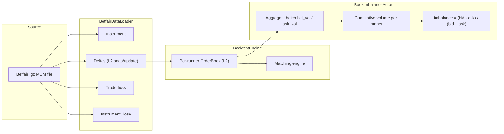
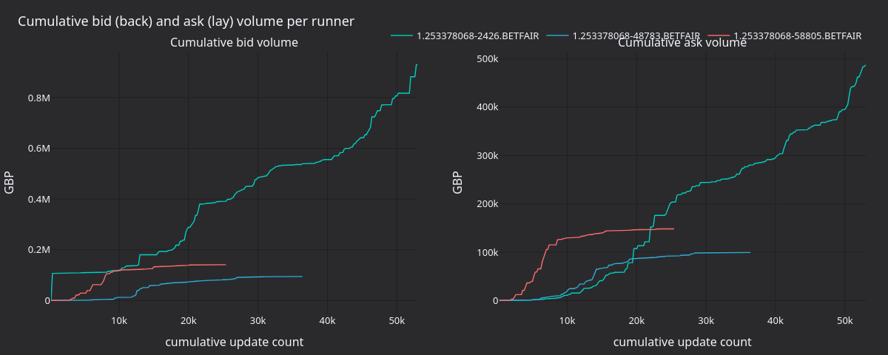

# Backtest Book Imbalance (Betfair)

:::note
tutorial นี้เป็นแบบ **Rust เท่านั้น** โดยส่งข้อมูล streaming ดิบของ Betfair เข้า `BacktestEngine` ของ Rust โดยตรง
ไม่ได้ใช้ Python หรือ Parquet
:::

tutorial นี้ทำ backtest `BookImbalanceActor` บนตลาด MATCH_ODDS ของ Betfair โดยโหลดไฟล์ `.gz` ข้อมูล streaming
ย้อนหลังแบบดิบ ป้อนผ่าน `BacktestEngine` ของ Rust และติดตาม imbalance ของปริมาณที่เสนอฝั่ง bid/ask ของแต่ละ runner

## บทนำ {#introduction}

Betfair เป็น exchange สำหรับเดิมพันกีฬา ที่ผู้เข้าร่วมทำการ back (bid) และ lay (ask) ผลลัพธ์ต่าง ๆ ที่ odds แบบทศนิยม
runner แต่ละตัวมี order book ระดับ L2 ของตัวเองที่ทำงานเหมือน order book ในตลาดการเงิน

actor อ่าน `OrderBookDeltas` ของทุก runner และเก็บยอดรวมราย batch และยอดสะสมของปริมาณฝั่ง bid (order แบบ back)
และฝั่ง ask (order แบบ lay) แล้วคำนวณ imbalance ราย batch และแบบสะสมดังนี้:

```text
imbalance = (bid_volume - ask_volume) / (bid_volume + ask_volume)
```

ค่าบวกแสดงว่าผลลัพธ์นั้นมีปริมาณ back มากกว่าปริมาณ lay นักเทรดกีฬาใช้ค่านี้เป็นสัญญาณเบื้องต้น โดยมักใช้ร่วมกับ
momentum ของราคาหรือ feature ระดับตลาด

release build ประมวลผลได้ราวสามล้าน data point ต่อวินาที พร้อมการดูแล order book เต็มรูปแบบใน matching engine



## สิ่งที่ต้องมี {#prerequisites}

- Rust toolchain ที่ใช้งานได้ ([rustup.rs](https://rustup.rs))
- repository ของ NautilusTrader ที่ clone และ build ได้แล้ว
- ไฟล์ `.gz` ข้อมูลย้อนหลังของ Betfair ที่มีข้อมูล MCM (Market Change Message) หาได้จาก
  [Betfair historic data](https://historicdata.betfair.com/), archive ของบุคคลที่สาม หรือบันทึกจาก
  Exchange Streaming API ด้วยตนเอง

วางไฟล์ไว้ที่:

```text
test_data/local/betfair/1.253378068.gz
```

ค่าคงที่ `DATA_FILE` ในตัวอย่างชี้ไปที่ path นี้ซึ่งอยู่ใน gitignore ผลลัพธ์ด้านล่างใช้ตลาด MATCH_ODDS ฟุตบอลที่
บันทึกเอง มี 3 runner และราว 82,000 บรรทัด MCM ตลอด 18 วัน repository ไม่ได้รวมไฟล์นั้นไว้ หากต้องการรันโดยไม่มี
ไฟล์ดังกล่าว ให้ส่งไฟล์ตัวอย่างที่มากับ `test_data/betfair/` เช่น `test_data/betfair/1-166811431.bz2` loader
อ่านไฟล์ `.bz2` ได้ด้วย

## การโหลดข้อมูล {#loading-the-data}

`BetfairDataLoader` อ่านไฟล์ของ Betfair Exchange Streaming API ที่บีบอัดด้วย gzip และ parse แต่ละบรรทัดเป็น
domain object ของ Nautilus:

```rust
use nautilus_betfair::loader::{BetfairDataItem, BetfairDataLoader};
use nautilus_model::types::Currency;

let mut loader = BetfairDataLoader::new(Currency::GBP(), None);
let items = loader.load(&filepath)?;
```

loader คืนค่าเป็น `Vec<BetfairDataItem>`:

| Variant             | คำอธิบาย                                          | map ไปยัง enum `Data` หรือไม่?  |
| :------------------ | :---------------------------------------------- | :---------------------------- |
| `Instrument`        | นิยาม runner จาก market definition               | ไม่ (เพิ่มแยกต่างหาก)             |
| `Status`            | การเปลี่ยนสถานะตลาด (PreOpen, Trading...)        | ใช่, `Data::InstrumentStatus`  |
| `Deltas`            | snapshot ของ order book หรือการอัปเดตแบบ delta     | ใช่, `Data::BookDeltas`        |
| `Trade`             | trade tick แบบส่วนเพิ่มที่คำนวณจากปริมาณสะสม        | ใช่, `Data::Trade`             |
| `Ticker`            | ราคาที่ซื้อขายล่าสุด, ปริมาณ, BSP near/far          | -                             |
| `StartingPrice`     | Betfair Starting Price ของ runner                | -                             |
| `BspBookDelta`      | book delta เฉพาะของ BSP                          | -                             |
| `InstrumentClose`   | event การ settle                                 | ใช่, `Data::InstrumentClose`   |
| `SequenceCompleted` | ตัวบอกว่า batch เสร็จสมบูรณ์                         | -                             |
| `RaceRunnerData`    | ข้อมูลติดตาม GPS (แข่งม้า/สุนัขเกรย์ฮาวด์)             | -                             |
| `RaceProgress`      | ข้อมูลความคืบหน้าระดับการแข่งขัน                     | -                             |
| `CricketMatch`      | ข้อมูลการแข่งขันคริกเก็ต (จาก CCM)                   | -                             |

backtest engine รับ enum `Data` ตัวอย่างนี้แปลง variant ที่จำเป็น และข้าม `Status` กับ type เฉพาะของ Betfair:

```rust
use nautilus_model::data::Data;

let mut instruments = AHashMap::new();
let mut data: Vec<Data> = Vec::new();

for item in items {
    match item {
        BetfairDataItem::Instrument(inst) => {
            instruments.insert(inst.id(), *inst);
        }
        BetfairDataItem::Deltas(d) => {
            data.push(Data::BookDeltas(Box::new(d)));
        }
        BetfairDataItem::Trade(t) => {
            data.push(Data::Trade(t));
        }
        BetfairDataItem::InstrumentClose(c) => {
            data.push(Data::InstrumentClose(c));
        }
        _ => {}
    }
}
```

`Data::BookDeltas` ห่อ payload `OrderBookDeltas` ไว้ใน box เพื่อให้ enum มีขนาดเล็ก

loader จะ emit instrument ทุกครั้งที่ market definition อัปเดต map จะตัดตัวซ้ำออกและเก็บ instrument แต่ละตัว
เวอร์ชันล่าสุดไว้

:::warning
variant `Status` บรรจุการเปลี่ยนสถานะของตลาด (PreOpen, Trading, Suspended, Closed) ตัวอย่างนี้ข้าม variant นี้
จึงไม่ replay การเปลี่ยนสถานะ หากต่อยอดเป็น strategy ที่ส่ง order ให้เพิ่ม arm
`BetfairDataItem::Status(s) => data.push(Data::InstrumentStatus(s))`
engine จะ route `Data::InstrumentStatus` ไปยัง matching engine ซึ่งจะเห็นการระงับและการปิดตลาดจาก stream
:::

## Actor {#the-actor}

NautilusTrader มี `BookImbalanceActor` มาให้ใน module examples ของ crate trading ตัวอย่างนี้ต่อ actor เข้ากับ
list ของ instrument ราย runner และ interval ของ log:

```rust
use nautilus_trading::examples::actors::BookImbalanceActor;

let actor = BookImbalanceActor::new(instrument_ids, 5000, None);
engine.add_actor(actor)?;
```

argument ตัวที่สองกำหนด interval ของ log: หนึ่งบรรทัดความคืบหน้าทุก 5,000 การอัปเดตต่อ runner ตัวอย่างกำหนด
interval นี้ผ่านค่าคงที่ `LOG_INTERVAL` หากต้องการข้อมูล panel ที่ละเอียดขึ้น ให้เปลี่ยนค่าคงที่เป็น `200` แล้ว
build ตัวอย่างใหม่

source ฉบับเต็มอยู่ที่
[`crates/trading/src/examples/actors/imbalance/actor.rs`](https://github.com/nautechsystems/nautilus_trader/tree/develop/crates/trading/src/examples/actors/imbalance/actor.rs)

### วิธีการทำงาน {#how-it-works}

`DataActor` ใน Rust ต้องมีสามส่วน:

1. struct ที่มีฟิลด์ `DataActorCore` และ state ของคุณเอง
1. `nautilus_actor!(YourType)` เพื่อเชื่อมต่อ core พร้อม implementation ของ `Debug`
1. implementation ของ trait `DataActor` พร้อม callback ของคุณ

framework มี blanket implementation ของ `Actor` และ `Component` สำหรับ actor ใน runtime สำหรับ struct ที่มี
`DataActorCore` นั้น macro `nautilus_actor!` จะจัดการการเชื่อมต่อกับ runtime แบบ native ให้ โค้ดของ actor
จึง implement เฉพาะ callback ที่ต้องใช้

ตอนเริ่มทำงาน actor จะ subscribe `OrderBookDeltas` ของแต่ละ instrument ทุกครั้งที่มีการอัปเดต จะรวมปริมาณจาก
delta แต่ละตัวของแต่ละฝั่งและอัปเดตยอดรวม เมื่อหยุดทำงานจะพิมพ์สรุปของแต่ละ instrument

เมื่อใช้ `managed: false` ใน `subscribe_book_deltas` นั้น data engine จะไม่เก็บ order book แยกไว้ใน cache สำหรับ actor
แต่ matching engine ของ exchange ยังคงดูแล book ของตัวเองผ่าน `book.apply_delta()` ทุก delta หาก actor ต้องการ
state ของ book เต็มจาก `self.cache().order_book(&instrument_id)` ให้ตั้ง `managed: true`

## การ setup backtest engine {#backtest-engine-setup}

### สร้าง engine และ venue {#create-the-engine-and-venue}

Betfair เป็น exchange เดิมพันที่ settle เป็นเงินสด venue จึงใช้ `AccountType::Cash`, `OmsType::Netting` และ
`BookType::L2_MBP`:

```rust
let mut engine = BacktestEngine::new(BacktestEngineConfig::default())?;

engine.add_venue(
    SimulatedVenueConfig::builder()
        .venue(Venue::from("BETFAIR"))
        .oms_type(OmsType::Netting)
        .account_type(AccountType::Cash)
        .book_type(BookType::L2_MBP)
        .starting_balances(vec![Money::from("1_000_000 GBP")])
        .fee_model(FeeModelAny::MakerTaker(MakerTakerFeeModel::zero()).into())
        .build()?,
)?;
```

### เพิ่ม instrument, actor และข้อมูล {#add-instruments-actor-and-data}

```rust
for instrument in instruments.values() {
    engine.add_instrument(instrument)?;
}

let actor = BookImbalanceActor::new(instrument_ids, 5000, None);
engine.add_actor(actor)?;

engine.add_data(data, None, true, true)?;
```

พารามิเตอร์ของ `add_data` คือ `(data, client_id, validate, sort)` เมื่อ `validate: true` engine จะตรวจสอบว่า
instrument ของ element แรกลงทะเบียนไว้แล้ว โดยสันนิษฐานว่า batch เป็นข้อมูลชนิดเดียวกันทั้งหมด เมื่อ `sort: true`
จะเรียงข้อมูลตาม timestamp

### รัน {#run}

```rust
engine.run(None, None, None, false)?;
```

พารามิเตอร์ทั้งสี่คือ `(start, end, run_config_id, streaming)` เมื่อใช้ `None` สำหรับ `start` และ `end` engine
จะใช้ช่วงเวลาทั้งหมดของข้อมูลที่โหลดไว้

## สิ่งที่เกิดขึ้นระหว่างการรัน {#what-happens-during-the-run}

สำหรับ data point แต่ละตัวตามลำดับ timestamp นั้น engine จะ:

1. เลื่อน clock ไปยัง timestamp ของข้อมูล
1. route ข้อมูลไปยัง exchange จำลอง ซึ่งจะนำ delta แต่ละตัวไปใช้กับ `OrderBook` ราย instrument และรันรอบของ
   matching engine
1. publish ข้อมูลผ่าน data engine และ message bus ซึ่งจะเรียก callback `on_book_deltas` ของ actor
1. ระบาย command queue และ settle venue (ประมวลผล order ที่ค้างอยู่)

matching engine ดูแล order book เต็มของแต่ละ instrument ตัวอย่างนี้ไม่มี order ให้ match หากเปลี่ยน actor เป็น
`Strategy` strategy ก็จะใช้ state ของ book นั้นได้

## ผลลัพธ์ {#results}

ชุดข้อมูล MATCH_ODDS ที่บันทึกเองมีสาม runner และ 143,098 data point release build รันเสร็จในราว 48 ms:

```text
--- Book imbalance summary ---
  1.253378068-2426.BETFAIR   updates: 53197  bid_vol: 212225339.34  ask_vol: 117422531.85  imbalance:  0.2876
  1.253378068-48783.BETFAIR  updates: 36475  bid_vol:  52506905.49  ask_vol:  19104694.72  imbalance:  0.4664
  1.253378068-58805.BETFAIR  updates: 25426  bid_vol:  24295351.82  ask_vol:  25692733.11  imbalance: -0.0280
```

runner `2426` (ผู้ชนะในที่สุด settle ที่ BSP 2.22) จบที่ +0.288 โดยปริมาณ back มากกว่าปริมาณ lay ตลอดทั้งตลาด
runner `48783` มีแรง back ที่แรงกว่า (+0.466) จากจำนวนการอัปเดตที่น้อยกว่า ส่วน runner `58805` จบใกล้เป็นกลาง (-0.028)


**รูปที่ 1.** *ค่า `(bid - ask) / (bid + ask)` สะสมของแต่ละ runner ตลอดการอัปเดตราว 143k ครั้งตลอดอายุของตลาด
เส้นประแสดง imbalance สุดท้ายของแต่ละ runner*


**รูปที่ 2.** *การกระจายของอัตราส่วน signed flow ราย batch `(bid - ask) / (bid + ask)` เมื่อใช้ batch ขนาด
`LOG_INTERVAL = 200` ต่อ runner รูปร่างการกระจายราย batch ของแต่ละ runner เป็นสัญญาณที่คมกว่า imbalance สะสม*



**รูปที่ 3.** *ปริมาณ back (bid) และ lay (ask) สะสมของแต่ละ runner ทั้งสองฝั่งไม่ได้เพิ่มขึ้นอย่างเดียว: ในช่วงสั้น ๆ
ปริมาณ lay บางครั้งแซงปริมาณ back แม้ imbalance สะสมจะยังเป็นบวก*

### สร้าง panel ใหม่ {#regenerate-the-panels}

actor จะ log `[runner] update #N: batch bid=B ask=A cumulative imbalance=I` ทุกการอัปเดตครั้งที่ N
ตัว renderer จะ parse บรรทัดเหล่านั้นและเขียนไฟล์ PNG แบบ static โดยใช้ theme tearsheet `nautilus_dark`

ตั้งค่าคงที่ `LOG_INTERVAL` ใน `betfair_backtest.rs` เป็น `200` ก่อน หลัง build NautilusTrader จาก source แล้ว
ให้รันคำสั่งนี้จาก root ของ repository เพื่อเก็บ log:

```bash
cargo run -p nautilus-betfair --features examples --release \
    --example betfair-backtest > /tmp/betfair.log 2>&1
```

> หมายเหตุ: ขั้นตอน render panel ในต้นฉบับใช้สคริปต์ Python (`render_panels.py`) จึงตัดออก

## การรันตัวอย่าง {#running-the-example}

```bash
# Debug build
cargo run -p nautilus-betfair --features examples --example betfair-backtest

# Release build (recommended)
cargo run -p nautilus-betfair --features examples --release --example betfair-backtest

# Custom data file
cargo run -p nautilus-betfair --features examples --release --example betfair-backtest -- path/to/file.gz

# Shipped sample file
cargo run -p nautilus-betfair --features examples --release --example betfair-backtest -- test_data/betfair/1-166811431.bz2
```

## Source ฉบับเต็ม {#complete-source}

ตัวอย่างฉบับเต็มอยู่ที่
[`crates/adapters/betfair/examples/betfair_backtest.rs`](https://github.com/nautechsystems/nautilus_trader/tree/develop/crates/adapters/betfair/examples/betfair_backtest.rs)

## ขั้นตอนถัดไป {#next-steps}

- **Strategy**: เปลี่ยน actor เป็น implementation ของ `Strategy` ที่ส่ง order แบบ back/lay ตามสัญญาณ imbalance
  ดูรูปแบบได้จากตัวอย่าง `EmaCross` ใน `crates/trading/src/examples/strategies/ema_cross/strategy.rs`
- **Managed book**: ตั้ง `managed: true` ใน `subscribe_book_deltas` แล้วอ่าน book เต็มผ่าน
  `self.cache().order_book(&id)` เพื่อหา spread ที่ top-of-book, อัตราส่วนความลึก หรือ weighted mid-price
- **หลายตลาด**: โหลดไฟล์ `.gz` หลายไฟล์และรันผ่าน engine เดียวกันเพื่อทดสอบสัญญาณข้ามตลาด
