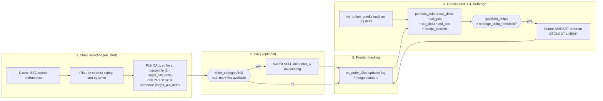
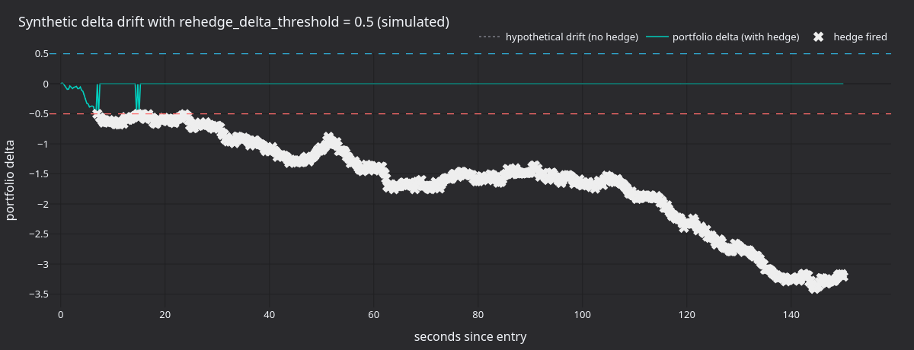

:::note
Tutorial นี้เป็นแบบ **Rust-only** โดยรัน strategy แบบ short-volatility ที่เป็น delta-neutral บน Bybit แบบ live
ด้วย `LiveNode` ของ Rust
:::

Tutorial นี้รัน short strangle แบบ out-of-the-money (OTM) บน BTC option ของ Bybit และ delta-hedge ด้วย BTCUSDT
perpetual strategy จะเลือก strike ของ call และ put ตอน startup และเข้า position ผ่าน limit order ที่กำหนดราคาด้วย
implied volatility โดยติดตาม delta ของ portfolio จาก Greeks ที่ venue ส่งมาให้ เมื่อ delta เคลื่อนเกิน threshold
จะส่ง market order เพื่อ hedge บน perpetual

:::warning
Strategy นี้เทรดด้วยเงินจริงบน mainnet การตั้ง `enter_strangle: false` จะปิดเฉพาะ entry order ชุดแรกของ strangle เท่านั้น
strategy ยังคงโหลด position ที่มีอยู่จาก cache ตอน startup และยังคงส่ง hedge order บน perpetual เมื่อ delta ของ portfolio
เกิน threshold หาก account มี position ของ option หรือ hedge ค้างจาก session ก่อนหน้า strategy จะเทรด
:::

## สิ่งที่ต้องมีก่อน [#prerequisites]

- ทำ [tutorial ข้อมูล option](options_data_bybit.md) ให้เสร็จก่อน ซึ่งครอบคลุมการค้นหา instrument, การ subscribe Greeks
  และ pattern ของ `DataActor`
- Bybit API key ที่มี **สิทธิ์ในการเทรด** สำหรับ option และ linear perpetual
- Environment variable สำหรับ Bybit mainnet ซึ่งตัวอย่างใช้เป็นค่าเริ่มต้น (ดู [การรันตัวอย่าง](#running-the-example)
  สำหรับ testnet):

```bash
export BYBIT_API_KEY="your-api-key"
export BYBIT_API_SECRET="your-api-secret"
```

## ภาพรวมของ strategy [#strategy-overview]

Strategy `DeltaNeutralVol` มาพร้อมกับ module `examples` ของ trading crate และทำงานเป็นห้าขั้น:

1. **การเลือก strike**: query instrument cache เพื่อหา BTC option ทั้งหมด กรองเฉพาะวันหมดอายุที่ใกล้ที่สุด แล้วเลือก
   strike ของ call และ put แบบ OTM ตามอันดับ percentile
1. **การเข้า position**: วาง SELL limit order ทั้งสองขา โดยกำหนดราคาด้วย implied volatility (ผ่านพารามิเตอร์
   `order_iv` ของ Bybit) การเข้า position เป็น optional และปิดไว้เป็นค่าเริ่มต้นในตัวอย่าง
1. **การติดตาม Greeks**: subscribe `OptionGreeks` ของทั้งสองขา ค่า delta และ IV มาจาก option ticker stream ของ Bybit โดยตรง
1. **การ rehedge**: คำนวณ delta ของ portfolio และส่ง market order บน BTCUSDT perpetual เมื่อเกิน threshold
   trigger ทุกครั้งที่มีการอัปเดต Greeks และจาก safety timer ที่ทำงานเป็นระยะ
1. **การติดตาม position**: ติดตาม position ของ call, put และ hedge ผ่าน `on_order_filled` และโหลด position ที่มีอยู่จาก
   cache ตอน startup



### Delta ของ portfolio [#portfolio-delta]

Strategy คำนวณ exposure สุทธิดังนี้:

```text
portfolio_delta = call_delta * call_position
                + put_delta * put_position
                + hedge_position
```

Short strangle เริ่มต้นใกล้เคียง delta-neutral เพราะ delta ของ call และ put หักล้างกัน เมื่อใช้ค่าเริ่มต้น
`target_call_delta = 0.20` และ `target_put_delta = -0.20` สองขาจะหักล้างกันตอนเข้า position เมื่อ underlying
เคลื่อนไหว delta สุทธิจะค่อย ๆ เบี่ยงไป และ strategy จะ hedge เพื่อดึงกลับมาใกล้ศูนย์

## Configuration [#configuration]

ไฟล์ตัวอย่างที่
[`crates/adapters/bybit/examples/node_delta_neutral.rs`](https://github.com/nautechsystems/nautilus_trader/tree/develop/crates/adapters/bybit/examples/node_delta_neutral.rs)
กำหนด config ของ strategy ดังนี้:

```rust
let hedge_instrument_id = InstrumentId::from("BTCUSDT-LINEAR.BYBIT");

let strategy_config = DeltaNeutralVolConfig::builder()
    .option_family("BTC".to_string())
    .hedge_instrument_id(hedge_instrument_id)
    .client_id(client_id)
    .contracts(1)
    .rehedge_delta_threshold(0.5)
    .rehedge_interval_secs(30)
    .enter_strangle(false)
    .iv_param_key("order_iv".to_string())
    .build();

let strategy = DeltaNeutralVol::new(strategy_config);
```

ตารางแสดงค่าเริ่มต้นของ struct และค่าที่ตัวอย่าง override ไว้ ตัวอย่าง override `enter_strangle` เป็น `false` และ
`iv_param_key` เป็น `"order_iv"`:

| พารามิเตอร์                 | ค่าเริ่มต้น   | ตัวอย่าง          | คำอธิบาย                                       |
| ------------------------- | ---------- | ---------------- | --------------------------------------------- |
| `option_family`           | required   | `"BTC"`          | ตัวกรอง underlying สำหรับการค้นหา instrument     |
| `hedge_instrument_id`     | required   | `BTCUSDT-LINEAR` | Perpetual ที่ใช้ delta hedge                    |
| `client_id`               | required   | `"BYBIT"`        | Identifier ของ data client และ execution client |
| `target_call_delta`       | `0.20`     | -                | Delta เป้าหมายของ call สำหรับเลือก strike        |
| `target_put_delta`        | `-0.20`    | -                | Delta เป้าหมายของ put สำหรับเลือก strike         |
| `contracts`               | `1`        | -                | จำนวนสัญญาต่อขา                                 |
| `rehedge_delta_threshold` | `0.5`      | -                | Delta ของ portfolio ที่ trigger การ hedge        |
| `rehedge_interval_secs`   | `30`       | -                | ช่วงเวลาของ timer สำหรับ rehedge เป็นระยะ          |
| `enter_strangle`          | `true`     | `false`          | วาง entry order เมื่อ Greeks เข้ามา              |
| `entry_iv_offset`         | `0.0`      | -                | จำนวน vol point ที่ต่ำกว่า mark IV สำหรับราคาเข้า   |
| `iv_param_key`            | `"px_vol"` | `"order_iv"`     | Key ของพารามิเตอร์ IV เฉพาะ adapter              |

`iv_param_key` แตกต่างกันในแต่ละ venue Bybit ใช้ `order_iv` ซึ่ง adapter จะ map ไปเป็น field `orderIv` ใน API
สำหรับวาง order ส่วน OKX ใช้ `px_vol` สำหรับการวาง order ตาม IV ให้ตั้ง key ให้ถูกต้องตาม venue

## การตั้งค่า node [#node-setup]

ตัวอย่างกำหนด config ของทั้ง data client และ execution client ด้วย product type `Option` และ `Linear`:

```rust
let data_config = BybitDataClientConfig {
    api_key: None,
    api_secret: None,
    product_types: vec![BybitProductType::Option, BybitProductType::Linear],
    ..Default::default()
};

let exec_config = BybitExecutionClientConfig {
    api_key: None,
    api_secret: None,
    product_types: vec![BybitProductType::Option, BybitProductType::Linear],
    account_id: Some(account_id),
    ..Default::default()
};
```

ต้องใช้ทั้งสอง product type: `Option` สำหรับขาของ strangle และ `Linear` สำหรับ instrument ที่ใช้ hedge คือ BTCUSDT
perpetual execution client ต้องมี `account_id` เพื่อติดตาม identity ของ order

```rust
let mut node = LiveNode::builder(trader_id, environment)?
    .with_name("BYBIT-DELTA-NEUTRAL-001".to_string())
    .add_data_client(None, Box::new(data_factory), Box::new(data_config))?
    .add_exec_client(None, Box::new(exec_factory), Box::new(exec_config))?
    .with_reconciliation(true)
    .with_delay_post_stop_secs(5)
    .build()?;

node.add_strategy(strategy)?;
node.run().await?;
```

ตอน startup `with_reconciliation(true)` จะ query order และ position ที่เปิดอยู่จาก Bybit reconciliation จะโหลดข้อมูลเข้า
cache ก่อน strategy เริ่มทำงาน จากนั้น strategy จะโหลด position ที่มีอยู่จาก session ก่อนหน้า

## Strategy ทำงานอย่างไร [#how-the-strategy-works]

### การเลือก strike [#strike-selection]

ตอน startup strategy จะ query cache เพื่อหา option instrument ทั้งหมดที่ตรงกับ `option_family` ตัด option ที่หมดอายุแล้ว
ออก และเลือกวันหมดอายุที่ใกล้ที่สุด แยก call กับ put ออกจากกัน แล้วเรียงแต่ละรายการตาม strike price

Strategy เลือก strike ตาม percentile ในรายการที่เรียงแล้ว:

- **Call**: index = `(1.0 - target_call_delta) * count` เมื่อ target delta เป็น 0.20 และมี call 50 ตัว จะได้ strike
  ตัวที่ 40 (percentile ที่ 80, OTM)
- **Put**: index = `|target_put_delta| * count` เมื่อ target delta เป็น -0.20 จะได้ strike ตัวที่ 10 (percentile ที่ 20, OTM)

นี่เป็นวิธี heuristic ลำดับของ strike price ใช้ประมาณลำดับของ delta สำหรับ option ที่หมดอายุวันเดียวกัน strategy ที่ใช้
ใน production ควร subscribe Greeks ของทุก strike ก่อน แล้วจึงเลือกตาม delta จริง

### การเข้า position ผ่าน implied volatility [#entry-via-implied-volatility]

เมื่อ `enter_strangle` เป็น `true` และได้รับ mark IV ของทั้งสองขาแล้ว strategy จะวาง SELL limit order โดยใช้พารามิเตอร์
`order_iv`:

```rust
let call_params = Params::new(
    [("order_iv".to_string(), json!(call_entry_iv.to_string()))].into(),
);

self.submit_order(call_order, None, Some(client_id), Some(call_params))?;
```

Bybit จะแปลง `orderIv` เป็น limit price บนฝั่ง server และให้ความสำคัญกับค่านี้มากกว่าราคาที่ระบุไว้ ค่า `entry_iv_offset`
จะลบ vol point ออกจาก mark IV เช่น offset 0.02 จะขายต่ำกว่า mark สอง vol point เพื่อให้ fill เร็วขึ้น

:::note
ใน demo environment ของ Bybit order ใหม่จะส่ง `order_iv` ผ่าน HTTP endpoint สำหรับสร้าง order แต่ demo ไม่รองรับการแก้ไข
order ผ่าน `order_iv` adapter จะทิ้งการแก้ไขนั้นพร้อม warning ก่อนจะถึง API
:::

### การ rehedge [#rehedging]

มีสอง trigger ที่ตรวจสอบ delta ของ portfolio:

- **การอัปเดต Greeks**: ทุกครั้งที่มีการอัปเดต `on_option_greeks` จะอัปเดตค่า delta ของขานั้น แล้วคำนวณ delta ของ
  portfolio ใหม่
- **Timer เป็นระยะ**: ตรวจสอบทุก `rehedge_interval_secs` รวมถึงในกรณีที่การอัปเดต Greeks หยุดไป

เมื่อ `|portfolio_delta| > rehedge_delta_threshold` strategy จะส่ง market order บน hedge instrument flag `hedge_pending`
จะป้องกันการส่งซ้ำขณะที่ยังมี order ค้างอยู่ระหว่างทาง

### การติดตาม position [#position-tracking]

Strategy ติดตาม position ผ่าน `on_order_filled` โดยไม่ query cache ทุก tick แต่ละ fill จะอัปเดตตัวนับ position ที่ตรงกัน
(call, put หรือ hedge)

ตอน startup strategy จะโหลดตัวนับจาก cache ที่ reconciliation เติมข้อมูลไว้ สำหรับ call ที่เลือก, put ที่เลือก และ hedge
instrument จะรวมปริมาณแบบมีเครื่องหมายของทุก position ที่เปิดอยู่ โดยไม่กรองตาม strategy ดังนั้น position ที่เปิดจากที่อื่นบน
instrument เหล่านั้นก็จะถูกนับด้วย ส่วน option position บน strike อื่นจะไม่ถูกนับ

:::warning
ใช้ account ที่ไม่มี position อื่นที่ไม่เกี่ยวข้องบน hedge instrument ตอน startup strategy จะถือว่า position
`BTCUSDT-LINEAR` ที่เปิดอยู่ทุกตัวเป็นส่วนหนึ่งของ hedge หากไม่มี option position แต่มี perpetual position ที่ไม่เกี่ยวข้อง
ซึ่งใหญ่กว่า `rehedge_delta_threshold` จะเกิน threshold ทันทีที่ Greeks ของทั้งสองขาเข้ามา แล้ว strategy จะส่ง market
order เพื่อปิด position นั้น
:::

### การปิดการทำงาน [#shutdown]

เมื่อหยุด strategy จะยกเลิก order ที่เปิดอยู่, unsubscribe จาก data feed ทั้งหมด และ reset flag hedge-pending โดยจะไม่ปิด
position หากต้องการปิด strangle และ hedge ให้ทำด้วยมือหรือใช้ exit strategy แยกต่างหาก

## ผลลัพธ์จากการรัน [#what-the-run-produces]

การรันบน mainnet 30 วินาทีด้วย `enter_strangle: false` กับ account ที่ไม่มี position จะไม่วาง order ใดเลย strategy จะ log
instrument ที่ค้นพบและการเลือก strike:

```text
Selected call: BTC-28APR26-81000-C-USDT-OPTION.BYBIT (strike=81000)
Selected put: BTC-28APR26-75000-P-USDT-OPTION.BYBIT (strike=75000)
Strangle: 1 contracts per leg, hedge on BTCUSDT-LINEAR.BYBIT
```

Log แสดงการค้นหา instrument และการเลือก strike ส่วน panel ด้านล่างแสดงกลไกรอบ ๆ strike ที่ถูกเลือกจริง (75,000 / 81,000)
ที่ราคา underlying ขณะบันทึก


**รูปที่ 1.** *PnL ณ วันหมดอายุของการรวม short PUT 75,000 กับ short CALL 81,000 โดยสมมติ premium รวม 1,500 USDT และ
ไม่มี discount ส่วนบนที่แบนราบคือโซนที่ได้แต่ credit ระหว่างสอง strike และขาดทุนจะเพิ่มขึ้นแบบเชิงเส้นเมื่อเลย strike ใด
strike หนึ่งไป*



**รูปที่ 2.** *Delta drift แบบ Brownian สังเคราะห์ในช่วง 150 วินาที ด้วย `rehedge_delta_threshold=0.5` เส้นประคือ drift
ที่ไม่ได้ hedge ส่วนเส้นทึบคือ delta ของ portfolio ของ strategy หลังการ hedge ด้วย market order แต่ละครั้ง (เครื่องหมายกากบาท)*


**รูปที่ 3.** *ตัวอย่าง delta ของ short call และ short put ในช่วงราคา spot 5% รอบจุดเข้า position panel นี้ยังแสดง delta
ของ portfolio ที่ได้ก่อนการ hedge ด้วย gamma ที่เป็นลบทำให้เส้นโค้งแบนลงที่ปีกทั้งสองข้าง และชันขึ้นในช่วงระหว่าง strike*


**รูปที่ 4.** *Heuristic การเลือก strike เทียบกับตัวอย่าง IV smile strike ของ CALL อยู่ที่ percentile (1 - 0.20) และของ PUT
อยู่ที่ percentile 0.20 ทั้งสองขาเป็น OTM และมี delta ขนาดใกล้เคียงกันรอบ underlying*

### สร้าง panel ใหม่ [#regenerate-the-panels]

Log มาจาก `bybit-delta-neutral` ซึ่งเป็น binary สำหรับ live trading โดยจะเชื่อมต่อกับ Bybit mainnet ด้วย API key ของคุณ
เมื่อใช้ config เริ่มต้นจะไม่วาง entry order แต่จะส่ง hedge order หาก account มี position บนขาที่เลือกหรือบน hedge instrument

หลัง build NautilusTrader จาก source แล้ว ให้รันคำสั่งเหล่านี้จาก root ของ repository เพื่อสร้าง log:

```bash
cargo build --release --example bybit-delta-neutral --package nautilus-bybit --features examples
timeout 30 ./target/release/examples/bybit-delta-neutral > /tmp/bybit_dn.log 2>&1
```

> หมายเหตุ: ต้นฉบับใช้ script Python (`render_panels.py`) ในการวาด panel จาก log จึงตัดออก

Panel เหล่านี้เป็นเพียงภาพประกอบ: การรันที่บันทึกไว้ใช้ account ที่ไม่มี position และไม่ได้วาง order ใดเลย

## ข้อควรพิจารณาด้านความเสี่ยง [#risk-considerations]

- **ความเสี่ยงด้าน gamma**: short strangle มี gamma เป็นลบ การเคลื่อนไหวขนาดใหญ่ของ underlying จะเพิ่ม delta exposure
  เร็วกว่าที่ rehedge timer ตอบสนองได้ ลด `rehedge_delta_threshold` และ `rehedge_interval_secs` เพื่อให้ตอบสนองเร็วขึ้น
  แลกกับจำนวน hedge trade ที่มากขึ้น
- **ความเสี่ยงด้าน vega**: IV ที่พุ่งขึ้นจะเพิ่มผลขาดทุนแบบ mark-to-market ของ short option strategy ไม่ได้จัดการ vega exposure
- **Liquidity**: crypto option แบบ OTM อาจมี spread กว้าง คุณภาพของการ hedge จะลดลงเมื่อ underlying เกิด gap หรือเมื่อ
  perpetual เทรดด้วยขั้นของขนาดที่หยาบ
- **ความเสี่ยงด้านวงจรชีวิต**: การหยุด strategy คือการหยุด hedge ด้วย position จะยังเปิดอยู่และไม่มีการ hedge จนกว่าจะจัดการด้วยมือ

## การรันตัวอย่าง [#running-the-example]

:::warning
ตัวอย่างนี้เทรดบน Bybit **mainnet** เป็นค่าเริ่มต้น โดยไม่มีค่าคงที่ระบุ network: config ของ client ทั้งสองใช้
`..Default::default()` ซึ่งเลือก `BybitEnvironment::Mainnet` และอ่าน `BYBIT_API_KEY` และ `BYBIT_API_SECRET`
หากต้องการรันบน testnet:

1. Import `BybitEnvironment` จาก `nautilus_bybit::common::enums` ใน `node_delta_neutral.rs`
1. เพิ่ม `environment: BybitEnvironment::Testnet` ให้ทั้ง `data_config` และ `exec_config`
1. Build ตัวอย่างใหม่

บน testnet adapter จะอ่าน `BYBIT_TESTNET_API_KEY` และ `BYBIT_TESTNET_API_SECRET`
:::

```bash
cargo run --example bybit-delta-neutral --package nautilus-bybit --features examples
```

ตัวอย่างรันด้วย `enter_strangle: false` เป็นค่าเริ่มต้น จึงไม่วาง entry order ของ strangle แต่ยังคงโหลด position ที่มีอยู่และ
ส่ง hedge order หาก delta ของ portfolio เกิน threshold บน account ที่ไม่มี position ค้างอยู่ strategy จะไม่วาง order ใดเลย

หยุดด้วย Ctrl+C strategy จะยกเลิก order ที่เปิดอยู่และ unsubscribe ก่อนปิดการทำงาน

## Source code ฉบับสมบูรณ์ [#complete-source]

- ตัวรันตัวอย่าง: [`crates/adapters/bybit/examples/node_delta_neutral.rs`](https://github.com/nautechsystems/nautilus_trader/tree/develop/crates/adapters/bybit/examples/node_delta_neutral.rs)
- Implementation ของ strategy: [`crates/trading/src/examples/strategies/delta_neutral_vol/`](https://github.com/nautechsystems/nautilus_trader/tree/develop/crates/trading/src/examples/strategies/delta_neutral_vol/)
- README ของ strategy พร้อม config reference ฉบับเต็ม: [`crates/trading/src/examples/strategies/delta_neutral_vol/README.md`](https://github.com/nautechsystems/nautilus_trader/tree/develop/crates/trading/src/examples/strategies/delta_neutral_vol/README.md)

## ดูเพิ่มเติม [#see-also]

- [ข้อมูล option และ Greeks บน Bybit](options_data_bybit.md): tutorial ที่ต้องทำก่อน ครอบคลุมการ subscribe Greeks และ
  snapshot ของ option chain
- [Options](../concepts/options.md): ประเภทของ option instrument และสถาปัตยกรรมข้อมูล
- [Bybit integration](../integrations/bybit.md#options-trading): พารามิเตอร์ของ order สำหรับ option รวมถึง `order_iv` และ `mmp`
