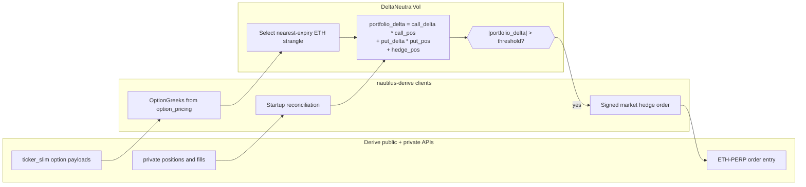
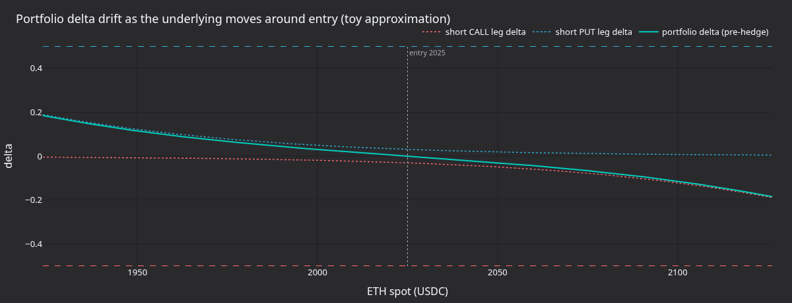
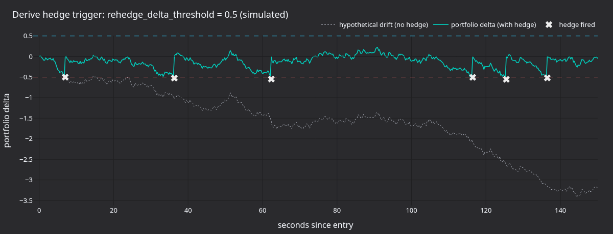
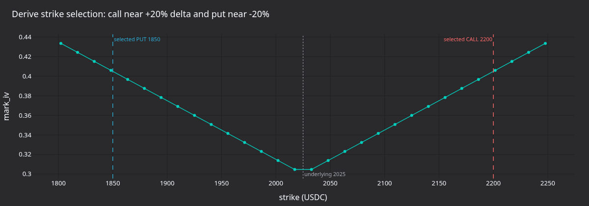

:::note
tutorial นี้เป็นแบบ **Rust เท่านั้น** โดยรัน strategy แบบ short volatility ที่เป็น delta-neutral แบบ live บน Derive
ด้วย `LiveNode` ของ Rust
:::

tutorial นี้รัน strategy `DeltaNeutralVol` ที่ใช้ร่วมกันกับ Derive adapter ตัวอย่างที่ให้มาจะค้นหา ETH option
แล้วเลือก call และ put ที่ out-of-the-money จากนั้น subscribe Greeks ที่ venue ให้มา และทำ delta hedge ด้วย
`ETH-PERP.DERIVE`

runner ของ Derive เริ่มต้นในโหมด hedge อย่างเดียว โดยตั้ง `enter_strangle: false` จึงไม่ส่ง order สำหรับเข้า
option ครั้งแรก การ hedge เปิดอยู่โดย default (`HEDGE_ENABLED = true`) reconciliation ยังคงโหลด position
ที่มีอยู่ เมื่อ portfolio delta เกิน threshold ที่ตั้งไว้ strategy อาจส่ง market hedge order บน perpetual

runner อ่านการตั้งค่าจากค่าคงที่ที่ด้านบนของไฟล์ตัวอย่าง ไม่ได้อ่านจาก environment variable ถ้าต้องการ smoke test
โดยไม่มี hedge order ให้ตั้ง `HEDGE_ENABLED` เป็น `false` แล้ว build ใหม่ strategy จะยังคงโหลด instrument,
reconcile account และ subscribe Greeks สำหรับ smoke test ที่ส่ง entry order ให้ตั้ง `ENTER_STRANGLE` เป็น
`true` แล้ว runner จะส่ง option order ที่ตั้งราคาตาม premium ของ Derive แทน option order ที่ตั้งราคาตาม IV

:::warning
strategy นี้เทรดด้วยเงินจริงบน mainnet ได้ การตั้ง `enter_strangle: false` ปิดเฉพาะ entry order ของ strangle
ครั้งแรกเท่านั้น ถ้า option leg ที่เลือกหรือ hedge instrument มี open position อยู่แล้ว strategy อาจส่ง hedge order ได้
:::

## สิ่งที่ต้องมี [#prerequisites]

- ทำตาม[คู่มือ integration ของ Derive](../integrations/derive.md) จนเสร็จ รวมถึงการตั้งค่า wallet, subaccount,
  session key และการเติมเงิน
- subaccount ของ Derive บน testnet หรือ mainnet ที่มี USDC collateral เพียงพอสำหรับ hedge order ที่ตั้งใจจะอนุญาต
- Rust toolchain ที่ใช้งานได้ และ workspace ของ NautilusTrader ที่ build แล้ว
- environment variable ของ credential สำหรับ environment ของ Derive ที่ตัวอย่างใช้ execution client จะอ่าน
  ค่าเหล่านี้เมื่อ config ไม่ได้ตั้งฟิลด์ credential ไว้

สำหรับ testnet:

```bash
export DERIVE_TESTNET_WALLET_ADDRESS="0x..."
export DERIVE_TESTNET_SESSION_PRIVATE_KEY="0x..."
export DERIVE_TESTNET_SUBACCOUNT_ID="12345"
```

สำหรับ mainnet:

```bash
export DERIVE_WALLET_ADDRESS="0x..."
export DERIVE_SESSION_PRIVATE_KEY="0x..."
export DERIVE_SUBACCOUNT_ID="12345"
```

ตัวอย่างนี้ใช้ testnet ผ่านค่าคงที่ `DERIVE_ENVIRONMENT` (`DeriveEnvironment::Testnet`) ใน
`node_delta_neutral.rs` และไม่ได้อ่าน network จาก environment ให้แก้ค่าคงที่เป็น `DeriveEnvironment::Mainnet`
แล้ว build ใหม่ เฉพาะเมื่อต้องการรันด้วยเงินจริง

## ภาพรวมของ strategy [#strategy-overview]

strategy `DeltaNeutralVol` อยู่ใน module examples ของ trading crate runner ของ Derive ใช้ strategy นี้ใน
ห้าขั้นตอน:

1. **โหลด instrument**: ตั้งค่า data client ของ Derive ด้วย `currencies: ["ETH"]` เพื่อให้ adapter โหลด ETH perp
   และ option ลงใน cache
1. **เลือก strike**: กรอง cache ให้เหลือเฉพาะ ETH option ที่ยังไม่หมดอายุ เลือก expiry ที่ใกล้ที่สุด แล้วเลือก strike
   ของ call และ put ที่เป็น OTM ตามอันดับ percentile
1. **ติดตาม Greeks**: subscribe `OptionGreeks` ของทั้งสอง leg โดย Greeks ของ Derive มาจาก feed `ticker_slim`
   ที่ใช้ร่วมกัน และ payload `option_pricing`
1. **Rehedge**: คำนวณ portfolio delta และส่ง market order ของ Derive บน `ETH-PERP.DERIVE` เมื่อเกิน threshold
1. **ติดตาม position**: ติดตาม position ของ call, put และ hedge ผ่าน fill reconciliation จะโหลด position ที่มีอยู่
   ก่อนที่ strategy จะเริ่ม



### Portfolio delta [#portfolio-delta]

strategy คำนวณ exposure สุทธิดังนี้:

```text
portfolio_delta = call_delta * call_position
                + put_delta * put_position
                + hedge_position
```

short strangle จะเริ่มต้นใกล้ delta-neutral เมื่อ delta ของ call และ put หักล้างกัน เมื่อสินทรัพย์อ้างอิงเคลื่อนไหว
delta สุทธิจะเบี่ยงออกไป และ strategy จะ hedge ด้วย perpetual เพื่อดึง portfolio กลับเข้าใกล้ศูนย์

## การตั้งค่า [#configuration]

runner ตัวอย่างที่ `crates/adapters/derive/examples/node_delta_neutral.rs` ตั้งค่าผ่านค่าคงที่ที่ด้านบนของไฟล์
ถ้าต้องการเปลี่ยนการรัน ให้แก้ค่าคงที่เหล่านี้แล้ว build ตัวอย่างใหม่ คำสั่ง `cargo run` จะ build ตัวอย่างใหม่ให้
หลังแก้ไข

```rust
const DERIVE_ENVIRONMENT: DeriveEnvironment = DeriveEnvironment::Testnet;

const OPTION_FAMILY: &str = "ETH";
const HEDGE_INSTRUMENT_ID: &str = "ETH-PERP.DERIVE";

const ENTER_STRANGLE: bool = false;
const HEDGE_ENABLED: bool = true;
const REHEDGE_DELTA_THRESHOLD: f64 = 0.5;
const REHEDGE_INTERVAL_SECS: u64 = 30;

const TARGET_CALL_DELTA: f64 = 0.20;
const TARGET_PUT_DELTA: f64 = -0.20;
const CONTRACTS: u64 = 1;
const ENTRY_IV_OFFSET: f64 = 0.0;
const ENTRY_PREMIUM_OFFSET_TICKS: i32 = 1;
const EXPIRY_FILTER: Option<&str> = None;

const MAX_FEE_PER_CONTRACT: &str = "1000";
const MARKET_ORDER_SLIPPAGE_BPS: u32 = 50;
```

runner สร้าง config ของ strategy จากค่าคงที่เหล่านี้:

```rust
// Disable rehedging by pushing the threshold beyond any reachable delta.
let rehedge_delta_threshold = if HEDGE_ENABLED {
    REHEDGE_DELTA_THRESHOLD
} else {
    1.0e12
};

let mut strategy_config = DeltaNeutralVolConfig::builder()
    .option_family(option_family)
    .hedge_instrument_id(hedge_instrument_id)
    .client_id(client_id)
    .target_call_delta(TARGET_CALL_DELTA)
    .target_put_delta(TARGET_PUT_DELTA)
    .contracts(CONTRACTS)
    .rehedge_delta_threshold(rehedge_delta_threshold)
    .rehedge_interval_secs(REHEDGE_INTERVAL_SECS)
    .enter_strangle(ENTER_STRANGLE)
    .entry_iv_offset(ENTRY_IV_OFFSET)
    .entry_premium_offset_ticks(ENTRY_PREMIUM_OFFSET_TICKS)
    .build();

if let Some(expiry) = EXPIRY_FILTER {
    strategy_config.expiry_filter = Some(expiry.to_string());
}

let strategy = DeltaNeutralVol::new(strategy_config);
```

`HEDGE_ENABLED` ไม่มีฟิลด์ของ strategy ที่ตรงกัน การตั้งเป็น `false` จะเพิ่ม `rehedge_delta_threshold` เป็น
`1.0e12` ทำให้ strategy ไม่ส่ง hedge order เลย

พารามิเตอร์:

| Parameter                    | Default    | Derive runner | คำอธิบาย                                      |
| ---------------------------- | ---------- | ------------- | --------------------------------------------- |
| `option_family`              | required   | `"ETH"`       | ตัวกรองสินทรัพย์อ้างอิงสำหรับค้นหา instrument  |
| `hedge_instrument_id`        | required   | `ETH-PERP`    | perpetual ที่ใช้ทำ delta hedge                 |
| `client_id`                  | required   | `"DERIVE"`    | identifier ของ data client และ execution client |
| `target_call_delta`          | `0.20`     | `0.20`        | delta เป้าหมายของ call สำหรับเลือก strike      |
| `target_put_delta`           | `-0.20`    | `-0.20`       | delta เป้าหมายของ put สำหรับเลือก strike       |
| `contracts`                  | `1`        | `1`           | จำนวนสัญญาต่อ option leg                       |
| `rehedge_delta_threshold`    | `0.5`      | `0.5`         | portfolio delta ที่ทำให้เกิดการ hedge          |
| `rehedge_interval_secs`      | `30`       | `30`          | ช่วงเวลาของ timer สำหรับ rehedge เป็นระยะ      |
| `expiry_filter`              | `None`     | unset         | ตัวกรอง expiry แบบ substring (ไม่บังคับ)       |
| `enter_strangle`             | `true`     | `false`       | ส่ง entry order เมื่อได้รับข้อมูล premium      |
| `entry_premium_offset_ticks` | `None`     | `1`           | จำนวน tick เหนือ option ask สำหรับการเข้าฝั่ง sell |
| `entry_iv_offset`            | `0.0`      | `0.0`         | ใช้เฉพาะเมื่อปิดโหมด premium                   |
| `iv_param_key`               | `"px_vol"` | unused        | key ของพารามิเตอร์ IV สำหรับ venue ที่ตั้งราคาตาม IV |

Derive sign ราคา limit ของ premium อย่างชัดเจน runner เปิดโหมด premium-entry ของ strategy ด้วย
`entry_premium_offset_ticks=1` entry order จะใช้ option ask แบบ live เมื่อมี เมื่อฝั่ง quote ว่าง จะใช้ฟิลด์ IV ของ
Derive แทน ส่วน Bybit และ OKX ใช้เส้นทาง IV-parameter ที่ใช้ร่วมกัน

## การตั้งค่า node [#node-setup]

runner ของ Derive ใช้ live environment และเลือก testnet หรือ mainnet จากค่าคงที่ `DERIVE_ENVIRONMENT`:

```rust
let environment = Environment::Live;
let derive_environment = DERIVE_ENVIRONMENT;
let trader_id = TraderId::from(TRADER_ID);
let account_id = AccountId::from(ACCOUNT_ID);
let client_id = *DERIVE_CLIENT_ID;
```

data client จะโหลด ETH instrument แบบเป็นชุด ซึ่งสำคัญเพราะ strategy เลือก option leg จาก cache ระหว่าง
`on_start`

```rust
let data_config = DeriveDataClientConfig {
    environment: derive_environment,
    currencies: vec![option_family.clone()],
    ..Default::default()
};
```

เมื่อไม่ได้ตั้งฟิลด์ใน config execution client จะอ่านค่า wallet, session key และ subaccount จาก environment
variable ของ Derive ตัวอย่างนี้ตั้งเพดานค่าธรรมเนียมและขอบเขต slippage ของ market order ไว้

```rust
let exec_config = DeriveExecutionClientConfig {
    account_id,
    environment: derive_environment,
    max_fee_per_contract: Some(Decimal::from_str_exact(MAX_FEE_PER_CONTRACT)?),
    market_order_slippage_bps: MARKET_ORDER_SLIPPAGE_BPS,
    ..Default::default()
};
```

node เปิด reconciliation เพื่อโหลด open order, position, balance และ report ก่อนที่ strategy จะเริ่ม:

```rust
let mut node = LiveNode::builder(trader_id, environment)?
    .with_name("DERIVE-DELTA-NEUTRAL-001".to_string())
    .add_data_client(None, Box::new(data_factory), Box::new(data_config))?
    .add_exec_client(None, Box::new(exec_factory), Box::new(exec_config))?
    .with_reconciliation(true)
    .with_delay_post_stop_secs(5)
    .build()?;

node.add_strategy(strategy)?;
node.run().await?;
```

## การทำงานของ strategy [#how-the-strategy-works]

### การเลือก strike [#strike-selection]

ตอนเริ่มต้น strategy จะ query cache หา option instrument ทั้งหมดที่ตรงกับ `option_family` สำหรับ Derive
ตัวอย่างนี้ใช้ `ETH` ดังนั้น instrument ที่ตรงกันจะมี symbol เช่น `ETH-20260626-3000-C.DERIVE`

strategy จะตัด option ที่หมดอายุแล้วออก และใช้ `expiry_filter` ถ้าตั้งไว้ ถ้าไม่ได้ตั้งตัวกรอง จะใช้ expiry ที่ใกล้ที่สุด
แล้วเรียง call และ put ตาม strike:

- **Call**: index = `(1.0 - target_call_delta) * count` เมื่อใช้ค่า default `0.20` จะได้ strike ราว
  percentile ที่ 80
- **Put**: index = `abs(target_put_delta) * count` เมื่อใช้ค่า default `-0.20` จะได้ strike ราว
  percentile ที่ 20

นี่เป็น heuristic ที่อิงลำดับของ strike strategy สำหรับ production อาจ subscribe Greeks ของทั้ง chain ก่อน
แล้วจึงเลือกตาม delta จริง

### Greeks และ ticker feed ที่ใช้ร่วมกัน [#greeks-and-shared-ticker-feeds]

Derive publish ฟิลด์ราคาของ option บน channel `ticker_slim` เดียวกับที่ใช้ส่ง quote adapter สร้าง `OptionGreeks`
จาก `option_pricing` ดังนั้น strategy จึงต้อง subscribe เพียงสอง option leg ที่เลือกไว้:

```rust
self.subscribe_option_greeks(call_id, Some(client_id), None);
self.subscribe_option_greeks(put_id, Some(client_id), None);
```

adapter เก็บ reference count ของ ticker subscription ที่อยู่ข้างใต้ สำหรับ instrument เดียวกัน ข้อมูลชนิดต่อไปนี้
ใช้ WebSocket channel เดียวร่วมกันได้:

- Quote
- Mark price
- Index price
- Funding rate
- Option Greeks

### การ rehedge บน Derive [#rehedging-on-derive]

execution adapter ของ Derive ส่ง market order เป็น signed order ที่มีราคา limit ซึ่งจำกัดด้วย slippage ก่อน sign
order adapter จะ refresh ticker snapshot ของ hedge instrument แล้วเขียนราคาที่แย่ที่สุดที่ยอมรับได้ลงใน payload
แบบ EIP-712 ค่า default ของ `market_order_slippage_bps` คือ `50`

strategy จะส่ง hedge เมื่อ option leg ทั้งสองที่เลือกส่ง Greeks ออกมาแล้ว และ:

```text
abs(portfolio_delta) > rehedge_delta_threshold
```

portfolio delta ที่เป็นบวกจะทำให้เกิด SELL บน `ETH-PERP.DERIVE` ส่วน portfolio delta ที่เป็นลบจะทำให้เกิด BUY
flag `hedge_pending` ป้องกันการส่งซ้ำระหว่างที่ order ยังอยู่ระหว่างดำเนินการ

### การติดตาม position [#position-tracking]

strategy ติดตาม position ผ่าน `on_order_filled` และไม่ poll position ทุกครั้งที่มีอัปเดต reconciliation จะโหลด
position ที่มีอยู่ตอนเริ่มต้น จากนั้น fill ที่ตามมาจะอัปเดตตัวนับ call, put และ hedge ใน memory

### การปิดระบบ [#shutdown]

ตอน stop strategy จะ cancel open order ของ option leg ที่เลือกและ hedge instrument แล้ว unsubscribe จาก data
feed และปล่อย position ไว้ตามเดิม ถ้าต้องการปิด strangle และ hedge ให้ทำเองหรือใช้ exit strategy แยกต่างหาก

## ผลลัพธ์จากการรัน [#what-the-run-produces]

บน testnet ที่ตั้ง `enter_strangle: false` strategy ควรค้นพบ leg ที่เลือก subscribe Greeks และไม่ส่ง entry order
symbol ที่เลือกได้จะขึ้นกับ chain ของ Derive ขณะนั้น:

```text
Selected call: ETH-<expiry>-<strike>-C.DERIVE (strike=<strike>)
Selected put: ETH-<expiry>-<strike>-P.DERIVE (strike=<strike>)
Strangle: 1 contracts per leg, hedge on ETH-PERP.DERIVE
Strangle entry disabled: hedging externally-held positions only.
```

ถ้าไม่มี position อยู่ก่อน การรันควรเป็นแบบรับข้อมูลอย่างเดียวหลังเริ่มต้น ถ้า account ถือ position ใน leg ที่เลือกหรือ
hedge instrument อยู่แล้ว timer สำหรับ rehedge เป็นระยะอาจส่ง hedge order

กราฟด้านล่างใช้กลไกการเลือก strike เดียวกับ runner ของ Derive โดย parse strike ที่เลือกจาก log ของ smoke test
เมื่อมี และถ้าไม่มีจะใช้ strike ของ ETH แบบสมมติเพื่อประกอบคำอธิบาย


**รูปที่ 1** *PnL ตอนหมดอายุของการ short ETH put รวมกับ short ETH call โดยสมมติ premium เป็น USDC คงที่และ
ไม่มี discount ส่วนบนที่แบนคือช่วงที่ได้เฉพาะ credit ระหว่าง strike ทั้งสอง ผลขาดทุนเพิ่มขึ้นแบบเส้นตรงเมื่อเลย strike
ใด strike หนึ่งไป*



**รูปที่ 2** *delta ของ short call และ short put แบบสมมติรอบจุดเข้า พร้อม portfolio delta ที่ได้ก่อนการ hedge*



**รูปที่ 3** *การเบี่ยงของ delta แบบ Brownian สังเคราะห์ตลอด 150 วินาที ด้วย `rehedge_delta_threshold=0.5`
กากบาทแสดงจุดที่ strategy จะส่ง hedge order เมื่อเปิดการ hedge*



**รูปที่ 4** *heuristic การเลือก strike เทียบกับ IV smile แบบสมมติ strike ของ call อยู่ใกล้ percentile
`(1 - target_call_delta)` และ strike ของ put อยู่ใกล้ `abs(target_put_delta)`*

## ข้อพิจารณาด้านความเสี่ยง [#risk-considerations]

- **ความเสี่ยงด้าน gamma**: short strangle มี gamma เป็นลบ การเคลื่อนไหวขนาดใหญ่ของ ETH อาจเพิ่ม delta exposure
  เร็วกว่าที่ timer ของ rehedge จะตอบสนองทัน
- **ความเสี่ยงด้าน slippage**: market order ของ Derive จะ sign ราคา limit ที่จำกัดด้วย slippage ก่อนส่ง ขอบเขตที่แคบ
  อาจทำให้ hedge ที่มีประโยชน์ถูกปฏิเสธ ขอบเขตที่กว้างอาจได้ fill ที่แย่กว่าที่คาด
- **ความเสี่ยงด้านราคาเข้า**: การเข้าบน Derive ใช้ option ask แบบ live บวก offset เป็น tick เมื่อฝั่ง quote ว่าง จะ
  คำนวณ premium จากฟิลด์ IV ของ Derive offset ที่เล็กหรือติดลบอาจข้าม book และถูก fill ทันที
- **ความเสี่ยงด้าน collateral**: Derive จะปฏิเสธ order เมื่อ subaccount มี initial margin เหลือไม่พอ ก่อนเปิด live
  hedging ให้ตรวจสอบ `private/get_subaccount` หรือ snapshot ของ account จาก adapter
- **ความเสี่ยงด้าน lifecycle**: การหยุด strategy จะหยุดการ hedge ด้วย position จะยังเปิดอยู่และไม่มีการ hedge
  จนกว่าจะมีการจัดการจากที่อื่น

## การรันตัวอย่าง [#running-the-example]

ด้วยค่าคงที่ที่ให้มา ตัวอย่างจะใช้ Derive testnet โดยปิดการเข้า strangle และเปิดการ hedge ถ้า subaccount ถือ
position ใน leg ที่เลือกหรือ hedge instrument อยู่ portfolio delta อาจเกิน threshold แล้ว strategy จะส่ง hedge
order บน `ETH-PERP.DERIVE`

```bash
cargo run --example derive-delta-neutral --package nautilus-derive --features examples
```

หยุดด้วย Ctrl+C strategy จะ cancel open order และ unsubscribe ก่อนปิดระบบ แต่ไม่ปิด position

สำหรับ smoke test ที่โหลด venue และ account โดยไม่ส่ง order ให้ตั้ง `HEDGE_ENABLED` เป็น `false` และคง
`ENTER_STRANGLE` ไว้ที่ `false` ถ้าจะรันบน mainnet ให้ตั้ง `DERIVE_ENVIRONMENT` เป็น
`DeriveEnvironment::Mainnet` ด้วย แล้วรัน:

```bash
timeout 45 cargo run --example derive-delta-neutral --package nautilus-derive --features examples
```

สำหรับ smoke test ที่ส่ง option entry order ตาม premium ของ Derive ให้ตั้ง `ENTER_STRANGLE` เป็น `true`
(`ENTRY_PREMIUM_OFFSET_TICKS` เป็น `1` อยู่แล้ว) order จะไปยัง network ที่ `DERIVE_ENVIRONMENT` เลือก และการ
hedge ยังเปิดอยู่ เว้นแต่ `HEDGE_ENABLED` เป็น `false` แล้วรัน:

```bash
timeout --signal=INT 45 cargo run --example derive-delta-neutral --package nautilus-derive \
    --features examples
```

## ซอร์สโค้ดฉบับเต็ม [#complete-source]

- runner ตัวอย่าง: `crates/adapters/derive/examples/node_delta_neutral.rs`
- implementation ของ strategy: `crates/trading/src/examples/strategies/delta_neutral_vol/`
- README ของ strategy: `crates/trading/src/examples/strategies/delta_neutral_vol/README.md`

## ดูเพิ่มเติม [#see-also]

- [Derive integration](../integrations/derive.md): การตั้งค่า environment, symbology, ความสามารถ และความหมาย
  ของ execution
- [Options](../concepts/options.md): ประเภทของ option instrument และสถาปัตยกรรมของข้อมูล
- [Options strategy แบบ delta-neutral บน Bybit](delta_neutral_options_bybit.md): strategy ที่ใช้ร่วมกันตัวเดียวกัน
  พร้อมพารามิเตอร์การเข้าตาม IV เฉพาะของ Bybit
