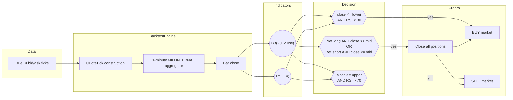
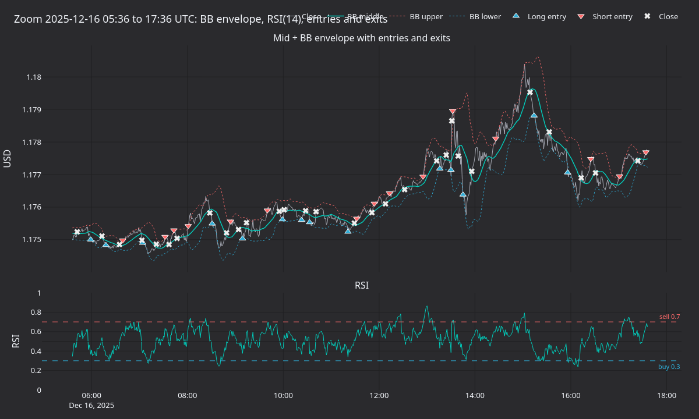
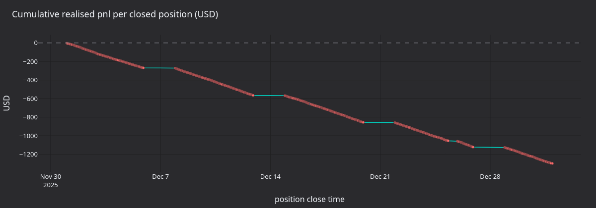

tutorial นี้ backtest strategy แบบ mean reversion ด้วย Bollinger band บน **EURUSD-PERP** ที่
[AX Exchange](https://architect.exchange) โดยใช้ spot tick ของ EUR/USD จาก [TrueFX](https://www.truefx.com)
เป็นข้อมูลแทน (proxy)

## บทนำ [#introduction]

strategy นี้ใช้ indicator สองตัวบน mid bar 1 นาที:

- **Bollinger Bands** (`BB(20, 2.0sd)` ของ `BBMeanReversion`): ค่าเฉลี่ยแบบ rolling 20 bar และกรอบ +/-2sd
  band จะบอกว่าราคาเคลื่อนไปไกลเกินไปเมื่อเทียบกับ volatility ล่าสุด
- **Relative Strength Index** (`RSI(14)`): momentum oscillator 14 bar ในช่วง `[0, 100]` ใช้กับ threshold
  มาตรฐานที่ 30/70

การเข้า position ต้องเกิดสัญญาณทั้งสองพร้อมกัน:

- แตะ band ล่างพร้อม `RSI < 30` จะเปิด long position
- แตะ band บนพร้อม `RSI > 70` จะเปิด short position

การออกใช้เฉพาะเงื่อนไขของราคาปิด: position ที่เปิดอยู่จะปิดเมื่อราคาปิดตัดกลับผ่านเส้นกลางของ BB strategy จะ
ปิด position ฝั่งตรงข้ามที่มีอยู่ก่อนเข้า position ใหม่

strategy `BBMeanReversion` ที่ให้มาตั้งใจทำให้เรียบง่าย และไม่มี edge

### ทำไมต้องใช้ข้อมูลแทน [#why-proxy-data]

ผู้ให้บริการข้อมูลย้อนหลังยังไม่ครอบคลุม AX Exchange [TrueFX](https://www.truefx.com) เผยแพร่คลัง tick ของ
EUR/USD spot ระดับสถาบันจาก pool ของ Integral และ Jefferies ให้ใช้ฟรี คลังข้อมูลนี้ใช้เป็นข้อมูลแทนสำหรับ
backtest AX EURUSD-PERP ได้

## สิ่งที่ต้องมี [#prerequisites]

- บัญชี TrueFX แบบฟรี สำหรับดาวน์โหลดคลัง tick รายเดือน

> หมายเหตุ: ตัวอย่าง strategy, การโหลดข้อมูล และการตั้งค่า backtest ในต้นฉบับเป็นโค้ด Python ทั้งหมด จึงตัดออก
> ดูวิธีรัน backtest ด้วย Rust ได้ที่ [รัน backtest (Rust)](../how_to/run_rust_backtest.md)

## การเตรียมข้อมูล [#data-preparation]

### ดาวน์โหลด tick EUR/USD จาก TrueFX [#download-truefx-eurusd-ticks]

1. ไปที่[หน้าดาวน์โหลดข้อมูลย้อนหลังของ TrueFX](https://www.truefx.com/truefx-historical-downloads/)
1. เลือก **EUR/USD** และเดือน เช่น **December 2025**
1. แตกไฟล์ ZIP ไฟล์ CSV ไม่มี header และมี column `pair, timestamp, bid, ask`

### โหลดเป็น quote tick ของ Nautilus [#load-into-nautilus-quote-ticks]

quote แต่ละตัวใช้ instrument ID ของ proxy และใช้ขนาด bid และ ask เท่ากับหนึ่งหน่วย strategy ประกาศ
`1-MINUTE-MID-INTERNAL` ดังนั้น engine จะสร้าง MID bar 1 นาทีภายในจาก tick stream

## การนิยาม instrument [#instrument-definition]

ข้อมูลแทนต้องนิยาม instrument เอง multiplier ที่ `1000` ทำให้สัญญาหนึ่งสัญญามี notional เท่ากับ 1,000 EUR
ดูตัวอย่างการสร้าง `PerpetualContract` สำหรับ `EURUSD-PERP.AX` ด้วย Rust ได้ที่
[Perpetual Contract](../concepts/instruments/perpetual_contract.md)

ค่าธรรมเนียมและ margin เป็นสมมติฐานของ backtest ที่กำหนดไว้อย่างชัดเจน ตรวจสอบอัตราปัจจุบันได้ที่
[เอกสารของ AX Exchange](https://docs.architect.exchange/)

## การตั้งค่า [#configuration]

| Parameter            | ค่า    | คำอธิบาย                                                   |
| -------------------- | ------ | ---------------------------------------------------------- |
| `bb_period`          | `20`   | rolling window สำหรับค่าเฉลี่ยของ BB และส่วนเบี่ยงเบนมาตรฐาน |
| `bb_std`             | `2.0`  | ความกว้างของ band เป็นจำนวนเท่าของส่วนเบี่ยงเบนมาตรฐาน       |
| `rsi_period`         | `14`   | lookback ของ RSI เป็นจำนวน bar                              |
| `rsi_buy_threshold`  | `30.0` | การยืนยันเพื่อเข้า long (RSI อยู่ในช่วง `[0, 100]`)        |
| `rsi_sell_threshold` | `70.0` | การยืนยันเพื่อเข้า short                                    |
| `trade_size`         | `1`    | หนึ่งสัญญาต่อ trade (notional 1,000 EUR)                    |

## การตั้งค่า backtest [#backtest-setup]

ในต้นฉบับ backtest ตั้ง venue `AX` แบบ `OmsType.NETTING` และ `AccountType.MARGIN` ด้วย base currency USD,
starting balance `100000 USD` และ `MakerTakerFeeModel` ที่ maker rate `0.0002` และ taker rate `0.0005`
จากนั้นเพิ่ม instrument, tick และ strategy ด้วย bar type `EURUSD-PERP.AX-1-MINUTE-MID-INTERNAL` แล้วรัน
และสร้าง report ของ account, order fill และ position จาก engine

## ผลลัพธ์จากการรัน [#what-the-run-produces]

การ replay ข้อมูล TrueFX EUR/USD เดือนธันวาคม 2025 ผ่าน `BBMeanReversion(20, 2sd, RSI 14)` ได้ mid bar 1 นาที
จำนวน 44,591 bar ปิด position ไป 1,089 position จาก fill 2,178 ครั้ง realized PnL สะสมจบที่ **-1,287 USD**
strategy ขาดทุนอย่างต่อเนื่องตลอดเดือน โดยไม่มีการฟื้นตัวที่ชัดเจนจากการเปลี่ยน regime mean reversion ที่ไม่มี
regime filter ต้องจ่าย spread ทุกรอบ EUR/USD มีแนวโน้มขาขึ้นแรงตลอดครึ่งหลังของเดือนธันวาคม และ strategy
เทรดสวนแนวโน้มนั้นซ้ำแล้วซ้ำเล่า

**รูปที่ 1** *mid bar 1 นาทีของ EUR/USD ตลอดเดือนธันวาคม 2025 พร้อมเส้นกลางของ BB และกรอบ +/-2sd ช่วงแบนยาว ๆ
คือช่วงวันหยุดสุดสัปดาห์ที่ไม่มีข้อมูลใน feed ของ TrueFX*

**รูปที่ 2** *ขยายช่วง 12 ชั่วโมงรอบจุดกึ่งกลางของชุดข้อมูล บน: mid พร้อมกรอบ BB, การเข้า long (สามเหลี่ยมชี้ขึ้น),
การเข้า short (สามเหลี่ยมชี้ลง) และ fill ที่ปิด position (กากบาท) ล่าง: RSI(14) พร้อม threshold ซื้อที่ 30 / ขายที่ 70*

**รูปที่ 3** *BB z-score ราย bar เทียบกับ RSI ตลอดทั้งเดือน บริเวณที่แรเงาคือ quadrant ที่เข้า position ได้:
ล่างซ้าย (long) และบนขวา (short) กลุ่มจุดแนวทแยงคือการเคลื่อนไหวไปด้วยกันตามธรรมชาติของราคาเทียบกับ band
และ RSI*

**รูปที่ 4** *realized PnL สะสมหน่วย USD ตาม position ที่ปิดแล้ว เส้นกราฟลดลงแบบเกือบเป็นเส้นตรง โดยมีสาเหตุหลัก
จาก spread และการเคลื่อนไหวที่ไม่เป็นใจเล็กน้อยในแต่ละรอบ*

## ขั้นตอนถัดไป [#next-steps]

- **Regime filter**: drawdown กระจุกตัวใน session ที่มีแนวโน้ม ให้ระงับการเข้า position เมื่อ realized range
  หรือ trend filter ที่ช้ากว่าบ่งชี้ว่าตลาดมีทิศทาง
- **Threshold**: band ที่กว้างขึ้น (`bb_std=2.5`) หรือเกณฑ์ RSI ที่เข้มขึ้น (`25` / `75`) จะลดการเข้า position
  และต้องการการยืนยันที่แรงขึ้น
- **Stop**: order แบบ hard stop-loss จำกัด downside ในแต่ละรอบ และป้องกันไม่ให้ strategy ถือ position ที่ขาดทุน
  ไว้จนกว่าราคาจะกลับไปที่เส้นกลางของ BB
- **AX sandbox**: เชื่อมต่อกับ AX sandbox เพื่อทำ paper trading เมื่อ backtest ทำงานได้ตามต้องการแล้ว ดูการตั้งค่า
  ได้ที่ [คู่มือ integration ของ AX Exchange](../integrations/architect_ax.md)

## การรันแบบ live [#running-live]

strategy เดียวกันสามารถรันแบบ live กับ AX Exchange ได้ โดยใช้ `LiveNode` พร้อม data client และ execution client
ของ AX แทน `BacktestEngine` ตัวอย่าง live ในต้นฉบับเชื่อมต่อกับ AX sandbox (`AxEnvironment.SANDBOX` ใน config
ของ client ทั้งสอง) และส่ง order จริงใน sandbox และยังตั้ง `LiveRiskEngineConfig(bypass=True)` ซึ่งข้าม
pre-trade risk check และ order rate limit ดูการรัน live ด้วย Rust ได้ที่
[รัน live trading (Rust)](../how_to/run_rust_live_trading.md)

ดูการตั้งค่าการเชื่อมต่อและ API key ได้ที่ [คู่มือ integration ของ AX Exchange](../integrations/architect_ax.md)

## อ่านเพิ่มเติม [#further-reading]

- [Tutorial book imbalance ของ gold perpetual](gold_book_imbalance_ax.md)
- [เอกสารของ Architect Exchange](https://docs.architect.exchange/)
