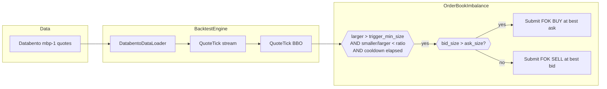
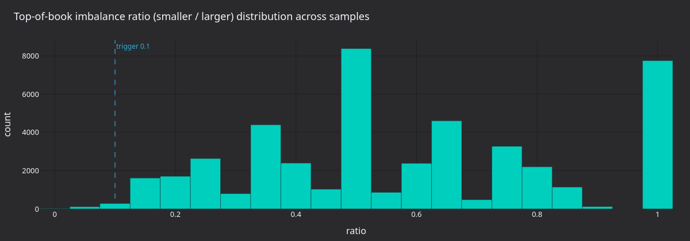
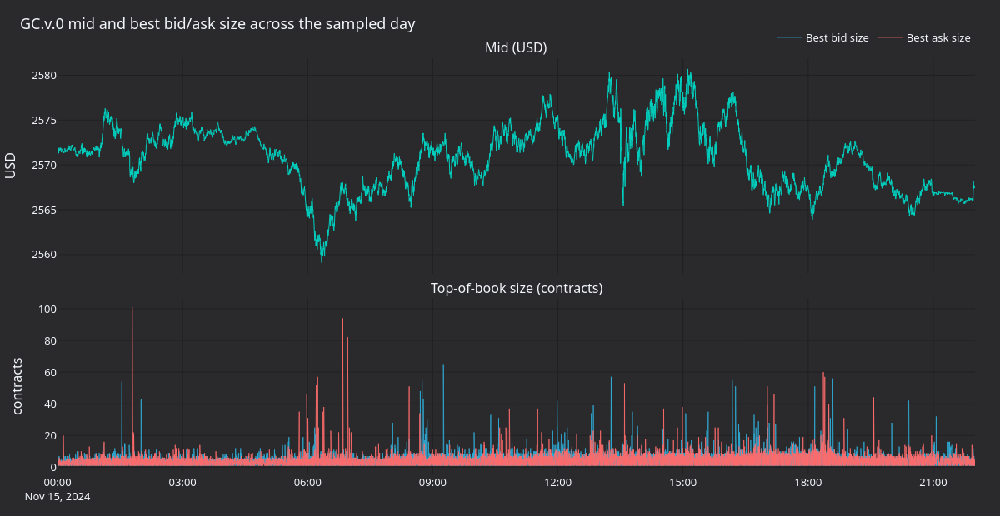
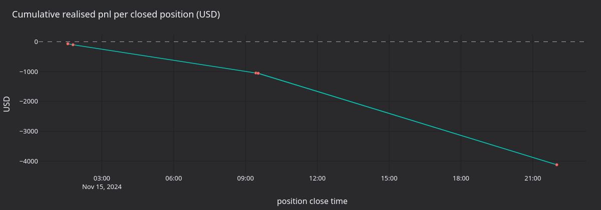

# Gold Perpetual Book Imbalance with Proxy Futures Data (AX Exchange)

tutorial นี้ backtest strategy แบบ top-of-book imbalance บน **XAU-PERP** ที่
[AX Exchange](https://architect.exchange) โดยใช้ quote แบบ `mbp-1` ของสัญญา gold futures ของ CME (`GC.v.0`) จาก
[Databento](https://databento.com) เป็นข้อมูลตัวแทน (proxy)

> หมายเหตุ: ต้นฉบับมีเฉพาะตัวอย่าง Python จึงตัดออก ดูวิธีรัน backtest ด้วย Rust ได้ที่
> [Run a Backtest (Rust)](../how_to/run_rust_backtest.md)

## บทนำ {#introduction}

top-of-book imbalance เป็นสัญญาณระดับ microstructure เมื่อฝั่งหนึ่งของ BBO มีขนาด order ที่วางรออยู่มากกว่าอีกฝั่งมาก
book จะเอียงไปทางฝั่งนั้น เมื่อฝั่งที่หนักกว่าดูดซับ flow ไว้ ราคาในระยะสั้นมักเคลื่อนไปทางฝั่งที่บางกว่า

strategy ตัวอย่าง `OrderBookImbalance` ของ AX จะ submit limit order แบบ fill-or-kill (FOK) ที่กินฝั่งที่บางกว่า เช่น
ซื้อที่ ask เมื่อฝั่ง bid มีขนาดมากกว่า โดยจะ submit order ทุกครั้งที่อัตราส่วนระหว่างสองฝั่งน้อยกว่า threshold และพ้นช่วง
cooldown แล้ว

strategy ต้องการแค่ BBO จึงใช้ quote data แบบ `mbp-1` (market by price, best bid/ask เดียว) ไม่ต้องใช้ L2 book เต็ม
ซึ่งช่วยลดค่าข้อมูลสำหรับการ backtest

`OrderBookImbalance` เป็น strategy เพื่อการสอน และไม่มี edge



### ทำไมต้องใช้ข้อมูล proxy {#why-proxy-data}

Databento ยังไม่ครอบคลุม AX Exchange สัญญา gold futures `GC` ของ CME เป็น gold derivative ที่มี liquidity สูงที่สุดในโลก
จึงให้ microstructure ที่เป็นตัวแทนได้ดีสำหรับการ backtest strategy ทองคำ **continuous contract** `GC.v.0` ต่อข้อมูลข้าม
วันหมดอายุโดยใช้สัญญาที่มี volume สูงที่สุด ซึ่งตาม liquidity เช่นเดียวกับที่ perpetual ทำ

พารามิเตอร์ `stype_in="continuous"` จะ resolve symbol ผ่าน continuous mapping ของ Databento ตอน request การ override
`instrument_id` ตอนโหลดจึงปลอดภัย เพราะ mapping นี้เลือก instrument อ้างอิงเพียงตัวเดียว ณ ขณะใดขณะหนึ่ง

อ่านเพิ่มเติมเกี่ยวกับความสามารถในการพยากรณ์ของ feature ด้าน book imbalance ได้ที่ [บทความของ Databento เรื่อง HFT
signals with sklearn](https://databento.com/blog/hft-sklearn-python)

## สิ่งที่ต้องมีก่อน {#prerequisites}

- [ติดตั้ง NautilusTrader แล้ว](../getting_started/installation.md)
- clone ของ repository NautilusTrader:

```bash
git clone https://github.com/nautechsystems/nautilus_trader
cd nautilus_trader
```

- Databento API key:

```bash
export DATABENTO_API_KEY="your-api-key"
```

## การเตรียมข้อมูล {#data-preparation}

### ดาวน์โหลด quote ของ CME gold futures {#download-cme-gold-futures-quotes}

ดาวน์โหลดข้อมูลจาก dataset `GLBX.MDP3` symbol `GC.v.0` (`stype_in="continuous"`) schema `mbp-1` ช่วง
`2024-11-15` ถึง `2024-11-16` แล้วเก็บเป็นไฟล์ `gc_gold_quotes.dbn.zst` request นี้ดาวน์โหลดหนึ่งวันทำการ และการรันครั้ง
ต่อไปจะใช้ไฟล์เดิม

### โหลดเป็น quote tick ของ Nautilus {#load-into-nautilus-quote-ticks}

`DatabentoDataLoader` parse ไฟล์ `.dbn.zst` และปล่อย object `QuoteTick` ออกมา argument `instrument_id` จะ override
symbology ของ Databento ทำให้ทุก tick ใช้ `XAU-PERP.AX` loader resolve price precision ของ ID นั้นไม่ได้ จึงต้องส่ง
`price_precision` อย่างชัดเจน (ในที่นี้คือ `2`) และต้องตรงกับการนิยาม instrument ด้านล่าง loader ใช้ไฟล์
`crates/adapters/databento/publishers.json`

## การนิยาม instrument {#instrument-definition}

ข้อมูล proxy ต้องนิยาม instrument เอง price precision, tick size และพารามิเตอร์ margin เป็นสมมติฐานของ backtest tick
`0.01` ละเอียดกว่าทั้ง tick ของ CME `GC` (`0.10`) และ tick ของ AX `XAU-PERP` (`0.1`)

ตัวอย่างนิยาม `XAU-PERP` เป็น `PerpetualContract` ที่มี asset class เป็น commodity, quote และ settlement currency เป็น
USD, ไม่ใช่ inverse, price precision `2`, size precision `0`, price increment `0.01`, size increment, multiplier และ
lot size เป็น `1`, initial margin `0.08` และ maintenance margin `0.04`

ค่าธรรมเนียมเป็นสมมติฐานของ backtest ที่ระบุชัดเจน ดูอัตราปัจจุบันได้ที่
[เอกสารของ AX](https://docs.architect.exchange/)

## Config ของ strategy {#strategy-configuration}

strategy subscribe quote และเปรียบเทียบขนาดฝั่ง bid กับ ask ในทุก `QuoteTick` โดยไม่ได้ subscribe L2 book delta

| พารามิเตอร์                     | ค่า     | คำอธิบาย                                      |
| ------------------------------ | ------ | -------------------------------------------- |
| `max_trade_size`               | `10`   | จำนวนสัญญาสูงสุดต่อ FOK order                   |
| `trigger_min_size`             | `1`    | ฝั่งที่ใหญ่กว่าต้องมีมากกว่าหนึ่งสัญญา               |
| `trigger_imbalance_ratio`      | `0.10` | trigger เมื่อ smaller / larger < 10%          |
| `min_seconds_between_triggers` | `5.0`  | cooldown ระหว่างการ trigger ที่ต่อเนื่องกัน         |

ตัวอย่างของ AX นิยาม strategy นี้ไว้ในไดเรกทอรี `examples/live/architect_ax`

## การตั้งค่า backtest {#backtest-setup}

backtest ใช้ `BacktestEngine` ที่มี trader ID `BACKTESTER-001` และเพิ่ม venue `AX` ด้วย OMS type แบบ `NETTING`,
account type แบบ `MARGIN`, base currency เป็น USD, balance เริ่มต้น `100000 USD` และ `MakerTakerFeeModel` ที่ maker
rate `0.0002` และ taker rate `0.0005` จากนั้นเพิ่ม instrument, quote data และ strategy แล้วรัน engine

เมื่อรันเสร็จ ให้สร้าง report ของ account, order fill และ position จาก engine

ดูวิธีตั้งค่าและรัน `BacktestEngine` ด้วย Rust ได้ที่ [Run a Backtest (Rust)](../how_to/run_rust_backtest.md)

## ผลลัพธ์ของการรัน {#what-the-run-produces}

การ replay ข้อมูล GC.v.0 mbp-1 ของวันที่ 2024-11-15 (หนึ่งวันทำการ) ผ่าน `OrderBookImbalance(0.10, 1.0, 5s)` ได้
FOK fill 2,378 ครั้ง fill เหล่านี้รวมสุทธิเป็นรอบ position ที่ปิดแล้ว 5 รอบ realized pnl สะสมจบที่ **-4,170 USD**
strategy ขาดทุนอย่างต่อเนื่องตลอดวัน ส่วนใหญ่มาจากต้นทุน spread ของ FOK fill แบบเพิ่มทีละส่วนที่เพิ่มขนาด position เดิม


**รูปที่ 1.** *top of book ของ GC.v.0 รอบ ๆ การเข้า short ใกล้ 09:26 และออกใกล้ 09:31 แล้วกลับเข้า long จนถึง 09:35
สามเหลี่ยมคือการเข้าจากสถานะ flat กากบาทคือการกลับสู่ flat และวงกลมกลวงคือ FOK fill แบบเพิ่มที่ทำให้ position โตขึ้น*



**รูปที่ 2.** *อัตราส่วนขนาด BBO แบบ `smaller / larger` จาก snapshot ของ top-of-book ทั้งหมดที่สุ่มเก็บ พร้อมเส้น
threshold trigger ที่ 0.10 มวลข้อมูลทางซ้ายของ threshold คือบริเวณที่ trigger ได้*



**รูปที่ 3.** *ราคา mid (บน) และขนาด best bid/ask เป็นจำนวนสัญญา (ล่าง) ตลอดวันทำการ ขนาดของ top-of-book แกว่งไปมา
ระหว่างประมาณสองถึงห้าสิบสัญญา ส่วน mid เคลื่อนในช่วงประมาณสิบห้าดอลลาร์*



**รูปที่ 4.** *realized pnl สะสมเป็น USD ตลอดห้ารอบ position ที่ปิดแล้ว ความชันเป็นลบอย่างสม่ำเสมอ และ pnl ต่อรอบถูก
ครอบงำด้วย spread*

## ขั้นตอนถัดไป {#next-steps}

- **Trigger ที่เข้มขึ้น**: ลด `trigger_imbalance_ratio` เป็น `0.05` หรือเพิ่ม `trigger_min_size` เป็น `5` เพื่อให้ต้องมี
  สัญญาณที่แรงขึ้นก่อน submit order
- **Session อื่น**: replay เฉพาะช่วงเวลาทำการปกติ (RTH) หรือหลายวัน เพื่อเปรียบเทียบพฤติกรรมในสภาวะตลาดต่าง ๆ
- **Instrument อื่น**: AX มี FX perpetual (`EURUSD-PERP`, `GBPUSD-PERP`) และเงิน (`XAG-PERP`) แนวทาง proxy เดียวกันใช้กับ
  CME futures ที่สอดคล้องกันได้
- **AX sandbox**: ดู[คู่มือ integration ของ AX Exchange](../integrations/architect_ax.md) เมื่อ backtest ทำงานได้ตามต้องการแล้ว

## การรันแบบ live {#running-live}

strategy `OrderBookImbalance` ตัวเดียวกันรันแบบ live กับ AX sandbox ได้ script สำหรับเริ่มใช้ `LiveNode` แทน
`BacktestEngine` และตั้งค่า data client และ execution client ของ AX สำหรับ `AxEnvironment.SANDBOX` ดูวิธีรัน live ด้วย
Rust ได้ที่ [Run Live Trading (Rust)](../how_to/run_rust_live_trading.md)

สำหรับการตั้งค่าการเชื่อมต่อและ API key ดู[คู่มือ integration ของ AX Exchange](../integrations/architect_ax.md)

## อ่านเพิ่มเติม {#further-reading}

- [tutorial Mean Reversion with Proxy FX Data](fx_mean_reversion_ax.md)
- [เอกสารของ Architect Exchange](https://docs.architect.exchange/)
- [Databento: HFT signals with sklearn](https://databento.com/blog/hft-sklearn-python)
