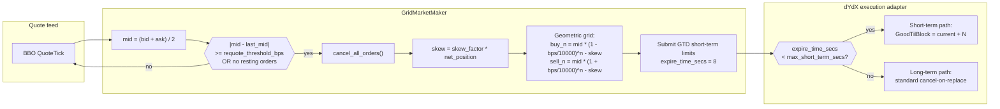
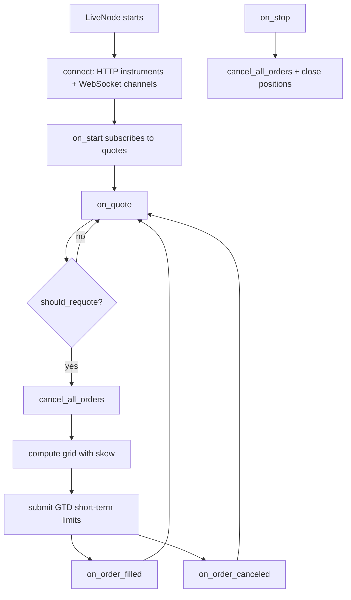
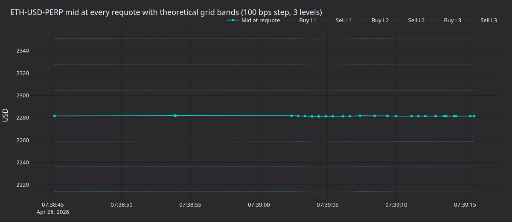
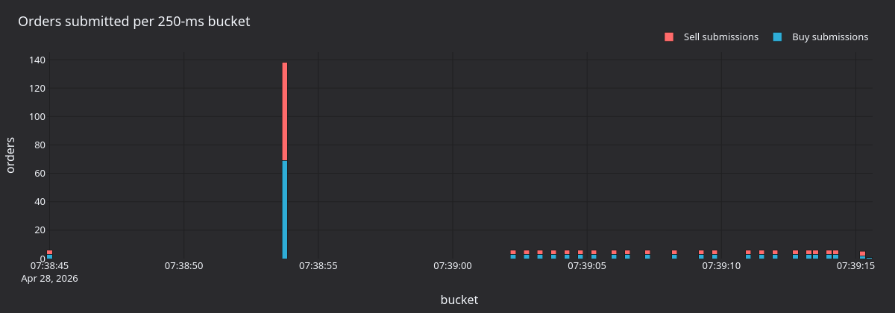

tutorial นี้รัน strategy `GridMarketMaker` ที่มาพร้อมกับโปรเจกต์บน dYdX v4 ผ่าน `LiveNode` ของ Rust strategy
จะวาง limit order แบบสมมาตรรอบราคา mid และเอียง (skew) grid เพื่อจัดการ inventory ส่วน venue จะหมุนเวียน
short-term order ผ่านการหมดอายุตาม block (time-to-block expiry) แทนการ cancel อย่างชัดเจน

## บทนำ [#introduction]

grid market maker ดูแลขั้นบันไดของ buy limit และ sell limit ที่วางรออยู่ตามระยะราคาคงที่รอบ mid ปัจจุบัน
เมื่อ order ถูก fill strategy จะได้กำไรจาก spread ระหว่างระดับ buy และ sell การจัดการ inventory จะคุม net
exposure ให้อยู่ภายใน `max_position` เพื่อไม่ให้ grid สะสม position ที่เอียงไปทางใดทางหนึ่ง



### การเอียง inventory (ได้แรงบันดาลใจจาก Avellaneda-Stoikov) [#inventory-skewing-avellaneda-stoikov-inspired]

เมื่อ position ฝั่ง long เพิ่มขึ้น grid ทั้งหมดจะเลื่อนลง (buy ถูกลง, sell ถูกลง) เพื่อกระตุ้นให้เกิด fill ฝั่ง sell
เมื่อ position ฝั่ง short เพิ่มขึ้น grid จะเลื่อนขึ้น แนวทางนี้ตาม framework ของ Avellaneda-Stoikov ที่ปรับให้ใช้กับ
grid แบบไม่ต่อเนื่อง

### ทำไมต้อง dYdX v4 [#why-dydx-v4]

dYdX v4 มีคุณสมบัติต่อไปนี้ที่เหมาะกับ market making:

- **Short-term order** ที่หมดอายุราว 20 วินาที: วาง order ได้ด้วย latency ต่ำ และไม่มีค่าใช้จ่ายในการเก็บข้อมูล on-chain
- **Block time ราว 0.5 วินาที** ทำให้รอบการยืนยันเร็ว
- **ไม่มีค่า gas สำหรับการ cancel**: การ cancel short-term order ฟรีภายใต้การป้องกัน replay แบบ GTB
- **On-chain order book** ที่ match แบบ deterministic ในแต่ละ block
- **Batch cancel**: `MsgBatchCancel` ครั้งเดียวล้าง short-term order ทั้งหมด

## สิ่งที่ต้องเตรียม [#prerequisites]

### Account dYdX ที่มีเงินทุน [#funded-dydx-account]

คุณต้องมี account dYdX ที่มี collateral เป็น USDC ตัวอย่างนี้เทรดบน mainnet โดยค่าเริ่มต้น หัวข้อ
[รันตัวอย่าง](#run-the-example) แสดงวิธีสลับไปใช้ testnet ดูหัวข้อ
[Testnet setup](../integrations/dydx.md#testnet-setup) ในคู่มือ integration สำหรับวิธีสร้างและเติมเงินเข้า
account บน testnet ส่วน API trading key เป็นทางเลือก: adapter จะ sign ด้วย private key ของ account เอง
เว้นแต่คุณจะตั้งค่า [permissioned key trading](../integrations/dydx.md#permissioned-key-trading)

### Environment variable [#environment-variables]

```bash
# Mainnet
export DYDX_PRIVATE_KEY="0x..."
export DYDX_WALLET_ADDRESS="dydx1..."

# Testnet
export DYDX_TESTNET_PRIVATE_KEY="0x..."
export DYDX_TESTNET_WALLET_ADDRESS="dydx1..."
```

## ภาพรวมของ strategy [#strategy-overview]

### การตั้งราคา grid แบบ geometric [#geometric-grid-pricing]

แต่ละระดับห่างจาก mid เป็นเปอร์เซ็นต์คงที่ (basis point):

```text
Buy level N:  mid * (1 - bps/10000)^N - skew
Sell level N: mid * (1 + bps/10000)^N - skew
```

โดยที่ `skew = skew_factor * net_position`

สำหรับ grid 3 ระดับที่ `grid_step_bps=100` (1%) รอบ mid ที่ 1000.00:

```text
                        Sell 3: 1030.30
                    Sell 2: 1020.10
                Sell 1: 1010.00
            ─── Mid: 1000.00 ───
                Buy 1:  990.00
                    Buy 2:  980.10
                        Buy 3:  970.30
```

เมื่อมี position long 2 และ `skew_factor=1.0` grid ทั้งหมดจะเลื่อนลง 2.0:

```text
                        Sell 3: 1028.30
                    Sell 2: 1018.10
                Sell 1: 1008.00
            ─── Mid: 1000.00 ───
                Buy 1:  988.00
                    Buy 2:  978.10
                        Buy 3:  968.30
```

### การจัดการ inventory [#inventory-management]

strategy บังคับขีดจำกัด position ผ่านกลไกสองแบบ:

- **`max_position`**: เพดานตายตัวของ net exposure (long หรือ short)
  strategy จะข้ามระดับใดก็ตามที่ exposure ที่คาดการณ์จะเกินเพดานนี้
- **Exposure ที่คาดการณ์**: ก่อนแต่ละระดับ strategy จะติดตาม exposure กรณีเลวร้ายที่สุดต่อฝั่ง
  (position ปัจจุบัน + buy / sell order ที่ค้างอยู่ทั้งหมด) เพื่อป้องกันการผูกมัดเกินขีดจำกัด

การเรียก `cancel_all_orders` เป็นแบบ asynchronous order ที่ค้างอยู่อาจยังถูก fill ระหว่าง cancel request กับ
การยืนยัน การตรวจ exposure กรณีเลวร้ายที่สุดต่อฝั่งช่วยป้องกัน exposure เกินชั่วขณะระหว่างช่วง cancel-requote

### เกณฑ์การ requote [#requote-threshold]

`requote_threshold_bps` ควบคุมว่า mid ต้องเคลื่อนไหวมากแค่ไหนก่อนที่ strategy จะ cancel order ที่เปิดอยู่ทั้งหมด
และวาง grid ใหม่:

- **เกณฑ์ต่ำ** (5 bps): ตอบสนองเร็วขึ้น มีธุรกรรม cancel/place มากขึ้น
- **เกณฑ์สูง** (50 bps): ธุรกรรมน้อยลง แต่ order อาจอยู่ห่างจากราคาปัจจุบันมากขึ้น

## Configuration [#configuration]

| Parameter               | Type           | ค่าเริ่มต้น    | คำอธิบาย                                                                  |
| ----------------------- | -------------- | ---------- | ------------------------------------------------------------------------ |
| `instrument_id`         | `InstrumentId` | *required* | instrument ที่จะเทรด (เช่น `ETH-USD-PERP.DYDX`)                            |
| `max_position`          | `Quantity`     | *required* | net exposure สูงสุด (long หรือ short)                                       |
| `trade_size`            | `Quantity`     | `None`     | ขนาดต่อระดับของ grid ถ้าเป็น `None` จะใช้ `min_quantity` ของ instrument หรือ 1.0 |
| `num_levels`            | `usize`        | `3`        | จำนวนระดับ buy และ sell                                                    |
| `grid_step_bps`         | `u32`          | `10`       | ระยะห่างของ grid เป็น basis point (10 = 0.1%)                               |
| `skew_factor`           | `f64`          | `0.0`      | ความแรงในการเลื่อน grid ตาม inventory                                        |
| `requote_threshold_bps` | `u32`          | `5`        | การเคลื่อนไหวของ mid ขั้นต่ำเป็น bps ก่อน requote                              |
| `expire_time_secs`      | `Option<u64>`  | `None`     | เวลาหมดอายุของ order เป็นวินาที ใช้ GTD เมื่อตั้งไว้ มิฉะนั้นใช้ GTC                |
| `on_cancel_resubmit`    | `bool`         | `false`    | ส่ง grid ใหม่ที่ quote ถัดไปหลังการ cancel ที่ไม่คาดคิด                          |

### การเลือก parameter [#choosing-parameters]

- **`grid_step_bps`**: [50, 100] bps ในตลาดที่ผันผวน และ [5, 20] bps ในสภาวะสงบ grid ที่กว้างกว่าได้ spread
  ต่อ fill มากกว่าแต่ fill น้อยครั้งกว่า
- **`skew_factor`**: เริ่มที่ `0.0` ค่า `0.5` จะเลื่อน grid 0.5 หน่วยราคาต่อ net position หนึ่งหน่วย skew ที่มาก
  เกินไปอาจทำให้ grid ทั้งหมดอยู่เหนือหรือต่ำกว่า mid
- **`expire_time_secs`**: สำหรับ short-term order ของ dYdX ให้ตั้งเป็น `8` วินาที ซึ่งพอดีภายในหน้าต่าง
  short-term 40 block (ราว 20 วินาที) และทำให้ order อยู่บนเส้นทาง short-term ที่เร็ว เมื่อเป็น `None` order
  จะใช้ GTC และเส้นทาง long-term
- **`on_cancel_resubmit`**: กระตุ้นการส่งใหม่ที่ quote tick ถัดไปหลังการ cancel ที่ strategy ไม่ได้เริ่มเอง
  (short-term order หมดอายุจาก indexer, self-trade prevention, risk limit) indexer จะปล่อย cancel event
  สำหรับ short-term order แต่ละตัวไม่นานหลังจากหมดอายุ flag นี้จะ reset จุดยึด (anchor) ของการ requote
  เพื่อให้ quote ถัดไปสร้าง grid ใหม่ แม้ mid จะยังเคลื่อนไหวไม่เกิน `requote_threshold_bps`

## ข้อพิจารณาเฉพาะของ dYdX [#dydx-specific-considerations]

### การหมดอายุของ short-term order [#short-term-order-expiry]

เมื่อ `expire_time_secs=8` adapter จะจัด order เป็นประเภท short-term:

1. adapter ตรวจว่า `8s < max_short_term_secs (40 blocks * ~0.5s = ~20s)`
1. adapter ส่ง order เป็น short-term พร้อม `GoodTilBlock = current_height + N`
1. order หมดอายุบน chain หลังจากราวแปดวินาทีถ้าไม่ถูก fill การหมดอายุไม่มีค่า gas (การป้องกัน replay แบบ GTB
   จัดการบน chain) indexer ยังปล่อย event `OrderCanceled` สำหรับ order ที่หมดอายุแต่ละตัวไม่นานหลัง block
   ที่หมดอายุ strategy จึงเห็นการหมดอายุผ่านเส้นทาง cancel event ปกติ

นี่คือ configuration ที่แนะนำสำหรับ market making เพราะ:

- short-term order มี latency ต่ำกว่า
- การหมดอายุไม่มีค่า gas บน chain
- การ requote อย่างต่อเนื่อง (ขับเคลื่อนด้วย cancel event ที่ indexer ปล่อยเมื่อ `on_cancel_resubmit=true`)
  จะแทนที่ order ที่หมดอายุ

ดูรายละเอียดทั้งหมดได้ที่หัวข้อ [order classification](../integrations/dydx.md#order-classification)
ในคู่มือ integration

### การ cancel ที่ไม่คาดคิดและ `on_cancel_resubmit` [#unexpected-cancels-and-on_cancel_resubmit]

set `pending_self_cancels` ใช้แยกการ cancel ที่ strategy เริ่มเองออกจากการ cancel ที่ไม่คาดคิด:

1. เมื่อ strategy เรียก `cancel_all_orders` จะบันทึก order ID ที่เปิดอยู่ทั้งหมดไว้ใน `pending_self_cancels`
1. เมื่อ `on_order_canceled` ทำงาน:
   - ถ้า order ID อยู่ใน `pending_self_cancels` แสดงว่าเป็นการ cancel ของตัวเองและไม่ต้องทำอะไร
   - มิฉะนั้น strategy ไม่ได้เป็นผู้เริ่ม cancel (short-term order หมดอายุ, self-trade prevention หรือ risk limit)
     เมื่อ `on_cancel_resubmit=true` จะ reset `last_quoted_mid` เพื่อให้ quote ถัดไปกระตุ้นการส่ง grid ใหม่ทั้งหมด

วิธีนี้ป้องกันการ requote ที่ไม่จำเป็นระหว่าง cancel request ของ strategy เอง ขณะที่ยังตอบสนองต่อการ cancel
ที่ไม่คาดคิด

callback `on_order_filled` ยังลบ order ที่ fill ครบแล้วออกจาก `pending_self_cancels` ด้วย ถ้า order ถูก fill
ก่อนการยืนยัน cancel จะมาถึง วิธีนี้ป้องกันไม่ให้รายการที่ค้างเก่าสะสม partial fill จะคง order ID ไว้ เพื่อให้
การ cancel ของตัวเองในภายหลังยังถูกระบุได้ถูกต้อง

### การ quantize order [#order-quantization]

`OrderMessageBuilder` ของ adapter quantize ราคาและขนาดสำหรับ market ของ dYdX ให้อัตโนมัติ ไม่ต้องปัดหรือ
แปลงค่าเอง ดูรายละเอียดได้ที่ [Price and size quantization](../integrations/dydx.md#price-and-size-quantization)

### Post-only order [#post-only-orders]

strategy ส่ง order ของ grid ทั้งหมดด้วย `post_only=true` exchange จะ accept แล้ว cancel ทันทีสำหรับ order
แบบ post-only ใดๆ ที่จะข้าม spread ตอน match strategy จะเห็น `OrderCanceled` ไม่ใช่ `OrderRejected` ดังนั้น
ทุก fill จึงใช้อัตราค่าธรรมเนียม maker และ grid จะไม่กิน offer ของตัวเองระหว่างช่วง requote

## การรันและการหยุด [#running-and-stopping]

### การตั้งค่าสภาพแวดล้อม [#environment-setup]

credential โหลดจาก environment variable หรือไฟล์ `.env` ที่ root ของโปรเจกต์ (โหลดอัตโนมัติผ่าน `dotenvy`):

```bash
# Direct export
export DYDX_PRIVATE_KEY="0x..."
export DYDX_WALLET_ADDRESS="dydx1..."
```

```bash
# .env equivalent
DYDX_PRIVATE_KEY=0x...
DYDX_WALLET_ADDRESS=dydx1...
```

### รันตัวอย่าง [#run-the-example]

:::warning
คำสั่งนี้วาง order จริงบน **dYdX mainnet** โดยค่าเริ่มต้น
ค่าคงที่ `DYDX_NETWORK` ใกล้ส่วนบนของ `crates/adapters/dydx/examples/node_grid_mm.rs` คือ `DydxNetwork::Mainnet`
ตัวอย่างนี้อ่าน `DYDX_PRIVATE_KEY` และ `DYDX_WALLET_ADDRESS`
หากต้องการรันบน testnet ให้ตั้ง `DYDX_NETWORK` เป็น `DydxNetwork::Testnet` แล้ว build ใหม่
จากนั้นตัวอย่างจะอ่าน `DYDX_TESTNET_PRIVATE_KEY` และ `DYDX_TESTNET_WALLET_ADDRESS`
:::

```bash
cargo run --example dydx-grid-mm --package nautilus-dydx --features examples
```

### การหยุดอย่างนุ่มนวล [#graceful-shutdown]

กด **Ctrl+C** เพื่อหยุด node ลำดับการ shutdown:

1. node ได้รับ SIGINT, trader หยุด และ `on_stop` ทำงาน
1. strategy cancel order ทั้งหมดและปิด position
1. node ประมวลผล event ที่เหลือในช่วงผ่อนผัน 5 วินาที (`delay_post_stop_secs`)
1. client disconnect และ node จบการทำงาน

## อธิบายโค้ด [#code-walkthrough]

function `main` อยู่ที่
[`crates/adapters/dydx/examples/node_grid_mm.rs`](https://github.com/nautechsystems/nautilus_trader/tree/develop/crates/adapters/dydx/examples/node_grid_mm.rs)
สำเนาแบบย่อนี้ใส่ค่าคงที่ของตัวอย่างไว้ในโค้ดโดยตรง:

```rust
const DYDX_NETWORK: DydxNetwork = DydxNetwork::Mainnet;

#[tokio::main]
async fn main() -> Result<(), Box<dyn std::error::Error>> {
    dotenvy::dotenv().ok();

    let network = DYDX_NETWORK;

    let environment = Environment::Live;
    let trader_id = TraderId::from("TESTER-001");
    let account_id = AccountId::from("DYDX-001");
    let node_name = "DYDX-GRID-MM-001".to_string();
    let instrument_id = InstrumentId::from("ETH-USD-PERP.DYDX");

    let data_config = DydxDataClientConfig {
        network,
        ..Default::default()
    };

    let exec_config = DydxExecutionClientConfig {
        account_id,
        network,
        ..Default::default()
    };

    let data_factory = DydxDataClientFactory::new();
    let exec_factory = DydxExecutionClientFactory::new();

    let log_config = LoggerConfig {
        stdout_level: LevelFilter::Info,
        ..Default::default()
    };

    let mut node = LiveNode::builder(trader_id, environment)?
        .with_name(node_name)
        .with_logging(log_config)
        .add_data_client(None, Box::new(data_factory), Box::new(data_config))?
        .add_exec_client(None, Box::new(exec_factory), Box::new(exec_config))?
        .with_reconciliation(false)
        .with_delay_post_stop_secs(5)
        .build()?;

    let config = GridMarketMakerConfig::builder()
        .instrument_id(instrument_id)
        .max_position(Quantity::from("0.10"))
        .num_levels(3)
        .grid_step_bps(100)
        .skew_factor(0.5)
        .requote_threshold_bps(10)
        .expire_time_secs(8)
        .on_cancel_resubmit(true)
        .build();
    let strategy = GridMarketMaker::new(config);

    node.add_strategy(strategy)?;
    node.run().await?;

    Ok(())
}
```

จุดสำคัญของ configuration:

- **`dotenvy::dotenv().ok()`**: โหลด `.env` จาก root ของโปรเจกต์ถ้ามี
- **`with_reconciliation(false)`**: ปิดไว้เพื่อความเรียบง่าย ควรเปิดใน production เพื่อกู้คืน state ข้ามการ restart
- **`with_delay_post_stop_secs(5)`**: ช่วงผ่อนผันให้ event การ cancel และการปิดที่ค้างอยู่เสร็จสิ้นระหว่าง shutdown

### Flow ของ event [#event-flow]



## กลไกภายในของ strategy [#strategy-internals]

snippet Rust ต่อไปนี้เป็นฉบับย่อของ source ของ strategy ใน
[`crates/trading/src/examples/strategies/grid_mm/strategy.rs`](https://github.com/nautechsystems/nautilus_trader/blob/develop/crates/trading/src/examples/strategies/grid_mm/strategy.rs)
ซึ่งมีการจัดการ error และการติดตาม state ที่ snippet เหล่านี้ละไว้

### การกำหนดขนาด trade (`on_start`) [#trade-size-resolution-on_start]

strategy กำหนดขนาด trade จาก cache ของ instrument ตามลำดับนี้:

1. ค่าที่ตั้งค่าไว้
1. `min_quantity` ของ instrument
1. `1.0` เป็นค่าสำรองสุดท้าย

```rust
fn on_start(&mut self) -> anyhow::Result<()> {
    let instrument_id = self.config.instrument_id;
    let (instrument, size_precision, min_quantity) = {
        let cache = self.cache();
        let instrument = cache
            .instrument(&instrument_id)
            .ok_or_else(|| anyhow::anyhow!("Instrument {instrument_id} not found in cache"))?;
        (
            instrument.clone(),
            instrument.size_precision(),
            instrument.min_quantity(),
        )
    };
    self.price_precision = Some(instrument.price_precision());
    self.instrument = Some(instrument);

    if self.trade_size.is_none() {
        self.trade_size =
            Some(min_quantity.unwrap_or_else(|| Quantity::new(1.0, size_precision)));
    }

    self.subscribe_quotes(instrument_id, None, None);
    Ok(())
}
```

### Quote handler (`on_quote`, ฉบับย่อ) [#quote-handler-on_quote-abbreviated]

```rust
fn on_quote(&mut self, quote: &QuoteTick) -> anyhow::Result<()> {
    let mid_f64 = (quote.bid_price.as_f64() + quote.ask_price.as_f64()) / 2.0;
    let mid = Price::new(
        mid_f64,
        self.price_precision
            .expect("price_precision should be resolved in on_start"),
    );

    if !self.should_requote(mid) {
        return Ok(()); // Mid hasn't moved enough, keep existing grid
    }

    self.cancel_all_orders(
        instrument_id,
        None,
        None,
        true, // Restrict cancellation to this strategy.
        None,
    )?;

    let (net_position, worst_long, worst_short) = { /* ... */ };

    let grid = self.grid_orders(mid, net_position, worst_long, worst_short);

    if grid.is_empty() {
        return Ok(()); // Don't advance requote anchor when fully constrained
    }

    let (tif, expire_time) = match self.config.expire_time_secs {
        Some(secs) => {
            let now_ns = self.clock().timestamp_ns();
            let expire_ns = now_ns + secs * 1_000_000_000;
            (Some(TimeInForce::Gtd), Some(expire_ns))
        }
        None => (None, None),
    };

    for (side, price) in grid {
        let order = self.order().limit(
            instrument_id,
            side,
            trade_size,
            price,
            tif,
            expire_time,
            Some(true), // post_only
        );
        self.submit_order(order, None, None)?;
    }

    self.last_quoted_mid = Some(mid);
    Ok(())
}
```

### การตั้งราคา grid (`grid_orders`) [#grid-pricing-grid_orders]

method `grid_orders` คำนวณราคา grid แบบ geometric และบังคับ `max_position` ต่อระดับ:

```rust
fn grid_orders(
    &self,
    mid: Price,
    net_position: f64,
    worst_long: Decimal,
    worst_short: Decimal,
) -> Vec<(OrderSide, Price)> {
    let instrument = self
        .instrument
        .as_ref()
        .expect("instrument should be resolved in on_start");
    let mid_f64 = mid.as_f64();
    let skew_f64 = self.config.skew_factor * net_position;
    let pct = self.config.grid_step_bps as f64 / 10_000.0;
    let trade_size = self
        .trade_size
        .expect("trade_size should be resolved in on_start")
        .as_decimal();
    let max_pos = self.config.max_position.as_decimal();
    let mut projected_long = worst_long;
    let mut projected_short = worst_short;
    let mut orders = Vec::new();

    for level in 1..=self.config.num_levels {
        let buy_f64 = mid_f64 * (1.0 - pct).powi(level as i32) - skew_f64;
        let sell_f64 = mid_f64 * (1.0 + pct).powi(level as i32) - skew_f64;
        let buy_price = instrument.next_bid_price(buy_f64, 0);
        let sell_price = instrument.next_ask_price(sell_f64, 0);

        if let Some(buy_price) = buy_price
            && projected_long + trade_size <= max_pos
        {
            orders.push((OrderSide::Buy, buy_price));
            projected_long += trade_size;
        }

        if let Some(sell_price) = sell_price
            && projected_short - trade_size >= -max_pos
        {
            orders.push((OrderSide::Sell, sell_price));
            projected_short -= trade_size;
        }
    }

    orders
}
```

## ผลลัพธ์จากการรันบน mainnet 35 วินาที [#what-a-35-second-mainnet-run-produces]

การรันบน mainnet 35 วินาทีกับ `ETH-USD-PERP.DYDX` ด้วย config ของตัวอย่าง (`grid_step_bps=100`, `num_levels=3`,
`skew_factor=0.5`, `requote_threshold_bps=10`, `expire_time_secs=8`) จับได้ 47 requote event, การส่ง order 276 ครั้ง,
accept 67 ครั้ง และ cancel 54 ครั้ง ขณะนั้น ETH เทรดอยู่ใกล้ 2,281 USD ราคาไม่เคยเคลื่อนไหวมากพอจะกระตุ้นเกณฑ์
requote 10 bps รอบส่วนใหญ่จึงเริ่มจากการหมดอายุของ short-term order ทุก 8 วินาที แทนการเคลื่อนไหวของราคา



**รูปที่ 1** *mid ของ ETH-USD-PERP ที่แต่ละ requote พร้อมแถบ grid ตามทฤษฎีหกแถบ (ฝั่งละ 3 ระดับ, step 100 bps)
mid อยู่ใกล้ 2,281 USD ระดับ buy และ sell ด้านในอยู่ที่ราว 2,258 และ 2,304 USD*


**รูปที่ 2** *เวลาจาก `OrderAccepted` ถึง `OrderCanceled` ต่อ short-term order หนึ่งตัว เป็นวินาที กลุ่มก้อนใหญ่
ใกล้ [7, 8] วินาทีตรงกับการตั้งค่า `expire_time_secs=8` กลุ่มเล็กที่ต่ำกว่า 6 วินาทีคือการ cancel ที่ strategy
เริ่มเองระหว่างช่วง requote*



**รูปที่ 3** *จำนวนการส่ง order ต่อช่วง 250 ms แยกตาม side แต่ละรอบ requote วาง order หกตัว (buy 3 + sell 3)
ระยะห่างระหว่างแต่ละชุดคือ interval ของการ requote*


**รูปที่ 4** *timeline ตามทฤษฎีของ short-term order ที่ `expire_time_secs=8` และ block 0.5 วินาที แผงด้านล่าง
ติดตามการเพิ่มขึ้นของ block height ของ chain โดยเป้าหมาย `GoodTilBlock` ของแต่ละ order ตั้งไว้ล่วงหน้าราว 16 block
ทำให้หมดอายุในแปดวินาที*

### สร้าง panel ใหม่ [#regenerate-the-panels]

:::warning
การรันเพื่อจับข้อมูลจะวาง order จริงบน dYdX mainnet โดยค่าเริ่มต้น หากต้องการจับข้อมูลจากการรันบน testnet แทน
ให้ตั้ง `DYDX_NETWORK` เป็น `DydxNetwork::Testnet` ก่อน build (ดู [รันตัวอย่าง](#run-the-example))
:::

หลัง build NautilusTrader จาก source แล้ว ให้รันคำสั่งเหล่านี้จาก root ของ repository เพื่อ build ตัวอย่างและ
จับ log จากการรันบน mainnet 35 วินาที:

```bash
cargo build --release --example dydx-grid-mm --package nautilus-dydx --features examples

# Capture a 35-second mainnet run.
timeout 35 ./target/release/examples/dydx-grid-mm > /tmp/dydx_main.log 2>&1
```

> หมายเหตุ: ต้นฉบับใช้ script Python (`docs/tutorials/assets/grid_market_maker_dydx/render_panels.py`) วาด panel จาก log นี้ จึงตัดขั้นตอนนั้นออก

## การติดตามและทำความเข้าใจ output [#monitoring-and-understanding-output]

### Log message [#log-messages]

| Log message                                         | ความหมาย                                                            |
| --------------------------------------------------- | ----------------------------------------------------------------- |
| `Requoting grid: mid=X, last_mid=Y`                 | refresh grid หลังการเคลื่อนไหวเกินเกณฑ์, การ reset anchor หรือ grid ว่าง  |
| `Submit short-term order N`                         | ส่ง order ผ่านเส้นทาง broadcast แบบ short-term                        |
| `BatchCancel N short-term orders`                   | execute batch cancel สำหรับ order ที่หมดอายุ/ค้างเก่า                   |
| `benign cancel error, treating as success`          | cancel order ที่ fill หรือหมดอายุไปแล้ว (ปกติ)                          |
| `Sequence mismatch detected, will resync and retry` | sequence error ของ Cosmos SDK กำลังกู้คืนอัตโนมัติ                     |

บรรทัด `Submit short-term order`, `BatchCancel` และ benign cancel ถูก log ที่ระดับ DEBUG ตัวอย่างตั้ง
`stdout_level: LevelFilter::Info` ไว้ จึงต้องเปลี่ยนเป็น `LevelFilter::Debug` เพื่อดูบรรทัดเหล่านี้

### รูปแบบพฤติกรรมที่คาดหวัง [#expected-behavior-patterns]

1. **Startup**: instrument โหลด, WebSocket เชื่อมต่อ, quote แรกกระตุ้น grid เริ่มต้น
1. **Steady state**: grid คงอยู่ข้าม tick การ requote เกิดเมื่อ mid เคลื่อนไหวอย่างน้อย `requote_threshold_bps`,
   grid ว่าง หรือมี event ที่ reset anchor การปฏิเสธและ event การหมดอายุจะ reset anchor ส่วนการ cancel ที่ไม่คาดคิด
   จะ reset เมื่อ `on_cancel_resubmit=true`
1. **Fill**: position อัปเดต, skew ปรับ และการ requote ครั้งถัดไปจะเลื่อน grid
1. **Expiry**: short-term order หมดอายุบน chain หลังราวแปดวินาที indexer ปล่อย cancel event สำหรับแต่ละตัว
   และ quote ถัดไปจะ refresh grid
1. **Shutdown**: order ทั้งหมดถูก cancel, position ปิด, WebSocket disconnect

## เคล็ดลับการปรับแต่ง [#customization-tips]

### ความผันผวนสูงกับต่ำ [#high-vs-low-volatility]

| สภาวะ             | การปรับ                                                                        |
| --------------- | ---------------------------------------------------------------------------- |
| ผันผวนสูง          | `grid_step_bps` กว้างขึ้น ([100, 200]), `num_levels` น้อยลง, `skew_factor` ต่ำลง |
| ผันผวนต่ำ          | `grid_step_bps` แคบลง ([10, 30]), `num_levels` มากขึ้น, `skew_factor` สูงขึ้น    |
| liquidity บาง    | เพิ่ม `requote_threshold_bps` เพื่อลดความถี่ของการ cancel                         |

### หลาย instrument [#multiple-instruments]

รัน instance ของ `GridMarketMaker` แยกกันต่อ instrument แต่ละ instance ดูแล grid, position และ state ของการ
cancel ของตัวเองอย่างอิสระ:

```rust
let btc_config = GridMarketMakerConfig::builder()
    .instrument_id(InstrumentId::from("BTC-USD-PERP.DYDX"))
    .max_position(Quantity::from("0.001"))
    .base(
        StrategyConfig::builder()
            .strategy_id(StrategyId::from("GRID_MM-BTC"))
            .order_id_tag("BTC".to_string())
            .build()?,
    )
    .grid_step_bps(50)
    .build();

let eth_config = GridMarketMakerConfig::builder()
    .instrument_id(InstrumentId::from("ETH-USD-PERP.DYDX"))
    .max_position(Quantity::from("0.10"))
    .base(
        StrategyConfig::builder()
            .strategy_id(StrategyId::from("GRID_MM-ETH"))
            .order_id_tag("ETH".to_string())
            .build()?,
    )
    .grid_step_bps(100)
    .build();

node.add_strategy(GridMarketMaker::new(btc_config))?;
node.add_strategy(GridMarketMaker::new(eth_config))?;
```

### สลับระหว่าง mainnet กับ testnet [#mainnet-vs-testnet-toggle]

ตัวอย่างเลือก network จากค่าคงที่ `DYDX_NETWORK` ใกล้ส่วนบนของไฟล์ (`DydxNetwork::Mainnet` โดยค่าเริ่มต้น)
เปลี่ยนเป็น `DydxNetwork::Testnet` แล้ว build ใหม่เพื่อรันบน testnet

## อ่านเพิ่มเติม [#further-reading]

- [dYdX v4 Integration Guide](../integrations/dydx.md): reference ฉบับเต็มของ adapter
- [dYdX Protocol Documentation](https://docs.dydx.xyz/): เอกสารทางการของ protocol
- [Order types](https://docs.dydx.xyz/concepts/trading/orders): กลไกของ order ระดับ protocol
