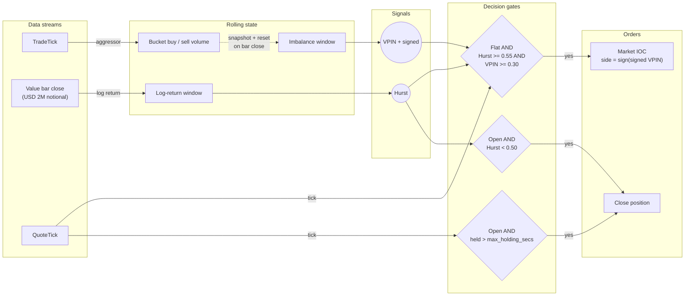
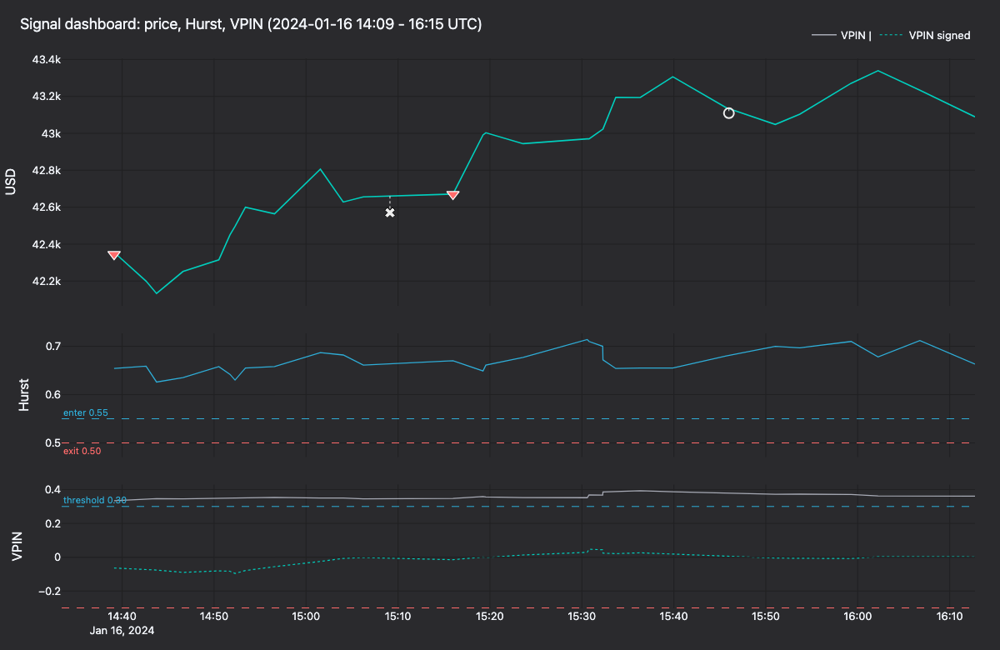
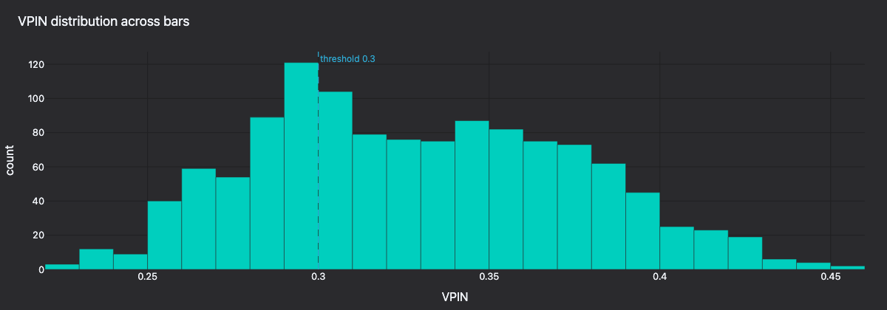
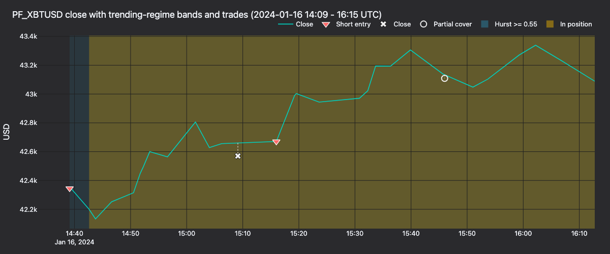
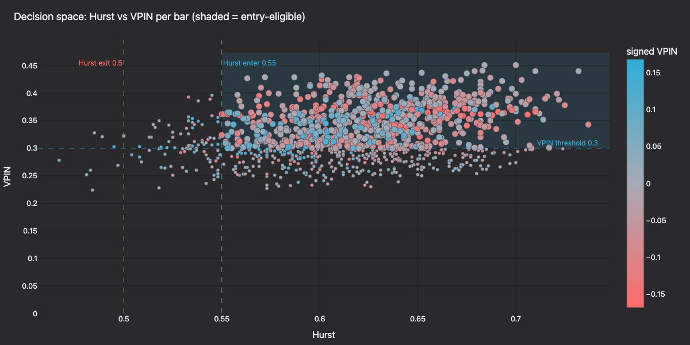

:::note
tutorial นี้เป็นแบบ **Rust เท่านั้น** โดยใช้ strategy, การ setup backtest และ test จาก core ที่คอมไพล์แล้ว
:::

tutorial นี้ทำ backtest strategy เชิงทิศทางบน **PF_XBTUSD** ซึ่งเป็น perpetual ของ Bitcoin ที่ใช้ USD เป็น margin บน
[Kraken Futures](https://futures.kraken.com) strategy นี้รวม **ตัวกรอง regime ด้วย Hurst exponent** เข้ากับสัญญาณ
flow แบบ **VPIN** (Volume-synchronized Probability of Informed Trading) โดย `BacktestEngine` ของ Rust จะ replay
trade และ quote ย้อนหลังจาก [Tardis.dev](https://tardis.dev)

## บทนำ [#introduction]

strategy นี้รวมตัวกรอง regime แบบช้าจาก bar เข้ากับสัญญาณ informed flow แบบเร็วจาก trade การเข้า position
ที่ขับเคลื่อนด้วย quote จะเกิดขึ้นเฉพาะเมื่อสัญญาณทั้งสองสอดคล้องกัน

- **Hurst exponent**: สุ่มตัวอย่างบน bar แบบ notional คงที่ (value) ตามแนวทางของ Lopez de Prado
  (*Advances in Financial Machine Learning*, บทที่ 2) ค่าประมาณแบบ rescaled-range (R/S) ที่มากกว่า `0.55`
  บ่งชี้พฤติกรรมแบบต่อเนื่องเป็น trend ค่าที่น้อยกว่า `0.50` บ่งชี้การกลับสู่ค่าเฉลี่ย (mean reversion) หรือ noise

- **VPIN**: dollar bar ที่ปิดแล้วแต่ละแท่งคือ volume bucket หนึ่ง bucket VPIN คือค่าเฉลี่ยของ imbalance สัมบูรณ์
  ระหว่างปริมาณซื้อเชิงรุกและปริมาณขายเชิงรุกในห้าสิบ bucket ล่าสุด ส่วน imbalance แบบมีเครื่องหมายบอกทิศทาง
  สุทธิของ informed flow

- **การเข้า position ที่ขับเคลื่อนด้วย quote**: เมื่อสัญญาณทั้งสองสอดคล้องกัน strategy จะเปิด position ใน quote tick
  ถัดไป จังหวะการเข้าจึงผูกกับ top of book แบบ live แทนที่จะผูกกับการปิด bar

strategy จะปิด position เมื่อค่าประมาณ Hurst ลดลงต่ำกว่าเกณฑ์ล่าง หรือเมื่อถือครบระยะเวลาสูงสุดที่กำหนด

strategy นี้มีมาให้ในชื่อ
[`HurstVpinDirectional`](https://github.com/nautechsystems/nautilus_trader/tree/develop/crates/trading/src/examples/strategies/hurst_vpin_directional)
ใน module `nautilus_trading::examples::strategies` เช่นเดียวกับ strategy ตัวอย่างอื่น ๆ ที่มีมาให้ มันถูกออกแบบให้
เรียบง่ายโดยตั้งใจ และไม่มีความได้เปรียบเชิง alpha

### ทำไมต้อง Kraken Futures [#why-kraken-futures]

Kraken Futures มี perpetual ของ Bitcoin และ Ether สองรูปแบบ:

- **perpetual แบบ inverse `PI_`**: quote เป็น USD แต่ใช้สินทรัพย์อ้างอิงเป็น margin และ settle
- **perpetual แบบ linear `PF_`**: quote เป็น USD ใช้ USD เป็น margin และ settle (ผ่าน multi-collateral)

tutorial นี้ใช้ **`PF_XBTUSD`** เพื่อให้สกุลเงินของ account, สกุลเงินที่ quote และกรอบการสุ่มตัวอย่าง dollar bar
เป็น USD ทั้งหมด

### ทำไมต้องใช้ dollar bar คู่กับ VPIN [#why-dollar-bars-and-vpin-together]

VPIN นิยามบน bucket ของ *ปริมาณ* แทน bucket ของ *เวลา* dollar bar (การ aggregate แบบ `VALUE` ใน NautilusTrader)
จะปิดหลังจากมีการซื้อขายครบ notional ที่กำหนด กรอบการสุ่มตัวอย่างจึงปรับตามกิจกรรมของตลาด VPIN bucket แต่ละ
bucket คือ dollar bar หนึ่งแท่ง และ Hurst ก็ใช้ bar ชุดเดียวกัน สัญญาณทั้งสองจึงใช้ clock และกรอบการสุ่มตัวอย่างเดียวกัน

## สิ่งที่ต้องมี [#prerequisites]

- Rust toolchain ที่ใช้งานได้ (ดู [rustup.rs](https://rustup.rs))
- repository ของ NautilusTrader ที่ clone และ build ได้แล้ว
- การเข้าถึงอินเทอร์เน็ตเพื่อดาวน์โหลดตัวอย่างฟรีของ Tardis (ไม่ต้องใช้ API key สำหรับวันแรกของแต่ละเดือน)

## การเตรียมข้อมูล [#data-preparation]

Tardis เผยแพร่ข้อมูล Kraken Futures ภายใต้ slug ย้อนหลังชื่อ `cryptofacilities` วันแรกของแต่ละเดือนใช้ได้ฟรีโดยไม่ต้อง
มี API key ตัวอย่างนี้เพียงพอสำหรับตรวจสอบการ setup แบบวันเดียว backtest เต็มรูปแบบต้องใช้อย่างน้อยสอง session
เพื่อเติม Hurst window ขนาด 128 bar ให้เต็ม ช่วงข้อมูลย้อนหลังเหล่านั้นต้องใช้ API key ของ Tardis แบบเสียเงิน (ดู tip ด้านล่าง)

```bash
mkdir -p /tmp/tardis_kraken

curl -L -o /tmp/tardis_kraken/PF_XBTUSD_trades.csv.gz \
  https://datasets.tardis.dev/v1/cryptofacilities/trades/2024/01/01/PF_XBTUSD.csv.gz

curl -L -o /tmp/tardis_kraken/PF_XBTUSD_quotes.csv.gz \
  https://datasets.tardis.dev/v1/cryptofacilities/quotes/2024/01/01/PF_XBTUSD.csv.gz
```

binary ตัวอย่างที่รันได้จะอ่านจาก `/tmp/tardis_kraken/` เป็นค่าเริ่มต้น หากดาวน์โหลดไว้ในไดเรกทอรีนั้น `cargo run`
จะทำงานได้โดยไม่ต้องแก้ค่าคงที่ของ path ในตัวอย่าง

:::tip
ช่วงข้อมูลย้อนหลังเต็มต้องใช้ API key ของ Tardis แบบเสียเงิน ใช้
[เครื่องมือดาวน์โหลดของ Tardis](https://docs.tardis.dev/downloadable-csv-files)
สำหรับการดาวน์โหลดจำนวนมากที่เกินตัวอย่างแบบวันเดียว
:::

loader Tardis ของ Rust parse ไฟล์ `.csv.gz` ได้โดยตรง และกำหนด instrument ID ที่ส่งให้กับทุก record strategy
จึงไม่ต้องมีการ map symbology:

```rust
use nautilus_model::identifiers::InstrumentId;
use nautilus_tardis::csv::load::{load_quotes, load_trades};

let instrument_id = InstrumentId::from("PF_XBTUSD.KRAKEN");
let trades = load_trades(
    "/tmp/tardis_kraken/PF_XBTUSD_trades.csv.gz",
    Some(1),               // price_precision
    Some(4),               // size_precision
    Some(instrument_id),
    None,                  // limit
)?;
let quotes = load_quotes(
    "/tmp/tardis_kraken/PF_XBTUSD_quotes.csv.gz",
    Some(1),
    Some(4),
    Some(instrument_id),
    None,
)?;
```

ส่ง `price_precision` และ `size_precision` ของ instrument อย่างชัดเจน มิฉะนั้น loader จะอนุมาน precision จาก
record แรก ๆ สำหรับวันตัวอย่างที่ไม่มีราคาเป็นเศษทศนิยม อาจอนุมานได้เป็น `0` และ matching engine จะปฏิเสธ
quote tick ที่ precision ไม่ตรงกับ precision ที่ instrument ประกาศไว้

## การนิยาม instrument [#instrument-definition]

tutorial นี้โหลดข้อมูล CSV โดยตรงโดยไม่ใช้ adapter Kraken แบบ live จึงต้องนิยาม `PF_XBTUSD` เองเป็น
[`CryptoPerpetual`](https://github.com/nautechsystems/nautilus_trader/blob/develop/crates/model/src/instruments/crypto_perpetual.rs)
perpetual แบบ linear บน Kraken Futures จะ quote และใช้ margin เป็น USD:

```rust
use nautilus_model::{
    identifiers::{InstrumentId, Symbol},
    instruments::CryptoPerpetual,
    types::{Currency, Price, Quantity},
};
use rust_decimal_macros::dec;

let instrument = CryptoPerpetual::builder()
    .instrument_id(InstrumentId::from("PF_XBTUSD.KRAKEN"))
    .raw_symbol(Symbol::from("PF_XBTUSD"))
    .base_currency(Currency::BTC())       // base
    .quote_currency(Currency::USD())      // quote
    .settlement_currency(Currency::USD()) // settlement (linear)
    .is_inverse(false)
    .price_precision(1)
    .size_precision(4)
    .price_increment(Price::from("0.5"))
    .size_increment(Quantity::from("0.0001"))
    .margin_init(dec!(0.02))
    .margin_maint(dec!(0.01))
    .ts_event(0.into())
    .ts_init(0.into())
    .build()
    .unwrap();
```

อัตรา margin และค่าธรรมเนียมเป็นสมมติฐานของ backtest ที่กำหนดไว้อย่างชัดเจน ตัวอย่างนี้ใช้ fee model แบบ
maker/taker ที่อัตรา maker 0.02% และ taker 0.05% ตรวจสอบอัตราปัจจุบันได้ที่
[ตารางค่าธรรมเนียมของ Kraken Futures](https://futures.kraken.com/features/fee-schedule)

## การสุ่มตัวอย่างด้วย dollar bar [#dollar-bar-sampling]

NautilusTrader มี bar aggregator แบบขับเคลื่อนด้วยข้อมูล (information-driven) ครบทุกแบบจาก AFML บทที่ 2 ได้แก่
tick, volume, value (dollar) รวมถึง variant แบบ imbalance และ runs ของแต่ละแบบ tutorial นี้ใช้ bar แบบ `VALUE`
ธรรมดา ซึ่งปิดหลังจากมีการซื้อขายครบ notional ที่กำหนดบน tape

bar type ระบุเป็น string โดย suffix `INTERNAL` บอก engine ให้ aggregate ภายใน NautilusTrader จาก trade stream
ต้นทาง (price type `LAST`):

```rust
use nautilus_model::data::BarType;

let bar_type = BarType::from("PF_XBTUSD.KRAKEN-2000000-VALUE-LAST-INTERNAL");
```

bar แต่ละแท่งปิดหลังจากมี notional ที่ซื้อขายครบ **USD 2,000,000** หนึ่ง session มักให้ bar น้อยกว่า 150 แท่ง และอาจ
ไม่ถึง Hurst window ขนาด 128 bar ดังนั้น config เริ่มต้นจึงต้องใช้หลาย session ในการ warmup สำหรับการรันวันเดียว
ให้ลดขนาด bar เป็น **USD 500,000** หรือลด `hurst_window` และ `vpin_window` ตามความเหมาะสม สำหรับ backtest
หลายวันเต็มรูปแบบให้ใช้ค่าเริ่มต้น

:::note
bar แบบ `VALUE` เป็น *มุมมอง* หนึ่งของ trade tape backtest engine ใช้ stream เดียวกับที่ขับเคลื่อน VPIN bar จึงไม่ทำให้
เกิดการนับซ้ำ
:::

## ภาพรวมของ strategy [#strategy-overview]

strategy `HurstVpinDirectional` รัน pipeline สามชุดพร้อมกัน ซึ่ง synchronize กันตอนปิด bar:

- trade ป้อนเข้าสู่ตัวสะสม bucket
- การปิด bar กระตุ้นการคำนวณสัญญาณใหม่
- quote ขับเคลื่อนการเข้า position และการตรวจ timeout



- **ทุก trade**: strategy สะสมปริมาณซื้อเชิงรุกและขายเชิงรุกของ bucket dollar bar ปัจจุบันผ่าน
  `TradeTick::aggressor_side`
- **ทุก bar** (ปิด bucket): strategy เพิ่ม log return ของ bar เข้าไปใน Hurst window คำนวณ imbalance แบบมีเครื่องหมาย
  และแบบสัมบูรณ์ของ bucket แล้ว reset ตัวสะสม จากนั้นประมาณค่า Hurst และ VPIN แบบ rolling ใหม่ ล้าง
  `exit_cooldown` และตรวจสอบการออกตาม regime
- **ทุก quote**: สัญญาณ Hurst และ VPIN ต้องสอดคล้องกันก่อนที่ strategy ที่ไม่มี position จะเปิด market order แบบ IOC
  Hurst ต้องถึง `hurst_enter`, VPIN ต้องถึง `vpin_threshold` และ imbalance แบบมีเครื่องหมายต้องไม่เป็นศูนย์
  หากมี position เปิดอยู่แล้ว จะตรวจสอบระยะเวลาถือสูงสุด

การออกตาม regime เกิดใน pipeline ของ bar เมื่อ Hurst ลดลงต่ำกว่า `hurst_exit` ส่วน holding timeout เกิดใน pipeline
ของ quote เมื่อ position เปิดอยู่นานกว่า `max_holding_secs`



**รูปที่ 1.** *Signal dashboard ของวันที่ 2024-01-16 เวลา 14:09-16:15 UTC: ราคาปิด, Hurst, VPIN marker แสดงราคา
fill จริง เส้นประเชื่อมแสดง slippage เทียบกับเส้นราคาปิดของ bar*

### ตัวประมาณค่า Hurst [#hurst-estimator]

strategy ใช้ regression แบบ rescaled-range (R/S) แบบคลาสสิก สำหรับแต่ละ lag `k` ใน `(4, 8, 16, 32)` จะแบ่ง
return window ออกเป็นช่วงที่ไม่ซ้อนทับกันความยาว `k` คำนวณ rescaled range ของแต่ละช่วง และบันทึกค่า R/S เฉลี่ย
ความชันของ `log(R/S)` เทียบกับ `log(k)` ตลอดชุด lag คือค่าประมาณ Hurst


**รูปที่ 2.** *Hurst แบบ rolling ตลอด 14 วันของ PF_XBTUSD (2024-01-15 ถึง 2024-01-28) พร้อมเกณฑ์เข้า 0.55
และเกณฑ์ออก 0.50*

### ตัวประมาณค่า VPIN [#vpin-estimator]

เมื่อ feed ของ venue ระบุฝั่ง aggressor ของ trade ไว้อย่างชัดเจน VPIN จะลดรูปเหลือ

```text
VPIN = mean_k ( |V_B_k - V_S_k| / (V_B_k + V_S_k) )
```

ตลอด `k` bucket ของ dollar bar ที่ปิดแล้วล่าสุด variant แบบมีเครื่องหมายจะคงเครื่องหมายของ `V_B - V_S` ไว้และใช้เลือก
ทิศทาง วิธีนี้แม่นยำกว่าการจำแนกแบบ bulk-volume ในสูตรดั้งเดิมของ Easley/Lopez de Prado ซึ่งจำเป็นเฉพาะเมื่อ
สังเกตฝั่ง aggressor โดยตรงไม่ได้



**รูปที่ 3.** *การกระจายของ VPIN ตลอดทุก bar พร้อมเกณฑ์เข้า 0.30*

### การตั้งค่า [#configuration]

| Parameter          | Value            | คำอธิบาย                                                          |
| ------------------ | ---------------- | ----------------------------------------------------------------- |
| `bar_type`         | `2M-VALUE-LAST`  | dollar bar ที่ปิดทุก notional USD 2,000,000                         |
| `trade_size`       | `0.0100`         | 0.0100 XBT ต่อ trade (ตรงกับ precision ของ instrument)              |
| `hurst_window`     | `128`            | rolling window ของ log return ของ dollar bar                       |
| `hurst_lags`       | `[4, 8, 16, 32]` | ชุด lag ที่ใช้ใน R/S regression                                     |
| `hurst_enter`      | `0.55`           | ค่า Hurst ต่ำสุดสำหรับ regime แบบ trend                             |
| `hurst_exit`       | `0.50`           | ต่ำกว่าค่านี้ position ที่เปิดอยู่จะถูกปิด                               |
| `vpin_window`      | `50`             | จำนวน volume bucket ที่ปิดแล้วซึ่งนำมาเฉลี่ยเป็น VPIN                   |
| `vpin_threshold`   | `0.30`           | VPIN ต่ำสุดที่ถือว่า flow เป็นแบบ informed                            |
| `max_holding_secs` | `1800`           | จำนวนวินาทีที่ถือ position ได้ (ค่าเริ่มต้น `3600`; override ที่นี่)       |

ตั้ง `hurst_window` และ `vpin_window` เป็นค่าในช่วง `[1, 16_384]`

:::tip
ขนาด dollar bar, Hurst lag และ VPIN window เชื่อมโยงกันทั้งหมด bar ที่เล็กลงให้การตอบสนองที่เร็วขึ้นแต่ Hurst มี noise
มากขึ้น bar ที่ใหญ่ขึ้นทำให้สัญญาณทั้งสองเรียบขึ้น แต่เสี่ยงที่จะมี sample น้อยเกินไปใน backtest แบบวันเดียว
:::

## การ setup backtest [#backtest-setup]

ตั้งค่า `BacktestEngine` ด้วย venue Kraken และ balance เริ่มต้นเป็น USD:

```rust
use nautilus_backtest::{
    config::{BacktestEngineConfig, SimulatedVenueConfig},
    engine::BacktestEngine,
};
use nautilus_execution::models::fee::{FeeModelAny, MakerTakerFeeModel};
use nautilus_model::{
    data::Data,
    enums::{AccountType, BookType, OmsType},
    identifiers::Venue,
    instruments::{Instrument, InstrumentAny},
    types::Money,
};

let mut engine = BacktestEngine::new(BacktestEngineConfig::default())?;

engine.add_venue(
    SimulatedVenueConfig::builder()
        .venue(Venue::from("KRAKEN"))
        .oms_type(OmsType::Netting)
        .account_type(AccountType::Margin)
        .book_type(BookType::L1_MBP)
        .starting_balances(vec![Money::from("100_000 USD")])
        .fee_model(
            FeeModelAny::MakerTaker(MakerTakerFeeModel::new(dec!(0.0002), dec!(0.0005))).into(),
        )
        .build()?,
)?;

engine.add_instrument(&InstrumentAny::CryptoPerpetual(instrument))?;
```

ป้อน trade และ quote ที่โหลดไว้ในรูป variant ของ enum `Data`:

```rust
let mut data: Vec<Data> = trades.into_iter().map(Data::Trade).collect();
data.extend(quotes.into_iter().map(Data::Quote));
engine.add_data(data, None, true, true)?;
```

### เพิ่ม strategy [#add-the-strategy]

```rust
use nautilus_model::types::Quantity;
use nautilus_trading::examples::strategies::{
    HurstVpinDirectional, HurstVpinDirectionalConfig,
};

let config = HurstVpinDirectionalConfig::builder()
    .instrument_id(instrument_id)
    .bar_type(bar_type)
    .trade_size(Quantity::from("0.0100")) // match instrument size_precision
    .max_holding_secs(1800)
    .build();

engine.add_strategy(HurstVpinDirectional::new(config))?;
```

### รัน backtest [#run-the-backtest]

```rust
engine.run(None, None, None, false)?;
```

เมื่อใช้ window เริ่มต้น 128/50 และ bar ขนาด USD 2,000,000 ตัวอย่างแบบวันเดียวจะอยู่ในช่วง warmup ตลอดการรัน
engine จะ aggregate dollar bar และขับเคลื่อน strategy ด้วย trade และ quote แต่ละตัว Hurst และ VPIN จะไม่ emit
ค่าจนกว่า window จะเต็ม หากต้องการเห็นการอัปเดตสัญญาณและการเข้าหรือออกภายในวันเดียว ให้ลดขนาด bar หรือ window
ตามที่อธิบายไว้ด้านบน หรือใช้ข้อมูลตั้งแต่สอง session ขึ้นไป

การรัน 14 วัน (2024-01-15 ถึง 2024-01-28) ด้วย config นี้พิมพ์ 1,224 bar และเกิดการเข้า position เพียง 2 ครั้ง,
การปิดบางส่วน 1 ครั้ง และการปิด 1 ครั้ง การเข้าที่ห่างกันมากนี้เป็นไปตามการออกแบบ: Hurst และ VPIN ต้องถึงเกณฑ์
ของตัวเองใน quote เดียวกัน ขนาดที่เหลือหลังการปิดบางส่วนด้วย IOC จะคงเปิดอยู่ตลอดช่วงที่เหลือของ session
OMS แบบ Netting จะทิ้ง position ที่เหลือนี้ไว้เมื่อ IOC สำหรับการออกถูก fill เพียงบางส่วน

การเชื่อมต่อทั้งหมดข้างต้นมีมาให้เป็น binary ที่รันได้:

```bash
cargo run -p nautilus-kraken --features examples \
  --example kraken-hurst-vpin-backtest --release
```

โดยค่าเริ่มต้นจะอ่าน `PF_XBTUSD_trades.csv.gz` และ `PF_XBTUSD_quotes.csv.gz` จาก `/tmp/tardis_kraken/`
หากต้องการอ่านไฟล์อื่น ให้แก้ค่าคงที่ `TRADES_PATH` และ `QUOTES_PATH` ใน
`crates/adapters/kraken/examples/engine_hurst_vpin_backtest.rs`



**รูปที่ 4.** *ราคาปิดของวันที่ 2024-01-16 เวลา 14:09-16:15 UTC แถบสีเขียวอมฟ้าแสดง bar ที่ `Hurst >= 0.55`
แถบสีทองแสดงช่วงที่มี position เปิดอยู่ marker อยู่ที่ราคา fill จริง เส้นประเชื่อมแสดง slippage เทียบกับเส้นราคาปิดของ bar*



**รูปที่ 5.** *Hurst เทียบกับ VPIN ราย bar ตลอด backtest ระบายสีตาม VPIN แบบมีเครื่องหมาย จตุภาคที่แรเงาแสดง
บริเวณที่เข้า position ได้*

### สร้าง panel ใหม่ [#regenerate-the-panels]

strategy ใน backtest จะ log `Hurst=… VPIN=… signed=… bar_close=…` ทุกครั้งที่ bar ปิด และ log event `OrderFilled`
มาตรฐานเมื่อเข้าและออก position log เหล่านี้ทำให้สร้าง panel ข้างต้นซ้ำได้ทั้งหมดจาก stdout ของการรัน

หลัง build NautilusTrader จาก source แล้ว ให้รันคำสั่งนี้จาก root ของ repository เพื่อเก็บ log:

```bash
RUST_LOG=info cargo run -p nautilus-kraken --features examples \
    --example kraken-hurst-vpin-backtest --release > /tmp/backtest.log 2>&1
```

> หมายเหตุ: ขั้นตอน render panel ในต้นฉบับใช้สคริปต์ Python (`render_panels.py`) จึงตัดออก

## ขั้นตอนถัดไป [#next-steps]

- **กรอบการสุ่มตัวอย่าง**: ลองใช้เกณฑ์ dollar bar ที่ใหญ่ขึ้นหรือเล็กลง aggregator แบบ `VALUE_IMBALANCE` และ
  `VALUE_RUNS` สร้าง bar ที่ปิดเมื่อมีข้อมูลใหม่เข้ามา ซึ่งเป็นทางเลือกแทนการสุ่มตัวอย่างแบบ dollar คงที่
- **เกณฑ์**: `hurst_enter`, `hurst_exit` และ `vpin_threshold` ล้วนส่งผลต่อกัน: เกณฑ์เข้าที่สูงขึ้นทำให้สัญญาณเกิด
  น้อยลงแต่เฉพาะเจาะจงขึ้น เกณฑ์ออกที่แคบลงทำให้ระยะเวลาถือเฉลี่ยสั้นลง
- **ตัวกรองความผันผวน**: เพิ่มตัวประมาณ realized volatility บน bar ชุดเดียวกัน เพื่อระงับการเข้า position ในช่วง
  session ที่ปั่นป่วนอย่างชัดเจน
- **Live trading**: เมื่อ backtest ทำงานได้ตามต้องการแล้ว ให้ขับเคลื่อน strategy เดียวกันผ่าน factory ของ live client
  ของ Kraken มีตัวอย่างการเชื่อมต่อแบบ live ที่รันได้มาให้ในชื่อ `kraken-hurst-vpin-live`

ตัวอย่างนี้เทรดบน **Kraken Futures production ด้วยเงินจริง** โดยค่าเริ่มต้น: client ทั้งสองใช้ค่าเริ่มต้น
`KrakenEnvironment::Live` และอ่าน `KRAKEN_FUTURES_API_KEY` และ `KRAKEN_FUTURES_API_SECRET` หากต้องการ
paper trade บน [demo-futures.kraken.com](https://demo-futures.kraken.com) แทน ให้แก้
`crates/adapters/kraken/examples/node_hurst_vpin_live.rs` ก่อน:

  1. ส่ง `true` เป็น argument `demo` ให้ `KrakenCredential::resolve_futures`
  1. ตั้ง `environment: KrakenEnvironment::Demo` (จาก `nautilus_kraken::common::enums`) บนทั้ง
     `KrakenDataClientConfig` และ `KrakenExecutionClientConfig`

จากนั้นตัวอย่างจะอ่าน `KRAKEN_FUTURES_DEMO_API_KEY` และ `KRAKEN_FUTURES_DEMO_API_SECRET`

  ```bash
  cargo run -p nautilus-kraken --features examples \
    --example kraken-hurst-vpin-live
  ```

## อ่านเพิ่มเติม [#further-reading]

- [source ของ strategy `HurstVpinDirectional`](https://github.com/nautechsystems/nautilus_trader/tree/develop/crates/trading/src/examples/strategies/hurst_vpin_directional)
- [แนวคิดด้าน data: bar type และการ aggregate](../concepts/data/index.md#bars-and-aggregation)
- [คู่มือ integration ของ Tardis](../integrations/tardis.md)
- [คู่มือ integration ของ Kraken](../integrations/kraken.md)
- [เอกสาร Kraken Futures](https://docs.kraken.com/api/docs/futures-api)
- Lopez de Prado, M. (2018). *Advances in Financial Machine Learning*,
  Wiley. บทที่ 2 (information-driven bar) และบทที่ 19 (VPIN)
