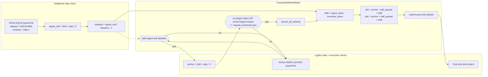
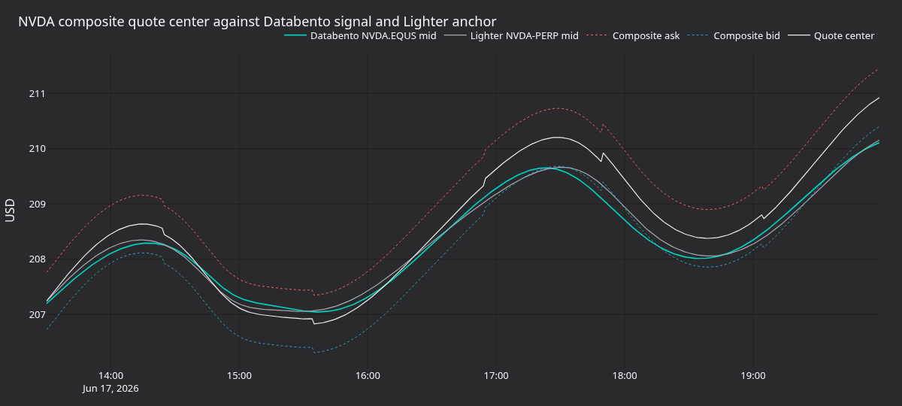
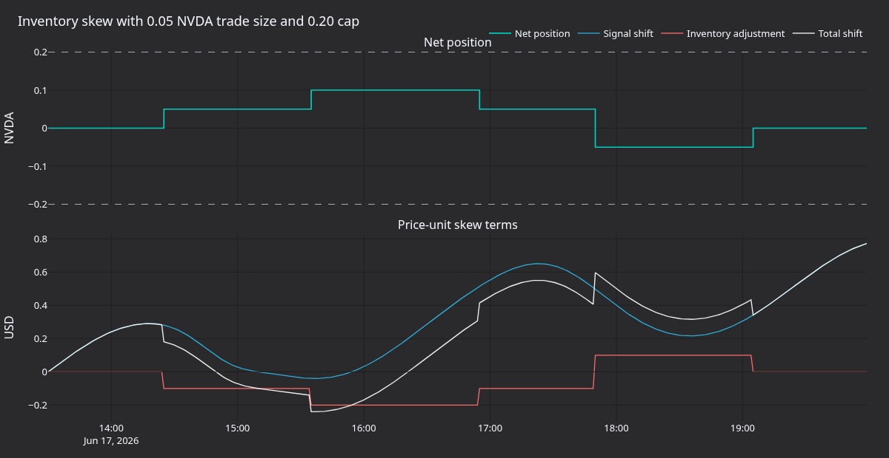

tutorial นี้รัน strategy [`CompositeMarketMaker`][composite-market-maker] ที่มาพร้อมกับ NautilusTrader
บนตลาด RWA `NVDA-PERP.LIGHTER` ของ Lighter โดยใช้ quote ของ `NVDA.EQUS` จาก Databento เป็น signal ภายนอก
strategy นี้วาง bid แบบ post-only หนึ่งตัวและ ask แบบ post-only หนึ่งตัวรอบ mid ของ Lighter แล้วเลื่อน
ทั้งสองฝั่งตาม residual ของ Databento ที่ normalize แล้วและ inventory ปัจจุบันบน Lighter

การตั้งค่านี้ใช้ [`LiveNode`][live-node] ของ Rust และ strategy `CompositeMarketMaker` ที่เป็น Rust แบบ native
หากเพิ่งเริ่มใช้ adapter ของ Lighter ให้ทำ [Get started with Lighter][lighter-get-started] ก่อน
จากนั้น tutorial นี้จะเพิ่มข้อมูล signal จาก Databento และการส่ง order แบบ live

## บทนำ [#introduction]

Lighter มี perpetual ของสินทรัพย์ในโลกจริง (real-world asset หรือ RWA) ที่ซื้อขายต่อเนื่องตลอดเวลา
รวมถึงตลาดหุ้นรายตัว ดูรายละเอียดล่าสุดของ venue ได้จาก [RWA docs] และ [market specifications]
ของ Lighter ส่วน dataset [US Equities][Databento US Equities] ของ Databento ให้ข้อมูล top-of-book ของหุ้น
สหรัฐฯ สำหรับ `NVDA` โดยมี `mbp-1` ให้ใช้ผ่าน adapter Databento ของ Nautilus

`CompositeMarketMaker` เป็น market maker ขนาดเล็กที่มีสอง input:

- **target instrument** คือตลาดบน Lighter ที่จะวาง quote: `NVDA-PERP.LIGHTER`
- **signal instrument** คือ feed อ้างอิงจาก Databento: `NVDA.EQUS`
- **anchor** คือ mid ของ Lighter
- **signal residual** คือ `(databento_mid / baseline) - 1.0`
- **quote shift** คือ `signal_skew_factor * residual - inventory_skew_factor * net_position`

หากไม่ได้ตั้งค่า baseline ไว้ strategy จะใช้ mid ตัวแรกที่ถูกต้องของ `NVDA.EQUS` เป็นราคาอ้างอิง residual
จึงเริ่มที่ศูนย์และวัดการขยับของ NVDA จาก signal mid ตัวแรกนั้น ไม่ใช่ basis ระหว่าง Lighter กับ Databento
หากต้องการผลการรันที่ทำซ้ำได้ ให้ตั้งค่าคงที่ `SIGNAL_BASELINE` ในซอร์สของตัวอย่างเพื่อตรึงราคาอ้างอิง

ในการตั้งค่านี้ BBO ของ Lighter ยังเป็นตัว anchor ของ spread ส่วน Databento จะเลื่อนจุดกึ่งกลางของ quote
ขึ้นหรือลงผ่าน residual ที่ normalize แล้ว



tutorial นี้แสดงให้เห็นว่า engine ตัวเดียวเชื่อม feed หุ้นสหรัฐฯ โดยตรงเข้ากับ venue RWA ที่เป็น crypto-native
ได้อย่างไร โดยวงจรชีวิตของ order, inventory และสถานะของ quote ยังอยู่ใน runtime แบบ event-driven
ตัวเดียวกัน

## สิ่งที่ต้องมีก่อน [#prerequisites]

- Rust toolchain (MSRV 1.99.1 หรือใหม่กว่า)
- Cargo project ที่มี crate ของ Nautilus, Lighter และ Databento เป็น dependency
  (ดู [การตั้งค่าโปรเจกต์](#project-setup))
- Databento API key ที่มีสิทธิ์ live สำหรับ Databento US Equities Mini (`EQUS.MINI`) ซึ่งเป็น dataset
  ค่าเริ่มต้นของเส้นทาง `NVDA.EQUS` ที่มาให้ ระดับที่สูงกว่าเช่น `EQUS.PLUS` ต้องใช้ license ของ Databento
  แยกต่างหาก เมื่อบัญชีของคุณมีสิทธิ์นั้นแล้ว ให้เลือกระดับด้วย `venue_dataset_map`
- credential API ของ Lighter (account index แบบตัวเลข, API key index และ API secret) สำหรับ environment
  ที่ตั้งค่าไว้ (ค่าเริ่มต้นคือ testnet) จำเป็นเฉพาะตอนเชื่อมต่อและส่ง order
- คู่มือการเชื่อมต่อ Lighter: [Lighter](../integrations/lighter.md)
- คู่มือการเชื่อมต่อ Databento: [Databento](../integrations/databento.md)

ตัวอย่างนี้อ่าน credential จาก environment variable และเก็บพารามิเตอร์ของ strategy เป็นค่าคงที่ใน Rust
ที่แก้ไขได้ ค่าเริ่มต้นคือ `LighterEnvironment::Testnet` ดังนั้นให้ทำตาม
[การตั้งค่า account และ API key](../integrations/lighter.md#account-and-api-key-setup) แล้วตั้ง credential
ของ Lighter testnet:

```bash
export DATABENTO_API_KEY="your-databento-api-key"
export LIGHTER_TESTNET_ACCOUNT_INDEX="123456"
export LIGHTER_TESTNET_API_KEY_INDEX="4"
export LIGHTER_TESTNET_API_SECRET="your-lighter-api-secret"
```

สำหรับ mainnet ให้เปลี่ยน `LIGHTER_ENVIRONMENT` ในซอร์สเป็น `LighterEnvironment::Mainnet` และใช้
environment variable credential `LIGHTER_*` ของ mainnet ตามที่อธิบายไว้ในคู่มือการเชื่อมต่อ และตั้ง
`DATABENTO_API_KEY` ก่อนรันตัวอย่าง

## การตั้งค่าโปรเจกต์ [#project-setup]

strategy, node และ adapter มาในรูป crate ที่ Cargo project ของคุณเองนำไปใช้ได้ ไม่จำเป็นต้องทำงานภายใน
checkout ของ NautilusTrader ให้เพิ่มข้อความต่อไปนี้ลงใน `Cargo.toml` โดยชี้ dependency ของ Nautilus
ทุกตัวไปที่ git source `develop` เดียวกัน เพื่อให้ crate ทั้งหมด resolve เป็นเวอร์ชันเดียวกัน:

```toml
[dependencies]
nautilus-common = { git = "https://github.com/nautechsystems/nautilus_trader.git", branch = "develop", features = ["live"] }
nautilus-core = { git = "https://github.com/nautechsystems/nautilus_trader.git", branch = "develop" }
nautilus-databento = { git = "https://github.com/nautechsystems/nautilus_trader.git", branch = "develop", features = ["high-precision", "live"] }
nautilus-lighter = { git = "https://github.com/nautechsystems/nautilus_trader.git", branch = "develop", features = ["examples", "high-precision"] }
nautilus-live = { git = "https://github.com/nautechsystems/nautilus_trader.git", branch = "develop", features = ["node"] }
nautilus-model = { git = "https://github.com/nautechsystems/nautilus_trader.git", branch = "develop", features = ["high-precision"] }
nautilus-trading = { git = "https://github.com/nautechsystems/nautilus_trader.git", branch = "develop", features = ["examples", "high-precision"] }

tokio = { version = "1", features = ["full"] }
```

feature `examples` ของ `nautilus-trading` จะเปิดให้ใช้ strategy `CompositeMarketMaker` และ
`high-precision` จำเป็นสำหรับการตั้งราคาแบบ crypto-native ของ Lighter สำหรับโครงสร้าง crate โดยรวม,
feature flag และทางเลือกการใช้ crates.io แทน git source ดู[คู่มือการตั้งค่าโปรเจกต์][project-setup] ของ Rust

Databento client ยังต้องใช้ไฟล์ publishers ที่ map venue ไปยัง dataset สำหรับโปรเจกต์ของคุณเอง ให้ดาวน์โหลด
[`publishers.json`][databento-publishers] จาก crate ของ adapter Databento แล้วตั้ง `publishers_filepath`
ให้ชี้ไปที่สำเนาในเครื่อง ตัวอย่างที่มาให้จะ resolve ไฟล์เดียวกันโดยอิงจาก checkout จึงมีเพียงโปรเจกต์ของ
คุณเองที่ต้องทำขั้นตอนนี้

## ทำไมต้อง NVDA [#why-nvda]

`NVDA` เป็นหุ้นรายตัวที่มีสภาพคล่องสูงซึ่งจดทะเบียนใน Nasdaq และ Lighter map perpetual แบบ RWA ของหุ้นนี้
ไปที่ `NVDA-PERP.LIGHTER` ทำให้จับคู่ signal ที่มี license จาก Databento กับตลาดที่ซื้อขายบน Lighter ได้:

| บทบาท              | Instrument ID       | แหล่งที่มา  | หมายเหตุ                                 |
| ----------------- | ------------------- | --------- | ------------------------------------- |
| Signal instrument | `NVDA.EQUS`         | Databento | การอัปเดต quote แบบ top-of-book ของ EQUS.MINI |
| Target instrument | `NVDA-PERP.LIGHTER` | Lighter   | RWA perpetual ที่ซื้อขายผ่าน Lighter       |

โดยค่าเริ่มต้น การ subscribe `NVDA.EQUS` จะขอ quote แบบ top-of-book (`mbp-1`) ของ `NVDA` จาก dataset
`EQUS.MINI` ของ Databento และ adapter จะส่ง quote เหล่านี้มาเป็นสตรีม `QuoteTick` เดียว dataset
`EQUS.MINI` เป็นระดับข้อมูลหุ้นสหรัฐฯ แบบรวมศูนย์ที่ราคาถูกที่สุด ระดับที่ละเอียดกว่าเช่น `EQUS.PLUS` ต้องใช้
license ของ Databento แยกต่างหาก หากบัญชีของคุณมีสิทธิ์นั้น ให้เลือกระดับด้วย `venue_dataset_map` ของ
client (เช่น `{"EQUS": "EQUS.PLUS"}`)

adapter จะ resolve venue `EQUS` จากไฟล์ publishers ตัวอย่างนี้ชี้ `DatabentoDataClientConfig` ไปที่
`publishers.json` ที่มาพร้อมกับ adapter Databento ดูกฎการ map ได้ที่ [Instrument IDs and
symbology][databento-symbology]

ชื่อ dataset แบบเก่าคือ Databento Equities Basic (`DBEQ.BASIC`) ยังปรากฏในบางบัญชีที่ได้รับสิทธิ์ต่อเนื่อง
และในตัวอย่างเก่า การ subscribe Databento ใหม่จะใช้สายผลิตภัณฑ์ Databento US Equities ดังนั้น tutorial นี้
จึงใช้ venue `EQUS` แบบรวมศูนย์ ให้มอง feed แบบ top-of-book นี้เป็นตัวแทน signal ที่มี license สำหรับการ
เดินระบบใน tutorial เท่านั้น ไม่ใช่ book แบบ full depth ของ Nasdaq TotalView

ตัวอย่างเริ่มที่ `trade_size=0.05` ซึ่งตรงกับ minimum base amount ของ NVDA บน Lighter ที่พบระหว่างการ
ตรวจสอบ tutorial ก่อนเพิ่มขนาดหรือเปลี่ยน instrument ให้ตรวจ endpoint รายละเอียดตลาดของ environment
ที่ตั้งค่าไว้:

- [Testnet][testnet market details] ซึ่งเป็นค่าเริ่มต้นของตัวอย่าง
- [Mainnet][market details endpoint]

## ข้อจำกัดเรื่อง session [#session-constraint]

ตลาด RWA ของ Lighter ซื้อขายต่อเนื่อง ขณะที่ `NVDA.EQUS` เป็นไปตาม session ข้อมูลตลาดหุ้นสหรัฐฯ ให้รัน
การทดสอบ live ครั้งแรกในช่วง regular cash session ([13:30, 20:00] UTC ในช่วง daylight time ของสหรัฐฯ)
และจัดการวันหยุดกับวันที่ซื้อขายครึ่งวันเป็นพิเศษ

`CompositeMarketMaker` ไม่มีตัวกั้น session หรือตัวตรวจอายุของ signal ในตัว สำหรับการใช้งานจริง ให้เพิ่ม
actor หรือ strategy รุ่นดัดแปลงที่ยกเลิก quote เมื่อ signal จาก Databento เก่าเกินไป tutorial นี้ใช้
strategy ที่มาให้ จึงคงข้อจำกัดในการใช้งานนี้ไว้อย่างชัดเจน

## Node ตัวอย่าง [#example-node]

รันตัวอย่างได้สองวิธี:

- จาก checkout ของ NautilusTrader ให้ใช้ [binary composite market maker สำหรับ NVDA บน Lighter][example-script]
  ที่มาให้
- ในโปรเจกต์ของคุณเอง ให้คัดลอกการตั้งค่า node ด้านล่างไปไว้ใน `main` พร้อม crate จาก
  [การตั้งค่าโปรเจกต์](#project-setup)

จาก checkout เมื่อตั้ง environment variable credential แล้ว binary ที่มาให้จะเชื่อมต่อ data client และ
execution client โดยค่าเริ่มต้นคือ `DRY_RUN = false` ซึ่งจะเพิ่ม strategy ที่ส่ง order ด้วย

:::warning
คำสั่งนี้สามารถส่ง order จริงได้ ให้เริ่มจากขนาดเล็กที่สุดที่ยอมรับได้บน test account ที่มีเงิน หรือบัญชี
mainnet ที่กำหนดขนาดไว้สำหรับรองรับการขาดทุน ยืนยัน instrument ID, account ID, account index แบบตัวเลข
และ credential ของ Lighter ที่ใช้งานอยู่ก่อนรัน
:::

```bash
cargo run --bin lighter-nvda-composite-mm --package nautilus-tutorials --features examples
```

Databento เป็น data client แบบหลาย venue ที่ไม่มีเส้นทาง venue ตายตัว engine จึงใช้เป็นเส้นทางค่าเริ่มต้น
สำหรับ `NVDA.EQUS` ส่วน Lighter ลงทะเบียนกับเส้นทาง venue `LIGHTER` และรับการ subscribe ของ
`NVDA-PERP.LIGHTER`

การตั้งค่านี้รวม node ที่มีสาม client เข้ากับ `CompositeMarketMaker` ตัวอย่างโค้ดด้านล่างถูกย่อไว้ โดยละ
รายการต่อไปนี้ รวมถึงบรรทัดอื่นๆ:

- ค่าคงที่ในซอร์ส
- การกำหนด `publishers_filepath`, `max_position` และ `trade_size`
- การเรียก `node.run().await?` ในตอนท้าย

[ซอร์สของตัวอย่าง][example-script] มี `main` ฉบับสมบูรณ์:

```rust
use nautilus_live::node::config::LiveExecutionEngineConfig;

let lighter_environment = LIGHTER_ENVIRONMENT;
let trader_id = TraderId::from(TRADER_ID);
let account_id = AccountId::from(ACCOUNT_ID);
let instrument_id = InstrumentId::from(INSTRUMENT_ID);
let signal_instrument_id = InstrumentId::from(SIGNAL_INSTRUMENT_ID);

let api_key = get_env_var("DATABENTO_API_KEY")?;
let databento_config =
    DatabentoDataClientConfig::new(api_key, publishers_filepath, true, true);
let lighter_data_config = LighterDataClientConfig::builder()
    .environment(lighter_environment)
    .build();
let lighter_exec_config = LighterExecutionClientConfig::builder()
    .account_id(account_id)
    .environment(lighter_environment)
    .build();

let mut strategy_config = CompositeMarketMakerConfig::builder()
    .instrument_id(instrument_id)
    .signal_instrument_id(signal_instrument_id)
    .max_position(max_position)
    .trade_size(trade_size)
    .half_spread_bps(HALF_SPREAD_BPS)
    .inventory_skew_factor(INVENTORY_SKEW_FACTOR)
    .signal_skew_factor(SIGNAL_SKEW_FACTOR)
    .requote_threshold_bps(REQUOTE_THRESHOLD_BPS)
    .on_cancel_resubmit(ON_CANCEL_RESUBMIT)
    .build();
strategy_config.base.strategy_id = Some(StrategyId::from("NVDA_COMPOSITE_MM-001"));
strategy_config.base.order_id_tag = Some("001".to_string());

let mut node = LiveNode::builder(trader_id, Environment::Live)?
    .with_name("LIGHTER-NVDA-COMPOSITE-MM-001".to_string())
    .with_exec_engine_config(LiveExecutionEngineConfig {
        reconciliation_lookback_mins: Some(60),
        reconciliation_instrument_ids: Some(vec![instrument_id.to_string()]),
        ..Default::default()
    })
    .with_reconciliation(!DRY_RUN)
    .with_delay_post_stop_secs(5)
    .add_data_client(
        None,
        Box::new(DatabentoDataClientFactory::new()),
        Box::new(databento_config),
    )?
    .add_data_client(
        None,
        Box::new(LighterDataClientFactory::new()),
        Box::new(lighter_data_config),
    )?
    .add_exec_client(
        None,
        Box::new(LighterExecutionClientFactory::new()),
        Box::new(lighter_exec_config),
    )?
    .build()?;

if !DRY_RUN {
    node.add_strategy(CompositeMarketMaker::new(strategy_config))?;
}
```

หากต้องการเชื่อมต่อโดยไม่เพิ่ม strategy ที่ส่ง order ให้แก้ค่าคงที่ใกล้ส่วนบนของซอร์สตัวอย่าง:

```rust
const DRY_RUN: bool = true;
```

จากนั้นรันคำสั่งเดิม:

```bash
cargo run --bin lighter-nvda-composite-mm --package nautilus-tutorials --features examples
```

สำหรับการทดสอบแบบ smoke run บน testnet ให้คง `LIGHTER_ENVIRONMENT` เป็น `LighterEnvironment::Testnet`
และใช้ environment variable credential `LIGHTER_TESTNET_*` หากรันนอก cash session ของ Databento US
Equities ก็ยังตรวจสอบการเริ่มต้น node, การ routing และข้อมูลจาก Lighter ได้ strategy จะรอ quote ของ
`NVDA.EQUS` ที่ถูกต้องก่อนส่ง order แรก ดังนั้นการตรวจสอบวงจรชีวิตของ order จึงต้องมี signal จาก Databento

เมื่อเปิด reconciliation ตัวอย่างทั้งสองแบบจะ reconcile เฉพาะ target instrument บน Lighter ที่ตั้งค่าไว้
โดยย้อนหลัง 60 นาที และข้าม report ของตลาดอื่นบน Lighter ในบัญชีเดียวกัน เมื่อหยุด strategy จะยกเลิก
target order ของตัวเอง และส่ง market order แบบ reduce-only เพื่อปิด target position ของตัวเอง

ให้เริ่มด้วย target position ที่เป็นศูนย์ในบัญชี Lighter จะ net exposure ทั้งหมดในตลาดหนึ่งเข้าด้วยกัน
ขณะที่ strategy จำกัดและปิดเฉพาะ position ที่ตัวเองเป็นเจ้าของ หลัง shutdown ให้ยืนยันว่าไม่มี order หรือ
position จากการรันครั้งนั้นเหลืออยู่ เพราะ fill อาจมาถึงได้ขณะที่การยกเลิกยังค้างอยู่

## พารามิเตอร์ของ strategy [#strategy-parameters]

| พารามิเตอร์               | ค่า                  | คำอธิบาย                                                        |
| ----------------------- | ------------------- | -------------------------------------------------------------- |
| `instrument_id`         | `NVDA-PERP.LIGHTER` | RWA perpetual บน Lighter ที่จะวาง quote                          |
| `signal_instrument_id`  | `NVDA.EQUS`         | feed signal จาก Databento US Equities Mini                      |
| `trade_size`            | `0.05`              | ขนาดต่อ bid หรือ ask แต่ละตัว                                      |
| `max_position`          | `0.20`              | เพดานตายตัวของ target exposure ของ strategy                       |
| `half_spread_bps`       | `25`                | ครึ่งหนึ่งของ spread รอบ anchor ของ Lighter                         |
| `inventory_skew_factor` | `2.0`               | หน่วยราคาต่อหนึ่งหน่วยของ net position                               |
| `signal_skew_factor`    | `55.0`              | หน่วยราคาต่อหนึ่งหน่วยของ residual จาก Databento ที่ normalize แล้ว      |
| `signal_baseline`       | mid ตัวแรกที่ถูกต้อง     | ราคาอ้างอิงสำหรับ residual ของ Databento (ไม่บังคับ)                  |
| `requote_threshold_bps` | `5`                 | การขยับของ anchor หรือผลกระทบจาก signal ที่กระตุ้นให้ยกเลิกและวาง quote ใหม่ |

เมื่อ mid ของ Lighter อยู่ที่ `207.00` และ `half_spread_bps=25` ครึ่ง spread ที่ยังไม่ skew คือ `0.5175` USD
หาก Databento อยู่สูงกว่า baseline 30 bps ค่า `signal_skew_factor` เท่ากับ `55.0` จะเลื่อนทั้งสองฝั่งขึ้น
`0.165` USD ก่อนคิด inventory skew ส่วน long position ขนาด `0.05` กับ `inventory_skew_factor=2.0`
จะเลื่อนทั้งสองฝั่งลง `0.10` USD

## พฤติกรรมการวาง quote ใหม่ [#requote-behavior]

tick ของ signal จะอัปเดตสถานะภายในแต่ไม่ส่ง order ด้วยตัวเอง เมื่อ `signal_skew_factor` ไม่เป็นศูนย์
tick ของ target จะรอจนครบทั้งสองเงื่อนไขนี้:

- quote ของ signal ที่ราคา bid และ ask เป็นบวกและไม่ cross กัน
- baseline ที่เป็นค่าจำกัดและเป็นบวก

signal mid ตัวแรกที่ถูกต้องจะใช้เป็น baseline เมื่อไม่ได้ตั้ง `signal_baseline` ส่วน baseline ที่กำหนดเองจะคงที่
และยังต้องมี quote ของ signal ที่ถูกต้อง baseline ที่ไม่ถูกต้องจะทำให้ไม่วาง quote และเมื่อ
`signal_skew_factor=0` strategy จะวาง quote ได้โดยไม่ต้องมี signal หรือ baseline

เมื่อพร้อมแล้ว quote tick ถัดไปของ Lighter จะอ่าน signal residual ล่าสุดและตรวจสถานะของ quote รอบการวาง
quote จะเกิดขึ้นเมื่อเงื่อนไขใดเงื่อนไขหนึ่งต่อไปนี้เป็นจริง:

- ไม่มี target order ที่เปิดอยู่หรือกำลังส่ง
- anchor ของ Lighter ขยับอย่างน้อย `requote_threshold_bps`
- ผลกระทบด้านราคาจากการเปลี่ยนแปลงของ signal residual ถึงเกณฑ์เดียวกัน

จากนั้น strategy จะทำสิ่งต่อไปนี้:

1. ยกเลิก order ที่เปิดอยู่
1. อ่าน net position ปัจจุบันและ exposure ที่ค้างอยู่จาก cache
1. คำนวณ bid หนึ่งตัวและ ask หนึ่งตัว
1. ตัดฝั่งที่จะทำให้เกิน `max_position` ออก
1. ส่งฝั่งที่เหลือเป็น limit แบบ post-only

## แผงกราฟ [#panels]

แผงกราฟด้านล่างใช้ข้อมูล replay ที่กำหนดผลได้แน่นอน แสดงกลไกการวาง quote และข้อจำกัดของ cash session
ไม่ใช่ trace ของ fill จริงที่บันทึกจาก Lighter



**รูปที่ 1.** *mid ของ `NVDA.EQUS` จาก Databento, mid ของ `NVDA-PERP.LIGHTER` จาก Lighter,
composite bid, composite ask และจุดกึ่งกลางของ quote*


**รูปที่ 2.** *residual ของ Databento, basis ของ Lighter และการเลื่อนจุดกึ่งกลางของ quote หน่วย bps*



**รูปที่ 3.** *net position, การเลื่อนจาก signal, การปรับจาก inventory และการเลื่อนรวม สำหรับขนาด trade
`0.05` NVDA และเพดาน position `0.20` NVDA*


**รูปที่ 4.** *นาฬิกาตลาด RWA แบบต่อเนื่องของ Lighter เทียบกับ signal ตาม cash session ของ Databento US
Equities พร้อมอายุของ signal หลังจบ regular session*

## ส่วนขยาย [#extensions]

ตัวกั้นอายุของ signal ทำให้ signal จาก Databento เป็น dependency ในการใช้งานที่ชัดเจน ตัวอย่างเช่น ยกเลิก
order ทั้งหมดบน Lighter หาก quote ล่าสุดของ `NVDA.EQUS` เก่ากว่า 30 วินาทีในช่วง cash session และยกเลิก
ทันทีหลัง cash session ปิด

สำหรับ strategy แบบ fair-value ล้วน ให้ใช้การตั้งค่า client ของ tutorial นี้ แล้วเขียนรุ่นดัดแปลงเล็กๆ ที่
anchor bid/ask กับ mid ของ Databento โดยตรง จากนั้นตรวจ BBO ของ Lighter เฉพาะสำหรับข้อจำกัด post-only
และ basis

[composite-market-maker]: https://github.com/nautechsystems/nautilus_trader/blob/develop/crates/trading/src/examples/strategies/composite_market_maker/strategy.rs
[live-node]: ../how_to/run_rust_live_trading.md
[project-setup]: ../concepts/rust.md#project-setup
[lighter-get-started]: ../how_to/get_started_lighter.md
[databento-symbology]: ../integrations/databento.md#instrument-ids-and-symbology
[databento-publishers]: https://github.com/nautechsystems/nautilus_trader/blob/develop/crates/adapters/databento/publishers.json
[RWA docs]: https://docs.lighter.xyz/trading/real-world-assets-rwas
[market specifications]: https://docs.lighter.xyz/trading/real-world-assets-rwas/market-specifications
[market details endpoint]: https://mainnet.zklighter.elliot.ai/api/v1/orderBookDetails
[testnet market details]: https://testnet.zklighter.elliot.ai/api/v1/orderBookDetails
[Databento US Equities]: https://databento.com/blog/introducing-databento-us-equities
[example-script]: https://github.com/nautechsystems/nautilus_trader/blob/develop/examples/tutorials/src/bin/lighter_nvda_composite_mm.rs
