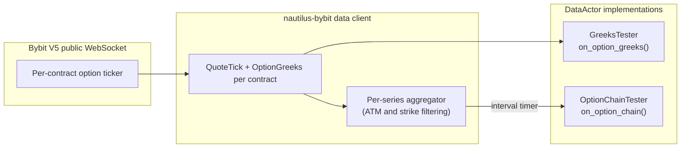
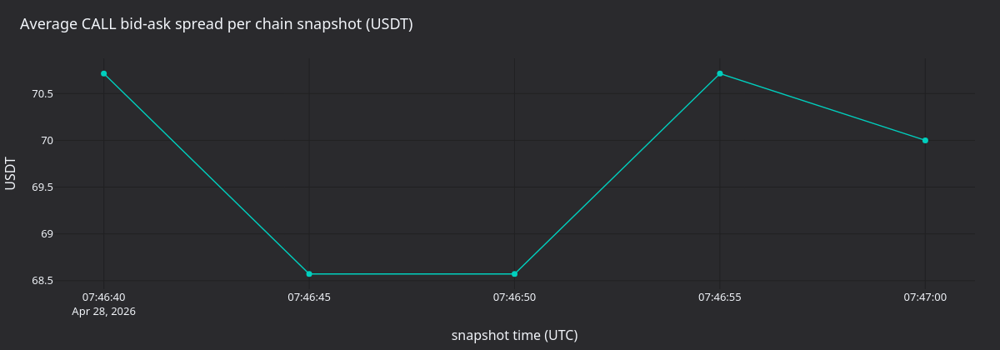

# ข้อมูล option และ Greeks (Bybit)

:::note
tutorial นี้ใช้ **Rust เท่านั้น** โดยใช้ `LiveNode` ของ Rust
ร่วมกับ adapter ของ Bybit เพื่อ stream option Greeks แบบ live และ snapshot ของ chain
ที่รวมไว้แล้ว
:::

tutorial นี้เชื่อมต่อกับตลาด option แบบ live ของ Bybit และรับข้อมูล Greeks
และ option chain ผ่านตัวอย่าง `DataActor` สองตัว ครอบคลุมการค้นหา
instrument, การ subscribe Greeks ที่ venue ให้มา และ snapshot ของ chain
เป็นระยะพร้อมการกรอง strike แบบอิงกับ ATM

## บทนำ {#introduction}

Bybit publish Greeks (delta, gamma, vega, theta) และ implied volatility
มาพร้อมกับการอัปเดต option ticker ทุกครั้ง NautilusTrader เปิดให้ใช้ข้อมูลนี้ใน
สองระดับ:

- **Greeks ราย instrument**: subscribe สัญญา option เดียวแล้ว
  รับ event `OptionGreeks` ทุกครั้งที่ ticker อัปเดต
- **Snapshot ของ option chain**: subscribe ทั้งชุดวันหมดอายุ (expiry series) แล้ว
  รับ event `OptionChainSlice` เป็นระยะ ซึ่งรวม quote และ
  Greeks ของทุก strike ที่ active ไว้

binary ตัวอย่างสองตัวแสดงรูปแบบเหล่านี้ ตัวแรก subscribe stream ของ Greeks ทีละตัว ตัวที่สอง
subscribe chain ที่รวมไว้แล้วพร้อมการกรอง strike แบบอิงกับ ATM



## สิ่งที่ต้องมีก่อน {#prerequisites}

- Rust toolchain ที่ใช้งานได้ ([rustup.rs](https://rustup.rs))
- repository ของ NautilusTrader ที่ clone มาแล้วและ build ได้

ตัวอย่างไม่ต้องใช้ API key ของ Bybit โดยปล่อย `api_key` และ `api_secret` ไว้โดยไม่ตั้งค่า data client จึงใช้
endpoint market data สาธารณะของ Bybit และไม่อ่าน credential จาก environment

:::warning
demo trading ของ Bybit ใช้ `stream-demo.bybit.com` สำหรับ private stream เท่านั้น
market data ของ option แบบสาธารณะใช้ public stream ของ mainnet
`wss://stream.bybit.com/v5/public/option`
:::

## รูปแบบของ DataActor {#the-dataactor-pattern}

`DataActor` ใน Rust ต้องมีสามส่วน:

1. struct ที่มีฟิลด์ `core: DataActorCore` และสถานะของคุณเอง
1. macro `nautilus_actor!(YourType)` และ implementation ของ `Debug`
1. implementation ของ trait `DataActor` พร้อม callback ของคุณ

macro จะจัดการการเชื่อมต่อกับ runtime แบบ native ที่ implementation แบบ blanket ของ `Actor` และ `Component`
ต้องการ คุณ implement เฉพาะ callback ที่ต้องการ เพราะทุก callback มี implementation เริ่มต้นที่ไม่ทำอะไร (no-op)

## ส่วนที่ 1: Greeks ราย instrument {#part-1-per-instrument-greeks}

ตัวอย่าง `bybit-greeks-tester` จะ subscribe `OptionGreeks` ของ
BTC CALL option ทั้งหมดที่วันหมดอายุใกล้ที่สุด และ log ทุกการอัปเดต

### โครงสร้างของ actor {#actor-structure}

```rust
#[derive(Debug)]
struct GreeksTester {
    core: DataActorCore,
    client_id: ClientId,
    subscribed_instruments: Vec<InstrumentId>,
}

nautilus_actor!(GreeksTester);

impl GreeksTester {
    fn new(client_id: ClientId) -> Self {
        Self {
            core: DataActorCore::new(DataActorConfig {
                actor_id: Some("GREEKS_TESTER-001".into()),
                ..Default::default()
            }),
            client_id,
            subscribed_instruments: Vec::new(),
        }
    }
}
```

macro ต้องการฟิลด์ `core` ส่วน `client_id` ระบุ data client สำหรับการ subscribe และ vector
`subscribed_instruments` จะบันทึก subscription ไว้เพื่อให้ actor ลบออกได้ตอน stop

### การค้นหา instrument {#discovering-instruments}

ตอน start actor จะ query cache เพื่อหา option instrument ทั้งหมด
กรองเฉพาะ BTC CALL ที่ยังไม่หมดอายุ แล้วหาวันหมดอายุ
ที่ใกล้ที่สุด:

```rust
fn on_start(&mut self) -> anyhow::Result<()> {
    let venue = Venue::new("BYBIT");
    let underlying_filter = Ustr::from("BTC");

    let mut options: Vec<(InstrumentId, f64, u64)> = {
        let cache = self.cache();
        let instruments = cache.instruments(&venue, Some(&underlying_filter));

        instruments
            .iter()
            .filter_map(|inst| {
                if inst.option_kind() == Some(OptionKind::Call) {
                    let expiry = inst.expiration_ns()?.as_u64();
                    let strike = inst.strike_price()?.as_f64();
                    Some((inst.id(), strike, expiry))
                } else {
                    None
                }
            })
            .collect()
    }; // cache borrow dropped here

    let now_ns = self.timestamp_ns().as_u64();
    options.retain(|(_, _, exp)| *exp > now_ns);

    let nearest_expiry = options.iter().map(|(_, _, exp)| *exp).min().unwrap();
    options.retain(|(_, _, exp)| *exp == nearest_expiry);
    options.sort_by(|(_, a, _), (_, b, _)| a.partial_cmp(b).unwrap());

    // ...subscribe to each
}
```

:::warning
ให้ปล่อยการยืม (borrow) cache ก่อนเรียก method สำหรับ subscribe ใดๆ
cache ใช้ `Rc<RefCell<...>>` ภายใน และ method สำหรับ subscribe อาจ
ต้องยืมมันด้วย ให้รวบรวมข้อมูลที่เป็นเจ้าของเองไว้ใน `Vec` ในเครื่อง ทิ้ง reference
ของ cache แล้วจึง subscribe
:::

### การ subscribe Greeks {#subscribing-to-greeks}

หลังค้นหา instrument แล้ว ให้ subscribe ทีละตัว:

```rust
let client_id = self.client_id;
for (instrument_id, _, _) in &options {
    self.subscribe_option_greeks(*instrument_id, Some(client_id), None);
    self.subscribed_instruments.push(*instrument_id);
}
```

### การจัดการการอัปเดต {#handling-updates}

การอัปเดต ticker แต่ละครั้งจาก Bybit จะ trigger `on_option_greeks` พร้อม
event `OptionGreeks`:

```rust
fn on_option_greeks(&mut self, greeks: &OptionGreeks) -> anyhow::Result<()> {
    log::info!(
        "GREEKS | {} | delta={:.4} gamma={:.6} vega={:.4} theta={:.4} rho={:.6} | \
         mark_iv={} bid_iv={} ask_iv={} | underlying={} oi={}",
        greeks.instrument_id,
        greeks.delta,
        greeks.gamma,
        greeks.vega,
        greeks.theta,
        greeks.rho,
        greeks.mark_iv.map_or("-".to_string(), |v| format!("{v:.2}")),
        greeks.bid_iv.map_or("-".to_string(), |v| format!("{v:.2}")),
        greeks.ask_iv.map_or("-".to_string(), |v| format!("{v:.2}")),
        greeks.underlying_price.map_or("-".to_string(), |v| format!("{v:.2}")),
        greeks.open_interest.map_or("-".to_string(), |v| format!("{v:.1}")),
    );
    Ok(())
}
```

ฟิลด์ของ `OptionGreeks`:

| ฟิลด์               | Type               | คำอธิบาย                                                        |
| ------------------ | ------------------ | ------------------------------------------------------------- |
| `instrument_id`    | `InstrumentId`     | สัญญา option                                                  |
| `convention`       | `GreeksConvention` | convention ของ Greeks (`BlackScholes` หรือ `PriceAdjusted`)    |
| `delta`            | `f64`              | ความอ่อนไหวของราคาต่อ underlying                                |
| `gamma`            | `f64`              | ความอ่อนไหวของ delta ต่อ underlying                             |
| `vega`             | `f64`              | ความอ่อนไหวของราคาต่อการเปลี่ยนแปลงของ volatility 1%              |
| `theta`            | `f64`              | การลดลงของมูลค่าตามเวลารายวัน                                    |
| `rho`              | `f64`              | ความอ่อนไหวต่อการเปลี่ยนแปลงของอัตราดอกเบี้ย                         |
| `mark_iv`          | `Option<f64>`      | implied volatility ของ mark price                              |
| `bid_iv`           | `Option<f64>`      | bid implied volatility                                        |
| `ask_iv`           | `Option<f64>`      | ask implied volatility                                        |
| `underlying_price` | `Option<f64>`      | ราคาอ้างอิงของ venue สำหรับวันหมดอายุนี้                          |
| `open_interest`    | `Option<f64>`      | open interest ของสัญญานี้                                      |
| `ts_event`         | `UnixNanos`        | UNIX timestamp (นาโนวินาที) เมื่อ event เกิดขึ้น                  |
| `ts_init`          | `UnixNanos`        | UNIX timestamp (นาโนวินาที) เมื่อ instance ถูก initialize         |

ค่า `delta`, `gamma`, `vega`, `theta` และ `rho` อยู่ใน struct ซ้อน `greeks: OptionGreekValues`
implementation `Deref<Target = OptionGreekValues>` ของ `OptionGreeks` ทำให้เข้าถึงได้โดยตรงผ่าน
`greeks.delta` และฟิลด์อื่นๆ ดังที่แสดงข้างต้น

Bybit ไม่ได้ให้ค่า rho adapter จึงตั้งเป็น `0.0`

### การเก็บกวาด {#cleanup}

ตอน stop ให้ unsubscribe จากทุก instrument:

```rust
fn on_stop(&mut self) -> anyhow::Result<()> {
    let ids: Vec<InstrumentId> = self.subscribed_instruments.drain(..).collect();
    let client_id = self.client_id;
    for instrument_id in ids {
        self.unsubscribe_option_greeks(instrument_id, Some(client_id), None);
    }
    log::info!("Unsubscribed from all option greeks");
    Ok(())
}
```

## ส่วนที่ 2: snapshot ของ option chain {#part-2-option-chain-snapshots}

ตัวอย่าง `bybit-option-chain` จะ subscribe option chain ที่รวมไว้แล้ว
และ log snapshot เป็นระยะ โดยแสดง call และ put ที่แต่ละ strike พร้อม
quote และ Greeks ของมัน

### ทำไมต้องใช้ option chain {#why-use-option-chains}

subscription ราย instrument ให้การควบคุมสัญญาแต่ละตัว แต่สำหรับทั้ง surface คุณต้องจัดการ
stream แต่ละตัวและเชื่อมโยงการอัปเดตข้าม strike เอง subscription แบบ option chain ทำสิ่งนี้ให้ผ่าน
`DataEngine` โดยรวม quote และ Greeks ของทุก strike ในชุดเดียวกัน แล้ว publish
`OptionChainSlice` เดียวตาม timer

การรวมนี้เกิดขึ้นภายใน NautilusTrader Bybit publish market data ของ option แยกตามสัญญา และเอกสาร
public WebSocket ของ V5 ไม่ได้ระบุ stream ของ option chain แบบ native ไว้

### Type ที่เกี่ยวกับ chain {#chain-types}

**`OptionSeriesId`** ระบุชุดวันหมดอายุหนึ่งชุด:

```rust
let series_id = OptionSeriesId::new_derived(
    Venue::new("BYBIT"),    // venue
    Ustr::from("BTC"),      // underlying
    Ustr::from("USDT"),     // settlement currency
    UnixNanos::from(expiry), // expiration timestamp
);
```

**`StrikeRange`** ควบคุมว่า strike ใดจะ active:

| Variant       | คำอธิบาย                                                                         |
| ------------- | ------------------------------------------------------------------------------ |
| `Fixed`       | ชุดราคา strike ที่กำหนดตายตัว                                                     |
| `AtmRelative` | `strikes_above` strike เหนือ ATM และ `strikes_below` strike ใต้ ATM                |
| `AtmPercent`  | ทุก strike ที่อยู่ภายใน `pct` ของราคา ATM                                           |
| `Delta`       | strike ที่ค่าสัมบูรณ์ของ delta ของ call หรือ put อยู่ภายใน `tolerance` จาก `target`    |

สำหรับช่วง strike แบบ dynamic subscription จะรอจนกว่า engine จะกำหนดราคา ATM ได้จาก
ราคาอ้างอิงที่ venue ให้มา

### การ subscribe {#subscribing}

```rust
let strike_range = StrikeRange::AtmRelative {
    strikes_above: 3,
    strikes_below: 3,
};

let snapshot_interval_ms = Some(5_000); // snapshot every 5 seconds

self.subscribe_option_chain(
    series_id,
    strike_range,
    snapshot_interval_ms,
    Some(client_id),
    None, // params
);
```

สำหรับโหมด raw ให้ส่ง `None` เป็น `snapshot_interval_ms` ในโหมดนี้ การอัปเดต quote หรือ Greeks ทุกครั้งจะ publish
slice ทันที

### การจัดการ snapshot {#handling-snapshots}

callback `on_option_chain` จะได้รับ `OptionChainSlice` ที่มี
strike ที่ active ทั้งหมดพร้อมข้อมูล call และ put:

```rust
fn on_option_chain(&mut self, slice: &OptionChainSlice) -> anyhow::Result<()> {
    log::info!(
        "OPTION_CHAIN | {} | atm={} | calls={} puts={} | strikes={}",
        slice.series_id,
        slice.atm_strike.map_or("-".to_string(), |p| format!("{p}")),
        slice.call_count(),
        slice.put_count(),
        slice.strike_count(),
    );

    for strike in slice.strikes() {
        let call_info = slice.get_call(&strike).map(|d| {
            let greeks_str = d.greeks.as_ref().map_or("-".to_string(), |g| {
                format!(
                    "d={:.3} g={:.5} v={:.2} iv={:.1}%",
                    g.delta, g.gamma, g.vega,
                    g.mark_iv.unwrap_or(0.0) * 100.0,
                )
            });
            format!("bid={} ask={} [{}]", d.quote.bid_price, d.quote.ask_price, greeks_str)
        });

        let put_info = slice.get_put(&strike).map(|d| {
            let greeks_str = d.greeks.as_ref().map_or("-".to_string(), |g| {
                format!(
                    "d={:.3} g={:.5} v={:.2} iv={:.1}%",
                    g.delta, g.gamma, g.vega,
                    g.mark_iv.unwrap_or(0.0) * 100.0,
                )
            });
            format!("bid={} ask={} [{}]", d.quote.bid_price, d.quote.ask_price, greeks_str)
        });

        log::info!(
            "  K={} | CALL: {} | PUT: {}",
            strike,
            call_info.unwrap_or_else(|| "-".to_string()),
            put_info.unwrap_or_else(|| "-".to_string()),
        );
    }

    Ok(())
}
```

ฟิลด์และ method ของ `OptionChainSlice`:

| ชื่อ              | Type / ค่าที่คืน              | คำอธิบาย                                |
| ---------------- | --------------------------- | ------------------------------------- |
| `series_id`      | `OptionSeriesId`            | ชุดที่ snapshot นี้ครอบคลุม                |
| `atm_strike`     | `Option<Price>`             | strike ATM จากราคาอ้างอิง                |
| `call_count()`   | `usize`                     | จำนวน strike ของ call ที่มีข้อมูล           |
| `put_count()`    | `usize`                     | จำนวน strike ของ put ที่มีข้อมูล            |
| `strike_count()` | `usize`                     | ยูเนียนของ strike ทั้งหมด                 |
| `strikes()`      | `Vec<Price>`                | list ของราคา strike ทั้งหมดที่เรียงแล้ว       |
| `get_call(k)`    | `Option<&OptionStrikeData>` | quote และ Greeks ของ call ที่ strike `k`   |
| `get_put(k)`     | `Option<&OptionStrikeData>` | quote และ Greeks ของ put ที่ strike `k`    |

`OptionStrikeData` แต่ละตัวมี `quote: QuoteTick` (bid/ask) และ
`greeks: Option<OptionGreeks>` แบบ optional

## การตั้งค่า node {#node-setup}

ทั้งสองตัวอย่างใช้รูปแบบ `LiveNode` เดียวกัน และไม่ต้องใช้ execution client
สำหรับการใช้งานเฉพาะข้อมูล:

```rust
#[tokio::main]
async fn main() -> Result<(), Box<dyn std::error::Error>> {
    dotenvy::dotenv().ok();

    let environment = Environment::Live;
    let trader_id = TraderId::from("TESTER-001");
    let client_id = ClientId::new("BYBIT");

    let bybit_config = BybitDataClientConfig {
        api_key: None,    // public market data needs no credentials
        api_secret: None,
        product_types: vec![BybitProductType::Option],
        ..Default::default()
    };

    let client_factory = BybitDataClientFactory::new();

    let mut node = LiveNode::builder(trader_id, environment)?
        .with_name("BYBIT-OPTIONS-001".to_string())
        .add_data_client(None, Box::new(client_factory), Box::new(bybit_config))?
        .with_delay_post_stop_secs(5)
        .build()?;

    let actor = GreeksTester::new(client_id); // or OptionChainTester
    node.add_actor(actor)?;
    node.run().await?;

    Ok(())
}
```

เมื่อตั้ง `product_types` เป็น `[BybitProductType::Option]` client จะโหลดเฉพาะ option instrument ตอน startup
จะรอขณะที่ instrument provider ดึงและ parse option ทุกตัวที่ list ไว้

## การรันตัวอย่าง {#running-the-examples}

```bash
# Per-instrument Greeks
cargo run --example bybit-greeks-tester --package nautilus-bybit --features examples

# Option chain snapshots
cargo run --example bybit-option-chain --package nautilus-bybit --features examples
```

หยุดตัวอย่างใดก็ได้ด้วย Ctrl+C callback `on_stop` ของ actor
จะ unsubscribe ทุก stream ก่อนปิดระบบ

## ผลลัพธ์ที่ตัวอย่างสร้างขึ้น {#what-the-examples-produce}

การรันบน mainnet 30 วินาทีในวันที่ 28 เมษายน (BTC ใกล้ 76,800 USDT, วันหมดอายุ 2026-04-28 08:00 UTC) ให้ผลดังนี้:

- tester ราย instrument จับ **การอัปเดต Greeks ได้ 938 ครั้ง** จากสัญญา BTC CALL 22 สัญญา
- tester ของ chain จับ **snapshot ของ chain ได้ 5 ครั้ง** แต่ละครั้งมี 7 strike

### Output ของ Greeks ราย instrument {#per-instrument-greeks-output}

```text
Found 22 BTC CALL options at nearest expiry (ts=1777359600000000000)
Subscribed to option greeks for 22 instruments
GREEKS | BTC-28APR26-72000-C-USDT-OPTION.BYBIT | delta=0.4733 gamma=0.000000 vega=0.0000 theta=-0.0000 rho=0.000000 | mark_iv=0.66 bid_iv=0.00 ask_iv=5.00 | underlying=76782.43 oi=0.0
GREEKS | BTC-28APR26-71000-C-USDT-OPTION.BYBIT | delta=0.4733 gamma=0.000000 vega=0.0000 theta=-0.0000 rho=0.000000 | mark_iv=0.74 bid_iv=0.00 ask_iv=5.00 | underlying=76782.43 oi=0.1
GREEKS | BTC-28APR26-73000-C-USDT-OPTION.BYBIT | delta=0.4733 gamma=0.000000 vega=0.0000 theta=-0.0000 rho=0.000000 | mark_iv=0.57 bid_iv=0.00 ask_iv=5.00 | underlying=76782.43 oi=0.0
```

### Output ของ option chain {#option-chain-output}

```text
OPTION_CHAIN | BYBIT:BTC:USDT:2026-04-28T08:00:00Z | atm=77000 | calls=7 puts=7 | strikes=7
  K=75500 | CALL: bid=1210 ask=1430 [d=0.445 g=0.00000 v=0.00 iv=36.2%] | PUT: bid=0 ask=5 [d=0.000 g=0.00000 v=0.00 iv=36.2%]
  K=76000 | CALL: bid=700 ask=850 [d=0.445 g=0.00000 v=0.00 iv=32.5%] | PUT: bid=0 ask=5 [d=0.000 g=0.00000 v=0.00 iv=32.5%]
  K=76500 | CALL: bid=265 ask=370 [d=0.442 g=0.00000 v=0.07 iv=29.9%] | PUT: bid=0 ask=5 [d=-0.003 g=0.00000 v=0.07 iv=29.9%]
```

### แผงภาพ {#panels}


**รูปที่ 1.** *delta ล่าสุดของแต่ละ strike ของ BTC CALL ที่วันหมดอายุใกล้ที่สุด
โดยทำเครื่องหมาย underlying ที่ ~77,000 USDT ไว้ delta ลดลงจาก ~0.45 เมื่อต่ำกว่า
underlying ไปจนเกือบเป็นศูนย์เมื่อเลย underlying ไป delta ของ Bybit บนสัญญาที่ gamma
ใกล้ศูนย์และใกล้วันหมดอายุจะถูกบีบให้เป็นลักษณะขั้นบันไดรอบ
ATM*


**รูปที่ 2.** *Mark IV ของแต่ละ strike สำหรับ snapshot ของ chain ล่าสุด (CALL และ PUT ซ้อนกัน) smile
สมมาตรรอบ ATM ที่ 77,000 USDT โดย IV ลดลงจาก 36% ที่ 75,500 เหลือ 30% ที่ 77,000 แล้วเพิ่มขึ้นเป็น 38%
ที่ 78,500*


**รูปที่ 3.** *ราคา underlying ของ Bybit ที่รายงานในการอัปเดต Greeks แต่ละครั้ง (บน) และ open interest ตาม strike
ณ การอัปเดตล่าสุด (ล่าง) OI กระจุกตัวในช่วง [70,000, 76,000] USDT: strike ที่ at-the-money ไปจนถึง
out-of-the-money เล็กน้อย*



**รูปที่ 4.** *bid-ask spread เฉลี่ยของ CALL ต่อ snapshot ของ chain หน่วยเป็น USDT
snapshot มาถึงทุกห้าวินาที (`snapshot_interval_ms=5000`)*

### การสร้างแผงภาพใหม่ {#regenerate-the-panels}

> หมายเหตุ: ต้นฉบับใช้สคริปต์ Python ในการ render แผงภาพ จึงตัดออก

## Source code ฉบับเต็ม {#complete-source}

- [`crates/adapters/bybit/examples/node_greeks.rs`](https://github.com/nautechsystems/nautilus_trader/tree/develop/crates/adapters/bybit/examples/node_greeks.rs)
- [`crates/adapters/bybit/examples/node_option_chain.rs`](https://github.com/nautechsystems/nautilus_trader/tree/develop/crates/adapters/bybit/examples/node_option_chain.rs)

## ขั้นตอนถัดไป {#next-steps}

- **ผสมรูปแบบ**: ใช้ Greeks ราย instrument สำหรับสัญญาที่ใกล้ ATM
  ควบคู่กับมุมมอง chain ที่รวมไว้แล้วใน actor เดียว
  subscribe Greeks สำหรับสัญญาที่ต้องการติดตามทีละตัว และ
  subscribe chain สำหรับมุมมองระดับ surface
- **การ subscribe quote**: เรียก `subscribe_quotes` เพื่อรับการอัปเดต
  `QuoteTick` ระดับ top-of-book ของสัญญา option แต่ละตัว
- **การ execute option**:
  [tutorial strategy แบบ delta-neutral](delta_neutral_options_bybit.md) อธิบาย
  short strangle พร้อมการ hedge ด้วย perpetual รวมถึงการวาง order แบบอิง IV
  ผ่านพารามิเตอร์ `order_iv` ของ Bybit

## ดูเพิ่มเติม {#see-also}

- [Options](../concepts/options.md): ประเภทของ option instrument, data type ของ Greeks
  และสถาปัตยกรรมของ chain
- [Bybit integration](../integrations/bybit.md): ข้อมูลอ้างอิงฉบับเต็มของ adapter Bybit
  รวมถึงพารามิเตอร์ order ของ option และข้อจำกัด
